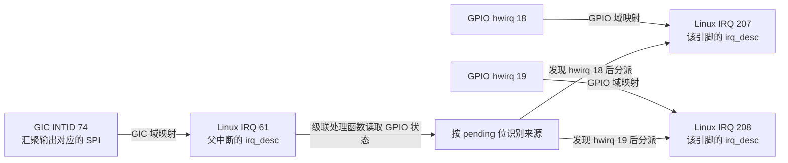
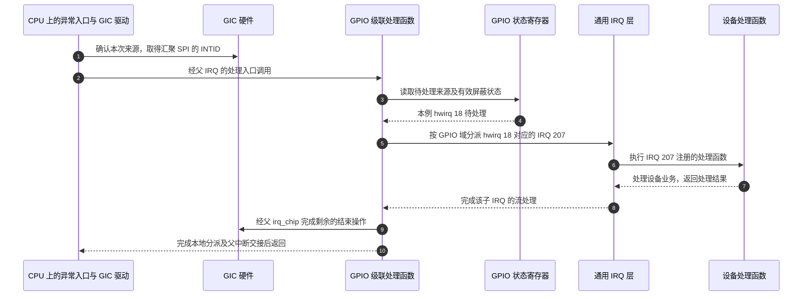
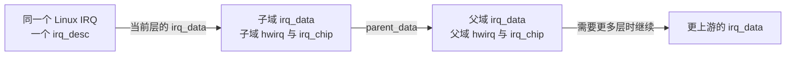

# 第9章\_层级中断控制器与\_ARM\_GIC\_在\_Linux\_中的实现

## 9.1\_同一根汇聚线为何需要两次来源识别

前面已经建立了 `irq_chip`、`irq_domain`、`irq_desc` 的基本分工，也讨论过 GPIO 的触发语义。现在把这些对象放进一条具体链路：外部器件接到 GPIO 引脚，GPIO 控制器把若干引脚的中断汇聚后送入 GIC，最后由 CPU 执行设备驱动的处理函数。

这时有两个容易混在一起的问题：硬件经过了几级控制器，Linux 是否就必须建立同样的 `irq_domain.parent` 链？设备驱动取得的 Linux IRQ 号，又是不是由最靠近 CPU 的 GIC 分配？本章沿着“建立映射”和“中断到达”两条过程回答这两个问题，然后回到 DTS、触发配置和排障。

本章区分三种关系：

- **硬件连接关系：** 哪个输入发生事件，哪个控制器产生输出，输出接到下一层的哪一路输入。
- **固件描述关系：** DTS 的中断描述由哪个控制器 binding 解释；这套描述告诉驱动如何建立资源关系。
- **Linux 软件关系：** 控制器可以通过级联处理函数重新识别来源，也可以使用 hierarchical irq_domain，把同一 Linux IRQ 在多层控制器上的资源组织起来。

前两种关系不能单独证明第三种具体采用了什么实现。本章先完整建立 GPIO 汇聚中断的级联模型，再与 hierarchical irq_domain 对照；MSI、虚拟化和电源管理的专门问题留给后续章节。

阅读本章涉及的硬件契约时，从[资料索引](../../../../../reference/external_resources/arm/README.md#1.4_版本选择与阅读顺序)选择对应版本：NXP i.MX 6UltraLite（i.MX6ULL，片上系统产品型号）主要对照 ARMv7-A 与 GICv2；Rockchip RK3588 实际集成 GIC-600 r1p6，实现 GICv3.0，型号证据见[手册核对表](../../../../../reference/external_resources/arm/README.md#1.4.2_型号判断的证据与适用边界)。GIC（Generic Interrupt Controller，通用中断控制器）是硬件；`irq_chip`、`irq_domain`、`irq_desc` 及其驱动是 Linux 软件对象，Linux IRQ 号也属于软件编号空间。

控制器自身的角色、状态与编程从 [GICv3 独立专题](../../../../../platforms/arm/architecture/gic/大纲.md#1.2_因果阅读地图)从零建立，再由[软件交接章节](../../../../../platforms/arm/architecture/gic/P16_软件交接_部署与分层排障.md#16.2_固件_控制器驱动与设备驱动怎样交接)回到本章。这里讲解 Linux 6.12 官方文档所描述的通用机制，不把某棵厂商源码树中的函数调用顺序当作所有平台的固定流程。

------

## 9.2\_多个引脚共用一条输出\_谁还记得原始来源

先暂时不看 Linux 的结构体。假设两个外部器件都要通知处理器，而 GPIO 控制器只向 GIC 提供一条汇聚输出。汇聚减少了向上连接的线路，但也隐藏了“两个器件中究竟是谁”的区别。要知道软件必须补什么，先沿硬件看清这份来源信息在哪里仍然存在。

### 9.2.1\_分层中断的典型硬件形态

SoC 内部外设可以直接连到 GIC；外部器件则常通过 GPIO 或其他中断控制器进入系统。先固定后一种场景：GPIO 的多个引脚共享一个汇聚输出，只要某个已使能来源待处理，控制器就可以让这条输出有效。GIC 看到的是汇聚输出对应的一个 **共享外设中断（Shared Peripheral Interrupt，SPI）**，这是 GIC 的硬件中断类别，并不表示 Linux 处理函数使用了共享 IRQ；GIC 仍不知道究竟哪个 GPIO 引脚触发了。

有的芯片在 GPIO 和 GIC 之间还加入中断复用或电源管理控制器；是否存在这些模块、怎样连接，要以该芯片资料为准。下面只画这些位置关系，不宣称每块 ARM SoC 都具备全部层次。


图中的设备是实际硬件，不是设备树节点；箭头是请求传播关系，不是 Linux 函数调用。没有中间控制器时，GPIO 输出可以直接接入 GIC。

### 9.2.2\_Linux\_要解决的核心矛盾

假设 GPIO 的第 18、19 号引脚共用一个输出。只根据 GIC 返回的 INTID，CPU 无法判断应该调用哪一个设备驱动。因此 Linux 需要保留 GPIO 控制器的本地编号空间，让 GPIO 驱动读取自己的 pending 状态，再把具体引脚对应的中断交给通用 IRQ 层。下文的 `hwirq` 指控制器域内的硬件局部编号；只有把它与所属域放在一起，才足以确定软件正在引用哪个来源。

这同时带来三个要求：

1. **编号可以独立。** GPIO 的 hwirq 18 和 GIC 的 INTID 18 不表示同一个来源；不同 GPIO 控制器也可以各有自己的 hwirq 18。Linux 用“域 + hwirq”确定映射，用系统范围的 Linux IRQ 号引用对应 `irq_desc`。
2. **配置必须落到实际拥有能力的硬件。** GPIO 可以配置自己的输入边沿、屏蔽和状态清除；GIC 可以配置其 SPI 的触发方式、屏蔽与目标路由。不能因为 GIC 靠近 CPU，就认为只有 GIC 才能屏蔽中断。
3. **设备驱动得到稳定的软件入口。** 消费中断的驱动通过 `platform_get_irq()` 等接口取得 Linux IRQ 号，再注册处理函数。控制器连接和域映射由提供这些资源的驱动与 IRQ 框架建立。

`irq_domain` 的作用是在控制器局部 hwirq 与 Linux IRQ 号之间维护映射，并支持解析固件提供的中断描述。它既服务于多控制器系统，也可以用于单控制器系统；“存在 irq_domain”不等于“启用了域层级”。可对照 Linux 6.12 [irq_domain 文档的开头与 irq_domain usage](https://docs.kernel.org/6.12/core-api/irq/irq-domain.html#irq-domain-usage)，确认编号分配和映射分别承担什么职责。

### 9.2.3\_缺少一层处理会带来的后果

对于刚才的 GPIO 汇聚模型，即使 GIC 已经可以递送这个 SPI，仍需要 GPIO 的状态读取、来源分派和本地控制。如果缺少这些步骤，GIC 只能报告“这一组中断来了”，无法替软件恢复已经汇聚掉的引脚身份。

不同阶段的失败要分开观察：

- GPIO 的中断域尚未就绪时，消费者获取 IRQ 可能失败或延迟探测；这发生在注册处理函数以前。
- 域和 IRQ 已经存在，但 GPIO 输出或 GIC 输入仍被屏蔽时，注册成功也可能收不到事件。
- 汇聚处理函数已经运行，却没有读出正确的 pending 位或分派到对应映射时，父级路径有活动，设备处理函数仍可能不执行。
- 各层确认、解除条件或重新使能不完整时，可能只来一次，也可能重复触发；现象本身不能唯一确定是哪一层出错。

所以，`request_irq()` 成功证明的是处理函数注册成功，不能证明物理连线、触发类型和整个递送路径都正确。下面先把各层的软件职责固定下来，再讨论如何用观察结果缩小范围。

------

## 9.3\_为每个来源保留软件身份\_域与描述符怎样分工

GPIO 的状态位保存“哪个引脚发生过事件”，却没有保存设备驱动函数的地址。Linux 必须建立从本地来源到处理入口的联系，而且不能把两个控制器里同名的编号混在一起。下面沿这项需要组织软件对象：先明确控制器之间是哪一种“父”关系，再说明编号、状态和硬件操作分别由谁保存。

### 9.3.1\_GIC\_作为主控制器时的域与上游关系

在常见的 ARM 系统中，GIC 负责把可递送的中断通知处理器，其 Linux 驱动建立对应的中断域和硬件操作回调，并接入处理器中断入口。这说明 GIC 在该系统中的位置，不等于“所有控制器的 `irq_domain.parent` 都必须直接指向 GIC”。

先区分三个用法相近的“父”：

| 所说的关系 | 它回答的问题 | GPIO 汇聚示例 |
| --- | --- | --- |
| 硬件上游控制器 | GPIO 的输出接到谁的输入？ | 可以是 GIC，也可以先经过中间控制器 |
| DTS 的 interrupt-parent | 当前中断描述按谁的 binding 解释？ | GPIO 输出的描述由接收它的控制器解释 |
| irq_domain.parent | 是否建立了 Linux hierarchical irq_domain 的父域关系？ | 由驱动采用的域模型决定，不能从前两项直接推出 |

当 GIC 域没有父域时，可以称它是该软件层级的根域。一个普通级联 GPIO 域即使没有 `irq_domain.parent`，也仍然可以通过父 IRQ 的处理函数接收到事件。因此，“没有 domain parent”不能单独用来判断 GPIO 路径断开。若存在中间层，软件父域关系也应依据该层实现建立，不能绕过中间层统一指向 GIC。

“GIC”这个产品家族名称本身也不保证处于最上游。例如 Linux 的 [GICv1/v2 binding](https://github.com/torvalds/linux/blob/v6.12/Documentation/devicetree/bindings/interrupt-controller/arm%2Cgic.yaml)明确区分直接连接 CPU 的 primary GIC 与级联到上游控制器的 secondary GIC。本章后续示例固定使用主 GIC，不能把这个条件省略后推广成架构定律。

### 9.3.2\_GIC\_硬件与驱动分别做什么

对这里的 SPI 路径，GIC 硬件识别自己的 INTID，维护该中断的使能、pending、active、优先级和路由等状态。Linux 的 GIC 驱动通过寄存器操作这些硬件，并向通用 IRQ 层提供相应回调；处理中断时，还要按所用 GIC 版本和模式完成确认、优先级下降与停用等交接。

**Linux IRQ 号由 Linux IRQ 核心及域分配机制管理，硬件 GIC 不认识这个编号。** GIC 驱动参与建立自己域内的映射或层级资源，但它不是所有 GPIO 子中断的最终编号分配者。后文的级联示例中，GPIO 引脚的 Linux IRQ 与 GIC 汇聚 SPI 的 Linux IRQ 是不同的。

GIC 也有自己输入端的触发配置。它可以把 GPIO 的汇聚输出当作高电平有效 SPI 处理，而 GPIO 同时把某个输入配置成下降沿触发。两者描述的是两段不同的信号，完全可以同时成立。GIC 无法仅凭汇聚输出，替 GPIO 决定原始引脚的触发方式、清除 GPIO 内部状态或完成外设业务。

### 9.3.3\_为什么子控制器要有自己的\_irq\_domain

回到两个引脚共用一个汇聚输出的例子。GPIO 驱动读取状态寄存器后，得到的是“本控制器 hwirq 18 待处理”。它还需要查到该来源对应的 Linux IRQ，才能调用通用 IRQ 层，最终进入消费者注册的处理函数。这就是本地映射的直接用途。

在内存中，这些角色分别承担：

- `irq_domain` 保存或组织本域的 hwirq 与 Linux IRQ 的对应关系；映射建立后，中断到达路径可以反查。
- `irq_desc` 保存一个 Linux IRQ 的软件状态、流处理入口和已注册的处理函数等信息。
- `irq_data` 关联当前 IRQ 在某一控制层的 domain、hwirq 和 `irq_chip`；`irq_chip` 回调负责操作这一层的硬件。

GPIO 驱动创建域，是为了让自己的来源能够被查找、配置和分派。DTS 中声明 `interrupt-controller` 只是固件描述的一部分，不会自行创建这些软件对象；反过来，Linux 中断域也不只服务于设备树。此处的对象关系可对照 [generic IRQ 文档的 Interrupt control flow](https://docs.kernel.org/6.12/core-api/genericirq.html#interrupt-control-flow)和 [irq_domain usage](https://docs.kernel.org/6.12/core-api/irq/irq-domain.html#irq-domain-usage)。

### 9.3.4\_GIC\_与子控制器的典型\_DTS\_关系

一个 GPIO 控制器可以同时具有两种身份：向下提供 GPIO 引脚中断，向上消费一条汇聚中断。前一种身份需要 `interrupt-controller` 和 `#interrupt-cells`；后一种身份需要描述输出接到上游哪一路，不能只写一个 `interrupt-parent` 就认为连线已经完整。

例如，当 GPIO 的 binding 规定两格中断描述时，消费者的 `<18 IRQ_TYPE_EDGE_FALLING>` 表示 GPIO 本地编号 18 及下降沿。GPIO 自己的 `interrupts` 则按它的上游控制器 binding 编码，可能是 GIC 的三格 SPI 描述。这两份描述不能当作同一数组逐层原样传递。

设备树中的中断父关系还可以使用继承、`interrupts-extended` 或中断映射节点表达；并非每个节点都必须显式写同一种属性。可对照 [Devicetree Specification §2.4 Interrupts and Interrupt Mapping](https://devicetree-specification.readthedocs.io/en/stable/devicetree-basics.html#interrupts-and-interrupt-mapping)，区分提供者、描述格式与父关系。

### 9.3.5\_把硬件连接与软件映射分开看

下面继续使用 GPIO 汇聚模型。Linux IRQ 61、207、208 仅为示意分配结果，不是任何开发板的固定值；GPIO 域的两个局部来源可以共享 GIC 上的一个父中断。



上面的前两类箭头分别表示映射关系和运行时分派，不表示 GPIO 18 被逐层“改号”为 GIC 74。GPIO 状态寄存器保存本地待处理来源，软件映射把这个来源交给正确的 `irq_desc`；GIC 始终只处理汇聚输出在自己这一层的状态。

------

## 9.4\_从设备树到处理函数\_走完一次GPIO级联

现在已经知道 GPIO 18、GIC INTID 74 和 Linux IRQ 207 可以分别描述同一路事件的不同位置。接下来把它们放在同一次启动和同一次事件里：启动时建立来源与软件入口的关系，事件到来后只沿已建立的关系查找和分派。设备树负责提供配置描述，不是在每次中断发生时重新解析的程序。

### 9.4.1\_典型三层拓扑的\_DTS\_表达

下面把关系写成裁剪的 DTS 片段。假设现有 `gic`、`gpio1` 和 `key0` 节点已经按目标平台 binding 定义；此处省略 `compatible`、地址、时钟等其他属性。SPI 编号 42 是教学假设，不能直接复制到板级配置中；GIC 的这一 SPI 编码对应 INTID 74。

代码中的 `GIC_SPI` 是 `arm-gic.h` 定义的中断类别宏，`IRQ_TYPE_LEVEL_HIGH` 和 `IRQ_TYPE_EDGE_FALLING` 是 `irq.h` 定义的触发类型宏，分别表示高电平有效和下降沿。这些宏在设备树构建时展开为 binding 规定的数值，属于描述格式，不是运行时函数调用。

```dts
#include <dt-bindings/interrupt-controller/arm-gic.h>
#include <dt-bindings/interrupt-controller/irq.h>

&gic {
    interrupt-controller;
    #interrupt-cells = <3>;
};

&gpio1 {
    /* 向消费者提供本控制器的引脚中断。 */
    interrupt-controller;
    #interrupt-cells = <2>;

    /* 本例只有一条汇聚输出，接到 GIC 的 SPI 42。 */
    interrupt-parent = <&gic>;
    interrupts = <GIC_SPI 42 IRQ_TYPE_LEVEL_HIGH>;
};

&key0 {
    /* 描述按 GPIO 控制器的 binding 解释。 */
    interrupt-parent = <&gpio1>;
    interrupts = <18 IRQ_TYPE_EDGE_FALLING>;
};
```

把两份 `interrupts` 分开读，每一格都由它的父中断控制器解释：

| 描述位于哪个节点 | 格的位置与值 | 由谁解释、表示什么 |
| --- | --- | --- |
| `gpio1` 的 `interrupts` | 第一格 `GIC_SPI`，展开为 0 | GIC 的绑定把 0 解释为 SPI 类别，不能当作 INTID 0 |
| `gpio1` 的 `interrupts` | 第二格 42 | 是 SPI 类别内的相对编号；普通 SPI 从 INTID 32 开始，所以本例的硬件编号是 `32 + 42 = 74`，不是 INTID 42 |
| `gpio1` 的 `interrupts` | 第三格 `IRQ_TYPE_LEVEL_HIGH`，展开为 4 | 配置 GIC 这一层的输入为高电平触发，即 GPIO 汇聚输出怎样被 GIC 识别 |
| `key0` 的 `interrupts` | 第一格 18 | 按本例 GPIO 控制器的绑定选择本地引脚中断 18；它不与 GIC 的 32 相加 |
| `key0` 的 `interrupts` | 第二格 `IRQ_TYPE_EDGE_FALLING`，展开为 2 | 配置 GPIO 这一层识别该引脚的下降沿，不要求 GIC 的汇聚输入也使用下降沿 |

因此这里有两个独立的输入配置：GPIO 识别引脚 18 的下降沿；GIC 识别 GPIO 汇聚输出的高电平。具体芯片可能有多个汇聚输出，也可能经过另一控制器；此时应按实际 binding 填写对应资源，不能拿本例的一条 SPI 代替全部连接。

> 表中 GIC 格式与宏值按 NXP 官方 Linux 6.12.20 固定提交 `dfaf2136deb2af2e60b994421281ba42f1c087e0` 的 [GICv3 绑定](https://github.com/nxp-imx/linux-imx/blob/dfaf2136deb2af2e60b994421281ba42f1c087e0/Documentation/devicetree/bindings/interrupt-controller/arm%2Cgic-v3.yaml)、同目录的 `arm,gic.yaml`，以及 `include/dt-bindings/interrupt-controller/arm-gic.h`、`irq.h` 整理。这里只使用普通 SPI 的三格格式；GPIO 的两格描述仍是本例已声明的绑定前提，不据此推广到所有 GPIO 控制器。

读完这段 DTS，可以确认谁提供中断描述、哪条输出连到哪里，但还不能确认 GPIO 驱动采用普通级联还是 hierarchical irq_domain。后一判断需要继续检查驱动建立的对象和处理路径。

### 9.4.2\_初始化映射与运行时分派

先看初始化阶段。GPIO 控制器驱动取得自身的父 IRQ，建立本地 irq_domain，并安装能够读取和分派 GPIO 来源的父中断处理入口。设备驱动随后通过 `platform_get_irq()` 获取 key0 的中断；在相应 OF 解析路径中，`interrupt-parent` 将这份 `<18 IRQ_TYPE_EDGE_FALLING>` 定位到 GPIO 域。

GPIO 域解释本地编号和触发信息，由 IRQ 框架建立或找到 hwirq 18 对应的 Linux IRQ。本例假设返回 207，设备驱动便在 IRQ 207 上注册处理函数。父汇聚中断所用 IRQ 61 是 GPIO 控制器自身的资源，不需要为每个引脚重新创建一次，也不会作为 key0 的 IRQ 返回。

再看事件到达阶段：

1. 引脚 18 出现所配置的下降沿，GPIO 硬件锁存相应状态，并在满足使能条件时使汇聚输出有效。
2. GIC 对应 SPI 成为可递送中断，处理器进入异常入口；GIC 驱动确认来源，进入该父 IRQ 的处理路径。
3. GPIO 级联处理函数读取本地 pending 与屏蔽状态，识别待服务的引脚。
4. 处理函数通过 GPIO 域查找并分派 hwirq 18 对应的 IRQ 207，通用 IRQ 层调用设备处理函数。
5. GPIO、GIC 和设备各自的状态由负责该层的驱动按硬件规则处理，必要的屏蔽、确认与重新使能由相应 IRQ 流程协调。

这是“父中断到来后，再查明子来源”的解复用。普通级联可以使用 chained handler；需要睡眠总线访问的片外控制器也可能使用线程化处理。不同实现的执行上下文不能互换，参见 Linux 6.12 [GPIO Driver Interface 的 Cascaded GPIO irqchips](https://docs.kernel.org/6.12/driver-api/gpio/driver.html#cascaded-gpio-irqchips)。

### 9.4.3\_各层的职责划分

同一个事件在不同层留下不同状态，不能用一句“清中断”代替全部动作：

| 层次 | 拥有的状态与配置 | 软件怎样参与 |
| --- | --- | --- |
| 外设或按键输入 | 外设业务状态、引脚实际电平或边沿 | 设备驱动处理业务；需要解除外设条件时按外设规则执行 |
| GPIO 控制器 | 引脚触发类型、本地屏蔽、pending、可选消抖 | GPIO irqchip 驱动配置并识别来源，执行本地确认与分派 |
| GIC | 汇聚 SPI 的触发类型、使能、pending、active、路由 | GIC 驱动完成该层控制与处理器侧交接 |
| 通用 IRQ 层 | 各 Linux IRQ 的 irq_desc、处理流程、注册的 action | 组织流处理和设备回调，不替外设定义状态寄存器语义 |

GPIO 的 hwirq 18 被屏蔽时，同组 hwirq 19 仍可能通过汇聚输出上报；屏蔽 GIC 的这个 SPI，则可能暂时挡住整组来源。这解释了为什么“屏蔽在哪一层”会改变影响范围。

### 9.4.4\_不正确挂接方式的后果

若设备真实接在 GPIO 18，却把设备节点写成直接使用 GIC SPI，软件可能取得一个语法上有效但语义错误的 IRQ。GPIO 的输入检测和本地分派没有因此建立，注册成功不能纠正这条错误描述。

若 GPIO 的域尚未注册，消费者通常在获取 IRQ 时就无法完成映射；具体返回值与日志依平台路径而异，可能需要等待依赖控制器就绪。不能把这种初始化失败描述成“已经正常申请，只是运行时不触发”。

若触发类型不受支持，控制器驱动可能在设置时返回错误；若错误配置已经写入或被错误忽略，也可能表现为丢事件、持续触发或只处理一次。应检查设置结果和实际硬件状态，不能凭单一症状断言 GIC 收到了什么。

### 9.4.5\_可视化的级联处理路径

下面画的是 CPU 执行软件处理的先后关系。硬件产生事件已经在图前发生；具体 ack、mask、EOI 的顺序由控制器协议和所选流处理方式决定，图中只固定来源识别与分派关系。



步骤 3、4 是汇聚模型必须补上的来源识别，步骤 5 才进入设备的 Linux IRQ。步骤 9 表示级联处理路径通过父 irq_chip 回调完成所需交接，不表示所有 GIC 模式都把优先级下降推迟到最后；某些模式会在入口较早下降优先级、稍后停用中断，必须以实际 GIC 驱动为准。

------

## 9.5\_何时把多个irq\_data串在同一个IRQ上

刚才的 GPIO 18 和 19 在硬件上先汇聚，软件必须在父中断到来后再次识别来源，所以分别保留了父 IRQ 和各个子 IRQ。若换成另一种硬件连接：每条子来源都拥有可确定的上游资源，这次“从一根线重新拆出多个来源”的工作就不再是相同的问题。此时要组织的是同一条中断在不同控制器上的资源，Linux 因而可以使用另一种对象关系。

### 9.5.1\_级联映射与层级域共享一个\_IRQ\_的区别

刚才的级联模型需要先处理父汇聚 IRQ，再分派不同的 GPIO IRQ。现在换一个约束：如果每个子来源都有可以确定的上游资源，不需要读一个共享状态寄存器来判定是哪个来源，Linux 可以用 **层级中断域（hierarchical irq_domain）** 组织同一条中断跨控制器的资源。

在这种模型中，`irq_domain.parent` 表示软件父域，`irq_data.parent_data` 把同一个 Linux IRQ 在各层的描述连起来。每层的 `irq_data` 保留本层 domain、hwirq 和 irq_chip，Linux IRQ 号与对应的 `irq_desc` 则由这条中断共享。子域分配回调可以请求父域分配所需资源，而不是让父域重新分配一个“更最终”的 Linux IRQ 号。



这张图表示内存对象关系，不能拿来代替上一节的运行时解复用时序。尤其不能把“GPIO 多个引脚共用一个父 SPI”的例子，解释成多个独立引脚的 IRQ 都在同一份父 hwirq 上形成普通的一对一层级映射。

| 比较项 | GPIO 汇聚的普通级联模型 | hierarchical irq_domain 模型 |
| --- | --- | --- |
| 如何确定最终来源 | 父事件后读取下级状态，再分派子 IRQ | 同一 IRQ 的资源已在各层关联；具体递送由驱动实现 |
| Linux IRQ 关系 | 汇聚父 IRQ 与各子 IRQ 可以各有 irq_desc | 同一条中断在多层关联多个 irq_data |
| 是否必有 domain.parent | 不要求以它表达级联 | 通过它组织域层级 |
| 是否由 GIC 统一“发号” | 否 | 否；IRQ 核心与各域分配回调协作 |

Linux 6.12 [Hierarchy IRQ domain](https://docs.kernel.org/6.12/core-api/irq/irq-domain.html#hierarchy-irq-domain)说明 `parent`、`parent_data` 和层级资源分配；[GPIO drivers providing IRQs](https://docs.kernel.org/6.12/driver-api/gpio/driver.html#gpio-drivers-providing-irqs)则给出了汇聚式与每线独立上游连接的 GPIO 对照。两者结合后，才能判断一幅硬件图应怎样映射到软件。

### 9.5.2\_irq\_domain\_ops\_在层级结构里的真实作用

`irq_domain_ops` 是域驱动提供的操作集合。它可以负责把固件中断描述译成本地 hwirq 与类型，也可以负责建立映射、分配或释放本层资源；不同域模型使用的回调不完全相同。

普通映射常见 `.map`、`.unmap` 与相应翻译回调。层级域使用 `.alloc`、`.free`，可以另外实现激活和停用回调，并在需要时申请或释放父域资源。不能把所有控制器都想象成依次对同一份 DTS cells 执行 `map`，直到 GIC 才产生 virq。

同样，**pending 清除和每次中断的硬件确认不属于“翻译 DTS”这一动作**。这些运行时操作通常由 `irq_chip` 回调及对应流处理函数组织。把 `irq_domain_ops` 和 `irq_chip` 的职责分开，才能解释为什么映射已经建立，运行时仍可能因确认或屏蔽逻辑出错。

### 9.5.3\_触发类型应该在哪一层处理

用 9.4 的例子重新判断：设备到 GPIO 18 是下降沿；GPIO 的汇聚输出到 GIC 是高电平。前者让 GPIO 锁存一个本地事件，后者让 GIC 在汇聚状态仍有效时继续识别请求。两端都配置正确，整条路径才有明确含义。

因此应逐段核对，而不是规定“类型只在最下层处理，GIC 只做 CPU 相关的事”：

1. 找出当前 flags 描述的是哪段输入信号，以及由哪个 binding 定义。
2. 找出该控制器的触发能力和设置回调，确认支持这项请求。
3. 若驱动还必须配置父级输入，按硬件连接生成父级的类型或调用父级操作；这可能需要转换，不能假定与原 flags 相同。
4. 对照每层状态清除规则，确认一次处理后能接收下一次事件。

层级驱动可以有意委托父 irq_chip 设置类型，通用 IRQ 接口也提供父级辅助操作；是否委托、传什么值取决于硬件与驱动契约。GPIO 本地 pending 清除、GIC 的 EOI/Deactivate、外设解除请求条件仍然是不同动作，任何一个都不能自动代替另外两个。

### 9.5.4\_与\_devm\_request\_irq\_的关系

`platform_get_irq()` 取得可供消费者使用的 Linux IRQ；`devm_request_irq()` 在这个 IRQ 上注册设备处理函数，同时把这次注册的释放动作交给设备资源管理。驱动解绑或 probe 后续失败清理时，这项资源会按规则释放，不必等到 `struct device` 对象销毁。

这里有三种不同的寿命：

- 处理函数注册：由消费驱动申请，`free_irq()` 或对应 devm 清理解除。
- IRQ 映射与层级资源：由创建、分配它们的框架和驱动按其所有权管理。
- 控制器 irq_domain：通常服务多个消费者，由控制器提供者维护。

所以释放一个消费者的处理函数，不等于拆掉整个 GPIO/GIC 域，也不能据此推断全部父域资源都已经释放。devm 适合绑定到设备驱动生命周期的注册；若业务需要更早停用或释放，仍要按 API 契约显式安排。可对照 [Devres §2](https://docs.kernel.org/6.12/driver-api/driver-model/devres.html#devres)的解绑与失败清理边界。

------

## 9.6\_沿已经证实的阶段排障

两种软件模型建立以后，排障就不能只问“GIC 是否正常”。以 GPIO 18 为例，获取 IRQ 失败、取得 207 后注册失败，以及注册成功但没有运行回调，发生在三个不同阶段。先保存返回值和一次受控事件前后的观察，再找最后一个已证实经过的阶段；下面的检查顺序服务于这个判断。

### 9.6.1\_典型症状分组

多级中断常见的观察包括：获取 IRQ 就失败、注册成功却不触发、只触发一次、持续重复触发，以及计数增加但预期的设备逻辑未执行。它们只是定位入口，不与某个根因一一对应。

先记录本次使用的内核版本、实际加载的设备树二进制文件（Device Tree Blob，DTB）、目标设备以及 IRQ 号。再判断失败发生在资源解析、处理函数注册还是事件递送阶段。这样可以避免把 probe 时的依赖未就绪，与运行时的硬件电平未解除混在一起。

### 9.6.2\_第一层排查\_看\_DTS\_的连接是否闭合

沿设备真实的输入逐段核对：

- 设备的中断描述是否交给正确的提供者解释，编号与触发 flags 是否符合该提供者 binding。
- GPIO 等中间控制器是否声明了中断提供能力，并描述其实际使用的上游输出资源。
- 中间还有没有中断复用器、电源管理控制器或片外器件，是否被错误跳过。
- 显式 `interrupt-parent`、继承关系、`interrupts-extended` 或中断映射节点最终是否解析到预期提供者。

根控制器可以没有上游中断资源，不能要求每个 `interrupt-controller` 节点都再提供一个 parent。也不能只检查源 DTS 文件：构建、引导和运行中的设备树可能并不是同一份。

### 9.6.3\_第二层排查\_看控制器驱动是否创建了\_irq\_domain

检查控制器驱动是否匹配并初始化成功，是否取得时钟、复位、寄存器和父 IRQ 等必要资源，再看消费者获取 IRQ 的实际返回值。依赖域尚未就绪时可能发生 probe defer，应保留错误码和对应日志继续追踪。

**没有打印“created irq domain”不能证明域不存在。** 内核没有要求所有控制器输出统一的成功日志。可用已有的动态调试、跟踪或启用 `CONFIG_GENERIC_IRQ_DEBUGFS` 后的 IRQ 调试信息观察映射和域；具体可用项取决于内核配置。方法依据见 [irq_domain 文档 Debugging](https://docs.kernel.org/6.12/core-api/irq/irq-domain.html#debugging)。

若需要读驱动，先判断它使用级联处理还是层级域，再核对相应初始化。不能在普通级联驱动中只搜索 `domain->parent`，找不到就认定未连接。

### 9.6.4\_第三层排查\_看\_/proc/interrupts\_的计数

先读取一次 `/proc/interrupts`，触发一次可控事件，再读取并比较目标 IRQ 的变化；同时记录该行的处理函数名称与 irqchip 信息，不只根据一个“GIC”字符串判断来源。

若目标计数增加，说明内核对应计数点确实经过，但还需要确认设备处理函数是否识别到自己的事件、是否完成业务处理。计数增加本身不证明设备的 **先进先出缓冲（First In First Out，FIFO）** 已读完或设备请求已解除。

若父级路径有活动而目标 IRQ 不增加，可以继续检查 GPIO 状态读取和子来源分派。普通 chained 父 IRQ 不一定表现为与设备 IRQ 相同的可见 action 行或计数方式，因此不能要求每级都在 `/proc/interrupts` 中增加一行。必要时跟踪级联入口和分派点，不能把“看不到父行”当成父事件未到达的证据。

若计数完全不变，依次检查源端是否产生事件、引脚复用、GPIO pending 与使能、汇聚输出、GIC 路由与使能以及软件分派；不要直接归因于某一个 DTS 属性。

### 9.6.5\_第四层排查\_看触发与确认在各层是否生效

对于“只来一次”或“持续触发”，重点追踪一次完整周期：

- 外设是否仍维持有效请求，设备驱动是否按协议取走数据或解除条件。
- GPIO 输入是否支持所选类型，设置是否成功，本地状态怎样确认，屏蔽后是否按流程恢复。
- 汇聚输出实际采用什么极性和触发语义，GIC 的配置是否与之相符。
- 父 IRQ 的确认、优先级下降和停用是否按当前控制器模式完成。

设置类型可能发生在映射、IRQ 注册或明确的配置调用中，不要求都在控制器 probe 时直接写寄存器。也不能只因为存在 `irq_set_type` 回调，就断言请求成功落到了硬件；还要核对返回结果和所走路径。

### 9.6.6\_建议的最小排查顺序

1. 根据原理图与 SoC 手册画出实际连接，标出每段信号与每层局部编号。
2. 检查运行中的设备树及消费者取得 IRQ 的结果，区分错误、延迟探测与注册成功。
3. 确认控制器使用的级联或层级域模型，检查初始化与映射证据。
4. 触发一个事件，比较计数，必要时跟踪父入口、状态读取、子 IRQ 分派和设备处理函数。
5. 沿一次处理周期核对各层使能、触发、确认及解除条件，修复后重复同一事件。

跟踪高频中断时控制输出量；每次都打印可能改变时序甚至淹没日志。诊断应该回答“最后一个被证实经过的阶段是什么”，而不是先猜某层坏了再寻找相符现象。

------

## 9.7\_拿两份中断描述检验硬件与软件关系

回到 9.4 的设备树，暂时不看驱动代码。固定 GPIO 18、19 共用 GIC SPI 42，GPIO 域将两条来源映射到 Linux IRQ 207、208，GIC 域将 INTID 74 映射到父 IRQ 61。这里的 Linux 数字只是本次练习给定的分配结果。

先独立回答四个问题，再用下面的解释核对：

1. 如果设备的 `interrupt-parent` 从 gpio1 改为 gic，原来的 `<18 IRQ_TYPE_EDGE_FALLING>` 能否原样保留？
2. GPIO 18 与 SPI 42 的触发类型必须相同吗？
3. 只看到 `interrupt-controller`，是否就能确认 Linux 域已经存在？
4. 这几份 DTS 信息能否证明驱动采用 `irq_domain.parent` 链？

这四问分别检查格式、信号、软件就绪与实现模型，不能用一个“设备树正确”代替全部答案。

### 9.7.1\_提供中断与消费中断的属性要分开

先判断第三问。`interrupt-controller` 描述提供者的能力，创建 `irq_domain` 则是 Linux 控制器驱动的运行时动作。固件描述存在，只能让后续驱动有机会识别和建立资源，不能证明这段初始化已经成功执行。

对于按标准中断提供者方式描述的节点，`interrupt-controller` 表明它提供中断，`#interrupt-cells` 表明消费者的一份中断描述需要多少格。具体字段的意义仍由该控制器 binding 定义。

如果这个控制器还要消费上游中断，应另外描述相应父资源。根控制器不必为了凑齐“父节点”而增加虚构连接。节点本身的存在也不保证 Linux 驱动已经注册了域；描述、驱动支持和运行时就绪是三个条件。

### 9.7.2\_interrupt-parent\_的位置要对

第一问先要确定谁来解释描述，而不是先数数字。在本章 GPIO 示例中，设备的描述由 GPIO 提供者解释，GPIO 汇聚输出的描述由 GIC 解释。把提供者换成 GIC 后，格式和编号语义也随之变化；原来代表 GPIO 18 的值不会自动变成“经过 GPIO 18”的路径描述。若中间存在另一个控制器，就按实际连接描述那一层；**电源管理集成电路（Power Management Integrated Circuit，PMIC）** 的中断输出也可能先进入 GPIO，而非直接进入 GIC。

`interrupt-parent` 表达的是中断描述的父关系，不一定等于设备树的结构父节点，更不自动等于 `irq_domain.parent`。这也回答了第四问：必须继续核对驱动建立的对象与运行路径，不能仅凭 DTS 推出层级域。使用继承、`interrupts-extended` 或 `interrupt-map` 时，应按对应规则解析，不能机械检查每一行有没有 `interrupt-parent = <&gic>`。

### 9.7.3\_cells\_数量要和控制器\_binding\_一致

第一问还要通过格式检查。本章示例中的 GIC 描述使用三格，GPIO 使用两格；把 GPIO 的两格直接交给本例 GIC 提供者，连字段数量都不符合约定。它们分别描述各自输入，不能混用。具体 GIC binding 也可能允许额外描述项，GPIO binding 之间的格式同样可能不同，最终以目标节点的 binding 和驱动支持为准。

第二问的答案则来自信号位置：GPIO 18 检测器件产生的下降沿，SPI 42 检测 GPIO 汇聚输出维持的高电平。两段输入不同，触发类型不必相同；盲目把下降沿一路向上传递，反而可能丢掉汇聚输出仍然有效这一条件。

例如 Linux 6.12 的 [GICv3 binding](https://github.com/torvalds/linux/blob/v6.12/Documentation/devicetree/bindings/interrupt-controller/arm%2Cgic-v3.yaml)允许三格或四格，第四格用于 **私有外设中断（Private Peripheral Interrupt，PPI）** 的亲和性分区描述。PPI 对应处理器私有来源，与本例 GPIO 汇聚输出使用的 SPI 是不同类别；选择四格时，普通 SPI 的第四格填零。不能把本章三格示例作为所有 GIC 节点的格式检查规则。

字段数量或编号语义错误可能使解析或映射失败；即使恰好满足语法，也可能指向错误来源。检查时同时核对数量、每格含义、有效编号范围和触发 flags，不要只等一条固定措辞的报错日志。

### 9.7.4\_多控制器场景下的歧义

最后只改变提供者，检验前面的方法是否还能使用：保留本地编号 18，却把 gpio1 换成 gpio2。如果后者也有 18 号输入，语法检查和资源获取都可能成功，但监听的器件已经变了。

假设 gpio1 和 gpio2 都有本地编号 18，`<&gpio1 18 ...>` 与 `<&gpio2 18 ...>` 仍是不同来源。把节点写错，可能取得另一个有效 IRQ，而不是立即报错。

因此核对顺序应是“物理引脚属于哪个控制器 → 该控制器的本地编号 → 设备树中的提供者 → Linux 映射结果”。Linux IRQ 号可能随系统配置和分配过程变化，不能把另一次启动记住的数字反当作硬件身份。

------

## 9.8\_消费驱动怎样注册和退出\_明确片段的使用前提

至此已经能说明设备驱动为何只取得一个 Linux IRQ，而不自行重建 GPIO 到 GIC 的路径。它真正需要管理的是自己的处理函数、依赖的数据和设备请求条件。下面把获取、注册、处理与退出分别展开，代码均为嵌入实际设备驱动的裁剪片段；设备寄存器、对象分配和业务处理没有在本章假造，因此这些片段不是可直接装载的完整驱动。

沿一次正常绑定理解顺序：先准备处理函数会访问的对象和硬件访问条件，再取得 IRQ 并注册，最后按设备协议允许事件进入。处理函数注册成功后可能开始运行，不能把它依赖的数据初始化留到“等第一次中断时再说”。反向退出时先让设备停止产生后续请求，再解除注册并结束仍在执行的处理，最后才释放回调需要的对象。下面的普通注册和 devm 注册是两种资源管理选择，同一份注册不要同时用两套释放方式。

### 9.8.1\_获取\_IRQ

消费驱动通常不需要自己重建 GPIO 到 GIC 的链路。下面是 probe 中的裁剪片段，假定设备资源已经由固件及控制器驱动提供：

```c
int irq;

/* 取得本设备的第一个中断资源；保留错误码供调用方处理。 */
irq = platform_get_irq(pdev, 0);
if (irq < 0)
    return irq;
```

返回成功后，这个数字是 Linux IRQ 号，可用于注册处理函数。它不保证设备已经产生事件，也不保证该资源描述正确；返回失败时应保留错误信息，不能用猜测的 GIC INTID 或 GPIO pin 号替代。

### 9.8.2\_注册(非\_devm)

假定 `dev` 指向设备、`my_isr` 已实现，下面继续注册：

```c
/* 本例沿用已配置的触发类型，注册本设备的处理函数。 */
ret = request_irq(irq, my_isr, 0, dev_name(dev), dev);
if (ret)
    return ret;
```

与其配对的 `free_irq(irq, dev)` 应在解绑或后续初始化失败时按所有权调用，释放前先停止可能继续产生请求的设备活动，并确保处理函数依赖的数据仍然有效。这里展示的是注册片段，不是包含所有回滚分支的完整驱动。

flags 为 0 不表示硬件没有触发类型；它表示本次调用没有额外指定 `IRQF_TRIGGER_*`。如果确有动态配置需要，可以使用支持的接口设置类型，但必须与硬件、固件描述以及共享 IRQ 的约束一致，不能把改 flags 当作猜测连线的手段。

### 9.8.3\_注册(devm\_管理)

当注册寿命与设备驱动绑定一致时，可以使用：

```c
/* 把处理函数注册的释放动作交给设备资源管理。 */
ret = devm_request_irq(dev, irq, my_isr, 0, dev_name(dev), dev);
if (ret)
    return ret;
```

这会在驱动解绑或 probe 失败清理时释放对应注册。devm 不替设备停止 DMA、解除硬件请求，也不替开发者证明回调依赖对象的释放顺序；这些仍由驱动安排。它管理的是消费者的资源，不会因为一个设备解绑就销毁仍服务其他设备的中断域。

### 9.8.4\_ISR\_中要做的最少动作

GPIO 层确认了本地 pending，只说明该层完成了自己的协议。若 GPIO 连接的是有状态寄存器、FIFO 或电平请求的外设，设备处理函数仍须处理外设条件。下面只保留骨架，实际读取和解除方式必须来自该设备手册：

```c
static irqreturn_t my_isr(int irq, void *dev_id)
{
    /* 根据设备协议读取状态；共享 IRQ 时先确认是否属于本设备。 */
    /* 处理或保存必要数据，按协议解除设备请求条件。 */
    /* 需要时通知适合当前执行上下文的后续处理路径。 */
    return IRQ_HANDLED;
}
```

`IRQ_HANDLED` 是向 IRQ 框架报告处理结果，不是写 GPIO/GIC/外设寄存器的替代动作。共享 IRQ 中若判断本设备没有待处理来源，应按接口契约返回 `IRQ_NONE`。如果设备访问需要睡眠总线，应选择相应线程化接口，而不是把睡眠操作放进普通硬中断处理函数。

### 9.8.5\_注册失败与解绑沿相反方向收回什么

现在改变正常流程的一个条件：IRQ 已取得，但注册失败。此时没有成功注册的设备处理函数可供释放，驱动需要回收的是此前自己取得的资源；也不能因为手里有 IRQ 207，就把服务多个消费者的 GPIO 域一起销毁。若注册成功后后续初始化失败，才需要解除这份已成功注册的处理函数，并保证清理期间回调依赖的对象仍在。

对于普通 `request_irq()`，驱动在可等待的退出路径安排对应 `free_irq()`，不能在中断上下文调用它。释放会等待该 IRQ 正在执行的处理完成，因此不能在持有处理函数也需要的锁时等待它退出。如果处理函数另外提交了工作队列任务，IRQ 处理结束也不等于这些任务已经结束，驱动还要按它们自己的协议收回后续活动。对于 devm 注册，框架会在失败清理或解绑期间释放相应资源，但“设备已停止产生请求”和“对象释放顺序正确”仍需驱动自己证明。比如对象由驱动提前手工释放，而注册还留给稍后的 devm 清理，就可能留下访问已释放对象的窗口。

把不同寿命放回本例检查：GPIO 控制器可以继续服务 IRQ 208；IRQ 207 的消费者退出，只撤销自己拥有的注册及业务资源；GPIO 域和 GIC 域仍由它们的提供者维护。这样才不会为了卸载一个设备而切断整个汇聚组。需要提前解除 devm 注册时使用相应的设备资源接口，不再对同一资源另做一次普通释放。接口的等待与上下文约束见 Linux 6.12 [free_irq](https://docs.kernel.org/6.12/core-api/genericirq.html#c.free_irq)，资源寿命见 [Devres](https://docs.kernel.org/6.12/driver-api/driver-model/devres.html#devres)。

------

## 9.9\_改变一个条件\_判断故障会在哪一层出现

下面沿同一个 GPIO 18 → 汇聚 SPI → IRQ 207 场景改变条件。每次先判断故障发生在获取资源、递送事件、识别来源还是结束处理阶段，再阅读解释。上一节已经建立设备退出时的所有权边界；这里进一步检查，失败现象是否足以证明是哪一层出错。

### 9.9.1\_DTS\_写对了\_驱动照样没中断

假设设备 probe 中获取 IRQ 返回错误，而测试者尚未检查这个返回值，就开始按键并观察计数。此时首先缺少哪一项证据？先判断软件有没有进入“可以等待事件”的阶段。

一种可能是中断提供者尚未初始化，消费者获取 IRQ 失败或延迟探测。先检查返回值、依赖设备和域的实际存在情况，再检查所需驱动及配置；不能只看 DTS 已有 `interrupt-controller` 就断言软件链路完整。

另一种可能是获取和注册都成功，但源端没有事件、被屏蔽或分派错误。此时继续走运行时路径，不应把所有问题归为“没有创建 irq_domain”。

### 9.9.2\_触发一次后就不再进入

假设第一次事件确实进入了设备处理函数，但没有记录退出点，第二次事件又没有得到响应。仅凭这两次观察，能否断定“GIC 丢了第二次中断”？关键是第一次周期是否真正结束。

先区分系统确实卡死，还是只是该 IRQ 不再进入。后者可能来自本地 pending/ack 协议不完整、屏蔽后未恢复、外设没有重新产生有效边沿、父中断没有完成必要交接，或线程化处理尚未结束等原因。

记录第一次处理的入口与退出，再检查每层状态。不能一边说“ISR 只进一次”，一边把目标 IRQ 持续计数当作必然伴随现象；那是不同观察，需要分别追踪。

### 9.9.3\_一直触发

假设 IRQ 207 持续增加，而设备需要由软件解除的请求条件一直没有被清除。把 GIC 的整组 SPI 屏蔽后计数停止，是否就说明问题已经修好？先预测同组 GPIO 19 会受什么影响。

如果外设保持请求，或者 GPIO 汇聚输出没有解除，GIC 在结束当前处理后可能再次看到有效输入。也可能是触发类型不匹配、机械抖动或驱动没有处理真正来源。

应先确认是哪一层仍保持有效状态，再核对该层的类型和解除规则。仅在 GIC 上屏蔽整组来源可以暂时压住现象，却可能同时阻止其他设备，不能视为根因已经解决。

### 9.9.4\_多个中断控制器名字类似\_挂错了

假设获取 IRQ 和注册都成功，触发目标器件没有反应，操作另一个器件却进入回调。这里最有区分力的事实是“另一个器件可以触发”，它把怀疑从全局递送路径移向来源身份。

设备实际接在 gpio1，却声明从 gpio2 取得相同编号，可能仍然成功映射和注册，只是监听了另一来源。对照原理图、SoC 引脚归属、运行中的设备树与实际触发结果，逐项确认身份。

不要通过在驱动里硬编码一个“看起来正确”的 Linux IRQ 号绕过错误提供者。这会把一次启动中的分配结果当作永久硬件连接，并使后续配置变化更难解释。

### 9.9.5\_层级里混进了\_PMIC-IRQ

现在给 GPIO 18 前面再接一个 PMIC，其多个内部事件共用同一条输出。进入 IRQ 207 后还不知道 PMIC 的哪个事件待处理，是否又要增加一次来源识别？这次若读取状态必须睡眠，应在哪种上下文完成？

PMIC 可以把多个内部事件汇聚到一条输出，这条输出可能接到 GPIO，再由 GPIO 汇聚到 GIC。每个汇聚点都可能需要读取各自的状态，逐层恢复最终来源；如果访问 PMIC 必须经过 I2C 等可睡眠总线，还需要适合的线程上下文。

若 PMIC 提供者的域没有就绪，其消费者获取 IRQ 通常就会遇到失败或延迟探测，不能笼统写成“能申请不触发”。若申请成功，则继续核对 PMIC 输出、上游 GPIO 配置、线程处理以及各层分派，仍按相同的阶段方法定位。

------

## 9.10\_从来源识别走向多核目标选择

现在可以用同一条 GPIO 路径说明三个不同事实：硬件把多个来源汇聚成一条线，设备树描述各段连接和输入语义，Linux 驱动再选择级联解复用或层级域组织方式。不能只根据物理层数，就推断 `irq_domain.parent` 的结构。

普通级联中，父汇聚 IRQ 和设备子 IRQ 可以拥有不同的 Linux IRQ 号；hierarchical irq_domain 则让同一 Linux IRQ 在各层关联不同的 `irq_data` 和局部资源。两者都不要求由 GIC 统一分配所有设备的“最终 virq”，也都不能把原始触发 flags 无条件传到最上层。

排障时，从资源获取、注册和事件递送三个阶段收集证据，再沿每层的状态与交接查找缺口。`request_irq()` 成功、某个计数增加、没有成功日志，各自能证明的事情都有限；清楚这些边界，才能避免为了修一个引脚而误改整组中断。

下一章继续讨论 SMP 中中断可以送到哪些 CPU，以及亲和性和 IPI 怎样改变处理器之间的工作分配。

------

上一篇：[P08 中断 x 高精度定时器(hrtimer) 去抖 延时确认与一次性中断再使能](P08_中断_x_高精度定时器%28hrtimer%29_去抖_延时确认与一次性中断再使能.md)。
下一篇：[P10 SMP 与中断亲和性 IPI 机制](P10_SMP_与中断亲和性_IPI_机制.md)。
