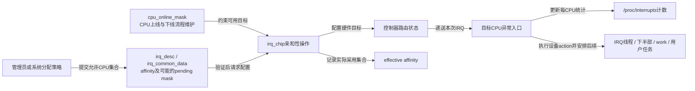
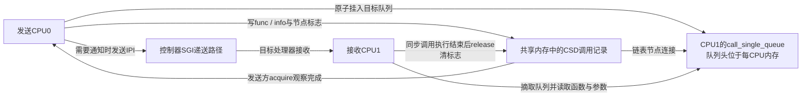
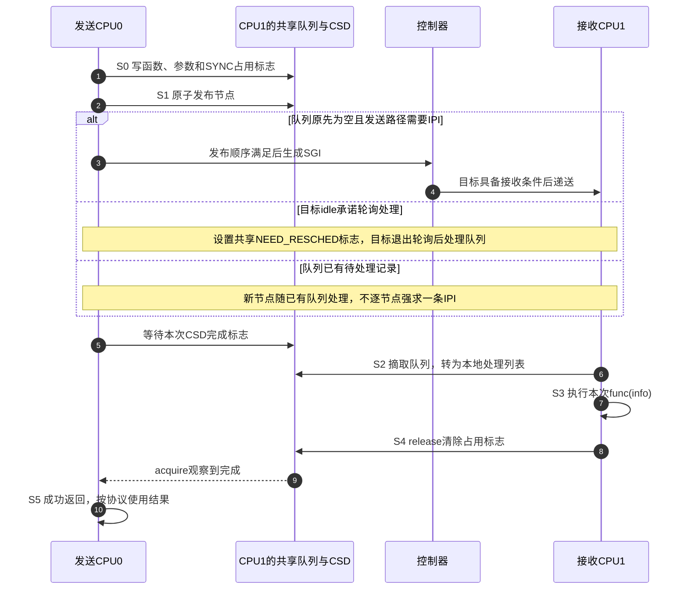

# 第10章\_SMP\_与中断亲和性\_IPI\_机制

上一章已经沿 GPIO 汇聚输出找到父控制器，并区分硬件级联、固件描述与 Linux IRQ 映射。现在假设这条链路能正常工作，系统又有四个在线 CPU：设备不断发来事件，CPU0 的中断计数增长很快，其他 CPU 却较空。改变 GPIO 编号不能把处理工作分出去，我们需要回答的是 **谁接收通知、谁消费数据、谁决定它们运行的位置**。

这属于对称多处理 **SMP（Symmetric Multiprocessing）** 的协作问题，系统模型见[多处理与缓存一致性](../../../../foundations/computer_architecture/cache_coherence/P01_缓存一致性问题与缓存行.md#1.1.1_SMP的中英文全称与系统模型)。本章先讨论外设 IRQ 的目标选择，再让一个 CPU 主动通知另一个 CPU，推导 **处理器间中断 IPI（Inter-Processor Interrupt）** 背后的工作状态。路由和通知都不是数据搬运，也不保证目标立刻执行。

Linux 机制按 6.12.20、NXP 固定提交核对，[证据记录](../../../../../research/source_reading/linux/SOURCE_BASELINE.md#1.189_中断亲和性与IPI工作状态)列出通用层、GICv3 驱动及 ARM/ARM64 分支。历史 i.MX6ULL 配置未启用 SMP，不能在那份单核配置上宣称验证了本章多核实验；下文实验需要另行确认目标系统确实有多个在线 CPU。GICv3 的硬件规则继续以[SPI 目标选择](../../../../../platforms/arm/architecture/gic/P11_SPI目标选择与每PE状态.md#11.2_怎样取得目标PE的硬件亲和坐标)和[SGI 核间通知](../../../../../platforms/arm/architecture/gic/P12_SGI核间通知与电源交接.md#12.1_核间中断传的是提醒_工作内容存在哪里)为依据，不把 Linux 掩码当成处理器硬件坐标。

## 10.1\_把入口分出去以前先看数据归谁处理

以一个接收队列为例：设备把完成记录写入队列，CPU0 的 IRQ 处理提示后续路径消费这些记录。队列的消费者索引、统计和锁常会被处理 CPU 反复访问。当所有活跃队列的通知都集中到 CPU0，它既处理大量入口，又承担一部分后续业务，留给普通任务的执行时间就会减少。其他 CPU 空闲并不能自动改变硬件路由。

不过，“下一次改送 CPU1”也有成本。如果队列的同一份消费者状态刚由 CPU0 修改，CPU1 接手时需要通过缓存一致性取得可用副本或修改权限；若两个处理路径共享同一把队列锁，增加接收 CPU 也不会让受该锁保护的消费步骤同时执行。**负载分散和数据本地性必须一起看**，不能只追求 `/proc/interrupts` 各列数字相等。

较自然的扩展是设备提供多份可独立消费的队列与中断向量：队列 A 交给 CPU0，队列 B 交给 CPU1，两边各自推进索引。代价是更多队列内存、向量和管理状态；若设备只有一个受保护的 FIFO，软件给允许掩码增加 CPU，并没有创造第二份 FIFO。网络的每秒包数和存储的每秒 I/O 操作数都只是负载指标，不能单独确定需要多少 IRQ 或 CPU。

硬件目标集合也不是“每个候选都处理同一次外设事件”。例如 GICv3 的 SPI，无论固定目标还是架构的 1-of-N 选择，本次交付只选一个接收者；它与向多个处理器各生成一份 SGI 不同。下面先研究 Linux 怎样表达允许集合，再核对驱动实际选择了谁。

## 10.2\_允许集合与实际目标是两份不同状态

**中断亲和性 IRQ affinity** 表示这条 IRQ 所允许使用的目标 CPU 集合。掩码中每一位对应 Linux 的逻辑 CPU 编号：十六进制 `1` 选择 CPU0，`3` 选择 CPU0 和 CPU1，`a` 选择 CPU1 和 CPU3。它不是优先级，也不是硬件亲和性字段的原样编码。

写入允许集合后，通用 IRQ 层还要检查这条 IRQ 能否迁移、是否由内核托管以及目标是否在线，再调用相应 irq_chip 的亲和性操作。某些控制器一次只能选择集合中的一个 CPU；有些迁移需要等安全时点完成。因此还需要 **effective affinity（实际生效的目标集合）**，以及运行后的各 CPU 处理计数。三者分别回答请求、当前执行配置和历史观察。



图 10-1：状态保存在不同位置。允许集合与 effective mask 是内核内存中的 IRQ 状态，路由配置在控制器接口中，各 CPU 统计记录发生过的处理。箭头到达 work 或用户任务并不意味着它们继承同一个硬件目标。

| 观察入口 | 内容 | 使用边界 |
| --- | --- | --- |
| `/proc/irq/N/smp_affinity` | 允许集合的十六进制掩码 | 有待处理迁移时可能显示 pending mask；不是广播命令 |
| `/proc/irq/N/smp_affinity_list` | 同一集合的 CPU 列表，如 `1,3`、`0-3` | 适合避免多字掩码的位号误算 |
| `/proc/irq/N/effective_affinity_list` | 驱动维护的实际目标列表 | 依赖相应内核配置与驱动支持，文件不存在不等于目标为空 |
| `/proc/irq/N/affinity_hint` | 驱动给策略程序的提示 | 提示本身不是已应用路由，也不强迫策略采用 |
| `/sys/devices/system/cpu/online` | 当前在线逻辑 CPU 列表 | 读取后仍可能改变；试验期间需固定热插拔条件 |
| `/proc/interrupts` | 各在线 CPU 的累计 IRQ 处理计数 | 看同一负载窗口的增量，不把过去的旧计数当作迁移失败 |
| `/proc/irq/default_smp_affinity` | 新 IRQ 分配时使用的默认策略之一 | 不等于把现有所有 IRQ 立即迁移 |

编号 N 必须是 Linux IRQ 号，不是 GPIO 索引、GIC INTID 或 DTS 中的 SPI 相对编号。中断还在级联 GPIO 子域时，能否设置子 IRQ 的亲和性取决于该层操作与父输出共享关系，不能因为最顶层有 GIC 就断言每个引脚都可以独立选 CPU。上一章建立的是控制器协作及编号关系，范围不只是“能否到达 GIC”。

### 10.2.1\_这版GICv3驱动怎样从集合中选一个目标

固定版本的 `gic_set_affinity()` 在普通非强制路径中，把请求集合与 `cpu_online_mask` 相交，从中选一个 CPU，再把逻辑编号转换为处理器硬件亲和性。它修改相应 SPI 的路由，并把 effective mask 更新为这个单一 CPU。空交集会失败；属于 Redistributor 的私有中断不能走这条 SPI 迁移路径。

所以写入 `0-3` 并不意味着四个 CPU 每次轮流处理。在这条实现路径中，effective 可以只是 `0`；这与“允许集合包含四个 CPU”不矛盾。要分散四份独立队列，可以分别设置四个向量，而不是指望单个掩码自动产生轮询分配。

本章只需要两个硬件接口的职责，具体位段与安全条件在 GIC 专题展开。把最小对照保留在这里，便于读到软件操作时知道它改变了什么：

| 接口 | 所在位置与访问方式 | 本章对应的状态或动作 |
| --- | --- | --- |
| `GICD_IROUTER<n>` | Distributor MMIO；64 位路由寄存器，n 为 SPI 的 INTID，普通 SPI 以 `0x6000 + 8 × n` 定位 | Aff3/Aff2/Aff1/Aff0 为硬件目标坐标，IRM 为路由模式；此驱动路径写单目标路由，不写 Linux CPU 掩码 |
| `ICC_SGI1R_EL1` | AArch64 CPU Interface 系统寄存器；64 位只写生成入口 | SGI 编号与硬件目标字段生成通知，不包含 C 函数地址、参数或完成结果；后面的 IPI 流程使用它 |

这些寄存器不是普通外设消费者驱动应该自行写入的地址。完整字段表分别见[路由字段](../../../../../platforms/arm/architecture/gic/P11_SPI目标选择与每PE状态.md#11.2.1_固定目标与1-of-N_一次选择几个接收者)和[SGI 生成字段](../../../../../platforms/arm/architecture/gic/P12_SGI核间通知与电源交接.md#12.1.2_目标列表与广播_同名IRM为什么有不同含义)。ARM32 的系统寄存器指令形式不能照抄 AArch64；本节明确描述 GICv3 驱动与 AArch64 接口的对应。

## 10.3\_先观察三份证据再做一次可恢复的迁移试验

先在目标多核 Linux 上定位自己能够制造负载的 IRQ。避免挑选系统定时器、IPI、共享关键设备或内核托管向量。下面只读命令使用 IRQ 42 作为示例，必须替换为本机实际号：

```bash
# 目标Linux：先核对CPU列与实际设备action名称。
cat /sys/devices/system/cpu/online
cat /proc/interrupts
irq=42
for name in smp_affinity_list effective_affinity_list affinity_hint; do
    file="/proc/irq/$irq/$name"
    if [ -r "$file" ]; then
        printf '%s: ' "$name"
        cat "$file"
    fi
done
```

输出列表只是当前配置；尚未施加负载时，不能用某列没有增长推断迁移失败。有效对比需要在修改前后分别施加同一种负载，同时记录请求、effective 和计数增量。

下面的 `irq_affinity_trial.sh` 用一个指定在线 CPU 做短时试验，并在正常退出、输入失败或可捕获信号后尝试恢复原允许集合。先把目标 IRQ 从其他自动调整策略中排除，并在维护窗口保持设备绑定、CPU 在线集合和策略不变；脚本无法替你锁住这些外部控制者。保存脚本以后，使用 `sudo bash irq_affinity_trial.sh 42 1` 表示试验 IRQ 42 与 CPU1。

```bash
#!/usr/bin/env bash
set -eu
if [ "$#" -ne 2 ] || [[ ! "$1" =~ ^[0-9]+$ ]] || [[ ! "$2" =~ ^[0-9]+$ ]]; then
    printf '用法: %s IRQ CPU\n' "$0" >&2
    exit 2
fi
irq=$1
cpu=$2
affinity="/proc/irq/$irq/smp_affinity_list"
effective="/proc/irq/$irq/effective_affinity_list"
[ -r "$affinity" ] && [ -w "$affinity" ] || exit 1
# 用CPU列表逐段判断，不把在线CPU数误当作最大CPU编号。
awk -v cpu="$cpu" 'BEGIN { FS=","; ok=0 }
    { for(i=1;i<=NF;i++) { n=split($i,a,"-");
        if(cpu>=a[1] && cpu<=(n==2?a[2]:a[1])) ok=1 } }
    END { exit !ok }' /sys/devices/system/cpu/online
original=$(cat "$affinity")
changed=0
restore() {
    status=$?
    trap - EXIT
    if [ "$changed" -eq 1 ]; then
        if ! printf '%s\n' "$original" > "$affinity"; then
            printf '恢复IRQ %s失败，原允许集合为%s\n' "$irq" "$original" >&2
            status=1
        fi
    fi
    exit "$status"
}
trap restore EXIT
trap 'exit 130' INT
trap 'exit 143' TERM
snapshot() {
    printf 'allowed: '; cat "$affinity"
    if [ -r "$effective" ]; then
        printf 'effective: '; cat "$effective"
    fi
    awk -v key="$irq:" 'NR==1 || $1==key' /proc/interrupts
}
snapshot
# 先登记恢复责任，写失败时也尝试恢复原值。
changed=1
printf '%s\n' "$cpu" > "$affinity"
snapshot
printf '施加约定负载后按回车，记录增量并恢复原允许集合。\n'
read -r _
snapshot
```

脚本中的 awk 以逗号拆开 online 列表，再把 `0-3` 这样的段拆成范围，因此 CPU 编号有空洞时仍能判断。`snapshot` 只选第一行 CPU 表头和精确等于 `IRQ:` 的记录，避免 IRQ 42 同时匹配 142。`trap` 登记退出处理，INT、TERM 分别转为相应退出状态，最后由 EXIT 恢复；`set -eu` 使失败和未定义变量中止流程，恢复函数则保留失败结果。

恢复动作只恢复请求集合，不承诺控制器一定重新选中先前那个 CPU。若设备已移除、CPU 已下线、进程被不可捕获的 SIGKILL 终止或系统掉电，恢复可能失败或根本没有执行；输出的原集合用来人工核对。它也不会自动停掉 irqbalance 或更改整个系统的默认亲和性。

假设修改前 CPU0/CPU1 的累计值是 `1000/20`，负载后为 `1000/120`，本轮增量是 `0/100`，不能因为 CPU0 仍然显示 1000 就说修改无效。如果 allowed 为 `1`、effective 为 `1`，而没有任何计数增长，应先核对负载与来源是否出现；如果 allowed 为 `0-3`、effective 为 `0`，则可能正是上一节解释的单目标选择。修改附近仍可能存在在途处理，不能以一个无同步边界的瞬时快照要求历史计数全部归零。

## 10.4\_把所有后续工作都绑到同一核并非亲和性的自动效果

现在即使证实硬 IRQ 改到了 CPU1，也只证明入口位置改变。线程化 IRQ 由内核自己的线程亲和性更新流程跟进；固定版本通过 `IRQTF_AFFINITY` 通知 IRQ 线程，由线程读取 effective mask 并调整可运行集合。它不是管理员写入后已经结束的全部处理都被搬迁。

普通 work、网络轮询处理、块设备完成路径以及用户线程各有执行安排。网络的 NAPI 是驱动批量轮询收包的机制，可能与入口相关，但软件转发和其他配置也会改变后续位置；本章不把一个 IRQ 掩码等同于整条网络数据路径的 CPU 集合。若业务必须在特定 CPU 的线程中睡眠执行，需要相应线程或工作队列的安排，不应该用 IPI 回调充当可睡眠工作线程。

当用户线程频繁读取队列结果时，把中断入口与它放在相近的缓存拓扑上可能降低共享数据迁移；但同核也可能争夺执行时间。可操作的选择是分别测量吞吐、尾部延迟、CPU 时间和队列积压，再比较同核与分核，不把“缓存本地性”当作无条件更快的标签。

**irqbalance** 是用户空间的中断分配策略程序，可能重新调整允许集合。手工写一次 affinity 并不会阻止后续策略覆盖；也不能因为名字是 balance 就认为它只追求各列计数完全相等。需要固定某条 IRQ 时，应在部署配置中明确其策略所有者，例如使用本机版本支持的排除机制；不要启动第二个服务实例抢写。选项与策略脚本以安装版本的帮助和[上游手册](https://github.com/Irqbalance/irqbalance/blob/master/irqbalance.1)为准，发行版的服务配置路径不能在这里猜定。

驱动提供的是设备队列能力与约束。下面这些接口容易被名字混淆，实际责任不同：

| 接口或资源 | 驱动应知道的契约 |
| --- | --- |
| `irq_set_affinity(irq, mask)` | 请求设置允许集合，检查返回错误，并继续核对 effective；不要直接写 proc 文件 |
| `irq_update_affinity_hint(irq, mask)` | 只更新提示，不改变实际 affinity |
| `irq_set_affinity_and_hint(irq, mask)` | 更新提示并尝试应用；固定实现没有把内部设置错误直接透传为这次调用的返回值，不能只凭返回 0 证明路由已变 |
| 提示掩码的内存 | 固定实现保存传入指针，不是为调用者复制一份永久存储；不能传短命栈地址，销毁存储与释放 IRQ 前应清除提示 |
| `devm_request_irq()` 等资源管理 | 管理申请和释放，不赋予控制器原本没有的迁移能力，也不取消派生业务 |

一般消费者驱动仍应正确取得 IRQ、检查注册结果并维护生命周期。硬编码 CPU0 会让多核拓扑、CPU 下线与系统策略难以协作；确有设备限制时才把限制明确提交给对应分配接口，并说明失败后的行为。

## 10.5\_CPU主动通知另一核时工作内容放在哪里

外设通知有设备队列承载数据。换成 CPU0 要求 CPU1 执行一次短内核操作，如果只发一个 SGI，CPU1 至多知道某个中断类别到了，仍不知道该调用哪个函数、用什么参数。由此必须引入 **共享工作记录**，再用 IPI 提醒接收方读取它。

Linux 的一条具体路径是 `smp_call_function_single()`。调用者指定目标逻辑 CPU、函数指针、参数指针及是否等待；跨 CPU 分支把调用记录放到目标的队列。记录类型为 `call_single_data_t`，常缩写 CSD，其中保存 `func`、`info` 和带标志的链表节点。这里的“单次调用”是软件对象，不是 GIC 中新增一条携带函数地址的硬件中断。

固定版本在普通内存中为每个 CPU 保存 `call_single_queue`。表达式 `&per_cpu(call_single_queue, cpu)` 定位目标队列头，`csd->node.llist` 是待挂接节点地址。发送 CPU 通过链表操作发布记录；目标 CPU 从自己的队列摘取记录并执行。CPU 缓存可能保存这些内存的副本，底层原子链表操作和屏障保证发布、读取与通知的顺序，不能用一个普通无同步的布尔变量替代。



图 10-2：IPI 承载提醒，函数、参数与同步完成状态都在内存中。一次通知可以促使接收方消费多份记录，所以 `/proc/interrupts` 的 IPI 计数不能直接当作调用次数。

固定实现只在 `llist_add()` 表明原队列为空时进入发送通知路径。队列已经非空时，新节点可以被即将进行的队列处理一起取走，减少重复通知。若接收方已经摘走旧列表，后续生产者会向新空队列提交并触发新的通知判断。通知可以合并，不能因此丢掉承载工作的链表节点。

即使队列刚从空变为非空，也有一条省去 IPI 的路径：若目标 idle 任务声明自己正在轮询，`call_function_single_prep_ipi()` 可以通过原子操作给它的 `thread_info.flags` 设置 `TIF_NEED_RESCHED`。目标退出轮询时清除 polling 状态、完成相应屏障，并调用 `flush_smp_call_function_queue()` 处理已经发布的记录。省掉的是控制器通知，替代它的是共享任务标志与接收方的轮询协议；不支持或不满足这个条件时继续发 IPI。不能把所有 CPU 空闲状态都理解为正在轮询。

GICv3 驱动的发送路径先执行对应的内存顺序保证，再按逻辑 CPU 到硬件坐标的映射生成 SGI；AArch64 最后使用 `ICC_SGI1R_EL1`。发送侧发出请求只说明递送流程启动，目标可能暂时屏蔽中断或正在执行更高优先级工作。需要确认工作结束，必须读取软件的完成状态，而不是猜一个“IPI 应该早到了”的延时。

## 10.6\_一轮同步远端调用怎样形成完成证据

先限定 `smp_call_function_single(cpu, func, info, 1)` 的 **远端在线 CPU、同步等待** 分支。这里有队列归属、CSD 的占用/类型标志和函数运行状态三组状态；下面用 S0～S5 描述同一轮，不把“节点已摘下”和“函数已执行完”合成一件事。表中的 release/acquire 是发布与获取的内存顺序：目标先完成回调相关访问再发布完成，发送方观察到该完成后，不能把后续结果读取移到完成观察以前。

| 阶段 | 写入者、位置与变化 | 谁随后读取，以及何时继续 |
| --- | --- | --- |
| S0 准备 | 发送方准备 CSD，写入 `func/info`，设置同步与占用标志 | 发布以后发送方不再擅自覆盖参数 |
| S1 发布 | 发送方把节点原子挂到目标 `call_single_queue` | 目标摘队列时能取得已发布字段；原队列空才需要进入通知判断 |
| S2 接收 | 目标 CPU 经函数调用 IPI 或上述 idle 退出路径摘下当前队列 | 记录转为接收方本地处理列表；新生产者仍可形成下一批 |
| S3 执行 | 目标读取参数并执行快速、不可阻塞回调 | 函数返回后才可完成本次同步调用 |
| S4 发布完成 | 目标以 release 操作清除 CSD 占用标志 | 发送方以 acquire 观察，获得完成与相应写入可见性 |
| S5 返回 | 发送方结束等待并返回接口结果 | 成功同步调用的参数对象此后可按自身协议回收 |



图 10-3：步骤 1～4 展开真正发送 IPI 的发布与通知分支，两个替代分支在同一队列上会合，5～10 展开等待、执行与完成。目标是当前 CPU 时，固定实现会在本 CPU 关本地中断的范围内直接调用，不需要绕控制器给自己传一份远端消息。

`wait=1` 的等待不是“允许睡眠回调”。回调必须快速且不可阻塞；调用方也不能持有回调需要的锁，否则发送方等完成、接收方等锁就会死锁。这版实现检查调用环境，普通调用应在任务上下文且本地中断开启时进行；任意 hardirq/softirq 路径不能因为设置 `wait=0` 就安全套用。

异步 `wait=0` 还有一个更细的边界：接收方取出 `func/info` 后，可以先释放 CSD 占用，再执行函数。此时 CSD 存储可供框架复用，不等于参数指向的对象已经不再被访问。调用方必须另行保证参数和目标对象寿命；若把栈上结果交给异步回调后立即返回，就可能留下悬空指针。`smp_call_function_single_async()` 是另一个由调用者提供 CSD 的接口，同样不能绕过它自己的复用与生命周期契约。

离线或非法目标会使调用失败；对“检查在线—提交”的整个需求，必须使用适当 CPU 热插拔同步或处理失败，不能把一次读取 online 当永久许可。本章解释协作模型，不建议普通设备驱动直接分配 SGI 或向控制器写函数调用命令。

## 10.7\_不同核间用途为什么不能按IPI数字猜行为

函数调用只是 IPI 的一种用途。ARM 与 ARM64 的架构入口还区分重新调度、停止 CPU、计时广播、irq_work、回溯等类别，实际类别与支持条件随架构和配置变化。`/proc/interrupts` 上的 `IPI0`、`IPI1` 等标签是该系统的分类展示，不是永久稳定的跨架构协议号，也不是 Linux 的普通外设 IRQ 号。

下面还会遇到 TLB（Translation Lookaside Buffer，地址转换后备缓冲）和 RCU（Read-Copy Update，读复制更新）：前者保存地址转换相关缓存，后者是允许读者继续访问旧版本并延后回收的同步机制。这里只定位它们与核间通知的交叉处，不要求先掌握各自完整实现。

| 场景 | 通知所配合的软件状态 | 不能直接推出的结论 |
| --- | --- | --- |
| 远端重新调度 | 调度器的任务、运行队列及重新调度需求 | 不是每次迁移都无条件发 IPI，也不等于通知到达就完成切换 |
| 远端短函数调用 | CSD、目标每 CPU 队列和完成标志 | 一条 IPI 不必只执行一个函数 |
| 地址空间维护 | 架构维护指令、目标集合及相应同步协议 | TLB 维护不一律等于“向所有 CPU 广播 IPI”；具体架构另行核对 |
| RCU 慢路径促进进展 | 宽限期所需证据与目标 CPU 状态 | 普通宽限期不是发一轮 IPI 就完成，见[RCU 专题](../../synchronization/rcu/大纲.md) |
| CPU 停止、回溯或调试 | 专门处理路径及停止/应答状态 | 不是一般驱动的负载分散工具，也不保证无期限等待成功 |

GIC 平台上这些通知通常通过 SGI 实现，内核架构代码负责登记和分派；它们不经过 GPIO 子控制器来寻找引脚来源。看到 IPI 计数增长不能证明某个 GPIO 的接线、使能或父域映射正确。

CPU 下线也会影响普通 IRQ 的路由。固定通用迁移代码会检查当前 effective 目标；对于普通可迁移 IRQ，原允许集合已没有在线 CPU 时可能改用其他在线 CPU，以维持可处理性。**托管亲和性 managed affinity** 则由内核配合队列分配管理，用户写入受到限制；当其集合没有在线目标时，可以关闭相应 IRQ，等待配套恢复，而不是无条件打破托管集合。

因此“我只允许 CPU1，所以 CPU1 下线以后系统仍绝不会用其他 CPU”不是普通 affinity 的无条件承诺。真正的 CPU 隔离还涉及本地中断、IPI、调度与工作线程等路径，不能凭一条外设的掩码就宣布隔离完成。下一章继续讨论设备与系统挂起，这又不同于单个 CPU 热插拔。

## 10.8\_用目标状态与业务结果一起判断优化是否成立

定位热点时，先按第六章检查是否确有输入、IRQ 计数如何增长以及处理耗时在哪里；再比较 allowed、effective 与在线集合。如果写入被拒绝，检查 per-CPU、managed、控制器操作和在线目标，而不是反复以更大掩码覆盖。如果设置稍后变化，检查 irqbalance、其他管理员策略、CPU 热插拔和驱动重建队列。入口迁移成功后，再测量后续业务是否真的减轻热点，不能到计数换列就停止。

**练习一：** 允许集合是 CPU0～CPU3，effective 只有 CPU2，是否必然是驱动漏写了三个 CPU？

**答案：** 不是。控制器驱动可能从允许集合中选一个目标；固定 GICv3 SPI 路径就是如此。若要四份队列并行消费，应核对设备队列、向量以及各自数据所有权，而不是要求同一次 SPI 广播四份。

**练习二：** 发出了两个跨 CPU 函数调用，IPI 统计只增加一次，是否已经丢工作？

**答案：** 不能这样判断。两个 CSD 可以进入同一目标队列，由一次通知触发批量处理。应核对每份记录是否消费、同步完成或业务结果是否出现。反过来，IPI 增加也不能替未检查的完成状态作证。

**练习三：** 异步 CSD 占用标志已经清除，能否马上释放 `info` 指向的对象？

**答案：** 不一定。异步路径可以在回调前释放 CSD，而回调仍需要参数对象。需要独立完成协议或其他寿命保证；同步远端调用在回调结束后发布完成，两者不能混用。

**练习四：** 硬 IRQ 已迁到 CPU1，用户线程仍在 CPU0，就能断言迁移没有生效吗？

**答案：** 不能。入口、IRQ 线程、work 与用户任务是不同调度对象。先确认硬件路由，再检查真实数据路径的成本和需求，决定是否协调这些对象的位置。

现在可以把多核中断分解为目标策略、控制器交付、共享工作记录和完成观察。接收 CPU 必须在线且能接收；设备还可能进入挂起状态。下一章继续沿这个条件问：设备关闭运行 IRQ 后，什么路径仍能把系统唤醒？

上一篇：[P09 层级中断控制器与 ARM GIC 在 Linux 中的实现](P09_层级中断控制器与_ARM_GIC_在_Linux_中的实现.md)。
下一篇：[P11 电源管理中的中断 suspendresume 与唤醒源](P11_电源管理中的中断_suspendresume_与唤醒源.md)。
