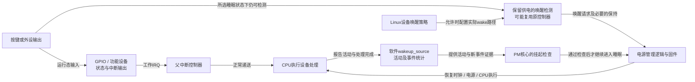
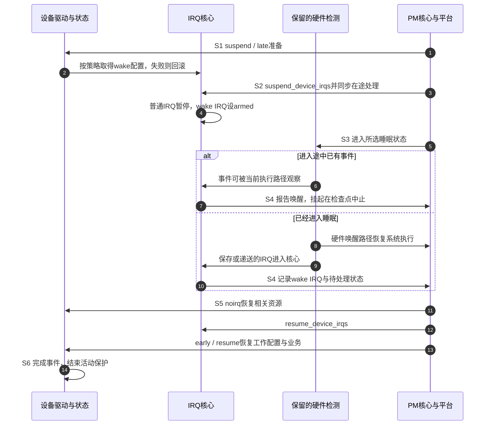

# 第11章\_电源管理中的中断\_suspendresume\_与唤醒源

上一章说明，选择目标 CPU 以后，还必须保证接收者在线并能处理通知。现在把系统进一步置于低功耗状态：CPU 不再正常执行，设备时钟甚至已经关闭，但用户仍希望按下按键就恢复系统。同一个 GPIO 在运行时能够产生 IRQ，并不能证明检测、保持和传递事件的整条链在睡眠时仍然存在。

本章沿“运行时收到按键—准备挂起—保留检测路径—事件发生—恢复设备与处理业务”这一轮展开。先分开硬件能力、用户唤醒策略、IRQ 唤醒配置和软件事件保护，再用 Linux 已有的 `gpio-keys` 驱动做完整实验。GPIO 的逻辑有效值与去抖策略沿用第五、八章；这里不把翻 LED 当作已经证明系统唤醒。

接口与实现依据 Linux 6.12.20、NXP 固定提交，[源码基线](../../../../../research/source_reading/linux/SOURCE_BASELINE.md#1.190_系统唤醒IRQ与设备电源交接)记录本次核对。控制器接收侧的硬件握手见[GIC 电源交接](../../../../../platforms/arm/architecture/gic/P07_目标选择_核间通知与电源交接.md#7.5_目标准备下线时_要交接的不只是路由)，RK3588 的集成边界见[电源域记录](../../../../../platforms/arm/rockchip/rk3588/P01_RK3588的GIC-600集成与手册核对.md#1.4_硬件连接与集成选择_怎样约束两条中断路径)。本章不把这些产品的睡眠实现拼成一张通用芯片接线图。

## 11.1\_要让系统醒来必须有一段硬件继续观察输入

先看正常路径：按键改变引脚电平，GPIO 检测电路留下状态，经父控制器通知 CPU，驱动读取并处理。如果挂起时把 GPIO 检测电路的电源关掉，软件设置再多 wakeup 标志，也无法让一个已停止工作的比较器继续观察边沿。

因此低功耗设计需要保留某条可用路径。可能是原 GPIO 检测逻辑仍有电，也可能是引脚另接始终供电的唤醒控制器，由它向电源管理逻辑提出请求。后者只需恢复系统，不必在睡眠时提供完整 GPIO 寄存器访问。**运行中断路径与唤醒检测路径可以复用，也可以分开。**



图 11-1：虚构一个独立唤醒块并不能证明芯片真的具有它，图只表示职责。实际哪段仍有电、谁保持请求、怎样唤醒处理器，要由芯片、板级连接和固件共同证明。保持一个普通 GPIO 输入也可以满足中断检测；“普通输入”与“中断输入”不是所有芯片都存在的两种互斥引脚模式。

**系统睡眠 system sleep** 涉及整机挂起与恢复；**运行时电源管理 runtime PM** 只让暂时不用的设备进入低功耗，系统仍在运行。系统睡眠本身也有深浅：`s2idle` 借助 CPU 空闲与常规中断路径，`deep` 通常对应挂起到内存，保留资源可能更少。某按键能够退出 s2idle，不能直接外推它能够退出 deep。

在实验前先看 `/sys/power/state` 和 `/sys/power/mem_sleep`。后者方括号标出 `mem` 当前选择，例如 `[s2idle] deep`；日志里只有“写了 mem”是不完整的实验条件。计时器唤醒的另一条完整路径见[系统睡眠与 RTC 委托](../timers/P11_电源管理_系统挂起与定时唤醒.md#11.2_让仍有电的RTC替睡眠中的CPU守住目标时刻)。

## 11.2\_四种唤醒状态不能靠一个标志代替

硬件路径存在以后，还需要决定“这个设备目前是否允许唤醒系统”。例如网卡可能有唤醒能力，但用户暂时禁用它；按键则保持允许。这是能力与策略的区别。Linux 的 `device_can_wakeup()` 询问能力，`device_may_wakeup()` 还反映当前是否允许；sysfs `power/wakeup` 是策略入口，不是测得硬件已经打通的仪器。

策略还必须落到具体 IRQ。`enable_irq_wake(irq)` 请求把该 IRQ 配成唤醒来源，调用可能因为控制器不支持而失败。它与普通 `enable_irq()` 管理的运行使能不是同一个计数：打开 wake 并不自动配对之前的普通 disable，也不等于让设备处理函数在所有挂起阶段都执行。

还有一份状态与线路不同：**唤醒源对象 wakeup_source** 是内核中的软件记录，保存活动状态和事件统计，帮助 PM 判断某次事件是否仍在处理。它不能给硬件补电，也不是把任意 GPIO 连到系统电源按钮的虚拟电线。

| 层次 | 状态主要在哪里 | 谁建立或改变 | 能证明什么 |
| --- | --- | --- | --- |
| 硬件检测能力 | 引脚、控制器、保持电路与电源域 | 芯片集成、固件与平台配置 | 所选睡眠状态下仍存在事件通路 |
| 设备能力与用户策略 | `dev->power` 的能力标记及唤醒对象关系 | 驱动初始化、sysfs策略 | 内核是否认为可唤醒，以及当前是否允许 |
| IRQ 唤醒配置 | IRQ wake 深度/标志及 irq_chip 配置 | 手动 enable/disable wake 或 wakeirq 管理 | 特定 IRQ 被纳入本轮唤醒协议 |
| 软件事件保护 | `struct wakeup_source` 的 active、计数与时间状态 | 事件报告与结束路径 | 软件仍有活动或有新事件需要阻止/中止挂起 |

设备树 `wakeup-source;` 声明能力，须由对应 binding 与驱动消费。`device_init_wakeup(dev, true)` 建立设备软件能力并启用相应策略，也可能返回错误；它没有 IRQ 参数，不能凭这个调用自动得知任意驱动究竟要用哪条线。sysfs 设置 `enabled` 更不能代替硬件接线或驱动的 wake IRQ 配置。

| 接口或标志 | 具体责任与配对要求 |
| --- | --- |
| `device_init_wakeup(dev, true)` | 初始化设备唤醒能力/策略；检查返回值，退出时撤销相应初始化 |
| `enable_irq_wake()` / `disable_irq_wake()` | 管理 IRQ 唤醒设置与嵌套所有权；只对成功取得的设置做配对，检查失败 |
| `dev_pm_set_wake_irq(dev, irq)` | 把已有工作 IRQ 关联到设备唤醒管理，并非只适用于第二条专用线 |
| `dev_pm_set_dedicated_wake_irq(dev, irq)` | 为独立唤醒 IRQ 建立专用线程处理及管理关系；不能再重复申请同一条专用 IRQ |
| `dev_pm_clear_wake_irq(dev)` | 拆除上述关联和相应资源；与设备及 IRQ 生命周期协调 |
| `pm_wakeup_event(dev, ms)` | 报告事件并提供有限活动窗口；ms 是保护时长，不是未来唤醒倒计时；0 不保护后续无限长工作 |
| `pm_stay_awake()` / `pm_relax()` | 持有和结束事件活动保护；不是普通可任意嵌套的业务引用计数，也不等于 runtime PM 引用 |

若选择 wakeirq helper 管理，就不要再在自定义 PM 回调中无条件重复 enable/disable wake。固定版本的 helper 在 PM 阶段调用底层 wake 操作，但 helper 登记成功仍不证明实际硬件配置成功；还要检查运行日志与目标状态试验。需要明确传播配置失败的驱动，应在自己选定的协议路径中处理，不能让两套管理者同时拥有一份不清楚的计数。

## 11.3\_唤醒IRQ为什么不在睡眠阶段直接运行设备处理函数

设备完成 suspend 回调后，其寄存器可能暂时不可访问。如果这时仍按正常路径调用驱动，处理函数可能读取已经关时钟的设备。为防止这种访问，通用 IRQ 核心在设备 late 挂起阶段之后、noirq 阶段之前运行 `suspend_device_irqs()`。

普通设备 IRQ 被标为 suspended 并禁用；已配置 wake 的 IRQ 则进入待唤醒状态。对后者，首次进入相应通用流程时，核心记录 pending/suspended、限制后续处理，并向 PM 报告唤醒，而不是立即执行普通设备 action。恢复时，设备 noirq 恢复阶段结束后，核心再恢复相应 IRQ，然后继续 early 与常规设备恢复。具体控制器和专用中断还有例外，不能说此阶段全机器一条中断也不会执行。

**`IRQF_NO_SUSPEND` 正是这类特殊入口的标志**：让 IRQ 核心在该阶段不按普通规则暂停这条 IRQ。它常服务于系统特殊需求，不是普通设备“唤不醒就加上”的修补项。同一设备不应把它与 `enable_irq_wake()` 当成双保险叠加；两者一个允许正常处理继续，一个要求把事件交给唤醒协议，语义相冲突。共享 IRQ 时 NO_SUSPEND 还影响同线其他 action。极少数经过专门设计的混合共享场景使用 `IRQF_COND_SUSPEND`，不能只加这个标志而省掉来源判断及唤醒上报。

现在把一轮过程固定为 S0～S6。它由设备运行状态、IRQ 状态和唤醒事件状态共同组成，不是一只“睡眠中”布尔变量。

| 阶段 | 谁改变什么状态 | 后续动作与完成条件 |
| --- | --- | --- |
| S0 运行 | 驱动处理设备，策略允许或禁止唤醒 | 确认资源和所选睡眠深度支持目标 |
| S1 设备准备 | 驱动停止普通业务，按策略设置 wake；或由已登记 helper 在对应阶段处理 | 失败必须回滚，不能继续假装挂起成功 |
| S2 IRQ 交接 | IRQ 核心暂停普通 IRQ，为 wake IRQ 设置 armed 状态 | 同步在途处理，再进入设备 noirq 阶段 |
| S3 等待或中止 | 保留硬件检测输入；进入途中也可能出现事件 | 新事件可使本轮挂起中止，未必真的进入深睡 |
| S4 记录唤醒 | 物理路径恢复执行；IRQ 核心记录 pending/suspended 并通知 PM | 设备普通处理尚不能据此访问未恢复资源 |
| S5 恢复与补处理 | PM恢复控制器/设备，IRQ核心恢复IRQ，驱动恢复工作配置与输入状态 | wake配置按所有权配对撤销；处理漏过的状态变化 |
| S6 本轮结束 | 软件业务结束并释放活动保护 | 可以准备下一轮睡眠；永久移除还须同步异步执行者 |



图 11-2：步骤 6～7 与 8～10 是两种到达 S4 的情形。图示事件进入通用 wake IRQ 处理的正常路径，不声称固件在每个平台都用同一条线报告唤醒。步骤 12 恢复 IRQ 早于常规 resume 回调，因此驱动必须保证此时的处理路径能识别自己的状态，不能等最后一行 resume 才第一次考虑寄存器可访问性。

如果普通工作在 suspend 以后仍会操作 LED、I2C 或设备寄存器，应先关闭生产入口并同步或暂停它；选择可冻结工作队列也不能替代所有设备状态管理。第八章的 IRQ → timer → work 回收协议在这里仍有价值，但 suspend 是可恢复暂停，不应照抄永久 remove 后把对象释放掉。

## 11.4\_用现有按键驱动把能力声明落到实际wake配置

接下来用内核的 `gpio-keys` 驱动，而不是再维护一份同时处理 LED、去抖和 PM 的自制按键驱动。它把 GPIO 变化转换成 **输入子系统 input subsystem** 的按键事件：按下报告逻辑 1，释放报告 0；用户程序通过 evdev 事件设备读取。这样运行事件与唤醒配置都有真实实现可核对。

以下是需要替换板级控制器、索引和引脚组的完整设备节点模板。低有效按键在物理电平下降时成为逻辑有效；`wakeup-event-action` 选择“有效时唤醒”，不会把运行状态的按下/释放报告改成只报按下。`KEY_WAKEUP` 是输入事件代码，不是一个硬件 IRQ 号。

模板中的 `gpio_controller` 和 `pinctrl_wake_key` 是待替换的设备树标签，`KEY_INDEX` 是本控制器内的引脚索引占位符。`GPIO_ACTIVE_LOW` 是低有效标志，`EV_ACT_ASSERTED` 是“信号成为逻辑有效时唤醒”的动作常量，两者均由所列头文件定义。

```dts
#include <dt-bindings/gpio/gpio.h>
#include <dt-bindings/input/input.h>
#include <dt-bindings/input/gpio-keys.h>

gpio_keys_demo {
    compatible = "gpio-keys";
    label = "Wake key demo";
    pinctrl-names = "default";
    pinctrl-0 = <&pinctrl_wake_key>; /* 本板实际定义的引脚组 */

    key-wakeup {
        label = "Wake key";
        linux,code = <KEY_WAKEUP>;
        gpios = <&gpio_controller KEY_INDEX GPIO_ACTIVE_LOW>;
        debounce-interval = <30>; /* 毫秒，控制按键事件去抖 */
        wakeup-source;
        wakeup-event-action = <EV_ACT_ASSERTED>;
    };
};
```

`gpio_controller`、`KEY_INDEX` 和 `pinctrl_wake_key` 尚待板级替换，不能将本模板当作已通过 DTB 编译的文件。不要同时让先前的自制驱动占用同一引脚。这里 `wakeup-source` 位于按键子节点，正是 gpio-keys binding 所规定的位置；不能只照抄到任意父节点就期待同样结果。节点没有寄存器地址，不添加虚构的 `@0`。

目标内核需要启用相应输入驱动与 evdev，例如：

```text
CONFIG_INPUT=y
CONFIG_INPUT_EVDEV=y
CONFIG_KEYBOARD_GPIO=y
CONFIG_PM=y
CONFIG_PM_SLEEP=y
CONFIG_SUSPEND=y
```

这是配置核对项，实际依赖由 Kconfig 解析，不是把这几行追加到文件末尾就完成配置。还需要目标 GPIO、pinctrl、父中断控制器与平台睡眠支持。若驱动配置为模块，使用目标内核匹配的模块并确认实际绑定；选成 `gpio-keys-polled` 会换成轮询驱动，不能用它代替睡眠中无人运行的硬件检测。

### 11.4.1\_看同一份驱动状态怎样经过挂起和恢复

固定实现为每个按键保存 `gpio_button_data`：其中 `gpiod` 用于采样，`irq` 标识工作 IRQ，`suspended` 表示按键处于挂起交接状态，`wakeup_trigger_type` 保存本轮需要的触发类型，timer/work 承担软件去抖。上层 `gpio_keys_drvdata` 汇总按键及 input 设备；没有把这些软件对象放进 GIC 寄存器。

| 本例阶段 | gpio-keys 的实际动作 | 为什么需要它 |
| --- | --- | --- |
| S0 建立输入 | 解析子节点，取得 GPIO/IRQ，初始化去抖并登记 input；按按键能力初始化设备唤醒 | 明确 `wakeup-source` 由谁消费，不靠DT属性自发运行 |
| S1 允许唤醒 | suspend检查 `device_may_wakeup()`，为有关按键 enable wake，必要时切唤醒边沿 | 低有效 asserted可对应下降沿；设置失败使挂起返回错误 |
| S1 部分失败 | 回滚已经成功配置的按键；触发类型配置失败时撤回本次wake请求 | 多个按键不能只留下一半状态却报告成功 |
| S2～S4 核心交接 | 通用IRQ/PM管理运行与唤醒行为，驱动保留自己的suspended状态 | 不能在睡眠时仍要求普通设备函数立即运行 |
| S5 恢复 | 撤销wake，按需要恢复双边沿，重新报告当前按键状态 | 睡眠前后的状态不应仅靠一条历史边沿推断 |
| S6 事件完成 | GPIO分支在通知后持有活动保护，去抖上报后释放 | 避免软件处理尚未结束就再次睡眠，但不是硬件滤波 |

若禁止系统唤醒，驱动走另一条挂起分支，根据 input 设备是否开启来关闭/重新打开普通输入处理，而不是仍无条件 enable wake。恢复触发类型或 disable wake 失败时，固定实现会记录警告；不能把“系统恢复了”当作这些操作都成功的证明。

还要保留一处实现限制：这版 `gpio_keys_probe()` 调用 `device_init_wakeup()` 后没有检查返回值。因此驱动绑定成功本身不能证明唤醒对象一定初始化成功，实验仍须检查设备的实际 `power/wakeup` 状态及错误日志。阅读现成驱动是为了核对它实际提供的保证，不是把每个未检查的返回值都提升成接口保证。

对 GPIO 读取不会睡眠的分支，这版驱动可以用 hrtimer 做软件去抖；可能睡眠时改用 delayed_work。它还会先尝试硬件去抖，失败再选择软件路径。这里恰好说明第八章的上下文约束：不是任何 GPIO 读都必须转 work，也不是 timer 回调可以任意执行可睡眠 GPIO 访问。

唤醒按键的处理还有一个特殊语义：若进入处理时仍标记 suspended，GPIO 分支可先合成按下事件，避免短按已经释放而完全看不到唤醒按压；随后采样报告当前状态。因此恢复后的某个按下上报，不一定证明那一刻引脚仍保持按下。做电气稳定性分析时，必须连同这项输入协议一起解释。

### 11.4.2\_先证明运行输入再进入睡眠试验

目标 Linux 上先定位 input 设备和实际绑定路径，不猜它一定是 `event0`：

```bash
# 目标板：找到name为Wake key demo的输入设备及Handlers行。
cat /proc/bus/input/devices
# 用实际找到的event编号替换eventX；需要已安装evtest。
sudo evtest /dev/input/eventX
```

按下与释放应出现该设备的 `KEY_WAKEUP` 事件及 1/0 值。`evtest` 是观察输入事件的用户程序；结束观察后仍须确认设备的 sysfs 身份，不能把所有 event 设备一起当作当前按键。某些桌面电源策略会消费唤醒键，试验时应明确它们的作用，避免把用户空间行为误认成驱动再次挂起。

定位 `gpio-keys` 绑定的设备，可以只读查看：

```bash
# 目标板：沿真实driver链接取得设备目录，再检查power/wakeup。
ls -l /sys/bus/platform/drivers/gpio-keys/
cat /sys/power/state
cat /sys/power/mem_sleep
```

如果还有 LED 教学装置，逻辑 1 才是有效输出，`GPIO_ACTIVE_LOW` 已由 GPIO 框架处理，不能再次写成 `on ? 0 : 1`。LED 的运行态示例见[注册与资源生命周期](P04_Linux_驱动中的中断注册与接口.md)，它只能作为反馈，不能替代下面的系统状态证据。

## 11.5\_pinctrl描述和电源域必须兑现同一条检测链

示例只声明 default 引脚组，并不因此断言它在 deep 中一定被保留。是否需要另外的 sleep 状态，由平台和驱动选择规则决定。有些硬件可保持原配置，有些必须切到低功耗唤醒复用，还有些由固件另行配置。**仅写 `pinctrl-names = "default", "sleep"` 不会保证所有设备自动切换。**

要核对具体消费者、总线或 PM 域是否调用 `pinctrl_pm_select_sleep_state()`，以及恢复时谁选择 default。固定 gpio-keys 自身的 suspend/resume 没有调用这对选择函数，所以不能给它添加一个 sleep 节点后就宣称测试覆盖了那份状态。需要由父层或平台切换时，应找到真实调用者；否则它只是一份未被选择的描述。

| 需要核对的对象 | 运行状态 | 目标睡眠状态要证明的条件 |
| --- | --- | --- |
| 引脚复用 | 能进入GPIO或外设检测逻辑 | 仍进入有效唤醒检测路径，不被其他功能占用 |
| 输入缓冲与偏置 | 能读出预期电平 | 缓冲保留，外部/内部上拉下拉在该供电条件下有效 |
| GPIO方向与输出值 | GPIO方向寄存器决定输入/输出，数据寄存器决定输出值 | 不把pad电气配置常数当成已经设置输出高低的证明 |
| 检测器与状态保持 | 按配置识别边沿或电平 | 睡眠期间可检测，必要状态不会在恢复前丢失 |
| 父控制器与唤醒路由 | 正常IRQ能够递送 | 对应睡眠状态下仍能向平台提交唤醒请求 |

不能把一组未经解码的 i.MX pad 十六进制值当作所有板的标准答案，也不能因为 GPIO 是“普通输入”就断言它不能中断。对确定芯片必须继续查实际寄存器位、驱动的方向/数据操作及板上电气连接。

固定 `gpio-mxc` 驱动会记录 `wakeup_pads` 并向相应父 IRQ 传播 wake 设置，部分平台还通过专用 pad/固件配置实现唤醒；其 runtime 路径也可能保存寄存器并关时钟。这个驱动覆盖多个 SoC，出现某个分支不代表 i.MX6ULL 一定采用该硬件，也不支持“整个 GPIO 控制器永远不能关电”的绝对结论。应证明实际保留的是哪一段检测链。

边沿与电平的选择同样受硬件支持和器件协议约束。把边沿改成电平可能保留一个持续请求，也可能因原因未撤销而立即反复唤醒；它不是通用防抖修复。恢复以后再等 30 ms 采样，可以决定是否上报业务，却无法收回之前已经发生的唤醒。要降低无用唤醒，需要在仍工作的硬件检测、偏置、信号质量或其支持的滤波环节解决。

## 11.6\_把一次试验的策略握手和结果一起保存

进入真实系统睡眠会暂停当前工作，只在选定测试板上操作，并先准备独立的恢复手段。这是实验条件，不要求为了文档验证去挂起正在编辑仓库的计算机。先记录所选睡眠深度、设备路径、运行态输入和当前策略，再实施一轮。

下面保存为 `wakeup_trial.sh`，参数为实际设备目录，例如从前节 driver 链接解析得到的 `/sys/devices/...`。脚本启用本设备唤醒策略，利用 `wakeup_count` 建立“观察后没有新活动”的握手，然后请求当前 `mem_sleep` 对应的 mem；返回或失败后尝试恢复原策略。试验期间不得由另一个程序并行修改同一策略或解绑设备。

脚本用 Bash 的 `EXIT` 退出钩子统一恢复策略，收到中断信号 `INT` 或终止信号 `TERM` 时先退出，再进入相同恢复路径；不能被捕获的强制终止信号 `SIGKILL` 不经过这些钩子。

```bash
#!/usr/bin/env bash
set -eu
if [ "$#" -ne 1 ]; then
    printf '用法: %s /sys/devices/实际设备路径\n' "$0" >&2
    exit 2
fi
case "$1" in /sys/devices/*) ;; *) exit 2 ;; esac
policy="$1/power/wakeup"
[ -r "$policy" ] && [ -w "$policy" ] || exit 1
original=$(cat "$policy")
case "$original" in enabled|disabled) ;; *) exit 1 ;; esac
case " $(cat /sys/power/state) " in *" mem "*) ;; *) exit 1 ;; esac
cat /sys/power/mem_sleep
changed=0
restore() {
    status=$?
    trap - EXIT
    if [ "$changed" -eq 1 ]; then
        if ! printf '%s\n' "$original" > "$policy"; then
            printf '恢复唤醒策略失败: %s 原值=%s\n' "$policy" "$original" >&2
            status=1
        fi
    fi
    exit "$status"
}
trap restore EXIT
trap 'exit 130' INT
trap 'exit 143' TERM
changed=1
printf 'enabled\n' > "$policy"
printf '设备策略: '; cat "$policy"
# 读取可能等待活动事件结束；保存失败说明出现了竞争活动，不强行继续。
count=$(cat /sys/power/wakeup_count)
printf '%s\n' "$count" > /sys/power/wakeup_count
printf 'mem\n' > /sys/power/state
# 只报告内核实际提供的记录；无数据不伪造为IRQ 0。
if ! cat /sys/power/pm_wakeup_irq; then
    printf '本轮没有可读取的pm_wakeup_irq记录，请结合平台日志。\n' >&2
fi
```

在目标板以 root 权限执行，例如 `sudo bash wakeup_trial.sh /sys/devices/实际设备路径`。脚本不改变睡眠深度，也不关闭其他唤醒来源；后者仍可能使系统提前返回。`wakeup_count` 读取可能等待活动处理结束，写回则核对事件是否变化；握手失败时应查新事件，不能删掉检查强行睡眠。这个协议防止忽略新活动，不修复硬件唤醒路由。

恢复的是本设备 `power/wakeup` 策略，不是还原整机所有 PM 状态。SIGKILL、掉电、设备移除或 sysfs 写失败都可能使恢复未完成，应按保存的原值核对。脚本返回也只证明挂起请求已经结束或失败，不能独自证明系统曾驻留 deep 一段时间。

| 观察项 | 支持的推断 | 不支持的推断 |
| --- | --- | --- |
| `power/wakeup` 为 enabled | 该设备的软件策略允许系统唤醒 | 物理链已验证、某个IRQ已经成功配置 |
| `pm_wakeup_irq` 有编号 | 内核当前记录了一条相关唤醒IRQ，可继续映射来源 | 所有唤醒的完整历史，或必然是物理引脚的最末级编号 |
| `wakeup_sources` 事件计数增加 | 对应软件唤醒源记录了事件 | 一定已深睡，或每次物理边沿恰好增加一次 |
| 挂起返回后有按键输入 | 输入协议报告了事件/状态 | 按键在handler运行时一直有效，或没有合成事件 |
| 挂起流程很快返回 | 进入途中被中止、立即唤醒等都是候选 | 唯一原因就是抖动或延时不足 |

`/sys/kernel/debug/wakeup_sources` 依赖 debugfs 等支持；在已经挂载且有权限时读取并比较试验前后计数。缺文件时先核对配置与挂载条件，不把自动挂载或打开大量动态日志作为第一步。固定 `pm_wakeup_irq()` 返回当前记录槽中的首项，无记录时 sysfs 读取可返回无数据错误；它不是“最后一次物理唤醒源”的全能查询接口。

原材料中保留了如下历史片段：

```text
[  157.780683] PM: suspend entry (deep)
[  157.924278] fec 20b4000.ethernet eth0: Link is Down
[  157.928986] Disabling non-boot CPUs ...
[  157.930635] demo_led_key_int led_key_int@0: into thread interrupt!
[  158.738486] PM: resume devices took 0.800 seconds
[  158.788942] PM: suspend exit
随后读取 /sys/power/pm_wakeup_irq 得到：46
```

这能支持“该次流程请求 deep、随后恢复，并记录 IRQ 46”这一组观察，但缺少当时 IRQ 46 的映射、wake 配置和驻留证据，不能仅凭线程日志断言系统真正深睡后由该按键独立唤醒。原示例还混用了 NO_SUSPEND 与 wake 配置，线程日志可能出现在交接途中。应重新采集当前内核与板级状态，而不是把这段历史输出当成本轮已复现的测试。

## 11.7\_运行时唤醒设备不等于唤醒整个系统

系统睡眠把整机的执行条件改变；runtime suspend 则发生在其他进程和设备仍活动时。假设 UART 闲置后关闭主时钟，但引脚检测逻辑仍能发现接收活动，它可以发出专用通知要求恢复 UART。恢复设备的动作与允许它把整机从 deep 唤醒，是两种策略，不能只用 `device_may_wakeup()` 统一裁决。

固定 runtime PM 文档明确允许“运行时远程唤醒开启、系统唤醒禁止”的组合。设备是否需要远程唤醒以及能力不足时能否进入 runtime suspend，由驱动/子系统判断；若恢复依赖此能力而硬件不具备，应拒绝那次运行时挂起，不能先关掉唯一输入再期待 IRQ 帮它恢复。

| 需求 | 正确的执行边界 |
| --- | --- |
| 只提交异步恢复请求 | 使用适合该上下文的 runtime PM 请求路径；返回不表示设备已恢复 |
| 要恢复设备后访问寄存器 | 在允许睡眠的线程/工作路径取得成功的运行时使用引用，例如 `pm_runtime_resume_and_get()`，完成后按协议 put |
| 专用wake IRQ负责恢复 | wakeirq的专用线程可调用 `pm_runtime_resume()`；这不等于任意硬中断都能同步恢复 |
| 原功能IRQ本身在掉电后不可用 | 保留真实可用的检测路径，或不进入该低功耗状态；不靠NO_SUSPEND补硬件 |

`pm_runtime_resume_and_get()` 与单纯 resume 的区别包括使用引用，错误返回时不能继续访问设备。恢复也不会自动重放所有在关电期间丢失的字节；UART 首字符能否保留、外部协议是否需要前导序列，要由硬件缓冲与协议证明。

同时使用 runtime PM 和 system PM 时，应明确哪条路径拥有普通IRQ禁用、wake使能、寄存器保存与恢复责任。设备在系统挂起开始时可能已经runtime suspended，需要协调状态，而不是两个回调各自无条件加一次disable。共享IRQ场景更不能为了关闭一个设备，就把其他使用者一起禁止。

## 11.8\_从具体失败位置决定下一步检查

“运行能中断，睡眠不能唤醒”时，依次核对所选睡眠深度、设备策略、wake配置返回值、引脚检测和保留电源路径；不要跳过策略与返回值就认定一定缺少 sleep pinctrl。“刚进入就回来”时，先区分进入过程中已有软件事件、持续有效的硬件请求、噪声以及其他唤醒源；软件延后确认只能改变业务结果。“第一次能醒，第二次不能”则要检查是否归还了wake/普通使能所有权、触发类型是否恢复、设备原因是否清除，以及输入是否真的再次产生所需变化。

**练习一：** DTS 写了 wakeup-source，sysfs 显示 enabled，是否已经证明 deep 唤醒可用？

**答案：** 只能证明描述与软件策略的部分状态。还须证明驱动选择并成功配置了正确IRQ，硬件在deep中仍可检测且平台能恢复系统。运行态IRQ成功不是这些条件的替代证据。

**练习二：** 普通设备加上 NO_SUSPEND，再enable wake，是否更保险？

**答案：** 不成立。同一设备把这两种处理协议叠加是错误做法；共享线还会影响其他action。先选定正常处理与唤醒交接模式，再按协议维护状态。

**练习三：** 唤醒后timer发现是假按键，能否据此减少刚才那次唤醒耗电？

**答案：** 已发生的恢复无法撤销。软件可以丢弃业务上报或尽快重新进入允许的低功耗状态，但要阻止那次唤醒，需要检测侧支持的滤波、合适电气条件或不同唤醒配置。

**练习四：** 禁止系统唤醒后，设备还能在系统运行时靠专用IRQ退出runtime suspend吗？

**答案：** 可以存在这种设计。系统唤醒策略和运行时远程唤醒是不同条件，是否可行要检查实际驱动、专用检测路径及runtime恢复协议。

现在可以沿运行、交接、唤醒和恢复逐段定位状态，且不会把一个软件标志当作硬件能力。下一章把外设通知从独立引脚换成消息写事务，继续追踪来源编号、路由与资源生命周期。

上一篇：[P10 SMP 与中断亲和性 IPI 机制](P10_SMP_与中断亲和性_IPI_机制.md)。
下一篇：[P12 MSI MSI-X 与 PCIe 设备的中断框架](P12_MSI_MSI-X_与_PCIe_设备的中断框架.md)。
