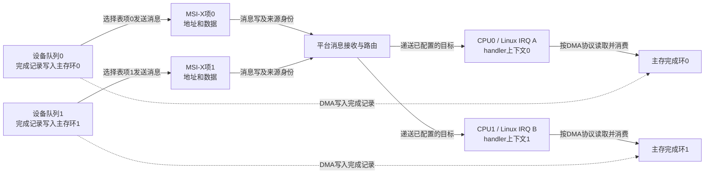
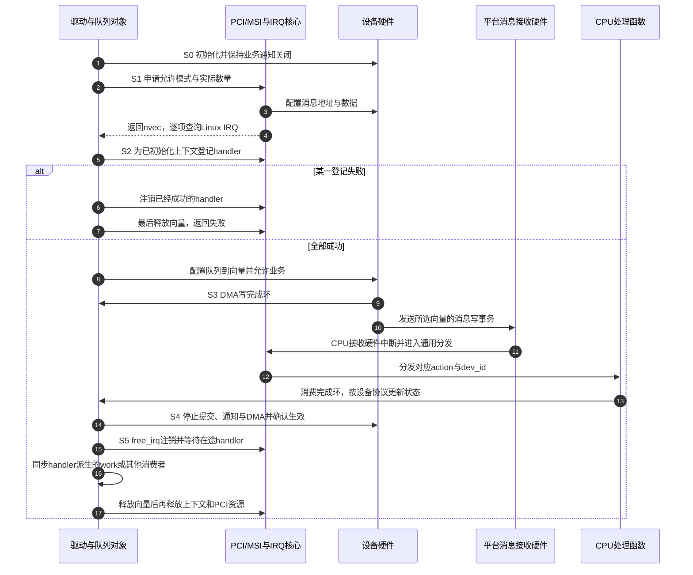

# 第12章\_MSI\_MSI-X\_与\_PCIe\_设备的中断框架

上一章把运行通知与低功耗唤醒分开了：能产生中断，仍要有接收路径和正确的软件状态。本章继续改变通知的载体。假设一块 PCIe 网卡有四个接收队列，队列里的完成记录已经写入内存，设备还要告诉 CPU“现在可以来取”。如果四个队列共用一个入口，这件事能够完成；但我们如何让不同队列分别通知不同 CPU，而不先挤进同一个处理入口？

这里先从单入口的价值与限制推出消息中断，再追踪设备内的向量索引、平台硬件身份和 Linux IRQ 号怎样关联。驱动部分给出完整的中断资源管理组件与只读观察脚本；没有具体网卡寄存器协议，便不虚构能直接驱动任意 PCIe 卡的模块。接口依据 Linux 6.12.20、NXP 固定提交，见[源码基线](../../../../../research/source_reading/linux/SOURCE_BASELINE.md#1.191_PCI消息中断的分配与生命周期)。

## 12.1\_一个入口能通知四个队列为什么还要拆开

先保留最朴素方案：设备只发一个通知，处理函数读取完成状态，发现队列 0 和队列 2 有数据，就分别消费它们。只要状态保存可靠，软件按协议排空并重新允许通知，单入口并不妨碍正确工作。低频设备甚至更适合这种简单设计：处理入口少，状态和资源也少。

当四个队列持续有完成时，缺口才出现。设备把不同队列的“有事可做”汇入一个通知，CPU 进入后再读取状态，重新拆分来源；接收这个 IRQ 的 CPU 成为第一轮分发者。把后续工作交给其他 CPU 仍然可行，但增加了队列传递与通知，且不能靠这一条 IRQ 给四个队列分别配置入口亲和性。

如果这条传统 IRQ 还与另一设备共享，Linux 又得调用同线登记的各个处理函数，询问“是不是你的原因”。这和 **同一设备内部多个队列共用一个向量** 是两层不同的汇聚，不能混为一谈。共享不是一定出错，但每次多检查几个设备寄存器的成本会随中断频率累积；一个持续不撤销原因的设备也可能使共享入口反复被调度。

这里的传统模式称为 **INTx**，x 表示 A～D 等传统中断标识。并行 PCI 时代存在对应引脚；**PCI Express（PCIe，PCI 快速互连）链路上的传统 INTx 通知使用 Assert/Deassert 消息来表达兼容语义，并不是每个 PCIe 端点再沿插槽拉一根专用 IRQ 线。** 一个功能的传统 INTx 仍只有一个通知选择，不能因此推出全系统只有四个 Linux IRQ。端点是链路上的设备一侧，根复合体 Root Complex 是主机与 PCIe 层次连接的一侧。

这一传输区别可追溯到[PCI Express Base Specification r2.1，6.1.2（Intel提供的原件）](https://www.intel.com/content/dam/support/us/en/programmable/support-resources/fpga-wiki/asset03/pci-express-base-r2.1.pdf)：传统语义由链路内消息表达，根复合体再将它映射到系统中断资源。

改进方向于是很具体：保留队列各自的完成记录，让通知也带上可区分的身份，由主机预先安排不同接收入口。**消息信号中断 MSI（Message Signaled Interrupt）** 用设备发出的内存写事务实现通知：主机给设备配置消息地址和数据，设备发生事件时发送该写事务，由平台接收并转为中断。这里的地址是中断接收目标，不是给 CPU 留一段普通业务字符串的缓冲区。

MSI 不等于“CPU 软件执行了一次 MMIO 写”，也不等于“DMA 数据本身就是中断号”。普通业务数据、完成记录和中断通知仍有不同作用。若四个队列只分到一个 MSI，软件仍须从状态判断哪些队列有完成；消息中断没有凭空消灭设备内部的分发需求。

## 12.2\_MSI-X怎样把独立通知变成独立配置

普通 MSI 已能提供多个向量，但它们使用一组受共同配置约束的消息资源。这里的 **向量 vector** 先指设备可选择的通知槽位，不是 Linux IRQ 整数，更不是处理函数地址。MSI 支持 1、2、4、8、16、32 这类数量，实际可用数量受设备和平台共同限制。

普通多消息MSI共用消息地址，由设备在允许范围内改变消息数据的低位来选择通知；启用k个选择位，就得到2的k次方个组合。因此它不是每个向量各保存任意地址、任意数据的独立配置表。平台还可能限制这一组通知的目标CPU集合，不能把“有四个MSI”直接当成“四个完全独立的路由”。

低位选择的具体含义可对照[Intel MSI Message Data字段说明](https://edc.intel.com/content/www/us/en/design/publications/core-processors-series-3-i-o-registers/001/message-signaled-interrupt-message-data-msi-md-offset-8c/)。这里采用其说明的消息选择规则，下面的能力头偏移则按固定Linux源码定义整理。

四个队列如果希望分别选择目标，或者管理事件与数据事件需要独立配置，就需要更细的表项。**MSI-X 是 MSI 的扩展机制**：设备有一张表，每个表项保存自己的消息地址、数据和屏蔽控制；表的硬件容量最多为 2048 项，分配数量不要求是二的幂。更多表项只是能力上限，不能把 TabSize 当成当前驱动已申请数量。MSI 与 MSI-X 可同时作为设备能力存在，但不能同时作为该功能的已启用模式。

| 同一功能的通知选择 | INTx | MSI | MSI-X |
| --- | --- | --- | --- |
| 通知表示 | PCIe 上保留传统置位/撤销语义 | 消息写事务 | 消息写事务 |
| 可用通知粒度 | 单个传统入口，可能与其他设备共享 | 1～32，数量为二的幂，受共同配置约束 | 每表项独立配置，容量最多2048 |
| 多队列处理 | 可汇聚后由软件分发 | 可按实际向量数分组 | 更适合灵活的一队列一向量或队列分组 |
| 主要代价 | 来源检查与汇聚入口负载 | 平台消息接收与资源分配 | 表存储、更多IRQ及状态维护 |
| 选择边界 | 设备支持且通知负载可接受时仍可用 | 向量数及路由约束够用时可选 | 需要独立配置且设备、平台、驱动均支持时选 |

### 12.2.1\_配置空间保存入口信息而BAR空间保存表项

要理解 MSI-X 的独立配置，先区分两种访问位置。**PCI 配置空间**保存设备身份、能力与控制信息；**基址寄存器 BAR（Base Address Register）**描述设备资源窗口。MSI-X capability 位于配置空间，但完整 MSI-X Table 位于某个 BAR 映射的设备地址范围内，不能把二者说成同一张配置空间表。

MSI 的能力头保存消息配置，MSI-X 的能力头则告诉系统表在哪里。以下偏移均有明确基准；“+0x04”不能脱离所属能力头或表项单独使用。

| MSI能力头相对偏移 | 宽度 | 名称与作用 |
| --- | --- | --- |
| +0x02 | 16位 | Message Control：bit0启用；bits3:1表示支持的多消息数量编码，bits6:4表示已启用数量编码，数量按2的幂解释；bit7表示64位地址能力；bit8表示逐向量屏蔽能力 |
| +0x04 | 32位 | Message Address低32位，由内核配置消息目的地 |
| +0x08，仅64位地址格式 | 32位 | Message Upper Address |
| +0x08或+0x0c | 16位 | Message Data，分别用于32位或64位地址格式 |
| +0x0c或+0x10，可选 | 32位 | Mask Bits，必须先确认逐向量屏蔽能力 |
| +0x10或+0x14，可选 | 32位 | Pending Bits，记录被屏蔽通知的待处理情况；不是业务完成计数 |

| MSI-X能力头相对偏移 | 宽度 | 名称与作用 |
| --- | --- | --- |
| +0x02 | 16位 | Message Control：bits10:0为表大小减1；bit14为Function Mask；bit15为MSI-X Enable |
| +0x04 | 32位 | Table：bits2:0为BAR索引BIR，其余位为该BAR内的表偏移 |
| +0x08 | 32位 | Pending Bit Array（PBA，待处理中断位数组）的位置，同样由BAR索引与偏移组成 |

第 i 项的访问位置由“选定 BAR 的映射基址 + Table Offset + 16×i”得到。单项布局如下：

| 表项内偏移 | 宽度 | 内容 | 维护者 |
| --- | --- | --- | --- |
| +0x00 | 32位 | 消息地址低32位 | PCI/MSI核心按平台消息格式写入 |
| +0x04 | 32位 | 消息地址高32位 | 同上 |
| +0x08 | 32位 | 消息数据 | 同上，不可直接填Linux IRQ号 |
| +0x0c | 32位 | Vector Control，bit0为Mask | 由中断管理路径协调；修改地址/数据时须遵守屏蔽协议 |

这些字段说明消息怎样形成，不授权普通设备驱动绕过内核直接修改 MSI-X Table。固定实现的 `pci_write_msg_msix()` 会在需要时先屏蔽表项，再修改消息，最后恢复控制状态。业务驱动另外负责“队列使用哪个表项”的设备私有配置；这一组队列寄存器须查具体设备协议，不能从标准 MSI-X 表推导出通用地址。

PBA 为相应表项留下待处理位，多个事件可以汇聚在一位中；它不是完成记录队列，也不是 Linux `irq_desc` 内的 pending 标志。驱动仍需以设备完成环或状态寄存器判断实际完成了多少工作。上述布局依据固定 `include/uapi/linux/pci_regs.h` 与 `drivers/pci/msi/msi.c`，来源入口保留在本章源码基线中。

### 12.2.2\_四个向量不自动等于四路并行

假设设备和驱动允许把队列0～3分别映射到表项0～3。平台为四个表项配置不同消息，Linux 为四个通知注册四个上下文，再把其 IRQ 合理分布到在线 CPU。这样 CPU0 消费队列0时，CPU1可以消费队列1，不必等待同一个入口先拆分所有来源。



图 12-1 只展开四队列中的两队列。设备完成环是主存中的 DMA 共享对象，消息表位于设备 BAR 窗口；平台路由状态又属于控制器。CPU 读取业务数据与硬件递送通知是两条关联路径，不是 CPU 把 MSI-X Table 当作数据环来消费。

并行仍有条件：设备确实能够独立生产队列工作，驱动没有让所有向量抢同一把长时间持有的全局锁，接收 CPU 在线，后续线程与工作队列也按设计分工。否则四个入口只把竞争搬到了同一个锁上。增加向量还会增加资源与通知开销，不能认为越多必然越快。

多向量还改变锁的重入条件：同一IRQ不会随意重入，不代表另一条向量不能在持锁路径上到来。如果进程或允许本地中断的路径持有一把handler也使用的自旋锁，应按上下文使用保存并关闭本地中断的加锁协议，避免当前CPU被另一个向量打断后再次等待自己持有的锁。不同CPU之间仍需锁本身的互斥；关闭本地中断不能替代它。

MSI 的事务顺序可避免传统引脚通知先于此前有序设备写到达的问题，但它不取消 DMA API、缓存一致性与内存屏障要求。尤其不能看到中断就任意解引用未映射缓冲区，也不能用这项 PCI 顺序保证推导所有跨设备、乱序属性下的写都已可见。

## 12.3\_同一个通知为什么经过三套编号

上一节说“表项0到了Linux IRQ A”，其中的关联必须由系统建立。设教学示例中的设备队列2使用表项1，分配所得 Linux IRQ 为74；在采用 GIC ITS 的平台，还可能把来源身份与消息事件翻译为某个 LPI。队列2、表项1、IRQ74和LPI号分属不同命名空间，任何两个数恰好相等都不构成接口保证。

| 对象与状态位置 | 谁写入 | 谁读取或使用 |
| --- | --- | --- |
| 设备队列到向量的选择，设备私有寄存器 | 设备驱动按实际设备协议设置 | 设备完成逻辑选择通知槽位 |
| MSI/MSI-X消息配置，配置空间或BAR表 | PCI/MSI核心与平台回调 | 设备形成消息写事务 |
| `struct msi_desc`，内核内存 | MSI核心分配并缓存消息、设备、索引与亲和性信息 | PCI/MSI及中断域管理路径 |
| `irq_data`及所属`irq_domain`，内核内存 | 各域分配与路由操作 | 控制器操作与映射查找 |
| `irq_desc`及action，内核内存 | IRQ核心与驱动登记/注销 | CPU收到中断后的通用分发 |
| 完成环与队列上下文，DMA内存及驱动对象 | 设备生产完成，驱动推进消费位置 | 对应处理函数及后续业务 |

`msi_desc` 不是永远“一对象一向量”：固定实现的多消息 MSI 可在一份描述符中记录 `nvec_used > 1`；通常 MSI-X 每项使用一份 `nvec_used = 1` 的描述符。业务驱动不应依赖这个内部数量关系自行计算 IRQ，而应调用 `pci_irq_vector(pdev, i)`。

**irq_domain 是软件映射与资源管理对象**，不是每来一条消息都必须依次执行一次的“虚拟硬件控制器”。在层级域实现中，PCI/MSI层把消息配置、分配及屏蔽等操作与父域协作，最终仍由统一的 IRQ 状态和处理函数服务设备。这延续[第九章的域层次](P09_层级中断控制器与_ARM_GIC_在_Linux_中的实现.md)，但不能把软件 parent 关系直接画成物理中断线级联。

也不能说所有 Linux MSI 实现都强制具有同一层数。固定 `pci_msi_setup_msi_irqs()` 在具备层级域时走相应域分配，否则保留架构旧分配入口；本文介绍的是现代常见层级路径，不抹掉源码中的配置分支。

平台落点由硬件决定。Arm 的 GICv2m 可把消息转为 SPI，GICv3 ITS 则处理设备事件与 LPI 的关联；二者不能因为都接收写事务就当成同一种控制器。x86 的 **高级可编程中断控制器 APIC（Advanced Programmable Interrupt Controller）** 体系中，MSI涉及处理器本地APIC目的地与可选中断重映射；负责外部引脚汇聚的IO-APIC并不是所有MSI的必经入口。接收角色建立后，再读[GIC消息状态](../../../../../platforms/arm/architecture/gic/P08_从消息请求到内存中的中断状态.md#8.1_来源越来越多_为什么让设备发送一条消息)和[ITS事件翻译](../../../../../platforms/arm/architecture/gic/P09_设备事件翻译与命令完成.md#9.1_两个设备都发事件0_怎样区分)，其中有控制器自身的寄存器和表项说明。

## 12.4\_先确定允许的退化再申请资源

知道映射由内核建立以后，驱动首先要回答的是“最少几条向量还能正确工作”。四队列设备如果能把所有队列汇聚到一个入口，并由处理函数检查全部完成状态，便可申请 min=1、max=4。若协议硬性要求一个管理入口加一个数据入口，min至少为2。固定数量同样合理：驱动只能正确支持四条时，应要求4～4；不能为了让probe成功就谎称支持单向量。

接口 `pci_alloc_irq_vectors(pdev, min, max, flags)` 返回实际获得数量，负值表示失败。固定实现按许可范围依次尝试 MSI-X、MSI、INTx。**只有包含 `PCI_IRQ_INTX`、min为1且存在可用传统IRQ时，才可能回退到INTx。** `PCI_IRQ_MSIX | PCI_IRQ_MSI` 不包含这种许可。本基线使用 `PCI_IRQ_INTX` 名称，不把旧资料中的 `PCI_IRQ_LEGACY` 宏直接拼进当前示例。

| 接口或输入 | 本章需要的契约 |
| --- | --- |
| `pci_alloc_irq_vectors()` | 选择flags允许的模式；实际数量决定后续可使用的索引 |
| `pci_irq_vector(pdev, i)` | 返回设备相对索引i对应的Linux IRQ；越界返回错误，不保证等于首IRQ+i |
| `request_irq()` / `free_irq()` | 登记/注销具体处理函数与dev_id；资源回收必须早于向量释放 |
| `pci_free_irq_vectors()` | 释放该次向量资源并结束相应MSI/MSI-X模式；不是替驱动停止DMA的函数 |
| `PCI_IRQ_AFFINITY` | 让分配过程考虑CPU分布；不能代替设备队列布局与热插拔协调 |
| `pci_irq_get_affinity()` | 查询分配的亲和性描述，可能为NULL；不是硬件实时目标读数 |

若允许 INTx，驱动还必须准备共享入口所需的来源判断、`IRQF_SHARED`、唯一而稳定的 `dev_id`，以及把所有必要队列交给该入口的业务方案。加上一个flag并不能把只会处理单个队列的函数改成可靠退化。单向量也不一定是INTx，可能是一条MSI或MSI-X，应查看实际模式。

中断亲和性在这里是队列设计的一部分。可让分配器依据 `struct irq_affinity` 描述保留管理向量并分布数据向量，或按平台规则处理普通IRQ；托管IRQ的热插拔与用户修改限制见[第十章](P10_SMP_与中断亲和性_IPI_机制.md#10.2_允许集合与实际目标是两份不同状态)。不能对 `i % nr_cpu_ids` 得到的CPU盲目绑定，它未必在线。

亲和性提示还涉及内存寿命：`irq_update_affinity_hint()` 保存提示指针，不是把临时掩码复制成永久配置；清提示前必须保留对象。旧 `irq_set_affinity_hint()` 同时涉及设置与提示，返回值也不能证明实际设置成功。不要在调用后立即释放掩码，更不能把hint写成“保证固定到指定CPU”。当前允许集合、effective目标和历史计数仍须分别观察。

## 12.5\_先停止生产再拆掉处理入口和向量

现在看完整生命周期。设备可能正在写完成环、发送消息，CPU也可能已经进入处理函数。如果仅仅释放向量而保留handler，后者仍引用已经拆除的中断状态；如果先释放队列，正在运行的handler可能访问失效对象。正确顺序来自所有权依赖，而不是某个API名称带不带devm。

| 阶段 | 设备与软件的状态 | 下一步条件 |
| --- | --- | --- |
| S0 准备 | PCI资源和队列上下文有效；设备业务中断保持关闭 | 所有可能被handler读取的状态已初始化 |
| S1 分配 | 获得nvec及平台消息配置 | 按实际数量建立设备队列到向量的方案 |
| S2 登记 | 各handler、dev_id和名字已登记 | 全部成功后才放开设备业务通知 |
| S3 运行 | 设备生产完成并发送消息；CPU消费相应队列 | 按设备协议确认、排空与重新允许通知 |
| S4 停止 | 阻止新提交，关闭设备通知，完成必要写刷新并停止DMA | 证明不会再生成访问即将释放资源的工作 |
| S5 回收 | free_irq等待对应处理结束，再同步后续工作，最后释放向量、队列和设备资源 | 全部异步使用者退出，才能归还被引用对象 |



图12-2把正常和注册失败放在同一生命周期中。CPU收到消息并不等于所有DMA已经停止；`free_irq()`等待中断处理也不等于等待处理函数排入的普通work。设备专有的“停止且确认”步骤必须成立，不能用固定延时猜硬件已经安静。

### 12.5.1\_用一份完整组件管理向量与handler的配对

下面是供具体PCI驱动嵌入的完整IRQ资源组件。它只接受MSI/MSI-X，采用普通 `request_irq()` 配对释放，避免将不支持的INTx路径伪装成fallback。`queue_irq_set` 是自定义资源对象，`queue_irq_slot` 是每向量长期保存的名字、IRQ和业务上下文；它们不是内核标准结构。

调用方先用普通PCI资源流程完成设备使能、BAR映射、DMA与队列初始化，保持设备业务通知关闭，再准备容量至少为max的 `contexts` 数组。每项是处理函数能理解的长期对象：可代表一个队列，也可代表一组队列。所有对象必须在第一次request_irq前初始化，防止登记后立刻到来的通知访问半成品。

组件在允许睡眠的probe/remove等管理上下文执行，并由调用方串行调用。`kcalloc(..., GFP_KERNEL)` 分配清零的slot数组，可能睡眠；返回的 `-EBUSY`、`-EINVAL`、`-ENOMEM` 分别表示资源对象已在使用、参数不合法和内存不足。IRQ回调自身仍遵守前章的硬中断上下文限制。

```c
#include <linux/errno.h>
#include <linux/interrupt.h>
#include <linux/pci.h>
#include <linux/slab.h>

struct queue_irq_slot {
    int irq;
    void *context;
    char name[64]; /* 保持到free_irq返回，不能指向循环内栈数组 */
};

struct queue_irq_set {
    struct pci_dev *pdev;
    struct queue_irq_slot *slots;
    unsigned int nvec;
    unsigned int registered;
};

/* 先注销入口，给调用方留下同步后续消费者的阶段。 */
static void queue_irqs_unregister(struct queue_irq_set *set)
{
    while (set->registered) {
        struct queue_irq_slot *slot =
            &set->slots[--set->registered];
        free_irq(slot->irq, slot->context);
    }
}

/* 仅在S4及必要的消费者同步完成后调用。 */
static void queue_irqs_release(struct queue_irq_set *set)
{
    queue_irqs_unregister(set);
    if (set->nvec)
        pci_free_irq_vectors(set->pdev);
    kfree(set->slots);
    set->slots = NULL;
    set->pdev = NULL;
    set->nvec = 0;
}

/* set须零初始化且由调用方串行操作；contexts容量为max_vecs。 */
static int queue_irqs_acquire(struct queue_irq_set *set,
                             struct pci_dev *pdev,
                             unsigned int min_vecs,
                             unsigned int max_vecs,
                             irq_handler_t handler,
                             void *const *contexts)
{
    unsigned int i;
    int ret;

    if (set->pdev || set->slots || set->nvec || set->registered)
        return -EBUSY;
    if (!pdev || !handler || !contexts || !min_vecs ||
        min_vecs > max_vecs)
        return -EINVAL;
    for (i = 0; i < max_vecs; i++)
        if (!contexts[i])
            return -EINVAL;

    ret = pci_alloc_irq_vectors(pdev, min_vecs, max_vecs,
                                PCI_IRQ_MSIX | PCI_IRQ_MSI);
    if (ret < 0)
        return ret;
    set->pdev = pdev;
    set->nvec = ret;
    set->slots = kcalloc(set->nvec, sizeof(*set->slots), GFP_KERNEL);
    if (!set->slots) {
        ret = -ENOMEM;
        goto fail;
    }

    for (i = 0; i < set->nvec; i++) {
        struct queue_irq_slot *slot = &set->slots[i];

        ret = pci_irq_vector(pdev, i);
        if (ret < 0)
            goto fail;
        slot->irq = ret;
        slot->context = contexts[i];
        snprintf(slot->name, sizeof(slot->name), "%s-v%u",
                 pci_name(pdev), i);
        ret = request_irq(slot->irq, handler, 0,
                          slot->name, slot->context);
        if (ret)
            goto fail;
        set->registered++;
    }
    return 0;

fail:
    queue_irqs_release(set);
    return ret;
}
```

组件返回0以后，`set.nvec` 才是实际数量，`set.slots[i].irq` 是对应Linux IRQ。调用方在S2之后配置设备队列使用的向量索引，再启用DMA/业务通知；若后续启动失败，先执行S4，再回收，不能直接跳到释放对象。

这段组件给出了两个退出阶段：先调用 `queue_irqs_unregister()` 注销入口，再同步handler派生的work或其他消费者，最后调用 `queue_irqs_release()` 归还向量。release内部再次注销是无剩余登记时的空操作。调用方须在S4设置停止状态，使后续消费者不会重新打开通知；普通队列内存与BAR也要保留到全部消费者退出。

注册失败路径直接release的前提是S0保持设备停产、handler不会在准备阶段派生后续业务；如果具体设备可能留下陈旧通知，handler须识别准备状态并按设备协议处理，不启动新消费者。本例不提供虚构的硬件handler、不宣称是一份可独立加载的PCI模块，验证范围是资源配对及失败顺序。

### 12.5.2\_devres改变谁收尾但不改变依赖顺序

若换用 `devm_request_irq()`，失败返回或解绑时会自动注销已登记处理函数。但这发生在devres回收阶段，不能在probe错误出口或remove里先手动 `pci_free_irq_vectors()`，再等devres以后处理handler。需要提前拆除时，先对成功登记项调用 `devm_free_irq()`，然后释放向量；不要再用普通free_irq去留下同一份待执行的devres记录。

“devm永远不管理MSI向量”也不准确。固定源码中，使用 `pcim_enable_device()` 的受管理PCI设备，会由MSI初始化路径登记 `pcim_msi_release`；其回收动作负责释放向量。普通 `pci_enable_device()` 路径没有自动获得这项保证。选择托管方案时，应按建立顺序核对devres的逆序回收，让后登记的handler先退出、消息资源随后回收；驱动仍必须在remove/错误路径完成S4，不能指望资源自动释放替它停止硬件。

同样要检查名字与提示掩码：request_irq保存的名字和dev_id、亲和性hint保存的对象，都要活到相应引用结束。循环中的 `char name[32]` 在函数返回后失效，不能用来给长期IRQ命名；本组件将名字放在持续存在的slot里，直到free_irq后才释放。

## 12.6\_平台怎样告诉内核这条消息会到哪里

资源接口能统一，消息接收路径却不能靠一个DTS属性在任何板上凭空建立。先问真实硬件：端点消息经过哪一个根控制器，由内建MSI接收器还是外部控制器处理，写事务还携带什么设备身份？然后才选择相应固件描述与驱动。

在设备树平台，`msi-controller` 标记接收MSI的控制器，`#msi-cells` 说明绑定所需的附加标识单元。`msi-parent` 按具体binding关联上级MSI提供者；PCI还可能使用 `msi-map`，把请求者ID映射到提供者及其设备标识。没有字面上的msi-parent，不自动证明平台不支持MSI：内建接收器、msi-map或ACPI等固件路径都可能承担该关系。

**请求者ID RID（Requester ID）**用总线、设备、功能号标识PCI请求来源。通用binding按bits15:8表示总线、bits7:3表示设备、bits2:0表示功能。用户工具常将这三项称为 **BDF（Bus、Device、Function）**，并在前面加PCI域号。若根控制器对身份另有别名或映射，必须按实际集成核对；不能把BDF字符串不加条件地当成ITS的DeviceID。

下面只演示映射属性的含义，假定根节点和ITS节点已由真实SoC描述建立，`its_controller` 是该提供者的标签；这不是可直接编译的整板DTS：

```dts
/* 放在相应根控制器节点内；仅当其binding与硬件身份转换支持此关系。 */
msi-map = <0x100 &its_controller 0x200 0x100>;
```

这段把RID区间 `[0x100, 0x200)` 映射为控制器侧 `[0x200, 0x300)`：例如0x123变为0x223。它没有给设备写入MSI消息地址，也没有替代控制器初始化。若配置 `msi-map-mask`，先按该掩码处理RID再匹配；单元的具体意义仍由提供者binding规定。不要在没有真实IP的情况下添加 `vendor,my-msi-ctrl` 并期待内核找到驱动。

PCI端点使用PCI/MSI接口，非PCI设备也可能使用平台消息中断机制。后者不意味着“把任意platform_device改写msi-parent就能发MSI”：设备必须具备消息发送能力，驱动和总线必须实现相应分配及消息配置接口。板载PCI端点与插槽端点都仍由PCI枚举，不因焊在板上就变成platform_device。

系统配置至少要核对 `CONFIG_PCI`、`CONFIG_PCI_MSI` 及实际主控制器/MSI接收驱动。不要照抄旧版本Kconfig名称，或把某个SoC家族当成每个型号都有PCIe。比如本仓库的i.MX6ULL源码研究环境不能仅因使用i.MX厂商内核，就被用作本章PCIe硬件实验已经存在的证明。

## 12.7\_从实际模式与IRQ集合开始观察

调试先证明“当前分配了什么”，再讨论“为什么没有来”。能力栏存在MSI-X只证明设备支持它；没有某句dmesg日志，也不证明它未启用。日志文本受驱动与日志级别影响，不能要求每个设备都打印想象中的 `enabling MSI-X`。

在目标Linux安装有pciutils时执行以下只读命令，完整地址写成 **域:总线:设备.功能**；把示例替换成实际设备：

```bash
# 目标Linux：列出设备及绑定驱动，再观察选定设备能力。
lspci -D -nn -k
sudo lspci -vv -s 0000:01:00.0
```

`Enable+` 表示对应能力当前启用；MSI的 `Count=1/32` 区分启用数量与能力上限，MSI-X的 `TabSize=8` 是表容量。不要把一段同时写MSI Enable+与MSI-X Enable+的假输出当作正常样例；两种模式不能同时启用。

保存下面为 `inspect_msi.sh`。它沿该设备的 `msi_irqs` 查找实际Linux IRQ，读取模式和CPU计数，不解绑设备、不写MSI表、不改变亲和性：

```bash
#!/usr/bin/env bash
set -eu
if [ "$#" -ne 1 ] ||
   [[ ! "$1" =~ ^[[:xdigit:]]{4}:[[:xdigit:]]{2}:[[:xdigit:]]{2}\.[0-7]$ ]]; then
    printf '用法: %s dddd:bb:dd.f\n' "$0" >&2
    exit 2
fi
device="/sys/bus/pci/devices/$1"
[ -d "$device" ] || { printf '设备不存在\n' >&2; exit 1; }
printf '设备: %s\n' "$1"
if [ -r "$device/irq" ]; then
    printf '兼容irq属性: '; cat "$device/irq"
fi
shopt -s nullglob
entries=("$device"/msi_irqs/*)
if [ "${#entries[@]}" -eq 0 ]; then
    printf '未观察到MSI IRQ条目；继续核对绑定、配置与实际模式。\n'
    exit 0
fi
for entry in "${entries[@]}"; do
    irq=${entry##*/}
    [[ "$irq" =~ ^[0-9]+$ ]] || continue
    printf 'Linux IRQ %s 模式: ' "$irq"
    cat "$entry"
    # 精确匹配首列，不能让42误匹配142。
    awk -v key="$irq:" '$1 == key { print; seen=1 }
        END { if (!seen) print "该IRQ当前未出现在/proc/interrupts" }' /proc/interrupts
    for item in smp_affinity_list effective_affinity_list; do
        path="/proc/irq/$irq/$item"
        if [ -r "$path" ]; then printf '%s: ' "$item"; cat "$path"; fi
    done
done
```

在目标机执行 `bash inspect_msi.sh 0000:01:00.0`，施加已知设备负载后再次执行，比较对应IRQ列的增量。`msi_irqs/<N>` 的N是Linux IRQ，文件内容区分msi/msix；`device/irq` 在MSI时可表示首条MSI，而在MSI-X时仍可能是传统INTx值，不能拿它代替整组MSI-X查询。缺少条目还可能是设备未绑定、未申请、接口配置不可用或观察时发生解绑，不直接推出硬件不支持。

这个读取不是原子快照。设备解绑、热插拔或IRQ重配可能使两次读取间的文件消失，应先确认设备生命周期稳定再比较。`/proc/interrupts` 的控制器名称因平台不同而变，不能仅按是否含字面MSI做判断。队列已合并、完成批处理或中断合并也会让数据包数量与IRQ增量不同。

| 已有证据 | 下一步要找的状态 | 不能直接跳到的结论 |
| --- | --- | --- |
| 申请返回少于max但不少于min | 设备容量、平台资源、亲和性分配与所选模式 | 平台故障，或可以继续访问原max范围 |
| IRQ登记成功，计数不增加 | 设备队列映射、通知使能、完成状态、表项屏蔽与消息路径 | 分配成功等于设备已经发送并到达CPU |
| 设备有pending或完成 | 消息是否生成、是否被屏蔽、路由/重映射是否允许 | pending位就是发送次数，或一定是ITS错误 |
| 计数增加但业务不前进 | handler上下文、完成消费、DMA访问及后续队列 | 消息丢失，或增加向量就能修复 |
| 多向量都集中一核 | 允许集合、effective目标、托管策略与实际负载 | MSI-X没有生效 |

错误恢复与系统恢复也沿同一链核对。PCI核心可恢复缓存的MSI配置，平台负责控制器/翻译状态，驱动仍需恢复设备队列、通知开关和DMA协议。“恢复后不来”是需要定位的失败，不能当成MSI正常特性；也不能现场只改一个flags就安全切到INTx。

低功耗唤醒不一定另拉GPIO。PCIe有电源管理事件 **PME（Power Management Event）**，端口服务可处理并上报设备唤醒，固定 `pcie_pme_suspend()` 还会尝试为服务IRQ设置wake。具体睡眠深度下哪些电源与链路保留、端口服务使用何种IRQ，仍须平台证明。普通数据MSI路径可用不等于深睡可唤醒，反过来也不能断言“MSI系统绝不参与唤醒”；这与[第十一章的四层状态](P11_电源管理中的中断_suspendresume_与唤醒源.md#11.2_四种唤醒状态不能靠一个标志代替)一致。

## 12.8\_用资源与队列关系检查设计是否成立

**练习一：** 四队列只分到两条MSI-X，是否丢掉队列2与3的中断？

**答案：** 不应根据向量数直接删除业务。若设备支持分组，可把四队列映射到两入口，每个handler检查自己负责的队列集合；若协议不支持，应减少可运行队列或提高min使分配失败。内核不会自动替驱动完成设备私有映射。

**练习二：** flags只写MSI与MSI-X，为什么没有退到INTx？

**答案：** 驱动没有许可INTx。即使添加许可，还要满足min为1、传统IRQ可用以及驱动具备共享来源判断和单入口业务方案；fallback是完整模式，而不是一位配置。

**练习三：** 第三个devm_request_irq失败，在错误出口先free vectors，前两个handler等自动回收，可以吗？

**答案：** 顺序错误。处理入口依赖向量，必须先注销已登记handler，再归还向量。或者选定正确建立的受管理PCI资源方案，让逆序回收满足依赖，同时完成设备停产；两种方案都不能跳过S4。

**练习四：** 表项1、Linux IRQ74、某个LPI恰好都指向队列2，设备应往消息数据填74吗？

**答案：** 不应。队列使用表项索引由驱动按设备协议配置，消息地址与数据由PCI/MSI及平台层生成。Linux IRQ是软件接口身份，不是通用设备消息格式。

现在能够从队列通知需求推导向量数量，并沿分配、登记、运行、停产和回收核对每份状态。下一章讨论通知进入CPU时的特殊优先级与入口约束：通知如何传输，与能否绕过普通屏蔽，是两条不同的分类轴。

上一篇：[P11 电源管理中的中断 suspendresume 与唤醒源](P11_电源管理中的中断_suspendresume_与唤醒源.md)。
下一篇：[P13 特殊与高优先级中断 NMI 定时器 性能中断](P13_特殊与高优先级中断_NMI_定时器_性能中断.md)。
