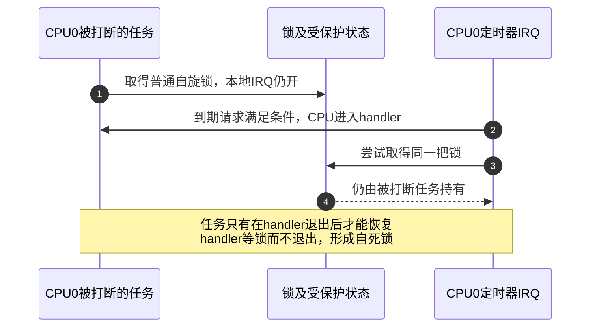
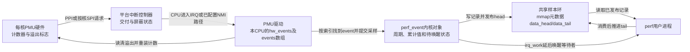
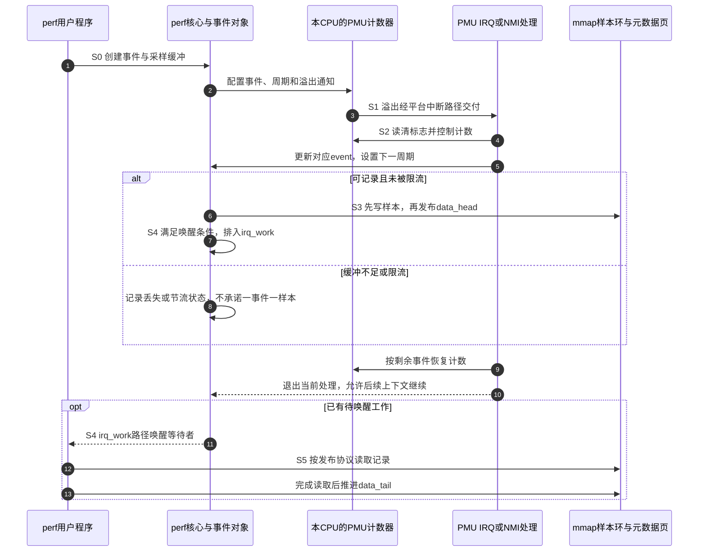

# 第13章\_特殊与高优先级中断\_NMI\_定时器\_性能中断

上一章把通知载体从传统信号换成消息写事务，但通知最终仍要经过CPU的接收与执行条件。现在考虑另一个问题：某CPU长期关闭普通中断，连定时器处理都不能运行，我们还靠什么观察它卡在哪里？另一方面，定时器和性能计数器都在CPU附近，它们是否因此天然绕过GIC、自动具有最高优先级？

这两个问题不能用“系统特殊中断”一并回答。本章先把来源用途、路由归属和可屏蔽性分开，再追踪NMI、定时器与性能采样各自的状态。实现以Linux 6.12.20、NXP固定提交为准，见[本次源码核对](../../../../../research/source_reading/linux/SOURCE_BASELINE.md#1.192_特殊中断的屏蔽边界与PMU样本交付)。文中的arm64 GICv3路径、x86 NMI框架与ARM32平台描述分别注明，不拼成一种通用CPU。

## 13.1\_用途特殊不意味着传递路径独立

先想一个定时器：它在计数达到比较值时提出请求，内核收到后运行到期处理。事件来源是计数器，但请求仍可以连接到GIC的私有中断PPI。再想一个性能计数器：它统计某类执行事件，溢出后通知软件；该通知既可能接到PPI，也可能由芯片给相应核分配SPI。因此“靠近CPU”不能推导“完全不用中断控制器”。

**不可屏蔽中断 NMI（Non-Maskable Interrupt）**则描述另一种需求：在普通中断被屏蔽时，仍有一类诊断通知可以进入。它没有限定来源必须是定时器还是性能计数器。**性能监控单元 PMU（Performance Monitoring Unit）**描述计数硬件；其通知在某个平台按普通IRQ交付，在另一种已配置路径中也可能按NMI语义交付。

三个轴分别回答“什么事件”“通知属于谁”“能被什么屏蔽”。它们组合成实现，而不是互斥的三种设备：

| 比较轴 | 可选事实 | 不能据此推导 |
| --- | --- | --- |
| 来源与用途 | 定时器到期、PMU计数溢出、外设完成、平台诊断 | 内核自用就必然最高优先级 |
| 状态与路由归属 | 每CPU一份、PPI、按核布置的SPI、平台专用入口 | 来源在核内就不经过GIC或设备树 |
| 交付与屏蔽 | 普通可屏蔽IRQ、架构NMI、特定实现的类NMI路径 | 名叫fast或FIQ就等于Linux NMI |

专用子系统拥有这些资源，是为了协调时间、采样和CPU生命周期，不是因为它们绝不使用IRQ框架。普通设备驱动应使用时间API或perf接口取得服务，不另行抢占已经由计时器/PMU驱动管理的IRQ。实现这些子系统的驱动本身，当然仍需要申请、使能、清源与回收中断。

## 13.2\_普通中断被挡住以后怎样保留诊断入口

假设CPU进入一段关闭本地IRQ的循环。普通定时器每次到期仍可能留下硬件状态，但它的handler无法运行，也就不能靠这个handler报告“我已经很久没运行”。要观察这种故障，诊断来源的交付必须能越过导致普通IRQ停顿的那层屏蔽；这就是NMI类路径的价值。

“不可屏蔽”必须说明相对于哪种屏蔽。它不意味着关电、所有异常屏蔽、NMI自身处理、固件限制和硬件故障下都必达，也不保证每个源事件都排队保存。x86固定NMI分发代码就明确考虑多个事件被有限锁存能力汇聚的情况。不能把“能在普通IRQ关闭时进入”扩大成无限可靠的事件记录器。

### 13.2.1\_x86专用分发与arm64优先级屏蔽是不同实现

x86有架构NMI入口和NMI处理链。固定 `arch/x86/include/asm/nmi.h` 中的 `register_nmi_handler` 是构造登记对象的宏，最终调用 `__register_nmi_handler()`。回调类型接收NMI分类和寄存器现场，返回是否处理；注销由 `unregister_nmi_handler()` 完成。这里的分类也不是普通Linux IRQ号。

arm64固定实现中的 **伪NMI pseudo-NMI** 则利用GICv3中断优先级：把某些来源置于更高的优先级，普通 `local_irq_disable()` 在所选模式下通过CPU Interface的优先级门限挡住普通IRQ，保留更高优先级来源。它仍使用GIC的状态、IRQ描述符和域映射，不是在GIC之外多造一根神秘线。

| 固定arm64实现中的接口或状态 | 所在位置与作用 | 当前解释边界 |
| --- | --- | --- |
| `ICC_PMR_EL1` | CPU Interface系统寄存器，优先级门限 | 通过系统寄存器指令访问；此模式用它实现普通IRQ屏蔽，不是MMIO基址偏移 |
| `DAIF`中的IRQ/FIQ屏蔽状态 | 处理器异常屏蔽状态 | 仍有入口保护等用途，不能说pseudo-NMI穿透一切异常屏蔽 |
| GIC来源优先级与`irq_desc`的NMI状态 | 控制器及内核内存 | irqchip设置优先级并选用相应NMI flow handler |
| `CONFIG_ARM64_PSEUDO_NMI`与启动条件 | 内核配置及GIC初始化 | 还需运行时启用、控制器能力和集成条件，不是只看CPU型号 |

固定Kconfig描述了 `irqchip.gicv3_pseudo_nmi=1` 启用参数；正文将它作为核对已有系统的依据，不要求为实验修改启动配置。GIC驱动还会拒绝不支持或集成有问题的情况。实际开启后，入口代码区分普通IRQ和NMI上下文，GIC路径调用 `generic_handle_domain_nmi()` 分发，直接反驳“只要是NMI就不会有irq_domain”的绝对说法。

此处介绍的是这版内核的GIC优先级方案，不代表所有Arm架构代际只有这种能力，也不把它套到ARM32/GICv2的板上。FIQ是处理器接口的异常信号类别，Linux NMI还涉及入口和软件上下文约定；两者的关系要看平台实现。安全分组、IRQ/FIQ与异常层的关系见[GIC权限与异常进入](../../../../../platforms/arm/architecture/gic/P09_权限_安全分组与异常路由.md#9.3.3_安全组怎样影响IRQ与FIQ_又怎样到达EL)。

### 13.2.2\_专用申请接口也不能把任意IRQ升级成NMI

通用IRQ层提供 `request_nmi()` 与 `request_percpu_nmi()`，前提是对应irqchip支持、描述符设置满足要求、来源和使用方式适合。固定 `request_nmi()` 要求相应每CPU用途及禁止自动使能，拒绝共享和线程化；per-CPU版本还需在各CPU上prepare后enable，并在退出时对称disable、teardown和free。申请失败就是能力或条件没有满足，不能只把函数名换掉便宣称获得NMI。

| 使用路径 | 申请与使能责任 | 为什么不能混用 |
| --- | --- | --- |
| 普通IRQ | `request_irq()`及相应使能/释放 | 按普通交付约定执行 |
| 通用NMI IRQ | `request_nmi()`，随后按协议enable；停止后free_nmi | 要求irqchip支持及规定flags，不提供普通线程化 |
| per-CPU NMI | `request_percpu_nmi()`，每CPU prepare/enable；disable/teardown后free | 每CPU准备状态不能靠全局登记一次代替 |
| x86 NMI处理链 | 专用分类的登记/注销接口 | 分类链与Linux IRQ资源不是同一套参数 |

Arm PMU驱动正好提供真实例子：`armpmu_request_irq()`先按来源是否为per-CPU描述符选择申请路径，尝试NMI，失败后可退到对应普通IRQ；再保存每CPU的操作集合。**PMU能工作与PMU使用NMI是两项不同结论。**

## 13.3\_持锁时能否进入要看屏蔽层而不是锁的名字

现在回到一个具体疑问：“我在spin_lock期间，定时器到期了，它等不等解锁？”先把硬件到期与软件进入拆开。硬件比较器按自己的计数工作，是否进入handler则由请求使能、控制器优先级和CPU屏蔽等条件决定；普通锁本身不会让计数器停走。

对非PREEMPT_RT内核中的 `spinlock_t`，普通 `spin_lock()`不关闭本地IRQ；若入口条件满足，定时器IRQ可以打断持锁代码。若这个handler也要同一把锁，就形成同CPU自等：持锁者要等handler返回才能解锁，handler却在等持锁者解锁。



图13-1刻画一个错误交错，不是推荐实验。使用相应irqsave加锁协议可在取得锁前保存并关闭普通本地IRQ，解锁后恢复原状态，避免这类普通IRQ打断。**restore是恢复原值，不保证一定打开IRQ。** 如果调用前已经关闭，解锁后仍关闭；`preempt_disable()`也不能代替本地IRQ屏蔽。

这还不是NMI安全性。NMI类入口可能越过普通IRQ屏蔽，仍不能等待被它打断的执行者持有的锁；把锁换成raw_spinlock也不会消除这种自死锁。per-CPU变量只隔离不同CPU，不自动隔离同CPU普通路径与NMI嵌套更新。NMI处理需要专门证明可重入的原子状态、缓冲或平台允许的延后机制，不能直接调用任意普通workqueue接口并假定安全。

PREEMPT_RT又改变了另一层语义：其 `spinlock_t` 使用不同实现，`spin_lock_irqsave()`等后缀不按非RT方式改变硬IRQ屏蔽；`raw_spinlock_t`才保留严格自旋语义。正确做法是核对实际锁类型、配置和执行上下文，不能把非RT三行口诀推广到所有内核。NMI和真实硬IRQ不能睡眠，禁止mutex、任意阻塞分配以及等待被打断者；普通线程化IRQ则有另一套上下文条件。

若普通定时器IRQ被延迟，到重新允许交付时还要检查请求是否仍有效、是否已由其他路径处理。多次到期不一定保存成多个通知，一位pending也不是次数队列。因此不能保证“解锁后必然按错过次数逐个补中断”。时间子系统可以通过计数读数计算经过的时间，和硬件中断次数是两种证据。

## 13.4\_本地定时器仍可经GIC进入时间子系统

定时器的用途是到时通知，**clockevent设备**把“下一个到期点”编程给硬件；**clocksource**提供可读取的时间基准，timekeeping用它建立系统时间线。中断回调被延迟时，可读取的硬件计数仍可能继续变化，所以“tick暂时没处理”不等于“硬件时间停止”。完整分工见[时间体系的三种角色](../timers/P02_Linux_时间基础与_timekeeping_框架速览.md#2.4_timekeeping_/_clocksource_/_clockevent_的基本角色)。

Arm每核架构定时器通常通过PPI进入GIC。固定 `arm_arch_timer.c` 用 `request_percpu_irq()` 登记对应物理或虚拟定时器handler，在CPU上线时配置本CPU的 `clock_event_device` 并使能PPI。handler读取控制状态，确认到期后先屏蔽该次定时器通知，再调用 `evt->event_handler(evt)` 交给时间子系统。接下来运行周期tick还是高精度到期处理，由当前clockevent配置决定，不是固定调用一条想象中的 `hrtimer_tick()`。

以下表只说明AArch64架构定时器所用的系统寄存器角色；物理/虚拟访问路径由权限及内核选择决定，不给普通外设驱动直接改写：

| 寄存器组 | 本章使用的字段或语义 | 状态作用 |
| --- | --- | --- |
| `CNTP_CTL_EL0` / `CNTV_CTL_EL0` | bit0 ENABLE使能、bit1 IMASK中断屏蔽、bit2 ISTATUS到期状态 | 控制物理/虚拟定时器与观察到期条件；mask与到期状态分开 |
| `CNTP_CVAL_EL0` / `CNTV_CVAL_EL0` | 64位比较值 | clockevent配置未来比较点 |
| `CNTPCT_EL0` / `CNTVCT_EL0` | 计数读数 | 物理/虚拟时间基准读数，和IRQ统计不同 |

同一驱动还有内存映射定时器分支，可使用SPI和 `request_irq()`。所以“系统定时器必须每CPU独占一条PPI”也不是所有实现的定义。x86本地APIC定时器走相应架构入口，不能把这一事实反过来套给Arm所有定时器。

设备树同样可能参与。固定 `imx6ul.dtsi` 包含 `arm,armv7-timer` 节点，声明多种定时器PPI，但该公共文件中它的 `status` 是disabled；还包含GPT等定时器描述。最终板级覆盖和启动选择才决定哪一个工作。看见节点不是启用证据，但断言“本地定时器不在DTS里”已经被实际文件否定。

**NO_HZ省略的是某些不必要的周期tick**，并非取消所有到期事件。空闲、隔离核、广播定时器、CPU离线和虚拟化都可能改变某列统计；不能要求/proc/interrupts中的每核timer计数总以固定频率增长。配置与按需到期的详细推导见[三种tick工作模式](../timers/P02_Linux_时间基础与_timekeeping_框架速览.md#2.5.1_先分清三种tick工作模式)。驱动需要延时或超时，应使用对应时间API，不另抢clockevent已经登记的IRQ。

## 13.5\_PMU从计数到样本还要跨过哪些状态

假设我们想知道程序主要在哪些指令附近消耗CPU周期。只读取计数器得到的是总量；若希望取得执行位置样本，需要配置采样周期，让计数达到溢出条件时产生通知，再记录当时的上下文。因此 **计数 counting** 与 **采样 sampling** 是两个观察目标，不能把一次perf stat成功直接当成溢出中断链已经验证。

PMU硬件计数器、溢出状态、内核事件对象和用户可读样本环是四份不同状态。计数可以继续而通知受屏蔽；通知可以到来而没有足够缓冲保存样本；样本已发布也不保证用户进程已经被调度读取。把它们分开，才能解释“有计数、没样本”与“IRQ很多、记录很少”。

这里选固定Arm PMUv3路径作为具体例子。PMU驱动为每CPU维护 `pmu_hw_events`，其中 `events[idx]`关联硬件计数器索引与 `struct perf_event`；事件对象的 `hw`保存周期等软件状态。PMU不是只维护一个“有事件”标志，多个计数器可共用一条中断，处理函数仍须检查每个溢出位。



图13-2区分硬件计数状态、驱动每核索引、内核事件和共享样本内存。各箭头是状态操作或通知，不把这些框当成串联的物理电路块。

| AArch64 PMUv3系统寄存器 | 作用与操作边界 |
| --- | --- |
| `PMEVTYPER<n>_EL0` | 为第n个事件计数器选择事件及过滤条件，具体支持集依实现能力 |
| `PMEVCNTR<n>_EL0`、`PMCCNTR_EL0` | 事件/周期计数读写；计数宽度与溢出条件须结合PMU版本及配置，不能只看C类型 |
| `PMCR_EL0` | 总体计数控制，E位控制总体使能；重置与长计数配置有各自语义 |
| `PMCNTENSET_EL0` / `PMCNTENCLR_EL0` | 按位设置/清除计数器使能 |
| `PMINTENSET_EL1` / `PMINTENCLR_EL1` | 按位设置/清除溢出中断使能；开计数不等于开通知 |
| `PMOVSCLR_EL0` | 读取溢出标志，写1清相应标志；不是写0清除，也不是完成次数 |

表中是系统寄存器名称，不是设备MMIO偏移。固定 `armv8pmu_getreset_flags()` 读取并清除溢出标志；`armv8pmu_handle_irq()` 检查有效溢出，暂停PMU计数处理各事件，更新累计值、设置下个周期，经 `perf_event_overflow()`处理采样及限流，再恢复计数。它调用的是实际 `arm_pmu` 回调和perf流程，不存在可供普通驱动照抄的 `armpmu->pmu.handle_irq(..., overflowed)`。

### 13.5.1\_一轮采样怎样从本核计数汇聚为用户可读记录

下面固定一次采样为S0～S5。周期设置、IRQ配置和环缓冲消费相互协作，但不是单一布尔状态机。

| 阶段 | 写入者与状态位置 | 后续读取者及完成条件 |
| --- | --- | --- |
| S0 配置 | perf与PMU驱动建立event，关联本CPU的events[idx]，编程计数与通知 | 硬件按选定事件/过滤运行 |
| S1 达到周期 | 硬件更新计数并置溢出标志 | 中断使能、GIC/CPU交付条件满足后进入handler |
| S2 识别与重装 | PMU handler读清溢出，更新event累计值与周期 | 逐个匹配有效事件，不把所有计数器一概当成到期 |
| S3 发布样本 | perf把记录写入共享环，再按顺序发布元数据页data_head | 用户读取head后才能按协议消费已完成记录 |
| S4 通知读者 | 达到唤醒条件时设置pending_wakeup并排入pending_irq的irq_work | 延后路径执行perf_event_wakeup，读者获得运行机会 |
| S5 消费或停止 | 用户读取样本并推进data_tail；事件停止/退出由perf管理 | 空间可再次使用；关闭后不能留下访问已释放缓冲的执行者 |



图13-3表达一轮采样的数据、发布和唤醒关系，选择等待中的读者作为正常路径。它没有把所有sample生成都拖到irq_work中：记录可在当前处理路径写入，**延后的重点包括唤醒等待处理动作**。`data_head`与`data_tail`位于mmap元数据页，内核生产者与用户消费者可能运行在不同CPU，必须遵守规定的屏障与所有权顺序；调用一个wake函数不能替代样本发布。已经运行的读者也可按发布协议主动读取，不必等待每条样本专门唤醒一次。

固定ring buffer代码还处理IRQ/NMI嵌套发布，避免较旧的head覆盖较新的head。因此不能简单用普通全局锁替换它，也不能只说“per-CPU所以不用同步”。这些是采样传输的同步成本，和被测程序的业务计数属于不同层。性能事件本身也可能被复用到有限硬件计数器上，报告需结合运行时间比例与丢失/限流信息。

### 13.5.2\_PMU通知来源也可能写在设备树中

固定 `imx6ul.dtsi` 的相关节点如下，这是上游配置摘录并附仓库说明，展示实际来源关系，不要求读者把它复制到另一块板：

```dts
pmu {
    compatible = "arm,cortex-a7-pmu";
    interrupt-parent = <&gpc>;
    interrupts = <GIC_SPI 94 IRQ_TYPE_LEVEL_HIGH>;
};
```

这里的94是binding中的SPI相对编号，不是Linux IRQ；若映射到GIC编号，SPI编号域从32开始，需要按对应域解释。父控制器写的是gpc，还须结合它与GIC的层级。这个例子同时否定“PMU一般不由DTS描述”和“PMU一定是PPI”两个判断。它属于ARM32 Cortex-A7平台描述，不是前面AArch64 PMUv3寄存器表的同一套访问指令。

通用Arm PMU binding允许一个PPI或按核给出的中断，并可描述 `interrupt-affinity`。多个核型号的性能事件支持集也可能不同；迁移任务、事件调度和CPU热插拔必须由PMU/perf协议协调，不能对任意PMU IRQ照搬普通网卡亲和性修改。

## 13.6\_用自身负载分别观察计数和采样

本节不通过关IRQ、死循环内核或主动产生NMI来验证理论。我们使用一个有限用户态计算程序，让perf分别统计总量与记录样本。先确认目标机具有匹配的perf工具、相应PMU驱动和权限；虚拟机还需要宿主暴露相应能力。软件事件可用于验证perf工具链，但不能拿它替代硬件PMU证据。

将下面完整程序保存为 `pmu_load.c`。参数是迭代次数，默认两亿次；上限用于避免误输入造成过长运行。计算只改变程序自身的无符号状态，输出结果防止编译器把工作整体删除。`UINT64_C` 与 `PRIu64` 是标准C宏，分别构造适合64位无符号类型的常量与打印格式。

```c
#include <errno.h>
#include <inttypes.h>
#include <stdint.h>
#include <stdio.h>
#include <stdlib.h>

int main(int argc, char **argv)
{
    uint64_t count = UINT64_C(200000000);
    uint64_t state = UINT64_C(0x12345678);
    uint64_t i;

    if (argc > 2)
        return 2;
    if (argc == 2) {
        char *end;
        unsigned long long parsed;

        /* 先拒绝符号和空字符串，再检查完整十进制转换。 */
        if (argv[1][0] < '0' || argv[1][0] > '9')
            return 2;
        errno = 0;
        parsed = strtoull(argv[1], &end, 10);
        if (errno || *end || !parsed || parsed > 1000000000ULL)
            return 2;
        count = (uint64_t)parsed;
    }
    for (i = 0; i < count; i++) {
        state ^= state << 13;
        state ^= state >> 7;
        state ^= state << 17;
    }
    printf("iterations=%" PRIu64 " checksum=%" PRIu64 "\n", count, state);
    return 0;
}
```

在目标Linux的实验目录编译并先运行短负载：

```bash
cc -O2 -Wall -Wextra -std=c11 pmu_load.c -o pmu_load
./pmu_load 10000
```

三次移位/异或形成一个简单的数据依赖链，无符号运算按位宽截断，不依赖有符号溢出。它只提供可重复的CPU工作，不是硬件性能基准；不同机器的耗时没有直接可比性。

接着查看能力与权限，保留当前系统条件：

```bash
# 目标Linux；只读，不修改全局perf权限或NMI watchdog。
uname -r
cat /sys/devices/system/cpu/online
cat /proc/sys/kernel/perf_event_paranoid
perf list
```

`perf_event_paranoid`和能力权限会限制可观测范围；权限拒绝不证明PMU硬件坏了。下面的 `cycles:u` 选择用户态周期事件，前提是perf list与实际平台支持。事件不存在、权限拒绝或资源无法安排时，保留错误作为实验结果，不自动改系统策略。

将下面保存为 `run_pmu.sh`，在包含 `pmu_load` 的目标实验目录运行 `bash run_pmu.sh`。它先计数，再采样，结果写入一个新建目录；任一步失败即停止，不继续解释不完整的结果：

```bash
#!/usr/bin/env bash
set -eu
# 同一目标实验目录，使用Bash；每轮目录独立保留。
run_dir=$(mktemp -d ./pmu_run.XXXXXX)
printf '本轮目录: %s\n' "$run_dir"
cat /proc/interrupts > "$run_dir/interrupts.before"
perf stat -e cycles:u -- ./pmu_load 200000000
perf record -e cycles:u -c 1000000 -o "$run_dir/perf.data" -- ./pmu_load 200000000
cat /proc/interrupts > "$run_dir/interrupts.after"
perf report --stdio -i "$run_dir/perf.data"
```

`stat`报告总计数及可能的复用比例，`record -c 1000000`请求按事件周期采样；一百万不是毫秒，也不是固定每秒一百万次中断。`report`解释保存的样本。采样开销、溢出处理延迟、调度、计数器复用、节流和缓冲丢失，都使“总周期÷一百万”不能成为必须完全一致的样本数。`-F`则表达目标采样频率，与固定事件周期不是同一输入。

比较两份中断快照时，先按具体平台确定PMU行或NMI统计，再按CPU列看增量。这个用户进程可以迁移，系统也可能有其他perf或watchdog使用者，因此增量不是本程序独占证据。反过来，计数模式也可能为了折叠有限宽度计数器而使用溢出通知；不能断言perf stat永远不产生中断。

若没有样本，先区分负载太短、事件或权限不支持、计数器未运行、IRQ未交付以及缓冲/报告问题。要检验采样链，应取得有效硬件事件、成功record、可解释的样本及相应系统条件；仅有一行/proc/interrupts或一次stat结果不够。

## 13.7\_诊断卡顿时先问是哪一层没有前进

NMI watchdog也应按这套证据方法看待。在使用perf事件的hardlockup检测方案中，较高优先级的周期检查观察普通hrtimer活动是否前进；softlockup检测则关注相关任务是否获得执行机会。这两种故障定义不同，具体后端、阈值和CPU覆盖取决于内核配置。不能把某个默认秒数写成所有Linux必定遵守的硬件时限。

watchdog没告警，仅能在检测器已启用、相应CPU受覆盖、后端能运行的条件下提供有限证据。NO_HZ_FULL隔离核可能不在默认覆盖集合，PMU资源或NMI交付也可能有条件限制。一个已经停止运行的观察者不能证明被观察对象健康。

| 观察到的现象 | 先核对 | 后续定位 |
| --- | --- | --- |
| 某CPU timer计数不动 | 在线状态、NO_HZ、广播/空闲与当前clockevent | 才判断是否长期屏蔽或入口故障 |
| PMU有计数却无样本 | 是否采样事件、周期与运行比例、权限和虚拟化暴露 | 溢出使能、实际IRQ/NMI路径、缓冲与限流 |
| NMI统计增加 | 平台统计口径、已有watchdog/perf使用者 | 不直接等同于目标设备事件次数 |
| 普通irq_handler_entry追踪不到 | 是否走该tracepoint、架构入口与采集配置 | 选用该路径实际提供的观测点，不把无记录当作未发生 |
| 锁内卡死 | 被打断上下文、锁拥有者与普通IRQ/NMI交付条件 | 重建同CPU自等或跨CPU等待，而非只改优先级 |

中断路径的目标不是“总是先清所有源再说”。定时器本例先屏蔽到期通知，PMU按协议读清溢出并重装，其他设备则可能需要先保存数据再确认。清源动作要符合具体寄存器协议，不能从一个NMI模板外推到所有设备。长时间打印或扩大采样率还会改变被观察负载，应把这些代价记录在实验条件中。

## 13.8\_用反例检查特殊中断的判断

**练习一：** 定时器用于调度，是否可以据此断言它绕过GIC且不在设备树中？

**答案：** 不可以。用途不决定接线；Arm架构定时器可经PPI/GIC并由设备树描述，固定驱动使用per-CPU IRQ接口。最终是否启用还须看板级覆盖和运行选择。

**练习二：** 非RT代码用irqsave锁保护状态，NMI能否安全地再拿同一把锁？

**答案：** 不成立。普通IRQ屏蔽并不挡住NMI类路径，NMI可能打断持锁者并自等。需要为NMI参与单独设计同步，raw锁或per-CPU变量都不会自动解决嵌套。

**练习三：** perf stat给出了cycles数，是否证明PMU中断和样本环都正常？

**答案：** 只证明该条件下取得了计数结果。采样还需要周期/溢出通知、处理、样本发布和读取路径；计数模式也不能反向保证从未使用过溢出中断。

**练习四：** 解锁irqrestore后，是否一定立即处理期间所有到期次数？

**答案：** 原IRQ状态可能仍为关闭；即便重新允许，还受请求状态、优先级等条件约束。有限pending状态可能汇聚多个事件，时间经过量与中断处理次数不是同一量。

现在可以依据来源、归属、屏蔽和状态前进证据解释“特殊”在哪里。下一章处理通知过多的另一端：来源持续有效、抖动、业务处理不及和中断风暴为何会表现相似，又应在哪里抑制。

上一篇：[P12 MSI MSI-X 与 PCIe 设备的中断框架](P12_MSI_MSI-X_与_PCIe_设备的中断框架.md)。
下一篇：[P14 中断风暴 抖动与防御机制](P14_中断风暴_抖动与防御机制.md)。
