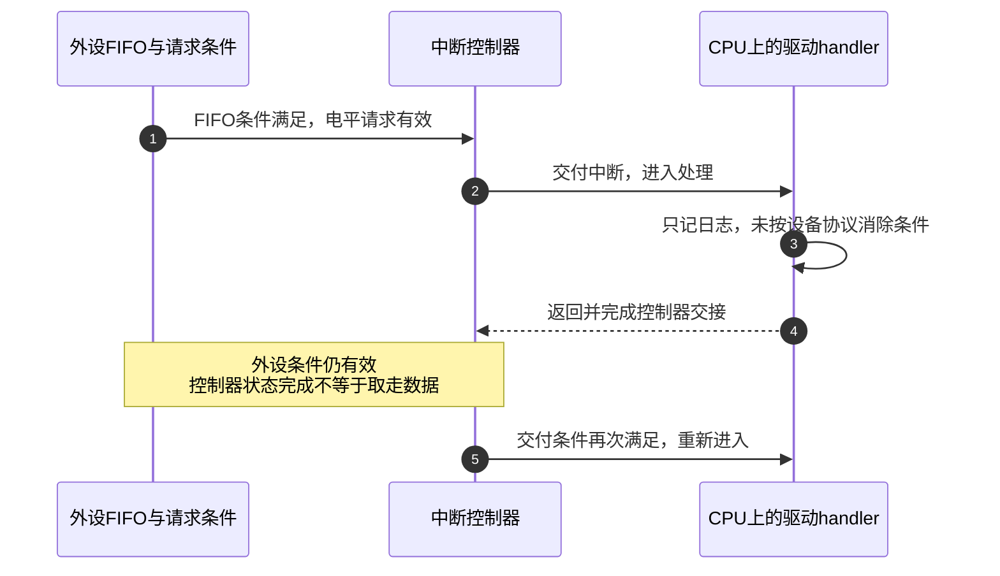
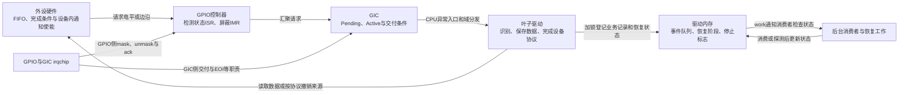
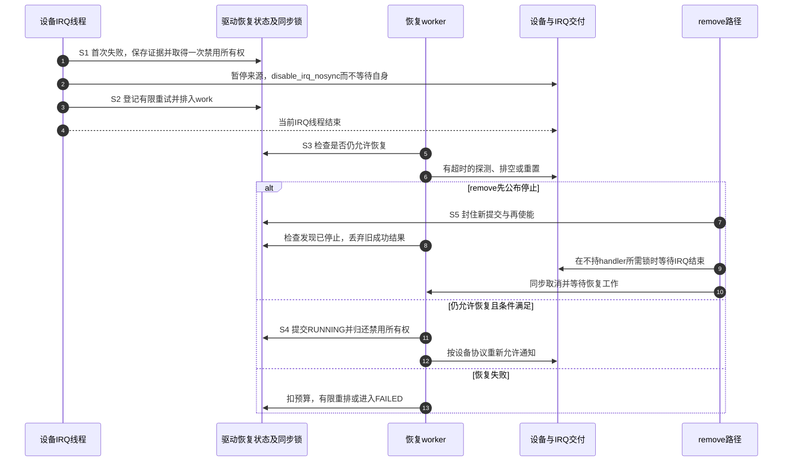

# 第14章\_中断风暴\_抖动与防御机制

上一章解释了普通IRQ被挡住时，诊断入口也必须满足自己的交付条件。现在看另一个极端：请求一直到来，CPU似乎忙于处理中断，业务却越来越慢。增加优先级不会凭空增加处理能力；把工作扔到后台，也不代表来源已经停止。

本章沿一条外设通知线，区分“条件始终有效”“真实事件太密”“一次动作产生多个边沿”和“消费者处理不及”，再建立隔离、恢复与退出协议。第五章已经说明清设备来源与完成控制器状态是两回事，第七、八章已经建立有界业务记录和窗口再使能；这里用这些结论处理异常负载。版本依据为Linux 6.12.20的[固定源码核对](../../../../../research/source_reading/linux/SOURCE_BASELINE.md#1.193_中断过载的隔离恢复与误报检测边界)。

## 14.1\_先确定变多的是通知还是尚未处理的业务

假设一个外设每收到一批数据就通知CPU。负载较小时，一次通知后处理完数据再返回，系统工作正常。现在同样看到某IRQ计数快速增加，却可能有四种完全不同的过程：外设一直保持“还有数据”的电平；外设确实产生了大量不同事件；机械开关一次动作抖出多个边沿；硬中断次数没变，后台每次处理太久，积压越来越多。

**中断风暴（interrupt storm）** 在这里指通知及其处理反复占用过多资源，妨碍系统及时完成其他工作。它没有全平台统一的“每秒多少次”门槛，也不只来自电平未撤销。**触点抖动（contact bounce）** 是一次机械动作的多次电气变化；**时延抖动（latency jitter）** 是执行延迟的波动。二者都可能影响输入体验，但不能混为同一个故障。

先把三个量分开：IRQ进入次数、设备实际产生的数据量、驱动已经消费的数据量。通知可以合并，一次IRQ也可以处理多条数据；一次触点动作还可能产生多次通知。因此三条曲线不必一一对应。

若同一CPU上每秒进入十万次handler，每次平均耗时8微秒，仅这些handler就约占0.8秒CPU时间。这是按 `进入频率 × 平均执行时间` 得到的粗估，尚未计入入口、缓存及后台成本；多CPU分摊、嵌套计时和IRQ线程又要另算。反过来，低频handler若每次耗时很长，也能造成卡顿。只看次数，既可能误判正常高吞吐设备，也可能漏掉真正的长处理。

| 同一观察窗口中的证据 | 更接近的问题 | 下一步需要证明 |
| --- | --- | --- |
| 反复进入，设备条件一直没消失 | 保持电平或未完成设备协议 | 哪个条件要求撤销，实际操作是否已生效 |
| IRQ与新数据都快，消费量跟不上 | 真实负载超过服务能力 | 队列容量、批量预算、丢弃或上游背压策略 |
| 一次动作伴随多次输入翻转 | 接触抖动、噪声或悬空 | 接线、电气边沿和软件观察窗口 |
| IRQ变化不大，work或线程长时间忙 | 消费成本、锁或总线等待 | 排队与执行时间，不能仅调整触发方式 |

`ksoftirqd`很忙只说明软中断执行压力，某个 `irq/N-name`线程很忙只说明该线程消耗了时间；都不能单独证明某根物理线没清。多条IRQ同时异常也只是提示共同负载或电源、总线等相关因素，并不能直接定性为电磁干扰。

## 14.2\_为什么已经返回HANDLED还会马上再进来

先选电平来源来重建一次重复过程：设备FIFO仍有数据，因此通知线有效。CPU进入后，驱动仅记一条日志，没有取走数据或完成设备要求的确认；即使返回 `IRQ_HANDLED`，也只是在告诉通用IRQ层“这个来源由我处理”，不会替外设读FIFO，更不会让物理条件自动消失。



图14-1中的“再次”受使能、优先级和CPU屏蔽约束，不承诺零延迟。控制器内部正确实现状态转换是硬件责任；软件需要完成接口协议，不靠猜几个控制器时钟周期来修补状态机。

但“第一行就清所有状态”同样不成立。有的设备读状态会清除标志，有的需要先复制数据再确认，有的FIFO要读到指定条件才撤销请求，有的支持写1清除。若先清掉唯一的完成证据，后台可能再也不知道该处理哪一笔。慢总线访问还可能必须在线程中执行。正确顺序应是 **识别归属—保存必要证据—按设备协议处理或暂时屏蔽来源—安排剩余工作**，具体先后由该设备契约决定。

### 14.2.1\_外设状态与控制器状态由不同驱动拥有

以外设接到GPIO控制器、再汇聚到GIC为例，外设驱动拥有数据与来源条件，GPIO irqchip拥有子中断检测与确认，GIC irqchip拥有上层交付。普通叶子驱动不能为了“清得彻底”，越过框架直接写父控制器状态。



图14-2把硬件请求、内存业务记录和异步通知分开。`work_struct`保存的是工作调度状态，不替代旁边那份业务队列。具体层级和控制器寄存器见[请求跨层与寄存器所有权](P05_GPIO_与触发语义_电平_边沿_DTS_与_只来一次一直来_为何出现.md#5.3_请求经过多层_为什么不能用一次清零代替全部完成动作)。

这里保留定位故障需要的最小寄存器表，读者不用跳回手册才能区分mask和ack。偏移仅针对固定 `gpio-mxc.c` 的 `imx35_gpio_hwdata` 布局，相对于对应GPIO控制器基址；其他布局不能照抄：

| 寄存器 | 偏移与位含义 | 本例使用者及限制 |
| --- | --- | --- |
| `GPIO_IMR` | `0x14`，每引脚一位；置位允许该来源参与中断汇聚，清位屏蔽 | gpio-mxc的irqchip mask/unmask维护；不代表输入电平变了 |
| `GPIO_ISR` | `0x18`，每引脚一位检测状态；相应ack路径写1清对应位 | 控制器驱动确认检测状态；不替外设取数据，也不能拉动外部输入 |

父入口读取 `ISR & IMR` 后分发子IRQ。即使清过ISR，持续有效的条件仍须按控制器和外设协议解释；不能把一次寄存器写入当作线路永远安静的证明。IOMUXC引脚复用、GPC低功耗控制也不能一概称为“还有一级pending要清”。

边沿来源则可能因真实高频信号或噪声不断产生新请求。把它随意改成电平或反过来，可能只是漏掉事件；只有芯片输出协议与控制器能力相符，触发配置才是修复。悬空、错误上拉、短路或长线干扰需要板级电气证据，软件节流不能修复输入电压。

## 14.3\_哪些防御减少通知哪些只改变执行位置

理解了来源与记录，再看“把业务放到work里”究竟改变什么。它缩短硬中断占用，并允许慢操作在合适上下文执行；但如果设备仍以相同速率通知，硬中断进入成本仍然存在。如果生产率长期超过消费率，队列最终还是会满。无限排队只是把卡顿改成内存增长或越来越长的延迟。

第七章的[有界事件计数实验](P07_中断下半部机制与驱动中的选择.md#7.6_完整实验_用有界事件计数连接IRQ与work)已经给出完整驱动：通知可合并，业务状态单独保存，并记录溢出。不要把它改回“每次IRQ覆盖一个 `last_status`，然后schedule_work”的无保护写法；旧状态可能被新IRQ覆盖，同一个work也不是一事件一副本。

### 14.3.1\_ONESHOT只保护线程窗口不会自动延长到work结束

当清源必须访问可睡眠的I2C/SPI总线，线程化IRQ可以承担这段处理。`IRQF_ONESHOT`让相应线程处理期间保持屏蔽，线程完成后，框架根据描述符是否仍禁用、其他oneshot线程是否完成等条件决定恢复交付。它不是按固定频率放行，也不是外设去抖滤波器。

若IRQ线程只是启动hrtimer或排入work后立刻返回，oneshot窗口通常也随线程完成而结束，不会等到那个异步消费者处理完。若设备条件仍有效，就可能立刻再来。需要跨线程返回继续屏蔽时，必须另有明确的禁用所有权与恢复协议；第八章[谁欠一次重新使能](P08_中断_x_高精度定时器(hrtimer)_去抖_延时确认与一次性中断再使能.md#8.3_屏蔽窗口必须记录谁欠了一次重新使能)已经展示这一点。

同理，线程函数返回 `IRQ_NONE` 不表示“保持mask等我修好”。固定 `irq_thread_fn()`不论返回值如何都进入 `irq_finalize_oneshot()`；返回值影响处理统计，屏蔽是否解除取决于另一套状态。错误不能通过谎报HANDLED隐藏，也不能靠返回NONE代替故障隔离。

### 14.3.2\_有真实业务时批量处理比丢通知更有意义

网卡接收提供了一个对照：DMA接收环已经保存报文描述符，通知只需唤起消费者。**NAPI** 是Linux网络栈的事件处理机制名称，调度状态保存在 `struct napi_struct`；它让驱动按预算处理接收环，而不是每个包都重新进入硬中断。通常在软中断执行，也存在专门线程模式。

在需要软件显式mask的常见驱动路径中，先取得NAPI调度资格，再屏蔽对应设备队列通知，然后提交poll。poll最多处理本轮接收预算；还有工作则保留调度，让后续轮次继续。完成处理并成功调用 `napi_complete_done()` 后，才能按该设备协议重新放开通知。接收环是业务保存位置，NAPI状态是消费调度所有权，设备通知mask是交付控制，三者都不能省略。协议依据见[Linux 6.12 NAPI文档](https://www.kernel.org/doc/html/v6.12/networking/napi.html)。

这个办法用批量消费降低每包通知成本，代价是排队延迟、预算调度和环容量限制；它不是机械按键的一般替代品。恰好耗尽budget、budget为0、关闭设备与最后一次poll并发都有专门规则，不能摘两行函数调用拼成完整网卡驱动。设备硬件通知合并也是独立能力，不应把所有合并都归功于NAPI。

| 方案 | 改变的环节 | 保留的成本与条件 |
| --- | --- | --- |
| 缩短硬handler，移交线程/work | 执行位置与可睡眠条件 | 原通知频率、队列同步与消费者CPU成本仍在 |
| 线程化ONESHOT | 线程运行中的再次交付 | 返回后条件仍有效会再交付，不自动等work |
| 设备通知合并、NAPI批量消费 | 每批通知成本与消费预算 | 数据必须保存在硬件环/队列，容量与延迟受限 |
| 软件输入确认窗口 | 上报的业务事件 | 未屏蔽时原始IRQ仍来；屏蔽时可能漏掉中间变化 |
| 故障隔离与有限重试 | 异常来源的继续交付 | 服务暂时不可用，须记录丢失并证明恢复条件 |

## 14.4\_nobody\_cared不是通用的高频熔断器

如果驱动没真正解决问题，内核能否自动识别？它能看到handler的返回结果，却通常不知道设备内部FIFO是否清空。因此通用IRQ层有 **未处理中断检测**，但没有从“进入太快”直接证明硬件坏掉的万能机制。

固定 `handle_irq_event_percpu()`把同一描述符各action的结果汇总，再在相应调试路径调用 `note_interrupt()`。某个共享处理者返回HANDLED就可能使汇总结果成为已处理；全部无人认领才是另一种证据。线程化结果通过 `threads_handled`延后比较，不能只看某次顶半部返回WAKE_THREAD便判定业务成功。

| `irq_desc`中的相关状态 | 谁更新或读取 | 该状态实际证明什么 |
| --- | --- | --- |
| `irq_count` | `note_interrupt()`用于检测窗口 | 不是 `/proc/interrupts`的终身累计总数 |
| `irqs_unhandled`、`last_unhandled` | 无处理结果时更新，过久的间隔会重置连续统计 | 最近未处理模式，不是精确IRQ/s |
| `threads_handled`、`threads_handled_last` | IRQ线程递增成功计数，后续硬入口比较 | 合并判断异步线程是否处理过 |
| `IRQS_SPURIOUS_DISABLED` | 检测路径置位，轮询路径检查 | 已进入该防御状态，不代表设备已修复 |
| `depth` | 禁用/使能与检测路径维护 | 禁用嵌套状态，不能当成只有0/1的业务开关 |

在本固定版本中，检测路径按 `irq_count`到100000检查，`irqs_unhandled > 99900`时报告并禁用；未处理事件间隔超过约 `HZ/10`时会重新累计相应计数。这里列精确条件是为了说明它看的是 **处理结果及其历史**，不是建议应用复制这些常数。`noirqdebug`、特殊IRQ路径和实现配置会影响检测；单靠“次数很多”不能预测必然触发它。

满足条件时可看到 `nobody cared`及 `Disabling IRQ #...`。若故障handler一直谎报HANDLED，检测可能根本抓不到。共享线的另一个正常设备也会影响汇总结果。高频打印的 `interrupt storm`字样可能来自具体驱动，不能把它都当成通用IRQ层同一种告警。

还有一个容易遗漏的边界：固定代码安排 `poll_spurious_irqs()`，其 `try_one_irq()`在符合条件的共享action上仍可轮询调用handler。因此“禁用后handler绝不会再执行”不是可靠生命周期证明；停止必须使用框架的注销和同步协议。这里的轮询也不表示已自动修好设备并重新启用硬件交付。

不要在看到日志后由无关模块调用一次 `enable_irq()`“救活”。这是一个可能与其他禁用所有者、设备故障和生命周期同时存在的状态，恢复必须由拥有该资源的驱动按受控过程完成。盲目开回去可能只是再次引发风暴。

## 14.5\_把隔离恢复和卸载放进同一条状态链

检测器不能代替设备恢复，我们就需要明确自己的协议。先限定一个便于推理的场景：驱动独占一条可线程化IRQ，设备访问允许睡眠，设备手册给出了暂停通知、保存现场、复位/排空以及验证恢复的操作。共享线不能擅自按整条IRQ隔离，应优先屏蔽故障设备自身来源，避免同时掐断其他设备。

协议有四组状态：设备是否可安全接收新业务；驱动保存了哪些数据；本驱动是否持有一次禁用；恢复工作是否排队、正在运行或已停止。它们不是一句 `enabled = true`能全部表达的。为追踪恢复阶段，本例自定五个名称：RUNNING正常服务、QUIET已隔离待恢复、PROBING正在探测、FAILED预算耗尽、STOPPED终止服务。它们是驱动模型的状态名，不是内核预定义的IRQ状态。下面给联合过程编号，恢复与remove都使用这一组阶段。

| 阶段 | 触发、写入者及状态位置 | 下一步的条件 |
| --- | --- | --- |
| S0 正常 | IRQ线程按设备协议处理，驱动状态为RUNNING | 失败证据充分后才能进入隔离，不因一次计数高就断线 |
| S1 隔离 | 线程保存错误与必要数据，第一次故障取得禁用所有权，状态变QUIET | 重复故障不得反复增加禁用深度 |
| S2 登记恢复 | 在驱动内存记录重试预算并排入唯一恢复工作 | 不依赖下一次IRQ，因为交付已经禁用 |
| S3 有界探测 | worker读状态，执行有限且有超时的设备恢复 | 失败消耗预算；移除/停止使本轮结果失效 |
| S4 提交结果 | 同步保护下重新检查阶段；成功归还自己的一次禁用，失败耗尽则留在FAILED | 成功必须含设备状态与数据处理条件，不只“总线读得通” |
| S5 停止 | remove封住新提交，禁止恢复重新放行，等待IRQ与恢复工作退出 | 确认所有访问者离开后才注销/释放资源 |



图14-3把“设备探测返回成功”和“允许重新启用”分开。如果探测期间remove已开始，旧成功结果不能覆盖停止状态。锁保护的不只是一个布尔值，还包括状态检查、所有权转移与放行动作之间的关系。

### 14.5.1\_先掌握接口等待什么再决定在哪里调用

| 接口 | 等待或副作用 | 本协议中的限制 |
| --- | --- | --- |
| `disable_irq_nosync()` | 增加嵌套禁用，不等已运行的handler/线程退出 | 可以隔离后返回，但不是释放对象的屏障；相同故障只取得一次 |
| `disable_irq()` | 禁用并等待相关处理结束，可能睡眠 | 不能在自身handler中等自己，也不能持有handler所需锁再等待 |
| `enable_irq()` | 归还一次禁用；最后一层解除才可恢复交付 | 只归还本驱动所持的一次，不能认为调用一次必然开线 |
| `queue_delayed_work()`等工作接口 | 登记未来执行，业务状态另存 | 首次故障必须实际安排恢复，且不能无限自重排 |
| `cancel_delayed_work_sync()` | 取消并等待该工作，但不阻止其他生产者再排入 | 先公布停止并关生产入口；等待时不持worker需要的锁 |
| `free_irq()` | 注销对应action并同步相关处理 | 业务生产、DMA及另行派生的work仍要按设备生命周期停止 |

本例若所有控制路径都是IRQ线程、worker和remove，可以用同一控制锁串行状态；硬顶半部不取得可睡眠锁。若恢复I/O在锁外执行，返回后还需重新检查停止与本轮身份，并把“检查成立—真正放行”纳入同一同步协议，不能检查后解锁，再无条件enable。若锁跨I/O持有，I/O必须有超时；remove等待这把锁的延迟就是代价。

S5不是固定的“取消所有东西”口令。要按真实依赖先停止新业务与设备生产、封住恢复提交，再在不阻塞被等待者的条件下同步IRQ和work，最后释放；重置和停DMA可能有设备特有顺序。共享IRQ、硬中断直接恢复、热插拔与runtime PM都需要重新审查所有权，不能把这张表当成任意设备可直接粘贴的完整驱动。

### 14.5.2\_用可执行模型找出重复禁用与旧结果复活

在写硬件驱动之前，可以先检查上述状态约束。下面是完整C11程序，保存为 `recovery_model.c`。它不接触IRQ或设备；命令按顺序制造事件交错，测试的是 **S1只取得一次禁用、S3有预算、S5以后旧结果不能恢复服务**。

`struct recovery_gate`保存本设备的模型状态，`held`只记录本驱动持有的一次禁用，不是整个内核的depth。`generation`区分恢复批次，`struct ticket`记录一次探测的批次和尝试序号；`valid`为false表示没有取得探测资格。`begin()`与`finish()`之间代表可能发生其他事件的I/O时间。三次尝试是本例的策略，不是Linux规定的次数；实际驱动须按设备协议确定次数、间隔和超时，并用锁、框架同步实现这些原子状态步骤。

`run()`每次从新对象开始，依次执行事件数组，每一步都检查禁用所有权，最后核对预期终态。下面的事件枚举和函数名都是模型私有名称，不是内核API；`require()`失败时退出，即使编译时定义NDEBUG也不会删去检查。本例只运行所列短序列，不跨越unsigned计数器的回绕；长期驱动必须另外处理身份复用与旧结果寿命。

```c
#include <stdbool.h>
#include <stddef.h>
#include <stdio.h>
#include <stdlib.h>

enum gate_state { RUNNING, QUIET, PROBING, FAILED, STOPPED };
enum event { FAULT, BEGIN, GOOD, BAD, STOP };
struct ticket { bool valid; unsigned generation, attempt; };
struct recovery_gate {
    enum gate_state state;
    bool held, pending;
    unsigned generation, tries, disables, enables;
};

static void require(bool ok, const char *message)
{
    if (!ok) {
        fprintf(stderr, "FAIL: %s\n", message);
        exit(EXIT_FAILURE);
    }
}

static void fault(struct recovery_gate *g)
{
    /* 同一隔离批次只取得一次禁用，并登记一份工作。 */
    if (g->state != RUNNING)
        return;
    g->state = QUIET;
    g->held = true;
    g->pending = true;
    ++g->generation;
    g->tries = 0;
    ++g->disables;
}

static struct ticket begin(struct recovery_gate *g)
{
    if (g->state != QUIET || !g->pending)
        return (struct ticket){0};
    g->pending = false;
    g->state = PROBING;
    ++g->tries;
    return (struct ticket){true, g->generation, g->tries};
}

static void finish(struct recovery_gate *g, struct ticket ticket, bool healthy)
{
    /* 阶段、批次与本次尝试必须仍然匹配，结果才能提交一次。 */
    if (g->state != PROBING || !ticket.valid ||
        ticket.generation != g->generation || ticket.attempt != g->tries)
        return;
    if (healthy) {
        g->state = RUNNING;
        g->held = false;
        ++g->enables;
    } else if (g->tries < 3) {
        g->state = QUIET;
        g->pending = true;
    } else {
        g->state = FAILED;
    }
}

static void stop(struct recovery_gate *g)
{
    /* 这里只关闭逻辑入口；真实驱动还必须同步全部执行者。 */
    g->state = STOPPED;
    g->pending = false;
    ++g->generation;
}

static void check(const struct recovery_gate *g)
{
    require(g->disables >= g->enables, "enable without ownership");
    require(g->disables - g->enables == (unsigned)g->held, "disable balance");
    if (g->state == RUNNING)
        require(!g->held && !g->pending, "running state");
    if (g->state == QUIET || g->state == PROBING || g->state == FAILED)
        require(g->held, "isolated state");
    if (g->state == FAILED || g->state == STOPPED)
        require(!g->pending, "work after final state");
}

static void run(const char *name, const enum event *events, size_t count,
                enum gate_state expected, unsigned expected_enables)
{
    struct recovery_gate g = {.state = RUNNING};
    struct ticket ticket = {0};
    const char *const names[] = {"RUNNING", "QUIET", "PROBING", "FAILED", "STOPPED"};
    for (size_t i = 0; i < count; ++i) {
        switch (events[i]) {
        case FAULT: fault(&g); break;
        case BEGIN: ticket = begin(&g); break;
        case GOOD: finish(&g, ticket, true); break;
        case BAD: finish(&g, ticket, false); break;
        case STOP: stop(&g); break;
        }
        check(&g);
    }
    require(g.state == expected && g.enables == expected_enables, name);
    printf("%s: %s disable=%u enable=%u\n", name, names[g.state], g.disables, g.enables);
}

int main(void)
{
    const enum event repeated[] = {FAULT, FAULT, BEGIN, GOOD};
    const enum event exhausted[] = {FAULT, BEGIN, BAD, BEGIN, BAD, BEGIN, BAD};
    const enum event during_probe[] = {FAULT, BEGIN, STOP, GOOD};
    const enum event before_work[] = {FAULT, STOP, BEGIN, GOOD};
    run("repeated fault", repeated, sizeof repeated / sizeof *repeated, RUNNING, 1);
    run("three failures", exhausted, sizeof exhausted / sizeof *exhausted, FAILED, 0);
    run("stop during probe", during_probe, sizeof during_probe / sizeof *during_probe, STOPPED, 0);
    run("stop before work", before_work, sizeof before_work / sizeof *before_work, STOPPED, 0);
    return EXIT_SUCCESS;
}
```

在Linux终端中进入保存源文件的目录，先编译再运行：

```sh
# 使用C11和常用警告，生成当前目录下的程序。
cc -std=c11 -Wall -Wextra -Werror -O2 recovery_model.c -o recovery_model
```

这里的 `-o`指定输出文件，源文件名与程序名由本实验约定。编译无错误后执行：

```sh
./recovery_model
```

先预测四行结果再运行。第一行的两次FAULT只得到一次disable和一次enable；第二行耗尽三次尝试仍保持隔离；后两行即使传入GOOD，也不能越过STOPPED：

```text
repeated fault: RUNNING disable=1 enable=1
three failures: FAILED disable=1 enable=0
stop during probe: STOPPED disable=1 enable=0
stop before work: STOPPED disable=1 enable=0
```

尝试把 `finish()`开头整个if-return保护换成 `(void)ticket;`，再编译运行。该语句只是表示这个错误变体故意不使用身份参数，避免未使用参数警告挡住实验。前两例仍能通过，但“探测期间停止”的旧成功结果会把服务重新开启，程序报告 `FAIL: stop during probe`并失败退出。此时禁用计数甚至仍然平衡：只有核对停止后的终态，才能发现恢复工作越过了remove。这正是两条路径不能各管各的原因。恢复原保护后再运行，四例应重新通过。

模型保留隔离所有权以便观察，并没有模拟最终注销、内存释放或电气状态。它只证明这些离散事件中的逻辑不变量，不证明多核内存序、内核API调用上下文或真实设备已停止。实现时可对照第八章完整驱动的入口关闭与同步退出，而不能把顺序执行的C结构体操作当成锁的替代品。

## 14.6\_去抖解决业务确认不能包治所有高频通知

机械按键的目标通常是“报告一次按下和一次释放”，脉冲计数器的目标可能是“一个边沿也不能漏”。前者可以容忍短暂变化被合并，后者不能。是否加确认窗口，必须由业务允许丢掉什么决定；不能看到长线或抖动就统一睡十毫秒。

硬件滤波若位于中断检测之前，可减少送到CPU的请求，但也可能过滤真实短脉冲。软件延后采样通常只减少业务上报，原始IRQ仍可能每个边沿进入；主动屏蔽窗口可减少进入，却失去窗口内变化。一次到期时仍有效，只证明那一刻的状态，不证明整个窗口一直稳定，更不能区分重复按下与长按。

| 策略 | 实际观察与输出 | 代价及不可声称的保证 |
| --- | --- | --- |
| 首边沿后固定延时读一次 | 固定时刻采样 | 不是“最后边沿后安静了这么久” |
| 每次边沿延后截止点 | 尽量在最近观察后等待窗口 | 回调与新边沿竞态仍需代次/截止点复核；只覆盖实际观察到的变化 |
| 窗口内屏蔽再采样 | 减少重复进入 | 丢失中间变化，不能据此证明连续稳定 |
| 硬件滤波 | 在指定检测位置过滤短变化 | 能力、时钟、宽度和休眠状态必须由实现证明 |

如果GPIO读取会睡眠，不能放到普通hrtimer回调里做。固定gpio-keys先尝试 `gpiod_set_debounce()`；硬件设置失败可退软件路径，再依 `gpiod_cansleep()`选择延迟工作或hrtimer。因此“hrtimer到期必定可以读任意GPIO”是错误的，长回调也不会因为使用高精度定时器变得安全。

设备树应使用实际binding。对于已有 `gpio-keys`按键子节点，`debounce-interval = <10>;`表示10毫秒，固定binding未指定时默认5毫秒；gpio-keys驱动把毫秒转换成微秒尝试GPIO硬件配置。它表达的是该驱动的去抖要求，不是保证SoC已经启用某个硬件滤波器。自创 `nxp,debounce-ms`若没有相应binding和驱动解析，不会产生任何标准效果。

完整板级按键配置和唤醒路径见[GPIO按键唤醒](P11_电源管理中的中断_suspendresume_与唤醒源.md)；软件安静窗口的代次校验见[记录最后边沿](../timers/P12_常用模式与代码模板.md#12.3_去抖要记录最后一个边沿而非只记pending)，按下/释放的业务区分见[按键业务状态机](../timers/P14_按键窗口合并与按下释放确认.md#14.3_按下与释放组成业务状态机)。这些不同保证不能用“二次确认”一个名字抹平。

## 14.7\_一次排查怎样留下可对照的证据

先在正常负载保存基线，再在相同时间窗口观察异常。记录内核、设备、IRQ映射与触发配置，并区分硬handler、IRQ线程、后台work的时间。第六章的追踪实验提供有界采集与恢复流程；不要在故障线上无限打印，也不要通过人为悬空或持续拉住未知信号制造风暴。

下面的完整Bash脚本保存两秒左右的只读快照。把从设备映射核对得到的十进制Linux IRQ号作为参数，例如 `bash irq_snapshot.sh 46`中的46仅是格式示例。它不禁用IRQ、不改启动参数，每轮使用新目录：

```bash
#!/usr/bin/env bash
set -eu
if [[ $# -ne 1 || ! $1 =~ ^[0-9]+$ ]]; then
    printf '用法: bash irq_snapshot.sh <十进制Linux_IRQ号>\n' >&2
    exit 2
fi
irq=$1
out_dir=$(mktemp -d ./irq_snapshot.XXXXXX)
printf '本轮目录: %s\n' "$out_dir"
uname -r > "$out_dir/kernel"
for phase in before after; do
    cat /proc/uptime > "$out_dir/uptime.$phase"
    cat /proc/interrupts > "$out_dir/interrupts.$phase"
    awk -v key="$irq:" '$1 == key { print }' \
        "$out_dir/interrupts.$phase" > "$out_dir/selected.$phase"
    if [[ ! -s "$out_dir/selected.$phase" ]]; then
        printf '该快照没有目标IRQ，停止解释结果\n' >&2
        exit 1
    fi
    if [[ -r /proc/irq/$irq/spurious ]]; then
        cat "/proc/irq/$irq/spurious" > "$out_dir/spurious.$phase"
    fi
    if [[ $phase == before ]]; then sleep 2; fi
done
printf '前后目标行:\n'
cat "$out_dir/selected.before" "$out_dir/selected.after"
```

两份uptime帮助确定实际间隔，sleep不是精确两秒的计时保证。用对应CPU列的差值除以实际间隔估算速率；若CPU集合、设备绑定或计数器发生变化，就不能直接相减。`spurious`中的count/unhandled来自检测状态，不是第二份终身IRQ累计；`last_unhandled`是保存的jiffies时间值换算为毫秒，不是源码计算出的“距今毫秒”。

再把快照与四类证据对应：设备状态/数据量解释来源，trace解释处理和排队时间，驱动丢弃/重试计数解释容量，电气测量解释实际输入。读设备寄存器本身可能有副作用，应通过设备驱动支持的诊断接口取证，不用通用内存写工具“清一遍试试”。

若日志出现nobody cared，先核对共享action和归属判断，而不是直接提高手工阈值；若IRQ停止而work积压，检查消费与停止协议；若恢复计数一直增加，检查重试上限与隔离；若只漏释放，检查屏蔽窗口与按键业务状态。相同外观要沿不同状态定位，不能统一增加一个hrtimer。

## 14.8\_用四个反例检验修复是否改变了正确环节

**练习一：** handler每次都返回HANDLED，设备电平仍有效。内核是否必然因为频率高将其关闭？

**答案：** 不必然。通用未处理检测依据返回结果和历史，不知道设备真实条件；HANDLED不会撤销电平，也可能使检测看不到无人处理模式。要修设备协议或受控隔离。

**练习二：** IRQ线程启动30毫秒hrtimer后返回，能否认为ONESHOT覆盖了这30毫秒？

**答案：** 不能。ONESHOT对应线程处理窗口，不自动跟踪另一个异步对象。跨窗口屏蔽必须有额外的禁用所有权、到期恢复及停止同步。

**练习三：** 同一故障调用两次disable_irq_nosync，worker成功后只enable一次，为什么仍可能没有中断？

**答案：** 禁用有嵌套深度，一次enable只归还一层。正确协议应在正常到隔离的首次转换取得一次所有权，重复故障只更新证据，不能重复取得同一份禁用。

**练习四：** 旧恢复探测返回成功，同时remove已公布停止，谁的结果应生效？

**答案：** 停止封住后续提交。worker必须在同步保护下重新核对状态，不能拿早先的RUNNING或探测成功覆盖STOPPED；remove仍要等待已经在途的访问结束才能释放。

现在可以从通知、业务数据、执行成本和恢复状态分别解释“中断太多”。本专题到这里闭合了从外部事件、控制器与Linux分发，到驱动注册、异步处理、平台扩展及异常退出的路径；深入某个设备时，继续沿其数据保存协议、DMA和生命周期验证，而不是把通用IRQ调用当作完整设备协议。

上一篇：[P13 特殊与高优先级中断 NMI 定时器 性能中断](P13_特殊与高优先级中断_NMI_定时器_性能中断.md)。
返回：[Linux中断机制专题大纲](大纲.md)。
