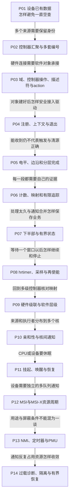

# 第1章\_Linux\_中断机制专题大纲

一个外设已经收到数据，Linux怎样知道、怎样找到驱动，又怎样在设备停止时保证没人再访问它？本专题沿这条完整路径学习 **中断请求（Interrupt Request，IRQ）**，从通知的价值进入控制器、软件对象与驱动生命周期，再处理异步消费、多核、电源切换和异常负载。

这里的目标是能够解释一次请求经过哪些状态，并据此选择和验证驱动接口。读者需要基本C语言、指针和结构体知识；共享状态与交错不熟悉时，先读[同一对象的多条执行路径](../../P01_同一对象的多条执行路径.md)。不要求先背GIC寄存器或读完整内核源码，硬件实现、Linux对象和板级条件会逐层建立。

## 1.1\_从通知到退出的因果阅读地图

先按P01～P08建立一条普通设备请求的闭环，再按P09～P14增加真实系统约束。每个新对象都用来回答上一阶段留下的问题；箭头表达阅读依赖，不是硬件总线连接。

下表给出每章入口、需要带来的结论和读完后应能回答的问题。表中的“留下的问题”用于串联下一章，末章则把通用协议交还给具体设备验证。

| 章节 | 已有前提 | 本章解决的问题 | 留下的问题 |
| --- | --- | --- | --- |
| [P01 中断的定位与演化](P01_中断的定位与演化.md) | 基本程序执行与设备读写 | 轮询为什么有价值，通知省掉什么工作，异常进入为何不等于任务切换 | 多个来源怎样同时接到处理器并保留身份？ |
| [P02 SoC 视角下的中断体系](P02_SoC_视角下的中断体系.md) | 通知与数据处理分离 | 芯片内汇聚、子状态、父请求与编号各在哪一层 | Linux怎样把不同控制器接成统一软件接口？ |
| [P03 Linux 的中断抽象 irq chip irq domain 与 irq desc](P03_Linux_的中断抽象_irq_chip_irq_domain_与_irq_desc.md) | 来源必须带着自己的编号空间 | irq_domain、irq_chip、irq_desc、irqaction与流程处理函数如何分工 | 驱动怎样取得资源、登记回调并安全退出？ |
| [P04 Linux 驱动中的中断注册与接口](P04_Linux_驱动中的中断注册与接口.md) | 对象与执行路径已分开 | 主回调和IRQ线程的约束，初始化、共享判断、注销和资源释放 | 已经登记后为何只来一次或一直来？ |
| [P05 GPIO 与触发语义 电平 边沿 DTS 与 只来一次一直来 为何出现](P05_GPIO_与触发语义_电平_边沿_DTS_与_只来一次一直来_为何出现.md) | 注册不替代设备协议 | 物理/逻辑电平、边沿/电平、设备清源与控制器完成的差别 | 怎样用证据定位究竟哪一层没前进？ |
| [P06 Linux 中断的调试与诊断](P06_Linux_中断的调试与诊断.md) | 各层有独立状态与身份 | 计数、当前映射、追踪窗口、线程等待与观测丢失怎样解释 | 现场处理太长时，延期执行还需保存什么？ |
| [P07 中断下半部机制与驱动中的选择](P07_中断下半部机制与驱动中的选择.md) | 硬入口、线程与观测边界 | work通知和业务记录分离，有界积压、合并及停止同步 | 延后一段时间确认输入时，谁负责再次放行？ |
| [P08 中断 x 高精度定时器(hrtimer) 去抖 延时确认与一次性中断再使能](P08_中断_x_高精度定时器%28hrtimer%29_去抖_延时确认与一次性中断再使能.md) | 异步执行不会自动保存每次业务 | 固定窗口、采样、禁用所有权与timer/work/remove交错 | 把这些协议放回多级控制器时，软件层级等于硬件级联吗？ |
| [P09 层级中断控制器与 ARM GIC 在 Linux 中的实现](P09_层级中断控制器与_ARM_GIC_在_Linux_中的实现.md) | 请求、状态、映射及退出已有模型 | GPIO级联与hierarchical irq_domain如何区别，如何接回GIC | 多CPU下目标如何选择，远端工作如何获知？ |
| [P10 SMP 与中断亲和性 IPI 机制](P10_SMP_与中断亲和性_IPI_机制.md) | 映射不能代替目标选择 | 亲和性请求与实际生效、IPI通知与跨CPU工作状态 | 目标CPU或设备进入低功耗后哪些条件改变？ |
| [P11 电源管理中的中断 suspendresume 与唤醒源](P11_电源管理中的中断_suspendresume_与唤醒源.md) | 运行态的资源与交付链 | 硬件唤醒能力、策略、IRQ wake和软件wakeup source如何协作 | 多队列设备能否用消息表达更独立的通知？ |
| [P12 MSI MSI-X 与 PCIe 设备的中断框架](P12_MSI_MSI-X_与_PCIe_设备的中断框架.md) | 来源、目标及生命周期是独立问题 | MSI/MSI-X配置、队列/向量/IRQ身份、分配失败与反向回收 | 定时器、PMU和NMI是否意味着另一套屏蔽规则？ |
| [P13 特殊与高优先级中断 NMI 定时器 性能中断](P13_特殊与高优先级中断_NMI_定时器_性能中断.md) | 消息和线路都需满足CPU进入条件 | 来源用途与可屏蔽性分开，定时器到期与PMU样本发布各怎样前进 | 通知过多时怎样区分异常来源与真实负载？ |
| [P14 中断风暴 抖动与防御机制](P14_中断风暴_抖动与防御机制.md) | 状态保存、同步和各类交付边界 | 清源所有权、ONESHOT与检测器限制、有界恢复和停止优先 | 回到具体设备证明数据、DMA、复位及电气条件。 |

## 1.2\_当前覆盖边界与源码缺口

本专题现有十四章建立普通设备驱动的中断使用闭环，并用固定Linux 6.12.20证据解释关键实现。正文中的程序、模型和追踪脚本分别注明执行环境：GPIO示例仍需真实板级连接和目标内核构建；用户态模型只能验证列出的逻辑交错；缓存脚本测试不等于已经在板上采集到中断。章节中的版本来源统一回到[Linux源码基线](../../../../../research/source_reading/linux/SOURCE_BASELINE.md)，不能用“本机有一个目录”替代源码身份。

P07承担驱动侧执行上下文与机制选择，P14借NAPI说明批量消费和通知成本，但本专题尚未建立 `softirq_vec[]`、每CPU pending位、`irq_exit_rcu()`、`__do_softirq()`、重启预算以及 `ksoftirqd`之间完整的逐函数源码闭环。因此可以依据正文选择threaded IRQ或workqueue，不能把这些说明当成已经可以修改整个softirq分派器的证明。更深入的[工作队列机制](../workqueue/大纲.md)与[时间及定时器机制](../timers/大纲.md)各有权威正文，不在这里重复维护。

[Tiny RCU模块源码概念导读](../../../../../research/source_reading/rcu/navigation/P11_Linux_6.12_Tiny_RCU模块源码概念导读.md#11.1_模块问题与当前配置前提)组织RCU侧角色与调用顺序，[Tiny RCU源码实现](../../../../../research/source_reading/rcu/source_explanations/P13_Linux_6.12_Tiny_RCU源码实现.md#13.1_实现所有权与本章读者任务)解释登记、置位与RCU回调消费的接缝。这些接缝不替代通用softirq实现说明；后续若进入该分派器，应建立对应模块导读和唯一实现讲解，而不是扩大RCU章节的职责。

## 1.3\_与独立GIC专题的分工

**通用中断控制器（Generic Interrupt Controller，GIC）** 组织硬件请求并向处理器递送中断；Linux IRQ管理建立软件对象、调用控制器操作并把事件交给驱动。硬件交付成功不等于驱动已读走数据，软件登记成功也不证明板级连线已经有效。

[GICv3独立专题](../../../../../platforms/arm/architecture/gic/大纲.md#1.2_因果阅读地图)从外设事件建立硬件模型，以RK3588的GIC-600 r1p6 / GICv3.0为具体资料边界。现有P01～P17包含物理中断机制和UART端到端复盘，另有RK3588集成记录；这不是Linux逐函数源码或真实板上实验已经完成的声明。官方原件身份与取得入口见[Arm资料索引](../../../../../reference/external_resources/arm/README.md#1.4.2_型号判断的证据与适用边界)，原件不能替Linux软件状态作证。

本专题P02建立芯片内位置，P09解释硬件级联与软件层级，P10～P12分别讨论多核、电源和消息中断的软件使用。需要进一步理解硬件时，按[双向阅读分工表](../../../../../atlas/roadmaps/gic_learning_plan.md#1.7_与现有中断章节的交叉阅读)跳转；不要求先学所有GIC代际，也不复制完整GIC正文。

## 1.4\_用已有章节完成四条组合练习

读完默认顺序后，可以按实际问题回访下面的组合；它们都是现有章节的使用方式，不另设空的“第十五章”。

| 任务 | 依次回访 | 应留下的结果 |
| --- | --- | --- |
| GPIO按键、确认窗口与唤醒 | P04资源 → P05触发 → P08窗口 → P11唤醒 | 板级连接、状态机和前后观测；说明窗口可能漏掉什么 |
| 多级控制器与设备树错误 | P02连接 → P03编号空间 → P06证据 → P09层级 | 逐层来源/域/IRQ映射，指出失败阶段，不靠改类型碰运气 |
| 共享线路上的误报或漏报 | P04归属判断 → P05设备协议 → P14检测与隔离 | 区分设备来源、共享action返回和整条线的屏蔽影响 |
| 高频负载与处理延迟 | P06时间证据 → P07业务积压 → P10目标 → P12队列 → P14恢复 | 通知率、消费率、丢失、CPU成本及停止后的同步证据 |

选择接口时先确定来源由谁拥有、能否睡眠、业务如何保存以及退出要等谁。不同设备可能需要不同组合；没有一份与硬件协议无关的“万能ISR模板”。人工阅读进度只在[知识评审地图](../../../../../atlas/maps/knowledge_review_map.md)维护，内容检查通过不代替人工评审。
