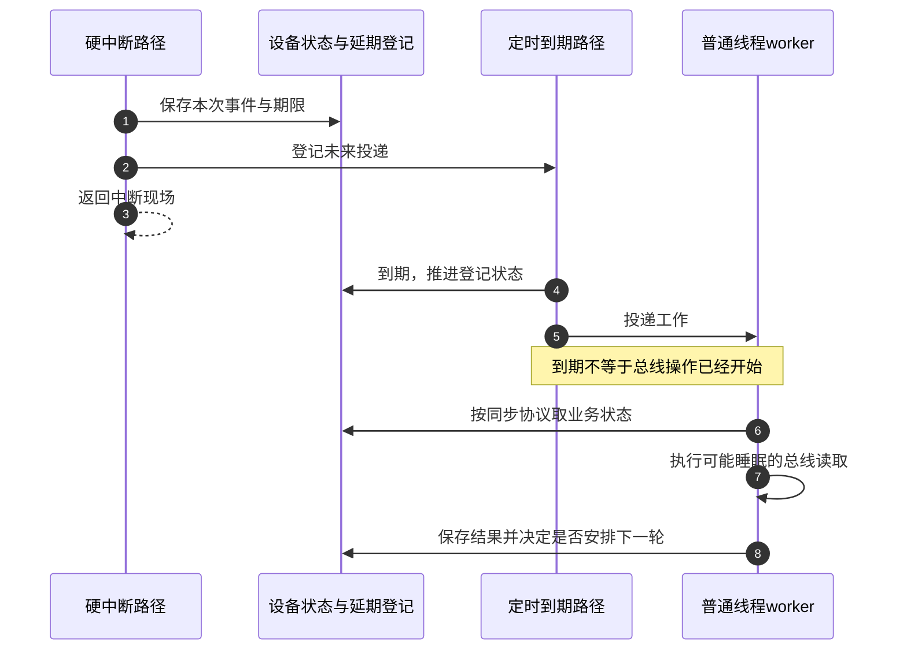
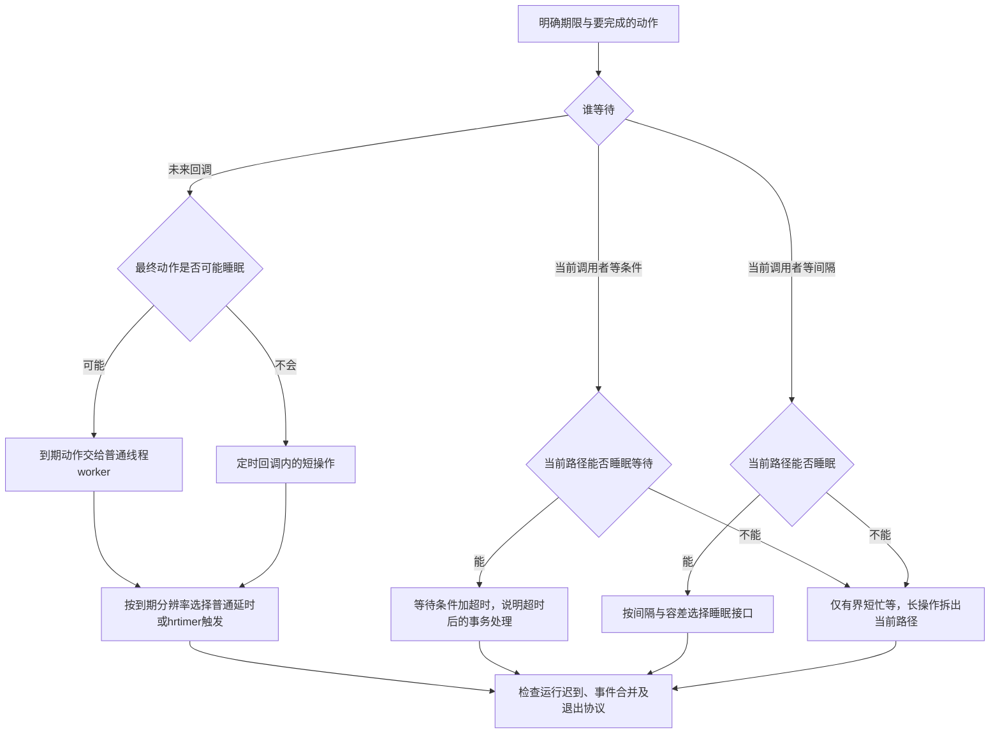

# 第1章\_驱动中的\_时间问题\_概述

## 1.1\_本章目标与适用范围

一块采样设备收到中断后，需要等 10 ms 再通过 I2C 读取稳定值；读操作可能睡眠。设备还要求每秒采样一次，并在一笔命令发出后最多等待 500 ms。最后，驱动卸载时不能留下仍会访问设备内存的回调。四个需求都包含“时间”，但它们等待的对象和完成条件并不相同。

最直接的方案是在中断处理函数里一直等到 10 ms，再读硬件。这样做省去了异步状态，却让处理器持续占在中断路径，而且可睡眠的总线读不能在这里执行。把时间到了以后才做的工作登记起来，先退出当前路径，可以解除这段占用；代价是必须另外保存工作状态，并处理设备退出与未来回调的关系。

本章从这个现场建立选择方法：先判断等待的是当前调用者、未来一次动作还是一个业务条件，再判断执行环境、时间单位和生命周期。读完后应能给出选择理由，不能只凭“需要 10 ms”选函数。正文面向已经能读懂基本 C 驱动回调的读者，具体接口以 Linux 6.12 系列为主要边界；5.x 旧代码只作为迁移时需要辨认的材料。

## 1.2\_驱动里典型的时间相关场景

先看谁继续执行。当前进程发出命令后等结果，是 **当前调用者等待**；中断返回后再采样，是 **未来回调**；硬件必须在下一次寄存器访问前稳定，是 **访问之间的最小间隔**。这些问题可以组合，却不能互相替代。比如一个异步采样动作既有 10 ms 的延期，也有卸载时必须取消的生命期约束。

未来回调还要区分“何时有资格执行”与“在哪执行”。普通定时器 timer_list 负责登记到期回调，高分辨率定时器 hrtimer 缩小到期量化误差；它们本身都不提供普通可睡眠线程环境。工作队列 workqueue 提供另一执行路径，普通线程工作队列的回调可睡眠。延迟工作 delayed_work 把定时到期与工作投递组合起来：先等到期，再等待 worker 执行。仅需离开硬中断而不需要额外延时，可以直接投递普通 work，或按设备协议使用线程化中断。

这里 I2C（Inter-Integrated Circuit）是两线串行总线，SPI（Serial Peripheral Interface）是串行外设接口；具体传输接口是否可能睡眠取决于契约。Regmap 是寄存器访问抽象，它可能封装这些总线，也可能访问内存映射寄存器，不能仅凭名称判断上下文。下文 IRQ（Interrupt Request）表示中断请求。

在上述区别建立以后，再把常见需求放回同一张表：

| 需求维度 | 采样设备中的问题 | 候选路径与仍需检查的条件 |
| --- | --- | --- |
| 延后动作 | 中断后 10 ms 再读稳定值 | delayed_work 提供到期后线程处理；需要记录事件，重复提交可能合并 |
| 周期动作 | 每秒轮询一次 | 定时器或延迟工作重新登记；要选择相对上次结束还是固定相位，处理漂移与超期 |
| 超时等待 | 当前调用者最多等 500 ms | 等待队列或 completion 的超时接口；超时不代表硬件事务自动取消 |
| 短间隔 | 复位后必须先等一小段时间 | 可睡眠时考虑范围睡眠；原子上下文只允许有界短忙等或重构路径 |
| 高分辨率 | 到期误差不能由一个逻辑 tick 决定 | hrtimer；还要测 IRQ 延迟和后续执行延迟，不保证硬实时期限 |
| 生命周期 | remove 后任何回调都不能再碰设备 | 封住新提交并同步在途执行；devres 只帮助安排释放，不能自动推导同步顺序 |

最后一行适用于前面所有行，不是一种与它们互斥的“第六类定时器”。看门狗、按键长按和轮询只是业务场景，必须继续问它们各自的最迟期限、漏一次的后果以及执行环境，不能只照名字复制机制。

## 1.3\_用户态时间\_vs\_内核时间的差异

用户写“500 毫秒”时，单位已经给定。传入内核接口时，必须看参数约定：`msleep(500)` 的参数本来就是毫秒；`mod_timer()` 的 expires 却是 jiffies 时间线上的绝对到期计数。错误不在于“内核不能写整数”，而在于 **同一个整数在不同接口里代表不同单位与语义**。

HZ 表示每秒的逻辑节拍单位数量，jiffies 按这个尺度计数。下面假定 dev->timer 已初始化、设备仍存活、调用者已满足并发与退出协议；这两行只展示时间参数转换，不是完整驱动：

```c
/* 把毫秒时长转为逻辑节拍，再加到当前计数上。 */
unsigned long timeout_ticks = msecs_to_jiffies(500);
mod_timer(&dev->timer, jiffies + timeout_ticks);
```

若误写成 `jiffies + 500`，增加的是 500 个节拍：HZ=1000 时名义间隔为 0.5 s，HZ=100 时为 5 s。换成 `msleep(msecs_to_jiffies(500))` 也不对，因为那会把已经转换成节拍的数再次当毫秒。转换只能发生在明确的单位边界。

ktime_t 则是内核的高分辨率时间值类型。纳秒表示不等于纳秒级执行保证；同样，选择单调时间还是墙钟时间，也独立于用毫秒或纳秒表示。用户态也有多种时钟与调度迟到，不能用“用户态 sleep 一下就够了”概括这些区别。第二章建立时间线，第三章再解释舍入、范围、回绕与绝对/相对转换。

## 1.4\_上下文\_精度\_可睡眠性三要素

先沿采样动作走一遍：中断记录“发生了采样请求”，定时部分保存期限；到期后，工作进入线程队列；worker 获得处理器后才真正读总线。高分辨率只能改善其中的期限表达与事件触发，不能消除 worker 的排队时间。



这张图里的业务状态由设备驱动保存，定时/排队状态由相应内核对象承载；框架不会替你保存每个输入样本。若同一个 work 已经 pending，再次提交可能只合并为一轮执行。需要保存全部事件时，应先进入业务计数或队列，再让 worker 取走。



进程上下文只是允许睡眠的必要背景之一，持自旋锁、关闭本地中断或处于其他原子区时仍不能睡。普通硬中断 handler 不能调用 msleep；线程化中断的线程函数另有契约。高分辨率需求也可能来自进程上下文，不能按“调用者是中断还是进程”决定是否允许使用 hrtimer。

时间要求要拆成至少三项：不能早于某点、允许晚多少、错过时怎么办。要求“10 μs 后精确发生硬件边沿”时，仅在 busy-wait 与 hrtimer 之间二选一并不能建立保证；还可能需要硬件比较器、PWM 或设备自身定时功能。PWM 是脉宽调制硬件输出，能把某些边沿时序从软件调度中移出去。

## 1.5\_后续章节结构说明(引导)

第二、三章先解决“时间从哪来、期限用什么口径”；第四至六章把未来动作落到普通定时器、高分辨率定时器与延迟工作；第七、八章回到当前调用者怎样等待。第九至十一章增加板级参数、释放与电源状态约束；第十二、十三章用完整场景和诊断记录检验选择；[第十四章](P14_按键窗口合并与按下释放确认.md)进一步比较按键窗口合并与按下释放确认。十四章的阅读入口见[专题大纲](大纲.md)。

工作队列自身的事件账本、合并语义和停止门控在[工作队列专题](../workqueue/大纲.md)建立；本专题第六章集中解释定时器到工作投递之间多出的一段生命周期，不另造一套工作队列基础理论。

## 1.6\_常见错误与不写的后果

把前面的选择放回错误现场，可以看到不同失败不是同一种“时间不准”。以下分别检查执行环境、单位、对象生命期、处理器占用与参数来源；修正其中一项并不会自动修正其他项。

### 1.6.1\_在中断上下文里调用可睡眠延时

硬中断中执行 msleep(10) 的问题不是“等得太久”这么简单，而是它试图让当前执行路径睡眠。调试配置可能报告 invalid context；没有告警不代表合法。把动作投递给普通线程 worker 时，还要按硬件协议先记录必要状态并确认或屏蔽中断源，否则电平源仍有效时可能立即再次进入中断。只 schedule_delayed_work 然后 IRQ_HANDLED 不足以作为通用正确 handler。

这个改法也改变了执行时刻：10 ms 是延期目标，后续还有 worker 排队和总线完成时间。需要每次中断都形成一条记录时，先保存事件，不能把投递次数当成可靠事件计数。

### 1.6.2\_直接写\_常量毫秒\_而不做\_HZ\_转换

`mod_timer(&dev->timer, jiffies + 500)` 增加 500 节拍；需要 500 ms 时用 msecs_to_jiffies。反过来，参数本来以毫秒为单位的接口不应再传 jiffies。评审时同时看变量名、类型、单位和接口契约，不能只搜索有没有转换宏。

### 1.6.3\_删除驱动时没有先删定时器/延迟工作

先释放 d，再等待它内嵌的定时器或工作，会使回调通过旧地址访问已释放内存，即 use-after-free。回调开头加 `if (!device_present)` 不能救回已经失效的对象：读取这个标志本身就可能访问悬空地址，而且检查之后还可能并发释放。

一般退出推导是先关闭新提交入口并同步已经进入的生产者，再停止/同步定时器和工作，最后释放回调依赖的内存、寄存器映射和引用。实际顺序必须按依赖图决定，不能持回调需要的锁等待它结束，也不能先关闭它完成所需的唯一事件源。普通同步删除与永久 shutdown 对再启动的保证不同，第十章展开；devres 自动释放不替代这一证明。

### 1.6.4\_用忙等待做长时间延时

`udelay(30000)` 试图在当前执行流里忙等约 30 ms，期间不主动让出处理器；并不是一个调用就“锁死整个 CPU 系统”。它是否阻止抢占或中断取决于外层上下文，但耗费处理器时间、放大原子区延迟的问题仍在。大参数还可能超出平台延时实现的适用范围。

可睡眠时选适合容差的睡眠/条件等待；不可睡眠却要等很久时，应拆成状态机或未来回调，而不是换成同样长的自旋轮询。若硬件真的只需很短的非睡眠等待，保留忙等仍可能是更简单且合适的方案。

### 1.6.5\_忽略设备树里的时间属性

设备树 Device Tree（DT）描述硬件与绑定约定；属性名和单位必须由设备 binding 定义。这里的 `nxp,debounce-ms` 仅沿用旧教学设备的自定属性示例，不是通用按键标准。标准设备应使用其真实绑定提供的属性，不能任意新增厂商前缀后便声称所有驱动识别它。

读取时需要确定缺失默认值、无效值与允许范围。下面只是 probe 中的参数片段：np 为当前设备节点，d 为已分配的设备对象；20 与 1000 是教学设备的默认值和上限，不是内核统一限制。

```c
u32 debounce_ms = 20;
int ret;

/* 此教学绑定允许缺省，但已存在的错误属性必须使初始化失败。 */
if (of_find_property(np, "nxp,debounce-ms", NULL)) {
    ret = of_property_read_u32(np, "nxp,debounce-ms", &debounce_ms);
    if (ret)
        return ret;
}
if (!debounce_ms || debounce_ms > 1000)
    return -EINVAL;
d->debounce_jiffies = msecs_to_jiffies(debounce_ms);
```

这里先查属性是否存在，缺省保留默认值；存在但不能读出 u32 时返回错误，超出教学绑定范围则返回 EINVAL。正式绑定还可能限制属性长度等条件，第九章按实际契约完成接入，不能把这个片段当所有设备的通用验证器。

## 1.7\_调试与验证建议

验证时沿请求到完成分段记录，先确定错误落在哪一段，再选择日志、跟踪或退出交错测试。测量本身会占用时间，必须同时记录工具与负载，避免把打点扰动当成设备固有延迟。

### 1.7.1\_基础\_printk\_打点

至少记录请求时间、期望到期点、回调开始与业务完成。只在回调打印一次 jiffies，不能区分配置错、不断改期、到期处理晚或执行队列拥塞。pr_debug 还受动态调试/构建配置影响，未出现输出不能证明没运行；高频 printk 本身会扰动测量。

### 1.7.2\_ftrace\_/\_trace\_events

ftrace 是内核跟踪设施，trace event 是带字段的结构化事件。先核对目标内核提供的事件和时间钟，再把定时登记、到期与 worker 执行关联到同一对象。跨 CPU 时间比较需要适用的 trace_clock；选择 global 可能有额外开销，不能把它当所有机器唯一正确的选项。第二、十三章给出具体检查入口。

### 1.7.3\_检查是否仍在\_pending

定时器迟迟不触发，可能因为每次输入又调用 mod_timer，把期限推后。pending 只描述是否排队，不能证明回调是否正在执行；直接打印 expires 也要满足相应串行化，单次字段快照不会成为退出同步协议。先记录每次改期，再对照到期事件，才能区分“不断延期”和“到期后迟到”。

### 1.7.4\_验证\_remove/shutdown\_路径

在可恢复的测试设备上覆盖“尚未到期”“刚开始回调”“回调准备重排”三个时点。模块卸载可用 rmmod；sysfs 的驱动 unbind 文件接收 **设备名**，不是 `echo 1 > unbind` 这样的通用开关。测试前必须选定实际设备与驱动，并保证不会拆掉当前系统的必要设备。

检查的是退出返回后是否仍有设备访问、提交入口是否关闭、在途执行是否完成，不能只看日志有没有出现 crash。没有故障只覆盖本轮执行到的交错；同步协议仍要从状态和锁关系证明。

### 1.7.5\_定位\_时间突然跳了/回拨了

先看记录使用哪条时间线。墙钟允许由管理员或校时机制调整；基于单调时间的绝对期限不会因为“采用绝对值”就继承墙钟回拨。相对与绝对是一条轴，单调、启动时间和墙钟是另一条轴。再检查 clocksource 状态、跟踪钟与跨 CPU 比较，不能看到负差值就直接归因于 NTP。NTP 是 Network Time Protocol，网络校时协议；它也可能调整时钟速率，并非每次校时都发生回拨。

## 1.8\_小结

现在可以把采样设备的四个需求分开：10 ms 后的总线读需要延期与线程执行两层，周期采样还要规定重排基准，命令超时需要业务取消/完成协议，卸载需要封住生产者并等待在途路径。下一章继续问：内核怎样知道“已经过了 10 ms”，又由谁在那个期限提醒处理器？

练习：同样是“500”，分别传给 msleep 与作为 jiffies 增量，HZ=100 时各表示什么？如果 hrtimer 已按时触发，但 worker 晚 3 ms 开始，应该先改时间表示还是检查执行排队？

答案：前者是名义 500 ms 的睡眠请求，实际返回仍可更晚；后者是 500 个节拍，名义 5 s。第二问先检查后续执行排队与调度，因为到期精度已经不是该次迟到的直接位置。

## 1.9\_本章产出\_时间需求\_to\_后续章节映射表

| 已经明确的问题 | 下一处正文 | 阅读时核对什么 |
| --- | --- | --- |
| 读时间与触发期限 | [第二章](P02_Linux_时间基础与_timekeeping_框架速览.md) | clocksource、clockevent 与时间线 |
| 时长转期限、范围与回绕 | [第三章](P03_时间表示与转换接口详解.md) | 参数单位、舍入与比较前提 |
| 到期后短回调或可睡眠动作 | [第四章](P04_基础定时器机制_struct_timer_list.md)、[第五章](P05_高精度定时器_hrtimer_的驱动用法.md)、[第六章](P06_基于工作队列的延迟执行_delayed_work.md) | 到期与实际执行的两段延迟 |
| 当前调用者等待或短忙等 | [第七章](P07_睡眠与超时调度接口.md)、[第八章](P08_忙等待与短延时_udelay%28%29_ndelay%28%29_的边界.md) | 条件、上下文和超时后的责任 |
| 参数、释放与挂起 | [第九章](P09_时间与设备树平台数据的对接.md)、[第十章](P10_与_devres_驱动生命周期和_PM_的关系.md)、[第十一章](P11_电源管理_系统挂起与定时唤醒.md) | binding、再启动和唤醒能力 |
| 模板与排错 | [第十二章](P12_常用模式与代码模板.md)、[第十三章](P13_调试_验证与常见陷阱.md) | 模板前提、分层时间戳与退出验证 |

接口对照依据：[Linux 6.12 时间读取接口](https://docs.kernel.org/6.12/core-api/timekeeping.html)；普通定时器删除/关闭的固定实现见[定时器退出源码导读](../../../../../research/source_reading/kref/navigation/P05_定时器重启与退出导读.md#5.2_从排队到最终关闭)。

下一篇：[P02 Linux 时间基础与 timekeeping 框架速览](P02_Linux_时间基础与_timekeeping_框架速览.md)。
