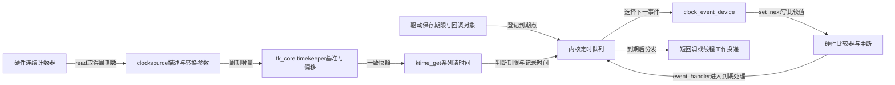
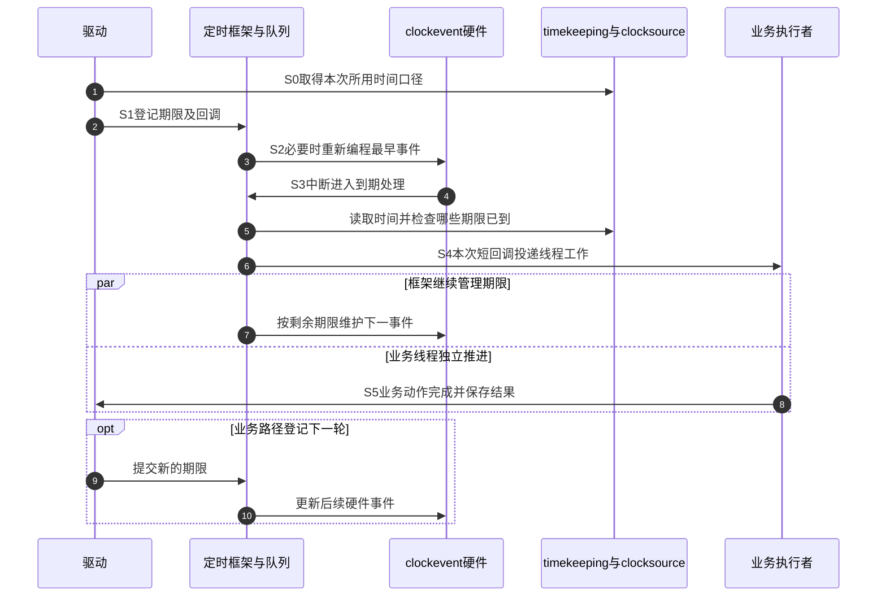
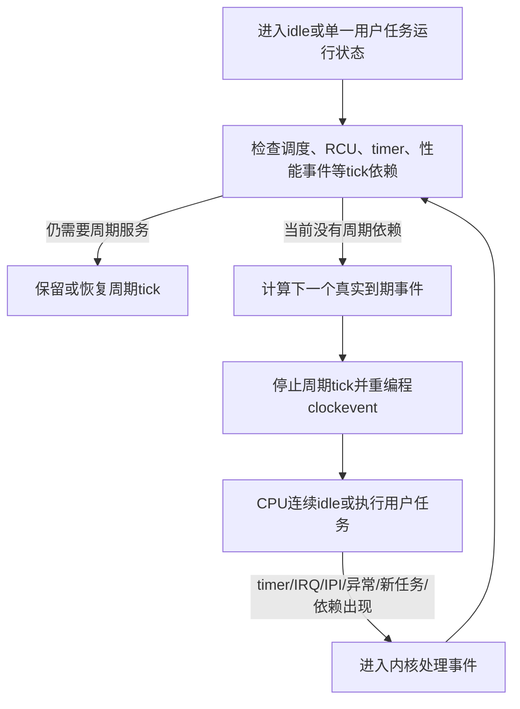

# 第2章\_Linux\_时间基础与\_timekeeping\_框架速览

## 2.1\_章节内容说明

上一章把“10 ms 后采样”拆成了到期与实际执行，现在仍缺两个能力：没有中断发生时，内核怎样知道已经过了多久？处理器没有持续轮询时，谁在期限附近叫它回来？如果只给出一个“系统时钟”名词，这两个方向会被混在一起。

本章先建立计时读数、时间线与到期事件三种角色，再解释逻辑 tick 为什么可以保留而物理周期 tick 被省略。读完后应能把“时间读错”“到期事件晚到”和“回调排队迟到”分开定位。驱动通常使用公共接口；只有实现平台计时设备时，才直接编写 clocksource/clockevent 驱动。

## 2.2\_内核时间体系的定位

先设想只有一个持续递增的硬件计数器。软件读两次，按频率换算差值，就能估算经过多久；但计数器可能回绕，频率也不等于 1 GHz，读数更没有直接说明今天的日期。于是需要一层软件维护“上次读数对应的时间基准”，把增量转换后加上去，并为墙钟、单调时间等提供不同偏移和调整规则。这就是 clocksource 与 timekeeping 的分工起点。

仅能读时间还不够。若 CPU 睡着了，某个计数器即便已经超过期限，也不会自动执行软件回调。还需要能编程比较点或周期、到期产生中断的硬件，以及把它接到内核的 clockevent 接口。一个硬件单元可以同时提供计数读数与比较中断，但两项接口的输入输出不同，不能因位于同一块硬件就合并成一个软件职责。

最小闭环因此是：驱动登记期限，框架选择下一个事件并编程硬件；硬件产生中断，内核读取时间、处理到期项，再执行短回调或投递线程工作。读时间和产生事件都不等于业务数据已经处理完。下面先把期限的粗粒度表示 jiffies 讲清，再把这条闭环放回具体状态。

## 2.3\_tick\_HZ\_与\_jiffies

这一节是整个时间专题的“最小公约数”。你说的很多“500ms”“10ms 去抖”“1s 轮询”最后其实都会走到这里。

### 2.3.1\_HZ\_是什么

CONFIG_HZ 是内核构建配置中的逻辑节拍频率参数；NO_HZ 是允许省略不必要周期 tick 的机制名称，其运行条件到 2.5 节展开。先分清参数尺度与硬件中断次数，再读下面的关系。

- `CONFIG_HZ` 定义内核每秒有多少个 **逻辑节拍单位**，也决定周期调度 tick 运行时的目标频率；
- 常见值是 100、250、1000，也有 300、1024 这种；
- HZ 越大，基于 jiffies 的时间粒度通常越细，但保留周期 tick 时的调度和中断负担也越重；
- 启用 NO_HZ 后，某个 CPU 可以省略一段时间内的物理周期 tick，不能再把 `CONFIG_HZ=1000` 机械理解成“每个 CPU 永远每秒进入 1000 次 tick IRQ”。

所以：**不能在驱动里写死对 HZ 的假设**。否则同一驱动在服务器核和嵌入式核上表现就会不同。

### 2.3.2\_jiffies\_是什么

- `jiffies` 是以 `1/HZ` 为单位表达内核逻辑时间的全局节拍计数器；
- 在周期 tick 模式下，可以先用“一个负责更新时间的 tick 使它前进一个单位”建立直觉；
- 在 NO_HZ 省略了若干物理 tick 后，内核会依据已经流逝的时间补算应前进的节拍数，所以 **省略物理 tick 不等于 jiffies 或系统时间停止**；
- 所有基于 `struct timer_list` 的低精度定时器，底子都是这个；
- 它的类型是 `unsigned long`，会按字长回绕；`jiffies_64` 扩大范围但仍是有限位宽。32 位机器读取完整 64 位值要用 `get_jiffies_64()`，不能假设裸读原子。

所以你常看到：

```c
mod_timer(&dev->timer, jiffies + msecs_to_jiffies(500));
```

这句话的语义其实是：“请在**当前节拍的基础上**，再加上 500ms 对应的节拍数，把这个逻辑到期点交给定时器框架；它不是承诺回调恰在这个物理时刻开始”。

### 2.3.3\_为什么要用转换宏

因为你不知道 HZ 是多少，所以 500ms → jiffies 必须要用内核提供的宏，把“时间长度”翻译成“节拍数”：

```c
unsigned long to = msecs_to_jiffies(500);
mod_timer(&dev->timer, jiffies + to);
```

你如果直接写 `+ 500`，就是在假定 1 tick = 1ms（也就是 HZ=1000）。这在 ARM 嵌入式上经常不成立。

### 2.3.4\_jiffies\_驱动的定时器精度

基于 jiffies 的定时器有两个天然限制：

1. **到期时间先量化为 jiffies 粒度**，不能表达任意两个逻辑节拍之间的纳秒级期限；
2. **到期不等于回调已经获得 CPU**：本地中断屏蔽和 softirq 延后会推迟普通定时器回调；若回调进一步投递 work，工作队列排队又增加一段业务执行延迟。不能把这两段都叫 timer 回调延迟。

但换个角度看，它也有明显优点：

- 适合大量允许粗粒度到期、常在到期前被取消的超时项目；timer wheel 用分层桶组织期限，避免对每个条目都按精确时间排序；
- 写法简单：`mod_timer()` 周期化特别方便；
- 对绝大多数“几十毫秒、几百毫秒”的驱动任务来说已经够用。

因此，粗粒度且回调很短的超时可以使用 timer_list；需要可睡眠业务动作时，普通 delayed_work 往往更直接。选择依据是容差与执行环境，不能给所有定时任务指定一个无条件默认接口。

### 2.3.5\_简单时间线示意


这个时间线只表示期限登记，未把到期与执行之间的延迟画成零。另一个边界是回绕：在有效比较范围内，应使用 time_after/time_before 族比较 jiffies 期限，不能直接用普通大小关系跨越回绕点。第三章展开范围前提。

## 2.4\_timekeeping\_/\_clocksource\_/\_clockevent\_的基本角色

仍沿“10 ms 后采样”追踪。平台计时驱动把可读计数器注册成 clocksource，把可编程中断源注册成 clock_event_device；timekeeping 用前者维护读数口径，定时框架用后者安排提醒。读者要区分计数器自身、软件保存的基准和一条未来期限，不能把它们看成同一变量。

### 2.4.1\_timekeeping\_维护\_当前时间线\_的那一层

硬件计数值相同，可以对应不同的用户问题：测量两次采样之间运行了多久，需要单调时间；把结果记成日历日期，需要墙钟；设备睡眠一小时后判断凭证是否过期，需要包括挂起时长的口径。因此 timekeeping 维护公共计数增量与各时间基准，读取者通过 ktime_get 系列选择口径。

固定 6.12.20 中，核心状态在 `tk_core.timekeeper`，其中 `tkr_mono` 保存单调读数基准与转换参数，`offs_real/offs_boot` 等保存其他时间线偏移。更新者在框架同步规则下推进状态；普通读取者通过 `tk_core.seq` 的序列计数检测读期间是否更新，必要时重读，避免拼接两个版本的基准。它不是给每次读取加一把全局互斥锁，也不是让读者直接修改硬件。

例如 `ktime_get()` 取基准、读 clocksource 的当前周期数、计算上次基准以来的纳秒增量，最后合成单调时间。这说明精细时间读数并不要求“每读取一次就先等一个 tick 中断”。墙钟可以跳变，单调时间则避免这种日期跳变，但仍可能接受频率校正；不能笼统说“timekeeping 会调整，所以它返回的所有时钟都会回拨”。

### 2.4.2\_clocksource\_提供\_读数\_的硬件或软件源

clocksource 的 read 回调提供计数值，mask 说明有效位宽，mult/shift 用于把周期差换成纳秒。软件先求当前周期与保存的 cycle_last 之差，再按掩码处理计数器回绕，最后进行比例换算。这里需要限制两次维护之间的距离，不能在计数器回绕了不知多少圈以后仍只凭一个差值恢复全部时间。

x86 的 TSC（Time Stamp Counter，时间戳计数器）、Arm 架构计时器的系统计数器、SoC 定时器都可能提供这类读数；这是实现候选，不是保证每块板最终使用某一个。框架根据能力与可靠性选择时钟源，也可能在发现不稳定后切换。硬件读数的分辨率、频率稳定性和跨 CPU 一致性，与“回调是否及时获得执行”属于不同问题，不能只因两块板迟到不同就归因于 clocksource。

### 2.4.3\_clockevent\_负责\_产生事件\_的那层

为了在未来提醒 CPU，框架把下一期限交给 clock_event_device。其 set_next_event 接收硬件计数差，或由支持的 set_next_ktime 接收时间值，平台驱动再写比较寄存器；硬件中断发生后调用框架分配的 event_handler。可编程范围、是否支持单次触发和 CPU 覆盖范围，决定框架可以怎样安排事件。



图中两个硬件框可能属于同一计时单元，也可能来自不同设备；这是一张职责图，不是某个 SoC 的寄存器布局。clocksource 不因为被读取就产生一次中断，clockevent 也不因为产生一次中断就替驱动读完总线。

| 软件对象/字段 | 谁提供或写入 | 谁读取/调用 | 当前能够证明的事情 |
| --- | --- | --- | --- |
| clocksource.read、mask、mult/shift | 平台驱动初始化并向框架注册 | timekeeping 读取计数并换算 | 当前时间读数的基础与有效范围 |
| tk_core.timekeeper、tkr_mono、偏移 | 时间保持与校时/恢复路径 | ktime_get 系列在序列计数保护下读取 | 同一口径的一致时间快照 |
| clock_event_device.set_next_event/set_next_ktime | 平台驱动实现，框架调用 | 硬件比较器接收编程值 | 下一硬件事件已尝试安排，不证明回调完成 |
| clock_event_device.event_handler | 框架按工作模式设置 | 底层定时中断路径调用 | 进入 tick 或高分辨率事件处理 |
| timer_list/hrtimer 对象及队列 | 提交者登记，框架到期路径推进 | 到期处理与取消路径 | 排队和执行分别有状态，不能靠一个 pending 位证明退出 |



S1～S3 解决期限管理，S4～S5 才完成业务动作。图中特意选择“短回调再投递线程”的分支：定时框架维护下一硬件事件不需要等待该业务线程结束；若业务在短回调内直接完成，便没有后续 worker 排队。这是角色层的关系，具体普通 timer 与 hrtimer 的锁、软硬中断路径、取消和重排在第四、五章展开。硬件没有可用的一次性比较事件时，不能只打开一个配置就宣称获得高分辨率执行。

字段依据为固定 NXP 6.12.20 的 `include/linux/clocksource.h`、`include/linux/clockchips.h`、`kernel/time/timekeeping.c`；来源身份与校验记录见[时间基础证据](../../../../../research/source_reading/linux/SOURCE_BASELINE.md#1.171_时间基础与定时入口边界)。本页是机制解释，不复制这些接口的完整实现体。

## 2.5\_NO\_HZ\_/\_高精度定时器配置对驱动的影响

先直接回答“NO_HZ 是不是把 tick 关闭了”：

> **NO_HZ 会在当前不需要周期调度 tick 时，动态停止该 CPU 的周期 scheduling-clock tick；它不是永久关闭 tick，更不是关闭所有定时器中断。**

“tickless”更准确的含义是 **省略不必要的周期 tick**。一旦某项内核工作需要 tick，tick 可以恢复；如果真正的 timer/hrtimer 已经安排到期点，clockevent 仍要在那个时刻产生中断。

本节会反复出现四个部署术语：`NO_HZ_FULL` 是“运行中的指定 CPU 也允许省略周期 tick”的 full-dynticks 模式；NOCB 是 Tree RCU 的 callback 卸载策略；housekeeping CPU 是承接被迁移后台工作的非隔离 CPU；RT task 指实时任务；优先级策略与 deadline 调度不是同一个策略，不能见到 RT 就默认任务使用 SCHED_DEADLINE。

### 2.5.1\_先分清三种tick工作模式

下面三项都是内核构建期的 Kconfig 布尔配置：`CONFIG_HZ_PERIODIC` 选择始终周期 tick，`CONFIG_NO_HZ_IDLE` 选择 idle dynticks，`CONFIG_NO_HZ_FULL` 选择 full dynticks。

| 模式 | 什么时候保留或停止周期调度tick | 主要目标 |
| --- | --- | --- |
| `CONFIG_HZ_PERIODIC` | CPU 运行和 idle 时都保留周期 tick | 实现简单、行为规律 |
| `CONFIG_NO_HZ_IDLE` | CPU 进入 idle 且条件允许时停止周期 tick；离开 idle 后恢复 | 避免唤醒无事可做的 CPU，降低能耗 |
| `CONFIG_NO_HZ_FULL` | 包含 idle tickless；指定 CPU 只有一个可运行任务并在用户态持续执行、且没有其他 tick 依赖时，也尽量停止周期 tick | 减少计算核的 OS jitter，改善 CPU isolation |

`CONFIG_NO_HZ_IDLE` 主要解决“CPU 已经无任务可跑，为什么还要按 HZ 周期醒来”；`CONFIG_NO_HZ_FULL` 又解决“CPU 只有一个用户态任务，为什么还要周期性打断它询问是否需要调度”。后者并不是所有 CPU 的默认状态：启动参数 `nohz_full=` 指定进入 full-dynticks 管理集合的 CPU，系统仍要保留 housekeeping CPU 承担时间保持、RCU callback、非绑定工作等后台职责，启动 CPU 也不会被放入该集合。

### 2.5.2\_停止的是周期tick而不是所有时间事件

本节的 IRQ 指 interrupt request，即中断请求，既可能来自设备也可能来自定时器等来源；IPI 指 inter-processor interrupt，即一个 CPU 主动通知另一个 CPU 的核间中断。

满足停 tick 条件时，内核执行的不是简单写入一个永久的 `tick_enable = false`，而是重新评估“下一件必须发生的事”：



因此以下事件都没有被 NO_HZ 消灭：

- 已编程的普通 timer 或 hrtimer 到期；
- 设备 IRQ、核间中断 IPI、异常和系统调用；
- 新任务唤醒、迁移或其他确实需要重新调度的事件；
- 子系统重新声明 tick 依赖后恢复的调度 tick。

所以“CPU 不再有周期 tick”只能推出 **少了一种固定频率的内核进入原因**，不能推出“CPU 永不进入内核”“不会调度”或“所有定时器都停了”。

### 2.5.3\_NO\_HZ\_FULL的典型对象是长时间用户态计算

`NO_HZ_FULL` 最容易成立的负载是：指定 CPU 上只有一个可运行的用户态计算任务，它很少系统调用、不使用会要求周期记账的 POSIX CPU timer，并且平台具有稳定可用的 clocksource。只要出现额外 runnable task 或其他 tick 依赖，周期 tick 就可能重新启动。

这解释了为什么它常见于 HPC、用户态数据面和隔离计算核，也能帮助某些长计算段实时任务降低尾延迟。它不是“收到外设中断后快速反应”的专用机制；设备 IRQ 应落在哪个 CPU，是另一项架构决定。

实时系统至少有两种不能混写的布局：

| 布局 | 事件和计算怎样衔接 | 收益 | 代价与边界 |
| --- | --- | --- | --- |
| 同核事件响应 | IRQ/线程化 IRQ 与高优先级 RT task 放在同一 CPU | 少一次核间交接，可能缩短最紧的 event-to-action 路径 | IRQ 和其他内核工作直接扰动 RT task；未必适合 `NO_HZ_FULL` |
| 分离式隔离计算 | housekeeping/I/O CPU 接收事件，经共享内存、ring 和唤醒协议把数据交给隔离 CPU | 计算 CPU 的工作集和执行窗口更可控，适合长用户态计算 | 多一次缓存行所有权转移、内存屏障、唤醒/IPI 和调度交接；端到端时延不一定更短 |

不能把 CPU 当作中断控制器的“缓存”：在 ARM 系统上，GIC 负责把中断路由到目标 CPU，真正的 handler 仍由 CPU 执行。是否把 I/O 与计算分核，要用完整的最坏时延链比较，而不是只看隔离 CPU 是否更“干净”。

### 2.5.4\_为什么NO\_HZ\_FULL还要配合RCU\_NOCB

假设 CPU3 已经满足单一用户任务条件，周期调度 tick 得以停止。如果 CPU3 对应的 RCU callback 仍需要由它本地推进和批量调用，这些工作可能重新制造内核噪声，或者形成停 tick 的依赖。为避免这段 callback 侧工作落回 CPU3，当前 Tree RCU 会让 `nohz_full` CPU 同时进入 callback offload 集合，再由 NOCB kthread 管理等待并执行成熟 callback。

这不是“进入 `NO_HZ_FULL` 前先把旧 RCU 账单结清，然后永久关 tick”的一次性过程。更准确的时间关系是：

```text
启动/配置阶段
    建立nohz_full CPU集合
    建立这些CPU的RCU callback offload属性
    规划housekeeping CPU与NOCB线程落点

运行阶段
    每次条件满足 → 动态停止周期tick
    条件破坏     → 必要时恢复tick
    callback出现 → 仍登记到对应per-CPU队列，但由NOCB侧推进和调用
```

纯用户态计算函数不会直接调用内核 `call_rcu()`。不过系统调用、缺页、调度、设备路径或该 CPU 上偶发执行的内核代码仍可能使用 RCU；而 callback 队列和 GP/QS 责任本来也是内核状态。NOCB 的作用是使 **未来出现的 callback 也继续走卸载协议**，不是把 CPU 的全部 RCU 读侧、QS/EQS 跟踪或所有内核活动清零。完整责任边界见 [Tree RCU NOCB 回调卸载](../../synchronization/rcu/P16_Tree_RCU_NOCB回调卸载.md#16.2_卸载前后责任对比)。

### 2.5.5\_普通timer不会因为省略tick就被遗忘

NO_HZ 的正确实现目标正是：省掉中间无用的周期 tick，同时把 clockevent 编程到 **下一个不能错过的真实事件**。因此不能把“1 秒普通 timer 偶尔在 1.x 秒才执行”直接解释成“内核为了 NO_HZ 故意不叫醒 CPU”。

实际回调晚于到期点时，应继续分层排查：

- `timer_list` 的 jiffies 量化和 timer wheel 粒度；
- timer slack、可合并策略，或是否明确使用了 deferrable timer；
- 到期中断是否被 IRQ-off 区间推迟；
- timer softirq 是否积压或被更高优先级工作延后；
- `delayed_work` 到期后是否还在等待 worker 获得 CPU；
- CPU 频率、电源状态退出、虚拟化和平台 clockevent 是否造成额外延迟。

其中 **deferrable timer** 明确允许 CPU 在 idle 时不因它单独醒来；普通非 deferrable timer 则应参与“下一个事件”的计算。NO_HZ 改变唤醒组织方式，但不把普通定时器的到期契约自动降级成“随便晚一些”。

### 2.5.6\_hrtimer提高到期表达精度但不承诺deadline

`CONFIG_HIGH_RES_TIMERS` 是启用高分辨率 timer 基础设施的 Kconfig 配置；`hrtimer` 是以高分辨率时间值表示到期点的内核对象。即使未进入高分辨率运行模式，它仍使用这一表示；实际能否在两个逻辑 tick 之间安排硬件事件，还需要 `CONFIG_HIGH_RES_TIMERS=y`、可用 clocksource 与 clockevent 能力以及运行时成功切换。配置开启本身不能证明“5 ms + 300 μs 附近”的事件已经得到相应分辨率。适合考虑它的场景包括：

- 期限小于一个 jiffies 粒度；
- 需要较小的到期量化误差；
- 音频、采样、控制等确实需要高分辨率事件。

但 hrtimer 只改善 **到期时间的表达和事件编程精度**。IRQ 屏蔽、抢占、回调执行时间和后续 worker 排队仍会形成 jitter，所以 `hrtimer` 本身不提供硬实时 deadline 保证。

### 2.5.7\_不要默认所有实时负载都适合NO\_HZ\_FULL

对长时间连续执行的单一用户态计算，减少周期 tick 往往有价值；对每 100 μs 一次、频繁进出内核的周期控制循环，稳定的周期 tick 有时反而更容易形成可预测的执行节奏，NO_HZ 的进入/退出与记账成本未必划算。这是按干扰来源作出的负载选择，不能把一份配置建议当成目标平台已经测得的最坏延迟。

因此选择顺序应是：先画出 event-to-action 或 compute-completion 的完整路径，再测量周期 tick 是否真的进入尾延迟主因，最后决定使用 periodic tick、`NO_HZ_IDLE` 还是 `NO_HZ_FULL`。**“实时”不是自动启用 `NO_HZ_FULL` 的充分条件。**

### 2.5.8\_官方机制说明入口

- [NO_HZ: Reducing Scheduling-Clock Ticks](https://docs.kernel.org/6.12/timers/no_hz.html)：三种 tick 模式及其基本约束。
- [CPU Isolation](https://docs.kernel.org/admin-guide/cpu-isolation.html)：补充阅读入口，随主线演进；具体部署仍按目标版本核对 `nohz_full`、housekeeping 与隔离核职责。
- [Real-time kernel configuration](https://docs.kernel.org/next/core-api/real-time/kernel-configuration.html)：开发版补充建议，不作为固定 6.12 实现证据。

------

## 2.6\_内核时间获取接口速览(驱动常用)

先选择要回答的问题，再选择返回格式。测一次事务在系统运行期间经过多久，通常用单调时间；如果挂起时间也算在业务有效期内，就用 boottime；要与日历日期关联才考虑 real。把值换成纳秒不会改变它属于哪条时间线。

| 接口/对象 | 时间口径与返回形式 | 挂起/调整与回绕边界 | 适用问题 |
| --- | --- | --- | --- |
| jiffies | unsigned long 逻辑节拍计数 | 会回绕，不能用普通大小关系作无限期比较 | timer_list 与以节拍为参数的超时 |
| get_jiffies_64() | 完整 64 位节拍快照 | 扩大范围，32 位上由接口处理一致读取 | 需要完整节拍范围的统计；不是自动变成纳秒钟 |
| ktime_get()/ktime_get_ns() | CLOCK_MONOTONIC，分别返回 ktime_t/u64 纳秒 | 不计系统挂起，避免墙钟跳变，可接受频率校正 | 运行期间的间隔和期限 |
| ktime_get_boottime()/ktime_get_boottime_ns() | CLOCK_BOOTTIME | 包含挂起时长；读取它不使普通定时器自动成为唤醒源 | 跨挂起的时间间隔 |
| ktime_get_real()/ktime_get_real_ts64() | CLOCK_REALTIME，墙钟 | 可能因设时等跳变 | 与日期关联的时间戳，通常不用于内部超时 |
| ktime_get_raw() | CLOCK_MONOTONIC_RAW | 不加 NTP 的频率修正，不计挂起 | 明确需要底层时钟速率的测量 |
| sched_clock() | 调度/快速时间戳专用读数 | 应满足其局部时间要求，但跨 CPU 一致性与挂起行为不能按通用单调钟假定 | 调度与相应跟踪基础设施，不直接拼跨 CPU 业务期限 |

旧资料的 do_gettimeofday 属于已淘汰接口；固定 6.12 新代码按所需口径使用 ktime_get_* 与 timespec64 形式。接口定义见固定 `include/linux/timekeeping.h`，语义对照见[Linux 6.12 ktime accessors](https://docs.kernel.org/6.12/core-api/timekeeping.html)。这里的 _ns 后缀改变返回格式，不增加到期或调度保证。

## 2.7\_调试与验证

第1章说过一遍了，这里补充**跟 timekeeping 这一层相关的调试点**，方便你判断“问题到底在驱动还是在系统时间”。

### 2.7.1\_看\_dmesg\_里的\_clocksource\_选择

启动日志里一般会有一行类似：

```text
clocksource: arch_sys_counter: mask: 0xffffffffffffff max_cycles: ...
```

或

```text
clocksource: tsc: ...
```

不同板可以用同一业务指标比较端到端误差，但必须记录 clocksource、clockevent、配置和负载作为解释条件；不能因为名称不同就拒绝比较，也不能只凭名称相同认定延迟路径相同。

### 2.7.2\_用\_trace\_看\_timer/softirq

先从目标 tracefs 的 available_events 确认 timer、irq 与 workqueue 事件，再选择对应 enable 文件；目录通配符不是可以原样执行的命令。串联事件时要使用对象地址和同一时钟口径。你可以核对：

- 你下发的 expires 值；
- 真正触发的时间；
- 中间有没有被推。

### 2.7.3\_检查\_NO\_HZ\_相关的配置

可以结合 `/proc/cmdline`、`/sys/devices/system/cpu/nohz_full`、`/proc/timer_list`（不同版本格式不同）和内核配置确认 NO_HZ/highres 状态。但配置存在只能证明机制可用或 CPU 被列入集合，不能单独证明一次迟到由 NO_HZ 造成；还要用 trace 区分“到期事件晚了”和“事件已到期、回调排队晚了”。

### 2.7.4\_人工压测法

测量时同时保存目标期限与实际开始点；只记录相邻回调的 jiffies 差，既看不到小于一 tick 的误差，也会把业务执行和自重排间隔混进周期。原来“每次打印再按当前 jiffies 加一秒重排”的做法是相对本轮执行时刻安排下一轮，会累计迟到与执行成本，不是固定相位的一秒周期。

可以按 S0～S5 在目标 Linux 上记录一次请求，然后依次增加 CPU 负载、制造受控的 worker 排队、比较空闲与活跃状态。每次只改一个条件，比较到期误差、业务开始误差和完成误差，而不是把所有差值统称为“定时器精度”。构建配置只能说明能力入口，实际高分辨率模式与事件路径还要结合运行记录。

本章不提供缺少初始化和退出的孤立自重排回调来充当可运行模块；第四至六章建立具体对象和同步后再运行对应模板。无论采用何种测试，都要有停止门控与同步退出，避免测量结束后仍重排。这里没有执行目标板压测。

## 2.8\_小结

1. **clocksource 提供读数、clockevent 产生事件、timekeeping 维护时间口径**，它们是相互协作的职责，不是三种可以互相替代的定时器；
2. `CONFIG_HZ` 定义逻辑节拍尺度；NO_HZ 可以省略物理周期 tick，但不会让 jiffies 或系统时间停住；
3. `NO_HZ_IDLE` 服务 idle 节能，`NO_HZ_FULL` 主要服务单一用户态任务的 CPU isolation；二者都不关闭真实 timer、IRQ、IPI 和异常；
4. NO_HZ 会把 clockevent 重编程到下一个真实事件，不能把普通 timer 的迟到直接归咎于“少了 tick”；
5. `NO_HZ_FULL` 与 NOCB 分别减少周期 tick 和 RCU callback 噪声，但仍需 housekeeping、IRQ/线程放置和系统级容量规划；
6. 要做高精度事件，优先核对 `CONFIG_HIGH_RES_TIMERS` 并选择 `hrtimer`，但执行 deadline 仍要分析 IRQ、调度和回调成本；
7. 本章是后面几章的“地基”，第3章开始就只讲一件事：**怎么把“外部给的时间”安全地转换成“内核要的时间”**。

------

练习：配置为 HZ=1000，但空闲 CPU 某一秒内只有三次定时事件，能据此说 jiffies 只前进 3 吗？如果 ktime_get_boottime 在恢复后包含了挂起期间的一小时，能据此说某个普通 timer 会唤醒系统吗？

答案：都不能。前者混淆逻辑时间尺度与物理事件数，NO_HZ 会按流逝时间处理应前进的逻辑节拍；后者混淆读数口径与硬件唤醒能力，能统计睡眠时长不代表普通定时器具有挂起唤醒路径。

上一篇：[P01 驱动中的 时间问题 概述](P01_驱动中的_时间问题_概述.md)。
下一篇：[P03 时间表示与转换接口详解](P03_时间表示与转换接口详解.md)。
