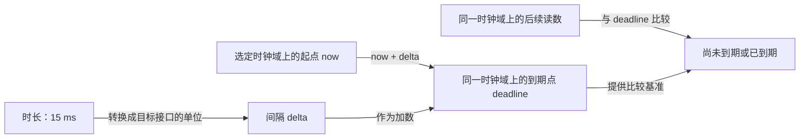
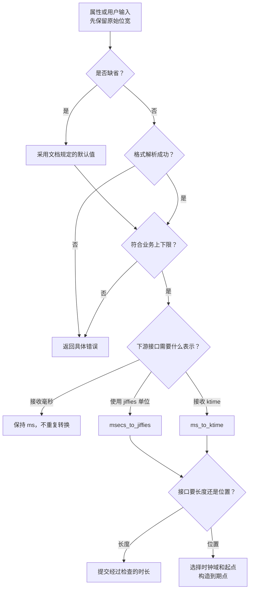

# 第3章\_时间表示与转换接口详解

上一章区分了读取时间与安排一次到期事件。现在给采样设备设置 `debounce-ms = 15`：这个数是“15 毫秒”，而普通定时器的到期参数却是一个 jiffies 时间点。把 15 原样传进去，既丢了单位，也丢了“从什么时候开始算”的语义。

本章先不注册中断、不启动回调，只解决时间数据进入接口以前的四个问题：它是时长还是时间点，属于哪个时钟域，使用什么单位，以及计算是否超出表示范围。读完后应能沿“外部参数 → 校验 → 单位转换 → 构造到期点 → 比较”检查一段代码，而不是看到时间整数就一律调用同一个转换宏。完整回调与退出协议从第四章开始。

接口以 Linux 6.12.20 的 NXP 固定提交为准，身份见[时间基础证据](../../../../../research/source_reading/linux/SOURCE_BASELINE.md#1.171_时间基础与定时入口边界)，转换与类型声明见[本章核对记录](../../../../../research/source_reading/linux/SOURCE_BASELINE.md#1.173_时间转换与组合模式的版本核对)。以下公式是帮助推导的数学模型；实际代码使用该版本已提供的接口，并保留它们的输入类型和范围约束。

## 3.1\_同一个15先要说清是什么

**时长（duration）** 表示一段长度，例如 15 ms；**时间点（time point）** 表示某条时间轴上的位置，例如单调时钟读数为 8 s 时再加 15 ms，得到 8.015 s。所谓相对定时，是把时长交给接口，由接口从某个起点计算；所谓绝对定时，是直接提供到期时间点。这里“绝对”不必是日历日期，单调时钟上的 8.015 s 同样是绝对到期点。

长度也不天然意味着“从现在开始”。“两次采样相隔 15 ms”只是间隔要求；只有把它加到当前时间或上一计划点，才得到下一次到期点。这个起点选择以后会影响周期漂移，本章先把运算对象分清。



加法两边的单位必须一致，比较两边的时钟域也必须一致。`ktime_get()` 读取的单调时钟与 `ktime_get_real()` 读取的日历实时时钟，即使都装进 `ktime_t`、都用纳秒表示，也不能直接混着比较。日历校时可能改变后者；单调时钟不因设置日期直接跳变，但其走时仍可能受时间校准影响。是否累计系统挂起时间则是上一章已经建立的 MONOTONIC 与 BOOTTIME 区别，与“绝对/相对”是另一条分类轴。

| 应先回答的问题 | 本例的回答 | 不能据此推出什么 |
| --- | --- | --- |
| 数据是长度还是位置 | 15 ms 是去抖窗口长度 | 不能直接当 timer 的绝对到期参数 |
| 时间点来自哪个时钟域 | 从单调时钟建立到期点 | 不等于会唤醒已挂起的机器 |
| 接口接收什么单位 | 可能是毫秒、jiffies 或 ktime | 不由变量名 `timeout` 自动决定 |
| 范围是否满足业务与类型 | 本例限定 1～5000 ms | 不等于任意巨大输入都能安全转换 |

因此变量名既要保留单位，也要保留角色，例如 `debounce_ms`、`delay_jiffies`、`deadline_jiffies`、`period_kt`。`ktime_t` 自身不记录“这是时长”或“这是哪个时钟域”，这些信息由变量用途和接口契约承载。

## 3.2\_把毫秒变成jiffies时为什么要向上取整

普通定时器使用 `jiffies` 时间点，等待接口也常使用 jiffies 时长。假设 `HZ=100`，一秒对应 100 个逻辑节拍，一个计量单位约为 10 ms。15 ms 不能用整数个节拍精确表示；若直接写 `15 * HZ / 1000`，整数除法得到 1，相当于只保留 10 ms 的名义长度。若输入 5 ms，甚至得到 0。

对正常、有限且已校验的正输入，毫秒转 jiffies 的目标是向上取整，数学上可以理解为 `ceil(ms × HZ / 1000)`。实际 `msecs_to_jiffies()` 会按 HZ 关系选择除法、乘法或缩放计算，并处理规定的极大值分支；不要用一行可能先溢出的手算替代它。

| 输入 | HZ=100 时的结果 | HZ=250 时的结果 | HZ=1000 时的结果 |
| --- | --- | --- | --- |
| 0 ms | 0 | 0 | 0 |
| 1 ms | 1 | 1 | 1 |
| 5 ms | 1 | 2 | 5 |
| 15 ms | 2 | 4 | 15 |
| 100 ms | 10 | 25 | 100 |

**0 不会自动变成 1。** 是否允许零由调用方定义：有的业务把它解释为立即处理，有的表示关闭功能，有的必须报错。转换函数不替业务作这个决定。表中的正数向上取整也只是离散单位转换；当前 tick 相位和具体定时接口的行为仍影响实际经过时间，不能据此证明外设必须等待的最小物理间隔。

微秒输入同样可以使用 `usecs_to_jiffies()`，但输入单位更细不会让输出分辨率更高。例如在 HZ=100 下，50 us 与 500 us 都会变成 1 个 jiffy。若业务确实需要区分这两个到期点，应重新选择执行机制，而不是继续缩小传给这个函数的数。

| 接口与输入 | 返回表示 | 本章使用边界 |
| --- | --- | --- |
| `msecs_to_jiffies(unsigned int m)` | `unsigned long` jiffies 时长 | 输入先验证，再转换；零保持零，特殊极大值可能成为饱和值 |
| `usecs_to_jiffies(unsigned int u)` | `unsigned long` jiffies 时长 | 用于单位适配，不提供微秒级执行保证；仍需限制输入范围 |
| `jiffies_to_msecs(unsigned long j)` | `unsigned int` 毫秒 | 适合本例短间隔日志；输出位宽不是任意长时间的容器 |
| `jiffies_to_usecs(unsigned long j)` | `unsigned int` 微秒 | 同样注意输出范围，不把往返转换当成无损 |
| `jiffies64_to_msecs(u64 j)` | `u64` 毫秒 | 用于相应 64 位计数转换；不改变原计数的时钟语义 |

例如 15 ms 在 HZ=100 下转成 2 jiffies，再转回得到名义上的 20 ms；原始 15 不能恢复。这是量化，不是日志错误。保存业务配置时保留 `debounce_ms`，内部执行时再使用 `delay_jiffies`，能同时解释用户输入与内核安排。

这里的接口分支位于固定版本 `include/linux/jiffies.h`，运行时入口位于 `kernel/time/time.c`。本章不假设该版本存在 `secs_to_jiffies()`；秒参数可在验证一个明确的小范围后转成毫秒，再调用已有接口。例如业务限定 1～3600 秒时，`seconds * 1000U` 最大为 3600000，不会溢出 32 位无符号整数。没有范围证明就先相乘，随后再调用转换函数，已经来不及恢复被截断的值。

## 3.3\_转换函数为什么救不了调用前的溢出

假设 `u32 ms = 5000`，希望变成纳秒。写 `u64 ns = ms * 1000000U` 看起来把结果放进了 64 位变量，但乘法先按两个 32 位操作数计算；5000000000 已超过 32 位无符号范围，赋值发生时错误已经形成。应在乘法前扩展操作数，例如 `(u64)ms * NSEC_PER_MSEC`，同时验证最终结果可放入目标类型。

反过来，把一个宽整数直接传给只接收 `unsigned int` 的 `msecs_to_jiffies()`，可能在进入函数前就被窄化。参数范围检查必须发生在窄化以前，不能先转换再检查返回值。下面是专门处理本例 1～5000 ms 业务输入的接入函数，并非所有驱动通用的时间策略：

```c
#include <linux/errno.h>
#include <linux/jiffies.h>
#include <linux/types.h>

static int demo_delay_from_ms(u64 input_ms, unsigned long *delay_jiffies)
{
    /* 先在原输入位宽上检查，再转入 unsigned int 接口。 */
    if (input_ms < 1 || input_ms > 5000)
        return -ERANGE;

    *delay_jiffies = msecs_to_jiffies((unsigned int)input_ms);
    return 0;
}
```

`-ERANGE` 是内核负错误码，表示输入超出允许范围。采用拒绝而非自动钳制，是为了让配置错误可见；若产品明确要求饱和到上下限，也应返回或记录实际生效值，而不是悄悄改变用户意图。

`msecs_to_jiffies()` 对被解释为负值的输入和部分过大值有“近似无限超时”的特殊处理，使用 `MAX_JIFFY_OFFSET` 这样的上界。这个保护是接口语义的一部分，不是通用输入校验，更不意味着业务应该接受任意负数或大数。`usecs_to_jiffies()` 也不能被笼统当成覆盖所有输入范围的同一饱和契约；本例只在明确的小范围内使用。

## 3.4\_把时长加成到期点以后怎样跨回绕比较

有了 `delay_jiffies`，普通定时器通常使用 `deadline_jiffies = jiffies + delay_jiffies`。前者是长度，后者是计数轴上的位置。`unsigned long` 位宽由目标架构决定；当计数绕过最大值时，新的时间点数值会变小。

用一个缩小到 8 位的计数器观察问题：当前为 250，再过 10 个单位，保存的到期点是 4。现在读到 252，如果直接判断 `252 >= 4`，就误以为已到期；实际还差 8 个单位。Linux 的 `time_after()`、`time_before()` 及带 `_eq` 的版本，按差值的符号解释先后，允许在约定跨度内跨回绕比较。

这个方法需要 **被比较的时间距离小于计数范围的一半**。若允许任意远的两个时间点，仅凭回绕后的有限位数，本来就无法知道谁属于下一圈。对于 `unsigned long` 的 jiffies，使用同位宽宏和同类型变量；若明确读取 `get_jiffies_64()`，则使用相应的 64 位比较接口，不能只把一边强制转换来混用两套计数。

```c
/* 片段：仅展示建立到期点和判断，不负责等待、排队或对象生命周期。 */
unsigned long delay_jiffies = msecs_to_jiffies(200);
unsigned long deadline_jiffies = jiffies + delay_jiffies;

/* 在后续某次检查中读取当前计数。 */
if (time_after_eq(jiffies, deadline_jiffies)) {
    /* 到期或已经超过到期点；在此决定业务下一步。 */
}
```

“到期”通常包含相等，所以这里使用 `_eq`。只用 `time_after()` 会把恰好相等留在未超时一侧；是否需要严格大于应由业务明确决定。这个片段没有循环等待：加入无限忙循环不会让比较更正确，只会占用 CPU；需要睡眠等待时，后续章节使用相应等待接口。

还有一种常见混用是把到期点送给接收时长的函数。`schedule_delayed_work()` 的延迟参数是长度，`mod_timer()` 的到期参数是位置；两者虽然都能接受一个整数，不能互换。同理 `msleep()` 本来接收毫秒，给它再包 `msecs_to_jiffies()` 反而改变了单位。

## 3.5\_纳秒表示不再经过jiffies但仍需要时钟域

若要保存 5 ms 这样的细粒度周期，先转 jiffies 再转纳秒会提前丢失精度。内核使用 **`ktime_t` 时间类型** 表示纳秒值；本章固定版本在 `include/linux/types.h` 中把它定义为有符号 64 位整数 `s64`，不是带 `tv64` 成员的结构体。旧版内部表示不应混入当前代码。

构造 5 ms 的时长可以写 `ms_to_ktime(5)`，也可以写 `ktime_set(0, 5 * NSEC_PER_MSEC)`。构造这个数本身没有选择时钟；调用 `ktime_get()` 才取得单调时钟时间点，把时长加上去才得到同一域上的到期点。

| 接口 | 本例中的读法 | 范围与语义提醒 |
| --- | --- | --- |
| `ktime_set(s64 secs, unsigned long nsecs)` | 用秒与纳秒组成一个值 | 本例使用非负秒及小于一秒的纳秒部分；不要把它当成任意输入校验器 |
| `ns_to_ktime(u64 ns)` | 已有纳秒数，改用 ktime 表示 | 输入是无符号数，但结果类型有符号；业务正时长应先限制到可表示范围 |
| `ms_to_ktime(u64 ms)` | 毫秒直接换成纳秒表示 | 不自动保证乘法与最终有符号结果不越界 |
| `ktime_add(a, b)` / `ktime_sub(a, b)` | 时间点加时长、同域时间点求差 | 单位一致还不够，也要保证结果范围；不能混合不同时钟域 |
| `ktime_add_ms(kt, ms)` | 对已选域的时间点加毫秒时长 | 同样要求输入与结果范围合理 |
| `ktime_compare(a, b)` | 返回负数、零或正数表示大小 | 用 `>= 0` 可以表达包含相等的到期判断 |
| `ktime_after(a, b)` / `ktime_before(a, b)` | 严格比较大小 | 不包含相等，不会检查两个参数是否来自同一域 |
| `ktime_to_ns()` / `ktime_to_us()` / `ktime_to_ms()` | 把表示换成日志或业务单位 | 后两者会丢失不足一个单位的部分；保留返回的有符号宽类型 |

普通 `ktime_add()` 不是任意有符号溢出的安全运算；不能把 jiffies 的无符号回绕比较规则搬过来。`ktime_set()` 虽对某些过大秒数返回上限，也不覆盖任意负输入、超范围纳秒或后续加法。最直接的驱动策略仍是先限制业务范围，并对长时间累计另外证明上限。

```c
#include <linux/ktime.h>

/* 片段：一次事务开始时，保存单调时钟上的 200 ms 到期点。 */
ktime_t started_kt = ktime_get();
ktime_t deadline_kt = ktime_add_ms(started_kt, 200);

/* 后续检查：仍读取同一时钟域，且把相等计入到期。 */
ktime_t now_kt = ktime_get();
bool expired = ktime_compare(now_kt, deadline_kt) >= 0;
s64 elapsed_ms = ktime_ms_delta(now_kt, started_kt);
```

这里假定当前时间与加法结果处于可表示范围，代码只负责计算。既不注册定时器，也不会自动在 200 ms 时运行检查；若执行者到 230 ms 才再次检查，`expired` 为真、已过时间约为 230 ms，仍然符合表达式的意义。

采用 `ktime_t` 并不以“超过几秒”为分界。选择取决于下游接口、需要的量化粒度、时钟域和范围；普通的秒级 timeout 也可能继续用 jiffies，高精度接口的相对时长同样可以用 ktime。下一章以后才讨论把这些数交给谁执行。

## 3.6\_设备树参数进入时先确认属性而非猜测板级事实

回到开头的 15 ms。设备树源文件中的属性单位来自对应绑定约定，不是 `of_property_read_u32()` 自动识别。读取函数只取得一个 32 位数；驱动必须知道它代表什么，并区分“属性缺省”与“属性存在但格式错误”。前者可以采用明确默认值，后者应报告问题。

以下沿用教材中的 `nxp,debounce-ms` 名字作为 **自定义示例属性**，不宣称它是 NXP 官方通用绑定，也不宣称某块板已经具有这些 GPIO 接线。最小节点仅表达软件参数；没有 `reg` 地址时不随意加 `@0` 单元地址：

```dts
/* 教学自定义绑定片段；真实驱动还要提供匹配和资源定义。 */
demo_led_key_int {
    compatible = "nxp,imx6ull-led_key_int";
    nxp,debounce-ms = <15>;
};
```

实际 GPIO 引脚、极性、中断触发方式和 `compatible` 的绑定必须按板卡与驱动证据补齐。边沿去抖与电平触发中断的清源协议也不相同，不能仅凭“去抖”两个字把一组引脚号和触发类型推广到所有平台。

下面的函数只解析并转换属性，不隐含中断申请或回调初始化。调用者传入已经确认有效的节点与存储位置；`delay_jiffies` 和 `delay_kt` 是为了并列观察两种目标表示，真实驱动可以只保存选中机制需要的一份。

```c
#include <linux/errno.h>
#include <linux/jiffies.h>
#include <linux/ktime.h>
#include <linux/of.h>

struct demo_delay {
    u32 debounce_ms;
    unsigned long delay_jiffies;
    ktime_t delay_kt;
};

static int demo_parse_delay(struct device_node *np, struct demo_delay *delay)
{
    u32 ms = 15;
    int ret;

    if (!np)
        return -EINVAL;
    if (of_find_property(np, "nxp,debounce-ms", NULL)) {
        ret = of_property_read_u32(np, "nxp,debounce-ms", &ms);
        if (ret)
            return ret;
    }
    if (ms < 1 || ms > 5000)
        return -ERANGE;

    /* 所有检查成功后再发布结果；本函数用于尚未启动异步入口的初始化。 */
    delay->debounce_ms = ms;
    delay->delay_jiffies = msecs_to_jiffies(ms);
    delay->delay_kt = ms_to_ktime(ms);
    return 0;
}
```

`of_find_property()` 这里只检查属性是否存在，`of_property_read_u32()` 负责解析并返回具体错误。`-EINVAL` 表示本片段不接受缺失节点；属性缺省时则明确采用 15 ms。若绑定还要求精确的属性长度，应在绑定验证与读取协议中一并约束，不能把读取第一个整数当成验证了完整配置。

转换后的成员存储让调用点不必反复换算，也让单位一眼可见，但它不自动提供并发安全。如果以后增加 sysfs 动态设置，设置线程、定时器回调和工作线程可能同时访问这些字段；32 位系统上读取 64 位 `ktime_t` 尤其不能假定天然不可分割。应选择共同的锁或发布协议，并明确新参数影响“下一次事件”还是“立即重排当前期限”。只在写侧加锁、读侧不遵守同一协议，不能保证成组字段一致。



前两条进入路径中的解析失败与范围失败应直接返回错误，不进入后续转换。图强调单位与角色判断，不代表失败可以继续执行。

## 3.7\_通过数值预测验证代码而不是先接硬件

先在纸上填写第二节的 HZ 表，再检查代码。若一个驱动只在换 HZ 后发生约定比例的时间变化，优先核对单位和裸整数；若单位与计划点都正确但回调迟到，应继续检查执行上下文、负载与到期处理。两类证据不能互相替代。

**练习一：** HZ=250，输入 15 ms，`msecs_to_jiffies()` 得到多少？再转回毫秒是否仍为 15？

**答案：** 4 jiffies，名义时长 16 ms；不能恢复被量化的原始 15。若日志要显示配置值，应保存原始毫秒字段。

**练习二：** `msleep(msecs_to_jiffies(200))` 是否比 `msleep(200)` 更可移植？

**答案：** 不是。`msleep()` 接收毫秒，转换后的 jiffies 数又被当成毫秒。例如 HZ=100 时，200 ms 转为 20，实际请求便成了 20 ms。只有下游接口要求 jiffies 时才作这次转换。

**练习三：** `u64 ns = ms * 1000000U` 中 `ms` 是 32 位的 5000，为什么宽结果变量没有避免错误？

**答案：** 运算类型先由操作数决定，32 位乘法先溢出，再赋给 64 位变量。先验证范围，再写 `(u64)ms * NSEC_PER_MSEC`，才能让乘法在足够宽的类型中进行；最终若要装入 ktime，还要满足有符号表示上限。

**练习四：** `ktime_t interval = ms_to_ktime(15)` 是否已经代表“现在起 15 ms 的单调时钟期限”？

**答案：** 它只表示长度。还缺少时钟域、起点或相对启动模式。`ktime_add(ktime_get(), interval)` 才构造出本例的单调时钟到期点；随后必须用同域读数比较。

调试时同时记录原始单位值、转换结果、计划到期点和实际检查时间，再按本章四个问题逐层定位。避免把反向转换后的值称为“用户原值”，也不要通过在回调里频繁打印来测量它原本的时序。

现在已经能安全地准备时间参数，但一个数不会自行调用函数。第四章用 `timer_list` 解释排队、执行与关闭；第五章再把 ktime 交给高精度定时器；第六章处理可睡眠的延后工作。设备树接入与中断去抖的组合放在第九、十二章，在这些机制已经成立后再阅读完整路径。

上一篇：[P02 Linux 时间基础与 timekeeping 框架速览](P02_Linux_时间基础与_timekeeping_框架速览.md)。
下一篇：[P04 基础定时器机制 struct timer list](P04_基础定时器机制_struct_timer_list.md)。
组合应用：[P12 常用模式与代码模板](P12_常用模式与代码模板.md)。
