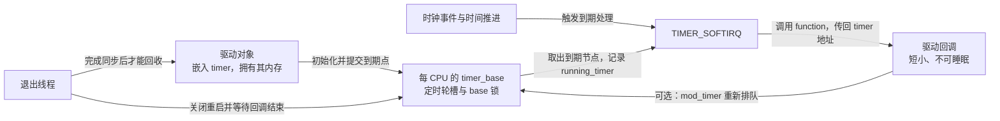
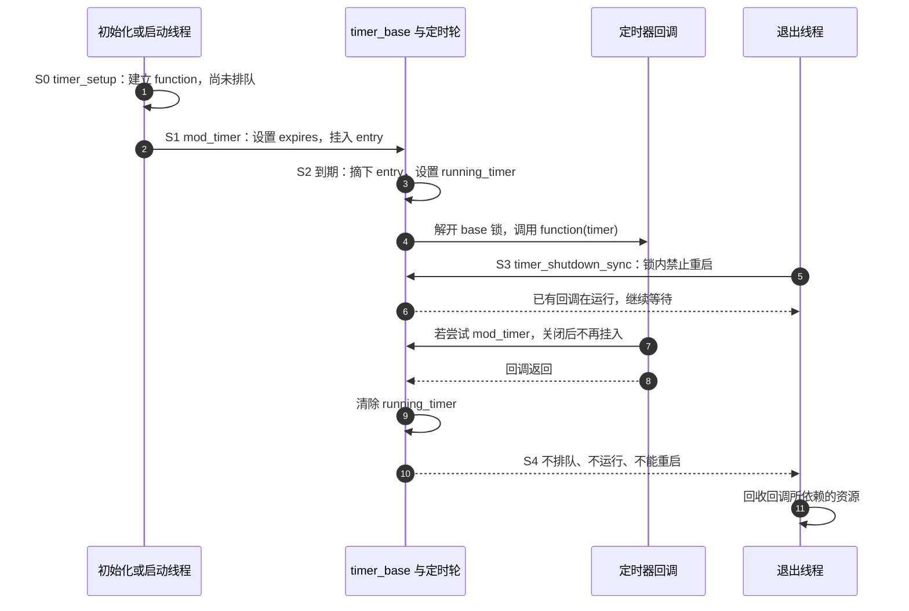

# 第4章\_基础定时器机制\_struct\_timer\_list

上一章已经把“等多久”转换为内核接口需要的单位，也说明了到期点应怎样比较。现在让采样设备在约 50 ms 后做一次很短的状态检查：提交检查的线程不必留在原地等待，内核只需记住“哪个函数、何时运行、关联哪个对象”。这个记录就是本章使用的 **普通内核定时器 `struct timer_list`**。

但登记成功不等于回调已经执行，更不等于对象可以随时释放。如果设备在第 30 ms 被移除，谁撤销尚未执行的检查？如果移除时检查已经开始，又该等谁结束？本章沿同一个 timer 的初始化、排队、执行、重新排队和最终关闭，建立这些问题的共同模型。例子先使用静态模块对象，排除真实硬件入口，随后再指出接入驱动时必须补上的生产者关闭步骤。

本章接口按 Linux 6.12.20、NXP 固定提交 `dfaf2136deb2af2e60b994421281ba42f1c087e0` 核对，来源与配置边界见[源码基线](../../../../../research/source_reading/linux/SOURCE_BASELINE.md#1.62_定时器改期与最终退出证据)。普通非实时内核是下面的默认执行模型；带实时抢占补丁的配置会改变部分执行与等待细节，但不能据此把普通 timer 回调改成可随意睡眠的线程。

## 4.1\_把一次未来检查交给谁执行

驱动先在自己的对象中嵌入一个 timer，然后把到期点登记给内核。内核的 **定时轮（timer wheel）** 用不同时间跨度的槽组织这些记录：近期和远期超时不必每次都逐个扫描。驱动拥有 timer 的存储空间，内核在它仍有效的期间管理其中的队列节点。

时钟事件到来后，内核推进时间并在需要时安排 **定时器软中断 `TIMER_SOFTIRQ`**，由它处理已经到期的普通定时器。软中断是内核延后处理事件的一种执行机制，不是为每个 timer 创建一个工作线程。回调执行期间不能调用 `msleep()`、获取可能睡眠的互斥锁，或访问只能在睡眠上下文使用的设备接口。软中断即使由内核线程代为推进，也没有把回调契约变成普通线程契约。

这解决的是“以后通知我检查一次”，并不承诺“恰在指定纳秒开始执行”。`expires` 使用 `jiffies` 单位；当前 tick 的相位、定时轮分桶、软中断排队和其他处理都会影响实际时间。尤其不能把 `jiffies + msecs_to_jiffies(50)` 当成严格的硬件最小间隔证明。需要更细的到期安排时再进入下一章的 hrtimer；需要严格边沿时序时，还要判断是否应由硬件承担。



图里的“每 CPU”表示内核组织队列和执行状态的位置，不表示驱动应自己维护一组 timer 副本，也不表示所有普通 timer 都永远固定在初始化时的 CPU。迁移和省电策略由内核及标志控制；本章例子不依赖指定 CPU。

## 4.2\_为什么未排队不能证明回调已结束

设设备对象叫 `demo_dev`，其中的成员 `timer` 正在等待到期。内核开始执行时，要先把它从定时轮槽中摘下来，否则下次扫描还会把同一个到期记录当成未处理。摘下后，回调才开始访问 `demo_dev`。所以“队列中已经没有它”与“没有人使用它”之间，存在整个回调执行窗口。

这不是一个仅靠 `pending` 位就能描述的状态机。至少要区分三个正交问题：**是否排队、是否执行、是否还允许重新排队**。回调运行时可以再次 `mod_timer()`，此时旧一轮仍在执行，新一轮已经排队；最终关闭又可以禁止后续排队，同时等待旧一轮退出。

下面列出本章所需的实际存储位置。字段用于帮助理解所有权，不授权驱动直接改写内核队列或锁。

| 状态或接口 | 保存位置与所有者 | 谁修改、谁观察 | 对当前问题的意义 |
| --- | --- | --- | --- |
| 到期点 `expires` | 驱动对象内的 `timer.expires`，单位为 jiffies | 排队接口更新，定时轮使用 | 是计划时间，不是完成时间 |
| 排队节点 `entry` | 同一个 timer 内的链表节点 | 内核在对应 base 的保护下挂接、摘除；`timer_pending()` 观察挂接状态 | 不另分配一个“回调任务”来替代该对象 |
| 正在执行 `running_timer` | 内核 `struct timer_base` 中 | 到期处理设置，回调返回后清除，同步退出观察 | 不在 timer 的 pending 状态中 |
| 回调入口 `function` | `timer.function` | 初始化建立；最终关闭在 base 锁下清空 | 关闭以后重新排队会被忽略 |
| 驱动业务状态 | 外围 `demo_dev` 自己的字段 | 驱动线程、回调等按各自协议访问 | 不自动受内核 base 锁保护 |

`timer_pending()` 只回答当前是否挂在队列里。即使返回 0，也可能正处于“已经摘下、正在回调”的窗口；观察后还可能被其他执行者重排。不能写成 `if (!timer_pending(&dev->timer)) kfree(dev);`。内核提供同步退出接口，正是因为调用方不能靠这种瞬时观察自行推导完成。

固定版本的字段声明见 `include/linux/timer_types.h`，执行者登记见 `kernel/time/timer.c:expire_timers()`。需要读具体实现时，从[定时器退出模块导读](../../../../../research/source_reading/kref/navigation/P05_定时器重启与退出导读.md#5.2_从排队到最终关闭)进入；[pending 的唯一实现讲解](../../../../../research/source_reading/kref/source_explanations/include/linux/timer.h.md#1.1_pending只观察队列成员)解释了为什么它不能代替执行同步。

### 4.2.1\_初始化回调与找回外围对象

回调只收到一个 `struct timer_list *`。设备通常还有寄存器映射、计数和业务状态，因此将 timer 作为设备结构的成员，再通过这个成员地址找回外围结构。`from_timer()` 是内核为此提供的宏，内部使用 `container_of()`；二者不是需要先后调用的两步。

```c
struct demo_dev {
    struct timer_list timer;
    unsigned int counter;
};

static void demo_timer_cb(struct timer_list *timer)
{
    struct demo_dev *dev = from_timer(dev, timer, timer);

    /* 本片段只有回调修改 counter；读者要等同步关闭后才读取它。 */
    dev->counter++;
}
```

`from_timer(dev, timer, timer)` 的三个参数分别是结果变量名、回调收到的指针、外围结构中的成员名。它只计算地址，不增加引用计数，也不验证对象是否仍存活。保持对象有效仍是启动方和退出方的责任。

创建对象后使用 `timer_setup(&dev->timer, demo_timer_cb, 0)` 初始化，再调用启动接口。初始化本身不会排队。不要在它仍排队或执行时重新初始化；栈上 timer 还需要专用初始化与销毁协议，本章静态模块例子不使用栈上 timer。

普通例子传标志 0。`TIMER_PINNED` 约束的是到期执行与排队 CPU 的关系，不是把对象永久绑定到调用 `timer_setup()` 的 CPU；需要指定 CPU 时还涉及 `add_timer_on()` 和 CPU 热插拔规则。`TIMER_DEFERRABLE` 允许为了 CPU 空闲而延后服务，不能用于必须按时唤醒处理的超时。`TIMER_IRQSAFE` 是特殊同步用途的标志，不是“回调更安全”或“允许睡眠”的开关。没有这些明确需求，就保留 0。

旧资料中的 `setup_timer()`、`init_timer()` 和整数 `data` 参数属于旧接口模型。本章基线使用 timer 指针回调与外围对象恢复，不把旧版签名混进新代码。

## 4.3\_启动与改期为什么不产生第二个对象

第一次提交可以使用 `mod_timer(&dev->timer, deadline)`。只要 timer 尚未关闭，未排队时它会启动，已经排队时它会修改同一对象的到期点。因此连续收到两次“50 ms 后再检查”的请求时，第二次可以把同一个 timer 推迟，而不是增加第二个节点。

但“只剩一个排队节点”不等于“前一轮业务一定尚未开始”。如果旧回调已经进入，新的 `mod_timer()` 不会撤回已经执行的指令。按键去抖若要求“最后一个边沿后安静满一段时间再采样”，还需要业务层记录最后事件或代数，并在真正采样前核对；单纯重排 timer 不能抹除已经开始的采样。

理解这一点以后，接口表才有清楚的比较对象：有的接口改变排队，有的等待执行，还有的关闭下一次排队的可能。

| 接口 | 做什么 | 返回值与边界 |
| --- | --- | --- |
| `timer_setup(timer, callback, flags)` | 初始化对象和回调 | 不启动；不能用来覆盖活跃对象 |
| `add_timer(timer)` | 按预先设置的 `expires` 加入未排队对象 | `void`；不得对已排队对象重复调用 |
| `mod_timer(timer, expires)` | 启动未排队 timer，或修改已排队 timer | 正常情况下 1 表示原来 pending，0 表示原来未 pending；关闭后也可返回 0 且没有启动 |
| `timer_pending(timer)` | 观察排队节点 | 不是正在执行查询，也不是回收许可 |
| `timer_delete(timer)` | 删除尚在队列中的记录 | 返回原来是否 pending；不等待已进入的回调 |
| `timer_delete_sync(timer)` | 删除记录并等待回调结束 | 调用方必须阻止竞争重启；0/1 不代表是否曾经运行过 |
| `timer_shutdown_sync(timer)` | 删除、等待，并禁止重启 | 用于最终关闭；并不让持有失效地址的外部线程安全 |

在这个固定版本中，旧名 `del_timer()`、`del_timer_sync()` 分别包装 `timer_delete()`、`timer_delete_sync()`；新代码采用后者。`mod_timer()` 的 0/1 不是一般的成功/失败码，更不能像工作队列接收布尔值那样用来决定是否转交一个引用。

启动、改期和关闭的串行化点在内核 base 锁内。内核对同一个 timer 的队列操作提供同步，不替外围 `counter`、设备指针或“是否允许新业务”的标志提供同步。有关返回分支与重排检查的源码见[改期不等于追加一次回调](../../../../../research/source_reading/kref/source_explanations/kernel/time/timer.c.md#1.1_改期不等于追加一次回调)。

## 4.4\_沿一轮到期与退出检查每个状态

现在让 50 ms 的定时器到期，同时让退出线程开始卸载。下图把同一轮划分为 S0～S4；退出可以在 S1 或 S2 到来，区别只在于是否还需要等待已经进入的回调。



S1 中到期点和队列节点由内核维护，启动线程可返回。S2 中队列节点被摘下，`running_timer` 接过“有人仍在使用对象”的证据；回调在 base 锁外执行，否则它调用 `mod_timer()` 会无法再次获取同一把锁。S3 在同一同步域中关闭重新排队，并不会强行中断回调。S4 必须等执行标记清除后才返回。若退出发生在回调进入之前，内核直接删除记录，就不必执行这一轮回调。

### 4.4.1\_为什么同步删除后仍可能被重新启动

设另一条线程或中断路径还能调用 `mod_timer()`。退出线程完成 `timer_delete_sync()`，确认当时没有回调；生产者随后重新挂入 timer；退出线程再释放外围对象。下一次到期就访问了释放后的内存。同步删除没有违反契约，错误在于调用方从未关闭生产者。

最终销毁时，`timer_shutdown_sync()` 会关闭该 timer 的重启功能，解决 timer 与自身回调、工作队列相互重排形成的循环。但它仍需要一个有效 timer 地址：对象释放以后，外部线程再调用 `mod_timer(&freed_dev->timer, ...)`，即使该 timer 先前已经关闭，也已经是非法内存访问。

因此真实驱动的退出通常先撤销外部入口、阻止新请求，并等待已经取得对象的入口执行者退出；然后关闭 timer，排空它派生的工作，最后释放资源。若硬件中断、用户文件操作或其他内核对象还能持有设备地址，分别遵循那些入口的注销、同步和引用协议。停止业务的布尔标志只表达业务许可，引用计数只表达存活责任，二者不能相互替代；一次原子读取也不能独自关闭“读到允许以后、真正重排以前”的竞争窗口。

需要暂时停用、以后还会重新启动的对象，可以在外部串行化协议下使用 `timer_delete_sync()`。最终关闭以后若确实要复用，必须先证明旧参与者都已退出，再重新初始化；不要用重新初始化绕过退出协议。

### 4.4.2\_等待结束时不能拿着结束所需的锁

假设退出线程持有 `dev->lock` 调用同步关闭，回调又在等待同一把锁才能返回。退出线程等待回调，回调等待退出线程，双方都无法前进。即使某把锁不由回调直接取得，它若挡住了中断执行，而该中断又阻止正在运行的回调继续，也可能形成等待环。

本章示例都在可睡眠的退出线程中、未持有这类锁时调用同步接口；不在 timer 回调里等待自己。需要保护退出标志时，应在锁内完成标志更新和入口封闭，然后解锁，再执行同步等待，而不是把所有退出步骤套进一把锁。

设备资源管理 **devres** 可以注册清理动作，例如通过 `devm_add_action_or_reset()` 调用自定义关闭函数，但注册动作不会自动推导生产者顺序，也不是原子回收全部异步活动。回调依赖的硬件资源必须在它结束前保持有效；注册顺序、失败回滚与工作排空都要单独设计。第十章继续处理这种组合退出。

> 固定实现的删除、等待和最终关闭分支见[等待执行与关闭重启](../../../../../research/source_reading/kref/source_explanations/kernel/time/timer.c.md#1.2_等待执行与关闭重启)。这里的区别来自接口保证，不能用“所有释放路径必须调用旧名 del_timer_sync”替代生命周期分析。

## 4.5\_周期检查到底保持间隔还是保持相位

一次 timer 到期只执行一次回调；“周期性”由回调或其他执行者再次排队实现。仍以采样设备为例：有时我们希望每次处理后休息约 100 ms，有时希望沿原来的 100、200、300 ms 计划线采样。这两个业务要求需要不同的下一次到期点。

第一种在处理完成后用 `jiffies + period`。如果本轮迟到或处理多花了时间，下一次也跟着后移。它适合“完成以后再隔一段时间”的轮询或退避，不保持启动时的相位；这里的时间间隔仍受 jiffies 计量与执行延迟影响。

第二种以原计划到期点递增 `period`。假设计划为 100、200、300、400 ms，本轮本该在 100 ms 执行，却直到 350 ms 才获得执行机会。只做一次 `next += period` 会把下一次设到已经过去的 200 ms，随后可能快速追赶到 300 ms。它不会补回过去那些时刻的真实采样，只会在现在增加负担。

如果业务允许丢弃错过的采样，应计算“从原到期点到现在跨过了几个周期”，直接跳到第一个未来计划点：本例跳到 400 ms，并记录漏掉了 200、300 ms 两个采样。若每次事件都必须处理，就需要独立保存事件数据与积压计数，并设计有界补偿，不能指望重新触发 timer 重建已经消失的历史。

| 业务目标 | 下一次计划的依据 | 迟到后的行为 | 仍然不保证什么 |
| --- | --- | --- | --- |
| 处理后休息一个周期 | 当前时间加周期 | 整体后移，不追赶 | 固定相位、精确最小物理间隔 |
| 保持原计划、允许漏采 | 原计划加足够多个周期 | 跳过已过期计划点，记录漏采 | 每个计划点都执行 |
| 每个事件都必须处理 | 独立事件记录与处理队列 | 消费积压，受处理能力约束 | timer 自己保存业务事件 |

两种时间算法都要遵守上一章的回绕比较边界：周期必须为正，参与 `time_after*()` 比较的时间跨度小于无符号计数范围的一半。下面的固定 100 ms 示例满足短周期设置；仍假定两次处理间隔没有长到跨过该比较边界。高精度计时也不能免除“漏采还是补做”的业务选择。

## 4.6\_先验证一次性回调与提前关闭

下面保留一次性、周期性和转交工作队列三种场景。它们是互相独立的教学模块，每次选择一个源码编译；不要把三份 `module_init()` 粘在同一模块中。对象是静态存储，没有硬件中断、用户入口或其他外部生产者，因此退出协议可以明确封闭。移入真实驱动时，必须重新盘点所有取得对象地址的入口。

本节给出完整源码和构建方法，但本轮仅进行了固定版本接口核对与周期算法验证，没有在目标内核完成模块构建、加载或卸载压力测试。执行者应准备与运行内核匹配、已配置并具备所需生成文件的源码或构建树；启用模块版本校验时，还需要匹配的构建符号信息。

保存为 `timer_once_demo.c`。只有回调写 `counter`，退出线程在同步关闭返回以后才读，因此这个特定例子不需要为计数额外增加自旋锁。若增加运行时查询或其他写入者，这个理由立即失效，必须为新并发关系补同步。

源码首行的 `SPDX-License-Identifier` 是标准化许可证标识，`GPL-2.0` 标明源文件许可；`MODULE_LICENSE("GPL")` 则向内核声明模块许可证类别。`module_init()` 与 `module_exit()` 分别登记装载与卸载入口；这层模块包装让本节能在不接硬件的情况下观察 timer。

```c
// SPDX-License-Identifier: GPL-2.0
#include <linux/module.h>
#include <linux/timer.h>
#include <linux/jiffies.h>

struct once_dev {
    struct timer_list timer;
    unsigned int counter;
};

static struct once_dev once_state;

static void once_timer_cb(struct timer_list *timer)
{
    struct once_dev *dev = from_timer(dev, timer, timer);

    /* 只做不可睡眠的短操作；本例不重新排队。 */
    dev->counter++;
}

static int __init once_init(void)
{
    timer_setup(&once_state.timer, once_timer_cb, 0);
    mod_timer(&once_state.timer, jiffies + msecs_to_jiffies(50));
    return 0;
}

static void __exit once_exit(void)
{
    /* 返回后 counter 不再被回调修改，模块代码也不再被它执行。 */
    timer_shutdown_sync(&once_state.timer);
    pr_info("timer_once_demo: callbacks=%u\n", once_state.counter);
}

module_init(once_init);
module_exit(once_exit);
MODULE_LICENSE("GPL");
```

立即卸载可能打印 0，也可能打印 1，取决于退出与回调的先后；运行足够久后通常为 1。这里验证的是“最多执行一次，以及退出后不再执行”，不是用一次日志证明 50 ms 的精度。

## 4.7\_保持计划相位并记录跳过的周期

保存为 `timer_periodic_demo.c`。`next` 保存本轮计划点，`period` 在初始化后保持不变，计数和 `next` 只有回调修改；退出线程仍在同步完成后才读取。`due` 是从本轮计划点到现在已经到期的周期数，其中一个由本次回调代表，其余记入 `missed`。

```c
// SPDX-License-Identifier: GPL-2.0
#include <linux/module.h>
#include <linux/timer.h>
#include <linux/jiffies.h>

struct periodic_dev {
    struct timer_list timer;
    unsigned long period;
    unsigned long next;
    unsigned long callbacks;
    unsigned long missed;
};

static struct periodic_dev periodic_state;

static void periodic_timer_cb(struct timer_list *timer)
{
    struct periodic_dev *dev = from_timer(dev, timer, timer);
    unsigned long now;
    unsigned long due = 1;

    /* 代表一次短检查；真实外设访问也必须符合不可睡眠契约。 */
    dev->callbacks++;
    now = jiffies;
    if (time_after_eq(now, dev->next))
        due = (now - dev->next) / dev->period + 1;

    /* 跳过过去的计划点；无符号加法允许计数自然回绕。 */
    dev->missed += due - 1;
    dev->next += due * dev->period;
    mod_timer(&dev->timer, dev->next);
}

static int __init periodic_init(void)
{
    periodic_state.period = msecs_to_jiffies(100);
    timer_setup(&periodic_state.timer, periodic_timer_cb, 0);
    periodic_state.next = jiffies + periodic_state.period;
    mod_timer(&periodic_state.timer, periodic_state.next);
    return 0;
}

static void __exit periodic_exit(void)
{
    /* 关闭后，即使旧回调还走到 mod_timer，也不能再挂入。 */
    timer_shutdown_sync(&periodic_state.timer);
    pr_info("timer_periodic_demo: callbacks=%lu missed=%lu\n",
            periodic_state.callbacks, periodic_state.missed);
}

module_init(periodic_init);
module_exit(periodic_exit);
MODULE_LICENSE("GPL");
```

关闭与回调重排无论谁先取得内核同步点，都能收敛：先重排，则关闭删除新记录并等旧回调；先关闭，则后续重排被忽略。这个证明依赖对象存储和模块代码在关闭返回前仍有效，不依赖一个可能刚读过就变化的 `running` 原子标志。

试着把下一次计算替换为 `dev->next = jiffies + dev->period`，即可得到“本轮处理后再等”的策略。它不是错误，只是换了业务目标。不要把两种策略用同一个“无漂移”结论描述。

## 4.8\_需要睡眠时把业务交给工作线程

现在增加一个新约束：状态检查要使用可能睡眠的设备接口。timer 回调不能直接完成它，于是只负责提交 **工作项 `struct work_struct`**；普通工作队列的 worker 线程执行实际业务。这里只建立交接与退出次序，第六章再展开合并、延迟工作和队列选择。

保存为 `timer_work_demo.c`。本例使用系统普通工作队列，不自行创建队列。`schedule_work()` 可能把多次请求合并到同一个已经排队的工作项，因此 `ticks` 与 `jobs` 可以不同；timer 不是逐次事件存储器。

`INIT_WORK()` 宏把工作项与处理函数关联，初始化本身不提交执行。先初始化 work、再允许 timer 启动，是为了避免 timer 到期时访问一个尚未准备好的工作项。

```c
// SPDX-License-Identifier: GPL-2.0
#include <linux/module.h>
#include <linux/timer.h>
#include <linux/jiffies.h>
#include <linux/workqueue.h>

struct layered_dev {
    struct timer_list timer;
    struct work_struct work;
    unsigned long delay;
    unsigned long ticks;
    unsigned long jobs;
};

static struct layered_dev layered_state;

static void layered_work(struct work_struct *work)
{
    struct layered_dev *dev = container_of(work, struct layered_dev, work);

    /* 普通工作线程上下文；这里可接入符合设备协议的可睡眠操作。 */
    dev->jobs++;
}

static void layered_timer_cb(struct timer_list *timer)
{
    struct layered_dev *dev = from_timer(dev, timer, timer);

    dev->ticks++;
    schedule_work(&dev->work);
    mod_timer(&dev->timer, jiffies + dev->delay);
}

static int __init layered_init(void)
{
    INIT_WORK(&layered_state.work, layered_work);
    timer_setup(&layered_state.timer, layered_timer_cb, 0);
    layered_state.delay = msecs_to_jiffies(200);
    mod_timer(&layered_state.timer, jiffies + layered_state.delay);
    return 0;
}

static void __exit layered_exit(void)
{
    /* 先断开唯一工作生产者，再取消排队工作并等正在运行的工作结束。 */
    timer_shutdown_sync(&layered_state.timer);
    cancel_work_sync(&layered_state.work);
    pr_info("timer_work_demo: ticks=%lu jobs=%lu\n",
            layered_state.ticks, layered_state.jobs);
}

module_init(layered_init);
module_exit(layered_exit);
MODULE_LICENSE("GPL");
```

这里 timer 只写 `ticks`，worker 只写 `jobs`，退出在线程和回调都同步结束后读取。固定的函数、对象与系统队列满足同一工作项不并发执行的条件。若以后让 timer 与 worker 共享可变业务数据，需要另加锁或其他发布协议，不能根据“它们都属于同一设备”推导同步。

顺序不能简单倒过来：先 `cancel_work_sync()`，timer 可能随后再次提交 work。关闭 timer 后再取消 work，才封住这个例子唯一的生产方向。如果 worker 也会重启 timer，最终关闭同样会拒绝重启；但如果还有外部生产者，仍需先关闭那些入口。`cancel_work_sync()` 取消尚未执行的工作，不保证每一份已提交业务都被处理；需要完成而非取消时，要在封闭生产者后选择相应排空协议。

## 4.9\_构建与观察时先写出预期

以一次性模块为例，在保存源码的独立实验目录中创建 `Makefile`：

```makefile
obj-m += timer_once_demo.o
```

`obj-m` 表示把该对象构建为可加载模块。选择另外两个例子时，把这一行改为相应源码的文件名去掉 `.c` 并加 `.o`。以下在 Linux 开发环境执行；`kernel_build` 是你已准备好的、与目标内核匹配的构建目录变量，不是仓库提供的固定路径。

```bash
# 执行位置：含源码和 Makefile 的实验目录；先设置真实构建目录。
kernel_build=/path/to/prepared/kernel-build
make -C "$kernel_build" M="$PWD" modules
```

`-C` 进入内核构建系统，`M` 指定外部模块目录。交叉编译时还需要使用该目标内核实际采用的 `ARCH` 与 `CROSS_COMPILE` 设置；仅让命令结束不能证明产物适合当前运行内核。

```bash
# 执行位置：运行匹配内核的测试系统，模块文件已复制到当前目录。
sudo insmod ./timer_once_demo.ko
sleep 1
sudo rmmod timer_once_demo
sudo dmesg | tail -n 20
```

先预测：等待一秒后，正常运行条件下计数应为 1；移除 `sleep 1` 后，0 和 1 都可能符合退出协议。测试周期模块时，先运行数秒再卸载，观察是否有回调和漏采记录；不要为了制造迟到在 timer 回调里忙等或睡眠，应用受控负载与跟踪工具测量。模块日志能反映这次执行，不能独自证明全部竞争交错都正确，也不能替代锁与生命周期推导。

## 4.10\_用三个反例检查模型

**练习一：** `timer_pending()` 返回 0，是否可以立即释放设备？

**答案：** 不能。S2 中节点已经摘下而回调仍在运行；也可能有生产者即将重排。必须封闭入口，并通过适当的同步删除或最终关闭等待执行结束，再处理其他引用与异步工作。

**练习二：** 100 ms 周期的计划点为 100 ms，本轮到 350 ms 才执行。若要求保持原相位且允许漏采，下一次设在哪儿？漏掉多少次？

**答案：** 下一次为 400 ms。当前回调代表一个已到期周期，200、300 ms 的两个计划采样已经错过，记录两次漏采。设为 200 ms 会要求追赶过去的计划，设为 450 ms 则改成从当前时间重新计周期。

**练习三：** `timer_shutdown_sync()` 返回以后，另一个线程还能持有即将释放的设备地址。是否已经安全？

**答案：** 没有。关闭保证该 timer 不再排队和执行，并不撤销其他线程持有的地址。必须先使那些入口停止访问并完成相应同步或引用回收；否则它们连调用一个被关闭 timer 的接口都可能发生释放后访问。

现在已经能从对象、队列、执行者和退出入口四个位置检查普通定时器。仍未解决的是：如果业务需要比 jiffies 更细的到期安排，如何表达时钟域、绝对到期点与周期前移？下一章继续这个问题，但本章得到的“到期不是执行保证、停止不是释放许可”仍然成立。

上一篇：[P03 时间表示与转换接口详解](P03_时间表示与转换接口详解.md)。
下一篇：[P05 高精度定时器 hrtimer 的驱动用法](P05_高精度定时器_hrtimer_的驱动用法.md)。
