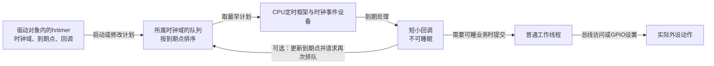
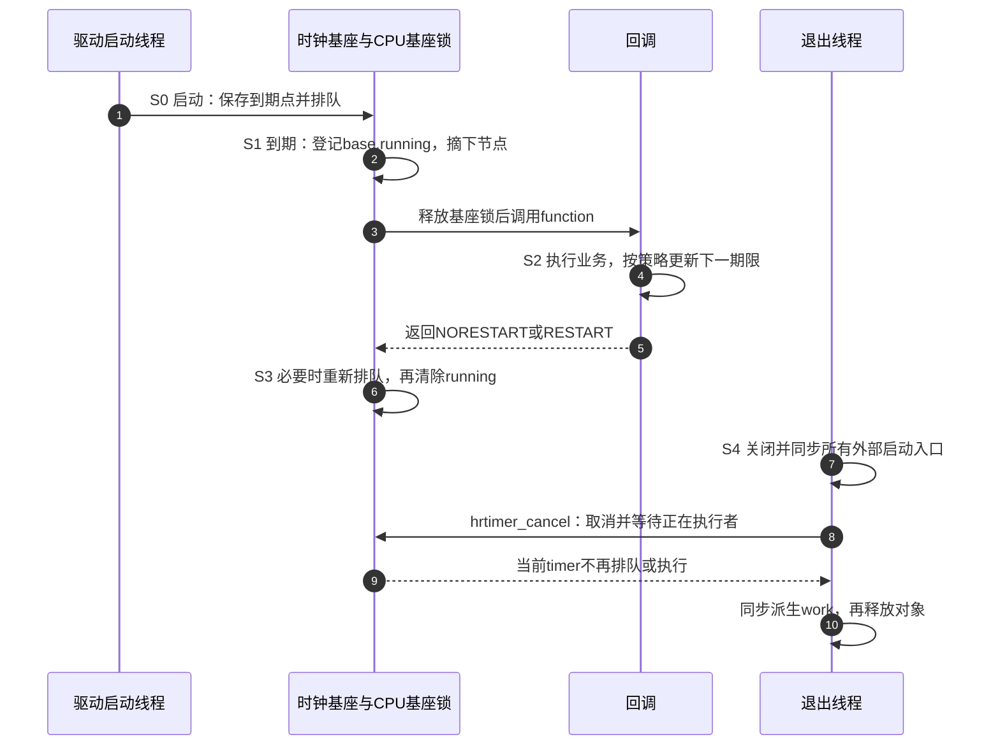

# 第5章\_高精度定时器\_hrtimer\_的驱动用法

上一章已经能把未来检查交给 `timer_list`，也知道排队、执行和关闭是不同状态。现在把计划间隔改成 5 ms：若 HZ=100，jiffies 的计量单位约为 10 ms，单纯把参数写得更小无法获得所需的时间表示。我们需要保留更细的到期点，并让内核按这些到期点安排时钟事件。

**高分辨率定时器（high-resolution timer，hrtimer）** 提供这条路径。本章先闭合一次到期，再比较周期计划如何推进，最后用同一份 LED 教学驱动观察不同策略。纳秒是数值表示单位，不是对回调开始时刻的误差承诺；“使用高精度接口”与“已证明业务实时性”之间仍有执行路径要检查。

接口以 Linux 6.12.20、NXP 固定提交为准，见[时间基础](../../../../../research/source_reading/linux/SOURCE_BASELINE.md#1.171_时间基础与定时入口边界)、[前移与取消证据](../../../../../research/source_reading/linux/SOURCE_BASELINE.md#1.173_时间转换与组合模式的版本核对)及[实际状态字段核对](../../../../../research/source_reading/linux/SOURCE_BASELINE.md#1.174_hrtimer状态位置与周期计划)。默认普通非实时内核，涉及其他执行模式时就地说明差量。

## 5.1\_更细的到期点怎样改变安排方式

普通定时轮面向大量超时管理，按时间跨度分槽；hrtimer 则按 ktime 到期点维护有序队列，便于取得最早需要处理的记录。内核再把相应事件交给时钟事件设备。在高分辨率运行模式下，下一次硬件事件不必只跟随固定 tick 边界；这才是保留细粒度到期点能够发挥作用的条件。

`CONFIG_HIGH_RES_TIMERS` 表示内核包含相应能力，还要有可用的时钟源、时钟事件设备并完成运行时切换。仅看到该配置为 y，不能推出当前 CPU 已进入高分辨率模式。没有进入该模式时，hrtimer 仍有低分辨率执行路径，但实际到期安排会受较粗粒度影响，部分相对到期计算也有相应调整。

因此先区分四种量：配置的间隔、队列中的计划到期点、回调实际开始时间、外设真正动作时间。若回调只是提交 work，最后一种时间还要经过工作线程调度和设备总线访问。改善第二种量的安排，不能自动把后两种量的延迟清零。



如果只是秒级超时检查，普通 timer 或 delayed_work 可能已经足够。若需要把 5 ms、5.5 ms 等不同到期点表达清楚，再评估 hrtimer。机制选择依据是业务容许误差、执行负载和硬件支持，而不是“超过某个毫秒数就必须换一种 API”。

## 5.2\_到期点与执行者仍然分开保存

像普通 timer 一样，hrtimer 对象通常嵌入驱动私有结构，内核并不替驱动拥有这块内存。驱动提供回调与时间值，内核管理队列和执行状态。区别在于这里按 CPU 和时钟域组织 **时钟基座 `hrtimer_clock_base`**；同一个 CPU 的多个时钟基座由 **CPU 基座 `hrtimer_cpu_base`** 的锁保护。

每个时钟基座知道用哪一个取时函数读取当前时间，也保存正在执行的 timer。因此“节点已从有序队列摘下”仍不等于“回调已退出”。在多 CPU 交错中，同一个 timer 可以已经被重新排队，同时上一轮回调尚未返回。

| 当前需要的状态 | 固定实现中的存储位置 | 读写职责 |
| --- | --- | --- |
| 最早可接受到期点 | `timer->_softexpires` | 启动或到期设置接口写入；到期判断使用 |
| 队列排序用到期点 | `timer->node.expires` | 无容忍窗口时与前者相同；有窗口时还包含允许延后量 |
| 排队标记 | `timer->state` 中的 `HRTIMER_STATE_ENQUEUED` | 内核在基座锁下入队与摘队 |
| 回调与所属时钟域 | `timer->function`、`timer->base` | 初始化、启动及必要的迁移维护；回调不得随意改所属基座 |
| 正在执行的对象 | `timer->base->running` | `__run_hrtimer()` 登记与清除，取消及活动查询使用 |
| 基座同步与运行模式 | `timer->base->cpu_base->lock`、`hres_active` | 内核管理；不是驱动业务字段的锁 |

这里的 `_softexpires` 中 soft 指“较早的可接受期限”，不表示一定在软中断中执行。回调执行类别由另外的模式与 `is_soft`、`is_hard` 状态决定。也不要直接改表内的 node、base 或 state 来实现启动：必须使用公开接口维持队列与硬件事件的一致性。

字段见固定版本 `include/linux/hrtimer_types.h` 与 `include/linux/hrtimer_defs.h`，执行过程见 `kernel/time/hrtimer.c:__run_hrtimer()`。同版本 `hrtimer.h` 中有旧注释把 running 写成 CPU 基座成员；当前声明和执行代码实际把它放在 **clock_base**，本章按二者核对后的结构说明，不用旧注释覆盖实际字段。

## 5.3\_初始化选时钟而启动指定时间的含义

仍以 200 ms 后检查一次为例，选择 `CLOCK_MONOTONIC` 后，所有绝对到期点都必须来自同一单调时钟域。它不会因设置日历时间直接跳变，但不能称作完全不受时钟校准影响；`CLOCK_BOOTTIME` 还累计系统挂起时间，却不单凭这个选择成为硬件唤醒源。

```c
/* 片段：对象尚未对外开放，my_callback已经定义。 */
hrtimer_init(&dev->timer, CLOCK_MONOTONIC, HRTIMER_MODE_REL);
dev->timer.function = my_callback;

/* 相对模式：传入200ms长度，由启动接口取得当前起点。 */
hrtimer_start(&dev->timer, ms_to_ktime(200), HRTIMER_MODE_REL);
```

如果应用已经保存了统一事务期限，就不应在每次重新安排时把完整 200 ms 再从现在开始计算。此时直接传绝对时间点：

```c
/* 替代上面的启动方式，不是再启动一个独立对象。 */
ktime_t deadline = ktime_add_ms(ktime_get(), 200);
hrtimer_start(&dev->timer, deadline, HRTIMER_MODE_ABS);
```

初始化不会启动 timer。模式中的相对/绝对位在启动时决定传入数值的解释；`PINNED` 位在启动时约束 CPU 归属，不把初始化发生的 CPU 永久焊死为执行目标。默认不需要固定 CPU，就不要为“可能更准”而先增加绑定条件。

| 接口 | 当前作用 | 关键边界 |
| --- | --- | --- |
| `hrtimer_init(timer, clockid, mode)` | 初始化并选择时钟与回调执行类别 | 初始化后设置 `function`，然后才开放启动入口 |
| `hrtimer_start(timer, tim, mode)` | 按相对长度或绝对期限启动/改期 | 返回 `void`；不撤回已执行的回调业务 |
| `hrtimer_set_expires(timer, time)` | 设置内部绝对期限 | 不负责排队；只在有适当串行化的路径使用 |
| `hrtimer_forward(timer, now, interval)` | 从旧期限跨过 now，得到未来计划点 | 只改期限；允许在自己的回调中调用，外部使用须排除排队与执行 |
| `hrtimer_forward_now(timer, interval)` | 用 timer 所属时钟的当前时间执行上述前移 | now 是前移参考，不是新的相位原点 |
| `hrtimer_cancel(timer)` | 取消排队并等待回调结束 | 不永久封闭外部 start，不能在回调中等自己 |
| `hrtimer_is_hres_active(timer)` | 观察所属 CPU 基座的高分辨率运行状态 | 是运行状态观察，不是时延测量或未来保证 |

本章使用零容忍窗口的普通启动。有意允许延后以合并事件时，可使用范围启动接口；其最早到期与较晚排序期限必须一起理解，不能把 `_softexpires` 和 `node.expires` 当成两个独立 timer。

## 5.4\_回调返回值只决定是否再挂入

hrtimer 的回调返回 `enum hrtimer_restart`。`HRTIMER_NORESTART` 表示本次回调不请求自动重启；`HRTIMER_RESTART` 请求按对象中现有的到期点再排队。它不会自动替你加一个周期：若仍保留已经过去的期限，就可能马上再次进入处理。



这条正常顺序中，退出发生在一轮回调之后；若退出恰好遇到 S1/S2，取消函数等待回调返回，再检查并取消它可能重新排入的记录。**外部启动者必须先封闭**，否则另一个线程仍可能在取消返回后再次启动。

固定实现还处理了“回调返回前对象已经被其他路径排队”的情况：不会因为返回 RESTART 就重复挂接同一节点。这不意味着驱动应该同时手工 `hrtimer_start()` 又请求自动重启；选一种明确的方式，更容易解释谁改变期限、谁负责排队。下面周期回调统一采用“设置或前移期限 → 返回 RESTART”。

回调默认遵守不可睡眠契约。普通非实时配置、未指定 SOFT 时通常走硬中断路径；显式 `HRTIMER_MODE_SOFT` 选择软中断路径。`PREEMPT_RT` 下默认处理有变化，显式 HARD 可以要求硬中断执行，但线程化实现并不授予任意睡眠权限。不能把 hrtimer 一概写成“软中断语义”，也不能认为换成 SOFT 就能调用 `mutex_lock()`、`msleep()` 或 `kmalloc(GFP_KERNEL)`。

## 5.5\_周期只有两种目标而不是三级精度

现在设周期为 100 ms，本轮计划点为 100 ms，真正决定下一次计划时已经是 350 ms。先别看函数名，先决定业务希望下一次发生在哪儿。

如果希望“处理完以后再休息 100 ms”，下一次计划应为 450 ms。这样每轮迟到和处理耗时都会改变下一轮相位；它适合处理后间隔型任务，不是错误写法。如果希望保持启动时的计划线 100、200、300、400 ms，并允许丢弃错过的采样，下一次应该跳到 400 ms。

`hrtimer_forward_now()` 正是在第二条计划线上推进。它读取所属时钟当前值，然后从 **旧到期点** 增加足够多个 interval；不会把相位原点改成当前时间。手工保存一个 `next_deadline`，用相同当前时间与周期计算“第一个未来计划点”，得到的是同一个目标，不是比 forward 更高的精度等级。

| 实现方式 | 本例下一次计划 | 保留什么 | 代价与限制 |
| --- | --- | --- | --- |
| 当前时间加周期，再设置 expires | 450 ms | 本轮结束后的间隔语义 | 原有相位随迟到与处理耗时移动 |
| forward / forward_now | 400 ms | 旧计划的周期网格 | 跨过已错过周期，不恢复历史采样 |
| 手工维护 next_deadline 并跳过过期点 | 400 ms | 应用显式保存的同一网格 | 还要自行处理算术范围、分辨率、并发与排队 |

对于计划点 d、当前时间 n、正周期 p，且 n≥d，数学上应推进 `floor((n-d)/p)+1` 个周期。相等时也推进一个周期，避免把“下一次”再次放到现在。函数返回的推进数量包含本轮走过的一个周期，因而在通常的到期回调中，额外跳过的计划数为 `advanced-1`。

固定 `hrtimer_forward()` 还把低于当前 `hrtimer_resolution` 的周期提高到可用分辨率。自行计算必须考虑这条边界；不能用输入 1 ns 的手工算术假装系统拥有 1 ns 的执行能力。以下对比实验要求已经处于高分辨率模式，并使用 1～1000 ms 的周期，避免把分辨率差异混入策略比较。

如果已经算出绝对 next，就直接按绝对期限设置。先算 `remaining = next - old_now`，再让相对启动接口读取一个更新的 now，相当于又加上这段计算时间；没有必要绕这个圈。也不要用无界 while 连续补做错过的周期，外设历史数据并不会因回调多跑几次而重现。

## 5.6\_先用一次性模块验证相对期限与取消

保存为 `hrtimer_once_demo.c`，按第四章的外部模块构建方式使用。timer 对象静态存储，只有装载入口启动一次，退出不会遇到外部生产者；`fired` 由回调写，退出在 cancel 返回后读取，不需要另加原子变量来掩盖生命周期问题。

```c
// SPDX-License-Identifier: GPL-2.0
#include <linux/module.h>
#include <linux/hrtimer.h>
#include <linux/ktime.h>

struct once_state {
    struct hrtimer timer;
    unsigned int fired;
};

static struct once_state once_state;

static enum hrtimer_restart once_callback(struct hrtimer *timer)
{
    struct once_state *state = container_of(timer, struct once_state, timer);

    state->fired++;
    return HRTIMER_NORESTART;
}

static int __init once_init(void)
{
    hrtimer_init(&once_state.timer, CLOCK_MONOTONIC, HRTIMER_MODE_REL);
    once_state.timer.function = once_callback;
    hrtimer_start(&once_state.timer, ms_to_ktime(200), HRTIMER_MODE_REL);
    return 0;
}

static void __exit once_exit(void)
{
    hrtimer_cancel(&once_state.timer);
    pr_info("hrtimer_once_demo: fired=%u\n", once_state.fired);
}

module_init(once_init);
module_exit(once_exit);
MODULE_LICENSE("GPL");
```

提前卸载可能得到 0，执行后卸载得到 1；cancel 的返回值不是“回调是否已经执行”的历史查询。这个例子检查一次性语义和退出顺序，不把 200 ms 写成“纳秒级精度实测”。把相对启动替换为本章第三节的绝对启动，可以练习同域期限表达，但仍需实际运行证据才能判断迟到。

## 5.7\_用同一份LED驱动比较计划策略

为了让比较只改变计划策略，这里使用同一份平台驱动，用只读模块参数 `mode` 选择：0 为处理后间隔，1 为内核前移，2 为显式锚点。三个模式使用同一个时钟、同一个 GPIO 工作函数和同一统计口径，初始化与资源回收也保持一致。

LED 由普通 work 切换，因为 GPIO 控制器可能通过可睡眠总线访问。**灯的边沿是 worker 真正执行的结果，不是 timer 进入的时间戳。** 多次提交同一 work 可能合并，所以本实验同时保留 timer 回调计数与 GPIO 工作次数；需要证明外部波形时应另外测量引脚。

以下各段接成同一个 `hrtimer_led_demo.c`。模块参数 `period_ms`、`mode` 的权限为 0444，装载后只读，避免动态写入与回调读数并发。配置有效后复制进每个设备对象；不能一边用全局新参数计算误差，一边让 timer 继续使用旧周期。

```c
// SPDX-License-Identifier: GPL-2.0
#include <linux/module.h>
#include <linux/platform_device.h>
#include <linux/of.h>
#include <linux/gpio/consumer.h>
#include <linux/hrtimer.h>
#include <linux/ktime.h>
#include <linux/workqueue.h>
#include <linux/math64.h>
#include <linux/slab.h>
#include <linux/err.h>
#include <linux/errno.h>

static unsigned int period_ms = 100;
static unsigned int mode = 1;
module_param(period_ms, uint, 0444);
module_param(mode, uint, 0444);

struct led_timer_dev {
    struct device *dev;
    struct gpio_desc *led;
    struct hrtimer timer;
    struct work_struct work;
    ktime_t period;
    ktime_t next_deadline;
    u64 period_ns;
    unsigned int mode;
    bool level;
    u64 callbacks;
    u64 jobs;
    u64 skipped;
    u32 samples;
    u64 first_ns;
    u64 last_ns;
    u64 worst_interval_error;
    u64 worst_lateness;
};

static void led_work(struct work_struct *work)
{
    struct led_timer_dev *dev = container_of(work, struct led_timer_dev, work);

    dev->level = !dev->level;
    gpiod_set_value_cansleep(dev->led, dev->level);
    dev->jobs++;
}

static void led_record(struct led_timer_dev *dev, ktime_t now,
                        ktime_t planned)
{
    u64 now_ns = (u64)ktime_to_ns(now);
    s64 lateness = ktime_to_ns(ktime_sub(now, planned));

    /* 固定窗口，避免无限累计和回调中高频打印；实验需在正常时间范围内。 */
    if (dev->samples >= 10000)
        return;
    if (dev->samples) {
        u64 actual = now_ns - dev->last_ns;
        u64 error = actual >= dev->period_ns ?
                    actual - dev->period_ns : dev->period_ns - actual;
        if (error > dev->worst_interval_error)
            dev->worst_interval_error = error;
    } else {
        dev->first_ns = now_ns;
    }
    if (lateness > 0 && (u64)lateness > dev->worst_lateness)
        dev->worst_lateness = (u64)lateness;
    dev->last_ns = now_ns;
    dev->samples++;
}
```

`led_record()` 只在 timer 回调中写统计，最多记录前 10000 次；卸载同步 timer 后才读。平均相邻间隔直接用“最后时间减第一次时间，再除以间隔数”，不无限累加有符号 jitter。`div64_u64()` 等内核辅助适配 32 位架构的宽整数除法；这不是禁止 C 中出现任何 64 位运算，而是避免在内核目标上引入不合适的编译器运行库依赖。

`gpiod_set_value_cansleep()` 使用逻辑电平，描述符已经处理 `GPIO_ACTIVE_LOW` 极性；代码里的取反是交替开关逻辑状态，不能再因低有效手工额外取反一次。

## 5.8\_只替换下一次计划的计算

三个分支都在本 timer 回调中修改 expires，然后统一返回 RESTART。记录本轮开始时间后，先提交 work，再采一次当前时间供三个策略共同使用。模式 1 调用 `hrtimer_forward(timer, now, period)`，与 `forward_now` 的区别只是把取时显式写出，便于确保三种算法使用同一个比较位置。

```c
static enum hrtimer_restart led_timer(struct hrtimer *timer)
{
    struct led_timer_dev *dev = container_of(timer, struct led_timer_dev, timer);
    ktime_t now = ktime_get();
    u64 advanced = 1;

    dev->callbacks++;
    led_record(dev, now, hrtimer_get_expires(timer));
    schedule_work(&dev->work);
    now = ktime_get();

    if (dev->mode == 0) {
        /* 本轮完成安排后再等待一个周期：重置下一轮的相位。 */
        hrtimer_set_expires(timer, ktime_add(now, dev->period));
    } else if (dev->mode == 1) {
        /* 内核沿旧到期点前移，不以now重建相位原点。 */
        advanced = hrtimer_forward(timer, now, dev->period);
    } else {
        s64 elapsed = ktime_to_ns(ktime_sub(now, dev->next_deadline));

        /* 教学约束：正周期，当前高分辨率，计算结果处于ktime范围。 */
        if (elapsed >= 0) {
            advanced = div64_u64((u64)elapsed, dev->period_ns) + 1;
            dev->next_deadline = ktime_add_ns(dev->next_deadline,
                                               advanced * dev->period_ns);
        } else {
            advanced = 0;
        }
        hrtimer_set_expires(timer, dev->next_deadline);
    }
    if (advanced > 1)
        dev->skipped += advanced - 1;
    return HRTIMER_RESTART;
}
```

模式 2 故意展开前移计算，方便与第五节的公式对照，并非建议所有驱动重写内核函数。没有进入未来点时也要考虑算术范围；本实验限定短周期与有限观测时间，不给任意接近 ktime 上限的输入作保证。模式 0 没有保留原网格，因此其 skipped=0 只表示“不按原网格记漏拍”，不能解释为从不漏采。

## 5.9\_探测和移除保持同一个生产方向

本例只有 timer 向 work 提交，worker 不重新启动 timer，也没有运行时启动入口。因而取消 timer 后再取消 work，就能闭合这条生产方向；无须额外用一个原子 running 标志来代替等待。高分辨率未启用时，下面的实验驱动拒绝启动比较，避免三个算法在不同分辨率规则下被误作同轴测量。

`devm_gpiod_get()` 取得设备的 GPIO 描述符，`GPIOD_OUT_LOW` 要求输出初始逻辑 0；`IS_ERR()` 判断错误指针，`PTR_ERR()` 保留具体错误码。参数错误、内存不足和本实验条件不支持分别用 `-EINVAL`、`-ENOMEM`、`-EOPNOTSUPP` 表达。`MODULE_DEVICE_TABLE()` 导出匹配表信息，供模块匹配使用，不代替设备树里的真实资源。

```c
static int led_probe(struct platform_device *pdev)
{
    struct led_timer_dev *dev;

    if (period_ms < 1 || period_ms > 1000 || mode > 2)
        return -EINVAL;
    dev = devm_kzalloc(&pdev->dev, sizeof(*dev), GFP_KERNEL);
    if (!dev)
        return -ENOMEM;
    dev->dev = &pdev->dev;
    dev->mode = mode;
    dev->period = ms_to_ktime(period_ms);
    dev->period_ns = (u64)period_ms * NSEC_PER_MSEC;
    dev->led = devm_gpiod_get(&pdev->dev, "led", GPIOD_OUT_LOW);
    if (IS_ERR(dev->led))
        return PTR_ERR(dev->led);

    INIT_WORK(&dev->work, led_work);
    hrtimer_init(&dev->timer, CLOCK_MONOTONIC, HRTIMER_MODE_ABS);
    dev->timer.function = led_timer;
    if (!hrtimer_is_hres_active(&dev->timer))
        return -EOPNOTSUPP;

    platform_set_drvdata(pdev, dev);
    dev->next_deadline = ktime_add(ktime_get(), dev->period);
    hrtimer_start(&dev->timer, dev->next_deadline, HRTIMER_MODE_ABS);
    return 0;
}

static void led_remove(struct platform_device *pdev)
{
    struct led_timer_dev *dev = platform_get_drvdata(pdev);
    u64 average = 0;
    s64 average_error = 0;

    hrtimer_cancel(&dev->timer);
    cancel_work_sync(&dev->work);
    if (dev->samples > 1) {
        average = div64_u64(dev->last_ns - dev->first_ns, dev->samples - 1);
        average_error = (s64)average - (s64)dev->period_ns;
    }
    dev_info(dev->dev,
             "mode=%u callbacks=%llu jobs=%llu skipped=%llu samples=%u\n",
             dev->mode, (unsigned long long)dev->callbacks,
             (unsigned long long)dev->jobs, (unsigned long long)dev->skipped,
             dev->samples);
    dev_info(dev->dev,
             "avg_interval=%lluns avg_error=%lldns worst_interval_error=%lluns worst_lateness=%lluns\n",
             (unsigned long long)average, (long long)average_error,
             (unsigned long long)dev->worst_interval_error,
             (unsigned long long)dev->worst_lateness);
    /* GPIO在devres释放前仍有效，最后恢复逻辑关闭状态。 */
    gpiod_set_value_cansleep(dev->led, 0);
}

static const struct of_device_id led_match[] = {
    { .compatible = "nxp,imx6ull-dt-led" },
    { }
};
MODULE_DEVICE_TABLE(of, led_match);

static struct platform_driver led_driver = {
    .probe = led_probe,
    .remove = led_remove,
    .driver = {
        .name = "hrtimer_led_demo",
        .of_match_table = led_match,
    },
};
module_platform_driver(led_driver);
MODULE_LICENSE("GPL");
```

在当前版本中 `remove` 返回 void；GPIO 与内存由 devres 回收，不再手工 `gpiod_put()` 一次。失败返回保留 GPIO 取得接口的错误码。若引脚复用配置失败或资源要求延后探测，应让相应资源路径报告失败，不能一边警告、一边继续假设引脚已正确配置。

## 5.10\_板级连接与观察命令先保持可核对

实验需要板上确有一个可安全控制的 LED，并确认 GPIO 与极性。以下节点沿用旧材料的自定义 `compatible`，改用本驱动读取的 `led-gpios`；其中 GPIO1 的 3 号线只是 **板级示例假设**，不是已核对所有 i.MX6ULL 板的事实。板卡不同必须使用真实原理图和已有引脚配置。

```dts
/* 教学节点：只有确认本板LED连接和引脚复用后才能采用。 */
dt_led {
    compatible = "nxp,imx6ull-dt-led";
    led-gpios = <&gpio1 3 GPIO_ACTIVE_LOW>;
    pinctrl-names = "default";
    pinctrl-0 = <&pinctrl_dt_led>;
    status = "okay";
};
```

`pinctrl_dt_led` 必须指向板级真实定义。旧材料给过 `MX6UL_PAD_GPIO1_IO03__GPIO1_IO03` 与 pad 值 `0x10B0`，这些分别属于引脚复用和电气配置，不能从 hrtimer 机制推导，也不能在未核对芯片手册和板线时照抄。节点没有 `reg` 地址，因此不附加 `@0`。这里的 compatible 是教学绑定名，不是 NXP 官方通用 LED 驱动承诺。

在含完整源码的外部模块目录创建：

```makefile
obj-m += hrtimer_led_demo.o
```

使用第四章说明的匹配内核构建树、架构和交叉编译器构建。以下命令在目标测试系统执行，每次卸载后再换模式，避免同时绑定多个驱动；本例可设置的模块参数只有 `mode` 和 `period_ms`。

```bash
# 执行位置：目标测试系统中，模块文件所在目录。
sudo insmod ./hrtimer_led_demo.ko mode=0 period_ms=100
sleep 10
sudo rmmod hrtimer_led_demo
sudo dmesg | tail -n 20
```

这里比较的是“处理后间隔”策略。接着把 mode 分别换成 1 和 2，以相同运行时长、负载、CPU 策略和周期重复。先预测：模式 1、2 在相同时间输入和分辨率前提下应计算相同计划点；实际日志存在测量与执行差异，不应先写死哪个一定具有更小 worst。

本轮未执行目标模块构建、加载或引脚测量。宿主的数值模型只能核对前移公式，不能证明本板 IRQ 延迟、GPIO 输出时刻或驱动卸载竞争。完整的纯周期加 work 模块另见[组合模板](P12_常用模式与代码模板.md#12.2_高精度计划也不能把延迟的工作变成实时采样)，适合先排除板级资源因素。

## 5.11\_间隔误差与相位偏移不能用同一个worst代替

设计划到期点为 dᵢ，回调开始时间为 aᵢ，周期为 p。`aᵢ-dᵢ` 表示这一轮相对其计划的迟到；`(aᵢ-aᵢ₋₁)-p` 表示相邻回调间隔与周期的差。一个迟到回调后紧跟较准时回调，后一个间隔可能小于 p，得到负误差，这不表示时间倒退。

本实验分别记录最大正迟到与最大间隔误差绝对值。模式 0 每次重置计划，可能每轮相对新计划的迟到很小，但相对最初周期网格持续后移；要量化这种长期相位偏移，必须另外保存最初锚点与计划序号。存在跳过周期时，序号还应包含跳过数量，不能用回调次数直接代替全部计划数。

下面保留原笔记中的两组日志供辨认统计口径。它们缺少足以复现的内核配置、负载、驱动提交和采集记录，**不是本轮重新取得的测试结果**；也不能仅凭两组 worst 不同证明更换一个函数必然降低抖动。

```shell
...
[ 2510.795078] hrtimer-dt-led-toggle-naive led@0: absjit=19083
[ 2510.800687] hrtimer-dt-led-toggle-naive led@0: naive: fires=10100 actual=100019083ns jitter=19083ns worst=17665042ns
[ 2510.800687]
[ 2515.813609] hrtimer-dt-led-toggle-naive led@0: absjit=19916
[ 2515.819217] hrtimer-dt-led-toggle-naive led@0: naive: fires=10150 actual=100019916ns jitter=19916ns worst=17665042ns
[ 2515.819217]
[ 2520.832117] hrtimer-dt-led-toggle-naive led@0: absjit=17333
[ 2520.837721] hrtimer-dt-led-toggle-naive led@0: naive: fires=10200 actual=100017333ns jitter=17333ns worst=17665042ns
[ 2520.837721]
[ 2525.850596] hrtimer-dt-led-toggle-naive led@0: absjit=15167
[ 2525.856196] hrtimer-dt-led-toggle-naive led@0: naive: fires=10250 actual=100015167ns jitter=15167ns worst=17665042ns
[ 2525.856196]
...
```

```shell
...
[ 3093.190892] hrtimer-dt-led-toggle-forward led@0: forward: fires=1900 actual=100000000ns jitter=0ns worst=11500ns
[ 3098.190890] hrtimer-dt-led-toggle-forward led@0: forward: fires=1950 actual=100002791ns jitter=2791ns worst=11500ns
[ 3103.190886] hrtimer-dt-led-toggle-forward led@0: forward: fires=2000 actual=99997959ns jitter=-2041ns worst=11500ns
[ 3108.190889] hrtimer-dt-led-toggle-forward led@0: forward: fires=2050 actual=100004708ns jitter=4708ns worst=11500ns
[ 3113.190886] hrtimer-dt-led-toggle-forward led@0: forward: fires=2100 actual=99998000ns jitter=-2000ns worst=11500ns
[ 3118.190886] hrtimer-dt-led-toggle-forward led@0: forward: fires=2150 actual=100003792ns jitter=3792ns worst=11500ns
[ 3123.190886] hrtimer-dt-led-toggle-forward led@0: forward: fires=2200 actual=99996833ns jitter=-3167ns worst=11500ns
[ 3128.190888] hrtimer-dt-led-toggle-forward led@0: forward: fires=2250 actual=100002583ns jitter=2583ns worst=11500ns
[ 3133.190888] hrtimer-dt-led-toggle-forward led@0: forward: fires=2300 actual=100000208ns jitter=208ns worst=11500ns
[ 3138.190886] hrtimer-dt-led-toggle-forward led@0: forward: fires=2350 actual=100003500ns jitter=3500ns worst=11500ns
[ 3143.190887] hrtimer-dt-led-toggle-forward led@0: forward: fires=2400 actual=100000750ns jitter=750ns worst=11500ns
[ 3148.190885] hrtimer-dt-led-toggle-forward led@0: forward: fires=2450 actual=100003792ns jitter=3792ns worst=11500ns
...
```

这些记录中的 `actual` 是相邻回调间隔，`jitter=actual-period`，`worst` 是该误差的历史最大绝对值，未直接记录相对于最初锚点的长期漂移。原驱动又在回调中频繁打印，日志自身会增加执行开销。新的比较驱动把打印移到同步停止后，仍需用相同负载与观测口径才能比较。

## 5.12\_动态配置与退出必须先关闭启动者

上面的参数故意只读，使例子只承担周期算法比较。若真实设备需要 sysfs 的 enable 和 period 设置，必须先设计配置线程与回调之间的协议：在可睡眠控制路径中串行化配置，阻止其他启动者，取消并等待旧 timer，必要时处理旧 work，再更新周期并按明确定义的新相位启动。回调不能获取配置线程正在持有的互斥锁，否则控制线程等回调、回调等锁会死锁。

“从现在重新开始”与“沿原网格变周期”是不同产品语义，应先选一种再实现。32 位系统对 ktime 成员的并发读写也不能默认天然原子；只有在旧回调已停止且其他访问者排除以后，才能无锁替换整组参数。

最终移除还要关闭用户、IRQ 或其他对象持有的启动入口。`hrtimer_cancel()` 不会永久拒绝后续 `hrtimer_start()`，`cancel_work_sync()` 也不会注销所有生产者。若 worker 还能重启 timer，应使用共同停止状态封闭这条边，再同步双方；单次读 running 标志不能代替这个完整协议。

`devm_add_action_or_reset()` 可以登记清理动作，但要先证明动作顺序与资源依赖。timer 和 work 完成以前，GPIO、总线、电源与外围对象必须仍然有效。若工作需要运行时电源管理许可，应在可睡眠路径获取和释放；改用 hrtimer 不会绕过设备访问规则。

## 5.13\_用三个预测结束本章

**练习一：** 旧计划为 100 ms、周期 100 ms，前移时当前读数为 350 ms。`hrtimer_forward_now()` 与同条件手工锚点算法分别得到什么？

**答案：** 都应得到 400 ms，推进 3 个周期；额外跳过的计划数为 2。450 ms 属于从当前时间重新计周期的另一种目标，不是 forward 的定义。

**练习二：** 回调返回 RESTART，却未更新已经过期的 expires，会自动加周期吗？

**答案：** 不会。返回值只请求重新排队，周期长度并不由这个枚举携带。应先正确设置未来期限或执行前移，再请求重启。

**练习三：** timer 统计的间隔很稳定，LED 波形是否已经得到同样保证？

**答案：** 没有。LED 通过 work 和 GPIO 接口执行，可能受队列合并、调度与总线访问影响。需要分别记录回调、worker 与实际引脚边沿，才能解释差异。

现在可以沿时钟域、队列、回调和外设动作四层判断高精度定时。下一章继续解决可睡眠业务的延后执行：如果主要目标只是“稍后在线程里做事”，怎样用 delayed_work 避免手工拼接一对 timer 与 work，同时保留正确的改期和退出语义。

上一篇：[P04 基础定时器机制 struct timer list](P04_基础定时器机制_struct_timer_list.md)。
下一篇：[P06 基于工作队列的延迟执行 delayed work](P06_基于工作队列的延迟执行_delayed_work.md)。
