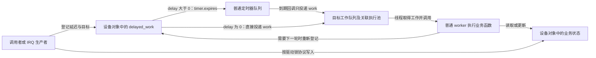
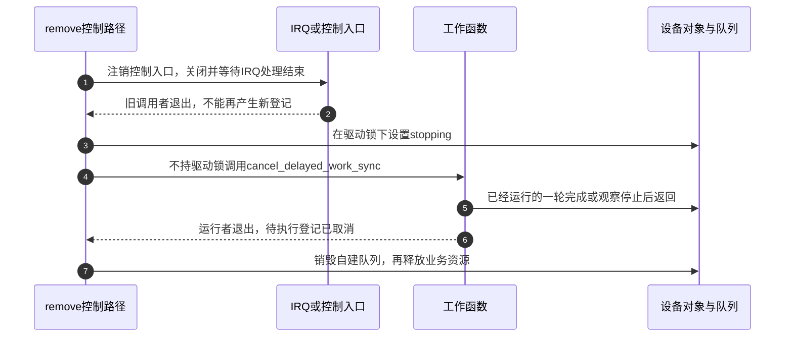

# 第6章\_基于工作队列的延迟执行\_delayed\_work

第五章已经把“到了计划时刻”和“软件真正开始执行”分开。现在让采样设备在收到请求后等 30 ms，再通过可能睡眠的总线读取状态：定时器能安排到期，但普通 timer 或 hrtimer 回调不能直接执行这种总线事务。

可以让定时器只投递普通工作，再由内核工作线程执行读取。**延迟工作（delayed work）** 把这个常见组合封装成一个对象。本章先走完一次等待、投递和执行，再处理改期、重试和退出。读完应能解释为什么排队返回 false 不等于“函数正在执行”，也能判断销毁设备以前还缺哪个生产者的停止证明。按键的不同判定策略留在[第十四章](P14_按键窗口合并与按下释放确认.md)，避免把工作调度机制与业务正确性混成一件事。

## 6.1\_把等待期限与可睡眠执行接起来

设设备对象里有一项延迟工作 `poll_work`。调用者登记 30 ms 的相对延迟后即可返回，不需要自己睡满 30 ms。定时器到期时只把这项工作交给目标工作队列；普通工作线程被调度后才读取设备。因此总线读取的开始时间，还受定时粒度、到期处理、队列负载与线程调度影响。

这里的 **工作队列（workqueue）** 是管理工作投递、并发与等待范围的逻辑对象，**工作线程（worker）** 才是实际执行函数的任务。逻辑队列不等于专属于某个驱动的一条线程。本文使用 `system_wq` 或普通线程工作队列；Linux 6.12 的 `WQ_BH` 是软中断执行模型，不能套用“工作函数可以睡眠”的结论。



图中零延迟绕过定时器，**没有绕过工作队列调度**。普通延迟工作不是“精度稍差的 hrtimer”：它同时选择了普通定时器和工作执行环境。如果需要更细的到期计划，可采用 hrtimer 投递普通 work；最终业务仍然会经历队列与调度延迟，不能因此承诺严格的 GPIO 翻转时刻。

## 6.2\_一份对象里为什么既有timer又有work

调用者只保存一个设备指针，内核却要跨两个执行阶段找到同一份业务。`struct delayed_work` 因此内嵌 `timer_list` 与 `work_struct`，并保存定时器到期后需要的目标队列和 CPU 信息。设备对象再内嵌这份 delayed_work，工作回调便能沿成员关系找回设备。

以下是本章用到的字段，不是要求驱动直接修改它们：

| 状态载体 | 谁写入和读取 | 在过程中的作用 |
| --- | --- | --- |
| `dwork.timer.expires` | 延迟工作排队路径写入，定时器路径读取 | 当前等待期限；只有非零延迟才经过这一步 |
| `dwork.work.data` 中的 pending 等状态 | 工作队列内部原子操作和锁协议维护 | 表示已经登记的一轮待执行工作，不是全部业务事件数 |
| `dwork.work.entry` | 工作队列内部维护 | 到期以后把工作连接到相应待执行链表 |
| `dwork.wq`、`dwork.cpu` | 非零延迟排队时保存，到期回调读取 | 指明 timer 到期后向哪里投递 |
| 执行 worker 的当前工作记录 | worker 开始/结束执行时维护 | 记录正在运行的函数；不能只由 pending 推出 |
| 驱动自己的计数、参数、停止标志 | IRQ、控制入口与工作函数按驱动同步协议读写 | 保存真正的事件和业务进度，不由 workqueue 自动代管 |

这不是单一的“空闲—排队—运行”枚举。**待执行登记与正在执行是两组可以同时成立的状态**：worker 开始一轮回调前会清除该轮 pending；当前回调仍运行时，调用者可能已经成功登记下一轮。同一工作项的非重入保证有前提：不更换函数、不重新初始化正在使用的对象，并始终投递到同一工作队列等。它也不保护 IRQ 与工作函数共享的设备字段。

| 阶段 | 触发与写入者 | 状态和下一步 |
| --- | --- | --- |
| S0 初始化 | 驱动初始化一次对象 | 还没有到期登记；所有回调需要的锁和状态已经就绪 |
| S1 等期限 | 调用者登记非零 delay | pending 已占用，timer 排队；到期回调读取目标队列 |
| S2 等执行 | 定时器投递，或调用者登记零 delay | work 等待 worker；此时再修改延迟可能把待执行工作改成新的定时等待 |
| S3 执行业务 | worker 取得工作，清除本轮 pending 后调用函数 | 当前执行仍有归属；期间可以出现后继 S1/S2 |
| S4 本轮结束 | 工作函数返回 | 没有后继登记才回到空闲；有后继则继续下一轮 |

`to_delayed_work(work)` 从工作成员找回 delayed_work，`container_of(dwork, struct demo, poll_work)` 再找回其外层设备对象。它们只做成员地址换算，不延长对象生命期；外层对象必须一直活到相关回调结束。

## 6.3\_追加一轮与移动期限是不同请求

假设 t=0 登记 30 ms 后检查，t=10 ms 又来一个事件。如果业务只需“已有检查就够了”，用 `queue_delayed_work()`；已有 pending 时返回 false，原来的检查计划保持。若业务需要“从最新事件再等 30 ms”，用 `mod_delayed_work()` 把等待改到新期限附近。后者若遇到正在运行的回调，不能把已经执行的代码倒回去，只能安排或调整后继一轮。因此严格的静默窗口还要在业务函数里复核事件代次与期限，第十二章给出这种实现。

| 接口 | 本章所需契约 | 容易误读的返回值或边界 |
| --- | --- | --- |
| `INIT_DELAYED_WORK(&dw, fn)` | 首次使用前初始化 | 不是每次启动都调用；不能重初始化活跃对象 |
| `queue_delayed_work(wq, &dw, delay)` | 没有 pending 且未禁用时登记一轮 | true 表示此次登记成功；false 可能是已有 pending 或被禁用，不等于正在运行 |
| `schedule_delayed_work(&dw, delay)` | 向 `system_wq` 登记 | 与上一项同类返回语义，不是一个新的执行模型 |
| `mod_delayed_work(wq, &dw, delay)` | 登记新一轮，或取得原 pending 后改期 | 通常 false 表示此前无 pending，true 表示修改了 pending；不是通用成功码。禁用时不产生新登记 |
| `cancel_delayed_work(&dw)` | 撤销待执行登记，不等待运行者 | 不能凭返回就释放可能仍被回调访问的对象 |
| `cancel_delayed_work_sync(&dw)` | 撤销并等待当前执行结束 | 可睡眠的停止路径使用；不允许等待自己，也不能持有回调需要的锁 |
| `flush_delayed_work(&dw)` | 将仍在等待的 timer 提前转为工作，并等相应排队实例完成 | 不保留剩余延迟，不关闭未来的生产者 |
| `disable_delayed_work_sync(&dw)` / `enable_delayed_work(&dw)` | 6.12 提供禁用计数与恢复接口 | 禁用期间拒绝新排队，但外部调用者仍不能访问已释放对象；恢复不会自动补一轮 |

delay 的单位是 jiffies，毫秒输入要先验证范围，再用 `msecs_to_jiffies()` 转换。传零允许直接投递；是否接受零应由业务定义，不能让无效的周期参数形成紧密自重排。

源码证据采用 NXP Linux 6.12.20 固定提交 `dfaf2136deb2af2e60b994421281ba42f1c087e0`。首次进入实现可从[工作队列源码总索引](../../../../../research/source_reading/workqueue/navigation/P01_Linux_6.12_工作队列源码总阅读索引.md)定位。字段与接口在 `include/linux/workqueue.h`；`kernel/workqueue.c` 的 `__queue_delayed_work()`、`queue_delayed_work_on()`、`mod_delayed_work_on()` 与 `flush_delayed_work()` 分别兑现零延迟分支、pending 登记、改期与提前执行。正文给出使用契约，固定文件身份见[源码基线](../../../../../research/source_reading/linux/SOURCE_BASELINE.md#1.170_工作队列执行模型与取消版本边界)。

## 6.4\_队列选择改变哪些保证

先使用 `system_wq` 能避免管理另一个队列对象。当驱动需要独立的 flush 范围、不同属性或特定并发约束时，才有理由自建队列。**自建普通队列仍可共享底层 worker pool**，不是从此拥有独占 CPU 或实时执行保证。

`alloc_workqueue("demo", WQ_UNBOUND | WQ_HIGHPRI, 1)` 中，unbound 表示执行不固定绑定到投递 CPU，HIGHPRI 选择较高优先级的工作池，数字 1 控制 active 配额。这个组合不能代替全局严格顺序队列。多个不同 work 必须按投递次序逐个执行时，使用 `alloc_ordered_workqueue("demo", 0)`；也要检查前一个工作是否等待只能由后一个工作产生的结果，否则顺序保证会成为死锁条件。

`WQ_MEM_RECLAIM` 供内存回收路径需要前进保证的队列使用，不是“可能睡眠就加上”的标志。`INIT_DEFERRABLE_WORK()` 则使用可延后定时器：CPU 空闲时不会仅为该定时器专门唤醒，检查可能继续推迟。它适合可容忍延期的后台统计，不适合到期限必须开始响应的动作。

这些选择都不会解决业务字段的数据竞争。多个工作、IRQ 与参数入口共享 `active` 或重试计数时，必须说明由谁持锁访问；只把 max_active 改成 1 不会让 IRQ 和用户参数写入跟着串行。

## 6.5\_退出需要先关生产者再等工作

考虑一条真实交错：remove 调用同步取消并返回，紧接着尚未注销的 IRQ 又把同一工作排上，随后 remove 释放设备。取消确实完成过，但新的登记仍会引用已释放地址。问题缺在外部生产者，而不是 cancel 没有等待。

在固定 6.12 实现中，同步取消期间使用临时禁用状态，处理包括回调自重排在内的并发；完成后恢复原有禁用深度。它不是设备永久死亡的标记。退出协议需要先使外部入口不能再登记，再等待工作，最后释放回调引用的资源。



步骤 1～2 关闭外部生产者；步骤 3 让业务路径看见停止；步骤 4～6 等执行者退场。不能在步骤 4 持有工作函数还要取得的 mutex，也不能由工作函数同步取消自己。若工作正在条件等待，停止路径还要先改变等待条件并唤醒它，不能只在外面等它超时。

设备资源管理 **devres** 能把清理动作放进自动回收链，例如用 `devm_add_action_or_reset()` 注册 cancel，但不会推导依赖顺序。资源按相反顺序释放：通常先取得工作依赖的 GPIO/内存，初始化工作并注册取消动作，再注册 IRQ，才能让 IRQ 释放先于工作取消、工作取消先于 GPIO/内存释放。若 remove 手动销毁队列，而 IRQ 仍等稍后的 devres 释放，顺序又被破坏了。应选择并验证一套所有权方案，不复制两遍清理当作“双保险”。

挂起也要根据设备策略决定：需要暂停访问的工作采用类似停止协议，恢复后明确重启；支持唤醒的 IRQ 必须走电源管理协议，不能一律说挂起前停止所有工作就完成了唤醒设计。第十、十一章展开这些约束。

## 6.6\_周期与退避先选业务时间轴

在工作末尾登记 `period_ms`，实际得到的是“**本轮完成后，再等一段时间**”。若每轮设备读取用了 8 ms、所需间隔为 100 ms，开始到开始还要加上这 8 ms 和排队延迟。它适合限制设备访问频度，不保持固定采样相位。需要固定计划网格时，应保存绝对目标并定义漏期策略；第五、十二章已展示相位推进。

失败重试又是另一种时间轴。每次立即重试会反复占用总线与 CPU，却未必给设备恢复时间。退避把失败后的间隔逐步放大，例如 100、200、400 ms，封顶后不再放大；成功则恢复普通巡检间隔。封顶只限制 **下一次请求的等待间隔**，不限制排队延迟或整个事务寿命。还要有失败预算或整体截止时间，才能避免永久失败无限重试。

不要写 `min(cur << 1, cap)` 期待 min 挽救已经发生的整数溢出。已知 `0 < cur <= cap` 时，先比较 `cur > cap / 2`，成立直接取 cap，否则再乘二。下一节把这条算式与重试预算放进可运行的实验。

## 6.7\_用无硬件模块观察轮询与有限重试

下面的模块只模拟一次可睡眠事务，不访问真实 I2C、SPI 或 GPIO。初始化只登记一次，之后由同一 work 决定是否继续；debugfs 控制入口可以制造故障、标记活跃或显式重新开始。所有状态归 `demo.lock` 保护，工作函数持 mutex 请求 2～4 ms 的模拟睡眠，所以控制写入可能还要等工作释放锁；实际恢复执行可能更晚。真实长事务是否能这样持锁，必须另行分析。

`once=1` 只做一次尝试；默认模式在成功后按活跃/空闲间隔巡检，失败后最多再重试三次。一次初始尝试加三次重试，总共至多四次。失败预算耗尽便停住，改变故障开关本身不重启，需写 restart。在线参数在下一次工作选择间隔时使用，已经排定的期限保持；restart 会显式改为零延迟。

接下来的三段 C 依次拼接成完整的 `dwork_demo.c`。先建立状态与执行函数，再增加控制入口，最后注册和回收资源。`mutex` 是可睡眠互斥锁，保护整个状态更新；`once` 是只读模块参数，`MODULE_PARM_DESC` 为它提供说明。

```c
// SPDX-License-Identifier: GPL-2.0
#include <linux/module.h>
#include <linux/workqueue.h>
#include <linux/mutex.h>
#include <linux/delay.h>
#include <linux/debugfs.h>
#include <linux/err.h>
#include <linux/jiffies.h>

static bool once;
module_param(once, bool, 0444);
MODULE_PARM_DESC(once, "只执行一次尝试，默认持续巡检");

/* 控制项编号：空闲/活跃间隔、退避基数/上限、故障、活跃提示、重启。 */
enum knob_id { IDLE_MS, ACTIVE_MS, BASE_MS, CAP_MS,
               FORCE_FAIL, ACTIVITY, RESTART, KNOB_COUNT };
struct demo_state;
struct knob { struct demo_state *owner; enum knob_id id; };
struct demo_state {
    struct mutex lock;
    struct delayed_work work;
    struct dentry *dir;
    struct knob knobs[KNOB_COUNT];
    unsigned int idle_ms, active_ms, base_ms, cap_ms;
    unsigned int backoff_ms, failures;
    bool stopping, force_fail, active;
};
static struct demo_state demo;

/* 前提是输入非零且不大于上限，先比较再倍增。 */
static unsigned int grow_delay(unsigned int value, unsigned int cap)
{
    return value > cap / 2 ? cap : value * 2;
}

static void sample_work(struct work_struct *work)
{
    struct demo_state *d = container_of(to_delayed_work(work),
                                       struct demo_state, work);
    unsigned int next;

    mutex_lock(&d->lock);
    if (d->stopping)
        goto out;
    usleep_range(2000, 4000); /* 模拟可睡眠事务，不能证明真实设备时延。 */
    pr_debug("dwork_demo: attempt, fail=%d\n", d->force_fail);
    if (once)
        goto out;
    if (d->force_fail) {
        if (++d->failures > 3) {
            pr_info("dwork_demo: retry budget exhausted\n");
            goto out;
        }
        next = d->backoff_ms;
        d->backoff_ms = grow_delay(next, d->cap_ms);
    } else {
        d->failures = 0;
        d->backoff_ms = d->base_ms;
        next = d->active ? d->active_ms : d->idle_ms;
        d->active = false; /* 消费一次活跃提示，不当作全部事件数。 */
    }
    pr_debug("dwork_demo: next=%u ms, failures=%u\n", next, d->failures);
    mod_delayed_work(system_wq, &d->work, msecs_to_jiffies(next));
out:
    mutex_unlock(&d->lock);
}

```

## 6.8\_在线控制也必须进入同一把锁

工作函数已经能决定下一次间隔，现在让实验者改变参数。`debugfs` 是内核调试文件系统，不是稳定用户 ABI；文件只允许管理者写入。每个 `knob` 保存所属设备与控制项编号，通用读取函数 getter 和写入函数 setter 据此访问对应字段，两者都取得 `demo.lock`。

输入先以 u64 接收并检查，再赋给 unsigned int。`EINVAL` 表示输入不合法，`ENODEV` 表示设备正在停止。修改 base/cap 还必须保持 base 不大于 cap，不能只分别检查两个数都在 1～5000 之间。属性宏 `DEFINE_DEBUGFS_ATTRIBUTE` 把这两个函数接到文件读写接口。

```c
static int knob_get(void *data, u64 *value)
{
    struct knob *k = data;
    struct demo_state *d = k->owner;

    mutex_lock(&d->lock);
    switch (k->id) {
    case IDLE_MS: *value = d->idle_ms; break;
    case ACTIVE_MS: *value = d->active_ms; break;
    case BASE_MS: *value = d->base_ms; break;
    case CAP_MS: *value = d->cap_ms; break;
    case FORCE_FAIL: *value = d->force_fail; break;
    case ACTIVITY: *value = d->active; break;
    default: *value = 0; break;
    }
    mutex_unlock(&d->lock);
    return 0;
}

static int knob_set(void *data, u64 value)
{
    struct knob *k = data;
    struct demo_state *d = k->owner;
    int ret = 0;

    /* 先验证宽输入，再赋给较窄字段；0 不作为轮询间隔。 */
    if (k->id <= CAP_MS ? (!value || value > 5000) : (value > 1))
        return -EINVAL;
    mutex_lock(&d->lock);
    if (d->stopping) {
        ret = -ENODEV;
        goto out;
    }
    switch (k->id) {
    case IDLE_MS: d->idle_ms = value; break;
    case ACTIVE_MS: d->active_ms = value; break;
    case BASE_MS:
        if (value > d->cap_ms) { ret = -EINVAL; break; }
        d->base_ms = value;
        d->backoff_ms = value;
        break;
    case CAP_MS:
        if (value < d->base_ms) { ret = -EINVAL; break; }
        d->cap_ms = value;
        d->backoff_ms = min(d->backoff_ms, d->cap_ms);
        break;
    case FORCE_FAIL: d->force_fail = value; break;
    case ACTIVITY: d->active = value; break;
    case RESTART:
        if (value) {
            d->failures = 0;
            d->backoff_ms = d->base_ms;
            mod_delayed_work(system_wq, &d->work, 0);
        }
        break;
    default: ret = -EINVAL;
    }
out:
    mutex_unlock(&d->lock);
    return ret;
}
DEFINE_DEBUGFS_ATTRIBUTE(knob_ops, knob_get, knob_set, "%llu\n");
```

## 6.9\_公开入口以前准备状态并规划失败回滚

参数文件一旦创建，就可能被另一个任务打开；不能以 probe/init 尚未返回为理由假设“无人使用”。因此先初始化锁、工作和全部参数，再逐个公开文件。若创建到一半失败，已经存在的 restart 文件也可能排过工作，必须先移除控制入口，再标记停止并同步取消。

创建接口可能返回空指针或编码错误的指针。`IS_ERR_OR_NULL` 检查这两类失败，`PTR_ERR` 取出负错误码，空指针按本例约定转成 `-ENOMEM`。正常卸载复用相同的关闭次序；没有自建队列，就不销毁共享的 system_wq。

```c

static int __init dwork_demo_init(void)
{
    static const char * const names[] = {
        "idle_ms", "active_ms", "base_ms", "cap_ms",
        "force_fail", "activity", "restart"
    };
    unsigned int i;

    mutex_init(&demo.lock);
    INIT_DELAYED_WORK(&demo.work, sample_work);
    demo.idle_ms = 500;
    demo.active_ms = 80;
    demo.base_ms = demo.backoff_ms = 100;
    demo.cap_ms = 2000;
    demo.dir = debugfs_create_dir("dwork_demo", NULL);
    if (IS_ERR_OR_NULL(demo.dir))
        return demo.dir ? PTR_ERR(demo.dir) : -ENOMEM;
    for (i = 0; i < KNOB_COUNT; i++) {
        struct dentry *entry;
        demo.knobs[i].owner = &demo;
        demo.knobs[i].id = i;
        entry = debugfs_create_file(names[i], 0600, demo.dir,
                                   &demo.knobs[i], &knob_ops);
        if (IS_ERR_OR_NULL(entry)) {
            /* 已创建的控制文件可能已被打开并写入 restart。 */
            debugfs_remove_recursive(demo.dir);
            mutex_lock(&demo.lock);
            demo.stopping = true;
            mutex_unlock(&demo.lock);
            cancel_delayed_work_sync(&demo.work);
            return entry ? PTR_ERR(entry) : -ENOMEM;
        }
    }
    queue_delayed_work(system_wq, &demo.work, msecs_to_jiffies(80));
    return 0;
}

static void __exit dwork_demo_exit(void)
{
    /* 先关闭并等待受 debugfs 保护的文件操作，再停止唯一自重排者。 */
    debugfs_remove_recursive(demo.dir);
    mutex_lock(&demo.lock);
    demo.stopping = true;
    mutex_unlock(&demo.lock);
    cancel_delayed_work_sync(&demo.work);
}
module_init(dwork_demo_init);
module_exit(dwork_demo_exit);
MODULE_LICENSE("GPL");
MODULE_DESCRIPTION("延迟工作、有限重试与在线参数实验");
```

`DEFINE_DEBUGFS_ATTRIBUTE` 配合 `debugfs_create_file()` 使用文件操作保护；删除目录会关闭这些操作进入本对象的路径。若改用 `debugfs_create_file_unsafe()` 加上未经保护的自定义文件操作，就必须另证生命期；这个属性宏自身仍使用 debugfs 的读写保护，不能只凭接口名中的 unsafe 判断全部操作都无保护。这里没有 IRQ，退出只需要关闭 debugfs 生产者和自重排工作；把它接到设备 IRQ 后，必须增加 IRQ 的停止和同步。

## 6.10\_从预测到观察一次完整重试周期

代码已经闭合初始化、可睡眠执行和退出，现在把它放进目标内核观察。先写下预期的三次重试间隔，再与日志比较，避免只看到“工作执行了”就判断策略正确。同目录新建 `Makefile`：

```makefile
# 使用目标内核构建系统生成外部模块。
obj-m += dwork_demo.o
```

在具有匹配运行内核构建目录的 Linux 实验机上执行：

```bash
# 当前目录包含 dwork_demo.c 与 Makefile。
make -C /lib/modules/$(uname -r)/build M="$PWD" modules
sudo insmod ./dwork_demo.ko
```

第一行使用该内核的 Kbuild，不是普通 gcc 直接编译内核模块；第二行装载默认巡检模式。需要模块构建、debugfs 配置及匹配的内核符号环境。本轮文档整理未执行目标 Kbuild 或装载实验，下面列的是可复现实验步骤，不是已取得的运行结果。

```bash
# debugfs 尚未挂载时才挂载；需要管理员权限。
mountpoint -q /sys/kernel/debug || sudo mount -t debugfs debugfs /sys/kernel/debug
# 需要内核开启动态调试；+p 为本模块启用 pr_debug 输出。
echo 'module dwork_demo +p' | sudo tee /sys/kernel/debug/dynamic_debug/control
# 制造持续失败，再显式开启一次重试周期。
echo 1 | sudo tee /sys/kernel/debug/dwork_demo/force_fail
echo 1 | sudo tee /sys/kernel/debug/dwork_demo/restart
sudo dmesg -w
```

预期依次看到失败后的下一次间隔 100、200、400 ms，第四次尝试耗尽预算后不再自动登记。日志本身会扰动时序，所以这里只验证重试决策，不据此测量精度。退出 `dmesg -w` 后清除故障，再写 restart，应恢复成功巡检；写 activity=1 只使随后一次成功选择活跃间隔，后续没有新提示便回到空闲间隔。

```bash
# 恢复事务并重新开始；最后卸载，验证工作不越过退出。
echo 0 | sudo tee /sys/kernel/debug/dwork_demo/force_fail
echo 1 | sudo tee /sys/kernel/debug/dwork_demo/restart
sudo rmmod dwork_demo
# 独立观察一次性模式，工作完成后模块仍需卸载。
sudo insmod ./dwork_demo.ko once=1
sudo rmmod dwork_demo
```

立即卸载可能在 80 ms 到期前撤销唯一工作，因而没有业务日志也是合法结果。若要看执行本身，装载后先观察一次 attempt，再卸载。

## 6.11\_把观察结果定位到正确一段

出现“30 ms 的任务晚了”时，至少记录请求登记、timer 到期、work 开始、业务结束四个时刻。只有 work 开始时间无法区分定时迟到和执行排队。具备 trace-cmd 与相应 tracepoint 的实验机可以在可控窗口记录：

```bash
# root终端：用本次独立实例记录十秒，避免清空全局跟踪设置。
name=dwork_record_$$
test ! -d "/sys/kernel/tracing/instances/$name" || exit 1
trace-cmd record -B "$name" -e 'timer:*' -e 'workqueue:*' -o dwork_trace.dat sleep 10
trace-cmd report -i dwork_trace.dat
```

用对象地址与函数身份关联同一工作，注意零延迟没有 timer 等待阶段；系统其他定时器也会出现在记录里。非零延迟的 `workqueue_queue_work` 出现在 timer 等待以后，不能把 queue→execute 误当作完整延迟。接口调用返回值不能代替业务计数，work 合并也不能代替设备 FIFO 或事件队列。工具版本、事件格式、跟踪时钟和丢失统计的完整检查见[第十三章采集与配对](P13_调试_验证与常见陷阱.md#13.3_在独立实例中采集一次完整装载与退出)。

卸载压力实验必须覆盖生产者同时触发、工作正在睡眠和自重排临界点。内核地址检查器 KASAN 的告警能揭示部分非法访问，但“未告警”还取决于配置、覆盖路径与时序，不能承诺错误示例必然稳定崩溃，也不能用没有日志证明所有生产者均已关闭。

练习：已登记 30 ms 后运行的工作，在 10 ms 时调用 `flush_delayed_work()`，它会继续等原来的 20 ms 吗？**答案：不会要求保留这段延迟。它将 timer 等待提前转为排队，再等相应执行完成；开始执行仍取决于 worker。** 若业务不允许提前检查，就不能用 flush 当作“等到自然到期”。

现在我们能安排一个未来可睡眠动作，并给出改期、重试和退出的边界。下一章换一个视角：当前调用者必须等结果时，如何区分“睡一段时间”和“等条件成立”。

上一篇：[P05 高精度定时器 hrtimer 的驱动用法](P05_高精度定时器_hrtimer_的驱动用法.md)。
下一篇：[P07 睡眠与超时调度接口](P07_睡眠与超时调度接口.md)。
