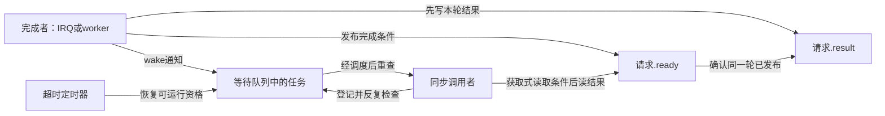
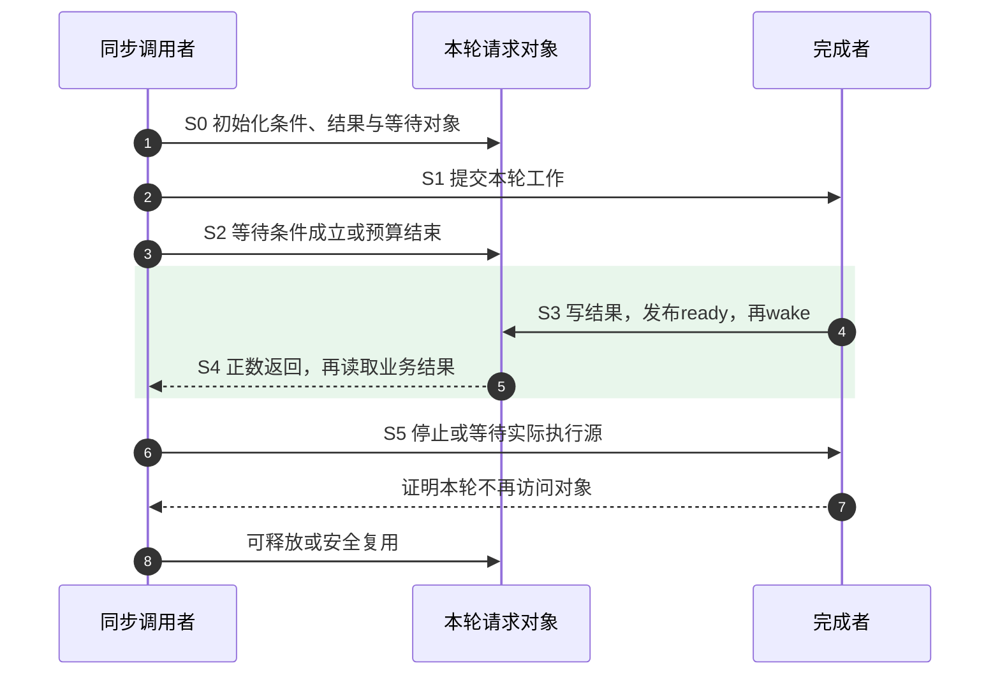
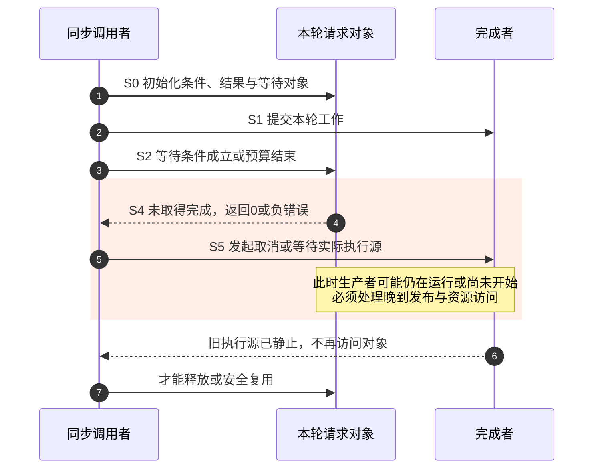

# 第7章\_睡眠与超时调度接口

第六章让调用者登记未来工作后立即返回。现在换成同步调用：驱动发出设备命令，调用它的任务暂时不能继续，但 CPU 可以先执行其他任务。这就是本章的睡眠等待。

同样写“等 20 ms”，可能表达三个不同要求：上电后至少留出稳定时间；每隔一会儿读取一次状态；等待另一条路径宣布命令完成，20 ms 后不再等。前者以时间为条件，后两者以业务状态为条件，接口返回值也不同。本章以一次设备请求贯穿这些选择，重点回答 **等待何时结束、返回值证明什么、退出等待后谁还在访问请求**。等待队列内部的入队与调度细节由[等待与通知专题](../../synchronization/waiting_notification/大纲.md)展开，这里把相关契约落实到时间与驱动流程。

## 7.1\_先区分留出时间与等待结果

上电后的稳定期不能因为“有别的任务叫醒我”就提前结束；命令等待却应该在结果到来后尽快继续。把两者都写成 `msleep(20)`，命令即使 1 ms 就完成，调用者仍会继续等；反过来，把稳定期写成一次可能提前返回的调度睡眠，又可能没有留足设备要求的间隔。

还要区分 **唤醒（wake）** 与 **重新运行**。唤醒通常只是让任务获得可运行资格；它何时真正得到 CPU 取决于调度。定时器到期、任务被唤醒、等待函数返回和设备动作完成，是四个不同观察点。因此超时参数不会给整个系统调用建立不可突破的墙钟执行上界。

所有本章会阻塞的接口都要求可睡眠上下文：普通任务、允许睡眠的内核线程、线程化 IRQ 或普通 worker；同时不能持有禁止睡眠的锁，也不能持有结果生产者必须取得的互斥锁。普通硬中断、软中断、`WQ_BH` 与禁止调度区域不能直接这样等待。第八章讨论真正不能睡眠时的短延时边界，不能把任意长等待都改成忙等。

## 7.2\_只要求时间经过时使用睡眠延时

`msleep()` 把毫秒转成 jiffies，并反复使用剩余时间睡眠；显式唤醒导致一轮提前返回时，它还会继续等。`usleep_range()` 则用高分辨率定时器表达最小间隔与允许合并到期的范围。这两个封装都比“裸调度一次”更接近“留出一段时间”的意图。

范围的上端不是任务必须恢复执行的硬截止。`usleep_range(1000, 1500)` 允许内核在该定时范围内安排到期以合并唤醒，但负载、IRQ 和调度仍可能使函数在 1500 μs 后才返回。不能把它解释成获得了严格的 `[min,max]` 返回窗口，也不能用 `usleep_range(800,1200)` 替换一个确实要求至少 1 ms 的设备协议。

| 接口 | 输入及返回 | 当前需要的边界 |
| --- | --- | --- |
| `msleep(unsigned int ms)` | 毫秒，无返回值 | 普通定时器粒度与调度影响实际延迟；不是设备就绪判断 |
| `msleep_interruptible(unsigned int ms)` | 返回未睡完的毫秒数，类型 unsigned long | 信号可结束等待；返回不是 errno。极小剩余量经毫秒换算可能为零，不能据此精确鉴定唤醒历史 |
| `usleep_range(unsigned long min, unsigned long max)` | 微秒，要求 min≤max，无返回值 | min 是所请求的最小间隔，max 提供到期余量；不能在不可睡眠上下文使用 |
| `ssleep(unsigned int seconds)` | 秒，无返回值 | 固定实现转换成毫秒再 msleep；应限制外部输入，不能忽略 seconds×1000 的范围 |

所谓“20 ms 以下常考虑 usleep_range”是经验选择，不是架构分界线。应先看最小稳定时间、可容忍的额外延迟、HZ 和平台高分辨率支持，再选择接口。短延时并非都要忙等，长睡眠也并非一定更省电；唤醒合并、硬件和负载决定实际结果。

下面是可嵌入可睡眠驱动路径的单位封装，不是完整驱动。把参数限定到 1～5000 ms 后，短分支的微秒乘法不会在常见 32 位 unsigned int 上溢出；2 ms 额外余量是本例业务允许的范围，不是通用推荐值。

```c
#include <linux/delay.h>
#include <linux/errno.h>

static int settle_ms(unsigned int ms)
{
    if (!ms || ms > 5000)
        return -EINVAL; /* 外部参数越界，不转换成紧密循环。 */
    if (ms >= 20)
        msleep(ms);
    else
        usleep_range(ms * 1000UL, ms * 1000UL + 2000);
    return 0;
}
```

若设备规定“至少等待 12 ms，然后检查锁定位，全部观察窗口共 50 ms”，应在这 12 ms 之前记录总截止时间，之后再按同一截止轮询。不能睡完 12 ms 后另外创建 50 ms 窗口，除非协议原本就允许两个时段相加。

## 7.3\_裸调度超时只说明还有没有等待预算

有时我们需要自己控制任务状态和每次检查，例如没有可用中断的轮询器。`schedule_timeout()` 提供这层底座：调用者先设置任务状态，再让出 CPU。`TASK_INTERRUPTIBLE` 可因相应信号或显式唤醒恢复，`TASK_UNINTERRUPTIBLE` 不因普通信号结束，但仍可被显式唤醒。不可中断不等于绝对不会提前醒，也不等于忙等。

若状态仍为 `TASK_RUNNING`，一次 schedule 不是把任务放入睡眠等待。函数可能在调度后很快返回，甚至根本没进入你设想的睡眠阶段。对这种返回做“唤醒来源分类”，起点已经错了。

| 接口 | 谁设置任务状态 | 返回值能证明什么 |
| --- | --- | --- |
| `schedule_timeout(long timeout)` | 调用者 | 有限合法输入下返回非负的剩余 jiffies；0 表示返回时预算已用完，不唯一证明究竟是哪条路径唤醒 |
| `schedule_timeout_interruptible()` | 封装设可中断状态 | 同上；返回正数不是一个 signal 错误码 |
| `schedule_timeout_uninterruptible()` | 封装设不可中断状态 | 同上；显式唤醒仍可能提前结束这一轮 |
| `schedule_timeout_killable()` | 封装设可响应致命信号的状态 | 不能把“信号只影响 INTERRUPTIBLE”写成覆盖全部任务状态的结论 |
| `schedule_hrtimeout_range_clock(ktime_t *expires, u64 delta, mode, clock_id)` | 调用者 | 非零、非空期限的普通路径中，0 表示 sleeper 定时器已完成；`-EINTR` 表示未由该到期状态完成，不等于一定收到信号 |

`MAX_SCHEDULE_TIMEOUT` 表示无有限超时，不是一个很长但终会耗尽的普通预算。hrtimeout 的空指针表示无限等待，期限值为零会立即返回；本章示例只使用明确、有限的正期限。绝对期限的时钟必须与 `clock_id` 一致，delta 是纳秒单位的允许余量，固定版本参数类型是 u64。

假设外部在第 9 ms 唤醒一个等待 10 ms 的任务，但它到第 12 ms 才重新运行，jiffies 剩余量可以已经为零。再看 `signal_pending()`、`kthread_should_stop()` 或冻结标志，只能知道 **现在有哪些条件成立**，不能无歧义复原“最先是谁叫醒我”。这些条件还可能同时成立。

因此不要把 hrtimeout 的任何 `-EINTR` 都向用户映射为 `-ERESTARTSYS`。只有驱动确认其可中断等待应按信号取消，并完成设备收尾，才返回相应错误。普通显式唤醒后，通常应重新检查业务条件与截止时间。

## 7.4\_总超时必须按同一截止时间计算

一种看似自然的轮询代码，每轮请求睡 5 ms，再从 `left` 固定减去 5 ms。若这轮 1 ms 就被叫醒，它把未经过的 4 ms 也扣掉了；若因调度晚到实际用了 12 ms，它又少扣 7 ms。读寄存器的时间也没被算进去。最终“120 ms 超时”只是循环计数，不是实际经过时间。

改进方法是在开始时建立一个绝对截止点，每次返回重新读同一个时钟。以下协议片段接收一个业务提供的 `ready()` 函数：正数表示就绪，0 表示未就绪，负数表示读取错误。负错误码 `-ETIMEDOUT` 表示观察窗口用完，`-ERESTARTSYS` 用于可中断路径的信号退出。它不假造芯片状态寄存器；接入具体芯片时，ready 的读写方式、寄存器字段及总线超时必须由该设备手册与驱动实现定义。

```c
#include <linux/ktime.h>
#include <linux/hrtimer.h>
#include <linux/sched.h>
#include <linux/sched/signal.h>
#include <linux/errno.h>

static int poll_ready_until(int (*ready)(void *), void *data,
                            ktime_t deadline, unsigned int slice_us)
{
    ktime_t now, next;
    int ret;

    if (!slice_us || slice_us > 1000000)
        return -EINVAL;
    for (;;) {
        now = ktime_get();
        if (ktime_compare(now, deadline) >= 0)
            return -ETIMEDOUT;
        ret = ready(data); /* 本回调本身也必须有可接受的执行边界。 */
        if (ret < 0)
            return ret;
        now = ktime_get();
        if (ktime_compare(now, deadline) >= 0)
            return -ETIMEDOUT;
        if (ret)
            return 0;
        next = ktime_add_us(now, slice_us);
        if (ktime_compare(next, deadline) > 0)
            next = deadline;
        set_current_state(TASK_INTERRUPTIBLE);
        if (signal_pending(current)) {
            __set_current_state(TASK_RUNNING);
            return -ERESTARTSYS;
        }
        /* 提前唤醒不直接当作信号错误，回到循环重查。 */
        schedule_hrtimeout_range_clock(&next, 0, HRTIMER_MODE_ABS,
                                       CLOCK_MONOTONIC);
    }
}
```

调用者先用 `deadline = ktime_add_ms(ktime_get(), 120)` 建立 120 ms 的观察窗口，再传 `slice_us=5000`。若还需要前置 12 ms 稳定期，就在建立 deadline 后调用 `settle_ms(12)`，然后进入同一个轮询函数。这些常量仅说明时间预算组织，不是某个芯片时钟锁定的真实时序要求。

这个函数采取“**截止前完成的软件观测才接受为就绪**”策略。设备物理上已就绪但软件读完时越过截止，仍判超时；需要按硬件时刻裁决时，须增加可信硬件时间戳。`CLOCK_MONOTONIC` 不累计系统挂起时间；若协议要求包含挂起，应重新选择时钟并检查睡眠/唤醒能力，不能只替换一个读时钟函数。

delta=0 没有赋予硬实时保证。若 ready 卡住、线程长时间得不到 CPU 或取消硬件很慢，函数仍可能晚于 deadline 返回；这里保证的是不主动接受截止以后的成功观测，而不是 CPU 必定按时执行。

## 7.5\_条件等待还需要保存结果与通知

若设备能产生完成中断，重复轮询就多做了读取，也把完成后的响应拖到下一次检查。现在增加一个结果对象：完成者写结果和 ready 条件，再唤醒等待队列；等待者在条件不满足时登记并睡眠，恢复以后重新检查。**等待队列保存等待者，业务对象保存完成事实。** 没有等待者时一次裸 wake 不会自动留下一份未来可消费的事件。

一次请求有三组正交状态：请求是否完成保存在业务对象，任务是否等待保存在等待队列及任务状态，时间预算是否耗尽保存在等待接口的超时机制。不能把它们压成一个 done 布尔值，再从 done 推断硬件和调用者都已退出。



只把 done 改成 `atomic_t`，不自动建立“结果写入先于等待者结果读取”的发布关系。单生产者、单消费者、每轮只写一次且完成后不再改结果时，可以用 **释放/获取（release/acquire）** 配对：先写 result，再 `smp_store_release(&ready, true)`；条件用 `smp_load_acquire(&ready)`。另一种方案是读写双方使用同一把业务锁。不要把 `WRITE_ONCE/READ_ONCE` 当成完整的跨字段排序协议，也不要只依赖 wake 内部可能执行的屏障，因为提前完成时等待者可能根本不用睡。

| 阶段 | 本轮动作与状态 | 接下来的责任 |
| --- | --- | --- |
| S0 准备 | 关闭上一轮生产者后初始化 result、ready、等待对象 | 对象在全部访问者退出前保持存活 |
| S1 提交 | 请求交给 IRQ/worker 等完成者 | 即使完成很快，也要保存结果而不是只发 wake |
| S2 检查并等待 | 获取式读 ready，必要时由等待宏登记任务 | 条件应可重复检查，不在表达式里执行破坏性消费 |
| S3 结果发布 | 完成者写 result，release 写 ready，再 wake | 完成者不能继续随意改已交付结果 |
| S4 等待返回 | 正数、0、负数分别按接口解释 | 超时/信号只结束等待，不自动撤销生产者 |
| S5 收尾 | 取消或等待实际执行源退出 | 然后才可释放、复用或开始下一轮 |

## 7.6\_返回正数后为什么还要读业务结果

`wait_event_timeout(q, condition, ticks)` 以不可中断状态等待条件；可中断版本还响应信号。它们会处理登记、检查与睡眠窗口，但业务条件、结果发布、轮次和对象寿命仍由调用者提供。

| 接口 | 正数 | 零 | 负数 |
| --- | --- | --- | --- |
| `wait_event_timeout()` | 条件成立；通常是剩余 jiffies，边界成立可返回 1 | 条件未满足且等待预算用完 | 正常契约不返回负数 |
| `wait_event_interruptible_timeout()` | 条件成立 | 超时 | 信号中断，通常 `-ERESTARTSYS` |

使用可中断版本时，用 `long` 保存返回值，避免负错误码转换为巨大的无符号正数。即使返回正数，还要读取业务结果：一项失败的设备事务也可以正常发布“已完成，结果为 -EIO”。同样，信号返回不代表硬件已经接受取消命令，超时返回也不代表之后不会再有 IRQ。



成功图步骤 4～5 也可以交付失败的业务结果；步骤 6～7 继续同步完成者退出。下面保持相同对象，单独看等待没有取得结果的路径，不能把成功图中的结果发布当成这条路径已经发生的事实。



超时/信号图步骤 4 只结束等待，步骤 5～6 才证明完成者不再访问对象。不能把这两步合并成“超时，完成者立即消失”。两图描述等待接口观察到的结果，不声称能唯一还原物理唤醒原因。

## 7.7\_completion增加的是可消费的完成记录

对于“一次提交对应一次完成”的协议，可以让 **完成量（completion）** 替我们保存完成记录。它内部有 done 计数和等待链：普通 `complete()` 增加一份完成记录，成功 wait 或 `try_wait_for_completion()` 消费一份；完成发生在等待之前，记录也不会因为当时没有 waiter 而丢失。

这意味着一组严格配对的 complete/wait，消费后 done 已回到零，**不是每轮都必须 reinit**。`reinit_completion()` 直接清零，适用于外层已经排除旧完成者和旧等待者的安全重新开始；它不取消硬件，不等待 IRQ，也不给完成记录增加请求编号。旧请求 A 超时后直接清零启动 B，A 的迟到 complete 仍可能被 B 消费。

| 操作 | 本章所需效果 | 生命期限制 |
| --- | --- | --- |
| `init_completion()` | 首次初始化计数与等待链 | 发布给生产者以前完成 |
| `DECLARE_COMPLETION_ONSTACK()` | 声明栈上完成对象并匹配相应调试初始化 | 超时返回前仍要证明异步完成者不会再访问栈 |
| `reinit_completion()` | 把 done 清零 | 不是取消和同步；先排除旧轮次 |
| `complete()` | 保存完成并唤醒一个等待者 | 不意味着调用 complete 的函数已经返回 |
| `complete_all()` | 设置持续广播完成状态并唤醒全部当前等待者 | 后来者也可通过，普通 wait 不消费掉广播；安全复用前才重置 |
| `wait_for_completion()` | 不可中断、无有限超时，取得完成后返回 | 等待前必须证明完成源有前进路径 |
| `wait_for_completion_timeout()` | jiffies 预算，0 表示未取得完成而超时，正数表示取得完成且至少为 1 | 超时不停止生产者 |
| `wait_for_completion_interruptible_timeout()` | 正数取得完成、0 超时、负数信号中断 | 用 long 保存返回值，并处理所有退出分支 |
| `try_wait_for_completion()` | 不睡眠，成功则消费记录 | 已取得与只观察不同 |
| `completion_done()` | 观察当前是否有完成/广播状态，不消费 | 另一等待者可能随后先消费，不能据此无条件阻塞等待 |

完成者先写本轮 result，再 complete；在单生产者一次写入的协议中，成功等待与完成建立交付边界，结果不必再机械地包一层 READ_ONCE。若 complete 后还继续改 result，或者多个完成者同时写，前提就不成立。complete_all 在实时内核还有上下文检查，不能把“不睡眠”扩张成所有配置与所有中断上下文都无条件可用。

完整令牌模型和广播复用见[完成量专题](../../synchronization/waiting_notification/P02_completion_完成量.md#2.2_计数与等待者是两套状态)。这里继续关注时间：超时与信号都不能代替 S5 的生产者收尾。

## 7.8\_用同一模块比较等待队列与完成量

下面的完整模块用第六章的 delayed_work 模拟完成者。`producer_ms` 是工作登记延迟，`timeout_ms` 是等待预算；`use_completion` 选择等待对象，`interruptible` 选择信号语义，`fail` 让正常完成携带失败结果。参数均为装载时配置，运行中不可写，没有并发重置或多生产者。

保存为 `wait_demo.c`。工作回调要么 release 发布 ready 后 wake，要么写 result 后 complete；等待者只在接口成功后读取 result。初值 `-EINPROGRESS` 表示处理中，真正的业务结果由完成者写入。无论等待结果如何，init 返回以前都同步取消/等待 delayed_work。因而 timeout=10 ms、producer=100 ms 不会让模块初始化失败后仍留下一条晚到回调。

```c
// SPDX-License-Identifier: GPL-2.0
#include <linux/module.h>
#include <linux/workqueue.h>
#include <linux/wait.h>
#include <linux/completion.h>
#include <linux/jiffies.h>
#include <linux/errno.h>
#include <linux/compiler.h>
#include <asm/barrier.h>

static unsigned int producer_ms = 30, timeout_ms = 100;
static bool use_completion, interruptible, fail;
module_param(producer_ms, uint, 0444);
module_param(timeout_ms, uint, 0444);
module_param(use_completion, bool, 0444);
module_param(interruptible, bool, 0444);
module_param(fail, bool, 0444);

struct wait_demo_state {
    struct delayed_work producer;
    wait_queue_head_t wait;
    struct completion finished;
    bool ready;
    int result;
};
static struct wait_demo_state demo;

static void produce_result(struct work_struct *work)
{
    struct wait_demo_state *d = container_of(to_delayed_work(work),
                                            struct wait_demo_state, producer);
    d->result = fail ? -EIO : 0;
    if (use_completion) {
        complete(&d->finished);
    } else {
        smp_store_release(&d->ready, true);
        wake_up(&d->wait);
    }
    /* 结果发布以后不再修改result；外层仍同步本回调退出。 */
}

static int __init wait_demo_init(void)
{
    unsigned long ticks;
    long left;
    int result;

    if (producer_ms > 5000 || !timeout_ms || timeout_ms > 5000)
        return -EINVAL;
    init_waitqueue_head(&demo.wait);
    init_completion(&demo.finished);
    INIT_DELAYED_WORK(&demo.producer, produce_result);
    demo.ready = false;
    demo.result = -EINPROGRESS;
    ticks = msecs_to_jiffies(timeout_ms);
    schedule_delayed_work(&demo.producer, msecs_to_jiffies(producer_ms));
    if (use_completion) {
        if (interruptible)
            left = wait_for_completion_interruptible_timeout(&demo.finished, ticks);
        else
            left = wait_for_completion_timeout(&demo.finished, ticks);
    } else {
        if (interruptible)
            left = wait_event_interruptible_timeout(demo.wait,
                                      smp_load_acquire(&demo.ready), ticks);
        else
            left = wait_event_timeout(demo.wait,
                                      smp_load_acquire(&demo.ready), ticks);
    }
    if (left > 0)
        result = demo.result; /* 成功取得完成，不等于result必为0。 */
    else if (!left)
        result = -ETIMEDOUT;
    else
        result = (int)left;
    cancel_delayed_work_sync(&demo.producer);
    pr_info("wait_demo: wait=%ld, result=%d, producer drained\n", left, result);
    return result; /* 失败装载也已完成异步源收尾。 */
}

static void __exit wait_demo_exit(void)
{
    /* init返回前已排空；保留明确的最终停止动作。 */
    cancel_delayed_work_sync(&demo.producer);
}
module_init(wait_demo_init);
module_exit(wait_demo_exit);
MODULE_LICENSE("GPL");
MODULE_DESCRIPTION("条件等待、完成量与超时收尾对照");
```

## 7.9\_对照结果而不是按函数名字猜测

同目录 Makefile 写 `obj-m += wait_demo.o`，在有匹配运行内核构建目录的 Linux 实验机执行：

```bash
# 当前目录含wait_demo.c与Makefile，需要模块构建环境。
make -C /lib/modules/$(uname -r)/build M="$PWD" modules
sudo insmod ./wait_demo.ko producer_ms=30 timeout_ms=500
sudo rmmod wait_demo
sudo insmod ./wait_demo.ko use_completion=1 producer_ms=0 timeout_ms=500
sudo rmmod wait_demo
```

第一组使用条件等待，第二组使用完成量且零延迟投递。预期两组都能交付结果；零延迟允许完成早于等待，但不保证实际一定早于等待。需明确覆盖“提前完成”时，可临时把等待调用移到一次受控的测试同步点之后，并记录生产者与等待入口顺序，不能只从 delay=0 推断交错已经发生。

```bash
# 这两次装载预期失败：一组预算不足，一组业务显式失败。
sudo insmod ./wait_demo.ko producer_ms=1000 timeout_ms=10
sudo insmod ./wait_demo.ko use_completion=1 fail=1
sudo dmesg | tail -n 10
```

第一组通常返回超时，但调度可能在开始等待前就已经运行完成者，所以它不是无条件必现的竞争实验。第二组预期 wait 为正而 result 为 -EIO；负结果使模块不保留在已加载列表中，不应再把 rmmod 失败当成另一个驱动问题。本轮没有执行目标 Kbuild、模块装载或发送信号测试。

信号实验使用 `interruptible=1` 并向正在装载模块的实际调用进程发送信号，观察负等待返回；不可中断模式下不能期望同一普通信号立即结束等待。信号返回也必须先完成工作取消，不能从“用户按了 Ctrl+C”推出内核资源已经释放。

## 7.10\_显式唤醒也要有事件保存与停止协议

更底层的 `wake_up_process(task)` 只针对任务状态，不保存一次业务事件。若生产者在任务设置睡眠状态以前调用 wake，而任务之后不检查共享条件就睡下，这次通知就无法代表一个可消费事件。

下面第二个完整模块保留裸 schedule_timeout 的教学用途，但增加一个计数器。工作生产者先增加 `kicks`，再唤醒线程；线程先设可中断状态，再检查 stop 和消费计数。这样事件在设状态以前到来会留在计数中，在设状态以后到来则使任务可运行。模块退出先取消唯一外部生产者，再 `kthread_stop()`，避免向已经退出的 task 指针发 wake。

保存为 `wake_demo.c`。`ATOMIC_INIT(0)` 初始化事件计数，`kthread_run()` 创建并唤醒线程，失败使用第六章的错误指针检查方式返回错误；`kthread_stop()` 设置停止请求、唤醒并等待线程退出。它只发送一次演示事件，计数不会无限累积；默认内核线程不启用普通用户信号，本例也不加入 freezer 协议。

```c
// SPDX-License-Identifier: GPL-2.0
#include <linux/module.h>
#include <linux/kthread.h>
#include <linux/sched.h>
#include <linux/workqueue.h>
#include <linux/atomic.h>
#include <linux/jiffies.h>
#include <linux/err.h>

static struct task_struct *worker;
static struct delayed_work kick_work;
static atomic_t kicks = ATOMIC_INIT(0);

static int worker_main(void *unused)
{
    for (;;) {
        long left;
        int count;

        set_current_state(TASK_INTERRUPTIBLE);
        if (kthread_should_stop()) {
            __set_current_state(TASK_RUNNING);
            break;
        }
        count = atomic_xchg(&kicks, 0); /* 原子取走已保存的事件数。 */
        if (count) {
            __set_current_state(TASK_RUNNING);
            pr_info("wake_demo: consumed=%d\n", count);
            continue;
        }
        left = schedule_timeout(msecs_to_jiffies(2000));
        pr_debug("wake_demo: left=%ld; recheck state\n", left);
    }
    return 0;
}

static void kick_once(struct work_struct *work)
{
    atomic_inc(&kicks);
    wake_up_process(worker); /* worker在cancel生产者以后才允许退出。 */
}

static int __init wake_demo_init(void)
{
    INIT_DELAYED_WORK(&kick_work, kick_once);
    worker = kthread_run(worker_main, NULL, "wake_demo");
    if (IS_ERR(worker))
        return PTR_ERR(worker);
    schedule_delayed_work(&kick_work, msecs_to_jiffies(100));
    return 0;
}

static void __exit wake_demo_exit(void)
{
    cancel_delayed_work_sync(&kick_work);
    kthread_stop(worker);
}
module_init(wake_demo_init);
module_exit(wake_demo_exit);
MODULE_LICENSE("GPL");
MODULE_DESCRIPTION("保存事件后显式唤醒与停止内核线程");
```

独立构建时 Makefile 写 `obj-m += wake_demo.o`，用前节方法编译、装载、观察一次 consumed 日志后卸载。若卸载发生在 100 ms 以前，事件可能被取消；`kthread_stop()` 仍会设置停止条件并唤醒线程，线程重查后退出，而不是无条件睡满 2 s。若它当时执行其他不可取消的长操作，stop 仍要等待该操作，不能由一个唤醒 API 保证瞬间退出。

freezer 是另一个参与协议：内核线程不会仅因调用可中断睡眠就自动成为可冻结线程。需要冻结的线程应采用对应 freezable 接口和安全冻结点，并避免持有冻结流程所依赖的锁；`try_to_freeze()` 不是遇到“不明提前醒来”就随手调用的通用补丁。

## 7.11\_超时重试必须先结束旧轮次

现在可以回到真正设备请求。超时后想重试，最危险的步骤不是再次睡眠，而是旧请求仍能写结果或产生中断。清零 done/ready 只能改软件字段，无法从硬件中撤回已经下发的命令。

一轮应按 S0～S5 闭合：串行取得请求所有权；准备本轮状态；提交命令；等待结果、超时或信号；按设备协议停止/撤销旧命令并同步旧回调；确认旧轮次不再访问对象，才能在有界退避后建立下一轮。正常完成也要区别“结果已交付”与“完成者已经不再使用对象”。第十二章的[事务终结与源同步](P12_常用模式与代码模板.md#12.8_事务被唤醒以后还必须读取结果)给出这种接口契约。

下面是协议伪代码，`run_one` 和 `quiesce_old_source` 不是 Linux 通用接口，必须由具体设备实现。保留这两个职责的分界，是为了不把一个空注释冒充已经实现的硬件回滚。

```text
对初次尝试及最多三次重试：
    只在旧轮次已静止后初始化本轮结果
    run_one：提交并等待，得到业务结果/超时/信号
    quiesce_old_source：撤销或等待旧设备动作与回调结束
    如果成功，返回结果
    如果信号取消或不可重试错误，结束请求
    如果超时且仍有预算，可中断地退避后再建立下一轮
最后返回超时
```

同一流程既适用于等待队列，也适用于 completion。若设备支持请求编号，可以让完成者匹配编号并拒绝迟到结果；若不能区分轮次，就必须把硬件与 IRQ 真正静止后再复用。仅加一把锁或重新初始化 completion 都不能凭空增加请求身份。

按键的同步 read/ioctl 等待也遵守同一规则。不能在 worker 已经发布 stable=1 后，由等待函数再无条件清成 0；那会抹掉本轮证据。应在启动前建立本轮条件，或者用事件序号/队列明确等待的是哪一项确认。去抖本身的证明继续使用第十二章，按下释放协议见第十四章，等待接口不会把一次随意 GPIO 读取变成“已经稳定”。

## 7.12\_从返回值走向可核验的证据

日志应分别保存“等待返回值”“业务结果”“当前停止/信号条件”和“执行源是否已同步”，不要把它们硬压成一个互斥的唤醒原因枚举。一个调用可以同时看到信号待处理与设备完成；由接口和业务协议规定接受哪种结果，不能反过来把判断顺序当成真实事件发生顺序。

具备调度 tracepoint 的实验机可记录：

```bash
# 记录十秒内任务唤醒与切换事件；在窗口中运行上述实验。
sudo trace-cmd record -e sched:sched_wakeup -e sched:sched_switch sleep 10
trace-cmd report
```

sched_wakeup 记录任务被唤醒，sched_switch 记录实际切换；它们帮助区分可运行与开始执行。要追踪具体调用栈，还需要合适的栈记录或函数跟踪配置；仅启用这两个事件不会自动给出完整 try_to_wake_up 调用链。功耗比较也要记录硬件、负载和观测工具，不能只因加了 slack 就声称实测省电。

练习：`wait_for_completion_timeout()` 返回 1，但系统时钟看起来已经到截止点，应当改判失败吗？**答案：不能只凭这个现象推翻接口结果。固定实现允许在边界取得完成时返回至少 1；业务若要求严格按物理完成时刻裁决，需另存完成时间并按同一时钟比较。** 同理，剩余量为零不是硬件已停止的证据。

本章依据固定 NXP Linux 6.12.20 提交 `dfaf2136deb2af2e60b994421281ba42f1c087e0` 的 `kernel/time/timer.c`、`kernel/time/hrtimer.c`、`kernel/sched/completion.c`、`include/linux/wait.h` 与 `include/linux/delay.h`。源码入口见[等待与完成量源码总索引](../../../../../research/source_reading/waiting_notification/navigation/P01_Linux_6.12_等待与完成量源码总阅读索引.md)和[源码基线](../../../../../research/source_reading/linux/SOURCE_BASELINE.md#1.176_睡眠等待与超时结果边界)，分别核对剩余时间、hrtimer sleeper、条件复查和完成令牌消费。示例的模型检查不等于目标模块构建、调度或设备实测。

上一篇：[P06 基于工作队列的延迟执行 delayed work](P06_基于工作队列的延迟执行_delayed_work.md)。
下一篇：[P08 忙等待与短延时 udelay() ndelay() 的边界](P08_忙等待与短延时_udelay%28%29_ndelay%28%29_的边界.md)。
