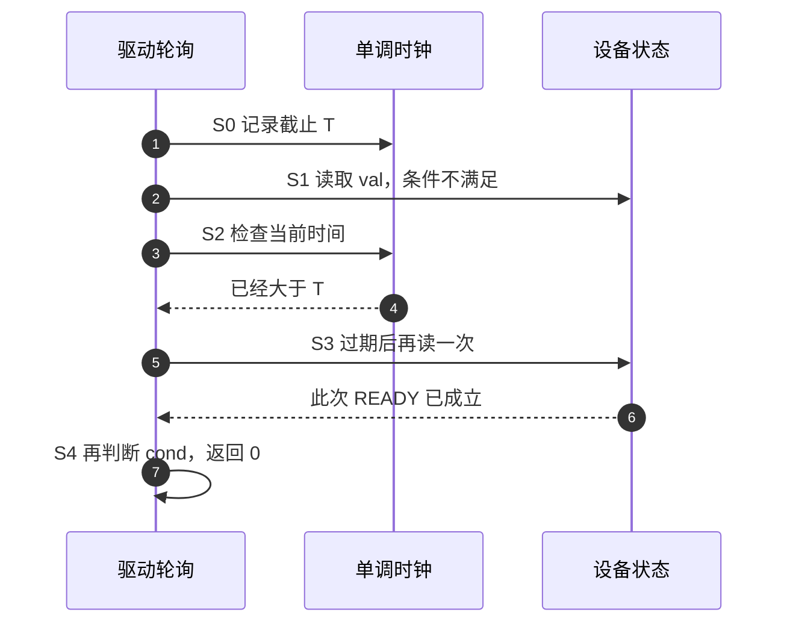
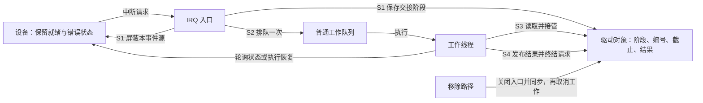
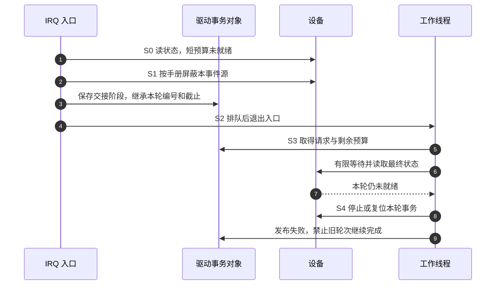

# 第8章\_忙等待与短延时\_udelay()\_ndelay()\_的边界

上一章让等待任务离开 CPU，并用条件或截止时间决定何时继续。现在遇到另一个约束：驱动处于不能睡眠的路径，但设备协议要求两次操作之间留出一个很短的间隔。此时不能直接调用 `usleep_range()`；不过，“不能睡”也不意味着可以无限占着 CPU 等设备。

本章从这个短间隔出发，区分 **等待时间流逝** 与 **反复读取状态**，再讨论短轮询失败后怎样把事务安全交给线程。沿用前文的 NXP Linux 6.12.20 固定提交；ARM32 实现细节只用于说明这种架构上的选择，不外推为所有处理器的实现。源码身份及本次核对文件见[源码基线](../../../../../research/source_reading/linux/SOURCE_BASELINE.md#1.177_忙等待实现与轮询超时边界)。

## 8.1\_设备需要短间隔为什么不能直接睡眠

设想驱动刚写下启动命令，设备协议要求等待一个很短的稳定期再读取状态。如果这段代码在普通进程上下文、没有持有禁止睡眠的锁，上一章的睡眠方法仍然适用。若它必须处在硬中断或一个确实不可拆开的原子操作片段中，调度出去会违反上下文约束。这才出现 **忙等待（busy-wait）**：当前执行路径自己消耗指令或反复检查计时条件，达到目标后继续。

`udelay(n)` 用微秒表达等待目标，`ndelay(n)` 用纳秒表达目标；`mdelay(n)` 把较长的毫秒请求拆成适当的微秒忙等。它们自身不通过睡眠主动让出 CPU，但 **不会自动关闭中断或抢占**。如果调用环境允许，中断和更高优先级任务仍可能打断当前路径。函数不睡眠与函数从进入到返回绝不被打断，是两件事。

这解释了忙等待的价值，也解释了它的边界：很短的间隔中，建立定时器、切换任务再恢复的成本可能比直接等待还大；间隔变长后，这些忙等指令既没有处理设备数据，也没有让其他可运行任务获得这段执行时间。真正应比较的是具体路径的时间预算与调度成本，不能从 `udelay()` 的名字推出“任何小于 100 µs 的等待都安全”。

还要先问设备需要哪一种等待。用 READY 表示设备报告的“已经就绪”状态：若手册要求“启动后至少保持一段时间”，提前读到 READY 也未必能省掉稳定期；若要求“READY 一出现即可继续”，固定睡满一段时间又会错过提前完成的机会。后者需要本章稍后介绍的条件轮询。手册若同时规定最短保持和最长脉宽，则还要核对软件能否同时满足两端；单个延时函数没有包办这个保证。

## 8.2\_纳秒参数为什么不等于纳秒精度

先看 `udelay()` 在哪里消耗时间。固定版本 ARM32 的 `arm_delay_ops` 保存三个延时操作入口，启动时默认连接到循环实现；合适的硬件计时器注册后，可以换成读取计数器的实现。因此，同一个调用名背后并不只有“按 CPU 主频数循环”这一种机制。

| ARM32 实现 | 等待期间实际做什么 | 换算依据与限制 |
| --- | --- | --- |
| 默认循环 | 递减循环计数，直到结束 | 用 `loops_per_jiffy`、`HZ` 与请求微秒数估计次数；校准、缓存行为和频率变化可能影响时间 |
| 注册后的计时器实现 | 反复读计数器，比较相对起点的增量 | 用计时器频率换算目标 tick；保存独立的 `ticks_per_jiffy`，避免直接跟随 CPU 调频修改循环校准值 |

第二行依旧是忙等，因为 CPU 仍在循环读取计数器，没有转入睡眠。它改变的是计时依据，不是等待期间的执行者。是否真的选中了这条路径，要看目标启动信息和注册过程，不能凭板子采用 ARM 核就断言。

此 ARM32 头文件定义 `MAX_UDELAY_MS=2`，常量 `udelay()` 参数大于 2000 µs 会走向故意未实现的 `__bad_udelay()`；相关换算按源码注明的 `HZ <= 1000` 边界设计。**这是实现的参数范围，不是允许驱动在关中断区忙等 2 ms 的性能许可。** 运行期变量不经过同样的常量检查，驱动仍要在乘法和调用以前检查范围。`mdelay()` 的拆分能避开一部分大参数换算问题，却不能消除毫秒忙等的占用成本。

在这套 ARM32 头文件没有覆盖 `ndelay()` 的情况下，通用实现把纳秒数向上取整为微秒，再调用 `udelay()`。例如 `ndelay(50)` 会转成 1 µs 的请求；这不是一次 50 ns 的精确保持。极端大的输入还要考虑取整表达式的整数范围，不能把无符号类型的整个范围当作可用延时。

`cpu_relax()` 也不能当作另一种纳秒延时。它是体系结构提供的循环辅助操作：本版本 ARM32 常见分支只是编译器屏障，ARMv6 或特定勘误分支另有内存屏障和空指令。其他架构可能提供不同的处理器提示；不能统一宣称它会休眠、节能、让出调度权，或替代共享数据所需的 acquire/release 同步。

通用 `delay.h` 明确提醒忙等可能提前返回，原因包括循环校准偏低、缓存和 CPU 频率变化；中断或抢占又可能把返回拖晚。因此，有严格电气时序上下界的位操作不能仅凭这些 API 的单位通过验收。需要稳定波形时，应先考察脉宽调制（Pulse Width Modulation，PWM）、硬件定时器或专门的序列引擎；直接内存访问（Direct Memory Access，DMA）只有在控制器确实提供相应触发和定时能力时才构成替代方案。

## 8.3\_同一段忙等会阻塞谁

假设设备需要 1 ms 才能完成。驱动每次 `udelay(10)` 后读一次状态，连续做了许多次。每次调用看起来很短，但整个事务仍可能消耗接近毫秒量级的 CPU 执行时间，并重复访问总线；把大延时切成小片段不会自动降低总成本。

这段成本影响谁，取决于代码周围的约束。普通可抢占任务的忙循环可以被更高优先级任务抢走 CPU；如果当前关闭了中断，则本地中断处理也要等它恢复；如果持有共享锁，其他 CPU 即使有空闲执行能力，也可能在等待这把锁。多处理器系统（SMP）增加了可用执行者，没有消除锁持有者造成的等待。

| 所在路径 | 必须辨认的限制 | 选择的依据 |
| --- | --- | --- |
| 普通任务、未持有禁止睡眠的锁 | 能睡，但非常短的等待可能不值得调度 | 比较设备最短间隔、容许延后与实测调度成本 |
| 硬中断、关闭中断、持有原始自旋锁等路径 | 不能睡；占用可能阻挡本地事件或其他锁使用者 | 检查是否真的需要等待，能否退出临界区或转移事务 |
| 线程化 IRQ | 线程本身可调度，具体操作仍受所持锁等条件约束 | 按实际执行上下文选接口，不按函数名里有 IRQ 就选 atomic |
| 实时抢占配置 PREEMPT_RT | 部分中断和锁的执行语义变化，原始锁与关中断区仍有约束 | 分别测量线程优先级、不可抢占区与设备响应；不能套一个固定微秒阈值 |

忙等待可能增加功耗和温度，但是否触发降频、是否进一步影响该延时实现，要按平台和计时源核对。把抢占造成的时间抖动称为“亚稳态”也不合适：这里描述的是软件被延后执行，不是触发器采样电气信号的问题。

本版本 `timers-howto.rst` 用约 10 µs 附近讨论睡眠建立成本；这些是选择的起点，不是所有平台共用的精度保证。若只有时间目标且上下文能睡，可回到上一章选择 `usleep_range()` 等接口；若等待的是设备状态，则还需要决定怎样读取、何时停止。

## 8.4\_一次读取与两种超时怎样组成轮询

设设备提供一个可重复读取的状态值。驱动把每次读取结果保存在局部变量 `val`，用条件表达式判断目标位是否满足；不满足才考虑等待下一次。这就是 `include/linux/iopoll.h` 的宏所组织的过程。

以下原型中的 `op` 是读取操作，`args...` 是传给它的参数；`cond` 是使用 `val` 的条件表达式。它们是宏参数，**不是普通 C 函数的函数指针原型**。后两行使用内存映射输入输出（Memory-Mapped I/O，MMIO），地址指向设备接口，而非普通内存变量；`-ETIMEDOUT` 沿用上一章的超时错误码。

| 宏的调用形式 | 等待方式 | 返回与最后一次观测 |
| --- | --- | --- |
| `read_poll_timeout(op, val, cond, sleep_us, timeout_us, sleep_before_read, args...)` | 用单调时间建立截止；非零 `sleep_us` 调用范围睡眠 | 条件满足为 0，否则 `-ETIMEDOUT`；最后读值留在 `val` |
| `read_poll_timeout_atomic(op, val, cond, delay_us, timeout_us, delay_before_read, args...)` | 用忙延时和循环次数扣减估算预算，不读取当前时间 | 同上；不因宏名 atomic 就保证 `op` 不睡眠 |
| `readl_poll_timeout(addr, val, cond, sleep_us, timeout_us)` | 第一种宏搭配 `readl(addr)`，首次读取前不睡 | 读取 32 位 MMIO 状态 |
| `readl_poll_timeout_atomic(addr, val, cond, delay_us, timeout_us)` | 第二种宏搭配 `readl(addr)`，首次读取前不延时 | 读取 32 位 MMIO 状态 |

`readb/readw/readq` 有相应宽度的包装，`readq` 是否可用还取决于平台。`relaxed` 变体改变访问排序约束，必须有设备和内存排序分析，不能仅因名字较短或可能更快就替换 `readl`。

第一种宏把 `sleep_us` 当作请求睡眠范围的上端，实际调用范围是 `((sleep_us >> 2) + 1, sleep_us)`。所以参数 20 表达的是请求睡 6～20 µs，**不是每隔 20 µs 精确读一次**。读取耗时、被调度出去的时间还会拉长相邻读取间隔。固定头文件要求：使用非零睡眠参数或超时参数时，不在原子上下文调用普通版本；不要把 `sleep_us=0` 当作普通版本的通用原子使用许可。

两种宏的 `timeout_us=0` 都表示 **永不因超时参数退出**。条件永远不成立时，这不是“一次读取后马上失败”，而是无限轮询。对设备可能失效的路径，通常应由驱动封装拒绝零超时。

### 8.4.1\_最后一次读取可以把超时变成成功

普通版本先读取并检查条件，再检查当前时间是否已经 **大于** 截止。检测到过期后，它还会多读一次，退出循环，再用最终 `val` 判断返回值。这意味着截止刚到时不会立即失败；即使已经过期，只要正常读取或最后补读得到满足条件的值，仍返回成功。



图中第 5～7 步说明宏的策略是给设备最后一次机会。它适合“等到就绪或放弃”的许多驱动路径，却不能直接证明“在 T 以前完成”。如果业务必须拒绝截止后才观测到的成功，应使用上一章的[同钟截止轮询](P07_睡眠与超时调度接口.md)，并明确观测时点、读取跨过截止的处理和设备自己的时间戳能力。手写循环不是天然错误，关键是不要在不理解差异时把一种期限策略换成另一种。

`cond` 在循环内和退出后会再次求值，所以应使用无副作用的纯判断。不要把 `retries++`、读取 FIFO 或确认中断这样的动作放进去。读取操作本身也必须允许重复和额外的最后一次访问；“读一次就清除”的状态、弹出数据的 FIFO 端口，不能未经协议分析就放入此模板。

### 8.4.2\_atomic版本扣的是估算预算

原子版本为了不依赖当前时间读取，把 `timeout_us` 换算成纳秒计数。每次 `udelay()` 后扣去请求的延时纳秒数，每轮另扣 1；余量小于零时，再执行最后一次读取。这允许在计时维护暂停等场景使用，但预算没有计入真实 MMIO 延迟、中断打断或全部循环指令成本。

因此 `delay_us=1, timeout_us=50` **不保证函数 50 µs 内返回**。同样，`delay_us=0` 也不是立即失败：它会进行紧密读取，靠每轮扣 1 消耗估算预算。慢总线上的这些读取可能远比这个计数表达的时间昂贵。若总线访问本身卡住，循环外层的超时判断也无法抢先把这一条访问取消。

固定头文件对原子版本建议把每次延时保持很短，文档提示约小于 10 µs；驱动还必须约束整个调用路径的读取次数和时间。超大参数的纳秒乘法、带符号余量和平台 `udelay()` 范围也有界，不能直接接收任意用户输入。

## 8.5\_先确认寄存器契约再套模板

现在已经知道宏控制的是“何时重复”，它不知道“重复读这个地址是否有意义”。接入真实设备前，至少要从对应版本手册建立下面这张表。此表是 **需要填入的接口信息**，没有虚构某块芯片的寄存器地址。

| 需要确定的项目 | 怎样影响轮询 |
| --- | --- |
| 状态寄存器的所属块、偏移、宽度、访问属性 | 决定映射和使用 readb/readw/readl 等哪种访问 |
| 目标位的含义、有效电平、复位值 | 决定等待任一位、全部位或某个编码；掩码不能随便选 |
| 重复读、读清除、FIFO 弹出等副作用 | 决定普通轮询和过期后的补读是否允许 |
| 时钟、电源与启动命令的先后要求 | 决定此刻访问是否有效，是否先满足稳定期 |
| 错误位、清除/确认方法与失败恢复 | 决定是否提前结束，超时后怎样停止或复位事务 |

下面是两个 **驱动内辅助函数**，调用者已经取得有效的 32 位状态地址；它们不完成映射，也不是某个完整平台驱动。这里选择“掩码中的位全部为 1”，保留最后读值给调用者分析。范围是本示例主动设置的输入政策，不是内核通用标准。

```c
#include <linux/io.h>
#include <linux/iopoll.h>

static int wait_bits_sleepable(void __iomem *addr, u32 mask,
                               u32 interval_us, u32 timeout_us, u32 *last)
{
    /* 上下文必须可睡；拒绝零掩码、无限等待和过大的输入。 */
    if (!mask || !interval_us || interval_us > 1000 ||
        !timeout_us || timeout_us > 1000000 || !last)
        return -EINVAL;
    return readl_poll_timeout(addr, *last, ((*last & mask) == mask),
                              interval_us, timeout_us);
}

static int wait_bits_atomic(void __iomem *addr, u32 mask,
                            u32 interval_us, u32 timeout_us, u32 *last)
{
    /* 1～9 微秒间隔、1～100 微秒估算预算仍需按设备实测评估。 */
    if (!mask || !interval_us || interval_us > 9 ||
        !timeout_us || timeout_us > 100 || !last)
        return -EINVAL;
    return readl_poll_timeout_atomic(addr, *last, ((*last & mask) == mask),
                                     interval_us, timeout_us);
}
```

参数非法时返回 `-EINVAL`，没有读取设备，`last` 内容不变；合法参数仍不证明地址可访问、设备有电或当前允许睡眠。这些是调用者前置条件。把两种封装分开，调用位置比较容易审查；一个 `can_sleep=true` 的策略字段只能表达调用者的承诺，不能把硬中断变成可睡上下文。

普通 `readl()` 没有用负错误码返回总线故障的统一契约。若自定义 `op` 返回带错误信息的值，应让条件同时识别错误和就绪，再在宏返回后转换业务错误；否则可能把读取错误反复当成“还没好”。最终 `-ETIMEDOUT` 只说明轮询策略放弃，复位、重试还是上报要由设备协议决定。

GPIO 按键节点提供的 `key-gpios` 不会凭空产生 `REG_STATUS=0x10` 或 `ST_KEY_STABLE` 位。读到按下也不证明消抖窗口内一直稳定。真实按键应按[稳定窗口](P12_常用模式与代码模板.md)或[按下释放确认](P14_按键窗口合并与按下释放确认.md)的状态机处理，不能给没有 MMIO 资源的自定义节点补一个虚构寄存器驱动。

## 8.6\_不用硬件也能观察两种预算

先用一个完整模块观察调用过程，避免把真实设备访问副作用混入实验。它用单调时钟模拟 READY：经过 `ready_us` 后，读取函数返回 1；`fail=1` 则始终返回 0。`atomic_mode` 只选择宏版本，模块初始化本身仍在可睡上下文，**这个实验不会把 CPU 切换进原子上下文**。

把下面代码保存为独立实验目录中的 `busy_poll_demo.c`。参数只读，加载后不再改变；`noinline` 是为了尽量保留可跟踪的轮询包装函数，不承担同步作用。

```c
// SPDX-License-Identifier: GPL-2.0
#include <linux/module.h>
#include <linux/iopoll.h>
#include <linux/ktime.h>

static unsigned int ready_us = 20;
static unsigned int timeout_us = 100;
static unsigned int interval_us = 1;
static bool atomic_mode;
static bool fail;
module_param(ready_us, uint, 0444);
module_param(timeout_us, uint, 0444);
module_param(interval_us, uint, 0444);
module_param(atomic_mode, bool, 0444);
module_param(fail, bool, 0444);

struct poll_demo {
    ktime_t ready_at;
    unsigned int reads;
};

static u32 sample_ready(struct poll_demo *d)
{
    d->reads++;
    /* 只模拟观测，不读取设备，也没有另一个 CPU 写共享结果。 */
    return !fail && ktime_compare(ktime_get(), d->ready_at) >= 0;
}

static noinline int run_poll(struct poll_demo *d, u32 *last)
{
    if (atomic_mode)
        return read_poll_timeout_atomic(sample_ready, *last, *last != 0,
                                         interval_us, timeout_us, false, d);
    return read_poll_timeout(sample_ready, *last, *last != 0,
                             interval_us, timeout_us, false, d);
}

static int __init busy_poll_init(void)
{
    struct poll_demo d = { 0 };
    ktime_t start;
    u32 last = 0;
    int ret;

    /* 限制乘法范围和实验成本；atomic 的参数仍不是墙钟上界。 */
    if (!timeout_us || timeout_us > 1000000 || ready_us > 1000000 ||
        !interval_us || interval_us > 1000 ||
        (atomic_mode && (interval_us > 9 || timeout_us > 100)))
        return -EINVAL;
    start = ktime_get();
    d.ready_at = ktime_add_us(start, ready_us);
    ret = run_poll(&d, &last);
    pr_info("busy_poll: atomic=%d ret=%d last=%u reads=%u elapsed_ns=%lld\n",
            atomic_mode, ret, last, d.reads,
            (long long)ktime_to_ns(ktime_sub(ktime_get(), start)));
    /* 模拟轮询失败已输出；模块本身没有待清理的异步对象。 */
    return 0;
}

static void __exit busy_poll_exit(void) { }
module_init(busy_poll_init);
module_exit(busy_poll_exit);
MODULE_LICENSE("GPL");
```

在同目录创建 `Makefile`：

```makefile
obj-m += busy_poll_demo.o
```

在 **匹配运行内核且提供构建目录的 Linux 实验机** 执行；交叉构建则沿用本专题的目标内核、工具链与部署步骤，不能拿宿主头文件替代目标内核。

```bash
# 当前目录含 busy_poll_demo.c 和 Makefile。
make -C /lib/modules/"$(uname -r)"/build M="$PWD" modules
sudo insmod ./busy_poll_demo.ko ready_us=20 timeout_us=100 interval_us=1
sudo dmesg | tail -n 10
sudo rmmod busy_poll_demo
```

默认运行可能因为调度而比 100 µs 晚得多才看到 READY，并仍返回 0。日志中的 `ret` 是轮询结果，`elapsed_ns` 是整个调用区间的观测耗时；模块加载成功不表示轮询成功，因为示例刻意把业务结果记录后返回 0。

然后对照一次永不就绪和一次原子预算实验，每轮先卸载再重新加载：

```bash
sudo insmod ./busy_poll_demo.ko fail=1 timeout_us=100 interval_us=1
sudo dmesg | tail -n 10
sudo rmmod busy_poll_demo
sudo insmod ./busy_poll_demo.ko atomic_mode=1 fail=1 timeout_us=50 interval_us=1
sudo dmesg | tail -n 10
sudo rmmod busy_poll_demo
```

预测两次 `ret` 都为 `-ETIMEDOUT`，但不预测读取次数或耗时刚好相同。`fail=1` 时，`sample_ready()` 的短路条件直接返回 0；正常模拟 READY 时，它还会自行读取时钟，增加实际开销。两种情况下都不能把该耗时当作某款设备的 MMIO 成本。改变 `ready_us`、间隔与负载，观察哪些成功落在名义截止之后，便能看出“轮询策略超时”与“业务硬截止”的区别。这里提供的是可运行实验步骤，本次文档核对没有宣称已经在目标内核装载此模块。

## 8.7\_短轮询失败后怎样交出事务

如果真实设备常常需要较长时间，就不应不断扩大原子预算。可以在入口只做少量读取，确认仍未就绪后，把剩余事务交给普通工作队列。第六章已经说明工作排队与执行之间有延迟；这里新增的问题是：入口退出后，谁保存这次请求，设备是否仍不断触发中断？

假定设备支持暂时屏蔽本事件源，并把待处理状态保留到后续读取。把驱动对象称为 `d`，其中 `d->phase` 保存事务阶段，`d->request_id` 区分请求，`d->deadline` 在启动本轮设备操作时记录总响应截止，`d->result` 保存最终结果。硬中断更新交接阶段，工作线程读取同一对象后接管，不在交接时重新获得一份完整预算。

这些短字段访问可由对象中的原始自旋锁 `state_lock` 保护；线程侧也使用保存并关闭本地中断的配对操作，防止本地 IRQ 抢占持锁线程后再等待同一把锁。临界区只更新或取得状态快照，设备轮询和同步取消放在锁外。这里建立的是一种明确的设计方案，实际驱动仍需与其他入口共同核对锁协议。下面是这种 **单个在途事务** 的关系，不是某个 GPIO 板级驱动。



状态不在 `schedule_work()` 的布尔返回值里。排队合并意味着一个工作项不能天然记录任意多个请求；若设备允许多条并发事务，就需要请求队列或计数，而不是反复覆盖同一个 `last_event`。共享字段必须按实际上下文使用锁或明确的发布协议，工作队列本身不能替代所有状态保护。



图中第 2 步必须按设备定义实现。若电平源持续有效，只排队后返回可能立即再次中断；如果读或确认动作会丢掉事件，则应先保存必要信息，再按协议确认。成功路径在第 6 步得到有效状态后发布成功、完成设备确认，再在允许接收下一轮时重新开放事件源；失败路径只有恢复完成后才能开放，不能一边复位一边让旧 IRQ 当作新请求。

也不能把“原子估算 50 µs，加工作线程轮询 5 ms”写成总响应上限 5 ms：排队时间、入口耗时和最后补读都在其外。如果要求一个总业务截止，就从事务开始保存同一时钟下的截止，在工作线程取得执行权时重新检查；过期则走失败协议。下一步等待还要继承剩余预算，并采用上一章讲过的截止后拒绝规则。软件只能停止继续等待，不能据此承诺线程一定在截止点获得 CPU。

移除则形成另一条退出路径：先阻止新事务，屏蔽并同步实际 IRQ 或其他生产者，再同步取消工作，最后释放对象、寄存器映射和电源。等待工作退出时不能持有它也需要取得的锁。具体错误恢复、IRQ 共享线和电源管理必须在设备驱动中补齐；这张图没有把这些未知条件伪装成已验证的通用驱动。

## 8.8\_用hrtimer交付工作还需要什么收尾

有些等待本来就不是“设备状态何时变好”，而是“过一段时间再做一次可睡操作”。此时可以用第五章的 `hrtimer` 安排到期事件，再排队工作。它消除了等待期间的忙循环，但引入了定时器响应和工作线程调度两段延迟，不能称为“准点执行可睡事务”。普通延迟工作足够时，继续用第六章的方法即可。

以下辅助代码演示 **一次性** hrtimer 到工作项的完整资源依赖。它可放进已有驱动，在 `probe()` 中调用 `start_deferred_notice()`；它只打印教学通知，没有虚构设备操作。`devm_*` 管理的资源按逆登记顺序释放，所以先分配对象，后登记取消动作，保证取消时对象仍在。

```c
#include <linux/device.h>
#include <linux/slab.h>
#include <linux/hrtimer.h>
#include <linux/workqueue.h>

struct deferred_notice {
    struct device *dev;
    struct hrtimer timer;
    struct work_struct work;
};

static void notice_work(struct work_struct *work)
{
    struct deferred_notice *n = container_of(work, struct deferred_notice, work);
    dev_info(n->dev, "deferred notice executed\n");
}

static enum hrtimer_restart notice_timer(struct hrtimer *timer)
{
    struct deferred_notice *n = container_of(timer, struct deferred_notice, timer);
    schedule_work(&n->work);
    return HRTIMER_NORESTART;
}

static void stop_notice(void *data)
{
    struct deferred_notice *n = data;
    /* 唯一生产者是此一次性定时器；先等它退出，再处理已交付工作。 */
    hrtimer_cancel(&n->timer);
    cancel_work_sync(&n->work);
}

static int start_deferred_notice(struct device *dev, u32 first_us)
{
    struct deferred_notice *n;
    int ret;

    if (!first_us || first_us > 1000000)
        return -EINVAL;
    n = devm_kzalloc(dev, sizeof(*n), GFP_KERNEL);
    if (!n)
        return -ENOMEM;
    n->dev = dev;
    INIT_WORK(&n->work, notice_work);
    hrtimer_init(&n->timer, CLOCK_MONOTONIC, HRTIMER_MODE_REL);
    n->timer.function = notice_timer;
    ret = devm_add_action_or_reset(dev, stop_notice, n);
    if (ret)
        return ret;
    hrtimer_start(&n->timer, ktime_set(0, (u64)first_us * 1000), HRTIMER_MODE_REL);
    return 0;
}
```

`stop_notice()` 的类型正好是 `void (*)(void *)`。不要通过强制类型转换把返回 `int` 的 `hrtimer_cancel()` 或返回 `bool` 的 `flush_work()` 冒充这种回调；也不能忽略登记失败。使用 `devm_add_action_or_reset()` 时，失败会立即调用清理函数，因此本例在登记以前就把 timer 和 work 都初始化完毕，登记成功以后才启动。

取消定时器只收回定时器这一层，不会自动收回它已经投递的工作；这就是清理中两次同步的原因。本例没有外部启动接口，没有工作回调重启定时器，也没有周期重启。若加入这些生产者，必须先关闭它们；单靠当前函数的两次 cancel 不再足够。周期推进、遗漏周期和工作合并按第五、六章的状态模型分析，不能把 `hrtimer_forward_now()` 简写成“保证不漂移”。

独立 `delayed_work` 也可用一个 `void (*)(void *)` 适配函数调用 `cancel_delayed_work_sync()`，再登记为设备清理动作。它同样要求先禁止 IRQ、sysfs 或其他入口重新排队。`flush_work()` 等待已提交的工作完成，与取消尚未执行的工作是不同策略；选择哪种取决于退出时是否还允许这项设备操作，而不是“用了 devres 就都安全”。

## 8.9\_怎样观察耗时而不把宏当成函数

前面的无硬件模块提供实际耗时和读取次数。若想进一步观察中断、调度与包装函数，可以使用 ftrace。`readl_poll_timeout()` 是宏，没有一个必然可跟踪的同名函数；应选自己的读取或轮询包装函数，并先在运行内核的 `available_filter_functions` 中确认它存在。

以下在支持 function graph 跟踪、已挂载 `/sys/kernel/tracing` 的 Linux 实验机执行，使用独立实例。模块只在初始化时轮询，所以选内核的模块初始化入口 `do_init_module` 作为图跟踪根，捕获它调用的模块初始化与 `run_poll()`；不用在模块卸载后赌模块函数过滤器还保留有效地址。

```bash
# root shell；当前实验目录已有 busy_poll_demo.ko，此时模块尚未加载。
set -eu
trace_root=/sys/kernel/tracing
trace_inst="$trace_root/instances/busy_poll_review"
# 确认内核具有真实可跟踪入口；没有输出则停止此方法。
grep -E '^do_init_module[[:space:]]' "$trace_root/available_filter_functions"
test ! -e "$trace_inst"
mkdir "$trace_inst"
printf '0\n' > "$trace_inst/tracing_on"
grep -w function_graph "$trace_inst/available_tracers"
```

第一条查询用于验证符号，第二条查询用于验证实例支持的跟踪器；内核配置不同可能缺少其中之一，不能直接照抄不存在的入口。函数图以这个入口为根记录其调用关系，包括可跟踪且未被编译器内联掉的子函数。接着开启事件并执行一次明确的加载操作。

```bash
printf '%s\n' function_graph > "$trace_inst/current_tracer"
printf '%s\n' do_init_module > "$trace_inst/set_graph_function"
# 高精度定时器事件属于 timer 组，不是 hrtimer 组。
test -e "$trace_inst/events/irq/irq_handler_entry/enable"
test -e "$trace_inst/events/timer/hrtimer_expire_entry/enable"
printf '1\n' > "$trace_inst/events/irq/irq_handler_entry/enable"
printf '1\n' > "$trace_inst/events/timer/hrtimer_expire_entry/enable"
printf '1\n' > "$trace_inst/tracing_on"
insmod ./busy_poll_demo.ko atomic_mode=1 fail=1 timeout_us=50 interval_us=1
printf '0\n' > "$trace_inst/tracing_on"
cat "$trace_inst/trace" > /tmp/busy_poll_trace.txt
rmmod busy_poll_demo
```

在保存的图中寻找 `busy_poll_init`、`run_poll` 及其耗时，并对照内核日志。如果函数被裁剪、内联或跟踪深度限制，没有对应条目不能解释成“它没运行”。函数图本身也可能显著增加循环成本，因此前一节不跟踪的测量应单独保留。最后关闭事件并释放本次实例；前面任何命令中断后，也应检查已创建实例并完成这段清理。

```bash
printf '0\n' > "$trace_inst/tracing_on"
printf '0\n' > "$trace_inst/events/irq/irq_handler_entry/enable"
printf '0\n' > "$trace_inst/events/timer/hrtimer_expire_entry/enable"
printf '%s\n' nop > "$trace_inst/current_tracer"
rmdir "$trace_inst"
```

函数图耗时受跟踪选项、抢占和跟踪本身开销影响；两个 IRQ 入口之间的间隔也不是设备从发出中断到软件响应的完整延迟。要判断物理脉冲宽度，需要在目标引脚使用逻辑分析仪或示波器；要判断高优先级任务是否被阻挡，需要同时记录调度事件、任务优先级、CPU 亲和性与不可抢占区。

在目标支持的普通/实时内核、空闲/压力负载、不同频率策略下分别记录版本、配置、参数、读取次数、返回码和实际耗时。不能预先断言低频一定让计时器型延时变长，也不能用有限次“没有超时”证明所有执行都满足期限。压力验证建立的是已覆盖条件下的证据；设备失效、零超时输入、取消与移除路径仍要分别检查。

## 8.10\_从等待条件反推方案

经过本章，选择接口时已经不必先猜一个“安全微秒数”。先辨认协议需要保持时间还是等待状态，再确定执行上下文、状态读取副作用和截止策略，最后才给参数。

| 当前要求 | 可以选用的机制 | 选择仍需满足的条件 |
| --- | --- | --- |
| 不可睡片段中的极短保持 | `udelay()` 等忙等 | 架构参数合法，累计占用可接受，设备时序得到验证 |
| 可睡上下文的纯时间间隔 | `usleep_range()` 或较长睡眠 | 容许调度造成的延后，范围符合协议最短保持 |
| 可重复读取的设备就绪条件 | 普通轮询宏；必要时很短的原子轮询 | 接受最后补读与成功判定，输入有界，读取上下文安全 |
| 总业务截止前必须观测成功 | 明确的同钟截止状态机 | 读取跨截止和晚到结果有处理，失败后能收回事务 |
| 过一段时间做可睡工作 | 延迟工作，或有理由时用 hrtimer 交付 | 不承诺准点执行，源与消费者按依赖顺序停止 |
| 严格波形或脉宽上下界 | 适用的硬件定时能力 | 手册、集成配置与实际波形共同支持 |

练习：普通轮询的最后一次补读在截止以后返回 READY，返回 0 是否违反它的契约？答案是不违反，但它不能替业务证明截止以前完成。再把 `timeout_us` 改成 0 并令条件永不满足，会发生什么？两种宏都不再因超时退出，所以封装需要主动拒绝这种输入。最后，若仅取消 hrtimer 后立刻释放驱动对象，哪里仍可能使用它？已经排队或正在运行的工作仍可能持有对象，必须先阻止新生产，再同步收回消费者。

现在能解释短忙等为何有用、为何不足以承诺硬截止，以及怎样把长等待交给有清理协议的可睡路径。下一章继续把这些时间参数接入设备树和平台数据：参数来自哪里、单位怎样确定、非法值在哪一层拒绝。

上一篇：[P07 睡眠与超时调度接口](P07_睡眠与超时调度接口.md)。
下一篇：[P09 时间与设备树平台数据的对接](P09_时间与设备树平台数据的对接.md)。
