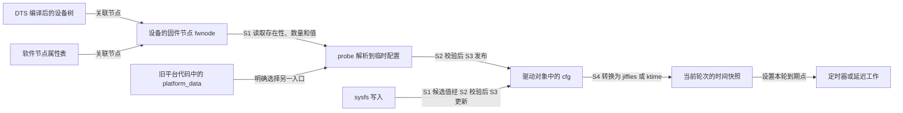
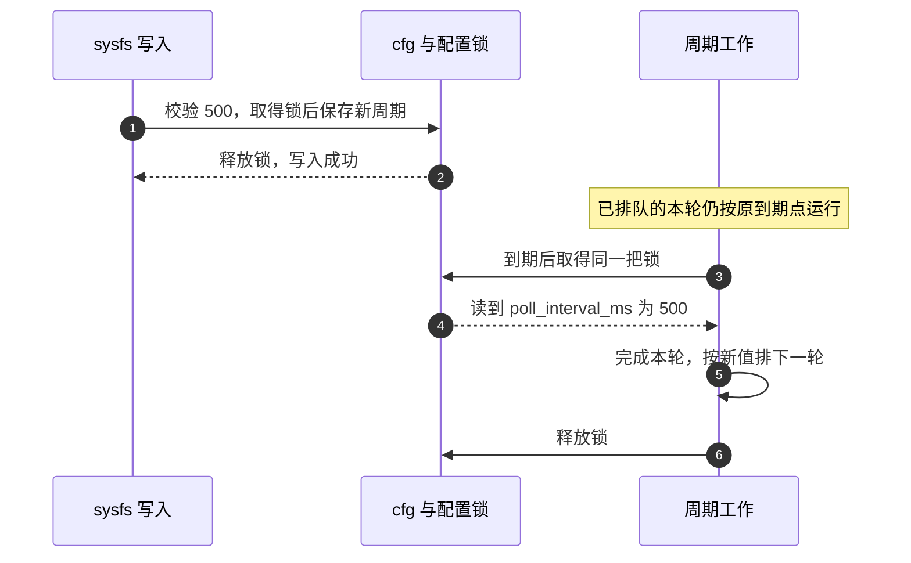

# 第9章\_时间与设备树平台数据的对接

上一章要求驱动在等待以前明确时间单位、参数范围与超时策略。接下来把写在源码中的数值换成平台提供的配置：同一个驱动接入不同板子时，怎样知道“20”表示什么，属性没写时采用什么，写错时又该怎样处理？

本章先建立配置契约，再把它接到已有的定时机制。主实验使用没有真实硬件的 platform 设备，完整演示属性解析、周期执行和 sysfs 修改；GPIO 去抖与设备事务分别沿用前文已经建立的状态机。这样可以观察参数怎样生效，而不把读一次电平误称为消抖，也不把一个到期回调误称为完整事务超时。

## 9.1\_时间单位来自绑定而不是属性名字的猜测

设备树（Devicetree，DT）用节点和属性描述硬件及其连接；DTS（Devicetree Source）是可编辑的源文件，编译后的 DTB（Devicetree Blob）是交给系统的二进制描述。**绑定（binding）** 规定某类设备允许哪些属性、类型和取值，以及每项属性的含义；Schema 是其中供工具检查这些约束的模式定义。驱动必须遵守已有绑定，不能因为代码需要一个参数就随意给节点增加一个属性并声称它是标准接口。

从时间问题看，应先分清三个来源：器件要求的启动稳定时间属于硬件约束；板级按键的消抖配置要服从对应输入设备绑定；调试时为了少打印而选的轮询频率可能只是软件策略。不能把全部运行策略都塞进设备树，更不能仅为实例化一个 Linux 驱动而制造一个没有硬件含义的节点。

新设计的时间属性通常使用约定的单位后缀，但现有绑定可能采用历史名字。例如本基线 `gpio-keys.yaml` 定义的 `debounce-interval` 单位是毫秒，缺省为 5；不能把它自行改写成 `debounce-ms`。同一文件中的 `poll-interval` 只用于 `gpio-keys-polled`，普通 `gpio-keys` 不接受这项属性。名字相似不表示适用节点相同。

| 要读取的内容 | 必须从绑定确定什么 | 不能自行推断什么 |
| --- | --- | --- |
| 时间数值 | 单位、整数宽度、元素数量、零值含义 | 有 `ns` 后缀就一定使用 64 位编码或具有纳秒精度 |
| 可选属性 | 缺省值、缺省值由谁实现 | Schema 写了 default 就会自动把属性加入运行中的设备树 |
| 数组或分阶段时间 | 元素顺序、每一项的作用、项间约束 | 读取第一个数成功就表示整个数组合法 |
| 新增私有属性 | 所属设备、厂商前缀、正式 Schema 与约束 | 带 `nxp,` 等前缀就已经获得厂商标准认可 |

设备树只承载配置，不负责选择内核回调在哪个上下文执行。毫秒参数也可以转换为 `ktime_t`，微秒参数也可能最终量化为 jiffy；单位描述数值，机制选择还取决于回调是否能睡、允许多晚执行以及设备生命周期。

## 9.2\_从固件属性到驱动自己的配置副本

内核不会把一个 DTS 属性直接变成工作项。设备对象先关联描述它的固件节点，驱动在 `probe()` 中读出数值，检查后保存到自己的配置结构，之后才用这份结构计算延迟。

把这条配置链分成六个讲解阶段：S0 确定输入来源，S1 读入临时配置，S2 校验全部约束，S3 发布驱动配置，S4 取得本轮时间快照并排队，S5 停止新排队并收回工作。这些是阅读阶段，不是必须新增的状态枚举。

直接面对设备树时可用 `of_property_read_u32()`；若驱动通过设备的固件节点接口读取，可用 `device_property_read_u32()`。后者经固件节点句柄 **fwnode** 分派到具体后端，除设备树外也可由另一套固件接口 ACPI（Advanced Configuration and Power Interface，高级配置与电源接口）的描述或内核构造的软件节点提供。统一读取入口不表示各种固件描述的属性名称、编码和绑定自动相同。



`platform_data` 是另一条历史路径：平台代码把双方约定的 C 结构指针交给设备，驱动用 `dev_get_platdata()` 取得。它不会自动变成 `device_property_*()` 可读的属性，也没有自动的单位或范围检查。涉及指针成员时，更不能把复制顶层结构误认为已复制所有指向的数据。

本章采用“存在固件节点时读取属性；没有固件节点时允许明确的 platform_data；两者同时提供则拒绝”的教学策略。它不是内核要求所有驱动采用的优先级，而是为了使每个最终数值有唯一可追溯来源。已有设备绑定规定了来源时，应按那个契约处理。

## 9.3\_缺失可以默认损坏不能默认

假设一个可选时间属性默认 20 ms。下面两种情况不能合并：属性确实没写，驱动可以采用约定默认值；属性写成空值、错误长度或不允许的数值，说明配置不符合契约，应该报错。若简单地写成“读取失败就用 20”，后者也会悄悄启动，读者看到的行为便与配置文件不同。

本章还约定每项恰好一个 `u32`。单次标量读取通常只要求足够容纳一个值，并不替我们证明没有额外元素，因此先检查数量，再读值。若绑定规定单个 `u64`，就对应使用 `of_property_read_u64()` 或 `device_property_read_u64()` 及相应数量检查；DTS 可用 `/bits/ 64 <数值>` 表达 64 位单元，不能仍按一个 32 位值读取。设备树属性底层仍是字节数据；长度和读取成功不能代替 Schema 对属性类型、合法名称和语义的检查，例如某些错误字节排列恰好也能解释成一个整数。

| 输入情况 | 本章的处理 | 为什么 |
| --- | --- | --- |
| 属性不存在 | 采用该项默认值 | 这是可选属性契约的一部分 |
| 属性存在但数量不是 1，或后端读取报错 | 返回错误，probe 不启用异步执行 | 不把损坏配置伪装成省略配置 |
| 数值为零或超出约定范围 | 返回 `-EINVAL` | 本例零值不是关闭机制，也不是无限等待 |
| 参数之间存在约束 | 在完整候选配置上检查后一次发布 | 不让其他执行者看到一半旧值、一半新值 |

自动夹紧只适用于接口明确承诺“超出范围按边界执行”的场景，而且应该能读回实际值。它不是通用健壮性规则。例如设备要求至少 80 ms，驱动暗中夹成 50 ms，即使避免了整数溢出，也破坏了协议。

## 9.4\_把参数接到合适的时间表示

设有三项教学配置：消抖窗口、轮询间隔和事务响应预算。它们最初都用毫秒保存，只有到具体使用处才转换。这样配置日志保留原始单位，内核时间表示又能按用途选择。

| 本章字段 | 默认值与允许范围 | 使用者与转换 |
| --- | --- | --- |
| `debounce_ms` | 20；1～2000 ms | 去抖状态机保存窗口或由 `msecs_to_jiffies()` 安排检查；本章实验只解析并显示 |
| `poll_interval_ms` | 100；10～60000 ms | 周期工作结束后用 `msecs_to_jiffies()` 排下一轮 |
| `tx_timeout_ms` | 500；1～600000 ms | 事务开始时用 `ms_to_ktime()` 建立时间预算；本章实验只解析并显示 |

这些范围是本实验的政策，不是所有按键或设备都适用的规格。原有教学属性名 `nxp,debounce-ms`、`nxp,poll-interval-ms`、`nxp,tx-timeout-ms` 在下文继续作为 **私有实验输入名** 使用；它们不因此成为 NXP 官方绑定。

`msecs_to_jiffies()` 和 `usecs_to_jiffies()` 会把正的不足一个 tick 的时间向上量化，而非四舍五入。`jiffies` 是系统 tick 计数，延迟参数只是同一单位下的相对数量；不能把二者都笼统称为相对时间。量化没有消失，换成属性输入也不会改善回调调度延迟。

若硬件协议用微秒，可以在范围验证后用 `ktime_set(0, (u64)us * 1000)` 转纳秒，先扩宽再乘；直接 `us * 1000` 可能先在窄整数内溢出。若接口采用 `u64` 纳秒，也要检查 `ktime_t` 的带符号范围和业务上限，不能只看源类型更宽。相关换算边界沿用[第三章](P03_时间表示与转换接口详解.md)。

机制选择现在才能落定：能睡的周期轮询用普通工作队列上的延迟工作；非常轻且不能睡的回调可以用普通定时器；确实需要更细到期表示时使用 hrtimer，但它不保证业务在硬截止前执行。去抖要追踪后续边沿，事务超时要隔离旧轮次并停止实际生产者；一个参数加一个定时器不能替代这些状态。

## 9.5\_运行期写入究竟改变哪一轮

静态属性解析完毕后，驱动拥有 `cfg` 副本。sysfs 是设备向用户空间暴露属性的接口；往 sysfs 写值应修改这份运行配置，而不是修改固件里的原始节点。debugfs 可以用于开发期的类似控制，但同样需要范围与生命周期保护，也不能承诺它是稳定的用户接口。

现在假设周期工作已按 100 ms 排入队列，用户写入 500 ms。有两种合理策略：保留当前到期点，下一次重新排队时采用 500；或明确重排当前待执行工作。它们的语义不同，不能把“写后没有立即取消定时器”判成错误。

本章选第一种。配置写入和工作重新排队都取得同一把互斥锁：工作若先取得锁，就用旧值排下一轮；写入若先取得锁，之后的排队使用新值。**已经安排好的到期点保持不变。** 写接口不会凭空创建一次按键事件，也不会把当前设备事务的截止重新计时。



若要设计“立即重排”，还必须说明正在运行的回调怎么办、相位是否保留、是否会产生额外执行。尤其不能持有工作回调也要取得的配置锁，然后调用同步取消等待它退出；这会使两边互等。去抖参数的动态更新还要决定当前窗口采用旧值还是新值，不能靠无条件 `mod_delayed_work()` 替读者作决定。

## 9.6\_完整实验从属性表到周期工作

从本节到 9.8 节的三个 C 代码块按顺序保存为 `time_config_demo.c`，组成一个完整模块。它注册自己的无硬件 platform 设备，并通过软件节点属性表提供三个数值，**不访问 GPIO、不请求 IRQ，也不装载 DTB**。每轮工作只增加计数，观察重点是输入契约、排队时间和退出顺序；实际按键算法见第十二、十四章。

首先是配置与解析。`read_optional_u32()` 是本例辅助函数，不是内核 API；它只解决存在性与单值读取，完整候选配置最后统一检查。

```c
// SPDX-License-Identifier: GPL-2.0
#include <linux/module.h>
#include <linux/platform_device.h>
#include <linux/property.h>
#include <linux/slab.h>
#include <linux/mutex.h>
#include <linux/workqueue.h>
#include <linux/jiffies.h>
#include <linux/ktime.h>
#include <linux/sysfs.h>

struct demo_time_cfg {
    u32 debounce_ms;
    u32 poll_interval_ms;
    u32 tx_timeout_ms;
};

struct time_config_dev {
    struct mutex lock;
    struct demo_time_cfg cfg;
    struct delayed_work poll_work;
    u64 runs;
    bool stopping;
};

static int validate_cfg(const struct demo_time_cfg *cfg)
{
    if (cfg->debounce_ms < 1 || cfg->debounce_ms > 2000 ||
        cfg->poll_interval_ms < 10 || cfg->poll_interval_ms > 60000 ||
        cfg->tx_timeout_ms < 1 || cfg->tx_timeout_ms > 600000)
        return -EINVAL;
    return 0;
}

static int read_optional_u32(struct device *dev, const char *name, u32 *out)
{
    int count;

    if (!device_property_present(dev, name))
        return 0; /* 保留调用者已经写好的缺省值。 */
    count = device_property_count_u32(dev, name);
    if (count < 0)
        return count;
    if (count != 1)
        return -EINVAL;
    return device_property_read_u32(dev, name, out);
}

static int parse_cfg(struct device *dev, struct demo_time_cfg *out)
{
    const struct demo_time_cfg *pdata = dev_get_platdata(dev);
    struct demo_time_cfg next = { 20, 100, 500 };
    int ret;

    if (pdata && dev_fwnode(dev))
        return -EINVAL; /* 本例拒绝混合来源，而不是默默覆盖。 */
    if (pdata) {
        next = *pdata;
    } else {
        ret = read_optional_u32(dev, "nxp,debounce-ms", &next.debounce_ms);
        if (ret)
            return ret;
        ret = read_optional_u32(dev, "nxp,poll-interval-ms", &next.poll_interval_ms);
        if (ret)
            return ret;
        ret = read_optional_u32(dev, "nxp,tx-timeout-ms", &next.tx_timeout_ms);
        if (ret)
            return ret;
    }
    ret = validate_cfg(&next);
    if (ret)
        return ret;
    *out = next; /* 只有全部成功才发布整份配置。 */
    return 0;
}
```

## 9.7\_更新配置而不重排当前工作

配置已经能被完整解析，现在让执行者使用它。继续向同一个 C 文件追加周期工作与两个 sysfs 属性：`poll_interval_ms` 可读写，执行计数 `runs` 只读。对前者的写入只改变下一次排队所用值，不重排已等待的工作；计数在同一把锁下读写，所以不依赖 32 位机器能否一次读完 `u64`。

`DEVICE_ATTR_RW()` 与 `DEVICE_ATTR_RO()` 分别把同名前缀的 show/store 函数组成读写、只读属性对象；`ATTRIBUTE_GROUPS()` 再将这些属性组织成可交给驱动核心的组。停止中的设备拒绝新配置，返回 `-ENODEV`。这一控制入口执行在可睡上下文，因此与工作回调共用互斥锁。

```c
static void poll_work_fn(struct work_struct *work)
{
    struct time_config_dev *d = container_of(to_delayed_work(work),
                                             struct time_config_dev, poll_work);
    mutex_lock(&d->lock);
    if (!d->stopping) {
        d->runs++;
        schedule_delayed_work(&d->poll_work,
                              msecs_to_jiffies(d->cfg.poll_interval_ms));
    }
    mutex_unlock(&d->lock);
}

static ssize_t poll_interval_ms_show(struct device *dev,
                                     struct device_attribute *attr, char *buf)
{
    struct time_config_dev *d = dev_get_drvdata(dev);
    u32 value;
    mutex_lock(&d->lock);
    value = d->cfg.poll_interval_ms;
    mutex_unlock(&d->lock);
    return sysfs_emit(buf, "%u\n", value);
}

static ssize_t poll_interval_ms_store(struct device *dev,
                                      struct device_attribute *attr,
                                      const char *buf, size_t count)
{
    struct time_config_dev *d = dev_get_drvdata(dev);
    u32 value;
    int ret = kstrtou32(buf, 10, &value);
    if (ret)
        return ret;
    if (value < 10 || value > 60000)
        return -EINVAL;
    mutex_lock(&d->lock);
    if (d->stopping)
        ret = -ENODEV;
    else
        d->cfg.poll_interval_ms = value;
    mutex_unlock(&d->lock);
    if (ret)
        return ret;
    return count;
}
static DEVICE_ATTR_RW(poll_interval_ms);

static ssize_t runs_show(struct device *dev,
                         struct device_attribute *attr, char *buf)
{
    struct time_config_dev *d = dev_get_drvdata(dev);
    u64 value;
    mutex_lock(&d->lock);
    value = d->runs;
    mutex_unlock(&d->lock);
    return sysfs_emit(buf, "%llu\n", (unsigned long long)value);
}
static DEVICE_ATTR_RO(runs);

static struct attribute *time_config_attrs[] = {
    &dev_attr_poll_interval_ms.attr,
    &dev_attr_runs.attr,
    NULL,
};
ATTRIBUTE_GROUPS(time_config);
```

## 9.8\_先备好对象再发布控制入口

还剩把这些回调接入设备模型。继续追加最后一个 C 代码块：先分配并初始化对象，再启动周期工作；驱动结构的 `dev_groups` 成员把前面的属性组交给核心，在成功 probe 后发布，并在调用 remove 前移除、等活动属性访问退出。即使 probe 成功后属性组发布失败，核心也会进入 remove 清理。本例只有工作回调会继续排下一轮，remove 在锁下关闭这个来源，再在锁外同步取消，对应前面的 S5。

属性表中的 `PROPERTY_ENTRY_U32()` 宏创建单个 32 位属性值；设备注册参数 `PLATFORM_DEVID_NONE` 表示不用编号后缀，所以实验设备名就是 `time_config_demo`。错误指针仍按前文的 `IS_ERR()` 判断、`PTR_ERR()` 取错误码处理，不能当作成功取得的设备对象。

```c
static int time_config_probe(struct platform_device *pdev)
{
    struct time_config_dev *d;
    int ret;

    d = devm_kzalloc(&pdev->dev, sizeof(*d), GFP_KERNEL);
    if (!d)
        return -ENOMEM;
    ret = parse_cfg(&pdev->dev, &d->cfg);
    if (ret)
        return dev_err_probe(&pdev->dev, ret, "invalid time configuration\n");
    mutex_init(&d->lock);
    INIT_DELAYED_WORK(&d->poll_work, poll_work_fn);
    platform_set_drvdata(pdev, d);
    dev_info(&pdev->dev, "debounce=%u ms poll=%u ms tx=%u ms tx_ns=%lld\n",
             d->cfg.debounce_ms, d->cfg.poll_interval_ms, d->cfg.tx_timeout_ms,
             (long long)ktime_to_ns(ms_to_ktime(d->cfg.tx_timeout_ms)));
    schedule_delayed_work(&d->poll_work,
                          msecs_to_jiffies(d->cfg.poll_interval_ms));
    return 0;
}

static void time_config_remove(struct platform_device *pdev)
{
    struct time_config_dev *d = platform_get_drvdata(pdev);
    mutex_lock(&d->lock);
    d->stopping = true;
    mutex_unlock(&d->lock);
    cancel_delayed_work_sync(&d->poll_work);
}

static struct platform_driver time_config_driver = {
    .probe = time_config_probe,
    .remove = time_config_remove,
    .driver = {
        .name = "time_config_demo",
        .dev_groups = time_config_groups,
    },
};

static const struct property_entry demo_properties[] = {
    PROPERTY_ENTRY_U32("nxp,debounce-ms", 20),
    PROPERTY_ENTRY_U32("nxp,poll-interval-ms", 100),
    PROPERTY_ENTRY_U32("nxp,tx-timeout-ms", 500),
    { }
};
static struct platform_device *demo_device;

static int __init time_config_init(void)
{
    const struct platform_device_info info = {
        .name = "time_config_demo",
        .id = PLATFORM_DEVID_NONE,
        .properties = demo_properties,
    };
    int ret = platform_driver_register(&time_config_driver);
    if (ret)
        return ret;
    demo_device = platform_device_register_full(&info);
    if (IS_ERR(demo_device)) {
        ret = PTR_ERR(demo_device);
        platform_driver_unregister(&time_config_driver);
        return ret;
    }
    /* 设备注册成功不等于 probe 成功；实验通过 sysfs 与日志确认绑定。 */
    return 0;
}

static void __exit time_config_exit(void)
{
    platform_device_unregister(demo_device);
    platform_driver_unregister(&time_config_driver);
}
module_init(time_config_init);
module_exit(time_config_exit);
MODULE_LICENSE("GPL");
```

注册设备时 `.properties` 会被用于创建软件节点，这才使 `device_property_*()` 能读到表中数值。若想实验 platform_data 路径，可把 `info` 的 `.properties` 换为 `.data = &某份配置结构` 与 `.size_data = sizeof(该结构)`；这两个成员只复制顶层数据。不要同时保留属性表，否则本例会明确拒绝混合来源。

示例固定在本专题核对的 Linux 6.12.20 接口上，`platform_driver.remove` 使用 `void` 返回类型。没有把“6.1+”写成无需核对的兼容承诺，也没有在模块中注册 PM 回调；这个无硬件计数器不承担系统睡眠时的设备访问或唤醒职责。

## 9.9\_观察默认值错误输入和下一轮生效

在同一目录创建 `Makefile`，内容是 `obj-m += time_config_demo.o`。使用匹配运行内核的构建目录，在 Linux 实验机执行：

```bash
# 当前目录含三个代码块组成的 time_config_demo.c 与 Makefile。
make -C /lib/modules/"$(uname -r)"/build M="$PWD" modules
sudo insmod ./time_config_demo.ko
cfg_dev=/sys/bus/platform/devices/time_config_demo
readlink "$cfg_dev/driver"
cat "$cfg_dev/poll_interval_ms"
cat "$cfg_dev/runs"
```

`readlink` 应指向本实验驱动，周期读回应为 100；`runs` 随工作实际执行增加，不保证加载后立即为 1。若设备存在却没有 driver 链接和属性，检查内核中的 `invalid time configuration` 或属性发布错误，不要把 insmod 成功当成 probe 成功。

```bash
# 修改后已排队的一轮保持原到期点，之后排队使用 500 ms。
printf '500\n' | sudo tee "$cfg_dev/poll_interval_ms"
cat "$cfg_dev/poll_interval_ms"
cat "$cfg_dev/runs"
sleep 2
cat "$cfg_dev/runs"
# 下列值被拒绝，原配置应仍为 500。
printf '0\n' | sudo tee "$cfg_dev/poll_interval_ms"
cat "$cfg_dev/poll_interval_ms"
sudo rmmod time_config_demo
```

两秒内的增量受加载时刻、排队和系统调度影响，不要求恰好增加四次。还可测试 `60001`、负数、非数字文本和超过 `u32` 的输入：预期写失败且读回值不变，错误码可能分别来自数值解析或范围检查。

静态属性错误需要修改 `demo_properties` 后重新构建、装载。删除其中一项应得到默认值；把它替换为两个元素的 `PROPERTY_ENTRY_U32_ARRAY()` 应被数量检查拒绝；值为零或超范围应被范围检查拒绝。每次记录修改、日志和是否绑定，不要以“驱动静默用了默认值”作为错误输入实验成功。恢复原属性再进行下一项，避免把上轮修改带入后面的结论。

本例没有 IRQ 生产者，因此退出时关闭工作自己的再排队路径即可。加入真实 IRQ、用户事务或 PM 恢复入口后，必须重新盘点生产者，不能原样复制这段 remove 后宣称生命周期已经安全。

## 9.10\_把实验结论接回真实按键节点

现在再看真实绑定与私有实验的区别。对于标准 `gpio-keys`，可在板级设备树中描述如下按键；它使用标准的 `gpios` 和 `debounce-interval`，由对应输入驱动解释。`linux,code` 选择输入事件中的键码，下面用 `KEY_ENTER` 表示回车键。

```dts
#include <dt-bindings/gpio/gpio.h>
#include <dt-bindings/input/input.h>

/* 放入板级根节点；gpio1 的编号、引脚复用和接线必须按实际板核对。 */
keys {
    compatible = "gpio-keys";
    key-user {
        label = "User key";
        linux,code = <KEY_ENTER>;
        gpios = <&gpio1 18 GPIO_ACTIVE_LOW>;
        debounce-interval = <20>;
    };
};
```

这里的 GPIO1_18 沿用原教学接线假设，没有在本轮验证实际板图或 pad 配置。`GPIO_ACTIVE_LOW` 表示逻辑有效时物理为低；GPIO 描述符读取经过极性转换，不能再手工反转一次。也不能把负读取错误放进 `bool stable`，否则错误可能被当成真。

原自定义 `nxp,imx6ull-led_key_int` 演示节点与标准 `gpio-keys` 是两套不同契约。它的 `led-gpios`、`key-gpios` 与 `nxp,debounce-ms` 等私有字段只有被相应驱动读取才有作用；没有 `reg` 的自定义组合节点也不应凭空写成 `demo_led_key_int@0`。LED 的 GPIO1_3、按键的 GPIO1_18、下降沿输入这些原教学条件，应在选定具体驱动时按[按键策略章](P14_按键窗口合并与按下释放确认.md)检查。需要观察释放或最后边沿安静窗口时，单下降沿并不足够。

真实 GPIO 获取必须检查 `IS_ERR()` 并保留诸如延后探测的错误；所有锁、工作项、计时器和状态必须在注册 IRQ 前初始化。注册成功后，中断可能立即到来，不能把初始化放到“probe 快结束时再补”。时间属性解析成功也不代表 GPIO、IRQ、时钟或电源资源已经可用。

一轮处理中若要同时使用去抖工作、周期维护和事务计时器，应分别写出每个对象的状态拥有者与停止路径。不能把 `atomic_t tx_inflight` 清零就当成已经中止硬件事务，也不能把增大消抖时间当成所有抖动问题的修复。前者需要旧轮次隔离与实际源同步，后者需要明确采用哪一种按键判定算法。

## 9.11\_验证配置链而不是只看时间数值

对设备树方案，先按目标内核的绑定检查与 DTB 构建流程验证对应 DTS，再确认启动时实际加载的 DTB。Schema 的默认值不会自动回填到运行属性；读取固件节点、解析日志和运行 sysfs 值可能分别显示“缺失”“20”“被用户改成 30”，三者并不矛盾，因为它们属于不同阶段。

观测定时行为时可以结合 `timer:*` 与 `workqueue:*` 事件；hrtimer 事件也位于 `timer` 组，不存在本章曾假定的独立 `hrtimer:*` 组。记录原始配置、读回的有效值、何时写入、何时重新排队、何时实际执行，才能区分单位错误、量化、排队延迟与生效政策。ftrace 操作沿用上一章的实例隔离与可用符号检查，不把接口宏名当成必然可跟踪函数。

电源管理又增加一个阶段：挂起以后是否还允许工作排队、恢复后采用哪份配置、暂停期间是否计入业务预算，都属于驱动协议。它不是“补回丢失 tick”这样一个通用操作。下一章将继续沿生产者、定时器、工作项与设备资源的依赖关系安排清理和恢复。

练习：把一个存在的标量属性改成两个值，为什么不该只读第一个继续运行？因为绑定约定的是一个值，读到第一个不足以证明整个输入合法。再把运行周期从 100 改成 500，下一次工作仍较早发生是否一定是故障？不是；本章明确保留已安排的到期点，后续重新排队才采用新值。最后，属性表存在且平台数据也存在时本例会怎样？它会拒绝，让配置来源冲突显式出现。

本章涉及的属性分派、软件节点创建、probe 后属性发布及 remove 顺序均按[固定源码基线](../../../../../research/source_reading/linux/SOURCE_BASELINE.md#1.178_时间属性解析与运行配置生效)核对。真实绑定依据为同提交的 `Documentation/devicetree/bindings/writing-bindings.rst` 与 `input/gpio-keys.yaml`；本章实验不是官方设备绑定，没有宣称完成目标模块装载、DTB 构建或板级测试。

上一篇：[P08 忙等待与短延时 udelay() ndelay() 的边界](P08_忙等待与短延时_udelay%28%29_ndelay%28%29_的边界.md)。
下一篇：[P10 与 devres 驱动生命周期和 PM 的关系](P10_与_devres_驱动生命周期和_PM_的关系.md)。
