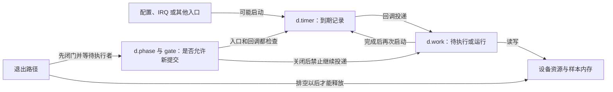
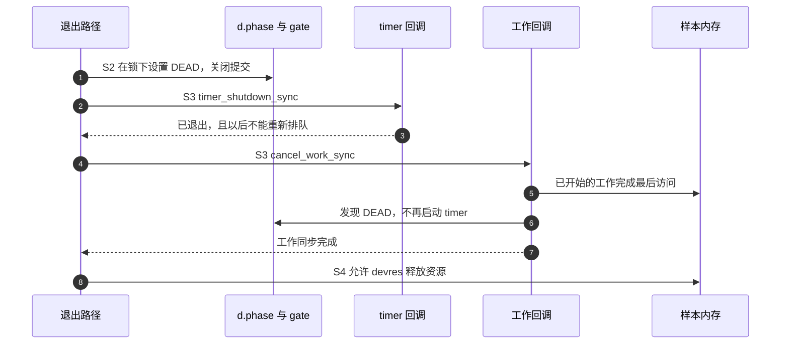
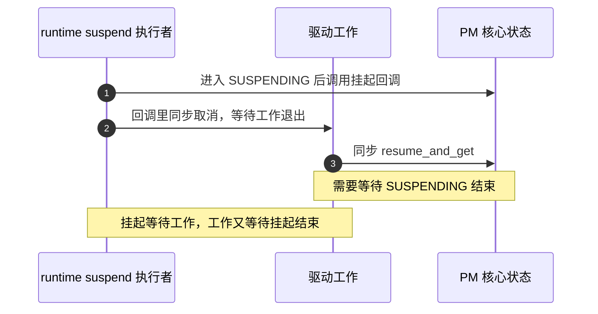

# 第10章\_与\_devres\_驱动生命周期和\_PM\_的关系

上一章让配置进入驱动，并规定每次重新排队使用哪一份时间值。现在把设备解绑放在两次回调之间：内存已经准备释放，定时器却刚好投递工作；或者工作还在访问设备，另一条路径已经关闭时钟。这时，参数正确、定时器取消过一次，都不足以证明安全。

本章沿着“谁能够再次启动谁”确定清理顺序，再区分永久退出和电源管理中的暂停。**电源管理（Power Management，PM）** 改变设备能否访问，也改变部分时间基准；它不会自动替驱动结束全部异步事务。完整实验仍采用无硬件 platform 设备，观察真实的定时器、工作项与设备托管内存依赖。

## 10.1\_资源还在不等于回调已经结束

假设驱动对象 `d` 内嵌一个普通定时器和一个工作项。定时器到期后投递工作，工作读取设备、更新结果，再启动下一次定时器。这个周期有两个执行者，还有三种不能混为一谈的状态：驱动是否允许新工作，定时器/工作是否排队或运行，以及回调访问的资源是否有效。

即使 `d` 的内存尚未释放，设备时钟已停时访问寄存器仍可能错误；即使设备仍有电，`d` 已被释放时回调取成员仍是悬空访问。反过来，仅从队列上撤下 timer，也没有把它此前投递的 work 从队列上撤下。



图中 timer 与 work 构成环，不能按成员在结构体里的排列顺序推出“先停谁”。先取消 work，timer 可能马上又投递；先删除 timer，已经运行的 work 又可能重新启动它。必须先切断重新提交的条件，或使用具有最终关闭语义的接口，再同步等待环上的执行者退出。

## 10.2\_devres保存清理动作但不替你发现依赖

**设备资源管理（device resource management，devres）** 把释放动作与 `struct device` 关联起来，在驱动解绑或探测失败回滚时执行。普通资源记录按逆登记顺序释放。因此先分配对象和它需要的数据，后登记“停止回调”的动作，能够使停止动作先于内存释放执行。

这不是“devres 只能处理没有并发的资源”。清理函数完全可以调用同步取消，托管 IRQ 释放也有它自己的同步语义；真正的问题是驱动有没有登记正确动作，并把其他入口和依赖排在正确位置。不能根据缺少某个想象中的 `devm_timer_create()` 名字，推导内核设计者不允许管理异步控制流。

固定 Linux 6.12.20 的 `include/linux/devm-helpers.h` 已提供两种工作辅助。先知道它们做了什么，再选择是否需要自定义组合清理。

| 接口 | 实际职责 | 驱动仍需负责 |
| --- | --- | --- |
| `devm_work_autocancel(dev, work, fn)` | 初始化普通工作，登记调用 `cancel_work_sync()` 的动作 | 检查返回值；开始排队前保证登记成功；关闭其他投递者 |
| `devm_delayed_work_autocancel(dev, dwork, fn)` | 初始化延迟工作，登记同步取消动作 | 同上；不要把延迟工作所在队列提前销毁 |
| `devm_add_action_or_reset(dev, action, data)` | 登记自定义动作；如果 **本次登记失败**，立即调用动作 | action 使用正确的 `void (*)(void *)` 类型；登记前对象须能安全清理 |
| `devm_release_action(dev, action, data)` | 找到匹配记录，执行动作并移除记录 | 只对仍登记的那份动作执行，避免之后重复执行 |
| `devm_remove_action(dev, action, data)` | 仅移除记录，不执行动作 | 不能用它冒充已经清理资源 |

前两种辅助使用 `devm_add_action()`，没有 `or_reset` 的立即清理分支；不过对象刚初始化，正常用法是登记成功才允许排队。不要在返回错误后仍让 IRQ 使用它。

`or_reset` 也不是“以后任何 probe 失败都在这个调用位置立即 reset”。登记成功以后发生的探测失败，由设备核心按 devres 记录回滚；登记本身失败，才由该辅助立刻调用 action。错误路径因此有两个时点，都必须能看到已完成初始化的对象。

正常 remove 可以让 devres 稍后执行动作，也可以在需要更早同步时调用 `devm_release_action()` 执行并摘下记录。不必为了表面“对称”先手工调用一次清理，再让 devres 调第二次。尤其是关开 IRQ、减少电源引用或销毁队列等动作，重复执行不一定安全。

## 10.3\_暂停和永久关闭为什么使用不同接口

普通定时器在 timer base 中排队；高分辨率定时器 hrtimer 通过按到期点排序的 timerqueue 组织，并不是所谓“hrtimer wheel”。这些内部队列存储位置沿用第四、五章，本节只看它们的退出保证。

| 操作 | 返回后建立的保证 | 仍不能证明什么 |
| --- | --- | --- |
| `timer_delete_sync()` | 删除普通 timer 的排队记录并等待当前回调结束，调用者须处理并发重启 | 外部路径以后不再 `mod_timer()` |
| `timer_shutdown_sync()` | 同步结束并使此 timer 不能再被重新排队，后续重排被忽略 | 其他 work、IRQ 或设备事务也已结束 |
| `hrtimer_cancel()` | 取消并等待此 hrtimer 回调退出 | 独立生产者以后不再调用 start |
| `cancel_work_sync()` / `cancel_delayed_work_sync()` | 在接口规定的并发约束下同步取消目标工作 | IRQ、用户入口或另一个对象以后不会再投递 |

`del_timer_sync()` 在本基线仍存在，但头文件要求新代码使用 `timer_delete_sync()`。最终销毁时，`timer_shutdown_sync()` 很适合切断 timer→work→timer 的环；临时暂停则还要在以后继续使用这个 timer，通常应先关闭自己的提交条件，再用 `timer_delete_sync()`。不能在 suspend 中永久 shutdown，resume 时原样 `mod_timer()`，然后期待它恢复。

对 hrtimer 或多个互相投递的工作对象，没有一个通用调用会自动关闭全部环。驱动要用所有入口共同遵守的停止状态，关闭再提交，然后按实际依赖同步。自建队列的 flush 也不会自动关闭生产者；销毁队列之前还需处理未到期的 delayed_work。普通共享系统队列不能由一个设备驱动销毁或当作自己的私有对象整体清空。

## 10.4\_用同一组阶段证明退出顺序

把整个对象生命周期划成 S0～S5：S0 准备资源与回调，S1 开放提交，S2 关闭新提交，S3 等待在途执行结束，S4 释放资源或保持暂停，S5 在资源恢复后重新开放。最终退出在 S4 结束，临时暂停才可能进入 S5。

示例用 `d->phase` 保存 LIVE、PAUSED、DEAD 三个业务阶段，分别表示运行许可、可恢复暂停、永久退出。它与 timer/work 自己的排队/运行状态是正交的：把 phase 改成 PAUSED 时，旧 work 仍可能运行，因此还需要 S3。`d->gate` 自旋锁保护 phase 和检查后排队这一小段动作；可睡的 `d->lifecycle_lock` 只序列化暂停、恢复与关闭，回调不取得它。



第 1 步不会强行中断已经在工作体里的执行，所以样本内存必须保留到第 7 步以后。等待期间不能持有回调要取的 gate，否则退出等待回调、回调等待 gate，双方都无法继续。只在关闭提交的瞬间短暂持有 gate，随后释放，再调用同步接口。

真实设备还可能有 IRQ、sysfs、DMA 完成和其他生产者。它们必须加入 S2/S3：例如先屏蔽设备事件源、同步或释放已注册的 IRQ，再取消其工作。共享中断线不能简单地为一个设备整体 disable；永久退出也不能在清理末尾重新 enable IRQ。设备唤醒事件与正常 I/O 事件如何分离，则由设备和总线协议决定。

## 10.5\_完整实验建立一个会相互重启的周期

把本节至 10.7 节三个 C 代码块依次保存为 `timer_lifetime_demo.c`。它建立普通 timer→work→timer 周期，工作仅更新托管样本内存并睡眠一小段时间，以便观察“同步关闭需要等工作结束”。它不申请真实 IRQ、不访问寄存器，也不模拟硬件唤醒。

`period_ms` 是只读模块参数，限定 10～60000 ms；`fail_after_start` 用来演示周期启动后 probe 失败的回滚。代码中的 `CYCLE_LIVE`、`CYCLE_PAUSED`、`CYCLE_DEAD` 就是前面三个业务阶段的枚举常量。样本由工作单写，最终清理在工作退出后读取。这里没有并发用户读取样本的接口。

```c
// SPDX-License-Identifier: GPL-2.0
#include <linux/module.h>
#include <linux/platform_device.h>
#include <linux/slab.h>
#include <linux/mutex.h>
#include <linux/spinlock.h>
#include <linux/timer.h>
#include <linux/workqueue.h>
#include <linux/delay.h>
#include <linux/ktime.h>
#include <linux/pm.h>

static unsigned int period_ms = 100;
static bool fail_after_start;
module_param(period_ms, uint, 0444);
module_param(fail_after_start, bool, 0444);

enum cycle_phase { CYCLE_LIVE, CYCLE_PAUSED, CYCLE_DEAD };
struct cycle_dev {
    struct device *dev;
    struct mutex lifecycle_lock;
    spinlock_t gate;
    enum cycle_phase phase;
    struct timer_list timer;
    struct work_struct work;
    u64 *samples;
    ktime_t paused_at;
};

static void cycle_timer(struct timer_list *timer)
{
    struct cycle_dev *d = from_timer(d, timer, timer);
    unsigned long flags;
    spin_lock_irqsave(&d->gate, flags);
    if (d->phase == CYCLE_LIVE)
        schedule_work(&d->work);
    spin_unlock_irqrestore(&d->gate, flags);
}

static void cycle_work(struct work_struct *work)
{
    struct cycle_dev *d = container_of(work, struct cycle_dev, work);
    unsigned long flags;
    bool allowed;

    spin_lock_irqsave(&d->gate, flags);
    allowed = d->phase == CYCLE_LIVE;
    spin_unlock_irqrestore(&d->gate, flags);
    if (!allowed)
        return;
    /* 代表一段可睡工作；资源必须保留到 cancel_work_sync 返回。 */
    (*d->samples)++;
    msleep(1);
    spin_lock_irqsave(&d->gate, flags);
    if (d->phase == CYCLE_LIVE)
        mod_timer(&d->timer, jiffies + msecs_to_jiffies(period_ms));
    spin_unlock_irqrestore(&d->gate, flags);
}
```

timer 回调只投递工作；工作结束后才排下一轮，因此这是“完成后等待一个周期”的节奏，不是固定相位采样。两条排队路径都在同一把 gate 下检查 phase，避免退出刚关门、生产者却依据旧判断排队的窗口。锁里没有睡眠或同步取消。

## 10.6\_让同一个周期能够暂停恢复与退出

接下来追加生命周期函数。`quiesce_cycle()` 是本例的静止化辅助：先禁止新提交，再同步 timer 和 work。它接收 `permanent` 区分最终关闭与暂时暂停，不把“暂停”伪装成已经销毁。

```c
static void quiesce_cycle(struct cycle_dev *d, bool permanent)
{
    unsigned long flags;
    mutex_lock(&d->lifecycle_lock);
    spin_lock_irqsave(&d->gate, flags);
    if (d->phase == CYCLE_DEAD) {
        spin_unlock_irqrestore(&d->gate, flags);
        mutex_unlock(&d->lifecycle_lock);
        return;
    }
    d->phase = permanent ? CYCLE_DEAD : CYCLE_PAUSED;
    spin_unlock_irqrestore(&d->gate, flags);
    if (!permanent)
        d->paused_at = ktime_get_boottime();
    if (permanent)
        timer_shutdown_sync(&d->timer);
    else
        timer_delete_sync(&d->timer);
    cancel_work_sync(&d->work);
    dev_info(d->dev, "cycle stopped: permanent=%d samples=%llu\n",
             permanent, (unsigned long long)*d->samples);
    mutex_unlock(&d->lifecycle_lock);
}

static void release_cycle(void *data)
{
    quiesce_cycle(data, true);
}

static int cycle_suspend(struct device *dev)
{
    quiesce_cycle(dev_get_drvdata(dev), false);
    return 0;
}

static int cycle_resume(struct device *dev)
{
    struct cycle_dev *d = dev_get_drvdata(dev);
    unsigned long flags;
    int ret = 0;
    mutex_lock(&d->lifecycle_lock);
    spin_lock_irqsave(&d->gate, flags);
    if (d->phase == CYCLE_DEAD) {
        ret = -ENODEV;
    } else if (d->phase == CYCLE_PAUSED) {
        d->phase = CYCLE_LIVE;
        mod_timer(&d->timer, jiffies + msecs_to_jiffies(period_ms));
    }
    spin_unlock_irqrestore(&d->gate, flags);
    if (!ret)
        dev_info(dev, "cycle resume: pause interval=%lld ms\n",
                 (long long)ktime_to_ms(ktime_sub(ktime_get_boottime(),
                                                  d->paused_at)));
    mutex_unlock(&d->lifecycle_lock);
    return ret;
}
static DEFINE_SIMPLE_DEV_PM_OPS(cycle_pm_ops, cycle_suspend, cycle_resume);
```

本例选择恢复后重新等待一个完整周期，不补做暂停期间每一轮。`paused_at` 到恢复的差包含关闭工作和恢复路径自身的时间，不等于精确的硬件睡眠时长。若要保持原周期相位，就应另存原计划到期点，并以同一时间域计算下一个未来周期；若允许漏采后补一次，也要限制补做次数，避免恢复时形成突发访问。

这里的周期在成功 probe 后总是启用，没有用户关闭开关。若产品允许用户停用，必须另存“用户希望启用”的状态，恢复时不能因为发现 PAUSED 就把原来关闭的功能打开。宏 `DEFINE_SIMPLE_DEV_PM_OPS()` 把这组暂停/恢复回调用于系统睡眠相应阶段，不表示 runtime PM 也可无条件使用同一协议。

## 10.7\_让登记失败和正常移除走同一份最终清理

对象及样本内存先登记，最终停止动作后登记；回滚时按相反顺序执行。动作登记前，timer 和 work 都初始化成有效回调；登记成功以后才开放周期。正常 remove 用 `devm_release_action()` 执行并移除记录，避免托管回滚再重复执行。

```c
static int cycle_probe(struct platform_device *pdev)
{
    struct cycle_dev *d;
    int ret;
    unsigned long flags;
    d = devm_kzalloc(&pdev->dev, sizeof(*d), GFP_KERNEL);
    if (!d)
        return -ENOMEM;
    d->samples = devm_kzalloc(&pdev->dev, sizeof(*d->samples), GFP_KERNEL);
    if (!d->samples)
        return -ENOMEM;
    d->dev = &pdev->dev;
    mutex_init(&d->lifecycle_lock);
    spin_lock_init(&d->gate);
    d->phase = CYCLE_PAUSED;
    timer_setup(&d->timer, cycle_timer, 0);
    INIT_WORK(&d->work, cycle_work);
    platform_set_drvdata(pdev, d);
    ret = devm_add_action_or_reset(&pdev->dev, release_cycle, d);
    if (ret)
        return ret;
    spin_lock_irqsave(&d->gate, flags);
    d->phase = CYCLE_LIVE;
    mod_timer(&d->timer, jiffies + msecs_to_jiffies(period_ms));
    spin_unlock_irqrestore(&d->gate, flags);
    if (fail_after_start)
        return -EIO; /* 设备核心回滚已登记动作，再释放样本与对象。 */
    return 0;
}

static void cycle_remove(struct platform_device *pdev)
{
    devm_release_action(&pdev->dev, release_cycle, platform_get_drvdata(pdev));
}

static struct platform_driver cycle_driver = {
    .probe = cycle_probe,
    .remove = cycle_remove,
    .driver = {
        .name = "timer_lifetime_demo",
        .pm = pm_sleep_ptr(&cycle_pm_ops),
    },
};
static struct platform_device *cycle_device;

static int __init cycle_init(void)
{
    int ret;
    if (period_ms < 10 || period_ms > 60000)
        return -EINVAL;
    ret = platform_driver_register(&cycle_driver);
    if (ret)
        return ret;
    cycle_device = platform_device_register_simple("timer_lifetime_demo",
                                                   PLATFORM_DEVID_NONE, NULL, 0);
    if (IS_ERR(cycle_device)) {
        ret = PTR_ERR(cycle_device);
        platform_driver_unregister(&cycle_driver);
        return ret;
    }
    return 0;
}

static void __exit cycle_exit(void)
{
    platform_device_unregister(cycle_device);
    platform_driver_unregister(&cycle_driver);
}
module_init(cycle_init);
module_exit(cycle_exit);
MODULE_LICENSE("GPL");
```

如果动作登记失败，`or_reset` 会在返回错误前同步调用 `release_cycle()`；此时样本已分配，两个回调对象也已初始化，所以清理仍合法。若更早分配失败，周期尚未开放，没有需要取消的活动对象。若启动后注入失败，probe 不会成功绑定，但已登记的清理会先关闭周期，再释放内存。

这一协议只覆盖本例的两个互相启动者。把真实 IRQ 接进来以后，应确保 IRQ 关闭/释放发生在最终工作取消以前；若依赖 devres 逆序清理，就必须核对 IRQ 登记与动作登记的先后。不能一边在 remove 手动销毁队列，一边让托管 IRQ 留到更晚才释放。

## 10.8\_观察解绑与失败回滚

在同目录创建 `Makefile`，内容为 `obj-m += timer_lifetime_demo.o`。在提供匹配内核构建目录的 Linux 实验机执行；此处使用固定 6.12.20 的接口形状，其他版本先核对 API。

```bash
# 当前目录已有完整 C 文件与 Makefile。
make -C /lib/modules/"$(uname -r)"/build M="$PWD" modules
sudo insmod ./timer_lifetime_demo.ko period_ms=100
cycle_path=/sys/bus/platform/devices/timer_lifetime_demo
readlink "$cycle_path/driver"
sleep 1
printf '%s\n' timer_lifetime_demo | sudo tee /sys/bus/platform/drivers/timer_lifetime_demo/unbind
sudo dmesg | tail -n 10
```

解绑日志应有 `permanent=1`，样本值取决于实际工作调度；不要期待一秒恰好十次。此时 platform 设备仍存在，驱动私有资源已释放。重新绑定会重新 probe，得到一个新对象与新计数，而不是复活已经 shutdown 的旧 timer。

```bash
printf '%s\n' timer_lifetime_demo | sudo tee /sys/bus/platform/drivers/timer_lifetime_demo/bind
sleep 1
sudo rmmod timer_lifetime_demo
# 重新加载，主动让 probe 在启动周期后失败。
sudo insmod ./timer_lifetime_demo.ko fail_after_start=1
sudo dmesg | tail -n 15
test ! -L /sys/bus/platform/devices/timer_lifetime_demo/driver
sudo rmmod timer_lifetime_demo
```

失败实验中模块加载仍可能成功，因为设备注册成功和驱动 probe 成功是两个结果；观察 driver 链接缺失、probe 错误和最终清理日志。按需缩短周期、在工作执行时解绑，并结合 timer/workqueue 跟踪检查 S2～S4 的顺序。一次没有崩溃不能覆盖所有交错，日志也不能证明释放后的访问绝不存在。

系统睡眠实验要在已验证恢复通路的目标上单独进行，确认设备实际经历对应 PM 回调，再比较暂停和恢复日志；不要把无硬件平台实验称为 RTC 唤醒验证。本次文档核对没有执行目标模块装载或系统挂起。

## 10.9\_runtimePM引用为什么可能与取消互相等待

系统仍在运行时，单个设备可以暂时进入低功耗状态，这称为 **运行时电源管理（runtime PM）**。普通工作线程能睡，不代表其访问的设备一定已经恢复供电。需要访问设备时，要遵守所属子系统的 PM 协议，取得有效的使用引用，再进行访问，完成后归还。

固定版本的 `pm_runtime_get_sync()` 即使返回负错误，也已经增加使用计数。忽略错误后继续 I/O 是一处错误，失败时忘记平衡引用是另一处。常用的 `pm_runtime_resume_and_get()` 在恢复失败时撤回这次增加，成功返回 0；但它也不替驱动启用 runtime PM 或初始化硬件。

下面是已有驱动中的调用片段，`perform_io()` 是设备自己的可睡操作，不是 Linux API。前提是该设备已正确建立 runtime PM、autosuspend 策略和退出同步，且调用者没有持有 resume 回调也需要的锁。

```c
ret = pm_runtime_resume_and_get(dev);
if (ret < 0)
    return ret;
ret = perform_io(dev); /* 本设备的实际访问，可以返回业务错误。 */
pm_runtime_mark_last_busy(dev);
pm_runtime_put_autosuspend(dev);
return ret;
```

`pm_runtime_mark_last_busy()` 记录最后活动时刻，put 归还使用引用并按已配置策略考虑自动挂起；它们不保证设备当场掉电。即使 `perform_io()` 失败，也必须归还成功取得的引用。若选择旧 get_sync 接口，则恢复失败路径通常需要 `pm_runtime_put_noidle()` 平衡计数，不能直接 return。

还有一个比引用泄漏更隐蔽的环：runtime_suspend 回调调用 `cancel_work_sync()` 等工作结束，而那个工作正调用同步 resume/get，等待当前 runtime_suspend 完成。两边在不同框架里等待同一条链，依然会死锁。因此不能把本章系统睡眠实验的停止函数机械复制成 runtime_suspend 回调。



图中 SUSPENDING 是 PM 核心保存的“正在挂起”状态，与本例驱动的 PAUSED 不是同一个字段。第 2、3 步组成相互等待，改变忙等时间或给取消加一把锁都不能解除这个依赖环。

一种设计是周期工作每轮自行取得 PM 使用引用，允许设备在轮次之间 autosuspend，此时 runtime_suspend 不反过来等待这个可能正在获取引用的工作；另一种设计在外部控制路径先禁止并排空周期，再允许设备进入 runtime suspend。选择哪种取决于事件来源和唤醒需求，必须把获取引用、关闭生产者及同步取消画在同一条执行链上。周期太短可能使设备反复醒来，事件驱动能够减少这部分成本，但前提是硬件支持相应事件与唤醒路径。

## 10.10\_挂起计时与硬件唤醒是另一层保证

`CLOCK_MONOTONIC` 不把系统挂起区间计入读数，`CLOCK_BOOTTIME` 则包含该区间。这个区别决定恢复后怎样计算已经过去多久，不说明普通 hrtimer 能把深睡的系统唤醒。jiffies、普通定时器、可冻结工作队列与设备 suspend 回调也不是同一个“全部冻结”开关；仍须在设备不可访问以前完成自己的同步。

需要定时唤醒时，要有实际支持的 RTC（Real-Time Clock，实时时钟硬件）或其他平台唤醒源，以及对应驱动、固件和系统睡眠状态支持。alarmtimer 提供与闹钟计时有关的内核机制，具体唤醒能力仍依赖可用硬件；它不是凭空替 SoC 生成一个新硬件模块。

`device_init_wakeup()` 建立设备的唤醒能力/策略相关状态，要检查返回值并按生命周期处理；它不会给设备接上一条原本不存在的唤醒线。`pm_wakeup_event(dev, msec)` 报告一次唤醒事件，并为预期处理区间维护软件唤醒源活动，**不是设置 msec 以后唤醒的闹钟**。PM QoS（Power Management Quality of Service，电源管理服务质量约束）表达延迟等约束，也不是硬实时计时器或深睡唤醒保证。

因此，省电优先可以选择暂停周期、恢复后重新开始；时效优先可能需要可验证的硬件唤醒与事件处理保护。两者都要明确哪些任务可以漏做、哪些设备事务必须先终止，以及恢复后资源何时重新可用。下一章专门追踪这条唤醒链，不在本章用一组 API 名字替代它。

练习：为什么不能在清理工作以后重新打开它的 IRQ 来源？因为后来的 IRQ 又能投递已失去清理机会的工作。为什么暂停不直接使用 timer_shutdown_sync？因为暂停后还要恢复同一个对象，最终关闭会阻止重排。为什么托管清理已经登记，remove 仍可能需要提前执行？因为 remove 内可能先要关闭其他依赖；此时可以执行并移除已登记动作，而不是无条件重复执行。

本章依据见[固定源码与验证边界](../../../../../research/source_reading/linux/SOURCE_BASELINE.md#1.179_异步清理依赖与电源引用)。通用 devres 的完整机制继续由[设备资源管理专题](../../../object_lifetime/devres/大纲.md)承担；本章只解释时间对象、工作生产者与电源状态相交的部分。

上一篇：[P09 时间与设备树平台数据的对接](P09_时间与设备树平台数据的对接.md)。
下一篇：[P11 电源管理 系统挂起与定时唤醒](P11_电源管理_系统挂起与定时唤醒.md)。
