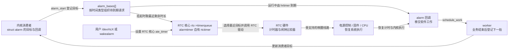
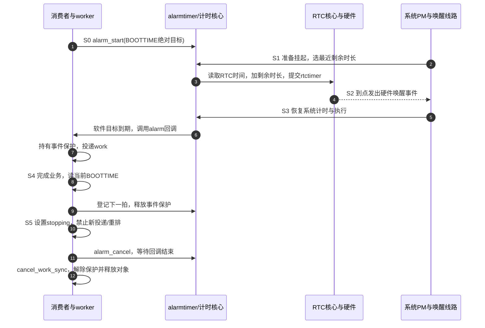

# 第11章\_电源管理\_系统挂起与定时唤醒

上一章已经让周期工作能够安全暂停、恢复和退出。可是，每隔半分钟采样一次的设备如果在暂停期间没有其他事件把系统叫醒，恢复函数就一直没有机会运行。保存再准确的截止时间，也不能让已经停止执行的 CPU 自己执行那条恢复指令。

本章解决这个缺口：先找出睡眠期间仍能计时和发出唤醒的硬件，再看 Linux 怎样把软件闹钟交给它。沿着同一轮采样，区分“目标时间到了”“系统恢复执行”“工作真正开始”三个时刻。最后用原生 RTC 接口和完整内核模块分别观察硬件路径与软件交接，不承诺某块板在某种睡眠状态下必然可用。

## 11.1\_计时包含睡眠时间\_为什么还不能把系统叫醒

设采样目标是开机后第 30 秒，系统在第 10 秒挂起，直到外部按键在第 50 秒将它唤醒。若目标用包含挂起区间的时间表示，恢复后软件可以立即发现“已经迟了 20 秒”；但从第 30 秒到第 50 秒之间，没有 CPU 替它检查这个比较式。**能够计算逾期与能够制造唤醒事件，是两种能力。**

这里的 **系统睡眠（System sleep）** 是整机活动被收缩的状态，用户进程停止正常执行，设备也经过挂起。它不同于 CPU 暂时空闲时进入的低功耗状态，也不同于第十章某一个设备的运行时电源管理。系统睡眠还分轻重：`s2idle` 是以软件和中断为基础的浅层挂起，`deep` 通常代表挂起到内存；同一条中断在前者可唤醒，不代表在后者仍有供电和路由。

第二章建立的时间域在这里各司其职：

| 时间或计时对象 | 系统挂起区间怎样计入 | 恢复后适合回答什么 | 本身是否承诺唤醒整机 |
| --- | --- | --- | --- |
| `CLOCK_MONOTONIC` | 不计系统挂起区间 | 系统活动时间经过多久 | 否 |
| `CLOCK_BOOTTIME` | 计入挂起区间 | 连同睡眠是否已过期 | 否 |
| `CLOCK_REALTIME` | 表示系统日历时间，包含睡眠经过，且可被校正 | 是否到了指定日期时刻 | 否 |
| 普通 `timer_list` | 用 jiffies 的到期机制；不能据此当作跨挂起硬闹钟 | 恢复运行后的普通超时处理 | 否 |
| 指定 BOOTTIME 的普通 hrtimer | 使用该时间域判断到期 | 恢复后识别逾期 | 否；与唤醒型 alarmtimer 有区别 |

不能把“MONOTONIC 不计挂起”解释成“所有定时器回调在进入挂起流程的瞬间都已同步结束”。设备停用前的门控与排空仍须执行，参见[第十章的关闭协议](P10_与_devres_驱动生命周期和_PM_的关系.md)。

在目标 Linux 上先只读查看：

```sh
# 目标板终端：查看支持的睡眠状态与 mem 的当前含义
cat /sys/power/state
cat /sys/power/mem_sleep
```

`mem_sleep` 中方括号包围的是当前选择，例如 `[s2idle] deep`。因此，两个系统都执行 `echo mem`，也可能进入不同深度。本章后续的唤醒结论必须连同这一选择记录，不能只写“测试了 mem”。休眠到磁盘还涉及镜像保存与恢复，不等同于这里的挂起到内存。

> 依据：Linux 6.12.20 固定基线的 [System Sleep States](https://github.com/nxp-imx/linux-imx/blob/dfaf2136deb2af2e60b994421281ba42f1c087e0/Documentation/admin-guide/pm/sleep-states.rst)，`Suspend-to-Idle`、`Suspend-to-RAM` 和 `Basic sysfs Interfaces`；源码身份与本章核对范围见[基线记录](../../../../../research/source_reading/linux/SOURCE_BASELINE.md#1.180_系统睡眠的闹钟委托与唤醒交接)。

## 11.2\_让仍有电的RTC替睡眠中的CPU守住目标时刻

如果 CPU 不能执行软件比较，就需要某个仍有电的硬件继续计时。**实时时钟（Real-Time Clock，RTC）** 通常保存日期时间；具有闹钟能力的 RTC 还能把当前时间与预设目标比较，到点输出中断或唤醒事件。RTC 的“实时”是钟表意义，不是实时调度的截止时间保证。

这条路至少经过四处：RTC 的计时电源、闹钟比较与输出、芯片/板级唤醒连接，以及低功耗固件与 Linux 驱动配置。只有 RTC 还在走，但输出没有连到所选睡眠状态可用的唤醒输入，系统仍不会醒。备用电池让 RTC 在主电源关闭后记时，也不自动使它拥有重新给主系统上电的能力，更不自动恢复已丢失的内存。

一个 RTC 常只有有限的硬件闹钟资源，而软件可能有多个目标时刻。Linux 的 **alarmtimer** 是把这种需求组织起来的内核软件定时接口：运行时借助 hrtimer 到期；进入系统挂起时，把相关软件闹钟中最近的到期需求交给合适的 RTC。它与 RTC 经常是 **上层请求和下层硬件** 的关系，不能按“BOOTTIME 用 alarmtimer、深睡就放弃它改 RTC”来二选一。

下图中的队列都在内存，只有右侧 RTC 比较器在受支持的睡眠状态下继续承担硬件计时。`alarm_bases[]` 是该版本 alarmtimer 按时间类型管理的队列；`rtc->timerqueue` 是 RTC 核心汇聚软件请求的队列，最终由 RTC 驱动写硬件。



`aie_timer` 是 RTC 核心用于闹钟中断接口的定时对象名称，不是一根由应用独占的硬件引脚。直接设置 `/dev/rtcX` 的闹钟仍经过 RTC 核心；它没有绕过底层驱动，也不天然比 alarmtimer 更可靠。

**`device_init_wakeup(dev, true)` 只建立设备的唤醒能力/策略与软件事件保护关系，不能补出物理连线。** 基线中的 alarmtimer 会选择具有闹钟功能、且父设备允许唤醒的 RTC；找不到 RTC 时，软件闹钟仍不能由这条 RTC 路径承担深睡唤醒。实际能力必须回到板级睡眠状态验证。

> 依据：[alarmtimer.c](https://github.com/nxp-imx/linux-imx/blob/dfaf2136deb2af2e60b994421281ba42f1c087e0/kernel/time/alarmtimer.c) 的 `alarmtimer_rtc_add_device`、`alarmtimer_suspend`、`alarmtimer_fired`，以及 [RTC interface.c](https://github.com/nxp-imx/linux-imx/blob/dfaf2136deb2af2e60b994421281ba42f1c087e0/drivers/rtc/interface.c) 的 `rtc_timer_enqueue`、`rtc_timer_do_work`。这里解释职责与状态落点，不假定任意 RTC 都具有相同寄存器或精度。

## 11.3\_把一次跨睡眠到期分成可核对的交接阶段

现在把采样目标放进这条链。`ALARM_BOOTTIME` 是 alarmtimer 选择 BOOTTIME 时间域的类型值；另一种 `ALARM_REALTIME` 则使用系统日历钟。以下选择前者：目标记录在开机经过时间里，系统校正日历钟不会直接把它变成另一个目标。挂起时，alarmtimer 先求“还差多久”，再读 RTC 当前日历时间，将这个差量换算成 RTC 的闹钟时刻。两种时钟并没有被当成同一个绝对数值。

这一轮使用六个阶段：S0 消费者登记，S1 挂起准备时委托硬件，S2 硬件等待，S3 系统恢复并交付软件到期，S4 处理业务并选下一拍，S5 永久停止。系统因其他事件提前恢复时，会取消本轮硬件委托，尚未到期的软件目标仍由运行中的计时机制管理。



第 4 步是硬件事件，第 6 步才是软件回调；平台恢复、计时恢复和调度都可能增加间隔。第 3 步还可能因为硬件支持范围不足而只能设置较早的目标；基线对距离过近的目标也可能暂时拒绝挂起。因此 **目标时刻不是业务执行时刻的硬上界**，看到提前醒或挂起返回忙，也不能立即判断闹钟计算错了。

第 7～9 步引出 **唤醒源（wakeup source）**：这是内核记录“这个事件仍在处理”的软件对象，帮助电源管理决定是否可以再次进入睡眠。`pm_wakeup_event(dev, ms)` 报告事件并提供有限时长的保护；其中 `ms` 不是“从现在等这么久再唤醒”。如果工作排队和执行超过这段时长，有限窗口不能证明整个工作都被覆盖。

业务必须处理到结束时，可以先持有保护，最后释放，例如设备接口 `pm_stay_awake()` / `pm_relax()`，或直接操作独立对象的 `__pm_stay_awake()` / `__pm_relax()`。它们不是可任意重复增加的业务引用计数。下面让每一轮只拥有一份保护，并让下一轮的获取与上一轮释放受同一把锁约束，避免旧工作错误释放新事件的保护。保护也不等同于设备运行时电源引用，更不会自动唤醒已关闭的外设。

## 11.4\_先用原生RTC闹钟确认硬件这一段

在写模块以前，先把 S1～S3 的板级问题与消费者代码分开。以下操作只在选定的测试 Linux 设备上执行；保存工作并保证有独立的人工唤醒办法。这里不是额外软件实现，而是直接观察同一 RTC 驱动是否能把硬件闹钟交给所选睡眠状态。

```sh
# 目标板：列出真实 RTC 设备，不假定 rtc0 就是所需硬件
for r in /sys/class/rtc/rtc*; do
    echo "$r"
    cat "$r/name"
    cat "$r/date" "$r/time"
done
```

根据设备名和板级连接选择 RTC。下面以已经确认的 `rtc0` 为例；`wakealarm` 存在表示导出了此接口，不等于所有睡眠状态都验证成功。

```sh
# root 终端；先查现存闹钟，非空时先确认其所有者，不覆盖其他业务
rtc=/sys/class/rtc/rtc0
cat "$rtc/wakealarm"
cat "$rtc/device/power/wakeup"
cat /sys/power/state /sys/power/mem_sleep
```

如果唤醒策略为 `disabled`，且该设备确实是本实验的唤醒源，可写 `enabled` 并在实验后恢复原值。路径缺失时应检查实际设备层次与驱动，不能随意创建文件。关闭冲突的闹钟使用者后，且现存闹钟为空，才设置相对目标：

```sh
# 同一 root 终端：+60 由 RTC 当前时间计算，不使用系统 date 的时间
printf '+60\n' > "$rtc/wakealarm"
cat "$rtc/wakealarm"
# 已确认 mem 的具体含义后进入该状态
printf 'mem\n' > /sys/power/state
```

恢复后检查内核日志中的睡眠进入/退出和 RTC 事件，并与目标时刻比较。闹钟通常是一次性的；若提前人为唤醒而不再测试，在确认没有其他写入者的条件下写 `0` 取消自己的目标。不要把“先写 0 清空”放成无条件实验开头，否则会悄悄撤掉别人的闹钟。

这组命令便于分层诊断，但“设置后再睡”的两个操作不是原子事务：设置过近、进入睡眠太慢或其他管理器并发操作都可能改变结果。生产系统应由明确的电源管理者协调唤醒事件检查与睡眠提交，不能把这段实验脚本当作完整电源守护进程。

> 接口格式依据：[sysfs-class-rtc](https://github.com/nxp-imx/linux-imx/blob/dfaf2136deb2af2e60b994421281ba42f1c087e0/Documentation/ABI/testing/sysfs-class-rtc) 的 `wakealarm`，以及 [sysfs.c](https://github.com/nxp-imx/linux-imx/blob/dfaf2136deb2af2e60b994421281ba42f1c087e0/drivers/rtc/sysfs.c) 的 `wakealarm_store`。`+N` 基于 RTC 当前读数；普通设置遇到已启用闹钟返回忙，但它仍不是跨所有访问路径的独占协议。

## 11.5\_周期任务如何跳过错过的拍点而保留相位

硬件能够唤醒以后，还要决定 S4 的下一次目标。设上一目标 `due=30 s`，周期 `step=30 s`。工作结束时若已经是 `now=97 s`，候选拍点为 60、90、120 秒；我们选择 120 秒，只做一次本轮工作，不把错过的两次采样补跑成突发负载。

这不同于“从完成时刻重新等待 30 秒”：后者得到 127 秒，下一轮会不断把处理时间带入相位。它也不同于“每次给旧目标只加一个周期”：后者得到已过去的 60 秒，可能立刻再次到期。本章选 **严格晚于当前时刻的最近原相位拍点**；恰好等于某拍点时也进入下一拍。真正需要补采历史样本的设备必须有硬件缓存和独立的数据恢复协议，不能靠晚来的回调伪造已经错过的测量。

下面三段代码依次保存为同一个 `alarm_cycle_demo.c`。它是 Linux 6.12.20 接口下的完整模块：只在内存中计数、短暂睡眠模拟工作并记录时间，没有外设寄存器和设备树依赖。因为没有真实设备，故不虚构 `leaf,alarm-demo` 硬件节点，也不调用未经建立的 runtime PM。真实设备的时间属性验证沿用第九章，外设访问前的恢复与退出沿用第十章。

第一段定义状态和相位计算。`gate` 保护停止许可、目标和保护的交接；`runs` 只由同一个工作项更新。`next_phase()` 对负值、零周期和加法溢出返回错误，不能让算术回绕把闹钟安排到过去。`S64_MAX` 是有符号 64 位数上限，`EINVAL` 表示参数无效，`ERANGE` 表示结果越界。模块参数沿用前章的只读形式，`MODULE_PARM_DESC` 补充参数说明；唤醒接口从 `linux/device.h` 引入，该版本不允许直接独立包含 `pm_wakeup.h`。

```c
// SPDX-License-Identifier: GPL-2.0
#include <linux/module.h>
#include <linux/alarmtimer.h>
#include <linux/device.h>
#include <linux/workqueue.h>
#include <linux/spinlock.h>
#include <linux/delay.h>
#include <linux/ktime.h>
#include <linux/math64.h>
#include <linux/limits.h>

static unsigned int period_sec = 30;
module_param(period_sec, uint, 0444);
MODULE_PARM_DESC(period_sec, "周期秒数，范围5到86400");

static struct alarm_cycle {
    struct alarm alarm;
    struct work_struct work;
    struct wakeup_source *ws;
    spinlock_t gate;
    bool stopping;
    s64 due_ns;
    s64 step_ns;
    u64 runs;
} cycle;

static int next_phase(s64 due, s64 now, s64 step, s64 *next)
{
    u64 remain;
    s64 advance;

    if (due < 0 || now < 0 || step <= 0)
        return -EINVAL;
    if (now < due) {
        *next = due;
        return 0;
    }
    div64_u64_rem((u64)(now - due), (u64)step, &remain);
    advance = step - (s64)remain;
    if (now > S64_MAX - advance)
        return -ERANGE;
    *next = now + advance;
    return 0;
}
```

`div64_u64_rem()` 同时取得除法余数，避免在 ARM32 上直接写无法由目标内核链接的 64 位运行库除法。`now < due` 时保留尚未到期的目标，而不是再向后跳一个周期。正常 S4 应在到期后进入；这个分支让辅助计算的边界仍有定义。

## 11.6\_让保护覆盖工作\_同时堵住退出后的重排

相位计算只决定下一个数，尚未解决谁能提交。回调在 S3 持有事件保护并投递工作，返回 `ALARMTIMER_NORESTART` 告诉框架本次回调不自行续订；工作在 S4 完成业务以后才重新读 BOOTTIME，随后在锁内检查停止许可、登记下一拍并解除本轮保护。**不得把读当前时间放在可能耗时的业务之前**，否则算出的“未来目标”在提交时可能已经过期。

```c
static enum alarmtimer_restart cycle_alarm(struct alarm *alarm, ktime_t now)
{
    struct alarm_cycle *d = container_of(alarm, struct alarm_cycle, alarm);
    unsigned long flags;

    (void)now;
    spin_lock_irqsave(&d->gate, flags);
    if (!d->stopping) {
        __pm_stay_awake(d->ws);
        schedule_work(&d->work);
    }
    spin_unlock_irqrestore(&d->gate, flags);
    return ALARMTIMER_NORESTART; /* 由工作结束路径提交下一次 */
}

static void cycle_work(struct work_struct *work)
{
    struct alarm_cycle *d = container_of(work, struct alarm_cycle, work);
    unsigned long flags;
    s64 now_ns, next_ns = 0;
    int ret = 0;

    /* 纯软件工作；退出必须等它结束，期间对象仍然有效 */
    d->runs++;
    msleep(10);
    now_ns = ktime_to_ns(ktime_get_boottime());
    spin_lock_irqsave(&d->gate, flags);
    if (!d->stopping) {
        ret = next_phase(d->due_ns, now_ns, d->step_ns, &next_ns);
        if (ret) {
            d->stopping = true;
        } else {
            d->due_ns = next_ns;
            alarm_start(&d->alarm, ns_to_ktime(next_ns));
        }
    }
    /* 与下一轮回调获取保护串行，不能在解锁后再释放旧保护 */
    __pm_relax(d->ws);
    spin_unlock_irqrestore(&d->gate, flags);
    pr_info("alarm_cycle: run=%llu now_ns=%lld next_ns=%lld error=%d\n",
            (unsigned long long)d->runs, (long long)now_ns,
            (long long)next_ns, ret);
}

static void cycle_stop(void)
{
    unsigned long flags;

    spin_lock_irqsave(&cycle.gate, flags);
    cycle.stopping = true;
    spin_unlock_irqrestore(&cycle.gate, flags);
    alarm_cancel(&cycle.alarm);
    cancel_work_sync(&cycle.work);
    /* 若工作尚未运行就被取消，由退出路径归还事件保护 */
    __pm_relax(cycle.ws);
    wakeup_source_unregister(cycle.ws);
}
```

到 S5 时先闭门，再在 **不持有回调所需锁** 的情况下取消闹钟、同步取消工作。已经开始的工作可以完成纯软件计数，但不能再重排。单独交换 `alarm_cancel()` 和 `cancel_work_sync()` 的顺序，无法代替这道共同门控。

`alarm_cancel()` 等待已经运行的回调结束，却不是类似永久 shutdown 的“以后谁都不能再启动”接口。`alarm_start()` 返回 `void`，表示登记软件目标，不能写成 `return alarm_start(...)`，也不能把它当成硬件唤醒已经验证成功。默认基线的 alarm 回调来自 hrtimer 路径，应按不可睡眠的回调编写；具体硬/软执行方式可能随实时配置变化，不能把所有配置概括为固定硬中断。

这份模块只靠 alarm/work 互相衔接，没有并行用户改周期或第二个生产者，因此一轮一份保护成立。要增加外部立即触发、取消或多条业务队列，应先定义事件合并和保护所有权，不能只往回调旁再加一个 `schedule_work()`。

## 11.7\_装载模块后分别验证运行到期和睡眠唤醒

模块入口先要求 alarmtimer 已经选到 RTC，以免把只在运行时能响的软件定时器误称为本实验的唤醒成功；这仍只是软件前提。独立的 `wakeup_source` 用来保护工作交接，它不把本模块伪装成另一块 RTC 硬件。

```c
static int __init cycle_init(void)
{
    s64 now_ns;
    int ret;

    if (period_sec < 5 || period_sec > 86400)
        return -EINVAL;
    if (!alarmtimer_get_rtcdev())
        return -ENODEV;
    spin_lock_init(&cycle.gate);
    INIT_WORK(&cycle.work, cycle_work);
    alarm_init(&cycle.alarm, ALARM_BOOTTIME, cycle_alarm);
    cycle.step_ns = (s64)period_sec * NSEC_PER_SEC;
    cycle.ws = wakeup_source_register(NULL, "alarm_cycle_demo");
    if (!cycle.ws)
        return -ENOMEM;
    now_ns = ktime_to_ns(ktime_get_boottime());
    ret = next_phase(now_ns, now_ns, cycle.step_ns, &cycle.due_ns);
    if (ret) {
        wakeup_source_unregister(cycle.ws);
        return ret;
    }
    alarm_start(&cycle.alarm, ns_to_ktime(cycle.due_ns));
    pr_info("alarm_cycle: first_ns=%lld period_sec=%u\n",
            (long long)cycle.due_ns, period_sec);
    return 0;
}

static void __exit cycle_exit(void)
{
    cycle_stop();
}
module_init(cycle_init);
module_exit(cycle_exit);
MODULE_LICENSE("GPL");
MODULE_DESCRIPTION("BOOTTIME alarm with bounded lifecycle and phase alignment");
```

三段合起来是一个文件，不需要平台设备配对。Kbuild 文件 `Makefile` 内容如下：

```make
obj-m += alarm_cycle_demo.o
```

在与目标运行内核匹配的 Linux 构建环境中执行；交叉编译时换成真实构建树并提供目标工具链，不能使用宿主 PC 的头文件假装板级构建。

```sh
# 含 alarm_cycle_demo.c 和 Makefile 的目录
make -C /lib/modules/$(uname -r)/build M="$PWD" modules
sudo insmod alarm_cycle_demo.ko period_sec=30
sudo dmesg | tail -n 20
```

先在不睡眠时观察连续 `run` 和 `next_ns`，确认 S0、S3、S4 工作。再取消直接 RTC 实验的残留闹钟、排除其他使用者，并用 11.4 已确认的睡眠状态试验 S1～S3。恢复后比较首目标、工作记录和下一目标的相位；应记录实际误差，不把示意数字当测量结果。完成后：

```sh
sudo rmmod alarm_cycle_demo
sudo dmesg | tail -n 20
```

退出后不应再出现本模块的新工作；取消发生在排队前、排队后和工作运行中都值得覆盖。若装载报告 `ENODEV`，应核对 RTC 驱动、唤醒策略与 alarmtimer 选择结果；不能通过删掉检查就声称支持硬件唤醒。基线的 `kernel/time/Makefile` 将 alarmtimer 编入内核；`CONFIG_RTC_CLASS` 决定 RTC 支持，具体 `CONFIG_RTC_DRV_*` 对应板上驱动，`CONFIG_SUSPEND` 决定系统挂起支持，`CONFIG_PM_SLEEP` 相关唤醒源设施也须可用。模块构建与目标配置必须一致。

本节未声称已经在你的板子运行。可复制的代码与验证步骤建立了检查对象，真正的构建、装载、睡眠深度和唤醒延迟仍需目标环境给出证据。

## 11.8\_直接设置RTC时\_结构体与时钟来源必须对应

上述内核消费者适合需要内核回调和生命周期协作的场景。若只是用户程序安排一次未来唤醒，直接使用 RTC 字符设备更容易隔离问题。**ioctl** 是向设备文件提交专用操作的系统调用；命令号不仅决定动作，也决定内核从用户地址复制哪一种结构体。

| 操作 | 参数对象 | 关键语义 |
| --- | --- | --- |
| `RTC_RD_TIME` | `struct rtc_time *` | 读取这个 RTC 的日历值，不是读取系统 REALTIME |
| `RTC_WKALM_RD` | `struct rtc_wkalrm *` | 读取闹钟的时间、启用与待处理标志 |
| `RTC_WKALM_SET` | `struct rtc_wkalrm *` | 同时给出完整日历目标与 `enabled` 状态 |
| 旧 `RTC_ALM_SET` | `struct rtc_time *` | 基线按旧式近一天闹钟处理，不能传 `rtc_wkalrm *` |
| `RTC_AIE_ON/OFF` | 无时间结构体 | 控制闹钟中断启用；WKALM_SET 已携带启用值 |

`rtc_wkalrm` 的起始是标志，时间在其中的 `time` 成员；把整个结构传给期待 `rtc_time` 的命令会让内核按错误位置解释字段。`struct rtc_time` 也不能强转为 C 库的 `struct tm`：布局和附加字段不同，归一化函数可能越界写。下面使用明确字段转换，并以 RTC 当前日历为起点，避免系统钟和 RTC 不一致时计算错目标。

保存为 `rtc_arm.c`。程序要求提供设备与 1～86400 秒，拒绝覆盖读到的已启用闹钟；但这不是跨 sysfs、内核消费者和其他管理服务的独占锁，因此实验仍须约定单一管理者。这里用 `timegm()` / `gmtime_r()` 按 **协调世界时（Coordinated Universal Time，UTC）** 的日历规则转换，不让进程本地时区或夏令时改变算术；目标 C 库须支持它们及 64 位 `time_t`。`_GNU_SOURCE` 请求所需库扩展，两个 `*_BITS` 宏请求 64 位接口，静态断言拒绝仍使用窄 `time_t` 的构建环境；`O_RDWR` 请求读写打开，`O_CLOEXEC` 防止文件描述符被后续执行的新程序继承。

```c
#define _GNU_SOURCE
#define _FILE_OFFSET_BITS 64
#define _TIME_BITS 64
#include <errno.h>
#include <fcntl.h>
#include <inttypes.h>
#include <linux/rtc.h>
#include <stdio.h>
#include <stdlib.h>
#include <string.h>
#include <sys/ioctl.h>
#include <time.h>
#include <unistd.h>

_Static_assert(sizeof(time_t) >= 8, "需要64位time_t的目标C库");

static int rtc_after(const struct rtc_time *r, unsigned long sec,
                     struct rtc_time *out)
{
    struct tm t = {0}, check;
    time_t base, target;

    /* 限定教学工具的输入范围，驱动还会检查硬件自身范围 */
    if (r->tm_year < 70 || r->tm_year > 499 || sec < 1 || sec > 86400)
        return -1;
    t.tm_year = r->tm_year; t.tm_mon = r->tm_mon;
    t.tm_mday = r->tm_mday; t.tm_hour = r->tm_hour;
    t.tm_min = r->tm_min; t.tm_sec = r->tm_sec;
    errno = 0;
    base = timegm(&t);
    if (errno || !gmtime_r(&base, &check))
        return -1;
    if (check.tm_year != r->tm_year || check.tm_mon != r->tm_mon ||
        check.tm_mday != r->tm_mday || check.tm_hour != r->tm_hour ||
        check.tm_min != r->tm_min || check.tm_sec != r->tm_sec)
        return -1; /* 拒绝将损坏日期悄悄归一化 */
    target = base + (time_t)sec;
    if (!gmtime_r(&target, &check))
        return -1;
    memset(out, 0, sizeof(*out));
    out->tm_year = check.tm_year; out->tm_mon = check.tm_mon;
    out->tm_mday = check.tm_mday; out->tm_hour = check.tm_hour;
    out->tm_min = check.tm_min; out->tm_sec = check.tm_sec;
    out->tm_wday = check.tm_wday; out->tm_yday = check.tm_yday;
    return 0;
}

int main(int argc, char **argv)
{
    struct rtc_time now;
    struct rtc_wkalrm old, alarm = {0};
    unsigned long sec;
    char *end;
    int fd, result = 1;

    if (argc != 3) {
        fprintf(stderr, "用法: %s /dev/rtcX 延迟秒数\n", argv[0]);
        return 2;
    }
    errno = 0;
    sec = strtoul(argv[2], &end, 10);
    if (errno || end == argv[2] || *end || argv[2][0] == '-' ||
        sec < 1 || sec > 86400) {
        fprintf(stderr, "延迟必须为1到86400秒\n");
        return 2;
    }
    fd = open(argv[1], O_RDWR | O_CLOEXEC);
    if (fd < 0) { perror("open RTC"); return 1; }
    if (ioctl(fd, RTC_WKALM_RD, &old) < 0) {
        perror("RTC_WKALM_RD"); goto out;
    }
    if (old.enabled) {
        fprintf(stderr, "已有启用闹钟，拒绝覆盖\n"); goto out;
    }
    if (ioctl(fd, RTC_RD_TIME, &now) < 0) {
        perror("RTC_RD_TIME"); goto out;
    }
    if (rtc_after(&now, sec, &alarm.time)) {
        fprintf(stderr, "RTC日期或转换范围无效\n"); goto out;
    }
    alarm.enabled = 1;
    if (ioctl(fd, RTC_WKALM_SET, &alarm) < 0) {
        perror("RTC_WKALM_SET"); goto out;
    }
    printf("已提交RTC目标 %04d-%02d-%02d %02d:%02d:%02d；尚未证明系统唤醒\n",
           alarm.time.tm_year + 1900, alarm.time.tm_mon + 1,
           alarm.time.tm_mday, alarm.time.tm_hour,
           alarm.time.tm_min, alarm.time.tm_sec);
    result = 0;
out:
    if (close(fd) < 0) { perror("close RTC"); result = 1; }
    return result;
}
```

本工具使用的编程接口是上表中的 ioctl 和结构体，底层寄存器由 RTC 驱动访问。更换 RTC 型号时可以沿用这层用户接口；若要检查寄存器地址、闹钟比较位或中断清除位，则须使用该型号的驱动与手册，不能套用一张跨芯片的寄存器地址表。

## 11.9\_验证RTC工具\_不要让两个消费者争同一条IRQ

日期转换完成以后，才能把返回成功解释为“内核接受了本次设置”。硬件秒级分辨率、可表示的日期范围与唤醒线路仍在这个结论之外。完整工具没有等待中断，也没有自动进入睡眠；这样可以先读回目标，再按 11.4 的已知状态试验。

```sh
# Linux 用户态构建；ARM32 必须使用支持64位time_t的目标C库
cc -std=c11 -O2 -Wall -Wextra -Werror rtc_arm.c -o rtc_arm
# 已停止 alarm_cycle_demo 和其他闹钟写入者、确认 rtc0 归属后
sudo ./rtc_arm /dev/rtc0 60
cat /sys/class/rtc/rtc0/wakealarm
```

该版本 RTC 文件关闭路径保留一次性 alarm，所以进程退出不会自动撤销刚安排的未来唤醒。实验结束后由相同管理者取消未触发的目标，不能指望 `close()` 清理它。日期加法在跨月、闰日、跨年时仍应正确；非数字、负数、零和超过一天的延迟都应被拒绝。设置成功后的读回失败或系统没有醒，应记录为另一个阶段失败，不得倒推设置从未发生。

如果业务必须在内核消费 RTC，`rtc_class_open()` 只是取得 RTC 对象的引用，不会把底层 IRQ 的所有权交给消费者。底层 RTC 驱动已经负责硬件状态确认与 IRQ 处理；消费者不能另外虚构一个 `interrupts` 属性再申请同一根线。`rtc_set_alarm()` 设置的是 RTC 核心的闹钟请求，也不会自动把某个自定义 `work_struct` 接到硬件 IRQ 上。

因此，本章用已建立的 alarmtimer 回调作为内核消费者的交接点，用 RTC 字符设备作为直接设置实验的入口。若特殊驱动确实使用 RTC 核心的 `rtc_timer_init/start/cancel`，须显式拥有自己的 `struct rtc_timer`、回调、错误处理、设备引用和取消顺序，并检查该版本上下文契约；不能用一个“可选 IRQ”为空仍装载成功的示例掩盖通知路径缺失。这样保留的是正确的分层，减少的是两个驱动同时清同一硬件状态的冲突。

还有一个时钟边界：**系统 REALTIME 与 RTC 硬件日历是两个状态载体。** 调整系统日期不必立即改变 RTC 寄存器；是否同步由系统策略与驱动决定。**网络时间协议（Network Time Protocol，NTP）** 用于校准系统钟，其存在不意味着每次校准都直接搬动已经写入 RTC 的闹钟。相对经过时间宜用 BOOTTIME；“每天某个日历时刻”须明确时区、校时和 RTC 同步策略，不能只靠恢复时重新加一个周期。

> 依据：[RTC 用户接口](https://github.com/nxp-imx/linux-imx/blob/dfaf2136deb2af2e60b994421281ba42f1c087e0/include/uapi/linux/rtc.h)、[rtc_dev_ioctl / rtc_dev_release](https://github.com/nxp-imx/linux-imx/blob/dfaf2136deb2af2e60b994421281ba42f1c087e0/drivers/rtc/dev.c) 和 [RTC 驱动说明](https://github.com/nxp-imx/linux-imx/blob/dfaf2136deb2af2e60b994421281ba42f1c087e0/Documentation/admin-guide/rtc.rst)。

## 11.10\_恢复策略与延迟约束\_不能替代丢失的采样

RTC 把系统叫醒，仍不代表设备已恢复到可以采样。真实采样驱动必须明确它在系统恢复的哪一步可访问资源；不能将本章纯内存工作的代码直接换成 MMIO 后跳过设备 PM。第十章的“暂停普通周期、恢复后从当前时刻再等完整周期”是一种策略，本章的“保存原相位并跳到未来拍点”是另一种；两者分别解决资源安全与周期语义。

| 需求 | 挂起前应保留的状态 | 恢复后策略 | 代价与限制 |
| --- | --- | --- | --- |
| 睡眠期间允许不采样 | 原来的业务启用标志、周期 | 原本启用才重启；可从恢复时重新计时 | 相位改变，不能称为补偿历史数据 |
| 需要保留原周期相位 | 上一目标、周期、时间域 | 跳过已错过拍点，选择严格未来目标 | 少采的样本依然缺失 |
| 到点必须发出唤醒请求 | 软件 alarm 目标及有效硬件唤醒路径 | 恢复后执行并评估延迟 | 硬件精度、恢复与调度带来误差 |
| 历史每份样本都不可丢 | 硬件自主采集与缓存状态 | 读回缓存并检查溢出 | 需额外硬件、容量和数据完整性协议 |

记录挂起前后的 BOOTTIME 差值有助于估算经过时间，但两次读数之间也包含驱动回调和恢复开销，不能不加限定地命名为精确“睡眠时长”。每台设备应保存自己的状态；只用一份全局启用标志，既不能区分多设备，也不能记住哪台设备原本被用户停用。系统睡眠钩子与 runtime PM 的触发条件不同，必须分别建立门控和恢复前提。

如果剩余问题是 CPU 空闲状态的退出延迟，可考虑 **电源管理服务质量约束（Power Management Quality of Service，PM QoS）**。它将消费者可接受的延迟要求交给电源选择机制；更严格的要求可能排除某些省电状态，代价是能耗。它不会倒退时间，也不能消除已发生的系统恢复延迟、设备响应和工作队列调度延迟。

Linux 6.12.20 对系统级 CPU 延迟请求使用下列接口；单位是微秒，原来的 `pm_qos_add_request(..., PM_QOS_CPU_DMA_LATENCY, ...)` 不是本基线采用的调用形式。

| 接口 | 本轮含义 | 所有权要求 |
| --- | --- | --- |
| `cpu_latency_qos_add_request(req, usec)` | 登记一个预先清零的请求对象 | 不能重复添加同一对象 |
| `cpu_latency_qos_update_request(req, usec)` | 改变已登记约束 | 与更新/删除串行 |
| `cpu_latency_qos_remove_request(req)` | 撤销约束 | 对象仍有效，所有使用者已停止 |

需要约束的是接下来一段业务时，可在可睡的控制路径建立请求，在所有成功/失败出口撤销；请求跨工作保存时纳入第十章的资源依赖。若想缩短 **第一次** 从空闲退出到回调的延迟，应在该等待阶段以前决定约束，等回调或工作已经开始才添加不会追溯改善这次唤醒。不要默认在 alarm 回调里增删 QoS，也不要为了省事让低延迟请求长期常开。

> 版本依据：[pm_qos.h](https://github.com/nxp-imx/linux-imx/blob/dfaf2136deb2af2e60b994421281ba42f1c087e0/include/linux/pm_qos.h) 与 [qos.c](https://github.com/nxp-imx/linux-imx/blob/dfaf2136deb2af2e60b994421281ba42f1c087e0/kernel/power/qos.c) 的 `cpu_latency_qos_*`。这些约束不构成硬实时保证。

## 11.11\_用三段时间定位问题\_再判断是否需要改变方案

一次“晚了 100 毫秒”还不能告诉我们改哪一段。沿 S0～S4 分别记录目标 `t_due`、内核恢复/到期交付时间 `t_fire`、工作开始与结束时间。`t_fire - t_due` 包含计时与恢复路径的影响；工作开始减去到期交付时间主要反映移交与调度。不同追踪时钟必须先统一或明确换算，不能直接把 RTC 秒数减去任意 trace 时间戳。

第十三章将展开追踪。这里先确认目标内核到底暴露哪些事件：

```sh
# root，tracefs 已挂载到 /sys/kernel/tracing 时；只读检查
ls /sys/kernel/tracing/events/alarmtimer
ls /sys/kernel/tracing/events/timer/hrtimer_expire_entry
ls /sys/kernel/tracing/events/workqueue
ls /sys/kernel/tracing/events/power
```

hrtimer 事件在 `timer` 组下，不存在一个可以想当然启用的统一 `hrtimer:*` 组。按实际存在的事件建立独立追踪实例，分别观察提交、到期、工作执行与电源转换；不要把高频 printk 带来的延迟也归给硬件。比较 QoS 前后还应在相同负载、睡眠状态、周期和电源条件下统计多次结果，能耗工具只能提供其硬件支持范围内的证据。

最后用四个现场检查模型：

1. BOOTTIME 普通 hrtimer 在外部按键唤醒后立即回调，是否证明它自己唤醒了系统？**不证明。** 它只证明恢复时已逾期；须追到 RTC/其他唤醒源。
2. `due=30`、周期 30、工作结束 `now=90`，下一个目标是多少？**120。** 相位保留，目标严格晚于当前时刻；不是立即补跑 60 和 90 的两次业务。
3. 退出先取消 alarm，随后正在运行的工作再次 `alarm_start()`，取消为什么无效？**取消没有关闭生产许可。** S5 的共同门控必须先发生，再排空回调与工作。
4. 设置 RTC 成功、进程也退出了，是否可以假定目标已清掉？**不能。** 本基线关闭文件保留一次性闹钟；是否触发、是否需要取消由闹钟管理者跟踪。

现在可以分别证明软件目标、硬件委托、事件交接与业务完成，不再用“支持唤醒”包办所有层次。下一章把这些时间与生命周期原则放进事务超时等常用模式；其后的诊断章再用证据定位慢在何处。

上一篇：[P10 与 devres 驱动生命周期和 PM 的关系](P10_与_devres_驱动生命周期和_PM_的关系.md)。
下一篇：[P12 常用模式与代码模板](P12_常用模式与代码模板.md)。
