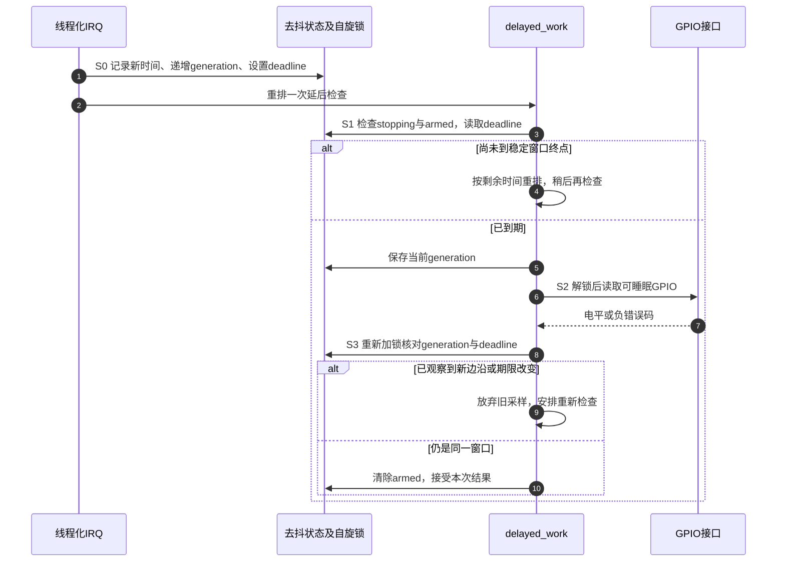
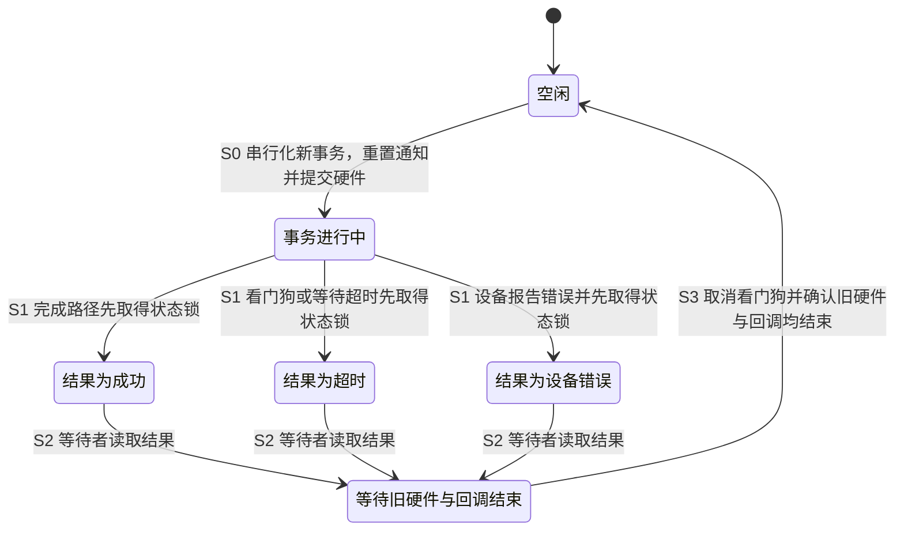
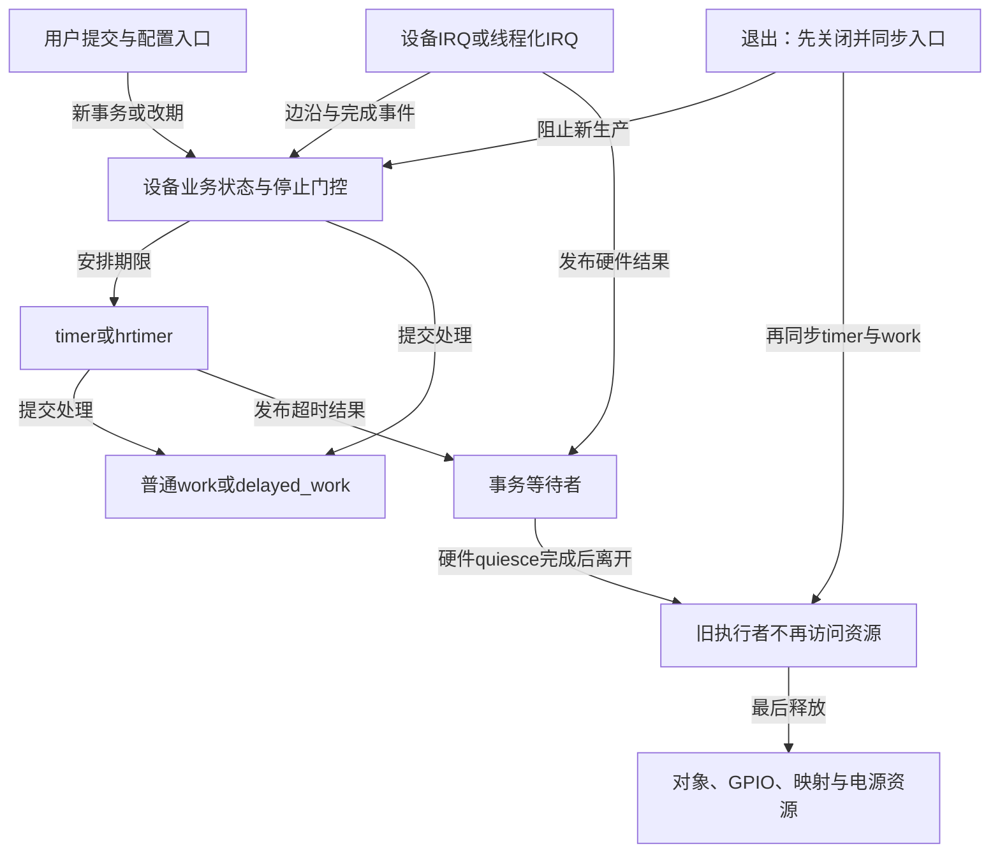

# 第12章\_常用模式与代码模板

前面各章已经建立了定时器、工作队列、等待与电源管理的单独契约。真实驱动却经常同时具有周期维护、按键边沿和有超时的硬件事务。困难不在于把几个初始化函数放进 `probe()`，而在于它们共享对象以后，谁还能产生下一次请求，以及哪一个状态能证明旧活动已经结束。

本章按三种业务推进：允许漏采的周期轮询、最后一个已观察边沿后的稳定窗口、只能终结一次的事务。先确定业务状态，再选择执行机制，最后给出停止与错误回滚。普通定时器的完整独立模块已经在第四章建立，这里保留本地选择依据，并补高精度周期模块、GPIO 去抖驱动和事务协议片段。

接口核对基线是 Linux 6.12.20 的 NXP 固定提交，见[源码身份](../../../../../research/source_reading/linux/SOURCE_BASELINE.md#1.171_时间基础与定时入口边界)与[组合接口核对](../../../../../research/source_reading/linux/SOURCE_BASELINE.md#1.173_时间转换与组合模式的版本核对)，默认普通非实时内核。完整代码说明其适用前提，协议片段明确指出设备必须补齐的部分；它们不是已经在某块板上编译、加载和验证通过的产物。特别是“源码完整”不包含未知的板级接线、绑定和硬件停止协议。

## 12.1\_先确定周期轮询允许丢掉什么

假设设备每 100 ms 查询一次当前状态。如果内核忙到 350 ms 才处理 100 ms 的计划，此时连读三次当前状态也找不回 100、200、300 ms 三个时刻的真实数据。对这种只关心最新状态的轮询，跳过错过的周期通常比连续追赶更有意义；若设备已经保存了每个历史样本，就应读取设备缓冲区，并用样本计数判断积压。

普通 `timer_list` 可以完成低成本的未来检查，其回调不可睡眠。需要访问可睡眠总线时，把检查交给普通 work，或直接采用 delayed_work。不要把 10 ms 当成普遍的机制分界：HZ、负载、允许的迟到和实际设备行为共同决定是否适用。普通 timer 也不会自动成为不打扰空闲 CPU 的可推迟 timer。

第四章的[保持相位示例](P04_基础定时器机制_struct_timer_list.md#4.7_保持计划相位并记录跳过的周期)保存 `next` 与 `period`，用足够多个周期把下一次计划推到未来；[timer 加 work 示例](P04_基础定时器机制_struct_timer_list.md#4.8_需要睡眠时把业务交给工作线程)则选择处理后重新计算下一次间隔。两者都是完整模块，使用前先决定要保持原相位，还是每轮结束后休息一段时间。

真正进入驱动时，还要列出状态所有权：配置周期由初始化线程写、运行期间保持不变；计划点和到期计数由回调写；work 的业务计数由 worker 写；退出线程在各执行者同步结束后读取。若加入动态设置或并发查询，就必须改变这份协议，不能只给字段加一个 `READ_ONCE()` 便宣称完整同步。

## 12.2\_高精度计划也不能把延迟的工作变成实时采样

若 5 ms 周期需要比当前 jiffies 更细的到期安排，可以使用 **高分辨率定时器 hrtimer**。它保存 ktime 到期点；`hrtimer_forward_now()` 以旧到期点为基础，向前推进足够多个周期，使新的到期点越过当前时间。这里的 `now` 是判断推进多少的参考，不是把每轮相位重新设为“现在加周期”。

前移只更新到期值，回调再返回 `HRTIMER_RESTART` 才请求重新排队。若返回 `HRTIMER_NORESTART`，这一轮就不自动继续。外部线程使用前移接口时另有“不得仍排队或运行”的串行化条件，不能把它当成任意时刻可调用的修改接口。

下面保存为 `hrtimer_poll_demo.c`，沿用第四章的外部模块构建方法。模块参数 `period_ms` 只允许装载时设置，权限 `0444` 表示运行后可读而不可写；本例接受 1～5000 ms，默认 5 ms。周期成员初始化后不改变，只有回调是 work 的生产者，便于先闭合生命周期。

初始化中的 `CLOCK_MONOTONIC` 选择单调时钟，`HRTIMER_MODE_REL` 说明启动参数是相对时长；`INIT_WORK()` 则关联工作项和处理函数，不启动业务。这些选择分别处理时钟域、时间角色与执行者，不是一组精度等级。

```c
// SPDX-License-Identifier: GPL-2.0
#include <linux/module.h>
#include <linux/hrtimer.h>
#include <linux/ktime.h>
#include <linux/workqueue.h>
#include <linux/errno.h>

struct poll_state {
    struct hrtimer timer;
    struct work_struct work;
    ktime_t period_kt;
    u64 callbacks;
    u64 skipped;
    u64 jobs;
};

static struct poll_state poll_state;
static unsigned int period_ms = 5;
module_param(period_ms, uint, 0444);

static void poll_work(struct work_struct *work)
{
    struct poll_state *state = container_of(work, struct poll_state, work);

    /* 普通工作线程中处理最新状态；本例只计数，不接入硬件。 */
    state->jobs++;
}

static enum hrtimer_restart poll_timer(struct hrtimer *timer)
{
    struct poll_state *state = container_of(timer, struct poll_state, timer);
    u64 advanced;

    state->callbacks++;
    schedule_work(&state->work);
    advanced = hrtimer_forward_now(timer, state->period_kt);
    if (advanced > 1)
        state->skipped += advanced - 1;
    return HRTIMER_RESTART;
}

static int __init poll_init(void)
{
    if (period_ms < 1 || period_ms > 5000)
        return -ERANGE;

    poll_state.period_kt = ms_to_ktime(period_ms);
    INIT_WORK(&poll_state.work, poll_work);
    hrtimer_init(&poll_state.timer, CLOCK_MONOTONIC, HRTIMER_MODE_REL);
    poll_state.timer.function = poll_timer;
    /* hrtimer_start() 返回 void，不是初始化的成功/失败返回码。 */
    hrtimer_start(&poll_state.timer, poll_state.period_kt, HRTIMER_MODE_REL);
    return 0;
}

static void __exit poll_exit(void)
{
    /* 没有外部启动者：先等定时器结束，再关掉它产生的工作。 */
    hrtimer_cancel(&poll_state.timer);
    cancel_work_sync(&poll_state.work);
    pr_info("hrtimer_poll_demo: callbacks=%llu skipped=%llu jobs=%llu\n",
            (unsigned long long)poll_state.callbacks,
            (unsigned long long)poll_state.skipped,
            (unsigned long long)poll_state.jobs);
}

module_init(poll_init);
module_exit(poll_exit);
MODULE_LICENSE("GPL");
```

这个模块有两处合并：前移可能跳过已经到期的计划，重复 `schedule_work()` 又可能合并到同一个工作项。因而 `jobs`、`callbacks` 和计划周期数不是同一计数。即使 timer 准时，worker 也可能迟到；如果业务要求采样本身按精确时刻发生，应评估硬件采样、设备缓冲或其他实时方案，而不是只提高回调频率。

普通非实时内核上的默认 hrtimer 回调通常在硬中断路径执行，模式与实时配置还会改变执行路径；本例遵守不可睡眠契约，不依赖某一 CPU。`hrtimer_cancel()` 会等待并取消，但没有 `timer_shutdown_sync()` 那种永久禁止重新启动的功能。例子的唯一重启来自正在同步的回调；真实驱动若有用户入口或中断调用 `hrtimer_start()`，必须先把这些入口关闭。

## 12.3\_去抖要记录最后一个边沿而非只记pending

设按键在线程化中断中先后报告了三个边沿，业务要求“最后一个已观察边沿后安静 15 ms，再读取电平”。第一条边沿到来后设置 `pending=true`，后两条因 pending 而被忽略，只能表达“从第一条边沿开始等”，不符合这个需求。即使每次都重排 delayed_work，旧 work 也可能已经开始，不能靠重排撤回它已经执行的代码。

于是需要一份独立的业务记录：`last_edge` 保存最近观察时间，`deadline` 保存当前稳定窗口终点，`generation` 标记事件代数，`armed` 表示仍有窗口待确认。IRQ 更新这组状态，worker 在读取 GPIO 前后核对同一代数。GPIO 访问可能睡眠，不能一直持有自旋锁；读完再检查，才知道读取期间有没有观察到更新的边沿。



这里保证的是 **软件已观察到的事件窗口**。电气边沿可能发生在读取或报告附近，也可能被硬件、中断屏蔽或调度延迟影响；该协议不证明引脚在连续时间上绝无变化。硬件支持并适合时，可以使用硬件去抖；机械按键与近场通信设备的协议也不同，不能把同一延时模板当作所有设备的通用确认机制。

## 12.4\_把状态与可睡眠采样分开

以下是一份平台驱动教学源码的第一部分，接下来的动态配置与探测回收两节接续同一文件 `debounce_demo.c`。它没有输入子系统上报，而是打印接受的电平；真实输入设备需在接受结果的位置接入自己的上报协议。

纳秒转毫秒时，`NSEC_PER_MSEC` 表示一毫秒的纳秒数，`DIV_ROUND_UP_ULL()` 对无符号宽整数作向上取整除法。中断处理返回的 `IRQ_HANDLED` 表示本例接受了这次 IRQ；它不证明引脚已经稳定。

```c
// SPDX-License-Identifier: GPL-2.0
#include <linux/module.h>
#include <linux/platform_device.h>
#include <linux/of.h>
#include <linux/err.h>
#include <linux/errno.h>
#include <linux/kernel.h>
#include <linux/gpio/consumer.h>
#include <linux/interrupt.h>
#include <linux/workqueue.h>
#include <linux/spinlock.h>
#include <linux/ktime.h>
#include <linux/jiffies.h>
#include <linux/math64.h>
#include <linux/slab.h>
#include <linux/sysfs.h>

struct debounce_dev {
    struct device *dev;
    struct gpio_desc *key;
    struct delayed_work work;
    spinlock_t lock;
    int irq;
    u32 debounce_ms;
    ktime_t last_edge;
    ktime_t deadline;
    u64 generation;
    bool armed;
    bool stopping;
};

/* 锁内调用；只是安排稍后复查，真正到期仍由ktime比较决定。 */
static void debounce_requeue(struct debounce_dev *dev, ktime_t remaining)
{
    u64 ms = 0;

    if (ktime_to_ns(remaining) > 0)
        ms = DIV_ROUND_UP_ULL((u64)ktime_to_ns(remaining), NSEC_PER_MSEC);
    mod_delayed_work(system_wq, &dev->work,
                     msecs_to_jiffies((unsigned int)ms));
}

static void debounce_work(struct work_struct *work)
{
    struct debounce_dev *dev = container_of(to_delayed_work(work),
                                             struct debounce_dev, work);
    unsigned long flags;
    ktime_t now;
    u64 generation;
    int value;

    spin_lock_irqsave(&dev->lock, flags);
    if (dev->stopping || !dev->armed) {
        spin_unlock_irqrestore(&dev->lock, flags);
        return;
    }
    now = ktime_get();
    if (ktime_before(now, dev->deadline)) {
        debounce_requeue(dev, ktime_sub(dev->deadline, now));
        spin_unlock_irqrestore(&dev->lock, flags);
        return;
    }
    generation = dev->generation;
    spin_unlock_irqrestore(&dev->lock, flags);

    /* GPIO控制器可能通过可睡眠总线访问，不能持有上面的自旋锁。 */
    value = gpiod_get_value_cansleep(dev->key);

    spin_lock_irqsave(&dev->lock, flags);
    if (dev->stopping) {
        spin_unlock_irqrestore(&dev->lock, flags);
        return;
    }
    now = ktime_get();
    if (generation != dev->generation || ktime_before(now, dev->deadline)) {
        debounce_requeue(dev, ktime_sub(dev->deadline, now));
        spin_unlock_irqrestore(&dev->lock, flags);
        return;
    }
    dev->armed = false;
    spin_unlock_irqrestore(&dev->lock, flags);

    /* 负错误码不能先转成bool，否则会被误报为高电平。 */
    if (value < 0)
        dev_warn(dev->dev, "GPIO read failed: %d\n", value);
    else
        dev_info(dev->dev, "accepted level=%d\n", value);
}

static irqreturn_t debounce_irq_thread(int irq, void *data)
{
    struct debounce_dev *dev = data;
    unsigned long flags;

    spin_lock_irqsave(&dev->lock, flags);
    if (!dev->stopping) {
        dev->last_edge = ktime_get();
        dev->deadline = ktime_add_ms(dev->last_edge, dev->debounce_ms);
        dev->generation++;
        dev->armed = true;
        debounce_requeue(dev, ms_to_ktime(dev->debounce_ms));
    }
    spin_unlock_irqrestore(&dev->lock, flags);
    return IRQ_HANDLED;
}
```

锁同时保护业务字段和“检查许可后提交 work”的操作，所以退出设置 `stopping` 以后，不会出现某条路径早先读到允许、稍后才在取消完成之后重新提交的窗口。delayed_work 的提交接口允许这种原子上下文使用；真正的 GPIO 读取放在锁外。

`remaining` 来自最长 5000 ms 的业务窗口；已经过期时排一个零延迟检查，正数时向上换算到毫秒再换 jiffies。即使粗粒度安排提前进入检查，也会再次比较 ktime，不会因“转换过一次”就接受未结束的窗口。代数使用 64 位，并假设一次读取期间不可能经历完整的 64 位代数回绕。

## 12.5\_动态改窗口必须与读者使用同一把锁

本例把 sysfs 属性命名为 `debounce_ms`，明确接受 1～5000 ms。运行时改值的策略是：没有待确认事件时仅影响下一次边沿；已经存在窗口时，从 **最近边沿** 重新计算终点，而不是从写配置的时刻重新开始。配置变更也递增代数，使正在进行的旧采样作废。

```c
static ssize_t debounce_ms_show(struct device *device,
                                struct device_attribute *attr, char *buf)
{
    struct debounce_dev *dev = dev_get_drvdata(device);
    unsigned long flags;
    u32 value;

    spin_lock_irqsave(&dev->lock, flags);
    value = dev->debounce_ms;
    spin_unlock_irqrestore(&dev->lock, flags);
    return sysfs_emit(buf, "%u\n", value);
}

static ssize_t debounce_ms_store(struct device *device,
                                 struct device_attribute *attr,
                                 const char *buf, size_t count)
{
    struct debounce_dev *dev = dev_get_drvdata(device);
    unsigned long flags;
    unsigned int value;
    int ret = kstrtouint(buf, 10, &value);

    if (ret)
        return ret;
    if (value < 1 || value > 5000)
        return -ERANGE;

    spin_lock_irqsave(&dev->lock, flags);
    if (dev->stopping) {
        spin_unlock_irqrestore(&dev->lock, flags);
        return -ENODEV;
    }
    dev->debounce_ms = value;
    dev->generation++;
    if (dev->armed) {
        dev->deadline = ktime_add_ms(dev->last_edge, value);
        debounce_requeue(dev, ktime_sub(dev->deadline, ktime_get()));
    }
    spin_unlock_irqrestore(&dev->lock, flags);
    return count;
}

static DEVICE_ATTR_RW(debounce_ms);
static struct attribute *debounce_attrs[] = {
    &dev_attr_debounce_ms.attr,
    NULL,
};
static const struct attribute_group debounce_group = {
    .attrs = debounce_attrs,
};
```

`DEVICE_ATTR_RW` 创建读写属性的描述，属性组把它交给 sysfs 注册。这里不将多字段状态拆成互不相关的 `READ_ONCE()`；IRQ、worker 和设置入口都遵守同一个锁。接受电平的日志在锁外打印，可能晚于随后到来的新边沿，但它表示刚才核对通过的那次采样，不承诺打印瞬间引脚仍保持同一值。

## 12.6\_先准备全部状态再开放中断入口

最后接上资源取得与回收。初始化 work、锁和配置必须先于中断注册，因为注册成功后回调就可能发生。`gpiod_to_irq()` 从 GPIO 描述符取得对应 IRQ；示例要求该控制器支持双边沿触发，且此 IRQ 不与其他设备共享。它不适用于需要先清设备状态才能撤销电平请求的中断源。

申请 GPIO 时，`GPIOD_IN` 表示配置为输入；`IS_ERR()` 判断返回的指针是否编码了错误，`PTR_ERR()` 取出原始负错误码。中断标志 `IRQF_TRIGGER_RISING`、`IRQF_TRIGGER_FALLING` 请求双边沿，`IRQF_ONESHOT` 使线程化处理完成以前保持相应中断屏蔽，它不是软件去抖窗口。`GFP_KERNEL` 用于可睡眠探测路径的内存分配；失败时返回 `-ENOMEM`，表示内存不足。

```c
static void debounce_stop(struct debounce_dev *dev)
{
    unsigned long flags;

    spin_lock_irqsave(&dev->lock, flags);
    dev->stopping = true;
    spin_unlock_irqrestore(&dev->lock, flags);

    /* 主动释放已注册IRQ并等回调退出，不等到devres末尾才关闭生产者。 */
    devm_free_irq(dev->dev, dev->irq, dev);
    cancel_delayed_work_sync(&dev->work);
}

static int debounce_probe(struct platform_device *pdev)
{
    struct device *device = &pdev->dev;
    struct debounce_dev *dev;
    u32 value = 15;
    int ret;

    if (!device->of_node)
        return -EINVAL;
    if (of_find_property(device->of_node, "nxp,debounce-ms", NULL)) {
        ret = of_property_read_u32(device->of_node, "nxp,debounce-ms", &value);
        if (ret)
            return ret;
    }
    if (value < 1 || value > 5000)
        return -ERANGE;

    dev = devm_kzalloc(device, sizeof(*dev), GFP_KERNEL);
    if (!dev)
        return -ENOMEM;
    dev->dev = device;
    dev->debounce_ms = value;
    spin_lock_init(&dev->lock);
    INIT_DELAYED_WORK(&dev->work, debounce_work);
    platform_set_drvdata(pdev, dev);

    dev->key = devm_gpiod_get(device, "key", GPIOD_IN);
    if (IS_ERR(dev->key))
        return PTR_ERR(dev->key);
    dev->irq = gpiod_to_irq(dev->key);
    if (dev->irq < 0)
        return dev->irq;
    ret = devm_request_threaded_irq(device, dev->irq, NULL,
                                    debounce_irq_thread,
                                    IRQF_ONESHOT | IRQF_TRIGGER_RISING |
                                    IRQF_TRIGGER_FALLING,
                                    dev_name(device), dev);
    if (ret)
        return ret;

    ret = sysfs_create_group(&device->kobj, &debounce_group);
    if (ret) {
        debounce_stop(dev);
        return ret;
    }
    return 0;
}

static void debounce_remove(struct platform_device *pdev)
{
    struct debounce_dev *dev = platform_get_drvdata(pdev);

    /* 先撤销用户入口并同步在途访问，再关闭IRQ与工作。 */
    sysfs_remove_group(&pdev->dev.kobj, &debounce_group);
    debounce_stop(dev);
}

static const struct of_device_id debounce_match[] = {
    { .compatible = "nxp,imx6ull-led_key_int" },
    { }
};
MODULE_DEVICE_TABLE(of, debounce_match);

static struct platform_driver debounce_driver = {
    .probe = debounce_probe,
    .remove = debounce_remove,
    .driver = {
        .name = "debounce_demo",
        .of_match_table = debounce_match,
    },
};
module_platform_driver(debounce_driver);
MODULE_LICENSE("GPL");
```

固定版本的 platform 驱动 `remove` 返回 `void`；不能把旧版返回 `int` 的模板直接声明为兼容所有 6.x。代码保留 GPIO、IRQ 申请函数的原始负错误码，包含可能要求延后探测的错误，不能统一改成 `-EINVAL` 而丢失原因。

设备树中的 `compatible` 和 `nxp,debounce-ms` 沿用教材自定义绑定，不是官方通用接口；真实节点还需提供经过板级核对的 `key-gpios` 与引脚配置。本章不指定一个未经确认的 GPIO 编号。由于没有寄存器地址属性，节点可叫 `demo_led_key_int`，不凭空添加 `@0`。第三章给出的参数片段负责单位，本节负责将该参数放进完整运行与退出路径。

构建时把前三段接成同一源码，使用 `obj-m += debounce_demo.o`。测试前先验证 GPIO 描述符与 IRQ 映射，再制造边沿，记录 IRQ 观察时间、窗口终点、代数和接受时间。用 sysfs 改值、持续输入与解绑交错检查退出；这些是应执行的目标验证步骤，本轮没有硬件实测记录。

## 12.7\_若用hrtimer等待窗口哪些责任仍然不变

如果 jiffies 安排造成的额外迟到不可接受，可以把“第一轮等待窗口”换成 one-shot hrtimer，再把采样交给同一工作检查。它只改善到期安排，不消除 worker 迟到，也不替代上面的代数与窗口复核。因此一般按键需求优先评估较简单的 delayed_work，只有确有粒度要求才增加一条 timer 生命周期。

下面是替换路径的协议片段，不能与前三段原样拼接。需要在 `debounce_dev` 增加 `struct hrtimer window_timer`，初始化时选择 `CLOCK_MONOTONIC` 和相对模式并设置回调；线程化 IRQ 在锁内更新窗口状态后改为启动它：

```c
/* 片段：window_timer是dev的新增成员，初始化须早于IRQ注册。 */
static enum hrtimer_restart debounce_window(struct hrtimer *timer)
{
    struct debounce_dev *dev = container_of(timer, struct debounce_dev,
                                             window_timer);

    /* 不读取GPIO；旧窗口触发的工作也要经过generation/deadline复核。 */
    mod_delayed_work(system_wq, &dev->work, 0);
    return HRTIMER_NORESTART;
}

/* 在线程化IRQ的状态锁内，使用已经校验并受同一锁保护的配置。 */
ktime_t delay_kt = ms_to_ktime(dev->debounce_ms);
hrtimer_start(&dev->window_timer, delay_kt, HRTIMER_MODE_REL);
```

退出顺序相应增加为：撤销 sysfs，锁内设置 stopping，释放并同步 IRQ，`hrtimer_cancel()`，最后 `cancel_delayed_work_sync()`。不能只取消 hrtimer 再等 devres 自动释放 IRQ，否则 IRQ 可能在取消后又启动 timer；也不能用 `flush_scheduled_work()` 排空全系统工作来代替本设备的生产者管理。动态调参可仍然触发立即 work 复查，新一轮期限由共同状态决定；旧 hrtimer 通知只会导致额外复查，不成为独立的业务真相。

## 12.8\_事务被唤醒以后还必须读取结果

周期和去抖都允许按业务规则合并事件，有超时的事务却需要明确给调用方一个结果。**完成量 completion** 只表达某个执行者发出了完成通知；如果硬件成功和超时回调都调用 `complete()`，等待返回非零只能证明收到了通知，不能证明硬件成功。

因此把事务结果单独保存在 `status`：开始时为 `-EINPROGRESS`，成功路径改成 0，设备错误保存相应负值，超时路径改成 `-ETIMEDOUT`。在同一把状态锁下，只有第一个终结者能改写它并通知等待方。一个事务只有一个等待线程，使用 `complete()` 即可；不需要用 `complete_all()` 永久放行一组并不存在的等待者。



图中还特意保留 S3：等待超时不等于硬件停止。旧事务的中断若在下一次 `reinit_completion()` 后到达，可能错误完成新事务。因此下一次开始前，必须取消旧看门狗、停止或确认旧硬件操作、清除旧事件，并同步旧回调。仅清一个 `inflight` 原子标志无法证明这些都完成了。

### 12.8.1\_先写结果再通知的共同终结点

下面是驱动接入片段，不是独立模块。`start` 和 `quiesce` 是本例要求设备实现的操作指针，**不是 Linux 通用 API**。`start` 提交一个有限时间返回的硬件操作，成功返回 0；非零表示没有遗留活跃事务。`quiesce` 必须在返回前证明旧硬件访问和旧完成回调已结束，并处置尚未消费的旧事件。若设备不能兑现这个保证，就需要设备特定的代数、复位或失效状态，不能复用这份单槽事务结构。

```c
#include <linux/completion.h>
#include <linux/hrtimer.h>
#include <linux/jiffies.h>
#include <linux/ktime.h>
#include <linux/mutex.h>
#include <linux/spinlock.h>
#include <linux/errno.h>

struct transaction {
    struct mutex serial;
    spinlock_t lock;
    struct completion done;
    struct hrtimer watchdog;
    int status;
    unsigned int timeout_ms;
    bool use_watchdog;
    int (*start)(struct transaction *tx);
    void (*quiesce)(struct transaction *tx);
};

static void transaction_finish(struct transaction *tx, int result)
{
    unsigned long flags;

    spin_lock_irqsave(&tx->lock, flags);
    if (tx->status == -EINPROGRESS) {
        tx->status = result;
        /* 通知也在这次状态变更内完成，避免延后通知落入下一事务。 */
        complete(&tx->done);
    }
    spin_unlock_irqrestore(&tx->lock, flags);
}

static enum hrtimer_restart transaction_watchdog(struct hrtimer *timer)
{
    struct transaction *tx = container_of(timer, struct transaction, watchdog);

    transaction_finish(tx, -ETIMEDOUT);
    return HRTIMER_NORESTART;
}

static int transaction_init(struct transaction *tx, unsigned int timeout_ms,
                             bool use_watchdog,
                             int (*start)(struct transaction *),
                             void (*quiesce)(struct transaction *))
{
    if (!start || !quiesce || timeout_ms < 1 || timeout_ms > 600000)
        return -EINVAL;
    mutex_init(&tx->serial);
    spin_lock_init(&tx->lock);
    init_completion(&tx->done);
    hrtimer_init(&tx->watchdog, CLOCK_MONOTONIC, HRTIMER_MODE_REL);
    tx->watchdog.function = transaction_watchdog;
    tx->status = 0;
    tx->timeout_ms = timeout_ms;
    tx->use_watchdog = use_watchdog;
    tx->start = start;
    tx->quiesce = quiesce;
    return 0;
}
```

设备完成路径在完成必要的清源、结果读取后调用 `transaction_finish(tx, 0)`，设备失败则传入具体负错误码；不得传入作为未终结哨兵的 `-EINPROGRESS`。它不在中断中同步取消看门狗，也不持有本例的 serial 互斥锁，因此不会与等待线程形成“持锁等完成、完成又要同一锁”的循环。

### 12.8.2\_等待期限与硬件停止是两件事

接续同一片段，等待线程只允许一个事务占用当前状态槽。可选 hrtimer 用来更细地发出“超时已被观察”的通知；它仍不能保证等待线程在那一刻得到调度，也不能保证硬件被那一刻停止。通常普通 completion 超时已经足够，不应无目的地增加第二个时间源。

```c
static int transaction_run(struct transaction *tx)
{
    unsigned long flags;
    unsigned long waited;
    int result;

    mutex_lock(&tx->serial);
    /* 前一事务已经quiesce；没有旧等待者和旧完成生产者。 */
    reinit_completion(&tx->done);
    spin_lock_irqsave(&tx->lock, flags);
    tx->status = -EINPROGRESS;
    spin_unlock_irqrestore(&tx->lock, flags);

    result = tx->start(tx);
    if (result) {
        transaction_finish(tx, result);
        goto out_unlock;
    }

    /* 本模板期限从提交函数返回后开始；不是总调用时长的硬上界。 */
    if (tx->use_watchdog)
        hrtimer_start(&tx->watchdog, ms_to_ktime(tx->timeout_ms),
                      HRTIMER_MODE_REL);
    waited = wait_for_completion_timeout(&tx->done,
                                         msecs_to_jiffies(tx->timeout_ms));
    if (!waited)
        transaction_finish(tx, -ETIMEDOUT);

    spin_lock_irqsave(&tx->lock, flags);
    result = tx->status;
    spin_unlock_irqrestore(&tx->lock, flags);

    hrtimer_cancel(&tx->watchdog);
    /* 该操作可睡眠，但不能依赖serial锁被别人释放才能结束。 */
    tx->quiesce(tx);

out_unlock:
    mutex_unlock(&tx->serial);
    return result;
}
```

若看门狗先调用 `complete()`，`waited` 可以非零，但 `status` 仍是 `-ETIMEDOUT`，因此不会误报成功。若等待超时与硬件完成恰好竞争，本例以共同状态锁下先终结者为准；要求严格“截止时刻以前到达才算成功”的协议，还要在完成路径核对同域硬件或软件时间戳，不能从等待函数的返回值反推物理事件时间。

`quiesce()` 的耗时以及取得 serial 锁的等待不包含在本例的等待期限中。若产品要求端到端总时限，需要在入口建立同一个绝对期限，并逐阶段传递剩余预算；硬件无法及时停止时，还需保留对象与失效状态，而不是为了返回超时就释放它仍访问的内存。

驱动移除时应先关闭提交入口，等待所有已经取得对象的提交者离开，再销毁事务状态。不能只取消 watchdog 而留下睡眠等待者、DMA 或设备 IRQ。挂起时是等待当前事务、取消还是拒绝挂起，也由设备协议决定，不等价于调用 remove。

## 12.9\_按生产方向倒推退出而非背固定停表顺序

把前面的模块放在同一个设备里以后，先画谁能提交谁。周期 timer 可以提交 work，IRQ 可以重排去抖工作，sysfs 可以修改窗口并重新提交，事务完成与看门狗可以唤醒等待线程。这些是不同的生产方向，退出必须逐条封闭。



因此没有对所有驱动都正确的“先 timer、再 watchdog、再 delayed_work”固定清单。若 worker 会重启普通 timer，最终关闭 timer 可以切断环；若是 hrtimer，则必须由共同的 stopping 协议阻止 worker 重启，然后等待双方。等待某条路径退出时也不能持有那条路径需要的锁。

运行时电源管理同样有状态所有权：worker 若要访问已经关闭时钟或电源域的设备，必须在可睡眠上下文取得运行时使用许可，并在结束后释放；timer 回调只负责通知不能替代这项许可。系统挂起、唤醒配置与最终移除有不同目标，普通 hrtimer 即使使用 BOOTTIME，也不能单凭时钟域变成硬件唤醒源。需要唤醒时继续按第十一章核对 alarmtimer、RTC 与平台实际连接。

`devm_add_action_or_reset()` 可以登记已经设计好的清理函数，不能从对象成员自动推出上面的依赖图。错误回滚也要按“哪些入口已经开放”决定关闭范围：去抖例子在 IRQ 注册失败时不取消从未开放的生产者，在 sysfs 注册失败时则必须同步已经开放的 IRQ 与 work。

## 12.10\_拿可观察的结果检查模板选择

| 需求 | 状态与通知方式 | 接口选择依据 | 完成或退出证据 |
| --- | --- | --- | --- |
| 低粒度周期维护 | 计划点、周期、漏采数 | timer_list；需睡眠则转 work | timer 最终关闭，派生 work 结束，外部入口已关闭 |
| 更细周期计划 | ktime 计划点与前移计数 | hrtimer，另核对运行分辨率与负载 | 生产者封闭后 cancel；不是固定微秒抖动保证 |
| 最后观察边沿后的窗口 | 最近边沿、期限、代数、armed | delayed_work 负责唤起，ktime 复核窗口；需要时增加 one-shot hrtimer | 采样前后代数相同；退出同步 IRQ、timer 与 work |
| 有超时的单事务 | 独立结果槽、completion、硬件活动 | completion timeout；必要时追加细粒度超时通知 | 结果明确且旧硬件、旧完成路径已 quiesce |
| 挂起期间到点唤醒 | 平台唤醒设备与许可 | alarmtimer/RTC 等具体路径 | 核对硬件支持和实际唤醒实验，不能只看 API 名 |

**练习一：** 去抖窗口里又出现一个边沿，为什么不能因为 work 已 pending 就丢弃这个边沿？

**答案：** pending 只说明执行记录已排队，不说明稳定窗口没有变化。必须更新最后边沿、期限与代数；旧 work 若已运行，还要在采样后复核，才能避免把旧窗口的结果当成新窗口稳定结果。

**练习二：** 看门狗调用了 `complete()`，等待返回非零，事务是否成功？

**答案：** 只能证明收到通知。成功或超时由独立结果槽决定；本例看门狗先写 `-ETIMEDOUT` 再通知，所以等待返回非零仍返回超时错误。

**练习三：** `hrtimer_cancel()` 已返回，但 IRQ 仍注册，能否释放设备？

**答案：** 不能。IRQ 可能随后重新启动 hrtimer，也可能直接访问对象。必须封闭并同步该入口；即便普通 timer 已最终关闭，外部执行者对释放后地址的访问也不会因此合法。

目标验证应覆盖正常事件、连续边沿、动态调参、申请失败回滚和卸载交错。日志、跟踪和状态断言分别提供不同证据；没有告警不代表所有交错已覆盖。下一章从这些具体状态出发，定位究竟是时间单位、到期安排、执行迟到还是退出协议出了问题。

上一篇：[P11 电源管理 系统挂起与定时唤醒](P11_电源管理_系统挂起与定时唤醒.md)。
下一篇：[P13 调试 验证与常见陷阱](P13_调试_验证与常见陷阱.md)。
