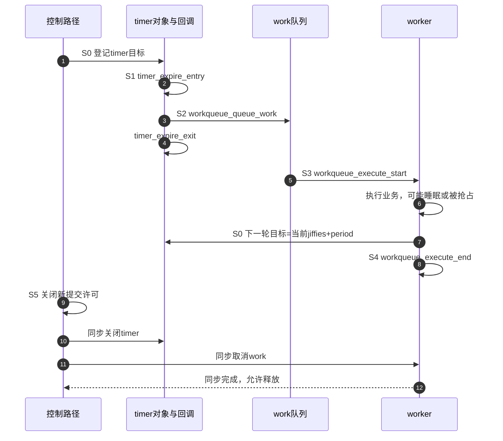
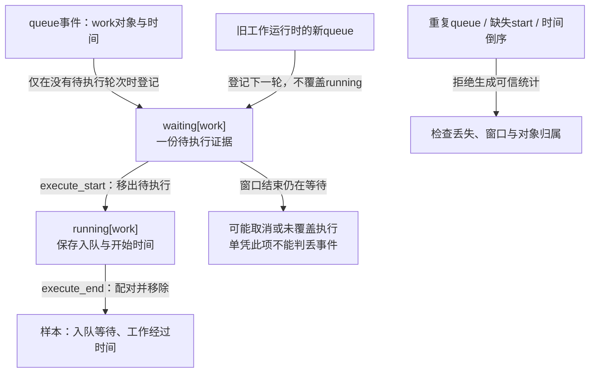

# 第13章\_调试\_验证与常见陷阱

前面的实验已经能登记定时对象、处理到期、把业务移交给工作，并在退出时关闭生产者。现在遇到一个很具体的问题：设置了 100 ms 周期，却在日志里看到相邻工作相隔 106 ms。究竟是定时器迟到、工作等待调度、业务本身花了时间，还是我们本来就从工作结束时重新计时？仅看两行日志，四种解释都说得通。

本章沿第十章的 `timer_lifetime_demo` 实验追一轮 timer→work→timer，再追它的退出。先建立每个观察点能证明的动作，再采集和配对。主实验不访问硬件，也不进入系统睡眠；第十一章的真实唤醒路径在时钟边界已经明确后另行验证。最后应能把“晚了”“没执行”“退出后还有记录”改写成有对象、有时间段、有证明边界的问题。

## 13.1\_把一个周期拆开\_先决定想测哪段时间

第十章的工作函数先睡眠一小段模拟业务，结束时再按 `jiffies + period` 启动下一轮。因此，相邻工作开始时间本来就包含业务耗时与下一轮等待，不能拿这个总间隔直接判定 timer 误差。我们给一次观察编号：S0 登记 timer，S1 进入到期回调，S2 work 真正入队，S3 worker 开始，S4 worker 返回，S5 关闭许可并同步清理。

这些是本章的 **观测阶段**，不是额外加入内核的状态枚举。计时对象的 pending/running 与驱动的 LIVE/DEAD 仍采用第十章的定义。`tracepoint` 是源码预置的事件记录点；`tracefs` 是控制和读取内核跟踪的虚拟文件系统；`ftrace` 是这套内核跟踪设施中的函数及事件观察能力。它们记录的是执行到某个点，不会替我们判定整项业务已经完成。



图示一条正常次序；不同 CPU 上 worker 也可能在 timer 回调返回前开始，不能把图中的上下排列额外当作跨 CPU 串行保证。第 2～4 步的区间是 timer 回调经过时间；第 3～5 步是 work 入队到开始；第 5～8 步是工作经过时间。后两者不能混为“定时精度”。第 7 步发生在本轮工作返回前，说明下一轮登记与本轮执行结束可交错；配对程序须分别保存“待执行的一轮”和“正在执行的一轮”。

一次日志中的时间戳也有两种来源：trace 行前缀来自选定的 **跟踪时钟**，事件载荷中的 `expires`、`now` 则来自该机制自身。普通 timer 的字段是 jiffies，hrtimer 字段常是其时间基准下的纳秒。不能因为都叫“时间”就直接相减。

## 13.2\_事件名称与字段决定我们实际看见了什么

先看运行内核导出的事件，而不是照抄一串工具开关。基线的普通 timer 与 hrtimer 都属于 `timer` 组；硬中断与 softirq 事件都属于 `irq` 组。下面的表用于选择观察点，不把它当作每次都必须全部启用的清单。

| 路径，均相对 `events/` | 主要身份或时间字段 | 能证明什么；仍缺什么 |
| --- | --- | --- |
| `timer/timer_start` | `timer`、`function`、`expires`、`bucket_expiry`、`now` | 对象被登记；请求到期和时间轮桶到期须区分 |
| `timer/timer_expire_entry` / `timer_expire_exit` | entry 有对象、函数、jiffies；exit 只有对象 | 当前回调进入/返回；不是外设事件发生时刻 |
| `timer/timer_cancel` | `timer` | 有一次摘除记录；不能单凭它证明同步等待返回 |
| `timer/hrtimer_init` / `hrtimer_start` | 对象、时间域/模式或函数、软/硬到期值 | 建立目标和模式；回调内部重启不保证每轮都有独立 start 事件 |
| `timer/hrtimer_expire_entry` / `hrtimer_expire_exit` | 对象，entry 的函数与基准 `now` | 软件回调边界；不是 RTC 引脚电平出现时间 |
| `workqueue/workqueue_queue_work` | `work`、`function`、队列名、请求/实际 CPU | work 被放入工作队列；delayed_work 的非零延迟已经经过 |
| `workqueue/workqueue_activate_work` | `work`、`function` | 工作从并发额度限制中进入活跃队列；还没开始执行 |
| `workqueue/workqueue_execute_start/end` | `work`、`function` | 工作体的进入/返回；经过时间含睡眠和抢占 |
| `irq/irq_handler_entry/exit`、`irq/softirq_raise/entry/exit` | IRQ 或 softirq 类别等 | 相关上下文；softirq raise 可能合并，不是一条请求必配一次执行 |

尤其注意 delayed_work：`schedule_delayed_work(..., 100 ms)` 时先登记的是内部 timer。`workqueue_queue_work` 通常在这 100 ms 到期、timer 回调把它移交以后才出现；从 queue 到 execute 只测后半段。零延迟提交没有这段 timer 等待。已有 pending 工作被合并时，也不能用一次接口调用推断必有一次新 queue 事件。

事件需要目标内核启用 `CONFIG_TRACING` / `CONFIG_EVENT_TRACING` 等跟踪支持；函数图还需要 `CONFIG_FUNCTION_TRACER` 与 `CONFIG_FUNCTION_GRAPH_TRACER`。这些是内核构建配置项，用户态安装 trace-cmd 不能替它们补出记录点。先在目标 Linux 上检查挂载和实际格式：

```sh
# 目标板，tracefs 未挂载时才挂载；需要管理员权限
mountpoint -q /sys/kernel/tracing || sudo mount -t tracefs tracefs /sys/kernel/tracing
cat /sys/kernel/tracing/events/timer/timer_start/format
cat /sys/kernel/tracing/events/workqueue/workqueue_queue_work/format
cat /sys/kernel/tracing/trace_clock
```

`format` 给出真实字段名称、宽度和打印方式；例如 `work` 字段打印时可能写成 `work struct=...`，它仍是对象身份。括号中的当前 trace clock 必须记录。默认 `local` 在某些平台不保证跨 CPU 同步，跨 CPU 配对不应默默使用它。本章要求可用的 `mono` 时钟；不包含睡眠时间的 MONOTONIC 适合当前不挂起的实验。

> 固定版本依据：[timer.h](https://github.com/nxp-imx/linux-imx/blob/dfaf2136deb2af2e60b994421281ba42f1c087e0/include/trace/events/timer.h)、[workqueue.h](https://github.com/nxp-imx/linux-imx/blob/dfaf2136deb2af2e60b994421281ba42f1c087e0/include/trace/events/workqueue.h)、[irq.h](https://github.com/nxp-imx/linux-imx/blob/dfaf2136deb2af2e60b994421281ba42f1c087e0/include/trace/events/irq.h)；本次源文件身份见[基线记录](../../../../../research/source_reading/linux/SOURCE_BASELINE.md#1.181_定时对象的事件观测与配对边界)。

## 13.3\_在独立实例中采集一次完整装载与退出

现在选定第十章已经建立的无硬件模块。把它编译成 `timer_lifetime_demo.ko`，保存下面完整脚本为 `capture_timer.sh`。脚本只接受这份模块，要求它尚未装载，且实验期间没有其他管理者同时装卸它；它会装载、观察两秒、卸载，并在自己的 trace 实例中标注操作边界。**实例（instance）** 是独立缓冲区与事件设置的容器，避免为一次实验清空别人正在使用的全局 trace。

采集控制本身也可能失败，所以脚本在中断或错误时关闭自己的记录并卸载自己装载的模块；只删除此次创建的虚拟实例，原始结果保存到当前目录中新建的结果目录。它不会把 `trace_pipe` 当普通文件复制，因为那是会消费记录的流式接口；这里停止记录后读静态 `trace`。`mktemp` 把末尾六个 `X` 替换成唯一目录名，`$PWD` 是当前目录；`trap` 在正常退出以及 HUP、INT、TERM 信号触发的退出时收尾。`/proc/kallsyms` 提供内核符号地址，本例在卸载前保存本模块映射，以便卸载后仍识别记录里的函数地址。

```sh
#!/bin/sh
set -eu
[ "$(id -u)" -eq 0 ] || { echo "请用root运行" >&2; exit 1; }
[ "$#" -eq 1 ] || { echo "用法: $0 ./timer_lifetime_demo.ko" >&2; exit 2; }
ko=$(readlink -f "$1")
[ -f "$ko" ] || exit 2
[ "$(modinfo -F name "$ko")" = timer_lifetime_demo ] || { echo "不是指定实验模块" >&2; exit 2; }
[ ! -d /sys/module/timer_lifetime_demo ] || { echo "模块已装载，先确认所有者" >&2; exit 1; }
root=/sys/kernel/tracing
[ -d "$root/events" ] && [ -d "$root/instances" ] || exit 1
out=$(mktemp -d "$PWD/timer-trace.XXXXXX")
inst="$root/instances/timer_lab_$$"
mkdir "$inst"
owned=0
cleanup() {
    result=$?
    trap - EXIT HUP INT TERM
    printf '0\n' > "$inst/tracing_on" 2>/dev/null || :
    # 错误出口也保留已有记录，不把复现证据随实例删除。
    if [ ! -f "$out/trace.txt" ]; then cat "$inst/trace" > "$out/trace.txt" 2>/dev/null || :; fi
    if [ "$owned" -eq 1 ] && [ -d /sys/module/timer_lifetime_demo ]; then
        if ! rmmod timer_lifetime_demo; then
            echo "卸载失败，模块仍需检查" >&2
            result=1
        fi
    fi
    rmdir "$inst" 2>/dev/null || echo "实例未能删除: $inst" >&2
    exit "$result"
}
trap cleanup EXIT
trap 'exit 130' HUP INT TERM
printf '0\n' > "$inst/tracing_on"
printf 'nop\n' > "$inst/current_tracer"
grep -qw mono "$inst/trace_clock" || { echo "缺少mono跟踪时钟" >&2; exit 1; }
printf 'mono\n' > "$inst/trace_clock"
printf '256\n' > "$inst/buffer_size_kb"
for event in timer/timer_start timer/timer_expire_entry timer/timer_expire_exit
do
    test -f "$inst/events/$event/enable"
    printf '1\n' > "$inst/events/$event/enable"
    cat "$inst/events/$event/format" > "$out/$(echo "$event" | tr / _).format"
done
for event in workqueue_queue_work workqueue_execute_start workqueue_execute_end
do
    test -f "$inst/events/workqueue/$event/enable"
    printf '1\n' > "$inst/events/workqueue/$event/enable"
    cat "$inst/events/workqueue/$event/format" > "$out/$event.format"
done
uname -a > "$out/kernel.txt"
cat "$inst/trace_clock" > "$out/clock.txt"
: > "$inst/trace"
printf '1\n' > "$inst/tracing_on"
printf 'before_load\n' > "$inst/trace_marker"
owned=1
insmod "$ko" period_ms=100
awk '$4 == "[timer_lifetime_demo]" {print $1, $3}' /proc/kallsyms > "$out/symbols.txt"
sleep 2
printf 'before_remove\n' > "$inst/trace_marker"
rmmod timer_lifetime_demo
owned=0
printf 'after_remove\n' > "$inst/trace_marker"
sleep 0.1
printf '0\n' > "$inst/tracing_on"
cat "$inst/trace" > "$out/trace.txt"
for stats in "$inst"/per_cpu/cpu*/stats; do
    echo "$stats"
    cat "$stats"
done > "$out/buffer_stats.txt"
echo "采集完成: $out"
```

执行 `sudo sh ./capture_timer.sh ./timer_lifetime_demo.ko`。`before_remove` 是开始卸载前的用户态标记，`after_remove` 是卸载系统调用返回后的标记，均不是驱动内部准确的 `phase=DEAD` 写入点。要研究门控临界点，必须进一步观察内部函数或加入业务事件。

先读 `buffer_stats.txt`：`overrun` 表示覆盖丢失，`dropped events` 表示非覆盖模式等情形下丢弃，`commit overrun` 也应检查。出现丢失时先缩短窗口、减少事件或调整每 CPU 缓冲区，再采集；256 KB 是每 CPU 大小，不是整机总大小。脚本只隔离控制与存储，跟踪动作仍会增加系统开销。

## 13.4\_从对象和轮次配对\_不能拿相邻两行相减

采集文件里还会有系统其他 timer/work。先用 `cycle_timer`、`cycle_work` 找到本实验，再沿 `timer` 或 `work` 指针追同一对象；退出后地址可能被重用，所以对象地址还须绑定本次装载的生命周期。同名函数可能服务多个对象，线程名或 CPU 号则会随执行环境变化，都不能独自当作请求编号。事件保存的是函数地址，打印时才解析符号：模块已卸载时可能只显示十六进制地址，须与脚本保存的 `symbols.txt` 对照。若安全配置隐藏地址，不能靠全零映射配对，应调整采集方式，在模块仍在时保存可解析的文本。

以下是 **教学构造记录**，只演示读法，不是板上实测：

```text
ksoftirqd/0-9 [000] .... 10.100000: workqueue_queue_work: work struct=abc function=cycle_work workqueue=events req_cpu=0 cpu=0
kworker/0:0-20 [000] .... 10.100400: workqueue_execute_start: work struct abc: function cycle_work
kworker/0:0-20 [000] .... 10.101900: workqueue_execute_end: work struct abc: function cycle_work
```

这一轮入队到开始为 0.4 ms，工作经过时间为 1.5 ms。后者包含工作中的 `msleep()` 以及可能的抢占，不等于占用 CPU 的 1.5 ms；还没有 timer 的目标和到期证据，所以不能据此计算 timer 迟到。

为了避免手工对错，下一节给出只分析本实验 `cycle_work` 的完整程序。它把 `waiting[work]` 与 `running[work]` 分开：开始时从 waiting 移到 running，结束时生成一条样本。在运行中出现下一轮入队，仍保留旧 running；不能让一个“最近时间”变量把它覆盖。



## 13.5\_用完整小工具计算等待时间\_同时拒绝不完整证据

把下面完整C++17程序保存为 `trace_pairs.cpp`。它只读取已保存的文本，不控制跟踪开关，也不装卸模块。选择C++是为了直接用标准库的map分别保存waiting/running，用vector保存样本，用regex识别本章已经核对的事件字段；这些容器属于分析程序，不是内核workqueue的数据结构。

时间先按小数点拆为整数秒与小数部分，补足九位后用64位无符号整数统一为纳秒；超过九位或超出整数范围就拒绝，避免悄悄截断。纳秒只是计算单位，不能凭此声称文本具有纳秒采样精度。对象地址也转成整数键，使abc与0x0abc指向同一记录；全零或无法识别的对象地址会被拒绝，不能把被隐藏的多个对象拼成一个。数值相同仍不能区别地址重用前后的对象寿命。

```cpp
#include <algorithm>
#include <cstdint>
#include <fstream>
#include <iomanip>
#include <iostream>
#include <limits>
#include <map>
#include <regex>
#include <set>
#include <sstream>
#include <stdexcept>
#include <string>
#include <vector>

using tick = std::uint64_t;
struct running_work { tick queued, started; };
struct sample { tick object, wait, elapsed; };
struct trace_result { std::vector<sample> samples; std::size_t pending; };

static tick integer(const std::string &text, int base)
{
    std::size_t used = 0;
    auto value = std::stoull(text, &used, base);
    if (used != text.size() || value > std::numeric_limits<tick>::max())
        throw std::runtime_error("integer outside supported range");
    return static_cast<tick>(value);
}

static tick nanoseconds(const std::string &stamp)
{
    auto dot = stamp.find('.');
    std::string fraction = stamp.substr(dot + 1);
    if (fraction.size() > 9)
        throw std::runtime_error("more than nine fractional digits");
    fraction.append(9 - fraction.size(), '0');
    tick seconds = integer(stamp.substr(0, dot), 10);
    tick remainder = integer(fraction, 10);
    if (seconds > (std::numeric_limits<tick>::max() - remainder) / 1000000000ULL)
        throw std::runtime_error("timestamp overflow");
    return seconds * 1000000000ULL + remainder;
}

static trace_result parse_work(std::istream &input, const std::set<tick> &addresses)
{
    const std::regex marker(R"(:\s+tracing_mark_write:\s+after_remove\s*$)");
    const std::regex event_re(R"(\s(\d+\.\d+):\s+(workqueue_\w+):\s+(.*))");
    const std::regex function_re(R"(function[= ]+([^\s+]+))");
    const std::regex hex_re(R"((?:0x)?[0-9a-fA-F]+)");
    const std::regex object_re(R"(work struct[= ]+((?:0x)?[0-9a-fA-F]+)(?=[:\s]|$))");
    std::map<tick, tick> waiting;
    std::map<tick, running_work> running;
    trace_result result;
    bool removed = false;
    std::string line;
    std::size_t line_no = 0;
    while (std::getline(input, line)) {
        ++line_no;
        auto reject = [line_no](const char *why) {
            throw std::runtime_error("line " + std::to_string(line_no) + ": " + why);
        };
        if (std::regex_search(line, marker)) removed = true;
        std::smatch event, function, object;
        if (!std::regex_search(line, event, event_re)) continue;
        std::string fields = event[3], kind = event[2];
        if (!std::regex_search(fields, function, function_re)) continue;
        std::string name = function[1];
        bool target = name == "cycle_work";
        if (!target && std::regex_match(name, hex_re))
            target = addresses.count(integer(name, 16)) != 0;
        if (!target) continue;
        if (kind != "workqueue_queue_work" && kind != "workqueue_execute_start" &&
            kind != "workqueue_execute_end") continue;
        if (!std::regex_search(fields, object, object_re)) reject("unrecognized work object");
        if (removed) reject("target event after remove returned");
        tick key = integer(object[1], 16), now = nanoseconds(event[1]);
        if (key == 0) reject("hidden or null work address");
        if (kind == "workqueue_queue_work") {
            if (waiting.count(key)) reject("duplicate waiting record");
            waiting.emplace(key, now);
        } else if (kind == "workqueue_execute_start") {
            auto found = waiting.find(key);
            if (found == waiting.end() || running.count(key)) reject("missing queue or overlapping execution");
            if (now < found->second) reject("start before queue");
            running.emplace(key, running_work{found->second, now});
            waiting.erase(found);
        } else {
            auto found = running.find(key);
            if (found == running.end()) reject("end without start");
            const auto &cycle = found->second;
            if (now < cycle.started) reject("end before start");
            result.samples.push_back({key, cycle.started - cycle.queued, now - cycle.started});
            running.erase(found);
        }
    }
    if (input.bad()) throw std::runtime_error("trace read failed");
    if (!running.empty()) throw std::runtime_error("unfinished running records");
    if (result.samples.empty()) throw std::runtime_error("no complete sample");
    result.pending = waiting.size();
    return result;
}

static tick percentile(const std::vector<tick> &sorted, unsigned percent)
{
    /* 最近秩ceil(N*p/100)，先拆商余数避免N*p溢出。 */
    std::size_t n = sorted.size();
    std::size_t rank = (n / 100) * percent + ((n % 100) * percent + 99) / 100;
    return sorted.at(rank - 1);
}

int main(int argc, char **argv)
{
    try {
        if (argc != 2 && argc != 3)
            throw std::runtime_error("usage: trace_pairs TRACE [SYMBOLS]");
        std::set<tick> addresses;
        if (argc == 3) {
            std::ifstream symbols(argv[2]);
            if (!symbols) throw std::runtime_error("cannot open symbols");
            std::string line, address, name, extra;
            const std::regex hex_re(R"((?:0x)?[0-9a-fA-F]+)");
            while (std::getline(symbols, line)) {
                std::istringstream fields(line);
                if (fields >> address >> name && name == "cycle_work" && !(fields >> extra)) {
                    if (!std::regex_match(address, hex_re)) throw std::runtime_error("invalid symbol address");
                    addresses.insert(integer(address, 16));
                }
            }
            if (symbols.bad() || addresses.size() != 1 || addresses.count(0))
                throw std::runtime_error("missing, hidden or ambiguous target symbol");
        }
        std::ifstream input(argv[1]);
        if (!input) throw std::runtime_error("cannot open trace");
        trace_result result = parse_work(input, addresses);
        std::cout << "work,queue_wait_ns,work_elapsed_ns\n";
        std::vector<tick> waits, elapsed;
        for (const auto &row : result.samples) {
            std::cout << std::hex << row.object << std::dec << ',' << row.wait << ',' << row.elapsed << '\n';
            waits.push_back(row.wait);
            elapsed.push_back(row.elapsed);
        }
        auto report = [](const char *name, std::vector<tick> values) {
            std::sort(values.begin(), values.end());
            std::cerr << name << ": N=" << values.size() << " min=" << values.front()
                      << " P95=" << percentile(values, 95) << " P99=" << percentile(values, 99)
                      << " max=" << values.back() << " ns\n";
        };
        report("queue_wait", waits);
        report("work_elapsed", elapsed);
        std::cerr << "unexecuted queue records=" << result.pending
                  << "; may be cancelled or outside capture window\n";
        std::cout.flush();
        if (!std::cout) throw std::runtime_error("output failed");
        return 0;
    } catch (const std::exception &error) {
        std::cerr << error.what() << '\n';
        return 1;
    }
}
```

在保存源文件的目录编译：

```sh
c++ -std=c++17 -O2 -Wall -Wextra -Werror trace_pairs.cpp -o trace_pairs
```

命令使用C++标准库生成本地分析工具。将结果目录替换成上一节脚本打印的目录，再运行：

```sh
./trace_pairs 结果目录/trace.txt 结果目录/symbols.txt > work_latency.csv
```

标准输出保存每轮数据，终端保留统计与未执行入队记录提示；文件打不开、配对矛盾、时间非法或写输出失败都会返回非零状态。程序用异常把错误送到main统一报告，文件流对象离开作用域时自动关闭，不需要手工维护每条错误路径的关闭列表。

上面的构造记录已经直接写出函数名，练习时把三行保存为 `trace_sample.txt`，执行 `./trace_pairs trace_sample.txt`即可，不需要符号文件。预期CSV数据行为 `abc,400000,1500000`；P95/P99分别按最近秩取排序样本中的95%/99%位置，单样本时都等于该样本。只有几十轮时它们也很可能靠近最大值，不能包装成稳定的产品尾延迟。

试着复制一行queue并放在start之前，程序应拒绝同一对象重复待执行；把第二轮queue放到第一轮start之后，再补齐两轮的end/start/end，则旧running与新waiting应同时存在并各自形成样本。最后将 `after_remove`标记放在目标事件之前，工具必须拒绝这段记录。每次修改只改变一个条件，才能知道是哪项配对前提被破坏。

此工具依赖本章完整窗口、单次模块生命周期、已核对的打印格式，以及没有同名其他示例同时运行。**先检查缓冲区丢失，再使用输出。** 程序能发现部分断裂，却不能证明恰好整轮丢失的记录不存在；它也没有解析驱动所有门控、取消和业务请求 ID。需要泛化到多队列、多对象重用或并发业务时，应使用带请求编号的自有事件扩展模型，不能只把函数名换成通配符。

## 13.6\_事件指出慢在哪一段\_函数图再解释这段里做了什么

若 work 经过时间显著增加，事件只告诉我们它迟迟没有返回。**函数图跟踪器（function graph tracer）** 可以显示入口、子调用与返回，用来定位锁等待、睡眠或额外计算。它会增加观察开销，因此另开一次短采集，不与第一轮轻量事件记录混作同一基准。

先装载第十章模块，再确认函数可跟踪。`set_graph_function` 选择调用图的根；`set_ftrace_filter` 则限制可记录的函数集合，二者职责不同。如果只用后者保留两个回调，可能恰好隐藏正在寻找的子调用。

```sh
# root终端；timer_lifetime_demo已经由你装载，本段不负责卸载它
root=/sys/kernel/tracing
cat "$root/available_tracers"
grep -E '^cycle_(timer|work)([[:space:]]|$)' "$root/available_filter_functions"
```

必须确认输出含 `function_graph` 和本模块的目标符号；函数被内联、禁止跟踪或配置未启用时，不能杜撰符号继续。下面用一个子 shell 做独立采集，保留结果后删除自己的实例：

```sh
# 同一root终端；出错也关闭并删除本次实例
(
    set -eu
    inst="$root/instances/timer_graph_$$"
    mkdir "$inst"
    trap 'printf "0\n" > "$inst/tracing_on"; rmdir "$inst"' EXIT
    printf '0\n' > "$inst/tracing_on"
    printf 'function_graph\n' > "$inst/current_tracer"
    cat "$inst/trace_options" > timer_graph_options.txt
    printf 'cycle_work\n' > "$inst/set_graph_function"
    printf '1\n' > "$inst/tracing_on"
    sleep 1
    printf '0\n' > "$inst/tracing_on"
    cat "$inst/trace" > timer_function_graph.txt
    cat "$inst"/per_cpu/cpu*/stats > timer_graph_buffer_stats.txt
)
```

图中的经过时间是否扣除调度离开，还受 `sleep-time` 等选项影响，应一并记录实际 `trace_options`。函数图看见睡眠调用不一定是错：worker 本来可以睡眠；同样的调用出现在不可睡的 timer 回调才违反上下文要求。hrtimer 的执行方式须结合初始化模式、内核配置与上下文事件判断，不能把函数名字等同于“所有版本都在硬中断”。

## 13.7\_需要更长记录时\_用工具保存格式和CPU时间线

短记录可以静态读取，长记录则更适合 **trace-cmd**：它持续从内核缓冲区取数据并连同事件格式保存为二进制文件。**KernelShark** 是读取这类记录的时间线工具，便于按 CPU、任务和事件查看；图形界面不会替代对象与轮次关联。

先运行 `trace-cmd list -e` 核对事件、`trace-cmd list -C` 核对时钟，并用本机 `trace-cmd record -h` 确认支持独立 buffer 的 `-B`。在自己的测试会话中使用唯一实例名，`-B` 放在对应事件选项之前：

```sh
# root终端；本例观察已在运行的模块，采集起点可能切断第一轮
name=timer_record_$$
test ! -d "/sys/kernel/tracing/instances/$name" || exit 1
trace-cmd record -B "$name" -C mono -o timer_trace.dat \
    -e timer:timer_start -e timer:timer_expire_entry -e timer:timer_expire_exit \
    -e workqueue:workqueue_queue_work \
    -e workqueue:workqueue_execute_start -e workqueue:workqueue_execute_end \
    sleep 5
trace-cmd report -i timer_trace.dat > timer_trace_report.txt
```

不要使用忽略未知事件的选项掩盖拼错的组名。也不要只按启动脚本的 PID 过滤：timer 回调和 worker 往往由别的执行者运行，过滤掉它们后会制造假的“没有执行”。这个窗口不是 13.3 的完整装载窗口，边界轮次须标为不完整；不能未经裁剪与解释就拿严格配对工具的报错当驱动错误。

在已安装 KernelShark 的分析机执行 `kernelshark timer_trace.dat`，选中同一对象的 queue/start/end 检查排队间隔与执行 CPU。若需进一步判断可运行任务何时获调度，增加实际存在的 `sched:sched_wakeup`、`sched:sched_switch`，或使用 `perf sched` 做专门调度分析。**eBPF** 是可在内核事件处执行受验证程序的扩展机制，适合在线聚合直方图；`bpftool prog load` 单条命令并不会凭空生成延迟分析程序，仍需明确事件、映射表、对象键、配对和丢失统计。

> 工具选项依据：[trace-cmd record 官方手册](https://www.trace-cmd.org/Documentation/trace-cmd/trace-cmd-record.1.html) 的 `-B`、`-e`、`-C`、`-o` 和过滤说明。用户态工具版本可能不同，以目标环境帮助为准；本章没有把下载或安装工具当作完成测量。

## 13.8\_退出后的记录\_应与同步完成边界比较

假设卸载刚开始时 work 正在睡眠：退出路径设置 DEAD，随后等待它醒来、访问仍保留的内存、发现 DEAD 并返回。这些记录出现在 `before_remove` 之后是正常的。真正需要禁止的是对象同步清理并释放以后再次执行，不是控制函数一进入就再也不能出现旧回调。

| 已取得证据 | 可以怎样判断 | 还需核对 |
| --- | --- | --- |
| `before_remove` 后有旧 work end | 在途工作可能正在被同步等待 | 工作结束是否早于相应清理返回和资源释放 |
| `timer_cancel` 后又有 timer start | 可能是仍有生产者，也可能是合法重新配置或别的生命周期 | 同对象、同一退出、是否已关闭许可；cancel事件不是sync返回 |
| `after_remove` 后仍有本模块事件 | 本实验应视为异常线索 | 是否符号/地址混同、时钟排序或错误采集；确认后查回调生命期 |
| 没看到任何越界记录 | 此次窗口未观测到 | 丢记录、未覆盖竞争窗口、错误过滤都可漏报 |

修复回到第十章的依赖：关闭用户/IRQ/自重排等生产许可，按真实依赖同步回调和工作，再释放资源。普通 timer 最终销毁可用 `timer_shutdown_sync()` 断开重排；可恢复暂停和 hrtimer 则要由驱动共同门控。共享 IRQ 不能为单个设备无差别关闭整条线，最终退出也不能在末尾重新 enable。固定“timer、hrtimer、delayed_work 各 cancel 一遍”的列表无法证明循环已被切断。

检查器能增加证据，但各看不同问题。**内核地址消毒器（Kernel Address Sanitizer，KASAN）** 可发现已覆盖访问中的越界或释放后访问；**Kmemleak** 寻找疑似不再被引用的分配，偏向泄漏，不是 KASAN 的 UAF 替代品。UAF 是 use-after-free，即释放后访问。`CONFIG_DEBUG_OBJECTS_TIMERS`、`CONFIG_DEBUG_OBJECTS_WORK` 在启用对象调试时跟踪对象操作和生命周期；它们的影子状态也不是驱动的业务状态。

KASAN 支持取决于架构和配置，不能要求每块 ARM32 板都具备相同模式。只有相关检查启用、仍有效、目标路径确实被执行且报告没有丢失时，“未告警”才是有限证据。具体 UAF 对照可接[已有 KASAN 实验](../../../object_lifetime/kref/P37_KASAN释放后访问实验.md)，不能为获取一个漂亮告警而把错误清理代码留在实际驱动。

## 13.9\_把时钟变化\_补跑与执行排队分开调查

退出正确后再处理时间误差。首先写出业务需要的是活动时间、包含睡眠的经过时间，还是日历时刻；它决定选 MONOTONIC、BOOTTIME 还是 REALTIME，不能把所有相对任务一律换 BOOTTIME。系统 REALTIME 的校正与 RTC 寄存器同步是两件事，详见第十一章；一次 `date -s` 不能直接证明 RTC 闹钟的实现，更不适合当作所有实验开头的默认操作。

clocksource 是第二章建立的读时来源，clockevent 是产生计时事件的装置。出现异常时先保存平台当前选择、内核告警与目标时间域，才能判断是时间读取失稳还是执行迟到：

```sh
# 目标板只读观察；文件是否存在由平台决定
cat /sys/devices/system/clocksource/clocksource0/current_clocksource
cat /sys/devices/system/clocksource/clocksource0/available_clocksource
dmesg | grep -Ei 'clocksource|timekeeping|watchdog'
```

不要因为日志含 watchdog 就认定 clocksource 坏了，也不要未确认平台约束就强制切换时间源。`sched_clock` 和 trace clock 也有自己的用途；不同时间来源的数值必须先确认可比较。

“醒后工作密集”同样有多种原因：多个对象集中到期、业务积压、驱动明确补跑历史、周期太短，或旧目标只加一次 period 后仍在过去。先按对象和轮次过滤，再看目标推进。**`now + period` 导致的是相位随处理时间漂移；它本身不会补跑历史。** 保留相位而跳过错过的拍点，应使用第十一章严格晚于 now 的计算，并明确数据是否允许丢样。

普通 timer 的精度还包含 jiffies 量化和时间轮桶对齐。可推迟定时器的属性、到期中断与 softirq 执行延迟都可能影响观测；NO_HZ 省略空闲期间无用的周期 tick，但普通非 deferrable timer 仍要参与下一次 clockevent 安排，不能只凭“停 tick”解释任意迟到。hrtimer 提高到期表达精度，也不消除关中断、长回调、调度与设备延迟。

最后才讨论优化：CPU 亲和性可能降低迁移，也可能把工作塞到更忙的 CPU；专用队列分离管理，不自动提供专用 CPU；PM QoS 约束可能减少某些空闲退出成本，但增加能耗，不能追溯改善已经发生的唤醒。每次只改变一项，并在同样负载、周期和睡眠状态下比较多次记录。

## 13.10\_把验证写成能推翻结论的实验记录

调查结束时，不只保存“没有报错”。记录内核提交与配置、板与固件、模块版本和参数、负载、时间域、trace clock、过滤条件、缓冲区丢失统计、样本数和退出覆盖。时间分布至少给最小值、P95/P99、最大值；需要平均值时同时给样本范围。功耗比较使用平台支持的测量设备或工具，`powertop` 的估计不能替代所有板上的电流测量。

| 想证明的结论 | 应构造的反例窗口 | 判定边界 |
| --- | --- | --- |
| 工作排队不是主要延迟 | 增加竞争负载，再分别测 queue→start 与 start→end | 只比较同对象同轮次，不能拿总周期替代 |
| 退出不会重排 | timer将到期、work已排队、work正在睡眠、工作尾部准备重排时卸载 | 观察sync完成后的生命周期，不只看remove入口 |
| 相位不会随工作时间漂移 | 增加单次工作耗时并跨越几个拍点 | 下一目标仍在原相位，错过样本按策略处理 |
| 挂起唤醒路径有效 | 明确睡眠状态和RTC，观察硬件委托与恢复 | 回调时间不是物理引脚触发时间 |
| 检查器未发现错误有意义 | 开启正确检查模式并覆盖目标路径，保存有效性证据 | 仍不是对所有并发交错的证明 |

若要用日志验证路径，先确认 `pr_debug()` 对应动态调试或编译开关已启用；打印 BOOTTIME 毫秒的最小语句可以写为 `pr_debug("tick_ms=%lld\n", (long long)ktime_to_ms(ktime_get_boottime()));`。有符号类型与格式要匹配。高频打印会改变调度和控制台开销，因此它用于确认路径，不用于替代轻量事件精度基准。

最后尝试三道判断：`queue→start=2 ms` 能证明 delayed_work 的 100 ms 定时只晚了 2 ms 吗？**不能，前面 timer 等待尚未计入。** `work start→end=10 ms` 能证明占用了 CPU 10 ms 吗？**不能，其中可能睡眠或被抢占。** 缓冲区没有 overrun 就能把完全没有事件视为未执行吗？**不能，还要核对事件是否开启、过滤是否覆盖对象、采集窗口与其他丢失计数。**

下一章使用同一按键输入比较四种业务策略，把这里的阶段观察用于区分“已经发生边沿”“检查时有效”和“收齐按下释放证据”。

上一篇：[P12 常用模式与代码模板](P12_常用模式与代码模板.md)。
下一篇：[P14 按键窗口合并与按下释放确认](P14_按键窗口合并与按下释放确认.md)。
