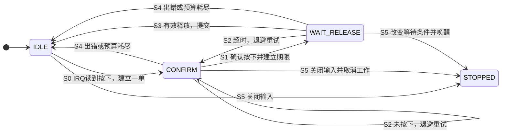
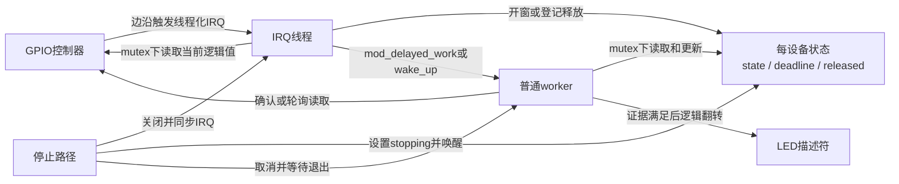
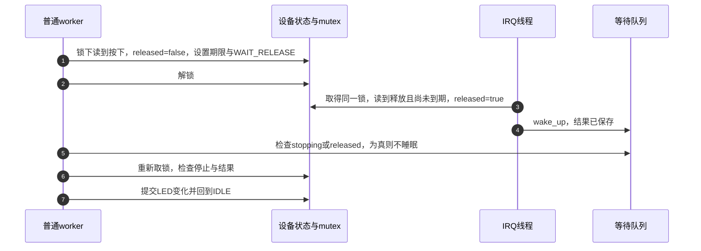

# 第14章\_按键窗口合并与按下释放确认

第六章解决了“晚些执行一个可睡眠函数”，第七章建立条件等待，第十二章给出以最新边沿为基准的静默窗口。现在回到同一个按键：用户希望按一下翻转 LED，但电气边沿、当前电平和“一次完整按下—释放”不是同一种证据。

本章比较四种策略：立即反馈后复核、首边沿窗口合并、轮询确认释放、IRQ 通知释放。先明确每种策略承诺什么，再用一套共享初始化与退出的驱动实现它们。策略不同不是接口优劣；读者应能给同一串输入预测不同输出，并判断哪种承诺符合设备用途。

## 14.1\_从一个边沿到底能推出什么

假设 GPIO 配置为 active-low，即物理低电平表示按下。下降沿只说明输入曾从高变低，不能证明此后持续稳定，也不能证明用户已经释放。抖动会产生多个边沿，慢速 GPIO 控制器还可能在 IRQ 线程实际读数之前经历更多变化。

GPIO 描述符接口会处理 active-low：`gpiod_get_value_cansleep()` 返回 **逻辑 1 表示有效（按下），逻辑 0 表示无效（释放）**，负数表示错误。不能因硬件低有效就在驱动里再次取反。LED 也一样：`gpiod_set_value_cansleep(led, 1)` 表示逻辑点亮，`GPIOD_OUT_LOW` 初始化为逻辑关闭。这里的 LOW 是传给描述符接口的逻辑初值，不能直接解释成引脚电压。

如果在第一次边沿时立即翻转 LED，之后才读取按键并撤销，这是一种 **推测反馈**。即使最后恢复了 LED 原状态，中间的短闪仍真实发生。它适合可以撤回的视觉提示，不能拿来提前执行电机动作、扣费或发出不可撤回命令。

如果只在首边沿后固定等 30 ms 再读一次，则只能说“检查时刻读到按下”。中间可能释放又按下；两次采样相同也不能证明间隔内一直不变。要保证软件观察到的最后一次边沿之后已有静默窗口，应使用第十二章的事件代次和期限复核；即便如此，也不能证明未被硬件采集到的模拟波形。

## 14.2\_先区分输出条件再比较延迟

现在把可观察保证写清。四个方案共用 GPIO 与可睡眠工作环境，但在不同阶段决定是否更新 LED：

| 策略 | 何时更新 LED | 后续边沿怎样处理 | 实际保证与代价 |
| --- | --- | --- | --- |
| 0：立即反馈后复核 | 开窗立即翻转；复核不是按下或读失败则翻回 | 当前窗口内不再开窗 | 响应快，但可能短闪；一次取样不是稳定证明 |
| 1：窗口合并与噪声退避 | 窗口结束翻转一次，不读当前键值作为提交条件 | 窗口内再读到按下的 IRQ 只增加噪声计数 | 合并重复触发与调节频率；**不保证有一次有效按键** |
| 2：按下确认后轮询释放 | 先读到按下，再在期限内的一次轮询读到释放才翻转 | 事务进行中不另开一单 | 无需依赖释放 IRQ 完成；付出周期读取，可能错过短暂释放 |
| 3：按下确认后等待释放通知 | 先读到按下，再由 IRQ 线程在期限内读到释放才翻转 | 释放通知写共享结果并唤醒等待者 | 少了周期读取，但依赖释放通知路径；等待期间占用一个 worker |

策略 1 的“噪声”只是本窗口内额外按下观测的次数，不是电气噪声测量。阈值降低会让退避更容易增长，通常延长后续响应，不能反说它会让按键更快。增加退避也可能掩盖输入问题，应先核对接线、上下拉、触发类型和硬件去抖能力。

50 ms 退避基数在指数为零时仍然是 50 ms。若确认等待为 30 ms，则初次等待是 **30 + 50 = 80 ms**，不能算成“接近 30 ms”。下方参数 cap=200 ms 只限制退避分量；总等待还有确认等待和调度延迟。这里的数值都是教学值，不是对人机操作普遍合适的规范。

## 14.3\_按下与释放组成业务状态机

把策略 2/3 的一次操作称为“业务事务”，只表示要收齐按下与释放两项证据后才提交 LED 变化，不表示数据库事务、硬件原子操作或任意外部副作用都可回滚。

空闲时观察到按下，保存一单并安排确认。到确认时仍读到按下，才进入等待释放；否则按预算重试。释放超时同样消耗预算。初始尝试以外最多重试三次，第四次仍失败便放弃。这能限制尝试次数，但若总线读取或调度迟迟不完成，不能据此推出严格的墙钟完成上界。

图中 IDLE 表示空闲、CONFIRM 表示等待确认、WAIT_RELEASE 表示等待释放。STOPPED 是设置停止标志并结束活动后的组合状态；代码把业务阶段与 stopping 分开保存，没有把它伪装成第四个业务枚举值。



S1 的释放期限从确认按下后开始，不是从第一个电气边沿开始。策略 2 以 GPIO 读取结束后的软件时刻判定是否还在期限内；策略 3 以 IRQ 线程读取结束后的软件时刻判定。两者都无法恢复被调度延迟遮住的精确物理释放时刻。截止时刻本身按超时处理；若要按硬件采集时刻裁决，需要设备提供可信的时间戳。

状态保存在每设备 `struct key_policy` 中：`state`、`attempt`、`backoff_ms`、`deadline`、`noise` 和 LED 镜像由同一 mutex 保护。IRQ 是线程化处理函数，因此可以取 mutex 和读取可睡眠 GPIO；普通 work 也用这把锁。等待用的 `released` 与 `stopping` 还会在不持锁的等待条件里读取，使用 READ_ONCE/WRITE_ONCE；锁仍负责其他字段的一致性，不能拿这两个宏替代锁。



两个执行者串行修改同一份状态，才不会把“当前单已结束”与“下一单刚开始”混在一起。工作队列只保证符合前提的同一 work 不重入；不同 work 之间、work 与 IRQ 之间的字段一致性仍是驱动责任。

## 14.4\_通知必须先有可保存的结果

轮询版本每隔一段时间读取电平，没有读取时 worker 不占用执行线程。等待版本则进入 `wait_event_timeout()`，把执行线程睡在等待队列上，IRQ 写结果并唤醒它。两者没有一方天然更快：轮询增加读取与量化延迟，通知依赖中断捕获和 IRQ 线程调度；都需要实际测量功耗和延迟。

下面是策略 3 的一条成功路径。关键是先在锁下清理旧结果、发布 WAIT_RELEASE，然后释放锁等待。IRQ 即使发生在真正睡眠之前，也能把结果保存在字段里，后续条件检查会看到它。



步骤 1 必须把清零与阶段发布放在同一临界区。若先发布 WAIT_RELEASE，IRQ 在中间写 true，worker 随后又无锁清零，就会丢掉已经发生的释放。步骤 4 的唤醒不是结果本身；保存结果的字段使步骤 5 不依赖“恰好已经睡着”。

停止时则先关闭 IRQ，锁下设置 stopping，再唤醒等待队列，最后在锁外同步取消。等待条件包含 stopping，所以移除设备不会无意义地等满释放超时。若把释放生产者也放在同一条严格顺序队列的后一个 work 中，再让前一个 work 等它，后者无法执行，设计就会死锁；本例释放来自独立 IRQ 线程。

## 14.5\_用共享状态保存一单与重试预算

以下完整驱动以 Linux 6.12.20 的 platform/remove、GPIO 和工作队列接口为基线。`policy` 为只读模块参数，0～3 对应上表，默认 2。使用同一个 delayed_work 和 `system_wq`，不通过“自建单线程队列”伪造隔离或实时性。策略 3 等待时占用 worker，这个有界教学例子不是大量设备长时间阻塞的通用推荐。

设备树属性只读入一次，合法范围在 probe 检查；示例不提供在线修改入口。若加入在线参数，必须像第六章那样保护读写，并定义当前窗口是否重新计时；不能直接把 `debugfs_create_u32()` 连到这些共享字段上。下面三段 C 依次拼接成 `key_policy_demo.c`。

```c
// SPDX-License-Identifier: GPL-2.0
#include <linux/module.h>
#include <linux/platform_device.h>
#include <linux/property.h>
#include <linux/of.h>
#include <linux/gpio/consumer.h>
#include <linux/interrupt.h>
#include <linux/workqueue.h>
#include <linux/mutex.h>
#include <linux/wait.h>
#include <linux/jiffies.h>
#include <linux/pm.h>
#include <linux/slab.h>

static unsigned int policy = 2;
module_param(policy, uint, 0444);
MODULE_PARM_DESC(policy, "0推测反馈 1窗口合并 2轮询释放 3等待释放IRQ");

enum key_state { KEY_IDLE, KEY_CONFIRM, KEY_WAIT_RELEASE };
struct key_policy {
    struct device *dev;
    struct gpio_desc *key, *led;
    int irq;
    struct mutex lock;
    wait_queue_head_t wait;
    struct delayed_work work;
    enum key_state state;
    unsigned int policy, debounce_ms, base_ms, cap_ms;
    unsigned int release_ms, poll_ms, retry_max;
    unsigned int backoff_ms, attempt, noise;
    unsigned long deadline;
    bool led_on, stopping, released;
};

/* 以下业务辅助函数均由持有 lock 的调用者使用。 */
static void flip_led(struct key_policy *d)
{
    d->led_on = !d->led_on;
    gpiod_set_value_cansleep(d->led, d->led_on);
}

static unsigned int grow_backoff(unsigned int value, unsigned int cap)
{
    return value > cap / 2 ? cap : value * 2;
}

static void queue_check(struct key_policy *d, unsigned int ms)
{
    mod_delayed_work(system_wq, &d->work, msecs_to_jiffies(ms));
}

static void finish_key(struct key_policy *d, bool commit)
{
    if (commit) {
        flip_led(d);
        d->backoff_ms = max(d->base_ms, d->backoff_ms / 2);
    }
    d->state = KEY_IDLE;
}

static void retry_key(struct key_policy *d)
{
    if (d->attempt >= d->retry_max) {
        dev_dbg(d->dev, "key transaction abandoned\n");
        finish_key(d, false);
        return;
    }
    d->attempt++;
    d->backoff_ms = grow_backoff(d->backoff_ms, d->cap_ms);
    d->state = KEY_CONFIRM;
    queue_check(d, d->debounce_ms + d->backoff_ms);
}
```

`attempt` 只数重试，初次为零。所有时间属性均限定在 1～5000 ms，确认延迟与退避相加最大 10000 ms，先证明加法范围再转 jiffies。失败后保留增长的退避，成功逐步回落到 base；它调节的是后续尝试，不能修复已发生的错误输出。LED 镜像保存驱动发出的逻辑命令，不是回读证明灯已经实际点亮。

## 14.6\_让工作与IRQ推进同一状态机

有了这一单的存储位置，工作函数按 policy 决定复核、合并还是等待释放，IRQ 则只负责开窗或保存释放证据。两者都取同一把锁；进入条件等待前必须先释放它，否则负责写结果的 IRQ 线程也会被挡住。中断函数返回 `IRQ_HANDLED` 表示本驱动已经处理此次调用，不代表业务事务已完成。

```c
static void key_work(struct work_struct *work)
{
    struct key_policy *d = container_of(to_delayed_work(work),
                                       struct key_policy, work);
    int value;
    unsigned long now, left;

    mutex_lock(&d->lock);
    if (d->stopping || d->state == KEY_IDLE)
        goto out;
    if (d->policy == 1) {
        /* 只合并事件，不将它称为按键有效性确认。 */
        flip_led(d);
        if (d->noise >= 2)
            d->backoff_ms = grow_backoff(d->backoff_ms, d->cap_ms);
        else if (!d->noise)
            d->backoff_ms = max(d->base_ms, d->backoff_ms / 2);
        d->state = KEY_IDLE;
        goto out;
    }
    value = gpiod_get_value_cansleep(d->key);
    if (d->policy == 0) {
        if (value != 1)
            flip_led(d); /* 包括读取错误：撤回可逆的推测反馈。 */
        if (value < 0)
            dev_warn(d->dev, "key read failed: %d\n", value);
        d->state = KEY_IDLE;
        goto out;
    }
    if (value < 0) {
        dev_warn(d->dev, "key read failed: %d\n", value);
        finish_key(d, false);
        goto out;
    }
    if (d->state == KEY_CONFIRM) {
        if (!value) {
            retry_key(d);
            goto out;
        }
        WRITE_ONCE(d->released, false);
        d->deadline = jiffies + msecs_to_jiffies(d->release_ms);
        d->state = KEY_WAIT_RELEASE;
        if (d->policy == 2) {
            queue_check(d, min(d->poll_ms, d->release_ms));
            goto out;
        }
        /* 结果字段已建立；IRQ 与本函数采用同一把锁。 */
        mutex_unlock(&d->lock);
        now = jiffies;
        left = time_before(now, d->deadline) ? d->deadline - now : 0;
        if (left)
            wait_event_timeout(d->wait,
                               READ_ONCE(d->stopping) || READ_ONCE(d->released),
                               left);
        mutex_lock(&d->lock);
        if (d->stopping)
            goto out;
        if (d->released)
            finish_key(d, true); /* IRQ 已按观察时刻核对期限。 */
        else
            retry_key(d);
        goto out;
    }
    /* 策略2：GPIO读取可能睡眠，所以在读取后裁决期限。 */
    if (time_after_eq(jiffies, d->deadline))
        retry_key(d);
    else if (!value)
        finish_key(d, true);
    else
        queue_check(d, d->poll_ms);
out:
    mutex_unlock(&d->lock);
}

static irqreturn_t key_irq(int irq, void *data)
{
    struct key_policy *d = data;
    int value;
    bool wake = false;

    mutex_lock(&d->lock);
    if (d->stopping)
        goto out;
    value = gpiod_get_value_cansleep(d->key);
    if (value < 0) {
        dev_warn_ratelimited(d->dev, "IRQ key read failed: %d\n", value);
        goto out;
    }
    if (d->state == KEY_IDLE && value) {
        d->state = KEY_CONFIRM;
        d->attempt = d->noise = 0;
        if (d->policy == 0) {
            flip_led(d);
            queue_check(d, d->debounce_ms);
        } else {
            queue_check(d, d->debounce_ms + d->backoff_ms);
        }
    } else if (d->policy == 1 && value) {
        /* 两次以上视为同一档，饱和保存避免计数溢出。 */
        if (d->noise < 2)
            d->noise++;
    } else if (d->policy == 3 && d->state == KEY_WAIT_RELEASE &&
               !value && time_before(jiffies, d->deadline)) {
        WRITE_ONCE(d->released, true);
        wake = true;
    }
out:
    mutex_unlock(&d->lock);
    if (wake)
        wake_up(&d->wait);
    return IRQ_HANDLED;
}
```

策略 3 的 IRQ 先保存 released，再唤醒；worker 即使晚于 deadline 才获得 CPU，也可以消费此前已经按时登记的释放证据。策略 2 没有这份中断证据，所以不能用截止以后才读到的释放补判成功。这个区别是证据来源的差异，不是把同一硬件事件神奇地提前了。

策略 0/1 窗口结束就回到空闲，没有额外的“等待松手后才能再接受”锁存。长按期间若再产生一次被读成按下的边沿，可能再开一窗；因此它们不能声称“每次物理按键只翻转一次”。若业务需要完整一单，应选策略 2/3，并继续评估采样遗漏与抖动条件。

## 14.7\_初始化\_停止和恢复保持同一所有权

前面的回调假设状态和资源已经存在，因此 probe 先取得描述符再注册 IRQ。`GPIOD_IN` 请求输入，错误指针用 `IS_ERR` 检查并用 `PTR_ERR` 取得错误码。`IRQF_TRIGGER_RISING/FALLING` 请求双边沿，`IRQF_ONESHOT` 让 IRQ 在线程处理完成前保持屏蔽。PM（Power Management，电源管理）回调由 `DEFINE_SIMPLE_DEV_PM_OPS` 组成，具体是否挂入驱动由配置相关的 `pm_sleep_ptr` 决定。

```c
static int read_ms(struct device *dev, const char *name,
                   unsigned int fallback, unsigned int *result)
{
    u32 value;
    int ret;

    if (!device_property_present(dev, name)) {
        *result = fallback;
        return 0;
    }
    ret = device_property_read_u32(dev, name, &value);
    if (ret)
        return ret;
    if (!value || value > 5000)
        return -EINVAL;
    *result = value;
    return 0;
}

static void stop_key(struct key_policy *d)
{
    /* 调用者已经阻止IRQ继续进入；不能持锁等待work退出。 */
    mutex_lock(&d->lock);
    WRITE_ONCE(d->stopping, true);
    if (d->policy == 0 && d->state == KEY_CONFIRM)
        flip_led(d); /* 撤回尚未复核的反馈。 */
    d->state = KEY_IDLE;
    mutex_unlock(&d->lock);
    wake_up(&d->wait);
    cancel_delayed_work_sync(&d->work);
}

static int key_probe(struct platform_device *pdev)
{
    struct device *dev = &pdev->dev;
    struct key_policy *d;
    int ret;

    if (policy > 3)
        return -EINVAL;
    d = devm_kzalloc(dev, sizeof(*d), GFP_KERNEL);
    if (!d)
        return -ENOMEM;
    d->dev = dev;
    d->policy = policy;
    d->retry_max = 3;
    mutex_init(&d->lock);
    init_waitqueue_head(&d->wait);
    INIT_DELAYED_WORK(&d->work, key_work);
    ret = read_ms(dev, "nxp,debounce-ms", 30, &d->debounce_ms);
    if (ret) return ret;
    ret = read_ms(dev, "nxp,backoff-base-ms", 50, &d->base_ms);
    if (ret) return ret;
    ret = read_ms(dev, "nxp,backoff-max-ms", 200, &d->cap_ms);
    if (ret) return ret;
    ret = read_ms(dev, "nxp,release-timeout-ms", 150, &d->release_ms);
    if (ret) return ret;
    ret = read_ms(dev, "nxp,release-poll-ms", 20, &d->poll_ms);
    if (ret) return ret;
    if (d->base_ms > d->cap_ms || d->poll_ms > d->release_ms)
        return -EINVAL;
    d->backoff_ms = d->base_ms;
    d->key = devm_gpiod_get(dev, "key", GPIOD_IN);
    if (IS_ERR(d->key))
        return dev_err_probe(dev, PTR_ERR(d->key), "key GPIO\n");
    d->led = devm_gpiod_get(dev, "led", GPIOD_OUT_LOW);
    if (IS_ERR(d->led))
        return dev_err_probe(dev, PTR_ERR(d->led), "LED GPIO\n");
    ret = gpiod_get_value_cansleep(d->key);
    if (ret < 0)
        return dev_err_probe(dev, ret, "initial key read\n");
    d->irq = gpiod_to_irq(d->key);
    if (d->irq < 0)
        return d->irq;
    platform_set_drvdata(pdev, d);
    /* 此演示明确申请双边沿，不声称只由设备树选择触发方式。 */
    return devm_request_threaded_irq(dev, d->irq, NULL, key_irq,
             IRQF_ONESHOT | IRQF_TRIGGER_RISING | IRQF_TRIGGER_FALLING,
             dev_name(dev), d);
}

static void key_remove(struct platform_device *pdev)
{
    struct key_policy *d = platform_get_drvdata(pdev);

    devm_free_irq(&pdev->dev, d->irq, d); /* 先注销并等待IRQ线程。 */
    stop_key(d);
    gpiod_set_value_cansleep(d->led, 0);
    /* GPIO与d由devres在remove返回后释放。 */
}

static int key_suspend(struct device *dev)
{
    struct key_policy *d = dev_get_drvdata(dev);

    disable_irq(d->irq); /* 不能持有IRQ线程需要的mutex。 */
    stop_key(d);
    return 0;
}

static int key_resume(struct device *dev)
{
    struct key_policy *d = dev_get_drvdata(dev);

    mutex_lock(&d->lock);
    WRITE_ONCE(d->released, false);
    WRITE_ONCE(d->stopping, false);
    d->state = KEY_IDLE;
    mutex_unlock(&d->lock);
    enable_irq(d->irq);
    return 0;
}
static DEFINE_SIMPLE_DEV_PM_OPS(key_pm_ops, key_suspend, key_resume);
static const struct of_device_id key_match[] = {
    { .compatible = "nxp,imx6ull-led_key_int" }, { }
};
MODULE_DEVICE_TABLE(of, key_match);
static struct platform_driver key_driver = {
    .probe = key_probe,
    .remove = key_remove,
    .driver = {
        .name = "key-policy-demo",
        .of_match_table = key_match,
        .pm = pm_sleep_ptr(&key_pm_ops),
    },
};
module_platform_driver(key_driver);
MODULE_LICENSE("GPL");
MODULE_DESCRIPTION("按键窗口与释放证据策略对照");
```

probe 在 IRQ 注册以前已经准备好全部字段，之后没有额外可能失败的步骤。注册成功以后 IRQ 才能产生工作；remove 则反向先释放 IRQ，再取消工作，最后由 devres 释放 GPIO 与对象。这个顺序比给同一资源写两套清理更容易核对。

本例挂起时放弃正在进行的一单，恢复后回到空闲；不把整个睡眠期间计入旧释放期限，也不主动把仍按住的键重开一单。它不配置按键唤醒、运行时电源管理或板级 sleep pinctrl；需要这些能力时，要按第十一章与实际 GPIO 控制器补充，不能只添加一个 `pinctrl-names = "sleep"` 就声称实现了挂起唤醒。

## 14.8\_接入板级资源与预测实验

下面保留原示例的 i.MX6ULL GPIO1_IO03 与 GPIO1_IO18 作为教学接线假设。必须先检查目标板原理图、引脚复用及引脚是否已被其他设备占用；这不是本轮已验证的硬件布局。`nxp,imx6ull-led_key_int` 与 nxp 时间属性是本教材自定义绑定，不能当成上游标准设备绑定。

```dts
/* 放在目标板设备树合适位置；实际pinctrl应由板级配置提供。 */
key_policy_demo {
    compatible = "nxp,imx6ull-led_key_int";
    led-gpios = <&gpio1 3 GPIO_ACTIVE_LOW>;
    key-gpios = <&gpio1 18 GPIO_ACTIVE_LOW>;
    nxp,debounce-ms = <30>;
    nxp,backoff-base-ms = <50>;
    nxp,backoff-max-ms = <200>;
    nxp,release-timeout-ms = <150>;
    nxp,release-poll-ms = <20>;
    status = "okay";
};
```

设备树需要已有 GPIO 控制器标签和 GPIO 常量头文件。驱动从 GPIO 描述符取得 IRQ 并显式要求双边沿，因此这里不再重复提供一份可能冲突的 `interrupts`。没有 reg 属性也不添加 `@0` 单元地址。LED 为必需资源，避免缺少 LED 时静默跳过本章唯一可见输出。

同目录 Makefile 为 `obj-m += key_policy_demo.o`，使用第六章的目标 Kbuild 方法构建。目标内核还需要 GPIO、OF、IRQ 与模块支持。设备树必须已包含并启用这个节点，且没有另一个示例驱动抢先绑定同一 compatible。

```bash
# 在已完成板级接线和设备树部署的目标Linux上运行。
sudo insmod ./key_policy_demo.ko policy=2
# 完成当前策略观察后卸载，再装载另一策略比较。
sudo rmmod key_policy_demo
sudo insmod ./key_policy_demo.ko policy=3
```

装载时若按键已按住，本例不把初始电平自动当作一单；等待后续新的按下观测。不要用 GPIO 的物理低高直接推断代码中 0/1：先核对描述符的逻辑转换。

| 可控输入 | 先预测的结果 | 解释重点 |
| --- | --- | --- |
| 短按脉冲，在策略 0 的复核前已经释放 | LED 先翻转再翻回，可能看见短闪 | 回滚不抹除已经发生的外部变化 |
| 同一窗口多次边沿，最终已经释放，策略 1 | 窗口结束仍翻转一次，后续退避可能增长 | 事件合并不等于按键确认 |
| 确认前一直按下，确认后在期限内释放，策略 2 | 下一次期限内的轮询读取到释放才提交 | 释放到提交包含轮询与调度延迟 |
| 同样输入，策略 3 | IRQ 线程按时登记释放后提交 | 可在正式睡眠前登记结果，不丢通知 |
| 一直按住或通知丢失 | 有限重试后放弃，不应无限占用一单 | 次数有界不等于硬实时结束保证 |
| WAIT_RELEASE 时卸载或挂起 | 停止条件唤醒等待者，取消后无资源访问 | 不能只测空闲时退出 |
| GPIO 返回负错误 | 放弃或撤回推测反馈，不把负数当“按下” | 错误路径与有效逻辑值分开 |

这些是实验预测，不是已经采集到的波形或本次目标板测试结果。测量应同时保存物理输入/输出波形与软件阶段时间戳；只看 LED 肉眼效果不能证明窗口、竞态或期限语义。

## 14.9\_组合巡检与重试时不要丢掉所有权

真实设备还可能把按键确认、后台巡检和事务退避放在一起。现在三种职责已能独立解释：按键工作产生“最近活跃”的提示，巡检消费提示选择短/长间隔，事务失败则改变自己的退避和预算。第六章完整模块演示后两项的共同调度和在线控制，第十二章演示严格按最新边沿计算的静默窗口；若在一个设备中组合，要保留这些不同语义。

可以用每设备 mutex 统一保护 `active`、参数和停止状态，或分别设计明确的锁与事件交接。一次 active=true/false 适合“最近是否活跃”，不适合需要逐次保存的按键事件；后一种情况需要计数或队列。多个 work 共用 mutex 会互相等待，可睡眠总线事务是否持锁也会改变 IRQ 与配置响应，应根据设备事务的最长持续时间分析。

退出顺序为关闭参数入口、注销并同步 IRQ、在锁下标记停止、唤醒可能等待的工作，再在锁外逐个同步取消，最后销毁自建队列和资源。自建队列不是必须；如果采用它，`WQ_UNBOUND | WQ_HIGHPRI, 1` 仍不能作为“全设备严格单线程”的证明。需要严格全局顺序才选 ordered，且不能让前项等待后项。

最后一个练习：策略 2 在释放期限以后才读到 0，策略 3 的 IRQ 则在期限以前已经把 released 写为 true，但 worker 到期限以后才运行，两者应当同判失败吗？**答案：不应。策略 2 缺少期限内的释放证据；策略 3 已保存期限内的观测，可以晚些消费它。** 两者仍不能据此断言物理引脚的精确变化时刻。

本章 Linux API 证据沿用[工作队列源码索引](../../../../../research/source_reading/workqueue/navigation/P01_Linux_6.12_工作队列源码总阅读索引.md)与[固定源码基线](../../../../../research/source_reading/linux/SOURCE_BASELINE.md)。GPIO 逻辑极性和负错误以固定 `drivers/gpio/gpiolib.c`、等待条件以 `include/linux/wait.h` 核对；具体证据记录见[延迟工作与按键策略核对](../../../../../research/source_reading/linux/SOURCE_BASELINE.md#1.175_延迟工作与按键策略核对)。本例为完整教学驱动，尚未进行目标 Kbuild、GPIO/IRQ 实测或挂起卸载压力验证。

上一篇：[P13 调试 验证与常见陷阱](P13_调试_验证与常见陷阱.md)。
返回：[定时与延迟执行阅读路线](大纲.md)。
