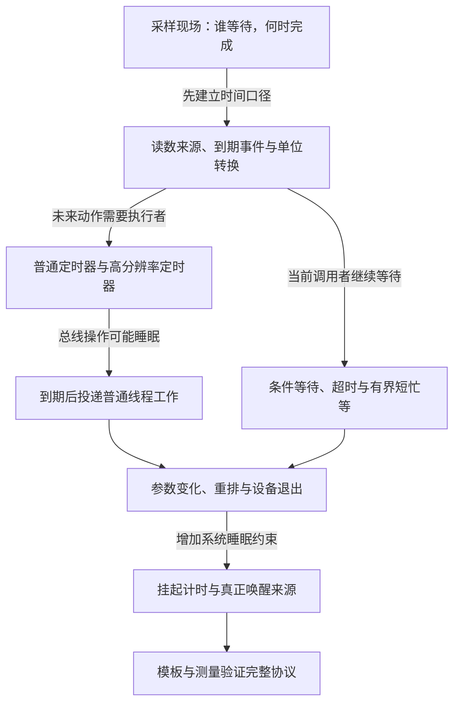

# 第1章\_定时与延迟执行阅读路线

这个专题沿一块采样设备展开：中断后等稳定、周期读取、命令超时以及设备退出。读者先学会区分当前调用者等待与未来回调，再弄清时间来源和表示，最后选择执行机制并证明回调不会越过设备生命期。需要基本 C 与驱动回调知识；工作队列的公共状态模型在[工作队列专题](../workqueue/大纲.md)，等待条件与通知的区别在[等待专题](../../synchronization/waiting_notification/大纲.md)。

## 1.1\_从需求到可验证的定时协议

图中不是按精度给接口排名。普通定时器和 hrtimer 管到期，工作队列管执行环境，等待接口管当前调用者；设备退出和电源管理横跨这些机制。每一步只在前一步暴露出新约束后加入状态。

## 1.2\_按问题连续阅读十四章

表中的 DT 是 Device Tree（设备树），PM 是 Power Management（电源管理），RTC 是 Real-Time Clock（实时时钟硬件）；这里只标明后续章节的位置，实际状态与接口在对应问题出现时展开。

| 章节 | 已有前提 | 本章解决的问题 | 留给后文的问题 |
| --- | --- | --- | --- |
| [P01 驱动中的 时间问题 概述](P01_驱动中的_时间问题_概述.md) | 当前调用者和回调的基本区别 | 从真实需求区分等待对象、单位、上下文与退出 | 内核如何读时间并触发期限 |
| [P02 Linux 时间基础与 timekeeping 框架速览](P02_Linux_时间基础与_timekeeping_框架速览.md) | 第一章的时间需求 | clocksource、clockevent、timekeeping 与停 tick 的分工 | 外部时长怎样安全转成期限 |
| [P03 时间表示与转换接口详解](P03_时间表示与转换接口详解.md) | 已经选定时间口径 | 相对/绝对、jiffies/ktime 转换与边界 | 如何保存一项未来动作 |
| [P04 基础定时器机制 struct timer list](P04_基础定时器机制_struct_timer_list.md) | 能表达未来到期点 | timer_list 的排队、回调、周期重排和停止 | tick 粒度不够时怎样处理 |
| [P05 高精度定时器 hrtimer 的驱动用法](P05_高精度定时器_hrtimer_的驱动用法.md) | 普通定时器的价值与粒度限制 | hrtimer 到期与重启、执行环境和迟到 | 到期动作需要睡眠怎么办 |
| [P06 基于工作队列的延迟执行 delayed work](P06_基于工作队列的延迟执行_delayed_work.md) | 已区分到期与执行 | delayed_work 的定时、投递、重排与取消 | 当前调用者怎样等条件 |
| [P07 睡眠与超时调度接口](P07_睡眠与超时调度接口.md) | 当前调用者能否睡眠 | 睡眠、等待队列与 completion 超时的不同完成条件 | 不可睡眠的短间隔怎么办 |
| [P08 忙等待与短延时 udelay() ndelay() 的边界](P08_忙等待与短延时_udelay%28%29_ndelay%28%29_的边界.md) | 等待与超时契约 | 忙等待适用范围及轮询边界 | 参数来自板级配置时怎样检查 |
| [P09 时间与设备树平台数据的对接](P09_时间与设备树平台数据的对接.md) | 接口的单位与范围 | DT 属性、默认值、转换和动态更新 | 这些状态怎样随设备退出 |
| [P10 与 devres 驱动生命周期和 PM 的关系](P10_与_devres_驱动生命周期和_PM_的关系.md) | 回调与重排依赖图 | devres、同步停止及资源释放顺序 | 系统挂起如何影响时间与回调 |
| [P11 电源管理 系统挂起与定时唤醒](P11_电源管理_系统挂起与定时唤醒.md) | 已区分停止与重启 | 挂起计时、RTC/alarm 和定时唤醒 | 如何把选择变成可检验实现 |
| [P12 常用模式与代码模板](P12_常用模式与代码模板.md) | 前面各机制的前提 | 轮询、去抖与事务等应用模式 | 怎样找到迟到或退出失败的位置 |
| [P13 调试 验证与常见陷阱](P13_调试_验证与常见陷阱.md) | 已知请求到完成的各阶段 | 跟踪、时间戳、故障与性能边界 | 按测量结果比较业务策略 |
| [P14 按键窗口合并与按下释放确认](P14_按键窗口合并与按下释放确认.md) | 延迟工作、条件等待、生命周期与测量 | 区分推测反馈、事件合并、轮询和释放通知的证据与代价 | 将已验证协议接入具体设备 |

## 1.3\_与其他专题的边界

本专题负责时间口径、到期路径和异步生命周期中的时间部分；[中断专题](../interrupts/大纲.md)负责硬件请求、handler 与中断源协议，[工作队列专题](../workqueue/大纲.md)负责共享执行资源与业务事件保存。不能把“延期完成”当成“外设数据已读完”，也不能把“取消一个定时器”当成“全部生产者都已关闭”。

普通定时器的固定版本源码证据复用[定时器重启与退出导读](../../../../../research/source_reading/kref/navigation/P05_定时器重启与退出导读.md#5.2_从排队到最终关闭)，具体函数体在其链接的唯一实现标题展开。本文只负责阅读路线；人工评审状态仍以[全仓阅读评审地图](../../../../../atlas/maps/knowledge_review_map.md)为准。
