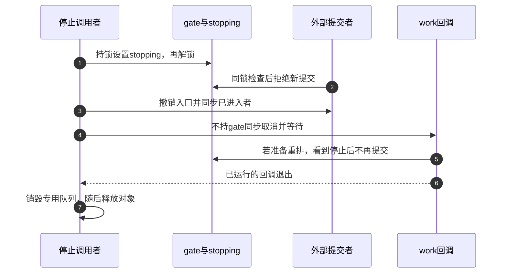
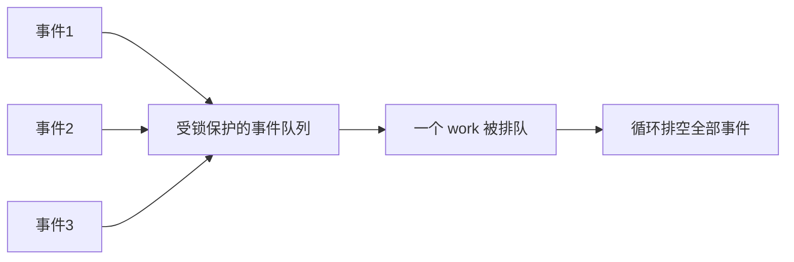

# 第1章\_工作队列

## 1.1\_工作队列的定位

设备收到一批采样数据，硬中断处理程序需要尽快确认来源、保存必要事件并返回；后续解析可能访问可睡眠接口，不能继续留在这个现场。若只设置一个标志却没有后续执行者，数据不会自己被处理；若每个设备都创建并维护专用线程，又要自己处理等待、唤醒和退出。我们需要把“有事情要做”的记录与“现在由谁执行”分开。

本专题先研究 **线程工作队列**：驱动提交一个工作项，由内核管理的工作线程 kworker 稍后调用它的函数。当前回调离开触发现场，进入可调度的进程上下文；是否能在具体位置睡眠，仍取决于持锁和依赖。普通内核路径也可用它做异步维护，不限于中断。

版本边界固定为 NXP linux-imx Linux 6.12.20。这个版本还提供 WQ_BH：BH 是 Bottom Half（下半部），这种工作队列在 softirq（软中断）上下文运行，**不能睡眠**。它复用部分投递、flush 和取消接口，但不是本章的线程执行模型。后文说“worker 可以睡眠”均指线程队列；不能只见 workqueue 名称就推断上下文。


工作队列不是“线程化中断”的唯一实现，也不是所有中断后逻辑的强制归宿。线程化 IRQ、tasklet/softirq、irq_work、timer 和专用 kthread 各有不同上下文与时延语义。

## 1.2\_cmwq\_的三层结构

先把三个名字对应到刚才的设备：work_struct 是嵌入设备对象的工作项，保存回调和排队状态；workqueue 是驱动选择的属性与完成等待范围；worker pool 是共享执行资源，kworker 是其中实际运行函数的内核线程。一份工作描述不等于一个线程，一个专用 workqueue 也不等于独占一组线程。

并发管理工作队列（Concurrency Managed Workqueue，cmwq）让多个逻辑队列复用执行资源，又保留各自的管理边界。下面只比较这三种职责，中间连接对象在第三章从共享需求继续推导：

| 层次 | 作用 |
| --- | --- |
| `work_struct` | 一次可排队执行的工作实例 |
| workqueue | 定义属性、并发限制和 flush 域 |
| worker pool / kworker | 实际排队和执行工作；由内核动态管理 worker |

bound workqueue 使用每 CPU worker pool 并保持 CPU 关联；带 `WQ_UNBOUND` 的队列使用 unbound pool，由调度器和 workqueue 的 pod/affinity 规则选择 CPU。默认 `system_wq` 不是 `WQ_UNBOUND` 队列；需要 unbound 语义时应显式选择对应系统队列或自行分配。

## 1.3\_定义与投递

下面是同一设备的协议片段，展示工作项、门控锁和回调的配合，不是可单独加载的驱动。handle_event、poll_device 和 stop_and_sync_producers 是需要按真实设备实现的业务函数；它们不是内核 API。本例处理可合并的状态变化，不能丢失的记录必须另存在业务队列中。工作项始终使用同一个队列，不更换回调、不重新初始化，也不额外调用 disable 接口；完整可运行的状态模型在第二章建立。

`INIT_WORK` 是初始化工作项并登记回调的宏，不会提交执行。container_of 宏根据成员地址找到包住它的设备对象；spin_lock_irqsave/irqrestore 这对锁操作保护门控，并保存、恢复本 CPU 的中断状态。提交入口本身不做可睡眠业务处理，工作回调也不会在 gate 锁内执行。

```c
struct my_device {
    struct work_struct work;
    struct delayed_work poll_work;
    struct workqueue_struct *wq;
    spinlock_t gate;
    bool stopping;               /* 只在gate锁下访问。 */
};

static void my_workfn(struct work_struct *work)
{
    struct my_device *m = container_of(work, struct my_device, work);

    /* 回调允许处理关门前已接收的事件；remove要等它返回。 */
    handle_event(m);
}

static bool submit_event(struct my_device *m)
{
    unsigned long flags;
    bool accepted = false;

    spin_lock_irqsave(&m->gate, flags);
    if (!m->stopping) {
        /* 此前应已按业务协议保存事件或更新可合并状态。 */
        queue_work(m->wq, &m->work);
        accepted = true;         /* 接收事件不等于新增一次排队。 */
    }
    spin_unlock_irqrestore(&m->gate, flags);
    return accepted;
}

/* 在向中断或其他提交者发布m以前完成。 */
spin_lock_init(&m->gate);
m->stopping = false;
INIT_WORK(&m->work, my_workfn);
```

门控锁把“检查是否停止”和“实际提交”放在同一临界区。remove 取得同一锁设置 stopping 后，不能再有一个已看见旧值的提交者越过关门点新增工作。锁只保护入口协议，不自动保护 handle_event 访问的业务数据；对象地址的有效性也必须由入口注册和生命周期协议保证。

`queue_work()` 的布尔返回值表示本次是否新增排队请求，不表示工作已经执行完成。固定 6.12 实现中，已 pending 或通过 disable 接口禁用的工作项都会使 queue 返回 false；不能据此判断回调是否正在执行。一个 `work_struct` 不是任意长度的事件计数器；多个事件可能合并到一次执行，若每个事件都不能丢失，应另建受保护队列或计数。

在保证 work 和 workqueue 仍然存活的前提下，`queue_work()` 可以从原子上下文调用；等待、flush 和同步取消接口通常会睡眠，只能在允许调度的上下文使用。

## 1.4\_共享系统队列与专用队列

```c
schedule_work(&m->work);                 /* system_wq */
queue_work(m->wq, &m->work);             /* 指定队列 */
```

共享系统队列适合短小、不会长期阻塞、不会造成特殊依赖的工作。下列场景考虑专用 workqueue：

- 需要独立 flush/销毁域；
- 需要 `WQ_MEM_RECLAIM` 保证内存回收前进性；
- 需要 ordered、unbound、freezable 或高优先级属性；
- 工作可能长期阻塞并影响共享系统队列上的无关用户；
- 需要明确限制同一队列的最大活动工作数。

alloc_workqueue 的三个主要参数依次是名称、属性标志和 max_active 活动额度；返回空指针表示创建失败。下面在初始化路径用内核的内存不足错误码 ENOMEM 向上层报告失败：

```c
m->wq = alloc_workqueue("mydev", 0, 0); /* 普通线程队列，使用默认额度。 */
if (!m->wq)
    return -ENOMEM;
```

这里没有回收链需求，因此不为例子随意加入 WQ_MEM_RECLAIM。分配成功后才发布提交入口；失败时尚无生产者可用这个队列。`max_active` 的准确含义会受 bound/unbound 和 workqueue 属性影响；不要把它简单当成固定线程数。

## 1.5\_常用属性

属性改变的是不同约束：执行位置、调度优先级、冻结参与和回收保障不能混成“更快”的单一等级。先保留默认线程队列；只有业务提出相应需求，才选择下面的变化。ordered 表示顺序执行要求，由专门的分配入口建立，不是名为 WQ_ORDERED 的公开标志。

| 属性 | 语义重点 | 常见误区 |
| --- | --- | --- |
| `WQ_UNBOUND` | work 不绑定提交 CPU 的 per-CPU pool | 不等于每次都换 CPU，也不保证低延迟 |
| `WQ_HIGHPRI` | 使用高优先级 worker pool | 不是实时保证 |
| `WQ_CPU_INTENSIVE` | bound pool中运行该回调时不计入普通运行数调节；仍受active额度约束 | 对unbound没有这种意义，不是让计算自动变快 |
| `WQ_FREEZABLE` | 系统冻结阶段参与 freeze | 不等于自动处理设备 suspend |
| `WQ_MEM_RECLAIM` | 为可能用于内存回收路径的队列预留救援执行者rescuer | 回收依赖链必须设置，但不能消除业务死锁 |
| `alloc_ordered_workqueue()` | 分配按排队顺序、最多一个工作执行的队列 | 不等于跨其他队列全局有序；不能用普通unbound加max_active=1替代 |
| `WQ_BH` | 选择不能睡眠的软中断执行上下文 | 不属于本章线程主线，不能照搬睡眠回调 |

## 1.6\_delayed\_work

`delayed_work` 先由 timer 等待延迟，到期后再把内含的 `work_struct` 放入 workqueue：

`INIT_DELAYED_WORK` 宏初始化延迟工作对象并设置回调，queue_delayed_work 才提交定时请求。下面初始化发生在开放提交入口之前；100 毫秒转换成内核节拍，表示定时等待时间，不承诺回调恰好在第100毫秒开始。

```c
INIT_DELAYED_WORK(&m->poll_work, poll_workfn);
queue_delayed_work(m->wq, &m->poll_work,
                   msecs_to_jiffies(100));
```

`mod_delayed_work()` 用于把尚未到期或已排队的 delayed work 调整到新的到期时间，也可以用于周期重新安排。周期任务的回调还会产生下一轮提交，因此它也是生产者。仅在函数开头读一次 stopping，不能关闭“检查后remove关门、随后又重排”的窗口；重排前必须进入同一门控协议。

```c
static void poll_workfn(struct work_struct *work)
{
    struct my_device *m = container_of(to_delayed_work(work),
                                       struct my_device, poll_work);
    unsigned long flags;

    /* 停止过程中仍允许这一轮返回；此时设备尚未释放。 */
    poll_device(m);
    spin_lock_irqsave(&m->gate, flags);
    if (!m->stopping)
        mod_delayed_work(m->wq, &m->poll_work,
                         msecs_to_jiffies(100));
    spin_unlock_irqrestore(&m->gate, flags);
}
```

## 1.7\_flush\_cancel\_与\_destroy

| 接口 | 目的 | 关键区别 |
| --- | --- | --- |
| `flush_work(work)` | 等待指定 work 的目标执行代际完成 | 不阻止其他路径稍后重新排队 |
| `flush_workqueue(wq)` | 等待该 workqueue 在 flush 边界覆盖的工作完成 | 不关闭生产者，也不是永久排空 |
| `cancel_work_sync(work)` | 取消 pending 实例；若正在运行则等待退出 | 返回后仍要阻止其他路径重新 queue |
| `cancel_delayed_work_sync(dwork)` | 同步取消 timer/pending/running delayed work | 周期回调必须遵守 stopping 协议 |
| `destroy_workqueue(wq)` | 销毁专用队列并处理其在途工作 | 调用前必须保证不会再有新提交 |

同步取消与 flush 可能睡眠，也可能等待工作函数退出。工作函数对自己调用 `flush_work()` 或 `cancel_work_sync()` 会自等待死锁；在同一受限队列中相互 flush 也可能形成依赖环，应让 lockdep 和 workqueue 警告参与验证。

## 1.8\_remove\_的正确顺序



```c
static void stop_async(struct my_device *m)
{
    unsigned long flags;

    spin_lock_irqsave(&m->gate, flags);
    m->stopping = true;
    spin_unlock_irqrestore(&m->gate, flags);

    /* 设备专用钩子：撤销外部入口，并等待已进入的提交者退出。 */
    stop_and_sync_producers(m);
    /* 不持gate或回调需要的其他锁等待，避免互相等待。 */
    cancel_delayed_work_sync(&m->poll_work);
    cancel_work_sync(&m->work);
    destroy_workqueue(m->wq);
    /* 到这里才允许外层关闭回调依赖的资源并释放m。 */
}
```

本例要求停止提交入口时仍保留在途回调退出所需的设备资源；若回调会等待某个中断完成，不能先切断那个唯一完成源再同步取消。stop_and_sync_producers 只表示应兑现的设备协议，不是一个通用内核函数，也不能把共享中断线一概 disable。实际顺序取决于生产者：timer、IRQ、文件操作、notifier 和其他 work 都可能重新提交。核心不变量是先封住所有新提交，再等待旧工作退出，最后释放对象。

不要把 devres 当作同步协议。可以用 `devm_add_action_or_reset()` 托管专用队列销毁，但 action 的注册顺序必须保证执行时所有生产者已经停止；普通驱动也不应假定存在适用于任意内核版本的通用 `devm_work_autocancel()`。

## 1.9\_工作函数中的锁与睡眠

work function 位于进程上下文，通常可以睡眠，但仍要检查：

- 是否持有自旋锁、关闭中断或禁抢占；
- 是否运行在 reclaim 依赖链，睡眠对象会不会反向依赖本 workqueue；
- 是否持有 remove 路径等待工作退出时需要的 mutex；
- 长时间阻塞是否会拖住 ordered 或受限并发队列。

常见死锁：remove 持有 mutex 后调用 `cancel_work_sync()`，而 work function 正在等待同一 mutex。同步取消之前通常应释放工作退出所需的锁，或重新设计停止状态机。

## 1.10\_事件合并与状态设计

work 的 pending 位会合并重复提交。可靠设计常使用“队列保存事件，work 负责排空”的模式：



这样即使多次 `queue_work()` 只成功一次，事件本身仍保存在业务队列里，不会因 pending 合并而丢失。

## 1.11\_常见错误

| 错误 | 后果 |
| --- | --- |
| 把 `system_wq` 说成 unbound | 错误推导 CPU 亲和和并发行为 |
| 把 work 当事件计数器 | 重复提交合并后丢失业务事件 |
| remove 只 cancel，不阻止生产者 | cancel 返回后 work 又被排队 |
| 工作自 flush 或同步取消自己 | 自等待死锁 |
| 持 mutex 调用 cancel_sync，work 也要该 mutex | remove 与 work 死锁 |
| delayed work 绕过停止门控重排 | 停止证明缺口，或取消返回后重新产生工作 |
| 为每个小工作随意建 unbound/highpri 队列 | 调度隔离和资源开销恶化 |
| 依赖 devres 自动保证停止顺序 | 资源回收时仍可能有 work 访问对象 |

## 1.12\_核对表

- work 是一次状态处理，还是不能丢失的多个事件？
- 共享 system workqueue 是否足够，为什么需要专用属性？
- 投递路径在什么上下文，work 和 workqueue 生命周期是否仍有效？
- remove 如何阻止 IRQ、timer、用户入口和其他 work 再次提交？
- cancel/flush 是否与工作函数形成锁依赖环？
- delayed work 是否在 stopping 后停止自重排？
- work 所在对象是否直到同步取消完成后才释放？

执行上下文的前置知识参见[中断下半部机制与驱动中的选择](../interrupts/P07_中断下半部机制与驱动中的选择.md)。

下一篇：[异步执行的抽象状态机](P02_异步执行的抽象状态机.md)。
