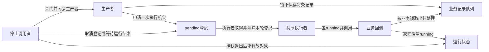
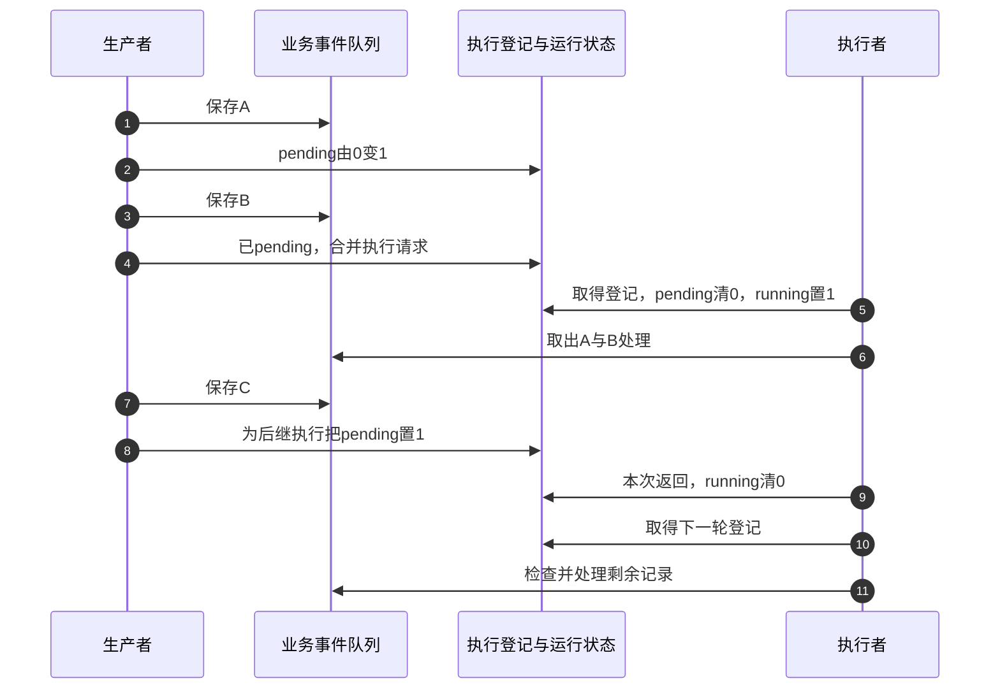

# 第2章\_异步执行的抽象状态机

## 2.1\_从一条记录与一个执行者开始

上一章已经能把采样后处理交给工作线程，但还不能解释多次提交怎样合并、执行中怎样重排、停止时究竟等什么。本章先不使用 Linux 内部字段，从一个生产者、一个共享事件队列和一个执行者推导协议；下一章再映射到内核对象。

直接在事件现场处理的价值是先后关系简单，不必管理异步对象。问题是硬中断不能睡眠，慢处理还会延长中断现场；每个设备各建专用线程能移动执行现场，但线程的等待、唤醒、资源和退出都由设备承担。共享执行者保留后移能力，代价是必须显式保存事件和协调执行机会。

## 2.2\_保存事件与登记执行机会为什么要分开

假设设备连续产生 A、B 两条不能丢失的记录。若把同一个工作对象直接插入链表两次，它只有一个链表节点，第二次插入可能破坏队列；若发现已经排队就忽略第二次调用，B 又可能丢失。需要区分两份状态：业务队列保存 A、B 的内容；工作对象只代表“请安排一次处理”，重复请求可以合并。

把“已登记下一次执行”称为 pending，把“回调目前正在运行”称为 running。它们不是互斥的三个枚举值：运行中的回调可以同时已有下一轮 pending。在开始调用回调之前清除本轮 pending，新的生产者才能为后来到达的记录登记下一轮；running 仍须独立约束，避免同一回调同时执行。



这里的箭头是需要实现的协议，还没有假定某个 Linux 字段替我们完成所有动作。持久业务状态解决事件保存，登记状态解决重复排队，运行状态解决重入与结束观察，停止状态解决对象寿命；四者不能压成一个忙标志。

## 2.3\_执行开始后再来一条记录



若第一轮还没结束就读到了 C，第二轮可能发现业务队列已经空了。这是允许的多一次检查，不能因为回调暂时读空就判断事件丢失。反过来，只看见 queue 返回 false 也不能直接宣布新事件已被处理；它还要依靠业务队列的锁和消费循环。

## 2.4\_用完整C模型区分pending与running

下面是顺序状态模型，枚举一条可预测轨迹，不创建线程、不模拟 Linux 锁或内存乱序。pending 表示是否登记了下一轮，running 表示当前一轮是否仍执行；queued 记录业务队列长度，handled 记录处理总数。

```c
#include <stdbool.h>
#include <stdio.h>
#include <stdlib.h>

struct model {
    bool pending, running, stopping;
    unsigned int queued, handled, rounds;
};

static void need(bool ok, const char *step)
{
    if (!ok) {
        fprintf(stderr, "unexpected result: %s\n", step);
        exit(EXIT_FAILURE);
    }
}

static bool publish(struct model *m)
{
    if (m->stopping)
        return false;                /* 本模型的关门检查与提交视为一个动作。 */
    ++m->queued;                     /* 先保存业务事件。 */
    bool newly_pending = !m->pending;
    m->pending = true;
    return newly_pending;            /* false也可能已经接收了业务事件。 */
}

static void begin(struct model *m)
{
    need(m->pending && !m->running, "begin requires pending and no running");
    m->pending = false;
    m->running = true;
    ++m->rounds;
}

static void drain(struct model *m)
{
    need(m->running, "drain inside callback");
    m->handled += m->queued;
    m->queued = 0;
}

static void finish(struct model *m)
{
    need(m->running, "finish an active callback");
    m->running = false;              /* 后继pending必须保留。 */
}

int main(void)
{
    struct model m = {0};
    bool first = publish(&m);
    bool second = publish(&m);
    need(first && !second && m.queued == 2, "two events one registration");
    begin(&m);
    drain(&m);
    bool third = publish(&m);         /* 第一轮仍运行，下一轮可登记。 */
    need(third && m.running && m.pending, "running plus pending");
    finish(&m);
    begin(&m);
    drain(&m);
    finish(&m);
    m.stopping = true;
    bool late = publish(&m);
    need(!late && m.handled == 3 && m.rounds == 2 &&
         !m.pending && !m.running && m.queued == 0, "closed and drained");
    puts("events=3 rounds=2 late=rejected");
    return 0;
}
```

把代码保存为 async_state_model.c，在具有 C 编译器的环境中执行：

```bash
cc -std=c11 -Wall -Wextra -Werror -O2 async_state_model.c -o async_state_model
./async_state_model
```

第一条按 C11 编译，-o 指定程序名，警告视为错误；第二条运行，应打印 `events=3 rounds=2 late=rejected`。need 显式检查并在失败时退出，业务动作不藏在 assert 中，定义 NDEBUG 也不会删掉发布操作。

先预测两个改动再运行：把第三次 publish 移到第一轮 drain 前，第一轮便可处理三条，第二轮只是空检查，总数仍为3；把 finish 错写成同时清 pending，下一次 begin 就会失败，因为新一轮登记被上一轮收尾抹掉了。模型不计动态无限增长，实际设备还必须定义队列容量、溢出和错误恢复策略。

## 2.5\_执行者不足与等待结束的两个新问题

事件已经可靠保存，但共享执行者也可能睡眠。若只允许一个执行者，它等待慢设备时，同一池中本来可以独立处理的工作也被挡住。增加按需唤醒的执行者能让独立工作前进，却不能绕过业务限额：若 A 必须等待 B，而它们共用唯一活动额度，新增线程也拿不到执行 B 的资格。

停止或 flush 又提出另一问题：生产者持续提交时，等待“从此队列永远为空”没有稳定终点。需要先定义等待边界，例如封闭生产入口后等待全部旧工作，或只等待某个已划定的提交代际。后文分别建立 worker 管理、活动额度和代际完成证明，不能把它们都归功于 pending。

## 2.6\_S0到S8完整周期

把上述推导编号，供后续具体实现回指。表内名称是角色和动作；下一章才给出 Linux 状态地址。S8可处理仍在排队或已经执行的工作，不一定等正常流程走完才开始。

| 阶段 | 进入条件与动作 | 谁维护什么 | 退出条件 |
| --- | --- | --- | --- |
| S0 构造 | 建立工作对象与入口 | 构造者独占初始化 | 地址可以安全发布 |
| S1 业务发布 | 事件到达 | 生产者按业务同步保存事件 | 事件已持久可见 |
| S2 登记 | 申请执行机会 | 生产者更新pending；已有登记则合并 | 新登记或明确未新增 |
| S3 选择执行域 | 新登记成立 | 队列策略选择承载资源 | 找到有效执行域 |
| S4 等待资格 | 活动额度不足时暂缓 | 连接账本保存待激活与在途状态 | 取得额度并进入可执行链 |
| S5 请求执行 | 有可执行项 | 执行池通知空闲执行者或管理资源 | 有执行者继续推进 |
| S6 接管 | 执行者选中工作 | 建立运行归属并清本轮pending | 可调用回调；后继登记可并存 |
| S7 执行结束 | 回调处理业务并返回 | 执行者清运行归属、减少在途和活动账本 | 后继工作可激活、完成证据可推进 |
| S8 同步收尾 | 调用者发起flush或停止 | 等待目标边界；取消或同步工作 | 所需证据齐备，永久停止另须关门 |

## 2.7\_本章结论与下一问

现在能解释为什么两条事件只需要一个排队代表，也能预测 running 与 pending 同时为真的情况。还不能仅凭这张表决定状态由哪个 Linux 对象保存、哪些队列共享线程、谁负责并发额度。下一章沿同一个采样设备，把角色逐个映射到具体结构。

上一篇：[工作队列](P01_工作队列.md)。

下一篇：[cmwq 对象层次与状态所有权](P03_cmwq对象层次与状态所有权.md)。
