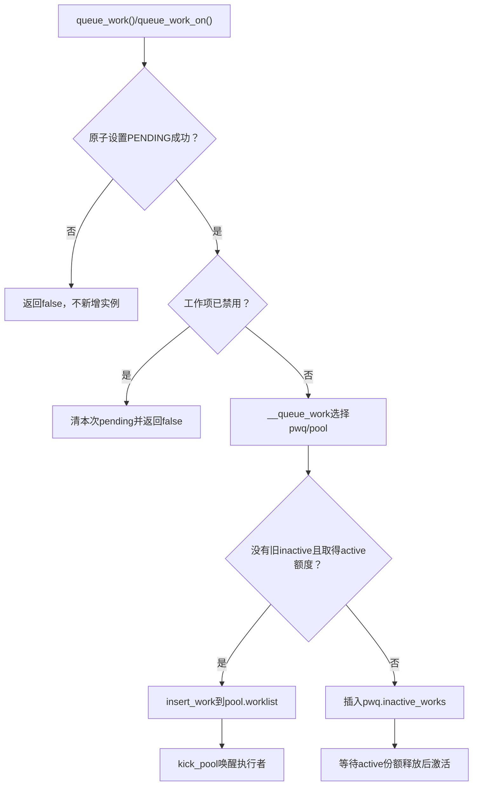
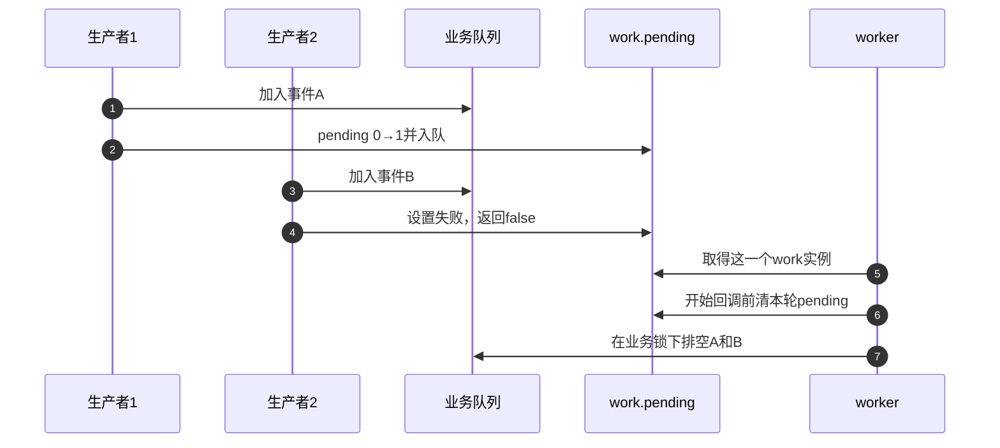

# 第4章\_work投递激活与pending合并

## 4.1\_queue\_work返回false意味着什么

上一章已经找到了工作对象、逻辑队列和执行池，但事件保存以后仍要取得排队资格。本章沿 S2～S4 追踪采样 work，先假设对象有效、未被禁用，且一直投递到同一个 workqueue。

提交者先原子尝试设置 work 的 PENDING 位。只有从非 pending 转为 pending 的调用者继续排队；其他并发提交返回 false。固定 6.12 还有 disable 计数：即使抢到 pending，发现工作项被禁用也会清除本次 pending 并返回 false。因此 false 表示没有新增排队请求，不能一概解释为“肯定已经有一个回调替我处理”。

可靠模式是先把事件放进受保护队列或累计计数，再 queue 一个负责排空的 work。pending 合并的是执行机会，不应吞掉业务事实。

## 4.2\_投递调用链

## 4.3\_为什么需要inactive列表

如果设备最多允许两轮操作处于活动阶段，第三轮已经提交却不能立刻占用设备资源，系统必须保存“已接收但还没资格执行”的状态。active 表示已获得活动额度，包括等待 worker 的工作和正在执行、甚至暂时睡眠的回调；inactive 则表示尚未获得该额度。它不是 CPU 调度器的运行/睡眠分类。

`max_active` 约束活动工作数，不是固定线程数。达到额度后，新 work 仍保持 pending 和归属，但先放入 pwq 的 inactive list；已有 active work 完成、`pwq_dec_nr_active()` 释放份额后，再推进暂缓项的激活。bound 队列按相应 CPU 的 pwq 计数；固定 6.12 的 unbound 队列还通过 wq 的节点级共享账本协调多个 pwq，不能把它简化成每个 pwq 各自拥有完整 max_active。

这样逻辑并发限制由 pwq 维护，pool 仍可为其他 workqueue 执行工作。

投递分流还先检查已有 inactive 链是否为空，不能仅因某一刻有额度，就让新到工作跳过早已暂缓的工作。unbound 的节点共享等待账本也参与后续公平推进；active 不是只比较一个数就能任意增加的字段。

## 4.4\_跨pool重新提交的约束

运行中的回调已经清除本轮 pending，另一 CPU 因而可能为它登记后继轮次。如果按照新 CPU 立即交给另一个池执行，同一回调就可能尚未结束又开始一次。对同一个 workqueue，固定实现会检查旧 pool 中是否仍有 worker 执行这个 work；符合条件时沿用该 worker 的 current_pwq，结合执行冲突检查保持非重入。ordered 队列还采用其专门的顺序连接管理。

这个保证有明确前提：从排队开始不修改回调函数、不重新初始化工作项，并且始终投递到 **同一个 workqueue**。跨 CPU 向同一队列重排可以符合这些条件；跨不同队列则不再享有这项非重入保证。pending 只能仲裁下一次登记，不能单独代表“当前没有人在运行”。

## 4.5\_发布顺序

成功 `queue_work()` 形成提交者到工作函数的发布边界：提交前的写必须能被执行该排队实例的 worker 观察。业务对象有多个生产者或 queue 返回 false 时，仍需用锁/原子操作保护它们之间的合并；工作队列的顺序不能替代业务队列自身一致性。

## 4.6\_delayed\_work的双阶段归属

delayed work 在延迟未到时由 timer 保存将来的投递；到期回调再把内含 work 送入 workqueue。取消必须同时处理 timer pending 与 workqueue pending/running，不能只对内含 `work_struct` 使用普通 cancel 接口。周期回调自重排还会制造新的生产者，必须受 stopping 控制。

用三个现场核对：正在运行且没有后继 pending 时，新的 queue 可能成功；被 disable 后尚未 enable 时，队列可以为空而 queue 仍返回 false；延迟定时器尚未到期时，工作也可处于 pending，不能只在 pool.worklist 上找它。第二章模型只覆盖未禁用的普通立即投递，不能拿模型省略的分支推断内核行为。

## 4.7\_源码入口

`queue_work_on()`、`__queue_work()`、`insert_work()` 与 active/inactive 状态见[工作队列对象与投递模块源码概念导读](../../../../../research/source_reading/workqueue/navigation/P02_Linux_6.12_工作队列对象与投递模块源码概念导读.md#2.3_从queue_work到insert_work)。唯一裁剪实现见[投递与激活源码实现](../../../../../research/source_reading/workqueue/source_explanations/P02_Linux_6.12_工作队列投递与激活源码实现.md#2.2_源码符号覆盖账本)。

## 4.8\_本章结论与下一问

pending 把并发提交合并为一个执行代表，pwq 再按 active 额度决定立即进入 pool 还是等待激活。work 到达 pool 后，仍需动态维持足够 worker；下一章进入 worker 并发管理和执行循环。

上一篇：[cmwq 对象层次与状态所有权](P03_cmwq对象层次与状态所有权.md)。

下一篇：[worker 并发管理与执行循环](P05_worker并发管理与执行循环.md)。
