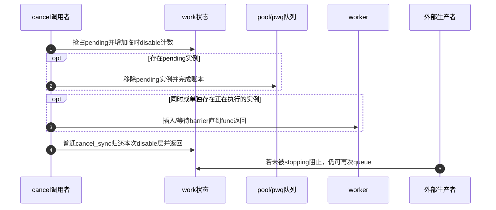
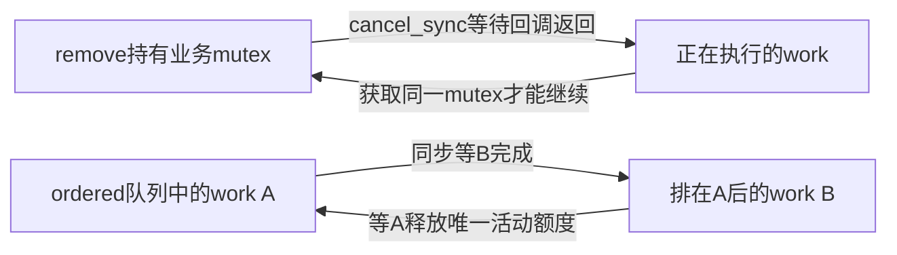

# 第6章\_flush\_cancel与颜色代际

## 6.1\_排空队列\_为什么不是稳定说法

生产者可以在 flush 进行时继续提交，工作函数也可能重排自己。如果要求队列在某一瞬间绝对为空，持续生产会让等待永不结束。workqueue flush 的核心是划定代际：等待 flush 边界之前属于目标颜色的 in-flight work 完成，后来提交的工作进入新颜色，不阻塞本轮结论。

颜色只是有限循环使用的代际编号，不是优先级。沿用采样设备，管理者想确认配置更新前已经接收的处理都结束，但新数据仍在到达；给旧工作一个可封存编号，就能把“等旧的完成”与“禁止新的提交”分开。多个池分别处理旧工作时，还需要把各连接的局部计数汇成一个全局结论。这是第二章 S8 的具体实现问题。

## 6.2\_三种等待对象

| 接口目标 | 等待/改变什么 | 不保证什么 |
| --- | --- | --- |
| `flush_work(work)` | 指定 work 当前目标实例完成 | 阻止以后重新 queue |
| `flush_workqueue(wq)` | wq 在 flush 颜色覆盖的 in-flight 代际完成 | 永久关闭生产者 |
| `cancel_work_sync(work)` | 取消 pending；若正在运行则等待退出 | 返回后其他路径不再 queue |

destroy 还需要更高层先封住生产者，不能把 cancel 或 flush 当停止开关。

## 6.3\_颜色怎样汇聚全局结论

work 入队时带上当前 work color；执行完成或取消时对应 pwq 的 in-flight 计数减少。所有 pwq 的目标颜色归零后，workqueue 才形成全局完成结论并唤醒 flusher。

具体状态落在 `pwq->nr_in_flight[color]`、`pwq->flush_color` 和 `wq->nr_pwqs_to_flush`。flush 准备路径在各 pool 锁下登记“这个 pwq 还有目标颜色的工作”，增加待完成连接数；完成路径只在该连接的目标计数归零时减少一次全局连接数。最后一个完成者调用 first_flusher 的 completion，等待方因此不用轮询每个池。

颜色切换是在各 pwq 的锁区间里落实，不是对全系统时钟拍下一个瞬时快照。flush 开始前已提交的工作必须被覆盖；与 flush 并发的提交则按其落入连接账本时的颜色归属分析，不能仅凭调用时间接近就断言必定属于新代际。

登记过程中还有一个容易漏掉的窗口：第一个 pwq 可能已经完成，而准备路径尚未登记第二个。固定实现先给全局计数保留一份准备期哨兵，遍历结束才归还它，防止中途暂时为零就提前宣布结束。更多 flusher 到来或颜色循环接近耗尽时，另有等待链和级联处理；颜色编号不能无条件复用。

例如旧颜色在 pwq0 有2个、pwq1有1个在途工作，新颜色又增加5个。旧颜色依次变为1/1、0/1、0/0时，只有最后一步完成本轮等待；新颜色的5个并不因此被取消。若旧颜色有一个 inactive 工作，它仍计入在途，不能仅凭不在 pool.worklist 就忽略它。

## 6.4\_flush\_work为何插入barrier

要等待一个具体 work，内核可在该 work 后面插入一个带 completion 的 barrier work；若目标正在执行，barrier 连接到当前执行序列。barrier 被执行并 complete，证明目标实例的执行位置已经越过。它不拥有业务对象生命期，也不禁止目标随后重新入队。

## 6.5\_cancel的竞争闭环

因此 remove 的第一步必须是让 P 不再提交；否则 cancel 返回后竞态依旧存在。

图中两个条件可以同时成立：上一轮回调正在执行，下一轮已经 pending。取消应处理这两份状态，不能在“队列中”与“正在执行”之间只选一条分支。

这里按 Linux 6.12.20 的 `__cancel_work_sync()`：先取消并临时禁用，再通过 flush 等待执行结束，普通 cancel 最后调用 enable 归还自己增加的禁用层。不是沿旧版 CANCELING 位解释本版本。`disable_work_sync()` 则保留它增加的禁用层，直到匹配的 enable；它也不代替调用者撤销入口、同步生产者和保持对象地址有效。

取消返回值回答是否取消了 pending 请求，不回答“是否曾等待正在运行的回调”。如果 pending 已清而回调还在执行，返回值可以为 false，但同步等待责任仍然完成。自重排与外部竞态投递也要分开：接口能处理回调自身的重排，永久停止仍须保证返回后没有外部来源重新提交。

## 6.6\_自等待和锁依赖

work function 对自己 `flush_work()` 或同步取消，会等待自身返回而死锁。同一 max_active=1/ordered 队列中，work A 等待排在其后的 work B，也可能永远无法推进。remove 持有 work 退出所需 mutex 再 `cancel_work_sync()` 同样形成依赖环。

这些错误要画成等待图：调用者等 completion/barrier，barrier 等 worker，worker 又等调用者持有的锁或同一队列额度。仅看到“接口允许睡眠”不足以证明安全。

前一环需要在同步取消前释放回调所需的锁，配合独立停止状态保证安全；后一环要改变依赖或执行域，增加普通池线程数不能解除 ordered 的唯一额度限制。

## 6.7\_源码入口

flush 颜色、barrier、cancel 和 destroy 的模块关系见[flush、取消与生命周期模块源码概念导读](../../../../../research/source_reading/workqueue/navigation/P04_Linux_6.12_flush取消与生命周期模块源码概念导读.md#4.2_三类完成证明)。唯一裁剪实现见[worker、flush 与取消源码实现](../../../../../research/source_reading/workqueue/source_explanations/P03_Linux_6.12_worker_flush与取消源码实现.md#3.4_flush颜色与barrier)。

## 6.8\_本章结论与下一问

flush 用颜色把分散 pwq 的局部 in-flight 证据汇聚成目标代际完成，cancel 用 pending 抢占与 barrier 处理排队/执行竞态；两者都不永久关闭生产者。下一章进入内存回收场景，解释 rescuer 怎样提供异常前进保证，以及 unbound 属性怎样改变 pool 选择。

上一篇：[worker 并发管理与执行循环](P05_worker并发管理与执行循环.md)。

下一篇：[unbound、rescuer 与回收前进性](P07_unbound_rescuer与回收前进性.md)。
