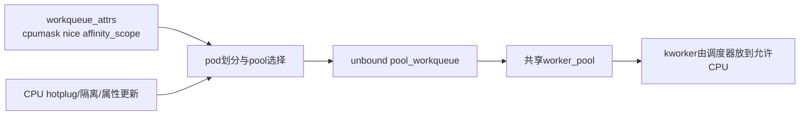
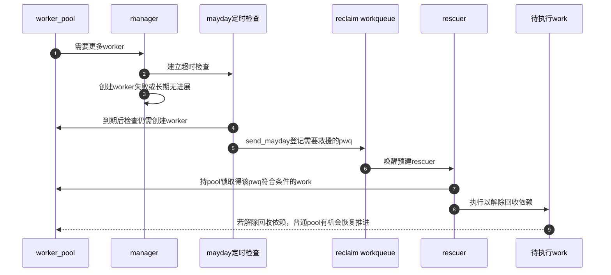

# 第7章\_unbound\_rescuer与回收前进性

## 7.1\_unbound解决的是执行域而非阻塞本身

第五章已说明 bound 池可以补偿 worker 睡眠，所以“回调可能阻塞”本身并不要求 unbound。真正要重新考虑的是执行位置：提交者频繁迁移时，为许多 CPU 分别保留执行资源可能浪费；长计算任务也可能希望由调度器在较大的允许集合内安排。`WQ_UNBOUND` 让 workqueue 按属性与亲和范围映射到共享 unbound pool，牺牲部分提交 CPU 局部性来取得这种灵活性。

代价是较弱的提交 CPU 局部性、更复杂的 pool 复用/属性更新，以及不能依赖每 CPU 顺序。unbound 不自动解决业务死锁，也不保证低延迟。

## 7.2\_属性传播关系

第三章的 pod 是亲和分组，不一定是严格的执行围栏。固定版本的 affinity_strict 属性决定是否严格限制在相应 pod；非严格策略允许调度器在有效 CPU 掩码内作进一步安排。cpumask 决定允许集合，nice 表示调度优先级偏好，affinity_scope 选择拓扑分组依据，三者改变的约束不同。

固定 6.12 的 unbound active 额度使用节点级共享计数。按允许集合中的在线 CPU 比例计算各节点份额，并在 min_active 与 max_active 之间限制结果；最低份额保证会使各节点份额之和不必严格等于用户传入值。绑定队列则采用对应 pwq 的活动数。不能把 max_active 看成固定线程数，也不能靠它给整个系统建立严格的外设并发上界；硬件资源上界应由业务协议保证。

这个固定树的 workqueue.rst 仍保留“unbound也总是每CPU额度”的旧文字，与 kernel/workqueue.c 的节点账本不一致。此处采用同一固定提交的 `wq_update_node_max_active()` 与 `pwq_tryinc_nr_active()` 解释实际实现，保留差异用于追溯，不把旧文档当作当前代码已经证明的行为。

## 7.3\_内存回收循环依赖

设回收路径等待 work A 释放内存，A 所在 pool 的 worker 都阻塞在内存分配，而创建新 worker 又需要内存。没有预留执行者时，系统可能在“必须执行 A 才能回收—必须先回收才能执行 A”之间僵住。

`WQ_MEM_RECLAIM` 在队列创建时预建 rescuer（救援执行线程），把关键执行资源的分配从内存紧张现场移到队列建立阶段。可能进入内存回收依赖路径的队列必须设置这个属性。正常路径仍由普通 pool 执行；manager 尝试创建 worker 时启动 mayday 定时检查，超时后如果仍需创建执行者，就登记有救援线程的相关 pwq 并唤醒它。

## 7.4\_正常与救援路径

rescuer 是异常慢路径，不保证无限并发，也不能修复 work 自等待或反向锁依赖。使用 WQ_MEM_RECLAIM 只在该队列确实位于回收前进依赖链时有意义。

救援请求实际保存在 wq->maydays 链上，pwq->mayday_node 表示该连接是否已经登记；登记时持有 pwq 引用，使救援线程取出并处理它之前连接不会消失。rescuer 处理的是对应 pwq 的可执行工作，不会凭空取消 inactive 额度或打破 A 等 B、B 又等 A 的依赖。若两个回收步骤必须互等，单个救援线程也可能不够，设计仍需拆开依赖与执行域。

## 7.5\_ordered\_highpri与power\_efficient边界

- `alloc_ordered_workqueue()` 建立队列内单活动顺序，长阻塞会拖住全部后继工作；内部使用 `__WQ_ORDERED`，不存在供调用者使用的公开 `WQ_ORDERED` 标志。
- `WQ_HIGHPRI` 选择高优先级 pool，不是实时保证，也不能绕过调度和锁等待。
- power-efficient 系统队列/配置可能牺牲局部性或唤醒时延来合并执行，适合不敏感后台工作。
- `WQ_FREEZABLE` 参与系统 freezer，但设备 suspend 仍需自己的硬件和对象状态协议。

## 7.6\_选择核对

- work 是否真的不应绑定提交 CPU，还是只是“可能阻塞”？
- CPU mask、NUMA 局部性和 affinity scope 的期望是否明确？
- 该 workqueue 是否位于 reclaim 依赖链，谁在等待它释放资源？
- ordered 或低 max_active 下是否存在 work 间同步等待？
- 高优先级是否有上界和依赖证明，还是仅希望“快一点”？

## 7.7\_本章结论与下一问

unbound 改变 pool 映射与调度位置，rescuer 只在普通 worker 创建受阻的回收慢路径提供前进性。最后一章把 CPU 热插拔、freezer、停机生产者和对象释放放进统一生命周期。

上一篇：[flush、cancel 与颜色代际](P06_flush_cancel与颜色代际.md)。

下一篇：[CPU 热插拔、电源管理与生命周期](P08_CPU热插拔电源管理与生命周期.md)。
