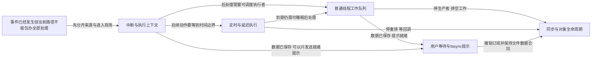

# 第1章\_Linux\_异步机制大纲

## 1.1\_原现场不能继续时\_把什么交给谁

[执行路径先修](../P01_同一对象的多条执行路径.md#1.1_先把一次加一拆开) 已经说明不同路径会交错。现在换一个问题：设备产生事件后，当前现场可能不允许睡眠，也可能不应长时间占用 CPU；有些工作要等到时间边界以后，有些结果还要通知用户程序。异步机制负责改变后续推进的执行者或时机，但仍要保存业务状态并完成退出交接。

先沿中断理解事件如何进入内核，再根据缺口选择线程执行、时间等待或用户通知。下面是阅读依赖，不表示所有软件事件都必须经过硬件中断，也不表示每条通知都保存一份业务记录。

## 1.2\_各专题接住哪一个未解决的问题

图中主线是普通线程工作队列。Linux 6.12 还有 `WQ_BH` 分支，回调运行在软中断上下文，不能据“工作队列”四个字认定可以睡眠。定时回调、IRQ线程和用户任务也各有上下文条件，进入具体专题后再据条件选择，不能用“异步”概括它们的全部保证。

| 从哪里接入 | 阅读入口 | 本专题建立什么 | 给后续留下的责任 |
| --- | --- | --- | --- |
| 外设有数据，软件怎样获知并找到来源 | [中断机制](interrupts/大纲.md) | 控制器与软件身份、注册、触发、清源、下半部、诊断与停止 | 通知合并后，业务记录如何保存 |
| 原现场不能执行完整后处理 | [工作队列](workqueue/大纲.md) | 工作描述、pending合并、执行资源、重排、flush/cancel和生命周期 | 队列不是无限业务日志，停止时仍要先阻止新提交 |
| 时间到期以后才允许继续 | [定时与延迟执行](timers/大纲.md) | 时间表示、睡眠、timer、hrtimer与delayed work的选择和退出 | 到期不等于已经执行，也不等于设备动作完成 |
| 数据留在内核，用户怎样等待或获知变化 | [fasync异步通知](async_notification/大纲.md#1.1_先看到数据与提示的区别_再进入实现) | 数据与提示分离、文件订阅、信号接收、并发退场和多源组合 | 提示不替代read，用户仍需处理合并、就绪重检与对象寿命 |

如果目标是等待可读状态，先确定 [阻塞I/O与poll/epoll](../../io_model/blocking_io/大纲.md) 的条件与消费规则，再判断是否还需要信号通知。不要因为设备使用中断，就认定用户也必须接收信号；内核收到中断与用户选择哪种等待接口是两次不同的交接。

## 1.3\_硬件规则与领域组合各自放在哪里

Linux 中断管理负责软件对象、分派和驱动调用。**通用中断控制器（Generic Interrupt Controller，GIC）** 的硬件请求、状态与处理器递送规则，从 [GICv3独立专题](../../../../platforms/arm/architecture/gic/大纲.md#1.2_因果阅读地图) 学习；该专题先区分架构、产品与芯片，再以 GIC-600 r1p6 / GICv3.0 和 RK3588 集成资料核对实现。硬件专题与 Linux 通过 [中断专题分工入口](interrupts/大纲.md#1.3_与独立GIC专题的分工) 衔接，不相互替代。

通用机制进入具体领域后，会与其业务状态组合。[VFS Direct I/O与异步完成](../../../kernel_subsystems/vfs/P17_Direct_IO与异步完成.md) 保留 I/O 请求和完成的领域条件，[字符设备阻塞、poll与异步通知](../../../driver_model/character_device/P06_阻塞_poll与异步通知.md) 保留文件消费合同。这些应用不需要复制一份完整工作队列或定时器教材。

最后回到 [同步机制](../synchronization/大纲.md) 核对共享状态、顺序与完成，再核对对象生命周期。异步只改变工作怎样继续，不免除调用者对数据、资源和最后一次访问的责任。
