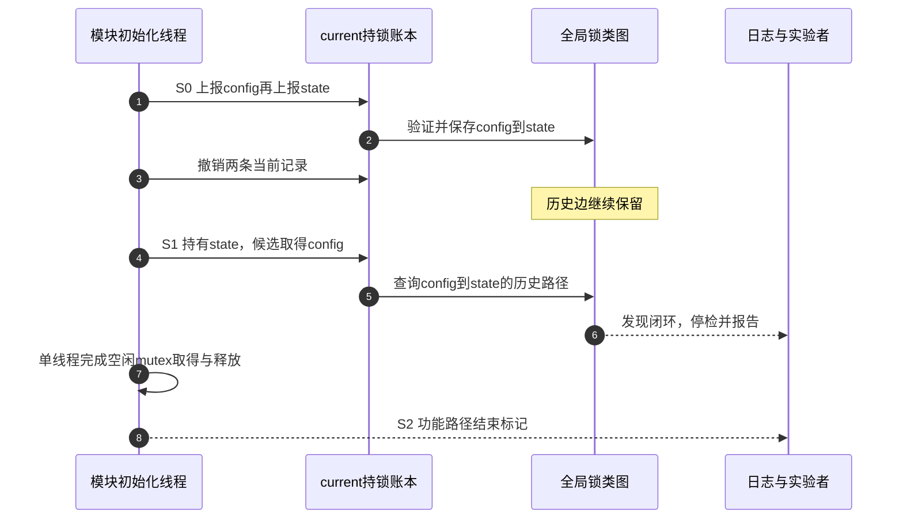

# 第8章\_配置\_亲手实验与报告解读

## 8.1\_先把使用资格变成环境检查

P06 已经回答“代码作者怎样使用”：标准锁调用者自动获得检查事件，公共函数维护者可以加入断言，只有新原语实现者才直接接入 map。本章继续回答更现实的一问：**我手上的机器和权限，能不能让这些检查真的运行？**

| 当前条件 | 能参与到哪一步 | 不应冒充什么结论 |
| --- | --- | --- |
| 能构建、启动并重启调试内核 | 可以配置 Lockdep、加载实验模块并设计完整覆盖 | 仍不能由一次无告警推出全代码安全 |
| 不能重建内核，但运行内核已启用完整 Lockdep | 可以执行自己的驱动路径、读取报告和状态 | 不能假定发行版一定启用了所需规则 |
| 没有模块加载权限或受签名、lockdown 限制 | 可以读取允许访问的配置与日志，或把测试交给受控 CI/虚拟机 | 模块没有运行不能算“实验无告警” |
| 只维护用户态锁 | 只能通过系统调用间接覆盖内核路径 | 内核 Lockdep 不检查 `pthread_mutex` |

最合适的第一次实验环境是可保存快照、允许预期告警并能够重启的虚拟机或 QEMU，而不是生产机。身份不是门槛，**可控内核、可执行路径和可复核证据** 才是门槛。

“内核启动正常，没有 Lockdep 报告”不是有效实验结论。至少三道门槛要同时成立：

```text
构建能力存在
  ∧ 检查器当前仍有效
  ∧ 目标组件链实际执行
  → 本轮无告警才形成有限证据
```

Linux 6.12.20 的主要配置职责如下：

| 配置 | 本实验需要它回答什么 | 关闭后的边界 |
| --- | --- | --- |
| `CONFIG_PROVE_LOCKING` | 完整锁依赖、IRQ 状态和闭包验证是否启用 | 不能声称做过完整依赖证明 |
| `CONFIG_DEBUG_LOCK_ALLOC` | 标准锁是否包含检查身份，生命期误用检查是否启用 | 相应 map/生命期诊断缺失 |
| `CONFIG_LOCKDEP` | 核心状态、事件和 proc 设施是否编译 | 多数 map、事件、查询和断言退化 |
| `CONFIG_LOCK_STAT` | 是否额外收集竞争和持有统计 | 不影响基本正确性图是否存在 |
| `CONFIG_PROVE_RCU` | RCU 动态调用条件是否消费 Lockdep 状态 | RCU 功能仍在，相应动态条件告警关闭 |

`LOCKDEP` 是隐藏基础设施，通常由用户可见的 `PROVE_LOCKING`、`DEBUG_LOCK_ALLOC` 或 `LOCK_STAT` 选择。完整依赖实验优先明确启用 `PROVE_LOCKING`，不要只看到 `CONFIG_LOCKDEP=y` 就推断所有规则存在。版本化配置与诊断阅读先进入 [Lockdep 总阅读索引](../../../../../research/source_reading/lockdep/navigation/P01_Linux_6.12_Lockdep源码导读.md#1.6_建议阅读顺序)和[查询适配与诊断模块导读](../../../../../research/source_reading/lockdep/navigation/P04_Linux_6.12_Lockdep查询适配与诊断模块导读.md#4.1_模块问题)，具体配置证据见 [`PROVE_LOCKING`、`DEBUG_LOCK_ALLOC` 与 `LOCKDEP`](../../../../../research/source_reading/lockdep/source_explanations/P04_Linux_6.12_Lockdep查询注解与配置源码实现.md#4.5_PROVE_LOCKING_DEBUG_LOCK_ALLOC与LOCKDEP)。

先在目标机读取构建能力：

```bash
# 目标 Linux，读取当前运行内核导出的构建配置。
zcat /proc/config.gz \
  | grep -E 'CONFIG_(PROVE_LOCKING|DEBUG_LOCK_ALLOC|LOCKDEP|PROVE_RCU)='
```

`zcat` 解压内核导出的配置，`grep` 筛选本实验关心的选项。没有 `/proc/config.gz` 时，改为读取与正在运行内核完全匹配的构建配置；文件缺失不等于选项关闭。构建选项成立以后，再读运行态：

```bash
# 同一目标 Linux；配置存在不等于检查器仍然工作。
sudo grep -E 'debug_locks|lock-classes|dependency chains|max locking depth' \
  /proc/lockdep_stats
```

`debug_locks` 表明检查器是否仍有效，其余字段帮助观察当前历史和深度；值的含义在 8.7 节展开。用户态不需要额外 Lockdep 分析器，`dmesg` 和 `/proc` 只是读取内核已经产生的状态。

## 8.2\_用不会真实卡死的组件链进入实验

目标是验证 P01 的组件链闭包，不是让实验机永远互等。模块在同一初始化线程中顺序执行：

```text
第一次：config_lock → state_lock，全部释放
第二次：state_lock → config_lock
```

第二次取得 `config_lock` 前，Lockdep 已有 `config → state` 历史，能够报告候选反向边。功能 mutex 此刻都空闲，所以调试器报告以后模块路径仍可结束；这正好隔离“协议证明”和“真实调度卡死”。

## 8.3\_把最小模块真正跑起来

本节沿一条路线操作：**确认运行内核 → 准备同一份模块 → 编译 → 观察并加载 → 保存报告和状态 → 卸载与恢复**。配套[独立实验](../../../../../labs/kernel/lockdep/P01_锁顺序反转与报告解读/README.md#1.1_本实验把哪条推理交给读者完成)提供交叉构建等环境分支；下面在正文完成“目标 Linux 本机已有匹配构建目录”这条主线。没有对应环境时，先完成环境准备，不把源码阅读当成运行结果。

### 8.3.1\_先让源码与正在运行的内核对应

在目标 Linux 的普通终端查看正在运行的内核版本及模块构建入口：

```bash
# 目标 Linux；此处只是读取环境，还没有加载模块。
uname -r
ls -ld /lib/modules/$(uname -r)/build
```

`uname -r` 给出运行内核发行字符串，后一个路径应指向为它准备的构建目录；仅有同版本源码目录但配置、生成文件或符号信息不匹配，也不足以保证模块可用。路径不存在时，应按目标内核的构建方式准备匹配产物。配置与运行态还须通过上一节的两次读取核对，特别是 `debug_locks` 必须在实验前有效。

把下面完整源码保存为 `lockdep_cycle_demo.c`，或者取用[同名材料](../../../../../labs/kernel/lockdep/P01_锁顺序反转与报告解读/lockdep_cycle_demo.c)。正文与材料使用相同的 `config_lock/state_lock` 和 `lockdep_cycle_lab` 日志前缀。`DEFINE_MUTEX` 静态初始化两把锁，`LAB_PREFIX` 是本例自定的日志字符串；`IS_ENABLED` 检查构建配置，配置不满足时返回 `-EOPNOTSUPP`（不支持该操作），但这不能判断运行中的检查器是否已经停检。

```c
// SPDX-License-Identifier: GPL-2.0-only
/*
 * Lockdep 锁序实验：
 * 1. 先完整执行 config_lock -> state_lock；
 * 2. 再完整执行 state_lock -> config_lock；
 * 3. 让 Lockdep 组合两条组件链，而不制造真实 ABBA 卡死。
 */

#include <linux/errno.h>
#include <linux/init.h>
#include <linux/module.h>
#include <linux/mutex.h>

#define LAB_PREFIX "lockdep_cycle_lab: "

static DEFINE_MUTEX(config_lock);
static DEFINE_MUTEX(state_lock);

static int __init lockdep_cycle_demo_init(void)
{
	if (!IS_ENABLED(CONFIG_PROVE_LOCKING)) {
		pr_err(LAB_PREFIX "CONFIG_PROVE_LOCKING is disabled\n");
		return -EOPNOTSUPP;
	}

	pr_info(LAB_PREFIX "S0 record config_lock -> state_lock\n");
	mutex_lock(&config_lock);
	mutex_lock(&state_lock);
	mutex_unlock(&state_lock);
	mutex_unlock(&config_lock);

	pr_info(LAB_PREFIX "S1 propose state_lock -> config_lock\n");
	mutex_lock(&state_lock);
	mutex_lock(&config_lock);
	mutex_unlock(&config_lock);
	mutex_unlock(&state_lock);

	pr_info(LAB_PREFIX "S2 functional mutex path completed\n");
	return 0;
}

static void __exit lockdep_cycle_demo_exit(void)
{
	pr_info(LAB_PREFIX "unloaded\n");
}

module_init(lockdep_cycle_demo_init);
module_exit(lockdep_cycle_demo_exit);

MODULE_LICENSE("GPL");
MODULE_AUTHOR("FormingSystem");
MODULE_DESCRIPTION("Lockdep lock-order inversion lab without a real deadlock");
```

S0 与 S1 分别执行两条完整组件链，S2 只表示功能路径到达末尾。模块许可证、作者和描述是模块元数据，不是检查事件。卸载入口打印标记，便于确认卸载已执行；本例没有额外分配资源。

在同一目录保存 `Makefile`：

```make
obj-m += lockdep_cycle_demo.o
```

`obj-m` 是 Kbuild 的模块对象列表，这一行要求把对应 C 文件构建为可加载模块。取用配套实验目录时已经有包含构建与清理目标的 Makefile，无须覆盖；两种方式都构建同一 C 源码。

### 8.3.2\_构建完成以后再检查加载资格

```bash
# 目标 Linux，进入放有 C 文件和 Makefile 的实验目录后执行。
make -C /lib/modules/$(uname -r)/build M="$PWD" modules
```

`-C` 让 make 进入运行内核的构建目录；`M="$PWD"` 把当前实验目录交给 Kbuild，作为外部模块的源码和输出位置；`modules` 请求构建模块目标。成功后才有 `lockdep_cycle_demo.ko` 可供下一步读取。

```bash
# 同一实验目录；只读取新生成模块的版本信息。
modinfo -F vermagic ./lockdep_cycle_demo.ko
```

`vermagic` 是内核用于模块兼容性判断的一部分。它与运行内核相符仍不保证签名、权限和全部符号条件都满足；最终以加载返回值和日志为准。构建失败时应停止，不加载目录里可能遗留的旧模块。

### 8.3.3\_同时保存组件链与检查器状态

在目标 Linux 的终端 A 跟随日志：

```bash
# 目标 Linux 的终端 A，保持此命令运行以观察新消息。
sudo dmesg -wH
```

`-w` 持续等待新日志，`-H` 采用便于阅读的显示方式。使用 systemd 日志且 dmesg 读取受限时，可在该终端改用 `sudo journalctl -kf` 跟随内核日志；具体权限仍由目标系统决定。再在终端 B 的实验目录保存运行前证据：

```bash
# 目标 Linux 的终端 B，当前目录用于保存本次记录。
sudo dmesg > lockdep_cycle_demo.before.dmesg
sudo grep 'debug_locks' /proc/lockdep_stats > lockdep_cycle_demo.before.stats
```

这两个快照分别保存旧日志和实验前的检查器状态。打开统计文件确认 `debug_locks` 有效；若已经为 0，应在干净启动后重试，不能在失效状态下注入错误再声称“没有告警”。确认后加载：

```bash
# 目标 Linux 的终端 B，只在允许预期告警的调试环境执行。
sudo insmod ./lockdep_cycle_demo.ko
```

`insmod` 请求加载模块，并在返回前执行模块初始化入口。若签名、权限、配置或符号错误导致加载失败，先读取完整错误；初始化没有完成不能算完成实验。成功执行后保存完整日志：

```bash
# 目标 Linux 的终端 B，加载尝试结束后保存完整现场。
sudo dmesg > lockdep_cycle_demo.dmesg
```

不要先清空 dmesg。比较 before 和本次文件可以区分旧报告与新报告。下面只用筛选辅助定位，完整日志仍是证据：

```bash
# 同一目录，读取刚保存的日志文件。
grep -E 'lockdep_cycle_lab|possible circular locking dependency|existing dependency chain|locks held' \
  lockdep_cycle_demo.dmesg
```

预期先出现 S0，再出现 S1，循环报告位于 S1 与 S2 之间，最后 S2 表明功能路径到达末尾。这是 **预期顺序**，不是本仓库已经采集的运行报告。再保存报告后的生命状态：

```bash
# 目标 Linux 的终端 B，与加载前快照共同保留。
sudo grep 'debug_locks' /proc/lockdep_stats > lockdep_cycle_demo.after.stats
```

固定 Linux 6.12.20 的循环报告路径会关闭检查器。实际记录仍须取自目标系统，不能把预期的 0 填进结果文件。下一节用这些材料分别解释功能路径完成和检查器停检。

### 8.3.4\_结束本轮并准备可比较的下一轮

```bash
# 目标 Linux；只在本次模块成功加载后执行。
sudo rmmod lockdep_cycle_demo
```

成功卸载可看到 `unloaded` 标记。失败时保留错误并核对模块状态，不把错误重定向掉。终端 A 可用 Ctrl+C 结束日志跟随，已经保存的日志文件仍在。

需要清理构建产物时，在原实验目录使用同一个构建入口：

```bash
# 原构建环境的实验目录；在保存日志以后执行。
make -C /lib/modules/$(uname -r)/build M="$PWD" clean
```

清理模块文件不会恢复 `debug_locks`。完成本轮预期错误后应重启实验内核，重新确认检查器有效，再测试修复版本。日志和统计是本机实验产物，不应混入知识仓库的已跟踪教材。

最后用本次证据回答：为什么 S0 释放以后历史边仍在？为什么 S1 只有一个线程也能报环？为什么 S2 出现仍不能证明锁序正确？答案分别来自历史路径、当前候选取得点和功能/检查两条链。任一标记缺失时，先检查加载返回值和完整日志。

## 8.4\_把运行过程记成状态接力

| 时点 | current 账本 | 全局历史 | 预期结论 |
| --- | --- | --- | --- |
| 加载前 | 无本模块 held record | 无本模块锁类边 | `debug_locks` 应仍有效 |
| 组件链1内 | 增加 `[config,state]`，随后撤销这两条记录 | 保存 `config → state` | 不应有循环报告 |
| 组件链2取得 config 前 | `[state] + 候选config` | 已有反向 `config → state` | 报告 circular dependency |
| 报告后 | 功能 mutex 仍按代码取得和释放 | 6.12.20 的循环报告路径会关闭 `debug_locks` | 后续无告警不再是证明 |

表中只展示本模块两把锁的账本部分，不能据此断言加载线程完全没有其他外层持锁记录。到报告阶段，表中的功能动作也不再等于“检查账本仍完整同步”：检查器已经停检，后续取得和释放仍由 mutex 功能实现负责。



图中第 3 步撤销当前记录，第 5 步仍可读到历史；第 6 步停检以后，第 7～8 步的功能路径仍能完成。因此，一次启动只注入一个预期错误。保存完整日志后重启，再做下一类故障实验；不要在 `debug_locks=0` 的同一启动里连续注入多种错误并比较“谁没报”。

## 8.5\_再把循环报告还原成同一条因果链

不要从最长的函数栈开始猜根因。按四个问题读取：

1. **报告在分类什么：** circular dependency、recursive locking、inconsistent state、bad unlock balance，还是容量/内部错误；
2. **本次新增什么：** current 正持有哪个前驱，又在哪个调用点准备取得哪个后继；
3. **历史怎样返回前驱：** 过去在哪些调用点建立了后继到前驱的路径；
4. **current 为什么把两者接起来：** 当前 held locks 列表中哪些记录仍未 release。

对本实验，最终应还原为：

```text
本次现场：持有 state，准备取得 config
候选新边：state → config
历史反向链：config → state
图结论：候选边加入后形成强依赖环
代码根因：两条路径没有统一锁序
```

报告最上面的函数只是最后补齐环的位置，不一定是唯一需要修改的路径。真正修复要比较两个方向的业务保证、调用者和所有权，再决定统一锁序、拆分临界区、去除嵌套或改变调用方向。

本例可以做一次可比较的修复：仅把第二段改成先取得 `config_lock`、再取得 `state_lock`，仍按相反顺序释放，同时把 S1 日志改为修复后的顺序。在干净启动中重新构建和加载，保留 S0/S1/S2 三个标记、配置及前后状态。预期不再产生本例的反向边，且检查器保持有效。若只删掉第二段，告警也可能消失，但它回答的是“未执行反向路径”，并没有测试改正后的第二条业务路径。比较实验必须保留要验证的操作。

## 8.6\_同一方法怎样扩展到IRQ报告

`inconsistent lock state` 或 IRQ inversion 需要找两类历史：

- 哪个调用栈让锁类成为 hardirq/softirq-safe，即在相应 IRQ 上下文取得；
- 哪个调用栈在相应 IRQ 开启时取得同类锁或依赖链终点，使它成为 unsafe。

再回到 P05 的时间线判断：IRQ 是否可能打断 unsafe 路径，随后取得 safe 锁并沿依赖等待回去。修复选择可能是：

- 进程侧对共享自旋锁统一使用正确的本地 IRQ 屏蔽协议；
- 把工作移到线程化 IRQ、workqueue 或其他允许睡眠的上下文；
- 拆开 IRQ 域与进程域的状态和锁；
- 消除 `safe → ... → unsafe` 的依赖链。

不能看到 IRQ 报告就机械替换所有 `spin_lock()`。先确认目标内核是否 PREEMPT_RT、具体 handler 是否线程化、共享状态在哪里、锁的临界区是否适合 hardirq。

## 8.7\_用proc接口确认历史与检查器生命状态

循环报告之后，功能线程仍能打印 S2，可是检查器已经停止继续证明。只看模块有没有返回，会把这两件事混为一谈。要解释后续沉默，首先读取 `debug_locks`；要知道已经积累了多少历史，再查看类、边和链的统计。若关心的是竞争耗时，则需要另一个统计设施，不能拿依赖边的数量当作等待时间。

| 接口 | 主要用途 | 不能推出什么 |
| --- | --- | --- |
| `/proc/lockdep` | 枚举锁类和依赖信息 | 业务所有分支已经覆盖 |
| `/proc/lockdep_chains` | 在完整证明配置下查看已记录链 | 未出现的链一定安全 |
| `/proc/lockdep_stats` | 查看类、边、链、堆栈、最大深度和 `debug_locks` | 锁竞争性能优劣 |
| `/proc/lock_stat` | `CONFIG_LOCK_STAT` 下查看竞争、等待和持有统计 | 热点锁一定有协议错误 |

容量与生命状态巡检：

```bash
# 目标 Linux；读取检查器状态与容量使用情况，权限不足时按系统授权使用 sudo。
grep -E 'lock-classes|direct dependencies|dependency chains|stack-trace entries|max locking depth|debug_locks' \
  /proc/lockdep_stats
```

看到 proc 文件只说明相关代码存在；还要确认 `debug_locks`、当前值与 `[max: ...]`，并用测试记录证明目标路径实际执行。具体创建条件见 [`lockdep_proc_init()` 与 `/proc/lockdep*`](../../../../../research/source_reading/lockdep/source_explanations/P04_Linux_6.12_Lockdep查询注解与配置源码实现.md#4.6_lockdep_proc_init与proc接口)。

## 8.8\_最后把单次实验扩展成覆盖计划

回到贯穿设备：连续执行一万次正常配置路径，可能只反复命中同一条 `config → state` 链；若反向顺序只在恢复失败分支出现，正常负载再长也不会提供它的证据。下一步应按真实业务入口触发恢复、超时和卸载，并记录对应组件链是否执行。测试目标因而是让每种相关简单组件链至少进入一次图，而不是只增加运行时长。

下面按可能改变协议输入的维度整理覆盖计划。只覆盖目标驱动确实具有的路径，不为没有的上下文编造测试：

| 协议维度 | 至少覆盖的路径 |
| --- | --- |
| 正常锁序 | 每个会改变嵌套方向的条件分支和回调入口 |
| 失败回退 | 可中断取得、超时、probe 失败、错误恢复和 teardown |
| 执行上下文 | 进程、softirq、hardirq、线程化 IRQ、workqueue 与电源管理 |
| 取得类型 | 独占、共享读、递归读、trylock 和 wait type 组合 |
| 对象层级 | 父/子、容器/成员、同类多实例的最大真实嵌套 |
| 生命周期 | 初始化、发布、热插拔、卸载、重复加载和异常释放 |

覆盖记录最好同时保存：运行内核版本与配置、测试用例、确认执行的组件链、完整首个报告、实验前后的 `/proc/lockdep_stats`。这样“无告警”才可以被后续复核。

## 8.9\_从实验回到工程结论

外部驱动作者、模块开发者和学习者都有资格使用 Lockdep；真正决定能否形成证据的是调试内核能力、路径是否执行、检查器是否仍有效以及实验环境能否承担告警与重启。最小顺序反转实验用单任务依次执行两个方向，验证的是组件链闭包，不制造真实卡死。报告应被还原为本次新边、历史反向路径和 current 账本；配置、`debug_locks` 和路径覆盖缺一不可。一次严重报告后应在干净启动继续实验。

最后一章把这些前提收束成工程判断：链缓存仍有哪些成本，固定容量为什么也是证明前提，四种“无告警”现场分别能得出什么结论，以及 Lockdep 与其他工具怎样分工。

上一篇：[RCU 与子系统检查适配](P07_RCU与子系统检查适配.md)。

下一篇：[成本、覆盖边界与工程选择](P09_成本_覆盖边界与工程选择.md)。
