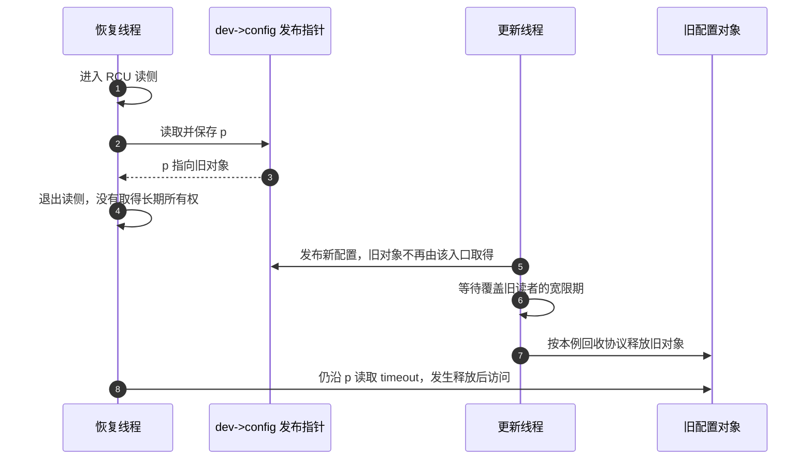

# 第9章\_成本\_覆盖边界与工程选择

## 9.1\_先把无告警写成条件命题

上一章已经用两条顺序执行的组件链重建了潜在死锁报告。现在回到贯穿设备 demo_device：修复恢复路径的锁序后，回归测试没有再报警，团队准备判断这个版本能否继续交付。仅仅保存一张安静的日志，还不能回答测试是否覆盖恢复入口、验证器是否仍在工作，更不能回答设备数据与对象寿命是否正确。

本章先解释持续检查的成本、容量与覆盖边界，再用同一设备的回归过程选择下一份证据。对“Lockdep 没报，所以锁没有问题”这句话，本专题建立的模型只允许改写成下面的条件命题：

> 在记录的内核版本和配置下，检查器于目标路径执行期间保持有效；这些路径正确上报并形成了所列简单组件链；Lockdep 没有在当前分类、取得类型和规则范围内发现冲突。

这句话刻意没有证明：未执行分支、未接入原语、错误归类、数据竞争、UAF、内存序或业务活性问题。工程结论的强弱取决于输入证据，不取决于报告页面是否安静。

## 9.2\_链缓存消除了哪部分成本

首次出现一条锁链时，验证器可能需要比较当前前驱、搜索全局图、传播 IRQ 使用状态、保存证据栈并写依赖边。若每次高频取得都重复这些工作，调试内核很快不可用。

沿用设备的 `config_lock → state_lock` 路径，假设启用了完整证明、检查器有效，而且两次都是普通阻塞取得。第一次取得两锁时，当前任务形成这条链的键；缓存中没有对应项，检查器进入全局图，检查前驱并保存依赖。释放两锁以后，当前账本撤销，历史与缓存继续存在。第二次仍按相同身份和取得类型执行时，可以利用已有缓存省去重复的完整依赖验证；它不能省掉本次进入、退出的事件，否则后来遇到第三把锁时就不知道当前前缀是什么。

在这个范围内，链缓存把成本分成两层：

```text
每次仍要承担：事件上报、current账本维护、链键计算、适用的缓存查询
首次新链额外承担：完整依赖验证、相关证据栈保存、依赖边写入
重复旧链可以省略：再次完整搜索与重复写边
```

不能把这张成本表理解为“命中链缓存就跳过一切规则”。IRQ 使用状态的登记与检查也有自己的入口；同一把锁第一次在硬中断上下文使用，是新的使用事实，不能因普通进程路径曾命中缓存就免检。trylock、关闭完整证明或显式不检查的事件也不全都走上述新链验证分支。缓存项的存在更不能单独证明本轮有效：发生错误并停检后，必须先回到 `debug_locks` 和完整报告判断证据边界。

所以缓存不是“Lockdep 零开销”。调试配置还会扩大锁结构或任务状态，保存全局类、链和堆栈，增加分支、临界区及跨 CPU 缓存流量。`CONFIG_PROVE_LOCKING` 更适合开发、回归和专用复现内核，不应默认当作低开销生产监控。

## 9.3\_固定容量为何是证明前提

Linux 6.12.20 对不同状态池分别设限：锁类索引空间、每任务 held 深度、依赖边、链、链元素、堆栈条目和 BFS 队列都不是无限的。当前源码中：

- `MAX_LOCKDEP_KEYS` 为 `1 << 13` 个锁类槽位；
- `MAX_LOCK_DEPTH` 为每任务 48 条 held records；
- 其他池由 `CONFIG_LOCKDEP_*_BITS` 和内部常量继续约束。

这些数字属于版本实现，不是 Lockdep 永恒契约。目标机应以匹配源码和 `/proc/lockdep_stats` 的 `[max: ...]` 为准。先从 [Lockdep 总阅读索引](../../../../../research/source_reading/lockdep/navigation/P01_Linux_6.12_Lockdep源码导读.md#1.6_建议阅读顺序)取得版本坐标，并用[查询适配与诊断模块导读](../../../../../research/source_reading/lockdep/navigation/P04_Linux_6.12_Lockdep查询适配与诊断模块导读.md#4.1_模块问题)理解容量与停检状态的消费关系；具体证据见 [`lock_class_key` 与 `lockdep_map` 身份结构](../../../../../research/source_reading/lockdep/source_explanations/include/linux/lockdep_types.h.md#1.2_lock_class_key与lockdep_map身份结构)、[`task_struct` 持锁账本与 `held_lock`](../../../../../research/source_reading/lockdep/source_explanations/P02_Linux_6.12_Lockdep取得释放与持锁账本源码实现.md#2.2_task_struct持锁账本与held_lock)和[容量常量与停检边界](../../../../../research/source_reading/lockdep/source_explanations/P04_Linux_6.12_Lockdep查询注解与配置源码实现.md#4.7_容量常量与停检边界)。

容量耗尽后不能理解成“只少记一条边，其他证明仍完整”。为避免半写全局状态继续产生看似可信的结论，相关错误路径会停检。此后的沉默不再具有证明意义。

可以用一个不运行内核的纸面反例验证这个必要性：历史已经保存 `A → B`；现在容量用尽，使 `B → C` 无法记录；随后出现 `C → A`。如果检查器悄悄丢掉中间那条边却继续声称验证有效，现有图就找不到完整的 `A → B → C → A`，而业务路径并没有消失。停检是在撤回证明资格，不是在替业务消除死锁。这里假设丢边是为了解释错误后果，并不是声称该版本真的采用这种继续运行策略。

## 9.4\_锁类或链为何异常增长

容量紧张可能来自真实覆盖扩大，也可能是模型错误：

1. 同一结构字段的动态实例没有共享稳定初始化 key，被拆成大量类；
2. 模块反复装卸产生新身份，而既有全局依赖仍需要安全处理；
3. 动态 key 登记、注销和对象生命周期不匹配；
4. 为压告警滥建独立 key 或 subclass；
5. 新测试确实覆盖了更多合法类、边和链，当前配置上限不足。

先比较 `/proc/lockdep_stats` 的增长趋势，再从 `/proc/lockdep` 定位新增类名，并回到初始化调用点和业务协议。若根因是错误分类，只扩大数组会延后而不会修复失效。

## 9.5\_四种无告警现场不能混写

| 现场 | 可以得出的结论 | 明确不能推出 |
| --- | --- | --- |
| 检查有效，目标链已执行，无告警 | 已上报组件链在当前模型下未发现冲突 | 未执行分支、未接入原语和生命周期一定正确 |
| 配置关闭或能力不完整 | 没有相应动态 Lockdep 证据 | 锁协议正确 |
| `debug_locks=0` | 之前已有错误、容量或内部路径使检查器停检 | 停检后的路径没有问题 |
| 只覆盖初始化/快路径 | 已覆盖快路径没有触发相应告警 | 错误恢复、IRQ、热插拔和卸载安全 |

有效测试报告必须把“无告警”与配置、检查器生命状态和组件链清单放在一起。

练习：甲测试连续运行一小时，但只执行 `config → state`；乙测试先执行这个方向，随后执行恢复路径 `state → config`，在第二段立即报告。哪个更能回答“两个入口是否统一锁序”？乙，因为它覆盖了决定命题的两个组件。甲的运行时长不能替代缺失的方向。再假设乙执行前检查器已经停检，即使两段都留下日志，也只能证明路径执行，不能宣称验证器已经检查这两条链。

## 9.6\_觉得误报或漏报时先审计输入

Lockdep 按上报模型推理。报告与业务直觉冲突时，按因果顺序检查：

1. 实例是否被错误合并或错误拆分成锁类；
2. `_nested()` 层级是否由稳定拓扑决定并被所有路径遵守；
3. trylock、独占/读类型和 wait type 是否忠实；
4. acquire/release 是否覆盖成功、失败、超时、异常和非栈顶释放；
5. hardirq/softirq 状态是否来自真实受支持入口；
6. 自定义同步原语是否根本没有接入，或重复接入标准原语。

只有证据表明输入模型错误，才调整注解。模型正确时，报告通常在揭示业务锁序或上下文问题；novalidate、notrack 和 `lockdep_off()` 都不是普通修复方案。

## 9.7\_修复锁序之后\_同一设备还要证明什么

仍从配置与恢复两条路径开始。原来配置按 `config_lock → state_lock` 取得两把 mutex，恢复反着取得；现在把恢复也改成相同顺序。测试需要证明的是“改后的两条业务路径确实都执行了，并且在有效检查期间没有形成反向依赖”，不是“删除恢复测试后日志变干净”。下面几种后续现象是假设的工程分支，用来推导证据选择，不是本仓库已经采集到的设备故障。

### 9.7.1\_第一轮先确认恢复路径确实进入了检查

如果测试只反复改配置，Lockdep 反复接收的仍然只是 config 到 state 的方向；运行更久不能补上恢复入口。应先安排能够触发恢复条件的用例，并确认它跨过了相应加锁点。KUnit 是内核内单元测试框架，适合驱动可隔离的内核逻辑；kselftest 是内核自测试体系，常从用户空间驱动内核接口。已有模块场景也可以承担触发任务。选择哪一种，取决于恢复路径的真实入口，而不是哪个工具名称更熟悉。

调用测试入口也还不等于到达目标链。恢复可能在参数校验处失败，或因为设备状态不同提前返回。可使用已有 tracepoint（内核显式跟踪事件）、ftrace 函数跟踪，或 dynamic debug 对已有动态调试语句的控制，记录本轮实际进入的阶段。三者提供执行证据，不会因为记录了一条路径就自动证明其锁协议正确；函数可跟踪性、事件是否存在与配置都要先确认，不能凭名字虚构一个现成观察点。

取得这些记录以后，再把它们与运行配置、检查前后的 `debug_locks` 和第一份完整报告放在一起。若检查器早已停检，两条路径的 trace 仍可证明执行过，但不能证明 Lockdep 对它们完成了检查。修复后应在干净启动中重新覆盖两个方向；可先按[锁顺序反转实验](../../../../../labs/kernel/lockdep/P01_锁顺序反转与报告解读/README.md#1.1_本实验把哪条推理交给读者完成)建立这种对照方法，再移到真实恢复入口。

### 9.7.2\_两条链都合法\_共享数据仍可能没有同步

假设两条链都已覆盖，Lockdep 保持有效，但恢复偶尔观察到不一致的配置。新增检查问题应落在具体数据上：配置路径持有 state_lock 写 `dev->enabled`，某条状态查询却直接读取它，没有取得同一把锁，也没有其他合法同步。Lockdep 能看到写者上报的锁事件，却不会因为存在一个普通内存读取，就自动知道它也应受 state_lock 保护。

KCSAN（Kernel Concurrency Sanitizer，内核并发检查器）通过内存访问插桩和抽样观察寻找数据竞争，更贴近这一问题。报告应结合具体地址、读写类型与调用栈，回到 dev->enabled 的全部访问者核对；trace 可以帮助找到执行路径，但不能替它提供通用的数据竞争检测。KCSAN 本身也受采样、接入与路径覆盖限制，未报告不是所有交错都正确的证明。

修复也应回到业务事务：若查询需要与写者共享一致性保证，就建立同一同步协议；若采用另一套原子或无锁协议，则要解释它怎样提供所需保证。不能把“没有锁序环”当成省略数据同步的理由，也不能为消除竞争报告随意加一个与写者无关的新锁。

### 9.7.3\_离开保护范围后崩溃\_应追踪谁还拥有对象

再考虑另一种现象：标量配置同步正确，恢复却在使用一份配置对象时崩溃。为固定问题，假设设备用 `dev->config` 发布一个受 RCU 保护的配置指针，恢复线程在 RCU 读侧取到局部指针 p，退出读侧后仍读取 p->timeout。更新方换掉共享指针，经过覆盖旧读者的宽限期后回收旧对象。



这条时间线不需要新的锁序环就能出错。读取指针时的 RCU 条件可以成立，错误发生在指针逃离保护后；它也不保证每次都立刻崩溃，取决于回收和后续使用的交错。应查的是取消发布、宽限期、实际释放与最后使用之间的所有权关系。

KASAN（Kernel Address Sanitizer，内核地址检查器）用于发现越界、释放后访问等内存安全错误；KFENCE（Kernel Electric-Fence）则以抽样保护堆对象换取较低运行开销，也能发现部分堆越界、释放后访问和无效释放。发生重复释放时，也要沿分配与所有归还路径追踪，不能只查锁序。它们能提供出错访问或分配释放的线索，不能替业务设计最终所有权。具体模式与架构、配置有关，不能因名字类似就视为相同覆盖率。

修复方向是让访问处于有效保护内，或按对象既定的引用协议在保护仍成立时取得长期持有，再在使用结束后归还。是否允许睡眠、如何防止取得已归零对象、谁执行最后释放，仍要按对应对象协议证明；不能直接把所有情形改成“多加一次引用”。P07 的指针逃逸分析与[RCU 专题](../rcu/大纲.md)承担这些前提。本章只用这条时间线决定下一步应查什么。

### 9.7.4\_正确性问题消失以后\_怎样解释恢复变慢

若回归已核对锁序、数据同步和所有权，却发现恢复耗时增加，问题又变了：是不是某把锁持有太久，还是线程在锁外等待设备完成？Lockdep 的依赖图记录取得关系，不保存足以回答这个性能问题的全部等待时间。

可以用 lockstat 的锁统计、`perf lock` 或适当跟踪，区分等待次数、等待时长和持有区间，并结合真实工作负载核对热点。若延迟主要来自锁外硬件访问，仅调整锁类或扩大 Lockdep 缓存不会改善它。比较前要固定构建配置、并发度与输入，特别是不能把启用完整证明的调试内核耗时直接当成生产配置耗时。

还有两个常被“锁没报”遮住的问题。`__rcu` 等类型与注解误用适合用 [Sparse 编译期检查](../../../../foundations/c_language/kernel_static_annotations/大纲.md#1.3_阅读依赖图)辅助发现；可睡眠操作误入原子上下文，则结合 `might_sleep()`、中断/抢占调试和 Lockdep 的等待上下文规则判断。若实现换成无锁发布，仍需用 Linux 内核内存模型（Linux Kernel Memory Model，LKMM）、描述最小交错的 litmus 测试和架构证据论证内存顺序，不能借 `lock_acquire()` 的函数名获得硬件 acquire 语义。

到这里再用表格整理工具，表中每一行都对应上面已经出现的问题。它是查询索引，不是要求所有项目依次打开全部检查器：

| 本设备当前要回答的问题 | 更直接的证据 | Lockdep 能承担的部分 |
| --- | --- | --- |
| 配置/恢复是否有潜在环、IRQ 反转或持锁契约冲突 | 正确上报且有效运行的 Lockdep | 锁协议主工具 |
| 恢复是否实际经过两次取得 | KUnit、kselftest 或模块场景触发；dynamic debug、ftrace、tracepoint 观察 | 消费实际发生的事件，不能用无告警反推覆盖 |
| enabled 的读写是否竞争 | KCSAN、访问者审查与辅助 trace | 可检查相关持锁断言，但不自动覆盖普通访问 |
| 配置对象是否越界、释放后仍用或错误释放 | KASAN/KFENCE、分配释放证据和所有权审计 | 部分锁对象生命周期误用，不能替代所有对象审计 |
| 指针是否在有效类型和保护域内使用 | Sparse、RCU 与 kref/refcount 的契约证明 | 提供适用的动态持锁或读侧检查 |
| 可睡眠操作是否出现在错误上下文 | might_sleep、IRQ/preempt 调试、wait-context | 与功能上下文检查配合 |
| 慢在等待锁还是持锁处理 | lockstat、perf lock、适用 trace | 正确性依赖图不是性能统计 |
| 无锁发布的内存顺序是否成立 | LKMM、litmus、架构实验与代码审查 | 检查事件自身不提供功能内存屏障 |

KCSAN、KASAN 的能力边界见固定保存的[并发检查文档](../../../../../research/source_reading/linux/Documentation/dev-tools/kcsan.rst)与[地址检查文档](../../../../../research/source_reading/linux/Documentation/dev-tools/kasan.rst)；KFENCE 对照同一固定提交的[官方源码文档](https://github.com/nxp-imx/linux-imx/blob/dfaf2136deb2af2e60b994421281ba42f1c087e0/Documentation/dev-tools/kfence.rst)。本节没有执行这些检查器或给出测得的性能数字。

## 9.8\_怎样接受这一轮回归结论

现在团队可以把一次回归分成可复核的证据，而不是写一个“全通过”。先保存源码版本、运行配置，以及是否采用 PREEMPT_RT、硬中断或线程化中断等执行形态；这些条件改变真实等待方式，不能把不同构建的结果直接混成同一个证明。再从设备协议列出正常配置、恢复、失败回退、IRQ、回调、热插拔、电源和卸载中实际存在的入口，记录它们产生了哪些组件链，哪些本轮没有执行。

运行中观察 `debug_locks` 和各状态池用量。第一次报告出现，就保存完整日志，按实例、锁类、当前前缀和历史反向路径还原；不要只截最后一行，更不要把报告之后的沉默继续算作成功证据。修复后在干净启动中重新建立所需历史，再比较相同业务入口的结果。

对于本节的设备，合格结论可以写成：“配置和恢复两条指定入口已经执行，锁序检查期间保持有效，未形成原反向依赖；配置对象的解锁后使用另按引用协议核对，尚未执行的电源恢复路径不包含在结论内。”具体声明必须来自实际记录，这里只是报告句式示例。

若生产环境不能接受结构膨胀和每次锁事件开销，可在尽可能贴近生产的硬件、负载与关键配置上使用专用调试内核，再以可承受的线上观测补足真实负载。调试配置与生产配置的差异本身也要记录，不能声称测试内核已经覆盖所有生产执行。正确断言与标准注解仍应保留，使后续调试构建继续核对契约；数据竞争、内存安全、类型、性能和所有权按尚未解决的问题选择验证轮次，不把工具全开当成完成标准。

## 9.9\_新报告出现时\_先还原哪一条因果链

假设以后的错误恢复报告里出现了以前没见过的锁名。先定位它实际保护什么：是可睡眠 mutex，还是短临界区自旋锁？当前任务此时持有哪些前驱，是否在真正取得新锁之前就已经上报了候选事件？这些事实决定有没有真实等待可能性，不能先按报告外观套一个 ABBA 标签。

随后把实例映射到锁类，确认 key 与 subclass 表达的业务关系，再从候选边的目标向前驱寻找报告给出的历史路径，或还原 IRQ 使用状态冲突。若发现两个不同协议被错误合并，修的是输入模型；若身份与取得类型都正确，修的是业务顺序或上下文条件。两个方向都必须有证据，不能因为不希望看到报告就换 key。

最后核对这份报告发生时检查器是否有效，以及准备继续验证的路径是否已经执行。报告解读、模型修复与后续覆盖在这里合成一次闭环；对象逃逸或内存序问题则回到 9.7 节选择其他证据。这样读者依据的是参与者、状态与等待因果，而不是记住某一种 splat 排版。

最后做一次工程选择练习：设备恢复路径没有 Lockdep 报告，但离开 RCU 读侧以后使用旧对象时崩溃。应当增加锁类容量，还是先检查对象何时取消发布、何时回收以及读者是否取得长期引用？应先追踪后者；容量变化不会补上对象所有权。若同时发现 `debug_locks=0`，还要在干净启动重新验证锁协议，但这与修复对象生命周期是两项不同工作。

## 9.10\_专题结论

Lockdep 的力量来自把已执行的简单锁链汇聚成全局历史，再在新等待边出现时搜索跨任务、跨时间的冲突组合；它的边界也来自同一事实：未执行、未上报、错误分类、容量耗尽和停检后的路径都不在有效证明中。

本专题最终形成的心智模型是：功能锁决定真实等待，current 账本描述本次等待前缀，锁类图保存可迁移历史，规则引擎按阻塞类型与 IRQ 上下文判断是否闭合，配置、覆盖和验证器生命状态共同限定证据。普通驱动作者通过标准锁、调试配置和路径覆盖就已经在使用 Lockdep；契约维护者再加入断言，只有新原语实现者才直接接入事件。读者应据此重建新报告，明确 Lockdep 已经提供什么证据，再为尚未回答的数据、对象和性能问题选择下一步验证。

上一篇：[配置、亲手实验与报告解读](P08_配置_亲手实验与报告解读.md)。

返回：[Linux Lockdep 专题大纲](大纲.md)。
