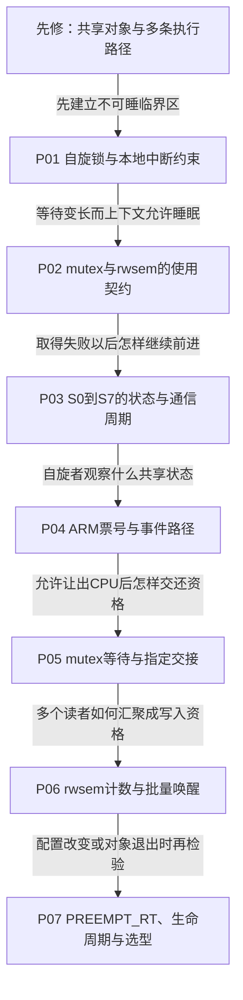

# 第1章\_Linux\_锁机制专题大纲

## 1.1\_专题定位

同一个对象可以由任务、中断或其他CPU访问；这些路径何时可能相互打断，先见[同一对象的多条执行路径](../../P01_同一对象的多条执行路径.md#1.5_先辨认当前路径再选择接口)。本专题接着追问：访问者遇到已有持有者时，应该原地等待，还是让出CPU？选择一种等待方式以后，又怎样保证释放与下一次取得能够接上？

阅读时把 **竞争状态、所有者、等待者、执行上下文和唤醒路径** 放在同一协议中追踪。前两章先建立使用契约，第三章统一一轮操作的阶段，再进入Linux 6.12.20的spinlock、mutex和rwsem实现；最后检验PREEMPT_RT配置与对象退出条件。可睡锁的等待队列并不是所有锁都有的组成部分，图中的分支名称也不能代替具体配置核对。

## 1.2\_因果学习链

1. [自旋锁](P01_自旋锁.md)：从采样值与计数的一致性建立完整状态辅助代码，再由本地中断重入推导非RT的irqsave，区分RT后缀边界。
2. [互斥锁与读写信号量](P02_互斥锁与读写信号量.md)：以配置条件提交建立可睡互斥，比较获取失败、锁外慢操作、读写升级窗口和解锁期间的寿命。
3. [锁的统一状态与通信周期](P03_锁的统一状态与通信周期.md)：用S0～S7区分快路径和可选等待阶段，分别追踪架构自旋与任务唤醒；通过A/B/C交错理解可运行资格不等于锁所有权。
4. [spinlock 实现与上下文边界](P04_spinlock实现与上下文边界.md)：由领号推导ARM票号、共享状态与事件通信，用C模型区分收到事件和取得资格，再解释配置与竞争成本。
5. [mutex 慢路径与所有权交接](P05_mutex慢路径与所有权交接.md)：以A/B/C交错比较重新竞争和指定交接，追踪HANDOFF请求、PICKUP接收、OSQ例外与信号取消顺序。
6. [rwsem 读写汇聚与唤醒](P06_rwsem读写汇聚与唤醒.md)：区分写者获竞争机会和读者预授份额，沿count、混合队列与task发布解释两遍批量交付及取消竞态。
7. [PREEMPT_RT、生命周期与选型](P07_PREEMPT_RT生命周期与选型.md)：用实时配置、停机顺序、诊断证据和决策表收束专题。

每篇都回答“状态存在哪里、谁写、谁读、怎样传播”。Linux 6.12.20 的版本化入口见 [锁源码总阅读索引](../../../../../research/source_reading/locking/navigation/P01_Linux_6.12_锁源码总阅读索引.md#1.1_版本边界与阅读任务)。

默认顺序中的每一步都有尚待解决的问题：

| 读到这里 | 已有结论 | 下一步追问 |
| --- | --- | --- |
| P01 | 采样不变量需同锁，本地IRQ重入另有约束 | 等待可能很长时如何让出CPU？ |
| P02 | 获取成功、取消与重新验证有不同契约 | 内核怎样把失败推进为等待而不丢进展？ |
| P03 | S0～S7是多组状态的可选阶段 | 自旋者到底观察什么地址？ |
| P04 | 票号与事件共同推进，事件不等于所有权 | 允许睡眠以后如何防止反复插队？ |
| P05 | 普通竞争、定向交接及取消各有顺序 | 多个读者怎样汇聚成可独占的结论？ |
| P06 | 读批次预授份额，写唤醒只是竞争机会 | 换成实时配置或停止对象后，哪些保证仍成立？ |
| P07 | 按配置、上下文和寿命选择协议 | 到版本化源码逐项核对，或进入检查器与其他同步专题 |

前两章的内核辅助代码用于建立应用契约；P04宿主C模型只验证票号资格。它们不能替代目标内核的中断、调度或实时性验证。读源码时也要保留正文与版本实现的职责边界，不把任一层当作另一层的副本。

## 1.3\_锁协议验证

[Linux Lockdep 专题](../lockdep/大纲.md#1.1_专题定位)解释标准锁原语怎样上报身份、取得、释放与 IRQ 状态，检查 current 持锁账本和全局锁类依赖图。锁专题负责功能语义，Lockdep 专题负责动态协议验证，两者不能互相替代。

## 1.4\_阅读完成标准

- 能从执行上下文和临界区长度解释为什么选择自旋或睡眠，而不是背 API 表。
- 能画出竞争者怎样从快速尝试进入自旋或等待队列，再由释放者交接所有权。
- 能指出 mutex 与 rwsem 的共享状态地址、写入者、读取者和唤醒方向。
- 能解释 PREEMPT_RT 为什么改变 `spinlock_t` 的调度语义，却保留 `raw_spinlock_t` 的原子上下文职责。
- 能把锁的互斥保证、对象生命周期和 Lockdep 证据分开。
