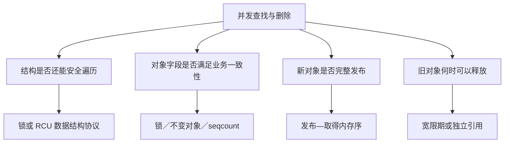
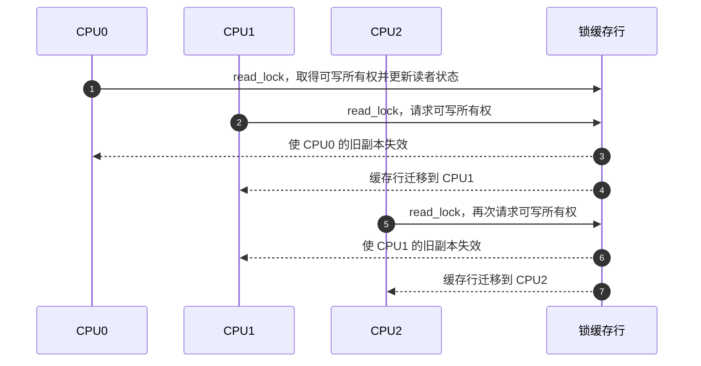
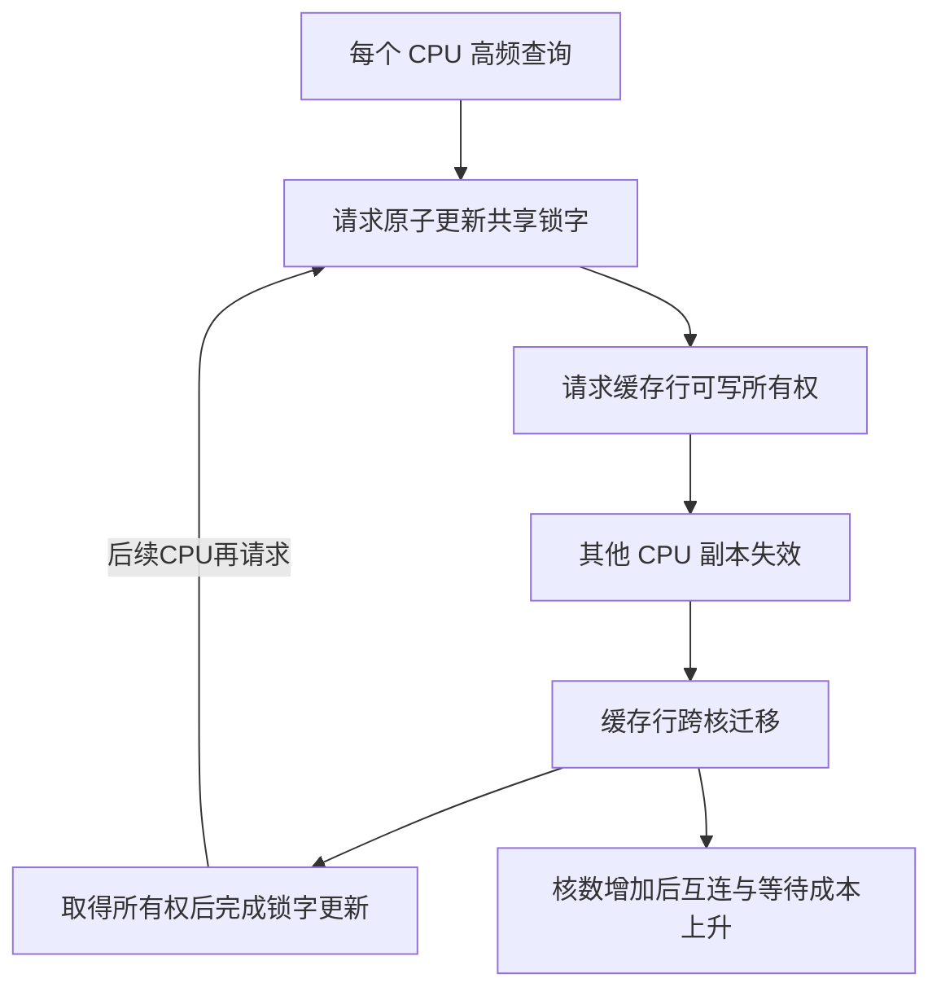
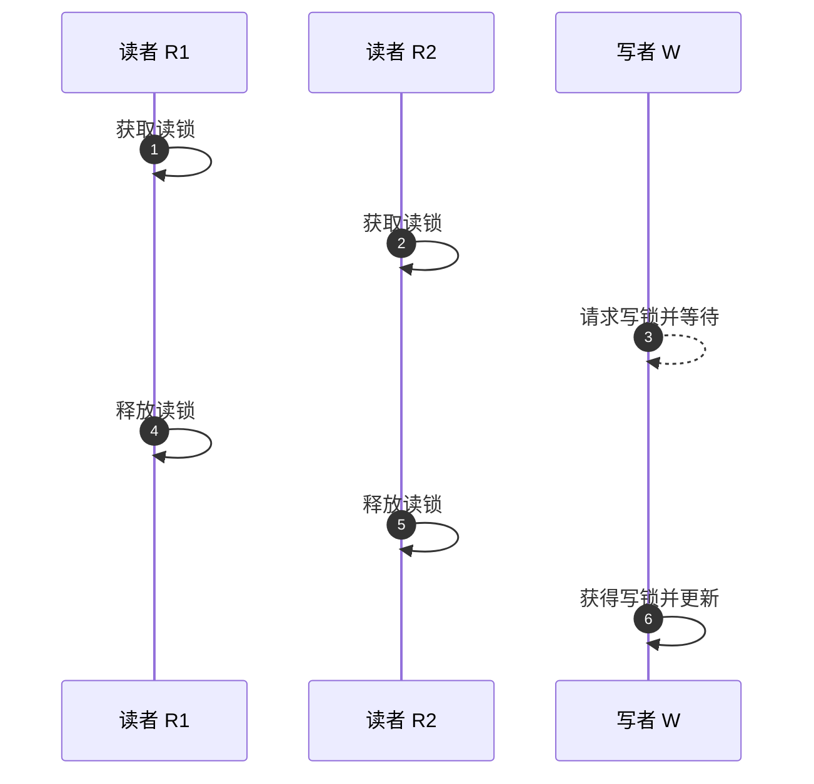
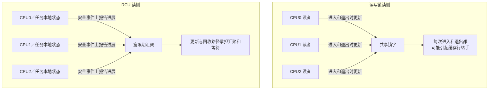
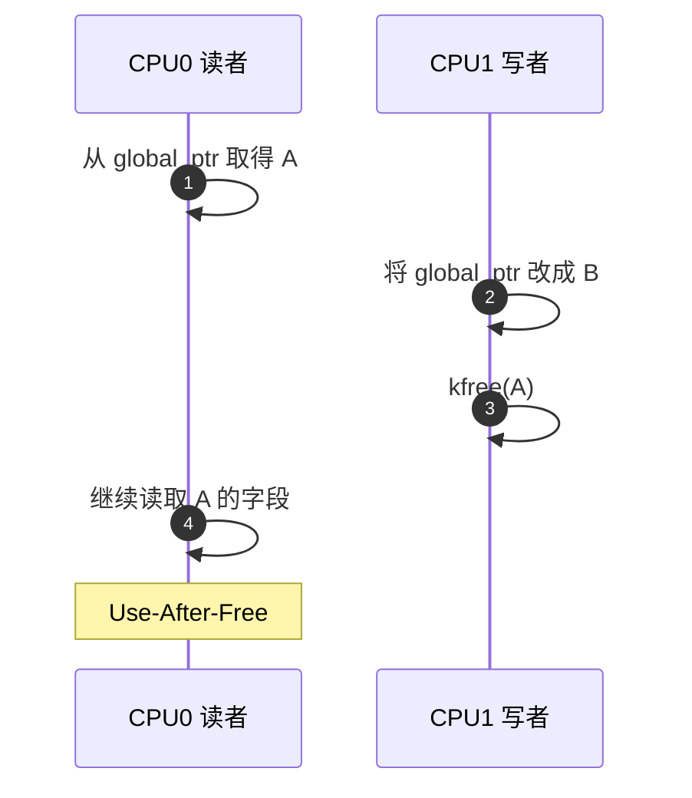
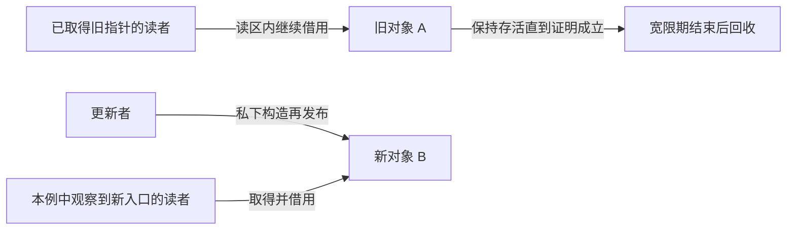
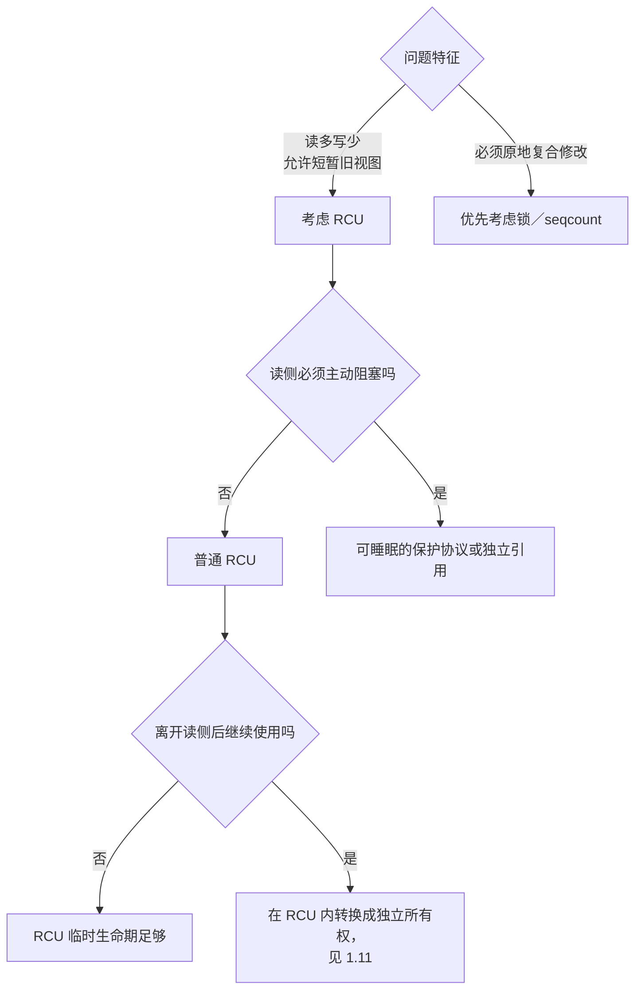
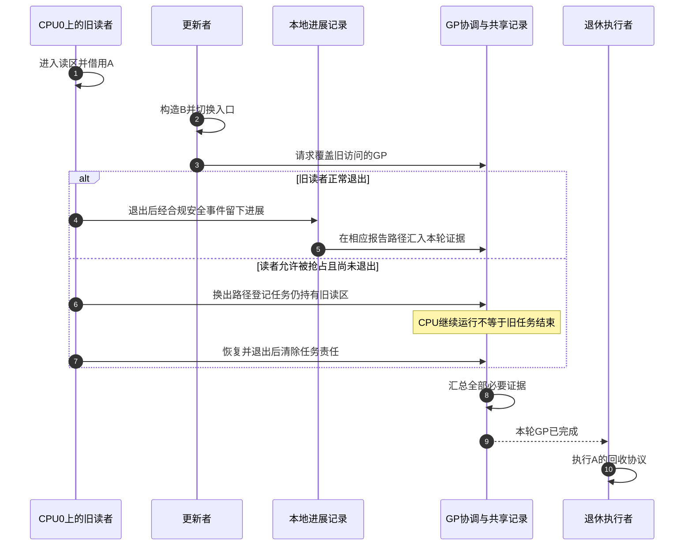

# 第1章\_为什么需要\_RCU

## 1.1\_先把问题说完整

本章以已经掌握共享锁、指针和缓存一致性的读者为起点；相关前置可从 [锁的职责与运行周期](../locks/P03_锁的统一状态与通信周期.md) 回顾。先看原来的锁方案怎样保证正确，再找出读多写少时值得改变的那一段成本。

假设内核维护一张设备表，读者按编号取得设备并读取状态，写者偶尔添加、替换或删除设备：

```text
CPU0：查找设备 7，并读取状态
CPU1：查找设备 12，并读取状态
CPU2：删除设备 7
```

这个例子看起来只是一次查表，实际同时包含四类正确性问题：

1. **结构完整性**：读者遍历链表或哈希桶时，写者能否同时改变指针连接？
2. **内容一致性**：读者看到的对象字段是否构成业务上允许的状态？
3. **发布顺序**：读者看到新对象指针时，对象初始化是否已经可见？
4. **对象生命期**：读者已经取得旧指针后，写者何时才可以释放旧对象？

这四个问题经常被一句“给它加锁”盖住。**RCU（Read-Copy Update，读—复制—更新）** 是一种允许读者继续访问旧版本、把回收推迟到安全边界以后的同步机制。在本章后面采用的整份对象替换场景中，Read 是借用已发布版本，Copy 是私下准备新版本，Update 是发布新入口；并不是每读一次就复制一次对象。它主要改变的是 **读者与更新者的并发方式，以及旧对象的回收时机**；它并不自动解决所有字段不变量，也不自动串行化多个写者。



## 1.2\_第一种办法\_用互斥锁把所有访问串行化

最直接的写法是让读者和写者都持有同一把 mutex：

```c
mutex_lock(&table_lock);
dev = lookup_device(id); // 通过id查找设备
if (dev)
    use_device(dev);
mutex_unlock(&table_lock);
```

删除者也在锁内摘除并释放对象。只要所有访问都遵守同一规则，锁就能同时保护表结构和对象生命期：**删除者** 无法在 **读者** 使用对象时进入，**读者** 也无法在 **删除者** 修改结构时进入。

这个方案正确、直观，而且 **写多** 或 **临界区较复杂** 时往往就是合适选择。但它把所有读者也互相串行化了。若查询是网络收包、路径查找或系统调用中的高频路径，CPU 数量增加并不会带来相应读吞吐量；任何可能睡眠或执行较久的读者还会延长其他访问的等待时间。

所以问题不是“mutex 不好”，而是这里的负载可能具有特殊比例：

```text
读：每秒数百万次
写：几秒、几分钟甚至几小时一次
```

为极少发生的更新，让每个读者都付出互斥与排队代价，可能不合算。

## 1.3\_第二种办法\_读写锁允许读者并行

读写锁缓解了读者之间的逻辑互斥：多个读者可以同时持有读锁，写者取得写锁时再排斥所有读者。下面改用另一种锁对象 `table_rwlock`，它不是上一节的 mutex；普通非 RT 内核中的 `read_lock()` 是自旋读锁接口，示例查询与使用过程必须保持不睡眠。若读区本来就要睡眠，应考虑读写信号量，不能只替换函数名。

```c
read_lock(&table_rwlock);
dev = lookup_device(id);
if (dev)
    use_device(dev);
read_unlock(&table_rwlock);
```

从语义上看，这已经很接近目标：读者可以同时进入，写者又很少，似乎不再存在竞争。问题在于，“允许多个读者同时持锁”只描述了 **软件互斥规则**，不表示获取读锁时各 CPU 互不影响。要知道写者能否进入，锁必须保存“当前是否有写者、是否已有读者、读者是否全部退出”等共享状态；典型读写锁会把其中至少一部分编码在同一个锁字中。

### 1.3.1\_没有写者也会发生的竞争

先假设系统中根本没有写者，四个 CPU 只做查询：

```text
CPU0：read_lock() → 查表 → read_unlock()
CPU1：read_lock() → 查表 → read_unlock()
CPU2：read_lock() → 查表 → read_unlock()
CPU3：read_lock() → 查表 → read_unlock()
```

它们在业务数据上可能只读，但获取和释放读锁通常需要更新锁的共享状态，可以把关键动作近似理解为：

```text
read_lock()   ：原子地登记“多了一个读者”
read_unlock() ：原子地登记“少了一个读者”
```

这里的“原子”不仅要求单个 CPU 自己完成加减，还要求其他 CPU 和写者观察到一个全局一致的锁状态。于是，真正被反复写入的是 **存放锁字的缓存行**。

### 1.3.2\_缓存行为什么会在核间乒乓

CPU 通常先在自己的 L1/L2 缓存中操作数据。多个 CPU 可以同时缓存同一锁字的只读副本，但某个 CPU 要原子修改它时，必须先通过缓存一致性协议取得这条缓存行的可写所有权，并使其他 CPU 中的副本失效。

假设锁缓存行最初归 CPU0 可写：



随后 CPU0 执行 `read_unlock()` 时又要修改同一个状态，只能重新请求所有权。缓存行便可能形成下面的往返：

```text
CPU0 → CPU1 → CPU2 → CPU3 → CPU0 → ……
       同一条锁缓存行不断转手
```

这就是这里所说的**缓存行乒乓**。它不是“两个读者不能同时进入临界区”，而是“两个读者为了证明自己可以同时进入，仍要轮流修改同一份记账状态”。业务层没有锁冲突，硬件层却存在共享写热点。

一次转手可能包含缓存失效、所有权请求、核间或片上互连通信以及原子读—改—写等待。锁和业务数据如果还发生伪共享，其他无关字段也会随整条缓存行一起迁移。CPU 越多、读临界区越短、获取频率越高，真正查表的工作越少，这些固定同步成本在总时间中的占比反而越高。



### 1.3.3\_为什么增加\_CPU\_可能不再增加读吞吐量

假设一次表查询本身只需几十纳秒。单核时，锁缓存行大概率留在本核，读锁成本并不显眼；当很多 CPU 同时执行相同热路径时，每个读者都在争取同一缓存行的写权限，访问开始受锁字转手速度限制。

这时会出现反直觉现象：

```text
增加 CPU
   ↓
增加并行读者
   ↓
同时增加对同一锁缓存行的原子修改
   ↓
缓存失效和核间通信增多
   ↓
吞吐量增长变慢、停滞，极端时甚至下降
```

因此，“没有写者等待”和“读路径可扩展”不是一回事。传统读写锁可能在功能上完全无竞争，却在缓存一致性层面产生竞争。[同一固定内核提交的 per-CPU 读写信号量文档](https://github.com/nxp-imx/linux-imx/blob/dfaf2136deb2af2e60b994421281ba42f1c087e0/Documentation/locking/percpu-rw-semaphore.rst)也把传统读写信号量的问题直接归因于多个核心读加锁时，包含信号量的缓存行在各核心 L1 缓存之间跳动。

### 1.3.4\_写者等待是另一项成本

写者还必须等待当前读者全部释放读锁，才能取得写锁并发布更新。也就是说，读写锁的核心策略仍是：

```text
写者想更新
    ↓
先阻止后续读者进入
    ↓
等待当前读者全部离开
    ↓
写者独占修改
```

读写锁没有错。它提供强而清楚的互斥语义；但如果读侧只想取得一个稳定的已发布版本，它可能让每一次读取都为罕见写入维护共享锁状态。



所以读写锁在这个场景中同时存在两类成本：

1. **没有写者时的读侧扩展性成本**：高频读者共同修改锁状态，导致锁缓存行乒乓。
2. **出现写者时的排斥成本**：写者必须阻止新读者并等待已有读者退出，读者与写者不能继续并行。

### 1.3.5\_RCU\_改变的不是锁实现细节\_而是成本归属

RCU 不再要求每个读者对同一个“全局读者计数”做原子增减。一种实现思路是让读者只维护本地执行约束或本地状态，在后续安全事件上再汇总进展。更新者发布新版本后，回收方等待旧读者越过安全边界。这段需要证明完成的等待称为 **宽限期（Grace Period，GP）**；它并不是给新旧对象规定一个固定共存时长。



这个变化把成本从“每次高频读取都修改共享锁状态”，转移到“低频更新者复制、发布、等待并回收旧版本”。RCU 因而适合**读极多、写极少、读者可接受短暂旧版本、对象允许延迟回收**的场景。若更新频繁、必须原地修改、读者必须立即看到最新状态，或旧版本占用资源过大，RCU 转移过去的写侧和内存成本可能不值得。

换句话说，选择 RCU 不是因为“读写锁偶尔会慢”，而是因为负载已经满足下面的矛盾：

> 业务希望读者彼此独立，但传统读写锁仍迫使所有读者通过同一条共享缓存行登记；RCU 允许读者不再为罕见写者维护这份集中记账，把版本维护和等待成本交给更新路径。

## 1.4\_能否只原子替换指针

既然写入一个自然对齐的机器字指针通常不会撕裂，一个诱人的优化是复制并初始化新对象 B，然后直接把共享入口从 A 改为 B：

```text
替换前：global_ptr -> A
替换后：global_ptr -> B
```

这样写者似乎不必阻止读者：较早的读者取得 A，较晚的读者取得 B。可是“指针没有撕裂”只回答了读者取得 A 还是 B，没有回答两个更深的问题：

1. 读者看到 B 时，是否一定能看到写者此前对 B 的完整初始化？
2. A 从入口消失后，是否还有读者握着 A？

第一个问题属于发布—取得内存序；第二个问题属于对象生命期。普通赋值本身不足以证明这两件事。

## 1.5\_真正危险的是取消发布后的旧指针

考虑下面这种调度上可能发生、却会暴露错误的交错。读者在写者替换入口之前取得了 A，但还没有使用完；最后一步会形成 **释放后使用（Use-After-Free，UAF）**：



写者重新读取 `global_ptr` 时只会看到 B，这并不能证明其他 CPU 的寄存器、栈或局部变量里没有 A。下面先用单一入口、顺序可见的教学时间线区分两件事：入口已经切走，与已有借用已经结束。跨 CPU 的发布传播不能仅用挂钟先后来判断，真实回收还依赖 GP 的内存顺序保证；第二章会明确这一抽象前提。

```text
取消发布 A                         最后一个旧读者用完 A
     │                                      │
     ├──── A 不再分发给后来的读者 ──────────┤
     │       但既存读者仍可合法访问 A        │
     └──────────── 此区间不能释放 A ─────────┘
```

因此，RCU 要解决的核心问题不是“怎样写入一个指针”，而是：

> 对象从共享入口消失以后，怎样证明此前可能取得它的读者已经全部越过不再使用旧对象的安全边界？

这里可以想到引用计数等其他生命期方案，但在比较组合机制之前，必须先把 RCU 自己怎样关闭旧入口、怎样等待既存读者以及何时允许回收讲清楚。下面暂不引入引用计数细节，先沿这个问题推出 RCU 的最小闭环。

## 1.6\_关键转折\_不赶走旧读者

前面的互斥锁和读写锁方案都要求读者先取得一份锁许可，并让写者等待冲突读者离场。RCU 没有否定锁的正确性，而是针对短小、高频的读取换了一个方向：既然读操作远多于写操作，能否先不赶走已经取得 A 的旧读者，让写者承担复制与等待成本？

```text
旧读者继续使用 A
写者准备并发布 B
新读者从共享入口取得 B
        ↓
系统中短暂同时存在 A、B 两个合法版本
        ↓
等待更新前潜在旧读者跨过安全边界
        ↓
最后释放 A
```



这里的核心交换是：

- 读者不必为了更新者停下来，也不必共同修改一把全局读锁的状态。
- 写者付出准备新版本、维护写写互斥和延迟回收的成本。
- 系统允许一段时间的新旧版本并存，读者不一定观察到绝对最新版本。

这才是 RCU 在读多写少场景中的优势来源，而不是“某几个 API 比锁快”。

## 1.7\_等待不是猜时间\_而是等待读者状态推进

如果只是 `delay(100)` 后释放 A，慢读者、抢占、CPU 离线或中断都可能使这个猜测失效。RCU 的宽限期不是固定延时。

普通 RCU 也不要求维护下面这种逐对象映射：

```text
对象 A -> CPU0、任务 T3
对象 B -> CPU2
```

`rcu_read_lock()` 没有对象地址参数。RCU 采用更粗粒度但更便宜的证明：

```text
在本次宽限期开始前可能已经存在的 RCU 读侧临界区，
是否都已经跨过安全边界？
```

系统可以利用两类信息回答这个问题。一类是执行约束：假如读侧不允许被调度换出，CPU 已经经过一次合规的调度边界，就排除了此前仍在这颗 CPU 上执行的旧读区。另一类是显式记录：假如读者允许被抢占，就必须留下“任务仍未退出”的证据，不能把 CPU 已切换当作任务已结束。后文先建立这两类证明的适用条件，再映射 Linux 的具体字段。

能排除旧读侧的安全事件称为 **静止状态（Quiescent State，QS）**。它不意味着 CPU 停止工作：CPU 可以继续运行完全无关的任务。回收方需要的是“它已越过旧访问边界”的证据。

所以，读者无需逐对象通知“我正在读取 A”，系统仍要通过本地记录、调度事件和后续汇聚传递进展。第 4 章区分实现选择，第 5 章建立地址与完整周期，第 6 章再比较读者能否被抢占。

## 1.8\_RCU\_优势成立需要哪些前提

RCU 并非在所有并发场景中都优于锁。它特别适合同时满足以下条件的问题：

- 读取远多于更新，读路径的扩展性值得优先优化。
- 读者可以接受在短时间内观察旧版本，而不是必须与写者线性互斥。
- 对象可以通过替换指针或维护多个版本更新，而不是只能做复杂的原地修改。
- 内存允许旧版本延迟回收。
- 普通 RCU 读侧可以保持短小且不主动阻塞；若必须睡眠，应另选允许睡眠的保护协议，或先取得独立引用。

以下问题则通常仍需要其他机制：

| 需求 | RCU 是否单独解决 | 常见补充机制 |
| --- | --- | --- |
| 多个写者修改同一结构 | 否 | spinlock、mutex 或单写者规则 |
| 多字段必须形成原子业务快照 | 否 | 不变对象、锁或 seqcount |
| 离开读侧区间后长期持有对象 | 否 | 把临时访问转换成独立所有权；具体机制见 1.11 |
| 条件不成立时睡眠并等待唤醒 | 否 | wait queue、completion 等 |
| 读侧必须跨越睡眠或 I/O | 普通 RCU 不适合 | 可睡眠的 SRCU 域（第 4、18 章建立），或先取得独立引用 |

RCU 的优势不是功能更多，而是它对问题做了更精确的分工：高频读者只承担很轻的临时访问协议，罕见写者承担发布、版本共存和延迟回收。



### 1.8.1\_用两组关系校准选择依据

前面的 RCU 方案比较可以压缩成两组便于工程判断、但不能丢失适用边界的关系。

第一，RCU 相对读写锁优化的不是“锁函数写法”，而是 **高频读者之间的同步方式**。传统读写锁的读者通常需要原子修改同一份共享锁状态，由此产生缓存行所有权转移；RCU 的可扩展实现则把进展分散到任务或 CPU 本地，把跨 CPU 汇聚放到每轮 GP 的安全事件报告、被抢占读者登记以及必要的主动检查路径。更新者因此不再等待“所有读者先退出才能发布”，而是在发布新版本后等待发布前的旧读者越过安全边界。

第二，缓解共享锁缓存行乒乓是 RCU 在读多写少负载中的重要价值，但不是它解决的全部问题。完整收益还包括读者与更新者允许并发、旧对象生命期具有可证明的回收边界；相应代价则转移为写侧复制或替换、版本暂时共存、GP 推进和延迟回收。若只记住“RCU 解决 cache 行乒乓”，就无法解释更新频繁、内存紧张或要求立即观察新状态时为什么可能不该使用 RCU。

普通 RCU 读侧 API 不接收对象地址，也正是因为它跟踪的是 **读侧时间区间与 GP 边界**，而不是为每个对象维护“谁正在读取它”的引用表。对象是否属于 RCU 保护的数据结构、怎样发布以及何时回收，仍由调用者的数据结构协议决定。

## 1.9\_所谓\_读无锁\_到底是什么意思

“读无锁”这个词很容易让人误以为同步成本已经消失。更准确的说法是：

> 普通 RCU 的可扩展实现用一套低成本、分布式的读侧状态与进展通知机制，替代传统共享读锁的集中记账与访问排斥。读者不在每次进入和退出时共同原子修改同一个全局读者计数，但仍然参加由任务状态、抢占状态、每 CPU 状态、静止状态观测和宽限期汇聚共同组成的生命周期协议。

RCU 文档中的“读无锁”因此应理解为：

- 读者不获取会与更新者形成互斥的传统共享读锁。
- 更新者发布新版本时，不必等待读者先退出。
- 旧读者和新读者可以同时观察不同版本。
- 高频读侧尽量避免对同一条全局共享缓存行执行原子读—改—写。

它不表示：

- `rcu_read_lock()` 在所有配置下都是空操作。
- 读侧没有任务状态、每 CPU 状态或通知机制。
- 指针读取不需要 `rcu_dereference()` 一类发布—取得契约。
- 对象内部字段自动变成一致快照。
- 离开读侧临界区后，裸指针仍然有效。

### 1.9.1\_它被什么替换\_低成本的分布式状态与通知机制

可以说 RCU 替换了传统读锁的作用，但替换者不是另一把隐藏的锁，而是一套**低成本、分布式的状态记录与进展通知机制**。如果只写“换了一种锁”，读者仍会自然想象系统中存在下面这种隐藏结构：

```text
global_rcu_reader_count
    ↑ 所有 CPU 在 rcu_read_lock() 时原子加一
    ↓ 所有 CPU 在 rcu_read_unlock() 时原子减一
```

这恰好又制造了上一节的共享缓存行乒乓，无法解释 RCU 的读侧扩展性。后文所分析的 Linux 普通 RCU 可扩展实现并不是这样实现的。它也没有一把对应的 `rcu_write_lock()`：多个更新者之间的互斥仍需数据结构自己的 spinlock、mutex 或单写者规则完成。

判断它是不是“另一把锁”，关键要看读者是否排斥其他参与者：

| 问题 | 传统读写锁 | 普通 RCU |
| --- | --- | --- |
| 读者进入后会阻止写者更新吗 | 会 | 不会 |
| 写者进入后会阻止新读者吗 | 会 | 不会 |
| 多个写者会自动互斥吗 | 会，由写锁保证 | 不会，另需更新锁 |
| 读者是否每次共同修改一个锁字 | 典型实现需要 | 快速路径刻意避免 |
| 旧对象能否立即释放 | 写者取得排他锁后可以 | 不能，必须等待旧读者跨过安全边界 |

所以，RCU 不是把“空间上的访问排斥”藏进另一把锁，而是把问题改写成“时间上的对象回收证明”：读侧用本地状态划出可能持有旧对象的区间，系统在后续调度、静止状态和特殊退出路径中产生进展通知，宽限期再汇聚这些通知。

这里的“通知”也不是每次 `rcu_read_lock()` 都向一个全局中心发送消息。普通快速路径优先只修改当前任务或当前 CPU 的状态；只有被抢占、经过静止状态、宽限期扫描或退出特殊路径等事件，才需要把“这个 CPU／任务已经或尚未跨过安全边界”的信息推进到共享 RCU 状态。

### 1.9.2\_读侧究竟记录了什么

先把“记录”与“共享写入”分开。读者需要遵守一个生命期区间，但这个区间未必由一份共享计数表示。读者不能被抢占时，禁止抢占这一执行约束就可以参与证明；读者允许被抢占时，本任务的嵌套状态可以表示它还在读区，只有真正发生换出等特殊事件时才需要登记到共享结构。两者都避免每个读者进入时争用同一全局计数。


图中高频边是读者与本地状态之间的边。共享边发生在证明所需的事件上，也可能由协调者读取已有记录；不能把它解释成每个 unlock 都发送一条全局消息。本地执行约束如何保存、配置是否生成实际指令，要到读侧模型章核对，不能由本图猜出固定开销。

### 1.9.3\_宽限期怎样知道旧读者已经离开

沿同一个设备对象 A 看一次完整交接。CPU0 的读者先借用 A；更新者切换入口并提出回收请求。协调者不逐个检查对象地址，而是保守地记录哪些参与者尚未证明越过旧读区。CPU0 的读者退出并经过合规安全边界后，本地进展才能被汇入本轮共享记录。参与者较多时，可以先在小组内汇总，再向上报告，避免每个事件都竞争同一全局位置。



这张图给出的是实现必须兑现的交接，不是某个函数的调用图。若本地事件迟迟不来，协调者可以观察共享状态、请求 CPU 尽快经过安全边界，或者报告停滞；这些慢路径增加通信和扰动，却不能因“等得够久”就跳过旧读者。

Linux 中对应的每任务、每 CPU、节点和全局状态，在 [公共完整周期](P05_Tree_RCU_公共骨架与完整周期.md#5.3_四层状态地址和一个对象队列) 中落到具体地址；[读侧执行模型](P06_Tree_RCU_读侧执行模型与配置差异.md#6.1_共同契约不随配置改变) 再解释嵌套深度、抢占控制及被换出任务的共享登记。此处先理解为什么需要这些职责。

### 1.9.4\_成本没有消失\_而是被拆散并转移

因此，最不容易骗人的表述不是“RCU 完全无锁”，也不是“RCU 换了一把锁”，而是“RCU 用低成本、分布式的状态与通知机制替换共享读锁的集中记账和访问排斥”：

```text
读写锁：
    每个读者通过共享锁状态取得访问许可；
    写者通过排斥读者获得安全修改与回收时机。

RCU：
    读者用任务／CPU 本地状态标记可能持有旧版本的时间区间；
    更新者不排斥读者，负责发布新版本；
    RCU 子系统在慢路径和宽限期路径汇聚 CPU／任务进展；
    回收者等证明成立后才释放旧版本。
```

RCU 只是把高频读侧的集中争用，换成了更新侧复制、额外版本内存、宽限期等待以及 RCU 子系统的分布式记账与汇聚成本。读多写少时这笔交换通常有利；写入频繁、内存紧张、必须原地修改或必须立即回收时，它未必比锁合适。

更完整的角色视角、数据结构拓扑、调度通知链和静止状态汇聚将在[Linux Tree RCU 状态与通知机制](P05_Tree_RCU_公共骨架与完整周期.md)中实现级展开；下一章先从本章的问题约束推演出不绑定 Linux 字段的抽象机制。

## 1.10\_先记住一条时间轴

第一次学习 RCU，不必立即记住所有 API 和数据结构。先抓住这一条时间轴：

```text
R1 进入读侧并可能取得 A
        ↓
写者完整初始化 B
        ↓
写者发布 B，A 从共享入口取消发布
        ↓
R2 在本示例中观察到新入口，取得 B
        ↓
RCU 等待更新前潜在旧读者跨过安全边界
        ↓
允许释放 A
```

其中最容易混淆的四句话是：

1. 发布 B，不自动解决多个写者之间的互斥。
2. 取消发布 A，不等于 A 已经无人使用。
3. 宽限期结束，不要求后来进入的新读者全部退出。
4. RCU 保护的是协议内的临时可访问生命期，不是永久对象所有权。

## 1.11\_临时借用为什么还不是长期持有

如果查询只把状态值复制出去，借用随本次读取结束即可；如果查询把对象地址交给异步工作，工作可能在原读区退出很久以后才运行。这时需要另一份覆盖整个使用期的所有权，例如引用计数。**RCU 保护协议内的临时访问区间，不自动提供跨读区的长期所有权。** 两种协议可以组合，但必须解释长期引用是在什么安全窗口取得的。

先在下一章独立推演发布边界、旧读者集合和 GP，再由第 3 章给出 RCU 的最小 API 闭环。掌握公共契约和后续实现以后，再到第 21 章比较：

```text
RCU怎样保护“取得引用以前对象仍存在”的窗口
    +
kref怎样保护“取得引用以后对象继续存在”的区间
    +
对象所属模块怎样选择唯一最终销毁路径
```

单对象、入口发布引用以及“版本根 + 多个独立 kref 数据块”的完整实现统一放在[RCU、kref 与复合对象生命周期](P21_RCU_kref与复合对象生命周期.md)，不再由问题引入章提前展开。

## 1.12\_接下来怎样把直觉变成机制

下一章不急着继续增加术语，而是先验证本章关于成本转移的结论：

- 为什么先发布新版本就能封闭旧读者集合。
- GP 等待的为什么是边界以前的读侧执行现场，而不是未来所有 reader 任务。
- 同步等待与异步回调怎样接收同一份 GP 完成证明。
- 朴素模型进入多 CPU、抢占、idle 和乱序现实后还缺哪些状态与通信路径。

下一章不进入 Linux 字段，而是从本章已经建立的问题约束自行推出发布、取消发布、宽限期和回收。随后用最小 API 建立使用边界，按分类坐标进入公共实现，再在同一模块中比较抢占与非抢占的证明差异。

先用一个判断检验本章的选择依据：设备表每次查询只读两个标量，更新每秒一次，旧版本很小；另一个表每次读取要等待设备 I/O，更新每毫秒一次且版本占几兆字节。前者值得评估 RCU 能否降低共享读锁成本；后者不能仅凭“读者很多”就选普通 RCU，因为睡眠契约、版本积压与更新成本都已改变。给出这三个原因，比背诵“RCU 读快”更能指导下一步设计。

下一篇：[RCU 抽象机制推演](P02_RCU_抽象机制推演.md)。
