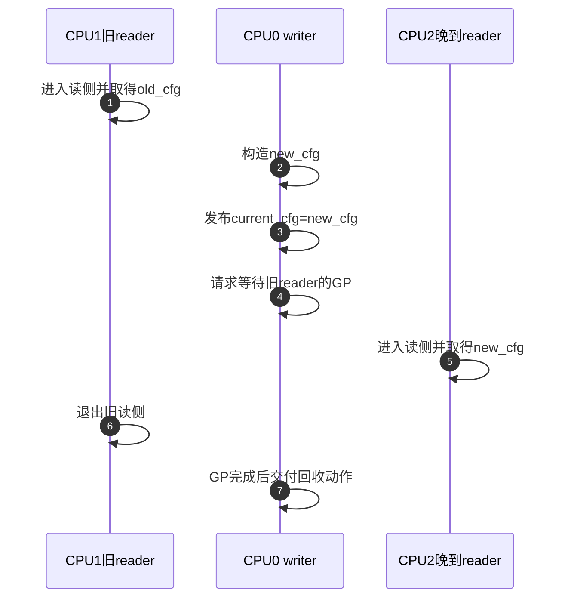
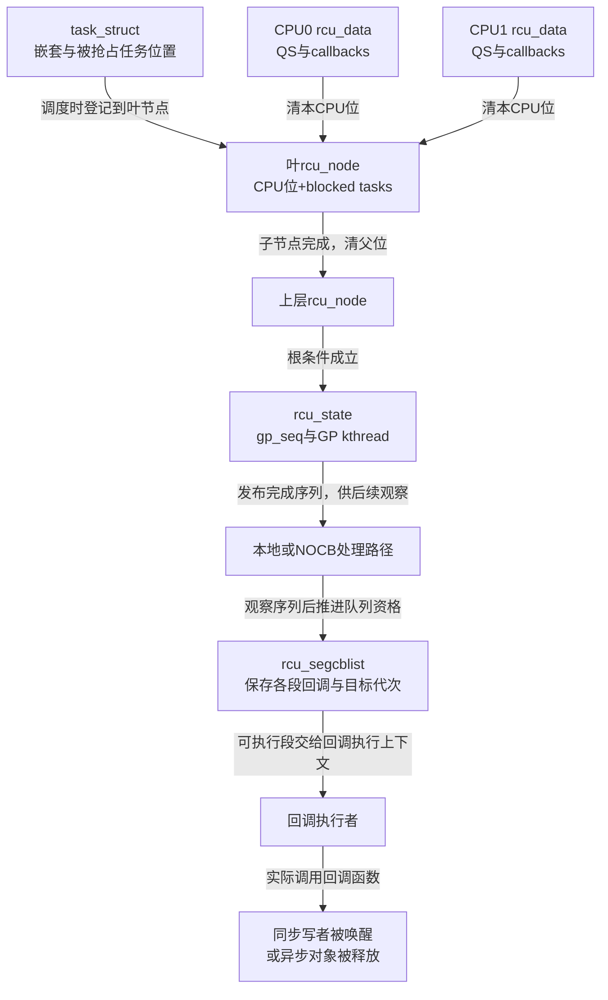
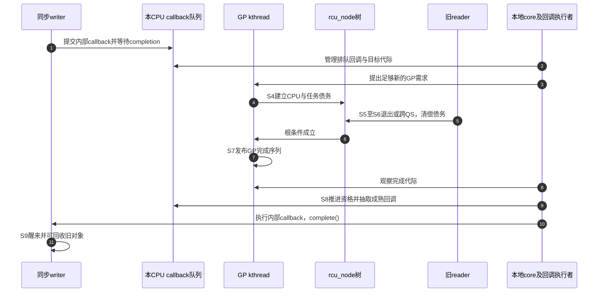

# 第5章\_Tree\_RCU\_公共骨架与完整周期

上一章已经区分保护域、后端和运行策略。现在选定普通 RCU 的 Tree 后端，继续追问第三章的更新函数：它把旧对象交出去以后，读者没有逐次登记，系统靠什么证明可以释放？这里沿用 GP（宽限期）、QS（静止状态）和 callback（回调）的含义，把它们从接口承诺落实到有地址、有写入者的状态。

[P04 已经把实现家族与读侧配置放回不同坐标轴](P04_RCU_分类坐标与内核配置.md#4.4_普通RCU的公共骨架与Tree内部差异)。本章只讨论 **普通 RCU 在 SMP 上的 Tree RCU 公共骨架**：无论普通 reader 能否被抢占，GP 请求、分层证明、callback 代际和完成交付都共用这条主线。

先固定一次对象替换，沿 S0～S9 走完“发布新对象 → 建立旧读者债务 → 收集 QS → 根节点完成 → callback 成熟并执行 → 写者继续”的周期；后续 P06～P17 只是逐个放大这条周期中的模块。

后表还会用到 **EQS（Extended Quiescent State，扩展静止态）**：CPU 进入 user、idle 等不再观察内核 RCU 对象的扩展状态后，可以为普通 RCU 提供比一次调度事件更强的排除证据。

## 5.1\_固定问题现场

本节使用三个教学用 C 标识符：指针变量 `current_cfg` 表示正式共享入口，变量名 `old_cfg` 表示替换前对象，后面出现的 `new_cfg` 表示替换后对象。初始时，`current_cfg` 指向 `old_cfg`：

```c
struct demo_cfg {
	int generation;
	struct rcu_head rcu;
};

static struct demo_cfg __rcu *current_cfg;
```

三类执行同时发生：

- CPU1 上的 reader 已进入读侧并取得 `old_cfg`；
- CPU0 上的 writer 构造 `new_cfg`，发布新入口，并要求旧对象最终可回收；
- CPU2 上的 reader 在本条交错中较晚进入，并观察到 `new_cfg`。

Tree RCU 不需要证明“系统里没有任何 reader”。它只需要证明：<span style="color:red;">**在本轮 GP 边界之前可能取得 `old_cfg` 的 reader 都已经跨过安全边界。**</span> CPU2 可以与本轮 GP 并行，但不能从“发布时间在前”推导所有 CPU 的并发读取都立即见到新值。这里选择 CPU2 确实读到新值的一条合法交错；真实等待仍按第二章的 GP 契约及内存顺序保守覆盖先存读区。



图中第 1 步固定旧 reader，第 2～3 步构造并发布新对象，第 4 步提出 GP 需求；第 5 步展示读到新对象的并发访问，第 6～7 步才关闭旧对象的回收窗口。图不承诺实现绝不等待任何并发晚到读者。

接下来所有数据结构都必须能回答这条时间线中的一个具体问题，而不是凭字段名字自行成章。

## 5.2\_先把九个概念与C类型分开

CPU0 已经切换入口，但不能拿着对象地址去扫描每个 CPU 的寄存器。它先提交一个等待需求，让 RCU 保留“至少覆盖这次替换”的责任。多个更新可以共用一次证明，因此请求不等于实际启动的一轮 GP；负责推进 GP 的内核线程也不能随着请求者睡眠而消失。Linux 把这份长期控制状态叫作 `rcu_state`。

GP 执行者还不能立即宣布完成。它先保守记录参与者尚欠哪些证据，等 CPU 的安全事件，或等被抢占旧任务的退出。这里的“CPU 债务”“任务债务”都是教学用语，意思是尚缺完成证据，不是对象引用数。分组汇总这些证据的节点叫 `rcu_node`。

证明成立以后，先前排队的回调才取得执行资格。保存回调的节点 `rcu_head` 嵌在业务对象中，队列还要记住目标代次；若是同步调用者，最终还需完成它的 `completion` 等待对象，调用者才能醒来。由这条交接链自然分出下表中的不同概念：

| 概念 | 它表示什么 | 常见 Linux 6.12 承载位置 |
| --- | --- | --- |
| 对象版本 | 发布前后的 `old_cfg` / `new_cfg` | 子系统自己的结构体和 `__rcu` 指针 |
| GP 请求 | “至少推进到某个代际”的需求 | callback 目标序列、节点请求序列、全局命令状态 |
| 物理 GP | GP 执行者实际启动并完成的一轮证明 | `rcu_state.gp_seq` 与 GP kthread 周期 |
| QS | 某 CPU 已跨过可排除旧普通 reader 的边界 | `rcu_data` 本地标志和节点等待位 |
| EQS | CPU 处于受跟踪的 user/idle 等扩展静止状态；CPU 下线还另有参与集合协议 | context tracking / watching 状态 |
| CPU 债务 | 当前 GP 仍需这个 CPU 给出证据 | 叶 `rcu_node.qsmask` 中对应位 |
| 任务债务 | 抢占式配置下，旧 reader 已离开 CPU 但尚未退出 | `task_struct` 与叶节点 blocked-task 状态 |
| callback 资格 | 回收动作依赖的 GP 是否已经完成 | 每 CPU `rcu_segcblist` 的分段与目标代际 |
| 等待完成 | 同步调用者怎样得知目标条件成立 | 栈上 `completion`、哨兵 callback 或全局 barrier 状态 |

这里最容易出现三种类型错误：

1. 把 `struct rcu_state` 误认为“一个 GP 对象”。这里的 `rcu_state` 是 C 结构体类型标识符，表示普通 RCU 长期存在的全局控制状态；它不是每替换一个旧对象就新建一次。常驻的 GP kthread 从这份状态中接收和合并请求、推进一轮物理 GP，再发布完成结果。一轮物理 GP 只是 `rcu_state` 的一次状态变化，不是 `rcu_state` 的完整生命周期。

2. 把 `struct rcu_head` 误认为受保护对象本身。它是嵌入对象中的 callback 节点，负责延后执行，不提供 reader 引用计数。

3. 把 `struct rcu_node` 误认为 reader 计数树。普通 Tree RCU 主要汇聚的是 **保守证明债务和被抢占任务边界**，不是每个 reader 的逐次进入退出计数。

   更准确地说，叶 [`rcu_node`](P10_Tree_RCU_rcu_node树与分层汇聚.md#10.2_一棵八CPU教学树) 管理的是一组 CPU 的证明债务，而不是“当前正在执行 reader 的 CPU 列表”。叶节点 `qsmask` 中的一位代表其覆盖范围内的一个参与 CPU；非叶节点的一位代表一个子节点。GP 先保守地建立这些位，后续再用 CPU 跨过 QS 的证据逐层清除。任务与 CPU 不需要永久绑定：只有抢占式 reader 在临界区内被换出时，才把无法再由 CPU QS 代表的债务登记到当时的叶节点；任务之后即使迁移，仍可通过保存的登记节点找回并清偿它。该任务债务的独立讲解见 [P10 抢占式任务债务怎样进入同一棵树](P10_Tree_RCU_rcu_node树与分层汇聚.md#10.7_抢占式任务债务怎样进入同一棵树)。

## 5.3\_四层状态地址和一个对象队列

如果所有 CPU 每次取得本地安全证据都写同一全局位置，就又引入了共享写热点。Tree RCU 因而让每个 CPU 用自己的 `rcu_data` 记住观察到的 GP 和本地进展，报告时先进入覆盖一组 CPU 的叶节点；这组完成后才继续向父节点传播。全局状态只协调代次和最终结论。被抢占任务另在自身字段中保存嵌套及登记位置，不能因为 CPU 已经运行别人就丢掉它。

这些都是普通内存中的 C 对象，缓存一致性让其他执行者能够观察共享状态，锁与屏障负责并发访问和顺序。分层降低每个事件直接争用根的频率，并没有取消跨 CPU 通信。下表中的 FQS 是 Force Quiescent State（强制静止态扫描）的简称，表示进展迟延时重新观察或催促参与者的慢路径，不是另一类 reader：

| 层级 | 代表对象 | 谁主要写 | 谁随后读 | 本章中的职责 |
| --- | --- | --- | --- | --- |
| 每任务 | [`task_struct` 的 RCU 读侧字段](../../../../../research/source_reading/rcu/source_explanations/P03_Linux_6.12_Tree_RCU_抢占读者债务关键函数源码实现.md#3.2_任务与节点的共享状态实现) | 当前任务、调度路径、最外层 unlock | 叶节点检查和任务清债路径 | 抢占式读侧保存本任务嵌套，以及换出后的债务定位 |
| 每 CPU | [`struct rcu_data`](P07_Tree_RCU_初始化_拓扑与执行上下文.md#7.5_每CPU怎样绑定叶节点) | 本 CPU 的调度、tick、idle、callback 路径 | 节点上报、GP 或 FQS、callback 执行者 | 感知 GP、记录本地 QS、保存回调队列 |
| 每节点 | [`struct rcu_node`](P10_Tree_RCU_rcu_node树与分层汇聚.md#10.3_位图字段各自表示什么) | 节点锁保护下的 CPU 报告、GP 初始化、任务登记 | 父节点汇聚、根完成判断 | 保存局部 CPU 位图和抢占任务边界 |
| 全局 | [`struct rcu_state`](P08_Tree_RCU_GP请求与全局生命周期.md#8.5.1_看到rcu_state时不要把字段顺序当成学习顺序) | GP 请求者与长期 GP kthread | callback、poll、同步等待和诊断路径 | 合并请求、推进 GP 序列、发布完成 |
| 回调队列 | `rcu_head` + [`rcu_segcblist`](P11_Tree_RCU_rcu_segcblist回调状态机.md#11.2_四段不是四条链表) | `call_rcu()` 生产者和本地/NOCB 管理路径 | callback 执行上下文 | 绑定目标代际、成熟、批量执行 |



箭头表示状态流。reader 本身不会沿图逐层发送“我进入了”的消息；高频读侧成本之所以低，是因为更新侧先建立保守等待集合，再利用调度、EQS 和任务退出等已有事件逐步排除旧 reader 的可能性。

## 5.4\_它不是一台状态机而是五台正交状态机

同一轮 RCU 操作至少包含五组相互交接、但不能互相替代的状态：

1. **对象发布状态机**：新对象何时完成构造，正式入口何时从 old 切到 new。
2. **GP 请求与全局状态机**：多个请求怎样合并，一轮物理 GP 何时开始和完成。
3. **证明债务状态机**：每 CPU / 被抢占任务怎样从“可能包含旧 reader”变成“已排除”。
4. **callback 状态机**：`NEXT`（Next callbacks segment，尚未分配目标 GP）、`NEXT_READY`（Next ready callbacks segment，已知后续 GP 需求）、`WAIT`（Waiting callbacks segment，等待已知 GP）和 `DONE`（Done callbacks segment，目标 GP 已完成）是 `rcu_segcblist` 的源码分段标识符。callback 不保证逐一走过四段；加速路径可把 `NEXT` 直接整理到 `WAIT` 或 `NEXT_READY`，完成序列推进后再把满足条件的连续段并入 `DONE`。
5. **等待者状态机**：同步调用者或 `rcu_barrier()` 函数怎样收到最终完成信号。

只看其中一台会得到错误结论。例如：

- 根节点完成只说明 GP 证明成立，不等于所有成熟 callback 已经执行；
- callback 进入队列只说明异步动作被接纳，不等于 GP 已开始；
- `synchronize_rcu()` 函数返回只证明目标旧 reader 已结束，不证明系统此前排队的所有 callback 都执行完；
- 发布新入口只改变后续 reader 的选择，不会自动使旧地址安全可释放。

例如 CPU1 的旧读区已经退出，但上报尚未到根；随后 GP 完成，回调又可能还在等执行上下文。对象入口、证明状态、回调资格和真正释放在这几个时刻并不同步变化。这正是把它们分开记录的原因。后续模块按下表继续放大这些交接：

| 状态机 | 本章只需记住的交接 | 独立运行原理 |
| --- | --- | --- |
| 对象发布 | 新入口封闭未来旧对象取得 | [P03 同步更新者的替换等待与释放](P03_RCU_通用API与最小使用闭环.md#3.3.3_同步更新者_替换后等待并释放) |
| GP 请求与全局周期 | 接收目标代际，建债后发布完成 | [P08 一轮物理 GP 的 G0～G10 生命周期](P08_Tree_RCU_GP请求与全局生命周期.md#8.9_G0到G10_一轮物理GP的统一生命周期) |
| 证明债务 | 本地产生 QS 或 EQS，叶节点再汇聚 CPU 与任务债务 | [P09 CPU 当前 GP 债务](P09_Tree_RCU_QS_EQS与Context_Tracking.md#9.4.1_CPU的当前GP债务) → [P10 节点逐层向根清位](P10_Tree_RCU_rcu_node树与分层汇聚.md#10.6_节点怎样逐层向根清位) |
| callback 代际与执行 | GP 完成只让回调成熟，执行上下文再真正调用它 | [P11 回调状态推进](P11_Tree_RCU_rcu_segcblist回调状态机.md#11.4_S0到S5_回调状态推进) → [P12 一次批处理周期](P12_Tree_RCU_回调执行_批处理与限流.md#12.4_S0到S6_一次批处理周期) |
| 等待者与关闭 | 回调或哨兵把完成结果交给同步调用者 | [P13 默认 synchronize_rcu 的等待对象](P13_Tree_RCU_同步等待与rcu_barrier.md#13.5_默认synchronize_rcu的等待对象) |

## 5.5\_S0到S9的一次完整周期

把前面的角色放到同一次操作中，得到下面 S0～S9。它们为本章的普通回调交付路径标出关键交接；多个 CPU 可以处于不同局部阶段，后续更新也可以重叠，不是整机锁步执行的十拍流水线。

### 5.5.1\_S0到S2\_对象构造与入口发布

CPU0 先在私有内存构造新对象，构造失败就丢弃它，正式入口仍然指向旧对象。只有完成初始化，才在更新锁协议下发布新地址。S2 使用 `rcu_assign_pointer()` 承担发布顺序，不负责等待旧 reader；“读者取得新值后能看到初始化”也不等于所有 CPU 立即读到新值。

| 阶段 | 进入触发 | 谁写什么地址 | 后续谁读取 | 退出条件 |
| --- | --- | --- | --- | --- |
| S0 稳态 | `current_cfg=old_cfg` | reader 只读取正式入口 | 子系统使用对象 | 尚无替换 |
| S1 构造 | writer 分配新版本 | writer 私有内存 | 只有 writer | `new_cfg` 完整可发布 |
| S2 发布 | `rcu_assign_pointer()` / replace | 子系统 `__rcu` 入口 | 之后进入的 reader | 正式入口指向 new |

这一段的接口闭环见 [P03 完整同步实现](P03_RCU_通用API与最小使用闭环.md#3.3_完整同步实现)。

### 5.5.2\_S3到S7\_GP请求证明与根完成

CPU0 在取消发布以后提交回收需求。GP 内核线程把需求合并到足够新的代次，并在节点中建立尚缺证据的位；`rcu_state.gp_seq` 记录全局周期进度。各 CPU 再从所属叶节点认识新代次，把本地观察记录到自己的 `rcu_data`，不会在 GP 线程执行一条赋值的瞬间自动全部更新。CPU1 退出或被抢占时，进展分别进入 CPU 或任务的证明路径；节点只有满足全部必要条件，才能继续向根汇报。根条件成立后，GP 线程还要发布完成序列，后续消费者才知道目标代次已经结束。

| 阶段 | 进入触发 | 谁写什么地址 | 后续谁读取 | 退出条件 |
| --- | --- | --- | --- | --- |
| S3 提交回收需求 | `call_rcu()` 或同步等待内部桥接 | 每 CPU callback 队列 / GP 请求状态 | callback 管理和 GP 请求漏斗 | 目标代际被记录 |
| S4 GP 开始建债 | GP kthread 接受请求 | GP线程写全局/节点序列及等待位；各CPU识别新代次后更新本地观察 | 各 CPU 与节点报告路径 | 本轮证明边界建立，局部观察逐步跟进 |
| S5 本地产生证据 | 调度、user/idle、读者退出等事件 | `rcu_data`；抢占分支还写任务/叶节点状态 | 本地上报和节点检查 | 本地条件可清债 |
| S6 分层汇聚 | CPU 或任务清债 | 叶到根的 `qsmask` / blocked-task 条件 | 父节点和 GP kthread | 根完成条件成立 |
| S7 发布GP完成 | GP cleanup | 节点序列与全局 `gp_seq` | callback、poll、等待路径 | 完成代际全局可见 |

这一段依次由 [P08 GP 统一生命周期](P08_Tree_RCU_GP请求与全局生命周期.md#8.9_G0到G10_一轮物理GP的统一生命周期)、[P09 本地证据时序](P09_Tree_RCU_QS_EQS与Context_Tracking.md#9.9_本地事件与远端观察的完整时序) 和 [P10 节点四 CPU 报告时序](P10_Tree_RCU_rcu_node树与分层汇聚.md#10.9_完整四CPU报告时序) 分段放大。

### 5.5.3\_S8到S9\_callback交付与生命周期关闭

看到完成序列以后，回调管理路径才把已满足目标的回调整理到可执行部分。执行上下文随后真正调用函数：异步删除可能直接释放对象，同步等待的内部回调则完成等待对象，由醒来的调用者释放。队列是记录，不会自己执行函数；GP线程宣布完成也不等于它已经逐个调用了所有回调。

| 阶段 | 进入触发 | 谁写什么地址 | 后续谁读取 | 退出条件 |
| --- | --- | --- | --- | --- |
| S8 callback成熟并执行 | 本地 core、softirq、`rcuc` 或 NOCB 线程运行 | `rcu_segcblist` 分段和对象状态 | 回调函数 / 同步等待桥 | 目标 callback 真正执行 |
| S9 生命周期关闭 | `kfree()`、completion、barrier 返回 | 子系统对象或等待状态 | 模块退出 / 后续业务 | 旧资源不再被引用或排队 |

注意 S2 与 S4 的先后含义：writer 先取消发布旧入口，再提出能够覆盖该替换的等待需求。GP 不是给所有 reader 加一堵全局门，而是关闭旧版本的回收窗口。

这一段的队列与等待交付分别见 [P11 回调状态推进](P11_Tree_RCU_rcu_segcblist回调状态机.md#11.4_S0到S5_回调状态推进)、[P12 批处理周期](P12_Tree_RCU_回调执行_批处理与限流.md#12.4_S0到S6_一次批处理周期) 和 [P13 默认同步等待对象](P13_Tree_RCU_同步等待与rcu_barrier.md#13.5_默认synchronize_rcu的等待对象)。

## 5.6\_从synchronize\_rcu看完整交接

`synchronize_rcu()` 的公共语义是同步等待旧普通 reader。这里固定 Linux 6.12 已进入正常调度期、选择 normal GP、`rcutree.rcu_normal_wake_from_gp=0` 的默认等待分支。该分支借助一个归属于调用者的等待对象和一个内部 callback，把同步等待接到异步 GP 交付链上。可以把它理解为：

```text
调用者提交“GP后执行”的内部callback
    → callback进入本地分段队列并提出GP需求
    → GP建立并清偿证明债务
    → callback获得执行资格并被执行
    → callback完成调用者的completion
    → 调用者醒来并返回
```

这里有三个不同对象：

- **GP** 给出旧 reader 已跨界的证明；
- **内部 callback** 把这个证明送到异步完成路径；
- **completion** 只负责让当前同步调用者睡眠和被唤醒。

因此不能说“`synchronize_rcu()` 一直轮询所有 CPU”，也不能说“callback 就是 GP”。等待者通常睡眠；证据由 CPU/任务事件和节点树汇聚；callback 是完成结果的交付载体之一。



图中第 1～3 步把同步调用接入异步请求链，第 4～6 步完成建债与分层证明，第 7～11 步依次发布完成、观察序列、取得执行资格并唤醒等待者。请求管理可以在不同调用路径中触发，图中按职责归到管理执行者，不表示回调队列能自己运行。

若启用 `rcu_normal_wake_from_gp`，同步请求还可走专用等待链，由 GP 清理及其工作路径交付完成；选择 expedited 或处于早期启动期时也有其他分支。它们仍须满足同一读者安全契约，但不应硬套本图的内部回调步骤。具体分支留到第 13 章。

## 5.7\_功能模块矩阵

后续章节以功能模块为主轴，每行先解释共同职责，再在该模块内部比较配置差异：

| 模块 | 输入 | 公共输出 | 非抢占 / 抢占差异 | 详细章节 |
| --- | --- | --- | --- | --- |
| 读侧进入/退出 | 普通 RCU 临界区 | 维持旧对象可用窗口 | 是否需要任务嵌套与 blocked-task 债务 | P06 |
| 初始化与执行者 | CPU 拓扑、启动与 softirq/kthread 环境 | 建立状态所有权和执行上下文 | 读侧插件分支不同，公共拓扑相同 | P07 |
| GP 请求与全局周期 | callback、同步者、poll 目标 | 合并需求并推进一轮物理 GP | 基本共用 | P08 |
| QS/EQS | 调度、user、idle、watching 事件 | 本 CPU 可报告证据 | 抢占分支先转移任务债务 | P09 |
| 节点汇聚 | 本地 CPU 位和 blocked-task 条件 | 根完成结论 | 抢占分支增加 `gp_tasks` 条件 | P10 |
| callback 分段 | 新 callback 与目标代际 | 维护 `NEXT`、`NEXT_READY`、`WAIT`、`DONE` 四段边界；不是固定四步直线流转 | 共用 | P11 |
| callback 执行 | DONE 批次 | 真正调用回调函数 | 共用 | P12 |
| 同步与 barrier | 等旧 reader / 等历史 callback | 唤醒等待者 | 共用 | P13 |
| FQS 与 stall | 长时间未清债 | 观察、催促、诊断 | 抢占任务可成为额外阻塞源 | P14 |
| expedited | 低延迟 GP 请求 | 更主动的完成路径 | 遇到抢占 reader 时仍等任务债务 | P15 |
| NOCB | callback 生产压力与隔离需求 | 转移等待/执行负载 | 不改变 reader 证明 | P16 |
| hotplug | CPU 上下线 | 更新参与集合并迁移 callback | 保留 blocked task 和当前轮债务 | P17 |

读后续章节时，可先找到它改变的这一行，再回到 S0～S9 判断输入和输出。配置差异尤其要看新增状态由谁写入、何时重新接回公共出口。

## 5.8\_正常路径特殊事件与慢路径

Tree RCU 的“读侧很轻”并不等于系统没有通信。成本被转移到不同频率的路径：

| 频率层级 | 典型动作 | 通信方式 | 成本承担者 |
| --- | --- | --- | --- |
| 高频 reader | 进入、取得、使用、退出 | 通常不逐 reader 向全局上报 | 当前任务 / CPU 的极小本地状态 |
| 调度或EQS事件 | 记录 QS、watching 变化 | 写每 CPU 状态，必要时进入节点锁 | 调度、tick、idle/context tracking 路径 |
| 每轮 GP | 建债、扫描、节点汇聚、cleanup | 共享状态、节点锁、唤醒 | GP kthread 与参与 CPU |
| callback 批次 | 推进分段、抽取并执行 | 每 CPU 队列或 NOCB 线程交接 | core/softirq/线程 |
| 慢路径 | FQS、resched、IPI、boost、stall 报告 | 远端观察或主动催促 | 迟延 CPU、GP 执行者和诊断路径 |

正常 GP 首先利用已有事件和共享状态推进。进展不足时会增加扫描与催促；expedited 会主动选择更强的推进方式。严格 GP 等特殊调试配置也可在边界主动通知 CPU，不能把“正常事件优先”解释成所有配置都只在超时后通信。这些动作改善活性、观察或延迟，但不能凭超时猜测安全。

## 5.9\_源码证据怎样对应公共骨架

本章已经把普通回调路径的状态位置和交接闭合。进入固定版本时，先从 [RCU 源码总阅读索引](../../../../../research/source_reading/rcu/navigation/P01_Linux_6.12_RCU源码总阅读索引.md#1.1_版本边界与总索引职责) 取得身份与配置边界，再按当前问题核对实现：

| 机制问题 | Linux 6.12 位置 | 对应源码阅读任务 |
| --- | --- | --- |
| 全局状态、GP kthread 与请求漏斗 | `kernel/rcu/tree.c`、`tree.h` | [Tree RCU GP 全局生命周期模块导读](../../../../../research/source_reading/rcu/navigation/P03_Linux_6.12_Tree_RCU_GP全局生命周期模块源码概念导读.md#3.1_模块问题与版本边界) |
| 非抢占/抢占读侧和任务债务 | `kernel/rcu/tree_plugin.h`、`include/linux/sched.h` | [公共接口与读侧模型模块导读](../../../../../research/source_reading/rcu/navigation/P02_Linux_6.12_RCU公共接口与读侧模型模块源码概念导读.md#2.1_模块问题与配置边界) |
| callback 与 NOCB | `tree.c`、`tree_nocb.h`、`rcu_segcblist.c` | [回调与 NOCB 模块导读](../../../../../research/source_reading/rcu/navigation/P07_Linux_6.12_Tree_RCU_回调与NOCB模块源码概念导读.md#7.1_GP完成为什么还不等于callback执行) |
| 同步等待与 barrier | `kernel/rcu/update.c`、`tree.c` | [同步等待与 rcu_barrier 模块导读](../../../../../research/source_reading/rcu/navigation/P08_Linux_6.12_Tree_RCU_同步等待与rcu_barrier模块源码概念导读.md#8.1_等RCU至少有三种不同对象) |

这些链接不是本章内容的替代物。即使暂时不打开源码，读者也应能说清 S0～S9、五组状态机、四层状态所有权和完成交付方向；进入源码只是把抽象角色落实到固定版本的字段与函数。

## 5.10\_五个常见误读

1. **“Tree RCU 是一把树形读写锁。”** 错。树主要汇聚证明债务，reader 不在根上取得共享读锁。
2. **“每个 reader 进入时都在 `rcu_node` 登记。”** 错。普通快路径不逐 reader 登记；抢占 reader 只有在临界区内被换出时才转入共享 blocked-task 状态。
3. **“根节点完成后对象立即被释放。”** 错。GP 完成和 callback 实际执行是两个阶段；同步等待还需要结果交付和唤醒。
4. **“没有 IPI 就没有跨 CPU 通信。”** 错。正常路径可通过每 CPU 状态、节点锁、共享序列和缓存一致性传播；IPI 是特定慢路径之一。
5. **“PREEMPT_RCU 有另一套 GP 和 callback 系统。”** 错。它在读侧和节点完成条件上增加任务债务，随后重新接回同一公共主线。

完整周期建立以后，再用下表回顾 Tree 后端在分类坐标中的位置：

| 层次 | 普通 Tree RCU 在本专题中的答案 | 本卷展开位置 |
| --- | --- | --- |
| 分类位置 | 普通 RCU 保护域在 SMP 构建中的 Tree 后端；`PREEMPT_RCU`、expedited、NOCB 是正交配置或策略 | P04 分类坐标与本章公共骨架 |
| 问题背景 | 高频短 reader 需要借用对象，同时 writer 必须安全删除旧版本 | 本章 5.1 |
| reader 与完成证据 | 边界前普通 reader；CPU 的 QS 与 EQS 以及可选的被抢占任务清债共同排除旧集合 | P06、P09、P10 |
| 运行原理 | S0～S9 串起发布、GP 请求、分层证明、callback 成熟和最终交付 | 本章 5.5～5.8 |
| 初始化与实现 | 启动期建立 `rcu_state`、`rcu_node`、`rcu_data`、参与 CPU 和执行者，运行期按模块消费 | P07～P17 及相邻源码导读、唯一实现 |
| 选择边界 | 适合普通短对象 reader；可睡眠私有域和旧代码轨迹必须改选 SRCU 或 Tasks 家族 | P04、P18、P19 与 P25 |

## 5.11\_本章验收与下一问

读完本章，应能从对象入口开始，依次指出：

- 新对象在哪里发布，旧对象为何暂时保留；
- GP 请求、物理 GP、QS、callback 和 completion 为什么是不同对象；
- 每任务、每 CPU、每节点、全局状态分别由谁写、谁读；
- 证明结果怎样从本地事件进入节点树，再到 GP 完成和 callback 交付；
- 高频快路径、每轮 GP 路径和强制慢路径分别承担什么成本。

可以用两个时刻检验这个模型：在 S6 根条件刚成立时能否宣布对象已释放？不能，还缺完成发布和具体退休动作。S8 一个普通异步回调执行完以后，能否宣布所有其他回调也完成？仍不能，每个回调有自己的目标与执行进度。

现在还剩一个关键缺口：如果 reader 能在临界区内被调度器抢占，CPU 已经切换上下文是否足以证明旧 reader 消失？P06 将只处理这个读侧模块差异，不再重复 GP、callback 和同步等待。

上一篇：[RCU 分类坐标与内核配置](P04_RCU_分类坐标与内核配置.md)。

下一篇：[Tree RCU 读侧执行模型与配置差异](P06_Tree_RCU_读侧执行模型与配置差异.md)。
