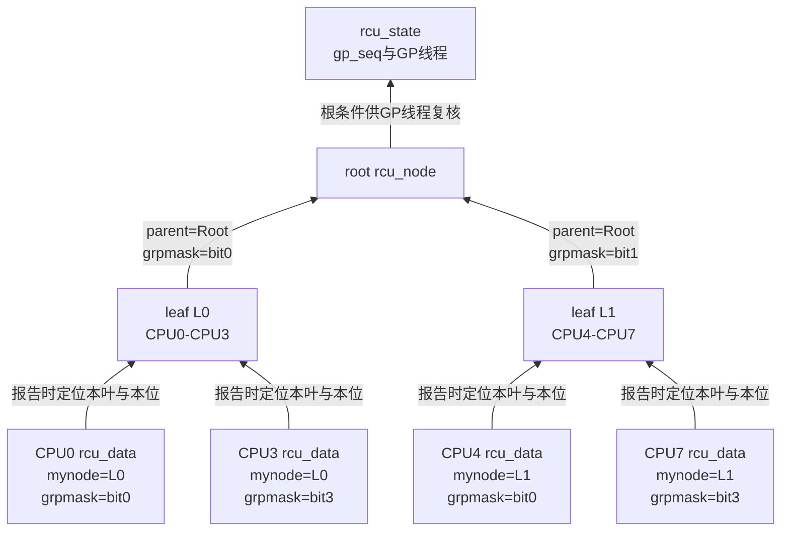
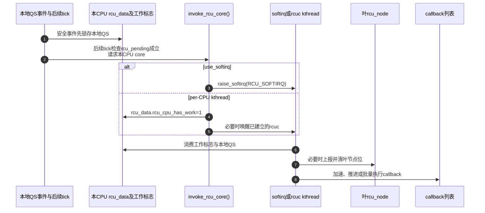

# 第7章\_Tree\_RCU\_初始化\_拓扑与执行上下文

## 7.1\_具体问题\_CPU的QS究竟要写进哪一个节点

上一章已经解释 CPU 证据与任务登记怎样交接，却把每 CPU 状态、叶节点和执行者当成了现成对象。本章回到启动时刻，追问这些地址和任务怎样建立。假设内核为 64 个 CPU 配置了容量；CPU37 上线后观察到 QS，路径通过 `this_cpu_ptr(&rcu_data)` 取得本地状态时，必须立即知道：

```text
本CPU属于哪个叶rcu_node
本CPU在叶qsmask中对应哪一位
该叶节点向父节点报告时又对应哪一位
谁负责运行本CPU的rcu_core
谁负责推进全局GP
```

若这些关系要到每次 QS 才搜索整棵树，报告路径会变得昂贵；若映射错误，CPU37 可能清掉 CPU38 的债务。初始化的任务就是把拓扑、位图和执行上下文预先建立为可直接寻址的状态。

## 7.2\_启动代码不是一条单函数调用

运行期需要的东西不能按名称随意排序。先确定树的容量与节点锁，才能安全写入节点；先绑定 CPU 的叶节点，才能准备它的本地代际；先登记执行入口，后续通知才有接收路径。状态建立与实际线程运行也不是同一时刻：早期启动尚不能依靠完整调度服务，后续才创建长期 GP 任务和相应 worker。

这里的 boot CPU 是执行早期启动的处理器。`possible` 集合表示内核为哪些逻辑 CPU 预留运行所需状态，`online` 集合表示当前上线参与运行的 CPU，两者不能互换；`nr_cpu_ids` 给出所需逻辑编号范围的上界，不等于此刻在线数。fanout 是一个节点覆盖的子节点数，叶层则覆盖 CPU；容量与扇出共同决定需要多少层。

下面按 Linux 6.12.20 的 `kernel/rcu/tree.c::rcu_init()` 顺序列出调用骨架，用来定位这些依赖。这是省略告警和条件细节的阅读摘要，不是可直接调用的驱动初始化程序；`cpu` 在函数入口取 `smp_processor_id()`：

```c
rcu_early_boot_tests();
kfree_rcu_batch_init();
rcu_bootup_announce();
sanitize_kthread_prio();
rcu_init_geometry();
rcu_init_one();
if (dump_tree)
	rcu_dump_rcu_node_tree();
if (use_softirq)
	open_softirq(RCU_SOFTIRQ, rcu_core_si);
pm_notifier(rcu_pm_notify, 0);          /* PM_SLEEP关闭时为空操作 */
rcutree_prepare_cpu(cpu);
rcutree_report_cpu_starting(cpu);
rcutree_online_cpu(cpu);
rcu_gp_wq = alloc_workqueue("rcu_gp", WQ_MEM_RECLAIM, 0);
sync_wq = alloc_workqueue("sync_wq", WQ_MEM_RECLAIM, 0);
qovld_calc = qovld < 0 ? DEFAULT_RCU_QOVLD_MULT * qhimark : qovld;
start_poll_synchronize_rcu_expedited();
rcu_test_sync_prims();
tasks_cblist_init_generic();
```

这段顺序同时建立早期契约测试、`kfree_rcu` 批处理、参数派生、固定拓扑、boot CPU 身份、softirq/PM 入口、工作队列基础设施、callback 过载门闩、过早 poll 修复和 Tasks RCU callback 分片。完整版本化调用账本、配置分支、失败语义和后半程接力见 [Linux 6.12 Tree RCU `rcu_init()` 启动初始化源码实现](../../../../../research/source_reading/rcu/source_explanations/P12_Linux_6.12_Tree_RCU_rcu_init启动初始化源码实现.md#12.5_I0到I13的初始化阶段账本)。

这段顺序有启动约束：`rcu_init()` 很早执行，此时源码断言在线 CPU 数不超过一个；其他 CPU 以后通过 CPU hotplug/bring-up 钩子逐个准备。GP kthread、boost/nocb/expedited 工作线程还受 `kthreadd` 和对应初始化阶段是否就绪的限制，不能把“`rcu_init()` 一次创建全部执行者”当作事实。早期 `synchronize_rcu()` 采用单启动任务语义，workqueue 对象虽可创建/排队，完整 worker 执行仍要等待 `workqueue_init()`。

第五章出现过的 **GP kthread** 是一个长期存在的内核调度任务：`rcu_spawn_gp_kthread()` 创建 `task_struct`，入口为 `rcu_gp_kthread()`，任务指针保存在 `rcu_state.gp_kthread`，无请求时睡在 `rcu_state.gp_wq`。它不是每轮 GP 新建的线程，不是第五颗 CPU，也不负责执行所有 callback。完整术语和生命周期见 [Tree RCU GP 请求与全局生命周期](P08_Tree_RCU_GP请求与全局生命周期.md#8.3_为什么需要一个长期存在的GP内核线程)，版本化模块协作见 [GP 全局生命周期模块源码概念导读](../../../../../research/source_reading/rcu/navigation/P03_Linux_6.12_Tree_RCU_GP全局生命周期模块源码概念导读.md#3.5_线程怎样创建并安全发布)；`rcu_init()` 与稍后线程创建的启动分界见 [从内核启动链定位 `early_initcall`](../../../../../research/source_reading/rcu/source_explanations/P05_Linux_6.12_Tree_RCU_GP全局生命周期源码实现.md#5.5.1_先从内核启动链定位early_initcall)，创建与发布语句见 [`rcu_spawn_gp_kthread()`](../../../../../research/source_reading/rcu/source_explanations/P05_Linux_6.12_Tree_RCU_GP全局生命周期源码实现.md#5.5.2_rcu_spawn_gp_kthread怎样创建并发布任务)。

## 7.3\_B0到B6\_拓扑建立的统一阶段

先把启动过程分成 B0～B6，B 表示本章的 boot 阶段，区别于第五章运行期的 S 周期。这些阶段表达依赖关系，不表示所有 CPU 同时完成七个动作：boot CPU 先建立全局状态，次级 CPU 的准备和上线以后逐个发生；某些线程也要到后续初始化调用才创建。

| 阶段 | 触发 | 写入状态 | 写入者 | 后续读取者 | 完成条件 |
| --- | --- | --- | --- | --- | --- |
| B0 计算几何 | `rcu_init_geometry()` | 层数、每层节点数量与 fanout | boot CPU | `rcu_init_one()` | 覆盖 `nr_cpu_ids` |
| B1 初始化节点 | `rcu_init_one()` 叶到根遍历 | 锁、`gp_seq`、范围、parent、`grpmask`、blocked 链表 | boot CPU | GP/QS/expedited 路径 | 每个节点可独立加锁 |
| B2 绑定每CPU | `for_each_possible_cpu` | `rdp->mynode`、per-CPU callback/本地初值 | boot CPU | 当前 CPU 快路径 | 每个 possible CPU 可直接找到叶节点 |
| B3 登记core执行入口 | 早期 `open_softirq()`；线程分支由后续初始化接力 | softirq handler 或每CPU线程登记、工作标志 | boot/后续初始化路径 | `invoke_rcu_core()` | 对应分支的入口已登记；实际调度能力另受启动阶段约束 |
| B4 准备boot CPU | `rcutree_prepare_cpu()` | 本地代际、QS债务、callback list、watching nesting | boot CPU | scheduler、RCU core | CPU可加入参与集合 |
| B5 CPU online | starting/online 钩子 | `qsmaskinitnext` 等在线状态 | hotplug路径 | 下一轮 GP init | 新 CPU 在正确代际加入 |
| B6 工作线程就绪 | spawn/workqueue初始化 | GP、nocb、boost、expedited执行对象 | init/hotplug路径 | 请求和慢路径 | 对应配置允许唤醒 |

初始化不是单一状态机，而是拓扑、每 CPU、本地执行器和全局线程四组状态在启动阶段汇合。

### 7.3.1\_初始化阶段怎样对齐公共实现抽象

[P04 提炼的七项实现抽象](P04_RCU_分类坐标与内核配置.md#4.1.4_先提炼跨类型实现都必须回答的七个问题)描述运行期必须存在的职责；本节 B0～B6 描述 Tree RCU 怎样把这些职责变成可寻址状态和可调度执行者。Linux 6.12.20 的逐函数源码则使用 I0～I13 记录更细的启动事务。三套编号不能互相替代，下面只建立交叉关系：

| 本节初始化阶段 | Linux 6.12.20 源码阶段 | 建立的实现抽象 | 第一次重要运行期消费 |
| --- | --- | --- | --- |
| B0 计算几何 | `rcu_init()` 的 I5 | 汇聚与全局结论所需的节点容量和层级 | [P05 S4](P05_Tree_RCU_公共骨架与完整周期.md#5.5.2_S3到S7_GP请求证明与根完成)开始一轮 GP 时遍历实际树形 |
| B1 初始化节点 | I6 的节点初始化部分 | GP 代际、局部债务汇聚与父子传播的共享地址 | P05 S4 建债、S6 逐层汇聚与 S7 发布完成 |
| B2 绑定每 CPU | I6 的 per-CPU 绑定部分 | reader 状态、局部证据与 callback 队列到叶节点的直接寻址关系 | P05 S5 记录证据、S6 清叶节点位以及 S8 推进 callback |
| B3 注册 core 执行入口 | I7；线程分支还要等待后继 initcall | 局部证据消费者和结果交付执行者 | P05 S5 的本地检查与 S8 的 callback 推进/执行 |
| B4 准备 boot CPU | I9 的 `prepare` 部分 | 当前 CPU 的本地状态、代际快照和回调容器 | 下一轮 P05 S4 建债以及本 CPU 后续 S5 证据记录 |
| B5 CPU online | I9 的 `starting/online` 部分；次级 CPU 以后复用 hotplug 协议 | 保护域参与集合及下一轮债务位 | 后续 GP 在 P05 S4 封闭本轮参与集合 |
| B6 工作线程就绪 | I10 先建立 workqueue；GP/core/NOCB 等线程由后继 initcall 创建 | GP 请求协调者、慢路径执行者和结果交付者 | P05 S3 接收需求、S4～S7 推进 GP、S8 交付结果 |

这张表也解释了为什么不能只读 `rcu_init()` 函数体：I5～I10 主要建立地址、入口和排队能力，实际 GP kthread、完整 workqueue worker 与次级 CPU 都在函数返回以后继续接力。完整源码交叉账本见 [`rcu_init()` 的 I 阶段到运行期职责映射](../../../../../research/source_reading/rcu/source_explanations/P12_Linux_6.12_Tree_RCU_rcu_init启动初始化源码实现.md#12.5.1_I阶段怎样回接公共实现抽象与运行周期)。

## 7.4\_rcu\_node怎样由叶到根建立

树的作用是让一组 CPU 先在叶节点汇总，再由节点向父层报告。为了运行时不再搜索父子关系，`rcu_init_one()` 按层从叶向根为每个节点填写范围和地址。先看 `rcu_state.node[]` 与 `rcu_state.level[]` 怎样解决“树放在哪里”的问题：

```text
逻辑树：Root → 中间rcu_node → 叶rcu_node

物理布局：rcu_state.node[0], node[1], node[2], ...
层入口：  rcu_state.level[i] → 第i层在node[]中的第一个元素
```

上游注释称这种布局为 tree in `"heap" form`，意思是类似堆数据结构那样按层紧密存入数组，**不是** `kmalloc()` 所说的动态内存堆。`node[0]` 是根；初始化根据 `num_rcu_lvl[]` 计算后续 `level[i]`，再为每个元素写 `parent/grpmask/grplo/grphi`。因此数组解决存储和遍历，节点字段解决逻辑父子关系，二者不是两棵树。

热插拔又带来两个不同问题：当前有多少 CPU 参与运行，以及哪些 CPU 曾经出现、需要被 expedited 初始化集合认识。一个 CPU 下线会改变前者，却不会抹掉后者的历史。因此同一全局对象保留两种计数：

| 字段 | 含义 | 主要消费路径 |
| --- | --- | --- |
| `rcu_state.ncpus` | 到目前为止被 RCU 看见、加入过 expedited 初始化集合的 CPU 数；新 CPU 首次 online 时单调增加 | expedited GP 用它判断是否需要把新 CPU 传播进 `expmaskinit` 树 |
| `rcu_state.n_online_cpus` | RCU CPU 生命周期计数；`prepare` 增加，dead 路径减少 | 辅助判断 RCU 初始化与生命周期进展；不等同任意瞬间的 `cpu_online_mask` 计数 |

`ncpus` 不是当前在线数，CPU offline 不会让它回退；`n_online_cpus` 也不是本轮普通 GP 的等待集合，本轮集合仍由 `qsmaskinit/qsmask` 在 GP 边界建立。

Linux 6.12.20 全部 `rcu_state` 字段域及其初始化见 [`rcu_state` 把多个子状态机放在同一全局对象](../../../../../research/source_reading/rcu/source_explanations/P05_Linux_6.12_Tree_RCU_GP全局生命周期源码实现.md#5.3_rcu_state把线程命令代际和等待队列放在一起)；本章只继续展开拓扑与 CPU 集合。

下面用等价伪代码说明范围与父指针的关系；`root`、`parent_level`、`parent_node` 是教学符号，不是该函数的实际局部变量：

```c
rnp->grplo = j * cpustride;
rnp->grphi = min((j + 1) * cpustride - 1, nr_cpu_ids - 1);

if (root) {
	rnp->parent = NULL;
	rnp->grpmask = 0;
} else {
	rnp->grpnum = j % levelspread[parent_level];
	rnp->grpmask = BIT(rnp->grpnum);
	rnp->parent = parent_node;
}
```

节点同时初始化两类锁：普通 `rnp->lock` 保护 GP、`qsmask`、blocked task 等主要状态；`fqslock` 用于 force-QS 请求漏斗，减少所有发起者直接争用根状态。



图中的位宽只是教学示例；实际 fanout 和层数由内核配置、`nr_cpu_ids` 与 geometry 计算决定。

## 7.5\_每CPU怎样绑定叶节点

节点建立后，`rcu_init_one()` 遍历 possible CPU。它顺着叶节点的 `grphi` 找到覆盖该 CPU 的叶节点并写：

```c
per_cpu_ptr(&rcu_data, cpu)->mynode = rnp;
rcu_boot_init_percpu_data(cpu);
```

`rcu_boot_init_percpu_data()`/相关初始化令 `rdp->grpmask` 表示本 CPU 在该叶的位。以后报告无需全树查找：

```text
rdp = this_cpu_ptr(&rcu_data)
rnp = rdp->mynode
mask = rdp->grpmask
```

CPU 与叶节点是静态几何映射；CPU online/offline 改变的是该节点哪些位参加下一轮 GP，而不是每次热插拔都重新发明整棵树。

## 7.6\_CPU准备与加入参与集合是两步

`rcutree_prepare_cpu(cpu)` 在根锁和叶锁保护下初始化本地运行状态：

```c
rdp->gp_seq = READ_ONCE(rnp->gp_seq);
rdp->gp_seq_needed = rdp->gp_seq;
rdp->cpu_no_qs.b.norm = true;
rdp->core_needs_qs = false;
rdp->rcu_iw = IRQ_WORK_INIT_HARD(rcu_iw_handler);
```

它还在必要时重新启用 callback 分段列表，在启动阶段允许时准备节点/CPU 相关 kthread，并增加 RCU 的 CPU 生命周期计数。这个计数动作早于 CPU 真正投入普通运行，不能当成该 CPU 已经开始执行任务的证明。但新增 CPU 对 `qsmaskinit` 的影响必须与 GP 边界和 hotplug 锁协调；源码用 `qsmaskinitnext` 表达下一轮参与集合，避免正在进行的 GP 因 CPU 中途上线而改变历史等待边界。

这与对象入口的时间边界相同：参与集合也必须按代际封闭，不能在 GP 中途随意增删而没有协议。

## 7.7\_五类执行者和状态通信

地址齐备以后，还需要有人推进它们。reader 只负责业务访问；调度和执行环境边界产生本地证据；本 CPU 的 RCU core 消费证据、管理本地回调；全局 GP 线程合并各处进度。回调卸载、提升被阻塞读者优先级和加速 GP 又有各自辅助执行者。它们不能因为名字都带 RCU 就被看作同一个后台任务。

| 执行者 | 常见上下文 | 读取 | 写入/通知 | 是否代表业务writer |
| --- | --- | --- | --- | --- |
| reader任务 | 任意允许的内核任务/中断上下文 | RCU发布指针 | 每任务或执行约束状态 | 否 |
| scheduler/context tracking | context switch、user/idle、IRQ边界 | 当前任务、watching、本CPU债务 | 本地QS或blocked任务登记 | 否 |
| `rcu_core()` | `RCU_SOFTIRQ` 或 per-CPU `rcuc` kthread | `rcu_data`、叶节点、callback分段 | QS上报、callback推进/执行请求 | 否 |
| `rcu_gp_kthread` | 普通 Tree RCU 的长期全局 GP 内核任务 | 根完成条件、GP请求 | 初始化各节点、FQS、cleanup；[完整职责](P08_Tree_RCU_GP请求与全局生命周期.md#8.3_为什么需要一个长期存在的GP内核线程) | 汇聚多个请求，不代表单个writer，也不直接执行全部callback |
| callback/NOCB/boost/exp 辅助执行者 | 依配置使用 softirq、内核线程或工作队列 | 可执行 callback、被抢占任务或 expedited 状态 | 分别调用回调、提高读者优先级或推进加速证明 | 各承担自己的内部职责，不自动取得业务入口所有权 |

## 7.8\_rcu\_core为何既可能是softirq也可能是kthread

本地有待办工作时，必须为它选一个消费上下文。softirq 路径把工作留在本 CPU 的软中断处理中，省去专门线程的调度，但可能增加本地软中断执行压力；`rcuc` 路径把相同 core 工作交给每 CPU 内核任务，使其可以按调度策略运行，同时付出唤醒和调度成本。

Linux 6.12.20 的 `rcutree.use_softirq` 参数默认在非 PREEMPT_RT 构建为真，在 PREEMPT_RT 构建为假；它是启动期选择，参数权限为只读，不能把本章分支当作运行时任意切换的 API。已经确认本 CPU online 后，`invoke_rcu_core()` 的分派骨架是：

```c
if (use_softirq)
	raise_softirq(RCU_SOFTIRQ);
else
	invoke_rcu_core_kthread();
```

softirq handler `rcu_core_si()` 只调用 `rcu_core()`；kthread 分支先写本 CPU `rcu_data.rcu_cpu_has_work`，再在任务已建立且需要唤醒时请求唤醒 `rcuc`。执行者会在局部 IRQ 保护下取得并清除工作标志，再处理工作；通知可以合并，状态不能丢掉。`rcu_core()` 自身依次：

1. 当前上下文允许时处理抢占式读者的延后 QS，否则保留责任并请求后续调度；
2. `rcu_check_quiescent_state()` 消费本地 QS；
3. 必要时加速 callback；
4. 检查 GP 启动 stall；
5. 对非 offload CPU 调用 `rcu_do_batch()`；
6. 处理 NOCB 延迟唤醒。

所以 scheduler tick 只可能 **请求** core 工作，它不是 callback 和 QS 的唯一执行上下文。`NO_HZ_FULL` 场景尤其不能依赖周期 tick 永远存在。

## 7.9\_一次本地工作触发时序

选一条 CPU 在内核运行、已锁存 QS，随后调度 tick 发现本地 RCU 待办的路径。记录 QS 的事件与请求 core 的事件可以不是同一次调用；user/idle 转换也不保证立刻直接调用下面的整个链条。



## 7.10\_代码和运行观察

观察也按“构建能力 → 启动选择 → 当前执行者”进行。以下命令在目标 Linux 终端执行，不修改内核状态。先找与当前运行映像对应的配置：

```bash
# 目标 Linux；若发行版未提供此文件，改为经过身份核对的构建输出 .config。
cfg=/boot/config-"$(uname -r)"
grep -E '^(CONFIG_(TREE_RCU|RCU_FANOUT|RCU_FANOUT_LEAF|RCU_NOCB_CPU|PREEMPT_RCU|PREEMPT_RT)=|# CONFIG_(TREE_RCU|RCU_NOCB_CPU|PREEMPT_RCU|PREEMPT_RT) is not set)' "$cfg"
```

数值 fanout 是节点扇出配置，布尔项决定有哪些分支可用。路径缺失、权限不足或 grep 无匹配都不能直接解释成“这些能力全部关闭”。接着看启动参数是否改变默认运行选择：

```bash
# 目标 Linux；观察 rcutree.use_softirq、rcu_nocbs 等已讲过的选择。
cat /proc/cmdline
```

没有显式参数时回到该版本默认值，不把“没有写参数”当作 false。然后检查日志中实际报告的初始化结果：

```bash
# 目标 Linux；读取日志可能需要系统授予相应权限。
dmesg | grep -E 'RCU|rcu:'
```

日志能提供几何与启动路径线索，但日志被覆盖或未输出也可能没有匹配。最后观察当前任务：

```bash
# 目标 Linux，使用提供这些列的 procps ps。
ps -eLo pid,psr,cls,rtprio,comm | grep -E 'rcu|rcuc|rcuo|rcub|rcuog|rcuop'
```

`pid` 标识任务，`psr` 是所报告的处理器位置而非永久绑定，`cls/rtprio` 显示调度类别和实时优先级，`comm` 是任务名。不要预期每种配置都有同一组线程；softirq 路径也没有必要为每 CPU 建立 `rcuc`。

做一个对照：若确认非 RT 构建、未覆盖默认 `use_softirq`，而列表没有 `rcuc/N`，这与本章模型一致；不能据此判断 RCU 没有工作。若线程存在但回调迟迟未执行，也不能只看任务名断言 GP 已完成，仍须区分待办标志、调度和回调资格。

版本身份先见 [RCU 源码总索引](../../../../../research/source_reading/rcu/navigation/P01_Linux_6.12_RCU源码总阅读索引.md)，Linux 6.12.20 的初始化实现再进入 [`rcu_init()` 启动初始化源码实现](../../../../../research/source_reading/rcu/source_explanations/P12_Linux_6.12_Tree_RCU_rcu_init启动初始化源码实现.md#12.1_从start_kernel里的一个调用固定本章任务)，再由 [拓扑与 CPU 热插拔模块源码概念导读](../../../../../research/source_reading/rcu/navigation/P04_Linux_6.12_Tree_RCU_拓扑与CPU热插拔模块源码概念导读.md#4.1_本模块究竟解决什么问题) 分流，分别直达 [`rcu_init_one()` 建立固定汇聚树](../../../../../research/source_reading/rcu/source_explanations/P06_Linux_6.12_Tree_RCU_拓扑与CPU热插拔源码实现.md#6.4_rcu_init_one建立固定汇聚树并绑定每CPU叶节点) 与 [boot/prepare 两阶段初始化](../../../../../research/source_reading/rcu/source_explanations/P06_Linux_6.12_Tree_RCU_拓扑与CPU热插拔源码实现.md#6.5_boot初始化与prepare为何仍未让CPU加入当前GP)。普通 GP kthread 继续进入 [启动、创建到运行期的唯一实现](../../../../../research/source_reading/rcu/source_explanations/P05_Linux_6.12_Tree_RCU_GP全局生命周期源码实现.md#5.5.1_先从内核启动链定位early_initcall)，每 CPU core 执行者进入 [回调分段与批处理源码实现](../../../../../research/source_reading/rcu/source_explanations/P09_Linux_6.12_Tree_RCU_回调分段与批处理源码实现.md#9.7_普通CPU怎样选择softirq或rcuc执行者)；不能由启动函数名把它们视为同一线程。

## 7.11\_成本与边界

- 初始化用固定拓扑换取运行时 `rdp->mynode/grpmask` 直接寻址。
- 树减少全局争用，但每个叶节点仍有锁和共享缓存行。
- 每 CPU callback 列表避免每次 `call_rcu()` 争用全局队列，却要求 hotplug 时迁移状态。
- 多种执行上下文改善隔离和实时性，却增加 softirq、线程唤醒、affinity 与卸载协调。

下一章从已经建立的全局线程和状态出发，追踪一个真实 GP 请求怎样被合并、开始并完成。

上一篇：[Tree RCU 读侧执行模型与配置差异](P06_Tree_RCU_读侧执行模型与配置差异.md)。

下一篇：[Tree RCU GP 请求与全局生命周期](P08_Tree_RCU_GP请求与全局生命周期.md)。
