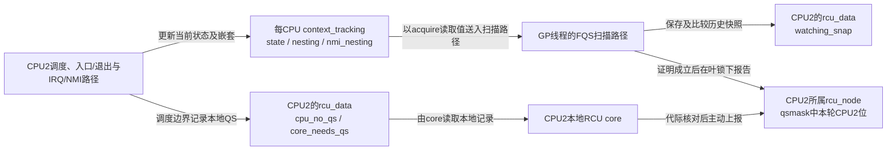
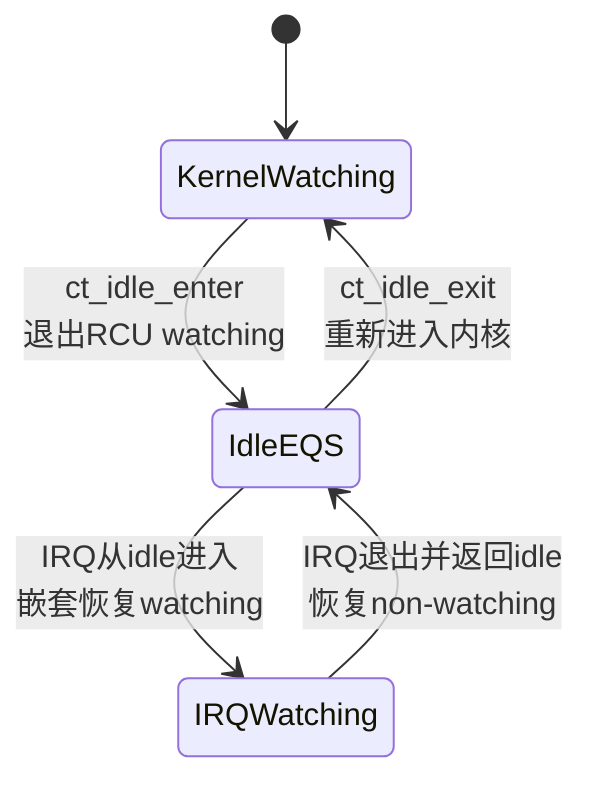
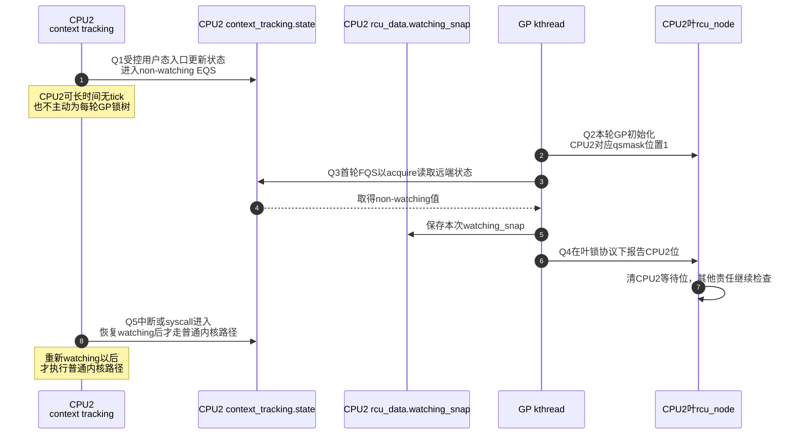

# 第9章\_Tree\_RCU\_QS\_EQS与Context\_Tracking


## 9.1\_上一章建立了债务却还没有解释证据从哪里来

P08 已经说明 GP 怎样请求、开始并建立等待债务，但 `gp_seq` 前进本身不能证明旧 reader 已经离场。本章只追踪 **CPU 在什么执行边界产生 QS、持续 EQS 怎样成为可读取状态、context tracking 怎样避免把 IRQ 或内核重入误判成静默区间**；这些局部证据怎样汇聚到根节点留给 P10。版本边界与模块证据入口见 [RCU 源码总阅读索引](../../../../../research/source_reading/rcu/navigation/P01_Linux_6.12_RCU源码总阅读索引.md)。

## 9.2\_场景\_三个CPU都不在执行普通旧reader\_却走三条证明路径

GP=N 开始时：

- CPU1 正在内核态运行普通任务，但当前不在 RCU 读侧；稍后发生 context switch。
- CPU2 正在用户态执行计算，可能是 `NO_HZ_FULL` CPU，长时间没有调度 tick。
- CPU3 已进入 idle，随后又被一次 IRQ 打断。

三者都可能没有旧 reader，但不能用一句“等每个 CPU 调度一次”处理：CPU2 和 CPU3 可能不发生普通任务切换；CPU3 的 IRQ 又意味着“进过 idle”不等于从此不执行内核代码。

本章解释 Linux 6.12.20 怎样用 **一次 QS 事件** 和 **持续 EQS/watching 状态** 两种证据覆盖这些现场。

## 9.3\_先区分QS\_EQS和watching

CPU1 的切换提供一个已经越过的边界，CPU2 的用户态运行则可能持续很久。只等主动报告会反复打扰 CPU2；只记“它曾经在用户态”又无法判断它此后是否已重新进入内核。需要记录持续状态及其变化，让远端能够读取并判断。本章将这段受控静止区间称为 **EQS（Extended Quiescent State，扩展静止状态）**；watching 表示 RCU 当前仍需把该 CPU 的执行纳入观察。

| 概念 | 形态 | 证明内容 | 典型来源 |
| --- | --- | --- | --- |
| QS | 一次事件/边界 | 在对应执行约束和任务登记成立时，可偿还该 CPU 对本轮的责任 | 合法调度边界、返回 user、进入 idle；offline 另有退出协议 |
| EQS | 一段持续区间 | CPU 在该区间中不执行普通内核 RCU reader | 受跟踪的 user/idle 区间；离线参与集合不直接等同 EQS |
| watching | 内核软件状态 | RCU 当前是否把该 CPU 视为可能执行普通内核 reader | context tracking 的 `CT_RCU_WATCHING` 状态与嵌套 |

`rcu_read_lock()` 到 `rcu_read_unlock()` 是读侧临界区，不是 QS。硬件也不会自动产生名为 QS 的信号；scheduler、context tracking 和 RCU 根据执行边界维护软件证明。

CPU2 即使当前处于 EQS，也不能替另一个位置登记着的被抢占任务清债。上一章及第六章建立的两种责任仍然独立：本章只解决 CPU 证据，原叶节点上的旧任务仍须走自己的退出路径。

## 9.4\_两条正交状态链

一条状态链回答“本 CPU 对当前 GP 是否仍欠一次报告”，另一条回答“RCU 现在是否把本 CPU 视为可能执行普通内核 reader”。二者由不同事件推进，只有在合法边界上交接，不能把 `watching=false` 或一次历史 QS 直接当作任意 GP 的完成证据。

### 9.4.1\_CPU的当前GP债务

```text
rdp->gp_seq感知GP=N
    → cpu_no_qs.b.norm=true
    → core_needs_qs=true
    → 本CPU观察合法QS
    → cpu_no_qs.b.norm=false
    → rcu_core上报并清叶qsmask位
```

### 9.4.2\_CPU是否处于watching

```text
进入普通内核执行
    → watching

受控进入user/idle并且没有IRQ/NMI嵌套
    → non-watching EQS

IRQ/NMI从EQS进入内核
    → 临时恢复watching/嵌套

中断退出并返回EQS
    → 再次non-watching
```

第一条按 GP 表示“欠不欠证明”；第二条跨 GP 持续表示 CPU 当前能否执行普通 reader。FQS 扫描把第二条状态转换成第一条 GP 的完成证据。

两条链的状态地址和写入者也不同：CPU2 的入口/退出路径写自己的 `context_tracking.state` 与嵌套字段；GP 扫描者远端读取该原子状态，把观察值保存在 CPU2 对应的 `rcu_data.watching_snap` 中。后者是扫描者的历史副本，不是 CPU2 每次进入 idle 时主动填写的主状态。



上方是远端观察，下方是本地报告，最终清同一轮的 CPU 位。二者靠共享内存和规定的同步顺序通信；没有每次进入用户态都主动通知 GP 线程，不等于没有跨 CPU 读取或缓存一致性成本。

## 9.5\_CPU1\_普通context\_switch的本地QS

`kernel/sched/core.c::__schedule()` 调用 `rcu_note_context_switch(preempt)`。

- 非抢占式 Tree RCU：读侧禁抢占，真实 context switch 不能跨越旧 reader，路径调用 `rcu_qs()`。
- 抢占式 Tree RCU：若任务在读侧内，先登记到叶 `blkd_tasks`；任务债务已共享以后再调用 `rcu_qs()` 锁存 CPU 的本地 QS。动作发生在调度钩子内，不要求实际切换已经完成。

两种分支最终都可能执行：

```c
__this_cpu_write(rcu_data.cpu_no_qs.b.norm, false);
```

这只是本 CPU 锁存事实。`rcu_core()` 以后通过 `rcu_check_quiescent_state()` 与 `rcu_report_qs_rdp()` 才把它写入共享节点。

## 9.6\_CPU2\_返回用户态为何可以成为EQS

普通内核 RCU reader 只能在内核执行区间运行；CPU 完成退出路径并进入 user 后，不会继续执行进入 user 以前的普通内核读侧。

“用户态具备这种语义”与“实现已将这个 CPU 的用户态标成 EQS”还要分开。下面选择 **用户上下文跟踪在 CPU2 上已激活** 的路径，典型场景是配置并启用 full dynticks 的 CPU。仅从任务运行在用户态，不能直接推断 `CT_RCU_WATCHING` 位已经清除；未激活的 CPU 可以沿 tick 等路径提供普通 QS。

Linux 6.12.20 的 context tracking 入口位于 `kernel/context_tracking.c`：

```text
__ct_user_enter()
    → ct_kernel_exit_state(...)
    → 更新context_tracking.state的watching/递增状态

__ct_user_exit()
    → ct_kernel_enter_state(...)
    → 重新进入内核watching
```

进入/退出函数标为 `noinstr`，并严格安排 instrumentation 边界，避免在已经宣告 non-watching 后执行一段未被 RCU 观察的普通内核 reader。

满足跟踪前提的 `NO_HZ_FULL` CPU 可以长期停在 user，RCU 不必仅为每轮 GP 周期性打断它。远端 GP 扫描可读取 watching 快照，若按本轮锁和顺序协议取得的值显示 EQS，就可偿还 CPU 责任；这不保证该 CPU 永远不会因其他原因收到 tick 或中断。

## 9.7\_CPU3\_idle与IRQ嵌套为什么不能压成一个布尔值

idle 入口/退出由 `ct_idle_enter()` / `ct_idle_exit()` 管理。若 CPU 进入 idle 后发生 IRQ：



若只保存“CPU 执行过 idle”这一历史位，就无法把那次 idle 与本轮 GP 对齐。反过来，仅保存当前 watching 布尔值，也会丢失“两次采样都在内核，但中间完整经过 idle”的安全证据。context tracking 因而同时保留状态变化的序列与 IRQ/NMI 嵌套。只有跨越外层边界才切换 watching；在正在处理的 IRQ 内再次进入 NMI，不能在内层返回时提前宣称整个 CPU 已回到 EQS。

需要区分三种观察结果：

Linux 6.12.20 中，FQS 第一次用 `ct_rcu_watching_cpu_acquire()` 保存 `rdp->watching_snap`，后续用 `rcu_watching_snap_stopped_since()` 比较；完整模块通信先读 [force-QS 与 Stall 模块源码概念导读](../../../../../research/source_reading/rcu/navigation/P05_Linux_6.12_Tree_RCU_force_QS与Stall模块源码概念导读.md#5.4_FQS是两阶段远端观察而不是无条件IPI)，函数实现见 [`rcu_watching_snap_save/recheck()`](../../../../../research/source_reading/rcu/source_explanations/P07_Linux_6.12_Tree_RCU_force_QS与Stall源码实现.md#7.4_watching快照怎样把EQS变成隐式QS证据)。这两个函数读取 context tracking 已维护的状态，不替代 context tracking 入口本身。

```text
CPU当前就在稳定EQS
CPU自上次快照以来完整穿过EQS
CPU仍在watching且尚无证据
```

这里并不要求证明时 CPU 完全没有运行新的 reader。若快照能证明本轮边界以后已经经过 EQS，之后 IRQ 中新进入的读区不会让那次历史证明失效；真正危险的是把 GP 以前的一次旧 idle 误用给当前轮。

## 9.8\_watching快照算法

第一次 FQS 扫描调用 `rcu_watching_snap_save(rdp)`。下面摘出决定是否取得 EQS 证据的条件，省略 trace 和代际溢出处理：

```c
rdp->watching_snap = ct_rcu_watching_cpu_acquire(rdp->cpu);
if (rcu_watching_snap_in_eqs(rdp->watching_snap))
	return 1;
return 0;
```

返回正值表示 CPU 当前已经在 EQS，可形成证明；否则保存快照。

以后扫描调用 `rcu_watching_snap_recheck(rdp)`。`rcu_watching_snap_stopped_since()` 比较远端当前状态与保存值，若证明 CPU 自快照以来进入或穿过 EQS，返回正值；若 CPU 长期 watching 且需要催促，返回负值；仍不确定则返回零。

`force_qs_rnp()` 在叶节点锁下聚合结果：

```text
ret > 0 → 把CPU位加入mask并用rcu_report_qs_rnp()报告
ret = 0 → 保持等待
ret < 0 → 把CPU位加入rsmask，解锁后resched_cpu(cpu)
```

这条路径是 GP 扫描者 **读取远端共享状态**，不等于远端 CPU 每次进入 idle 都主动锁 RCU 树为某一 GP 清位。

同一版本的 recheck 还检查异常残留的 offline CPU 债务，并在警告后处理该状态；这属于热插拔协议的防御分支，不能把“CPU offline”从上下文中拿出来当成任意清位许可。长期 watching 的催促路径在 P14 展开，它只能促使参与者产生真实证据，不能用超时冒充 QS。

## 9.9\_本地事件与远端观察的完整时序



若 GP 开始时 CPU2 仍 watching，首轮只保存快照；CPU2 后来进出 user，下一轮 recheck 才把“自快照以来穿过 EQS”转为本轮 QS。

Q1～Q5 是本章这条采样路径的编号：Q2 对应 P05 S4 建债，Q3～Q4 对应 S5～S6 取证和汇聚；Q1/Q5 可以与不同轮 GP 交错。图选取 Q1 先发生的一条合法顺序，绝不把所有 CPU 的执行环境锁步到 GP 线程上。

## 9.10\_内存顺序为什么属于证明的一部分

`ct_rcu_watching_cpu_acquire()` 的 acquire 读取、`rcu_seq_start()` 的屏障以及从 GP 初始化到叶节点锁的锁链共同保证：远端 CPU 在进入 EQS 前完成的旧读侧访问，不会在 GP 完成后还被当成未排序的对象访问。

这不是“只要读到 non-watching 位就安全”。快照值的状态变化和内存顺序必须一起成立。通用 acquire/release 与 RCU GP 屏障关系见[release/acquire 发布协议](../memory_ordering/P04_release_acquire_发布协议.md)和[数据依赖、控制依赖与 RCU 取得](../memory_ordering/P05_数据依赖_控制依赖与RCU取得.md)。

## 9.11\_与6.12的状态位置差异

读旧资料时，可能在 `rcu_data` 中看见名为 dynticks 的主状态；本章却说它在 `context_tracking`。这是实现存放位置随版本变化，不能凭相似字段名把两份布局叠起来。以下比较固定在上游 v5.10 与本专题 NXP 6.12.20，前者只用于解释旧资料名称：

| 版本 | watching/EQS主要状态 | 典型入口 |
| --- | --- | --- |
| 上游 Linux v5.10 | `rcu_data.dynticks_nesting`、`dynticks_nmi_nesting`、`atomic_t dynticks` | `rcu_eqs_enter()`、`rcu_idle_enter()`、`rcu_user_enter()`、`rcu_momentary_dyntick_idle()` |
| Linux 6.12.20 | 通用 per-CPU `context_tracking.state` 与 `CT_RCU_WATCHING`；`rcu_data.watching_snap` 保存扫描快照 | `ct_kernel_exit/enter_state()`、`ct_idle_enter/exit()`、`__ct_user_enter/exit()`、`rcu_momentary_eqs()` |

跨版本稳定的是“本地执行状态形成可验证快照”；不稳定的是字段位置和函数名。写 6.12 文档时继续把 dynticks 主状态塞回 `rcu_data` 会让状态所有权错误。

对照原件：[上游 v5.10 tree.c 中的每 CPU 初值、原子 dynticks 访问与入口](https://github.com/torvalds/linux/blob/v5.10/kernel/rcu/tree.c)；当前版本的字段与入口见 [固定提交 context_tracking_state.h](https://github.com/nxp-imx/linux-imx/blob/dfaf2136deb2af2e60b994421281ba42f1c087e0/include/linux/context_tracking_state.h) 和 [context_tracking.c](https://github.com/nxp-imx/linux-imx/blob/dfaf2136deb2af2e60b994421281ba42f1c087e0/kernel/context_tracking.c)。这些链接用于追溯，比较所需的区别已列在本节。

## 9.12\_代码与trace观察

先做一个不依赖设备的快照推演。用 W0、W1 表示两次不同的 watching 序列值，E 表示 non-watching 值；只比较本轮建立以后采样的值，先假设没有计数回绕。遮住最后一列，逐项判断扫描者有无 CPU 证据：

| 首次采样 | 中间过程 | 后续采样 | 本轮结论 |
| --- | --- | --- | --- |
| E | 不要求再等一次切换 | 无须第二次 | 首轮就取得 EQS 证据 |
| W0 | 始终在内核，未取得其他 QS | W0 | 单凭这两次快照不能清位 |
| W0 | 进入受跟踪 user，尚未回来 | E | 已跨过静止边界，可以清 CPU 位 |
| W0 | 进 idle、被 IRQ 唤醒并重新 watching | W1 | 序列变化证明中间经过 EQS，不要求采样时仍空闲 |
| W0 | 只在内核中发生普通 IRQ/NMI 嵌套，没有跨外层 EQS 边界 | W0 | 嵌套本身不是静止证据 |

第四行是只看布尔值会漏掉的合法进展；若把采样改为 GP 以前保存的旧 E，又会错误地替新一轮清债。实际算法用规定宽度和回绕协议处理序列，本表只演练一次有限观察窗口。任务债务仍按第六章独立检查。

再到目标 Linux 只读核对本章条件。用户态忙循环只有在目标 CPU 的用户跟踪已激活时，才适合观察长期用户态 EQS；另一个 CPU 的 GP 请求和有效 trace 采集也必须实际存在。仅打开几个事件，不构成完整实验。

```bash
# 目标 Linux；先确认启动时是否指定了 nohz_full CPU 集合。
cat /proc/cmdline
```

参数只能说明请求的配置，不能代替构建能力。接着查与当前映像匹配的配置：

```bash
# 目标 Linux；若无 /boot 配置文件，使用经过身份核对的构建输出 .config。
cfg=/boot/config-"$(uname -r)"
grep -E '^(CONFIG_(NO_HZ_FULL|CONTEXT_TRACKING[^ =]*|TREE_RCU|RCU_TRACE)=|# CONFIG_(NO_HZ_FULL|CONTEXT_TRACKING[^ =]*|TREE_RCU|RCU_TRACE) is not set)' "$cfg"
```

没有文件或没有匹配必须先查原因，不能解释成所有配置为 n。然后确认跟踪事件是否由这个内核提供：

```bash
# 目标 Linux；要求 tracefs 已挂载于此，读取权限由系统提供。
trace_root=/sys/kernel/tracing
grep -E '^rcu:(rcu_fqs|rcu_quiescent_state_report|rcu_grace_period|rcu_watching)$' \
    "$trace_root/available_events"
```

事件存在只说明可观察。读取其字段定义，才能知道已采集记录中的 CPU、GP 序列和节点掩码各指什么：

```bash
# 目标 Linux；只在上一步确认事件存在后读取。
cat "$trace_root/events/rcu/rcu_fqs/format"
cat "$trace_root/events/rcu/rcu_quiescent_state_report/format"
```

本版本 `rcu_fqs` 的 `dti` 原因可来自首轮已经处于 EQS，也可来自后续快照变化，单看这三个字母不能区分两种情形。节点报告还应按同一 GP、CPU 所属叶范围和清除位配对。若两个事件都存在而记录为空，只能继续查采集配置、丢失和实际路径，不能推出没有 GP 或没有 QS。这些命令只核对观察能力，没有启停或清空全局跟踪会话，也不冒充已经完成的 nohz 实验。

## 9.13\_结论与边界

- QS 是一次证明事件，EQS 是持续状态，watching 是软件编码；三者不可互换。
- 本地 `cpu_no_qs=false` 与共享 `qsmask` 清位允许异步。
- user/idle 减少主动通知成本，但增加 context tracking、远端读取和特殊入口/退出约束。
- IRQ/NMI 嵌套必须被状态机覆盖，不能用简单 idle 布尔值。
- 满足跟踪条件的 full dynticks 用户态路径减少对周期 tick 的依赖，FQS 仍可读共享快照并在必要时催促 CPU。

上一篇：[Tree RCU GP 请求与全局生命周期](P08_Tree_RCU_GP请求与全局生命周期.md)。

下一篇：[Tree RCU rcu_node 树与分层汇聚](P10_Tree_RCU_rcu_node树与分层汇聚.md)。
