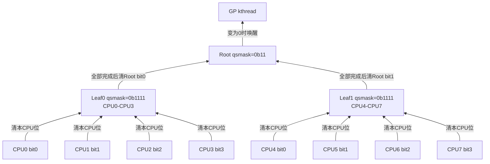
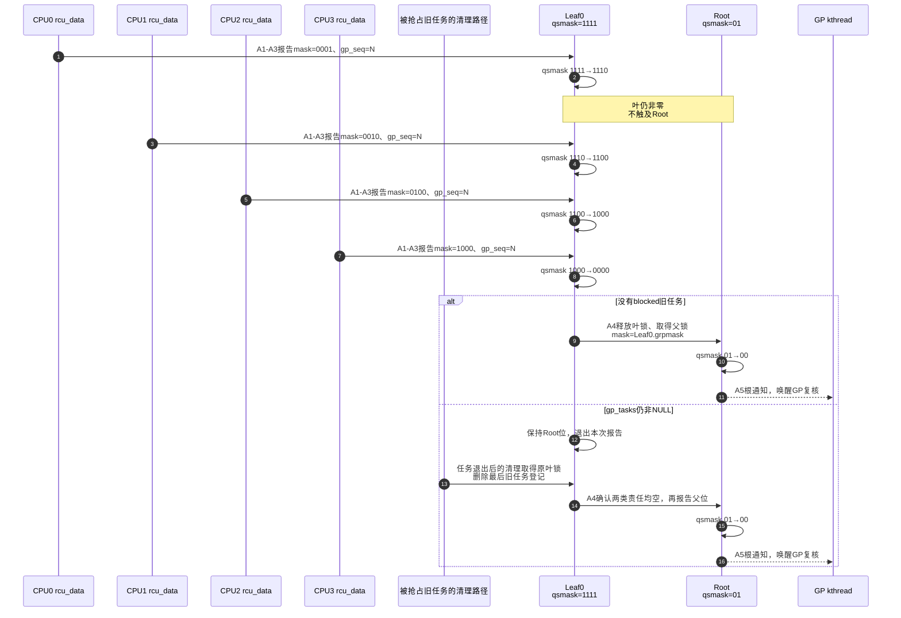

# 第10章\_Tree\_RCU\_rcu\_node树与分层汇聚

## 10.1\_问题\_为什么不让所有CPU清一个全局位图

上一章已经得到本地 QS 或远端 EQS 证据，现在还缺“局部安全怎样变成全局完成”。设 256 个 CPU 都在 GP 开始后很快经过 QS。最直接的设计是让它们锁同一个全局对象并清自己的位。下面是内核位图接口形式的教学片段，假设锁已经初始化、CPU 编号在 0～255 内：

```c
DECLARE_BITMAP(global_qsmask, 256); /* 多个机器字承载256位。 */

/* 报告路径片段；初始化本轮位图时也遵守同一锁协议。 */
spin_lock(&global_gp_lock);
clear_bit(cpu, global_qsmask);
spin_unlock(&global_gp_lock);
```

锁使清位不会互相覆盖，也让“最后一个位消失”的判断有确定顺序。但 CPU0 改锁与位图时，其他 CPU 缓存中的相关行要失效或等待；CPU1 接着报告，又要取得这些共享行的写权限。即使位图跨多个机器字，所有报告仍先经过同一把锁。跨 NUMA 节点时还可能增加远端互连访问；NUMA 指不同处理器组访问内存的延迟并不一致。这个成本按报告数量发生，不能只用一句“锁竞争大”跳过。

RCU 已经把成本从每次读取降到每 CPU 每 GP 的证明，继续改进的方向是让不同 CPU 组先写不同的局部位置。Tree RCU 用叶节点接收本组 CPU 位，只有该节点的 CPU 责任和必要任务责任都完成，才继续报告父节点。高层看到的是子树完成，通常不承受每个 CPU 的逐次清位；代价则是保存拓扑、初始化整棵树和多层加锁。本节先假设没有被抢占旧任务，10.7 再把这条责任接回。

## 10.2\_一棵八CPU教学树

把规模缩到八个 CPU、每叶四个 CPU，便于直接手算。CPU4 在 Leaf1 中仍占 bit0，Root 的 bit1 却表示整个 Leaf1；同样的位编号在不同节点有不同归属，必须和节点地址一起读。



若 CPU0、1、2 先报告：

```text
Leaf0: 1111 → 1110 → 1100 → 1000
Root:  11   → 11   → 11   → 11
```

只有 CPU3 最后令 Leaf0 `1000 → 0000`，Leaf0 才锁 Root 并清 bit0：

```text
Root: 11 → 10
```

Leaf1 完成后 Root `10 → 00`，全局结论才成立。

## 10.3\_位图字段各自表示什么

刚才手算时只改变“本轮还缺谁”，没有改变 CPU 属于哪个叶节点。热插拔还要另存“下一轮谁参加”，迟到报告则必须带代次，避免把上一轮的证据用到下一轮。这三个问题分别要求稳定拓扑、参与集合和本轮进度，字段表才由此展开：

| 字段 | 所属 | 生命周期 | 含义 |
| --- | --- | --- | --- |
| `qsmaskinitnext` | `rcu_node` | hotplug持续维护 | 下一轮预计参与集合 |
| `qsmaskinit` | `rcu_node` | GP边界更新 | 本轮初始化所依据的参与集合 |
| `qsmask` | `rcu_node` | 每轮 GP | 当前仍欠证明的 CPU/子节点位 |
| `grpmask` | `rcu_node` 或 `rcu_data` | 拓扑稳定期 | 自己在父节点/叶节点中对应的一位 |
| `mynode` | `rcu_data` | CPU映射稳定期 | 本 CPU 所属叶节点地址 |
| `gp_seq` | 节点/CPU | 每轮更新 | 报告属于哪个代际 |

`qsmask` 的位为一不表示对应 CPU 正在读，只表示本轮还没有取得足够证据。`qsmaskinitnext` 也不是当前 GP 等待集；它解决 CPU online/offline 与下一轮边界的协调。

## 10.4\_GP初始化怎样建立每层等待集

`kernel/rcu/tree.c::rcu_gp_init()` 广度优先遍历节点，在 `rnp->lock` 下执行：

```c
rcu_preempt_check_blocked_tasks(rnp);
rnp->qsmask = rnp->qsmaskinit;
WRITE_ONCE(rnp->gp_seq, rcu_state.gp_seq);
```

为何是广度优先：开始时要让上层代际和等待状态按统一 GP 发布，再让 CPU/叶节点异步感知；结束时同样要避免下一轮在部分节点开始，而上一轮在另一些节点尚未完整记录。

CPU hotplug 的 `qsmaskinitnext → qsmaskinit` 转换在专门锁和 GP 初始化边界中完成，避免当前 GP 中途出现无法解释的新参与者。

## 10.5\_CPU报告到叶节点

本 CPU `rcu_core()` 调用 `rcu_check_quiescent_state(rdp)`。确认本地已观察 QS 后进入 `rcu_report_qs_rdp()`：

```text
锁rdp->mynode
    → 校验本地已经有QS、代际相同且没有gpwrap
    → 不满足则重新要求本地QS，解锁返回
    → 清本地core_needs_qs
    → 若本位已清则解锁返回
    → 否则准备相关回调/紧迫状态，再进入逐层报告
```

代际校验阻止这个交错：

```text
CPU很晚才提交GP=N的QS
    → 节点已经开始GP=N+1
    → 旧报告不能清N+1的位
```

## 10.6\_节点怎样逐层向根清位

`rcu_report_qs_rnp()` 进入时已持有当前节点锁，并携带本轮 `gps`。它会在继续向父层前释放当前锁，再取得父锁；因此每层都重新核对代际，不能把拿到任意一个锁理解成整棵树已经冻结。以 A0～A5 表示本章局部交接：

| 阶段 | 进入条件与写入者 | 状态变化和后续动作 | 对应公共周期 |
| --- | --- | --- | --- |
| A0 建立等待集 | GP 线程初始化该节点 | 设置本轮序列、CPU/子节点位和任务边界 | P05 S4 |
| A1 提供证据 | 本地 core、远端 FQS 或任务清理路径 | 带本轮序列与待清掩码进入节点报告 | P05 S5～S6 |
| A2 校验并清位 | 报告者持当前节点锁 | 代际不符或非零掩码已无对应位时解锁返回；否则清相应位 | P05 S6 |
| A3 检查整个节点 | 同一报告者、同一节点锁 | 仍有 CPU 位或旧任务就解锁返回；都为空才记录 `completedqs` | P05 S6 |
| A4 交给父层 | 已证明子节点完成的报告者 | 保存子节点 `grpmask`，释放子锁、取得父锁，在父层重复 A2/A3 | P05 S6 |
| A5 根通知 | 已到根且条件成立的报告者 | 设置唤醒原因并通知 GP 线程复核，退出根锁协议 | P05 S6～S7 |

零掩码是该内部接口允许的特殊情况，不能用“掩码与 qsmask 无交集就一律返回”的伪代码抹掉它。通常 CPU 报告携带自己的非零位；任务责任清理等路径则依据当时节点与根关系进入相应分支。完整条件保留在版本化实现中，本表只说明交接职责。

到根后 `rcu_report_qs_rsp()` 唤醒 GP kthread。传播不是 CPU 主动给每一级发送消息；同一个报告函数只在某层刚好完成时继续锁父节点。

## 10.7\_抢占式任务债务怎样进入同一棵树

PREEMPT_RCU 的 blocked reader 只挂在叶 `rcu_node.blkd_tasks`，当前 GP 边界由 `gp_tasks` 表示。叶节点即使 `qsmask==0`，只要 `gp_tasks!=NULL` 就不能向父节点清位。

```text
Leaf0 qsmask=0
Leaf0 gp_tasks=&R-old
Root bit0=1
```

R-old 最外层 unlock 结束借用；立即或延后的特殊清理从原节点删除登记以后，`rcu_report_unblock_qs_rnp()` 在确认任务与 CPU 责任都为空时，以 Leaf0 的 `grpmask` 重新启动向父节点的报告。只有一个节点的树没有父节点，此时直接走根通知。不能在任务刚把嵌套降到零、共享登记尚未清理时就替它清父位。

所以高层 `qsmask` 不只是低层 CPU 位的算术 OR；叶节点把 CPU 和任务两类证明先做合取，再用自己的一位向上表示“整个子树完整”。

## 10.8\_锁与缓存通信发生在哪里

和全局单锁比较，现在 CPU0～3 的普通报告只写 Leaf0，CPU4～7 的报告只写 Leaf1。两组可以在不同节点锁下推进，只有各组完成时才争用 Root。这个收益来自减少根的写入次数，而不是树中的字段变成了无代价内存。按刚才 A 周期回看各层成本：

| 事件 | 触及共享位置 | 频率 |
| --- | --- | --- |
| 普通 `rcu_read_lock/unlock` | 非抢占执行约束或当前任务字段 | 每次读侧，不锁树 |
| 本 CPU 首次报告本轮 QS | 所属叶 `rnp->lock/qsmask` | 通常每 CPU 每 GP 一次 |
| 叶节点 CPU 与任务责任都完成 | 父节点锁和一位 | 正常同代汇聚时，每个子树完成才触及父层 |
| 中间节点清零 | 更上层节点 | 每完成子树一次 |
| GP初始化/cleanup | 遍历全树 | 每物理 GP |

树没有消除缓存一致性通信，而是把高频 reader 从共享树移开，并把 GP 报告成本分区、分层、批量化。CPU 很少或 GP 非常频繁时，树的管理成本也可能显著；RCU 的优势取决于 reader/update 比例和平台规模。

## 10.9\_完整四CPU报告时序

继续使用 Leaf0 的四个 CPU，假定 Leaf1 已经完成，因此 Root 只剩 bit0。本图的 A 阶段沿用上一节；节点框表示共享状态，修改仍由箭头上的报告或任务清理路径执行。



## 10.10\_trace和故障定位

RCU trace 中 `rcu_quiescent_state_report` 可观察节点层级、清除 mask、剩余 `qsmask` 和 blocked task 指示。stall 日志中的 `q=`/CPU mask 等字段随版本不同，应回到 `tree_stall.h` 对照格式。

排查“某 CPU 明明 QS 了但根没完成”时按层检查：

1. 本地 `cpu_no_qs` 是否已清；
2. `rcu_core()` 是否有机会运行并上报；
3. 叶节点代际是否匹配；
4. 叶 `qsmask` 是否还有其他 CPU；
5. 叶 `gp_tasks` 是否仍有被抢占旧 reader；
6. 父节点是否还有其他叶分支。

不要从根非零直接推断当前 CPU 的 reader 没退出；根保存的是整棵子树的汇总结论。

用手算检查这一判断：Leaf0 初始 `1111`，CPU0 同轮重复报告两次，再由 CPU3 报告，结果应为 `0110`，Root 的 Leaf0 位仍为 1。重复报告不会重复扣除“人数”，因为记录的是尚未证明的位。若随后送来的 CPU1 报告属于上一代 N，而节点已进入 N+1，则必须拒绝使用这份历史证据，不能把 N+1 的 bit1 清掉。

最后把 Leaf0 CPU 位全部清零，但保留一个旧任务登记：Root 仍不能完成。只有该登记也清理完，A4 才继续。由此可以同时排除“QS 只是计数减一”“旧证据可跨代使用”“CPU 位空就能释放”三种错误模型。

## 10.11\_源码入口

- 版本与模块地图先见 [RCU 源码总阅读索引](../../../../../research/source_reading/rcu/navigation/P01_Linux_6.12_RCU源码总阅读索引.md)。
- 先从 [拓扑与 CPU 热插拔模块源码概念导读](../../../../../research/source_reading/rcu/navigation/P04_Linux_6.12_Tree_RCU_拓扑与CPU热插拔模块源码概念导读.md#4.3_参与者状态地址与所有权)建立 `rcu_state`、`rcu_node` 与 `rcu_data` 的地址映射，再进入具体函数。
- `kernel/rcu/tree.h::struct rcu_node`、`struct rcu_data`。
- [`rcu_init_one()` 建立 parent、范围和 `grpmask` 拓扑](../../../../../research/source_reading/rcu/source_explanations/P06_Linux_6.12_Tree_RCU_拓扑与CPU热插拔源码实现.md#6.4_rcu_init_one建立固定汇聚树并绑定每CPU叶节点)。
- [`rcu_gp_init()` 建立本轮 `qsmask` 和代际](../../../../../research/source_reading/rcu/source_explanations/P05_Linux_6.12_Tree_RCU_GP全局生命周期源码实现.md#5.9_rcu_gp_init开始代际并建立证明债务)。
- [`rcu_report_qs_rdp()`、`rcu_report_qs_rnp()` 的逐层汇聚](../../../../../research/source_reading/rcu/source_explanations/P02_Linux_6.12_Tree_RCU_等待桥_QS与节点汇聚关键函数源码实现.md#2.6_rcu_report_qs_rdp与rcu_report_qs_rnp汇聚证据)。
- `kernel/rcu/tree_plugin.h::rcu_preempt_blocked_readers_cgp()`：任务债务门控。

走到根只把安全结论交给 GP 控制路径，业务对象还没有因此自动释放。下一章继续追踪回调队列怎样把已完成代次变成某个具体 callback 的执行资格。

上一篇：[Tree RCU QS、EQS 与 Context Tracking](P09_Tree_RCU_QS_EQS与Context_Tracking.md)。

下一篇：[Tree RCU rcu_segcblist 回调状态机](P11_Tree_RCU_rcu_segcblist回调状态机.md)。
