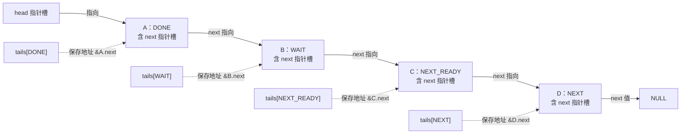
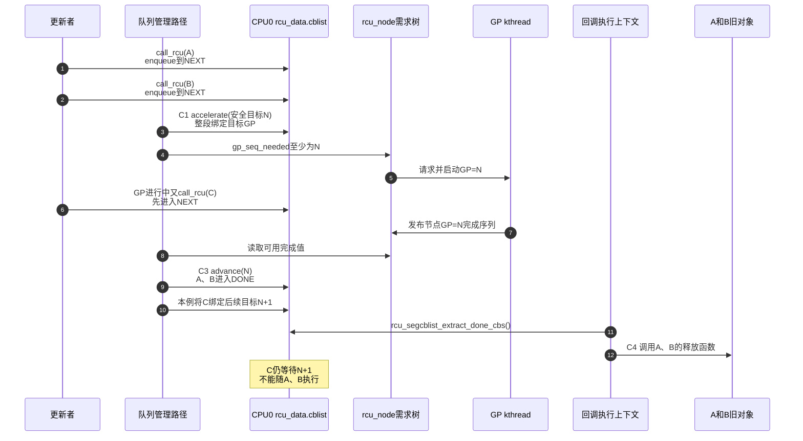

# 第11章\_Tree\_RCU\_rcu\_segcblist回调状态机

## 11.1\_场景\_三个callback对应哪一轮GP

上一章解释了怎样汇聚读者完成证据。但 GP 完成时，有些回调在这一轮以前已经登记，有些刚到达，不能把整个回调队列一起清空。本章追踪它们怎样分别取得执行资格。

更新者先撤掉旧对象的公开入口，再登记释放动作。下面是操作片段，假定 A、B、C 是不同对象，且没有独立引用需要保留它们：

```c
call_rcu(&obj_a->rcu, free_obj_rcu); /* 本例随后将 A、B 安全地绑定到 N。 */
call_rcu(&obj_b->rcu, free_obj_rcu);
/* 本例安排 N 开始以后，再撤下并登记 C。 */
call_rcu(&obj_c->rcu, free_obj_rcu); /* 本例为 C 分配后续目标 N+1。 */
```

N、N+1 是相邻 GP 的教学标签，不是源码序列值的加一运算，也不是 API 承诺的固定等待轮数。目标选择必须来自安全的序列快照；仅凭“在某轮进行期间调用”不能判断该轮覆盖了这个对象的旧读者。

`call_rcu()` 不等待宽限期完成，但也不保证固定返回时延。实现集中管理大量回调，无须为每个对象建立线程与完成对象，却仍须回答：

```text
A是否已经过目标GP
B是否已经绑定目标GP
C是否还没分配代际
哪些callback已经安全但尚未执行
```

`rcu_segcblist` 用 **一条链表 + 四个边界 + 少量目标序列** 表达这些关系。

## 11.2\_四段不是四条链表

如果每个节点都保存目标代际，推进一轮就可能要逐项检查。相邻回调往往具有相同资格，因此可以把它们分组，只维护组的边界。`rcu_segcblist` 就是这种 **分段回调链表**，其中 `seg` 表示 segmented。

Linux 6.12.20 的 `include/linux/rcu_segcblist.h` 定义下列区间。方括号表示沿 `next` 遍历时包含左端、不包含右端，绝不是按数值比较内存地址：

```text
[head, *tails[DONE])                 DONE
[*tails[DONE], *tails[WAIT])         WAIT
[*tails[WAIT], *tails[NEXT_READY])   NEXT_READY
[*tails[NEXT_READY], *tails[NEXT])   NEXT
```



图中为展示四个边界而各放一个节点，不是上一节 A、B 同组场景的快照。实线是链表，虚线表示边界字段保存哪个 **指针槽的地址**。`tails[]` 不在链表中，不是四个额外节点。读 `*tails[DONE]` 得到 DONE 后面的第一个节点，写这个槽则可以接上下一段。

| 段 | 当前资格 | 空段表示 |
| --- | --- | --- |
| DONE | 已观察到目标 GP 的完成证据，允许执行 | `tails[DONE] == &head` |
| WAIT | 等待队列最早的已分配目标 | 与 DONE 尾相同 |
| NEXT_READY | 已分配较后的目标 | 与 WAIT 尾相同 |
| NEXT | 新入队，尚未分配目标 | 与 NEXT_READY 尾相同 |

初始化时四个 tail 都等于 `&head`，`head` 为 NULL。稳定分段中若 WAIT 为空，NEXT_READY 也必须为空；推进函数会将剩余的有目标段向前收拢。空段可以共用边界，无须空哨兵或四份链表头。

`gp_seq[]` 对 WAIT/NEXT_READY 等非空段记录目标 GP。DONE 已经安全，NEXT 尚未分配，所以不需要有效目标序列。

## 11.3\_对象和状态所有权

```c
struct demo_obj {
	struct rcu_head rcu;
	/* 其他业务字段。 */
};

static void free_obj_rcu(struct rcu_head *head)
{
	struct demo_obj *obj = container_of(head, struct demo_obj, rcu);
	kfree(obj);
}
```

| 对象 | 保存位置 | 谁写 | 谁消费 |
| --- | --- | --- | --- |
| callback函数 | `rcu_head.func` | `call_rcu()` | `rcu_do_batch()` |
| 链表链接 | `rcu_head.next` | enqueue/分段操作 | callback提取和执行 |
| 分段边界 | `rcu_data.cblist.tails[]` | 本CPU或NOCB锁保护路径 | 加速、推进、提取、barrier |
| 目标代际 | `cblist.gp_seq[]` | accelerate | advance与GP需求路径 |
| 总数 | `cblist.len` | 登记增加，执行后结算减少 | 包括在途回调，NOCB 下还包括 bypass 节点；供过载、barrier、诊断使用 |
| 分段数 | `cblist.seglen[]` | 入队、分段移动、提取与回插 | 描述仍挂在共享分段链表中的节点 |

普通本地队列路径借助中断状态排除同 CPU 并发修改；卸载路径还需要相应的 NOCB 锁。下文“管理者”指当前取得队列修改权限的执行路径，不是链表自己在运行。

**链表为空不等于回调已经完成。** A、B 提到执行者的临时链表后，`seglen[DONE]` 可以为 0，`len` 仍包含这两项。保守计数让 barrier 不会漏掉在途回调。

同一个 `rcu_head` 已登记且仍在等待调用时，不能重复入队。执行者在调用函数前解除调试登记；回调自身可以在保留对象且满足新一轮所有权协议的条件下重新登记这个 head，外部线程不能与它竞争复用。`CONFIG_DEBUG_OBJECTS_RCU_HEAD` 可帮助发现重复登记，未告警不等于生命周期正确。

## 11.4\_C0到C5\_回调状态推进

| 阶段 | 函数 | 回调所在段 | 已知事实 | 下一步 |
| --- | --- | --- | --- | --- |
| C0 登记 | `rcu_segcblist_enqueue()` | NEXT | 需要覆盖旧读者的 GP | 请求/分配代际 |
| C1 分配 | `rcu_segcblist_accelerate()` | WAIT 或 NEXT_READY | 已绑定安全目标 `gp_seq` | 等 GP 推进 |
| C2 等待 | 无需移动每个节点 | WAIT / NEXT_READY | 尚未观察到目标完成 | 保持边界 |
| C3 完成观察 | `rcu_segcblist_advance(completed_seq)` | DONE | 目标序列已完成 | 等执行上下文 |
| C4 提取 | `rcu_segcblist_extract_done_cbs()` | 临时 `rcu_cblist` | 已从共享分段取出，仍计入 `len` | 批量调用 func |
| C5 剩余回插 | `rcu_segcblist_insert_done_cbs()` | DONE 头部 | 本批尚未执行的项仍然成熟 | 后续批次继续 |

这里细化 P05 的完整周期：C0/C1 对应 S2 登记与 S3 提出需求；C2 跨越读者证明过程；C3 对应 S8 完成被队列观察；C4/C5 属于 S9 的执行与续批。GP 证明、队列资格和实际执行是相连的多组状态，不是每个 callback 自己更新一个阶段字段。移动 `tails[]` 就能让一整段同时换资格。

## 11.5\_enqueue为什么总进NEXT

`rcu_segcblist_enqueue(rsclp, rhp)` 的核心动作是：

```c
rcu_segcblist_inc_len(rsclp);
rcu_segcblist_inc_seglen(rsclp, RCU_NEXT_TAIL);
rhp->next = NULL;
WRITE_ONCE(*rsclp->tails[RCU_NEXT_TAIL], rhp);
WRITE_ONCE(rsclp->tails[RCU_NEXT_TAIL], &rhp->next);
```

两次 `WRITE_ONCE` 分别把旧尾槽接到新节点、保存新尾槽的地址。提前将 `rhp->next` 置 NULL，才能保证链尾结束。这里是已有保护条件下的源码核心，`WRITE_ONCE` 不把队列变成任意线程可并发写入的无锁容器。

挂入节点只需要队列所有权；分配目标还需要可靠的 GP 序列知识。先放 NEXT，再在规定的保护条件下统一分配，避免把不充分的时序猜测写进每个节点。

`call_rcu()` 交出了执行责任。**返回既不证明回调已经执行，也不保证它仍未执行。** 其他执行上下文可能已完成回调；若回调释放对象，调用者不能在登记后继续假定对象存活。完成与否须靠自己的同步协议确认。

## 11.6\_accelerate怎样绑定目标GP

`rcu_segcblist_accelerate(rsclp, seq)` 接收调用者已经确认安全的目标 `seq`，整理 WAIT/NEXT_READY 段。它不自行证明读者结束，也不凭空选择任意未来 GP。

例如 A、B 在 NEXT，管理者取得安全目标 N 后，可以一起绑定。已有段等待更早目标时保留该段；可使用当前目标的尾部段则合并。原先保守地安排到更晚目标的回调，也可能据新证据提前到给定目标，这就是 accelerate（加速）的含义。分段容量和已有目标不允许调整时，函数也可能返回 false，不能把每次调用都解释为已经请求新 GP。

调用者再通过 `rcu_segcblist_nextgp()` 取得最近需要的 GP，沿 `rcu_node.gp_seq_needed` 向根提出需求。多个 callback 可以共享同一 `gp_seq` 段，无需每项存一个序列字段。

若已有段等待更早 GP，新 callback 不能插到它前面破坏 FIFO；若目标序列可合并，tail 边界可以合并而不遍历每个 `rcu_head`。

## 11.7\_advance为何可能一次推进多段

管理者观察到所属 `rcu_node` 的完成序列后调用 `rcu_segcblist_advance(rsclp, seq)`。P08 已说明节点发布完成与全局序列最后收尾不是同一瞬间。这里从 WAIT 开始检查：凡目标 `gp_seq` 被可用完成值覆盖的连续段，都把尾边界并入 DONE；随后填补空 WAIT 段。

例子：

```text
推进前：DONE=[] | WAIT=[A,B]@N | NEXT_READY=[C]@N+1 | NEXT=[D]
观察完成N：DONE=[A,B] | WAIT=[C]@N+1 | NEXT_READY=[] | NEXT=[D]
观察完成N+1：DONE=[A,B,C] | WAIT=[] | NEXT_READY=[] | NEXT=[D]
```

`D` 仍在 NEXT，因为“全局某轮已完成”不能反向覆盖一个在其边界以后才登记且尚未分配的 callback。

## 11.8\_完整回调代际时序



管理者和执行者是职责，普通路径可由同一次 `rcu_core()` 承担，NOCB 会分开。链表不会自行唤醒线程，回调也不会返回更新者原来的调用栈执行。

## 11.9\_entrain为何服务rcu\_barrier

`rcu_barrier()` 要知道先前回调是否执行完，却不应为已经成熟的旧回调凭空增加一轮 GP。`rcu_segcblist_entrain()` 将哨兵回调接到现有最后非空段，**包括 DONE**。它跟随前序回调取得资格；同一队列的串行执行者运行到哨兵时，前面的回调函数已经返回。

还有一个容易遗漏的交错：A、B 已提到临时链表并正在执行，共享链表为空。此时 `len` 仍非零，entrain 会把哨兵放到 DONE；同一执行者先完成当前批次，再运行哨兵，所以不会漏掉在途 A、B。若 `len` 确实为 0，entrain 返回 false，表示没有旧工作需要尾随。P13 会解释各 CPU 哨兵怎样汇聚成一次 barrier 完成。

## 11.10\_迁移与合并为什么必须保留段语义

CPU offline 时，未完成工作必须交给别处。`rcu_segcblist_merge(dst, src)` 在热插拔协议和锁保护下分别提取 DONE 与未成熟部分：DONE 仍放入目标 DONE，保留已取得的安全资格；其余回调并入目标 NEXT，**原等待段的精确目标代际不保留**，以后重新分配，可能延长等待。

这用保守等待换取较简单的合并协议。它保留可执行与尚不可执行的区别，并不完整复刻两条队列的分段，更不建立两个 CPU 所有提交之间的全局 FIFO 顺序。

## 11.11\_不变量与常见误读

1. DONE 表示可执行，不表示已经执行。
2. WAIT 的 callback 已绑定目标 GP；NEXT 尚未绑定。
3. 四个 tail 可以重合，重合表示空段，不是链表损坏。
4. barrier 依赖队列及执行者的规定次序；不能推广成跨 CPU 的全局 callback FIFO。
5. 长度计数服务过载、barrier 与诊断，不能凭一个总数判断全部 callback 都在同阶段。
6. `call_rcu()` 只登记动作，不保证当前或下一固定物理 GP。

## 11.12\_源码与trace入口

本章具体字段与算法以 NXP Linux 6.12.20 固定提交为准，版本和模块地图见 [RCU 源码总阅读索引](../../../../../research/source_reading/rcu/navigation/P01_Linux_6.12_RCU源码总阅读索引.md)。原件位置是 `include/linux/rcu_segcblist.h`、`kernel/rcu/rcu_segcblist.h` 与 `kernel/rcu/rcu_segcblist.c`。

版本化模块先进入 [回调与 NOCB 模块源码概念导读](../../../../../research/source_reading/rcu/navigation/P07_Linux_6.12_Tree_RCU_回调与NOCB模块源码概念导读.md#7.1_GP完成为什么还不等于callback执行)。实现直达入口为：

- [`call_rcu()` 与每 CPU queue 所有权交接](../../../../../research/source_reading/rcu/source_explanations/P09_Linux_6.12_Tree_RCU_回调分段与批处理源码实现.md#9.4_call_rcu怎样把所有权交给每CPU队列)；
- [`rcu_segcblist_accelerate/advance()` 与 Tree RCU GP 连接](../../../../../research/source_reading/rcu/source_explanations/P09_Linux_6.12_Tree_RCU_回调分段与批处理源码实现.md#9.5_accelerate与advance怎样连接callback和GP)；
- 普通 GP 怎样在 cleanup 先发布节点完成代际、再结束全局序列，见 [`rcu_gp_cleanup()`](../../../../../research/source_reading/rcu/source_explanations/P05_Linux_6.12_Tree_RCU_GP全局生命周期源码实现.md#5.11_rcu_gp_cleanup发布完成并承接下一代)；本章从该完成值继续解释 callback 进入 DONE；
- DONE 抽取、回插与执行见 [`rcu_do_batch()`](../../../../../research/source_reading/rcu/source_explanations/P09_Linux_6.12_Tree_RCU_回调分段与批处理源码实现.md#9.6_rcu_do_batch为何先抽取再锁外执行)；
- `entrain()` 的 barrier 语义见 [P10 哨兵证明](../../../../../research/source_reading/rcu/source_explanations/P10_Linux_6.12_Tree_RCU_同步等待与rcu_barrier源码实现.md#10.6_barrier_callback与entrain如何证明队列前序已执行)，`merge()` 的 CPU hotplug 调用点见 [P06 callback 迁移](../../../../../research/source_reading/rcu/source_explanations/P06_Linux_6.12_Tree_RCU_拓扑与CPU热插拔源码实现.md#6.7_rcutree_migrate_callbacks保持成熟边界与barrier证明)。

先用纸面推演检查边界。令 `head=A`，A→B→C→NULL，DONE 为空，WAIT 为 A、B，NEXT_READY 为空，NEXT 为 C。四个 tail 依次指向哪里？观察目标完成并推进后，哪些指针槽中的值实际需要改变？

答案是初始 `tails[DONE]=&head`、`tails[WAIT]=&B.next`、`tails[NEXT_READY]=&B.next`、`tails[NEXT]=&C.next`。WAIT 成熟后前三个边界都为 `&B.next`，链表仍然是 A→B→C，没有把 A、B 搬到另一片内存。提取 DONE 才会将共享 `head` 改为 C，将 B.next 截为 NULL，形成临时的 A→B 链；总 `len` 仍为 3，直到执行后结算。再问：此时并发登记 D 应接到哪里？它接在共享 C 后面，不会接入执行者的 A、B 临时链。

在 Linux 目标上，下面只检查当前 trace 接口，不开启或覆盖全局跟踪配置：

```bash
# tracefs 已挂载到 /sys/kernel/tracing，且当前用户有读取权限。
for event in rcu_segcb_stats rcu_callback; do
    path="/sys/kernel/tracing/events/rcu/$event/format"
    if test -r "$path"; then
        printf '\n%s\n' "$event"
        cat "$path"
    else
        printf '事件不存在或无读取权限：%s\n' "$event"
    fi
done
```

`format` 展示运行内核的真实字段。分段统计用于定位队列资格，`rcu_callback` 标记登记；都不能单独证明函数已经返回。事件缺失还可能来自内核配置、挂载或权限问题。本节纸面边界练习不依赖这些事件存在，也没有把查看接口当作实际采集运行证据。

上一篇：[Tree RCU rcu_node 树与分层汇聚](P10_Tree_RCU_rcu_node树与分层汇聚.md)。

下一篇：[Tree RCU 回调执行、批处理与限流](P12_Tree_RCU_回调执行_批处理与限流.md)。
