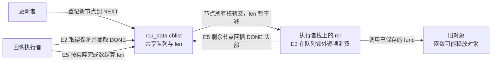
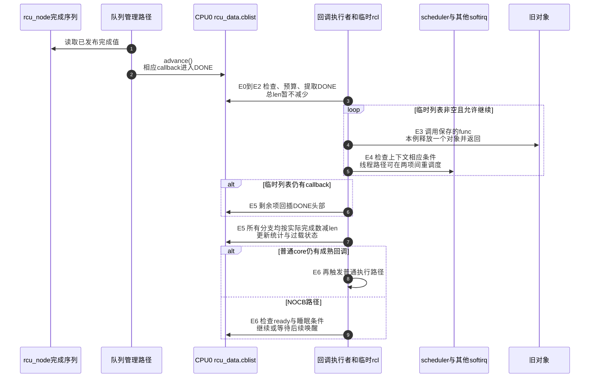

# 第12章\_Tree\_RCU\_回调执行\_批处理与限流

## 12.1\_场景\_一次GP后突然成熟五万个callback

上一章建立了回调的执行资格：管理者观察到目标 GP 完成，把相应段推进 DONE。但资格不会自己变成执行时间。现在假设网络模块批量替换五万个短对象；更新者已按其并发协议撤掉旧入口，也没有需要额外保留的独立引用，然后为不同的旧对象分别登记以下释放函数：

```c
static void flow_free_rcu(struct rcu_head *head)
{
	struct flow *flow = container_of(head, struct flow, rcu);
	kfree(flow);
}

/* 登记一个已经撤下的旧对象；完整批量循环由业务容器决定。 */
call_rcu(&old_flow->rcu, flow_free_rcu);
```

这是已有 `struct flow` 和更新协议内的代码片段，不是可独立编译的网络模块。五万个 callback 可能共享一轮 GP，在一次队列推进时同时进入 DONE。若为每项唤醒一个线程，调度开销会随对象数增长；若一次 softirq 连续执行全部回调，其他 softirq 和可运行任务则可能长期得不到这一 CPU 的处理机会。例如仅作估算，平均每项 2 微秒，五万项已达 100 毫秒；这不是实测值，也不表示内核对单项回调耗时作了保证。

回调执行层必须在两种成本之间折中：**批量执行以摊薄调度开销，同时限流以交还 CPU。**

本章回答“单个执行者如何处理成熟 callback 批次”；如果问题进一步变成“为什么这个批次不应在实时/隔离 CPU 上执行，以及怎样把 callback 侧工作迁给 kthread”，继续见 [Tree RCU NOCB 回调卸载](P16_Tree_RCU_NOCB回调卸载.md#16.1_场景_隔离CPU不希望执行回调批次)。

## 12.2\_资格取得与执行完成之间还隔着什么

```text
T0 call_rcu()将callback交给RCU
    → 调用者不再以函数返回来判断对象是否存活

T1 目标GP开始
    → callback仍不能执行

T2 目标GP完成证据已经发布
    → 队列管理者还需要观察这个完成值

T3 管理者advance，使相应callback进入DONE
    → 可执行，但还需要取得执行机会

T4 执行者调用func，func返回
    → 这个callback的动作完成；本例在函数内释放旧对象
```

这是一条资格依赖链，不规定 `call_rcu()` 返回必须夹在哪两个时刻之间。回调可能在提交者返回前已经被另一执行上下文完成。

`synchronize_rcu()` 给出覆盖其契约范围的读者完成结论；即便普通等待实现借助自己的内部回调唤醒，也不证明其他回调全已返回。`rcu_barrier()` 等待调用前提交的回调完成，而不包办之后不断新增的回调。卸载模块若只等待 GP 就撤走回调函数的代码，T3 到 T4 之间仍可能发生执行已卸载代码的错误。P13 会展开这两种等待协议。

## 12.3\_谁调用rcu\_do\_batch

非 offload CPU 上：

```text
invoke_rcu_core()
    → RCU_SOFTIRQ或per-CPU rcuc kthread
    → rcu_core()
    → cblist存在DONE且scheduler fully active
    → rcu_do_batch(rdp)
```

NOCB CPU 由回调卸载线程调用同一 `rcu_do_batch()`。执行者不同，不改变普通 `call_rcu()` 回调 **不得阻塞** 的契约；本版本 NOCB 调用该函数时同样禁用本地 bottom halves（BH，软中断下半部）。线程能在两个回调之间让出 CPU，不等于某个回调内部可以睡眠。也不能假设回调由提交者稍后在原调用栈上同步执行。

## 12.4\_E0到E6\_一次批处理周期

本章把 P05 的 S9、P11 的 C4/C5 展开成执行周期 E0～E6。队列资格已经成立；这里追踪的是节点从共享队列交给执行者、剩余节点返回，以及长度何时结算。

| 阶段 | 动作 | 共享状态 | 上下文 | 退出条件 |
| --- | --- | --- | --- | --- |
| E0 检查 | `rcu_segcblist_ready_cbs()` | DONE 是否非空 | softirq / rcuc / NOCB 执行者 | 无回调则返回 |
| E1 计算预算 | 读取 DONE 数、`blimit`、除数、上下文 | 栈上的数量/时间目标 | 队列保护期间 | 预算确定 |
| E2 提取 | `rcu_segcblist_extract_done_cbs()` | DONE 移到栈上临时 `rcu_cblist`，总数暂不减 | 中断及适用的 NOCB 锁保护 | 与并发登记隔离 |
| E3 执行 | 解除 debug 登记并调用保存的函数指针 | 临时列表；对象可能释放 | 队列锁外、BH 禁用 | 单项函数返回 |
| E4 让出判断 | 数量、时间、调度条件；线程路径可重调度 | 本地计数与调度状态 | 两个 callback 之间 | 继续 E3 或进入 E5 |
| E5 结算 | 回插剩余 DONE，按实际执行数减少 `len` | 共享队列及统计 | 重新取得队列保护 | 计数与剩余项一致 |
| E6 续批 | 普通 core 再触发，或 NOCB 线程继续/等待唤醒 | 普通工作标志或 NOCB 睡眠状态 | 各自执行路径 | 以后继续成熟工作 |

## 12.5\_提取后为什么在锁外调用func

`rcu_do_batch()` 先关本地中断，并在需要时取得 NOCB 锁，把 DONE 提到当前栈上的普通 `rcu_cblist`，随后恢复相应保护状态才调用 callback。普通未卸载路径不是无条件持有一把 NOCB 锁；中断排除本地并发登记也是保护的一部分。下面仅保留所有权交接的源码骨架，省略预算、trace 和调试操作：

```c
rcu_nocb_lock_irqsave(rdp, flags);
rcu_segcblist_extract_done_cbs(&rdp->cblist, &rcl);
rcu_nocb_unlock_irqrestore(rdp, flags);

while ((rhp = rcu_cblist_dequeue(&rcl)) != NULL) {
	rcu_callback_t func = rhp->func;

	WRITE_ONCE(rhp->func, 0);
	func(rhp); /* 可能释放包含 rhp 的对象，之后不能再解引用 rhp。 */
}
```

否则回调内部的释放、锁和后续 `call_rcu()` 都会发生在 cblist 的内部保护范围，既可能死锁，也会让入队路径承担不可预测的持锁时间。抽取并不减少总计数；回调函数返回并完成批次结算以后，才从 `len` 中减去实际执行数。



## 12.6\_数量预算和时间预算

集中抽取解决了锁持有时间，却还没解决 CPU 占用。6.12.20 按以下关系计算数量目标，下面是公式伪代码，`pending` 在此特指 DONE 段数量：

```text
pending = DONE段数量;
bl = max(rdp->blimit, pending >> 已校正的rcu_divisor);
```

除数不是随便接受的移位数：负值使用默认 7，过大值限制为机器 long 位数减 2。成熟积压增大时，数量目标也可增大；基础值由 `rdp->blimit` 保底。

softirq 路径在 `count >= bl` 且 `need_resched() || !is_idle_task(current)` 时结束本批。这里不只看是否请求调度：当前不是 idle task 时，达到数量目标本身就足以结束这一批，为其他工作留下机会。

时间目标也有条件：当前在 softirq 中或普通 `rcuc` 正在执行，并且开启 `CONFIG_RCU_DOUBLE_CHECK_CB_TIME` 或本批数量目标大于 100，才建立时间上限。`rcu_resched_ns` 的代码默认值为 3 毫秒，使用时夹在 1 毫秒到 1 秒之间。时间检查通常每 32 个回调读取一次 `local_clock()`；开启上述配置还会结合 jiffies 条件增加检查。

这些都是 **回调返回后的续批判断**，不是强行打断单个回调的硬时限。某项回调本身过长，3 毫秒默认值不能救场；程序仍须保证每项短小且不可阻塞。

在线程执行路径中，两个回调之间可以临时启用 BH，调用 `cond_resched_tasks_rcu_qs()` 给调度器机会，再禁用 BH。普通 `rcuc` 仍有时间检查，命中时标记尚有工作，以免持续执行推迟 QS 报告；NOCB 回调线程不直接套用同一套 softirq 数量退出条件，其等待与续批由自己的循环组织。

若 callback 过载，`rdp->blimit` 可被提高以加速排空；降到 `qlowmark` 后恢复普通限额。吞吐和公平不是固定常量，而是根据积压、上下文和调度压力共同决定。

## 12.7\_回调函数允许做什么

安全模板：

```c
static void route_free_rcu(struct rcu_head *head)
{
	struct route *route = container_of(head, struct route, rcu);

	/* 短小、不可阻塞；只做有界清理。 */
	kfree(route);
}
```

不应在普通 RCU callback 中执行：

```c
static void bad_free_rcu(struct rcu_head *head)
{
	mutex_lock(&slow_mutex);     /* 可能睡眠：错误 */
	flush_workqueue(slow_wq);    /* 可能长期等待：错误 */
	msleep(100);                 /* 错误 */
	mutex_unlock(&slow_mutex);
}
```

NOCB 回调在线程中也仍受普通 RCU callback 的不可阻塞契约约束，不只是“阻塞以后性能较差”。需要可睡眠的复杂销毁时，回调可把工作转交给明确的 workqueue。此时对象必须一直存活到工作完成，回调不能先释放它；关闭入口、等待 RCU 回调、排空工作队列、最后卸载代码成为相连的销毁协议。`rcu_barrier()` 本身不会替你排空后来转交的工作。

## 12.8\_kfree\_rcu与kvfree\_rcu

如果回调只做找回对象并释放，维护一份专用函数往往没有必要。`kfree_rcu(ptr, rcu_member)` 表达“经过宽限期以后释放这个对象”；调用前撤掉入口、处理其他引用的责任仍在使用者。它不提供返回后对象继续存活的保证。

在本章固定的 6.12.20 源码中，**两个双参数宏 `kfree_rcu(ptr, rhf)` 与 `kvfree_rcu(ptr, rhf)` 都展开到 `kvfree_rcu_arg_2()`**，不能把它们描述成两套独立回调机制。这个公共宏校验成员偏移，并向 `kvfree_call_rcu()` 传入内嵌 head 与对象地址。

Tree RCU 可批量收集待释放对象，经 monitor 和 workqueue 等路径等待安全条件再释放，不保证每个对象都对应一项普通 `call_rcu(head, func)`。批量化改变了存储、调度和释放时延，安全条件仍然是先完成所需宽限期。本版本另有不带 head 的 `kfree_rcu_mightsleep()` / `kvfree_rcu_mightsleep()`，其调用上下文须允许 `might_sleep()`；不能把这种条件反向套给普通 callback，也不能因名字相近就随意换用。

## 12.9\_完整批处理时序



## 12.10\_回调积压的因果链

```text
更新速率持续高于callback处理速率
    → cblist长度增长
    → 多代旧对象同时存活，内存峰值上升
    → RCU提高批量/触发FQS/过载策略
    → callback执行占用更多CPU
    → 若业务负载也饱和，调度与GP可能进一步迟延
```

“RCU 内存瓶颈”通常不是 reader 数量本身生成引用计数，而是更新产生旧对象的速度、GP完成速度与 callback执行速度三者失衡。诊断必须分别测这三个阶段。

## 12.11\_trace和指标

先做一个不用目标机的纸面观察。共享队列只有 A、B、C 三项 DONE，初始 `len=3`。执行者提走三项后共享 DONE 数为 0；此时更新者又登记 D，令 `len=4`、NEXT 数为 1。执行者只完成 A、B 就结束本批，把 C 回插，再结算减 2。最终应为 `len=2`、DONE 含 C、NEXT 含 D。若在提取时就减去 3，会错误地丢失在途工作；若仅在“全部执行完”分支减数，部分批次会永久虚增计数。

在有 tracefs 且允许读取的 Linux 目标上，可先检查观测接口，不改变全局跟踪配置：

```bash
# Linux 目标机；tracefs 已挂载在 /sys/kernel/tracing 时执行。
for event in rcu_batch_start rcu_batch_end rcu_invoke_callback; do
    path="/sys/kernel/tracing/events/rcu/$event/format"
    if test -r "$path"; then
        printf '\n%s\n' "$event"
        cat "$path"
    else
        printf '事件不存在或无读取权限：%s\n' "$event"
    fi
done
```

`format` 给出当前运行内核实际提供的字段。start 中的队列长度与批量目标、end 中的实际执行数及剩余工作和调度标志，承担不同含义；`rcu_invoke_callback` 记录调用动作，不是任意业务销毁链全部结束的证明。事件不可见可能是配置、挂载或权限问题，不能推断没有 RCU 活动。这里仅检查接口，尚未采集一段真实负载的时间线。

分析已有记录时，一次批次小可能只是主动交还 CPU。DONE 持续增长意味着成熟回调的到达量超过该段时间实际获得的执行量，原因可能是回调太慢、执行者缺乏调度机会或预算限制；未分配/等待段增长则还需检查 GP 推进。必须把登记速率、资格成熟速率和实际执行速率分开，不能仅凭一个总长度定位瓶颈。

## 12.12\_源码入口

本章实现条件以 NXP Linux 6.12.20 固定提交为准。版本与模块地图先见 [RCU 源码总阅读索引](../../../../../research/source_reading/rcu/navigation/P01_Linux_6.12_RCU源码总阅读索引.md)，不能把这一版本的默认预算或线程分支当作所有 Linux 的固定 API 保证。

- [普通 GP cleanup 的完成发布](../../../../../research/source_reading/rcu/source_explanations/P05_Linux_6.12_Tree_RCU_GP全局生命周期源码实现.md#5.11_rcu_gp_cleanup发布完成并承接下一代)只提供 callback 变成可执行的代际前提；以下入口才解释何时由哪个执行者真正调用函数。
- [回调与 NOCB 模块源码概念导读](../../../../../research/source_reading/rcu/navigation/P07_Linux_6.12_Tree_RCU_回调与NOCB模块源码概念导读.md#7.5_普通callback状态机)先建立完整执行链。
- [`invoke_rcu_core()` 与 softirq/rcuc 选择](../../../../../research/source_reading/rcu/source_explanations/P09_Linux_6.12_Tree_RCU_回调与NOCB源码实现.md#9.7_普通CPU怎样选择softirq或rcuc执行者)。
- [`rcu_do_batch()` 的 DONE 抽取、锁外调用、预算与回插](../../../../../research/source_reading/rcu/source_explanations/P09_Linux_6.12_Tree_RCU_回调与NOCB源码实现.md#9.6_rcu_do_batch为何先抽取再锁外执行)。
- [NOCB callback kthread 执行者](../../../../../research/source_reading/rcu/source_explanations/P09_Linux_6.12_Tree_RCU_回调与NOCB源码实现.md#9.10_NOCB_CB线程只执行成熟批次)。
- `kernel/rcu/tree.c` 中 kfree/kvfree RCU 批处理路径。
- `rcu_do_batch()` 与批量释放路径在真正执行延迟动作前后登记 `rcu_callback_map`；先从 [RCU Lockdep适配模块源码概念导读](../../../../../research/source_reading/rcu/navigation/P12_Linux_6.12_RCU_Lockdep适配模块源码概念导读.md#12.4.3_callback上下文链)建立调用链，再进入 [`rcu_callback_map` 上下文标记](../../../../../research/source_reading/rcu/source_explanations/P04_Linux_6.12_RCU_Lockdep适配层源码实现.md#4.7_rcu_callback_map怎样标记延迟动作上下文)核对定义、影子状态、消费者和修改边界。

上一篇：[Tree RCU rcu_segcblist 回调状态机](P11_Tree_RCU_rcu_segcblist回调状态机.md)。

下一篇：[Tree RCU 同步等待与 rcu_barrier](P13_Tree_RCU_同步等待与rcu_barrier.md)。
