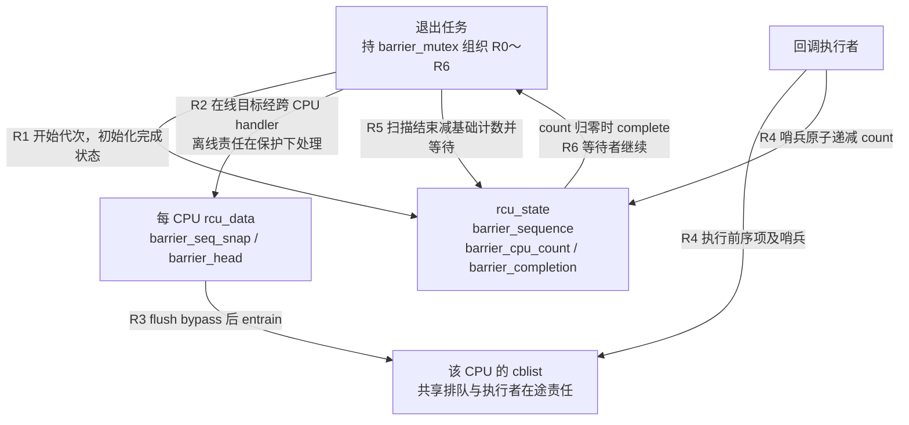
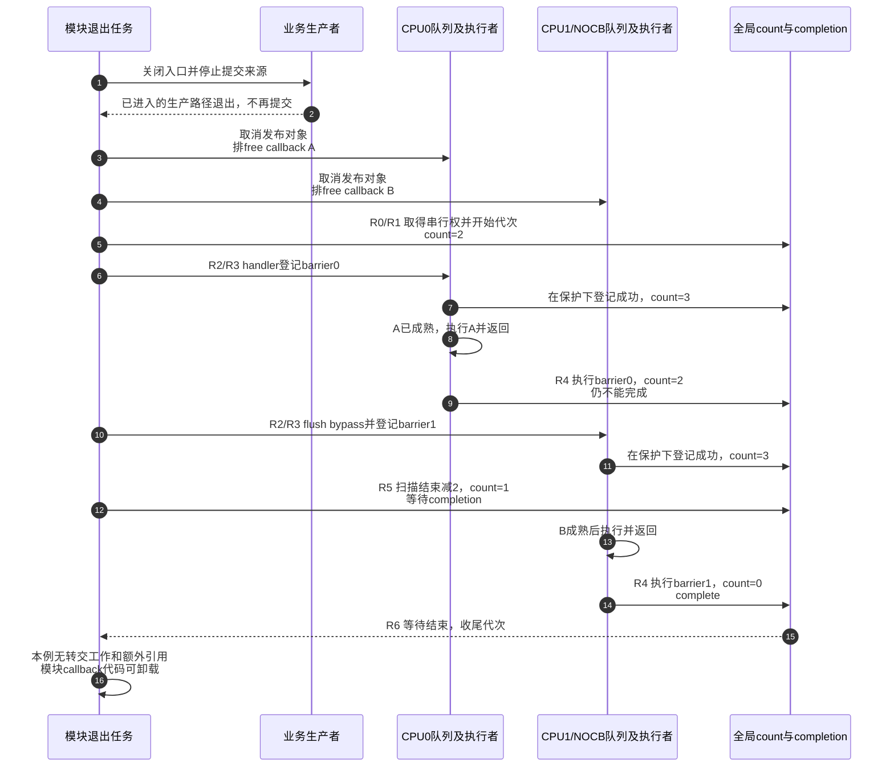

# 第13章\_Tree\_RCU\_同步等待与rcu\_barrier


## 13.1\_GP完成callback执行和barrier完成不是同一事件

P11、P12 已经把 callback 从登记、绑定 GP、成熟到实际调用的过程分开。于是等待方必须先说清自己要的是哪一个完成条件：旧 reader 已离场、某个专用 callback 已执行，还是调用前散落在所有队列中的 callback 都已执行。本章用同一个模块退出现场比较这些条件，不把三个名字相近的接口压成“都等 RCU”。

## 13.2\_模块卸载场景暴露三种不同等待

模块回调 `demo_free_rcu()` 位于文本段，这段内存保存可执行指令，`rcu_head.func` 保存进入这些指令的地址。即使对象已没有旧 reader，尚未执行的回调仍需要代码存活。沿用 hlist 对象场景，删除片段如下：

```c
static void demo_free_rcu(struct rcu_head *head)
{
	struct demo_obj *obj = container_of(head, struct demo_obj, rcu);
	kfree(obj);
}

static void demo_remove(struct demo_obj *obj)
{
	spin_lock(&demo_lock);
	hlist_del_rcu(&obj->node);
	spin_unlock(&demo_lock);
	call_rcu(&obj->rcu, demo_free_rcu);
}
```

模块退出不仅要让 reader 离场，还要确保此前登记的 `demo_free_rcu()` 已经 **实际调用完**，否则模块代码卸载后 RCU 再跳到该函数就会执行失效地址。

下面是协议骨架，不是通用模块模板。`demo_stop_producers()` 和 `demo_unpublish_all_objects()` 是业务占位函数，必须自行实现：前者关闭入口、停止定时器/工作等来源，并等已经进入的生产路径退出；后者在写侧保护下摘除剩余对象，每项恰好登记一次释放。仅写 `stopping=true`，不能证明之前已通过检查的生产者不再提交。

满足这些前提后，关闭顺序为：

```c
static void __exit demo_exit(void)
{
	/* 先阻止新对象、新lookup和新callback继续产生。 */
	demo_stop_producers();
	demo_unpublish_all_objects(); /* 每项通过call_rcu退休。 */

	/* 等待所有调用前已登记的RCU callback真正执行。 */
	rcu_barrier();

	/* 现在模块callback代码与其释放的对象都已收尾。 */
}
```

这里还假定普通 RCU 是对象最后一道使用权保护，回调直接释放对象，没有再转交异步工作。若有独立 kref 或工作队列消费者，必须补上对应排空协议。仅调用 `synchronize_rcu()` 不足以替代这里的 `rcu_barrier()`。

## 13.3\_四个相近接口等待什么

| 接口 | 截止边界 | 返回时保证 | 不保证 |
| --- | --- | --- | --- |
| `synchronize_rcu()` | 调用前既存普通 RCU reader | 满足语义的 GP 已过去 | 此前所有 callback 已执行 |
| `call_rcu(head, func)` | 登记并交出执行责任，内部以后分配安全目标 | 调用者不等待 GP；无固定返回时延 | 返回既不证明 func 已执行，也不证明它仍未执行 |
| `rcu_barrier()` | 调用前已经登记的普通 RCU callback | 这些 callback 已实际调用完成 | 新 callback、无条件经过新GP |
| `synchronize_rcu_expedited()` | 调用前既存 reader | 更积极取得同类reader证明 | 此前 callback 全执行 |

`rcu_barrier()` 在系统没有 pending callback 时可以立即返回，甚至不经过一轮 GP；它等待的是队列顺序，不是以 GP 为目标。

## 13.4\_为什么多等一个GP仍不能替代barrier

考虑这个时间线：

```text
CPU0上的callback C目标GP=N
    → GP=N完成，C进入DONE
    → callback执行线程尚未获得CPU
    → CPU1上的退出任务调用synchronize_rcu()
    → GP=N+1完成，CPU1的专用等待回调获得执行机会
    → C仍可能只是在DONE队列
```

不同 CPU 队列的执行机会可以不同。CPU1 的专用等待回调返回，不会强制 CPU0 的 C 已运行。N、N+1 仍是教学轮次标签。此时卸载仍可能留下指向模块文本的 `C->func`；可选直接唤醒分支同样不承诺排空所有回调。

P11/P12 已把状态拆成：

```text
GP完成 → WAIT进入DONE → rcu_do_batch提取 → 调用func
```

`synchronize_rcu()` 的契约是前半的读者证明，实现可以经过自己的回调；`rcu_barrier()` 的契约覆盖调用前全部回调执行完成。区别是等待对象，而非函数内部是否出现 callback。

## 13.5\_默认synchronize\_rcu的等待对象

限定 Linux 6.12.20、调度器正常运行、普通 GP 且 `rcutree.rcu_normal_wake_from_gp=0`，路径为：

```text
synchronize_rcu()
    → synchronize_rcu_normal()
    → wait_rcu_gp(call_rcu_hurry)
    → 调用者栈上struct rcu_synchronize
    → 初始化completion并排wakeme_after_rcu callback
    → wait_for_completion()
```

`completion` 是栈上等待对象中的完成通知状态。先登记、后等待：`wakeme_after_rcu()` 更新 completion 并唤醒等待者；若完成先于等待，状态仍被保存，不会漏掉通知。调用者须等完成后才能离开这个栈帧，否则回调会访问失效栈地址。

这利用专用回调等待足够新的 GP，不等于排在所有 CPU 的既有回调后面。`call_rcu_hurry` 避免等待请求被当作可长期懒处理的回调，却不会把读者安全条件缩短成固定时间。

若许多任务只想等 GP，逐一经过普通回调管线会增加排队与交付。可选 `rcu_normal_wake_from_gp` 分支因此单独汇聚等待请求：调用者接入自己的栈上节点，GP 初始化插入分隔节点，划定本轮能覆盖的批次；完成时直接通知一部分，其余由 workqueue 继续交付。

省去普通 callback 排队并未消除通信。节点仍需跨 CPU 发布，边界必须同步，GP 线程也不能无限量唤醒任务，因此增加了分隔节点、完成边界和 workqueue 交接。SRS 是源码中这组同步请求状态的字段前缀，不是一种新的保护域。

该可选分支在 `rcu_state` 中使用六组 `srs_*` 状态：

| 字段 | 精确职责 |
| --- | --- |
| `srs_next` | 新调用者把自己的栈上 `rcu_synchronize.head` 无锁加入的请求入口 |
| `srs_wait_tail` | GP init 插入 dummy wait-head 后，锁存“由当前物理 GP 覆盖到哪里” |
| `srs_done_tail` | cleanup 已经交给直接完成/workqueue 的批次边界，使用 release/acquire 交接 |
| `srs_wait_nodes[]` | 预分配的 dummy wait-head 分隔节点；不是每个调用者的等待对象池 |
| `srs_cleanup_work` | GP kthread不宜一次唤醒过多调用者时，继续完成剩余批次 |
| `srs_cleanups_pending` | 已登记的 cleanup work 待处理/在途计数；排队失败回退，完成以 release 递减，供安全回收分隔节点判断 |

默认值 `rcu_normal_wake_from_gp=0` 时，同步调用者仍走 callback+completion；不能因为这些字段存在，就把可选优化写成所有 `synchronize_rcu()` 的固定实现。

Linux 6.12.20 的模块阅读入口是 [同步等待与 rcu_barrier 模块源码概念导读](../../../../../research/source_reading/rcu/navigation/P08_Linux_6.12_Tree_RCU_同步等待与rcu_barrier模块源码概念导读.md#8.1_等RCU至少有三种不同对象)；具体请求加入和 GP init 划界见 [SRS 请求划批](../../../../../research/source_reading/rcu/source_explanations/P05_Linux_6.12_Tree_RCU_GP全局生命周期源码实现.md#5.13_SRS怎样登记请求并冻结本轮批次)，cleanup 与 workqueue 唤醒见 [SRS 完成交付](../../../../../research/source_reading/rcu/source_explanations/P05_Linux_6.12_Tree_RCU_GP全局生命周期源码实现.md#5.14_SRS怎样在cleanup与workqueue之间交付等待者)。

## 13.6\_barrier怎样在分散队列后放哨兵

模块旧回调可能散落在多个 CPU。每个 possible CPU 有对应 `rcu_data`，并非每条队列始终启用或非空；NOCB 还可能先将提交放到 `nocb_bypass` 旁路以减少主队列锁竞争。barrier 不能只在当前 CPU 排一个回调。

办法是在每条有旧工作的执行链末尾放一个哨兵：它不释放业务对象，只报告前序回调已经完成。全局等待者收齐报告即可继续。状态与通信如下，后面的 R0～R6 使用同一组对象：



具体过程按以下阶段推进：

1. R0：快照 `barrier_sequence` 后取得 `barrier_mutex`。若等待锁期间另一轮 barrier 已覆盖快照，可返回，不重复扫描。
2. R1：在 `barrier_lock` 保护下开始代次，初始化 completion，将全局计数设为 2。
3. R2：扫描 possible CPU。每 CPU 快照已说明本轮处理过时跳过；否则在锁下检查总数。总数为 0 时只记录快照。检查的是含在途项的 `len`，不能只看共享 `head`。
4. R3：有工作的在线 CPU 通过同步跨 CPU 调用运行 handler；若调用因目标状态变化失败，短暂等待后重试并重新判断。离线但仍有回调责任的路径在保护下直接处理，不能丢弃队列。
5. R3：先 flush bypass 再 entrain 哨兵；成功则增加全局计数，失败则撤销调试登记。队列保护保证执行者不能在计数登记完成前运行新哨兵，随后发布每 CPU 快照。
6. R4：执行者运行到哨兵，将计数减一，归零则 complete。R4 可以与其他 CPU 的扫描交错，无须等全局扫描完毕。
7. R5：全部扫描结束后调用者减去初始的 2；若因此归零，由调用者自己 complete，然后等待完成状态。
8. R6：完成后结束全局代次、更新每 CPU 快照，释放 mutex，继续退出。

这里还有一个容易被结构体短注释误导的字段：`barrier_lock` 注释说保护 `barrier_seq_snap`，而 `barrier_seq_snap` 实际位于每 CPU `rcu_data`，并不在 `rcu_state` 中。该 raw spinlock把每 CPU 快照、哨兵 callback 登记以及 hotplug/callback 迁移放进同一可序列化边界；`barrier_mutex` 则负责串行化可睡眠的整个 `rcu_barrier()` 调用。两把锁的保护范围和可睡眠属性不同。

## 13.7\_为什么初始计数不是零

6.12.20 设置：

```c
atomic_set(&rcu_state.barrier_cpu_count, 2);
```

遍历过程中，某个刚 entrain 的哨兵可能立刻被执行。如果从零开始并边遍历边加，第一个队列增加到 1 又减到 0 时就会提前 complete，而第二个队列还没扫描。先保留数值为 2 的基础计数，全部队列处理完再 `atomic_sub_and_test(2)`，使扫描结束以前无法归零。这不是额外排入队列的两个哨兵回调，也不能仅凭这段用途推导“所有异步计数协议都必须从 2 开始”。

这是典型的生命周期技巧：先持有发布者自己的基础引用，再把各异步分支登记完，最后归还基础引用。

## 13.8\_entrain如何证明前序callback已经执行

`rcu_segcblist_entrain()` 把 barrier callback 接到当前队列最后一个非空分段的尾部。由于同一 cblist 保持 callback 顺序：

```text
旧callback A → 旧callback B → barrier_head
```

当 `barrier_head.func` 被调用，前序 A、B 已经在该执行管线中返回。P11 已说明最后一段也可能是 DONE；若 A、B 已从共享链表提走但尚未结算，非零总计数仍让哨兵登记到 DONE，同一执行者先处理当前批次再运行哨兵。证明覆盖在途项，而不只是某一瞬间还能从 `head` 找到的节点。

NOCB bypass 必须先 flush，否则 B 可能仍躲在旁路中，而 barrier_head 已进入主 cblist；6.12 的 `rcu_barrier_entrain()` 明确调用 `rcu_nocb_flush_bypass()` 并在需要时唤醒 nocb GP 线程。

## 13.9\_完整模块退出时序



图中每条队列旁合并画出了它的执行者，不表示链表会自行调用函数。R4 与扫描交错，但基础计数使提前完成不可能。另一种交错是两个哨兵都在扫描结束前运行：此时 count 仍为 2，R5 减 2 后由调用者自己 complete，所以不会丢失完成通知，也不一定有 `LastCB` 这条 trace 记录。

第一步不能省略。生产者可能早已读到“尚未关闭”，被抢占后直到 barrier 扫描完才登记模块回调；因此退出任务必须取得生产者退出的证据，不能只发一个关闭请求。

## 13.10\_两种正确关闭方案

两种方案都必须先关闭入口并等在途生产者退出，再选择回收者：已异步退休的对象要等 callback，集中摘除且尚未排队的对象可以等 GP 后由退出任务释放。下面仍是业务协议伪代码，除 RCU API 外的函数均代表需自行实现的操作；它们继承 13.2 的关闭与对象所有权前提。

### 13.10.1\_异步逐对象退休

```c
stop_producers();
unpublish_all_with_call_rcu();
rcu_barrier();
```

适合运行期已经大量使用 `call_rcu()`，退出时需要等这些 callback 和最后一批对象一起完成。

### 13.10.2\_同步批量退休

```c
stop_producers();
list = unpublish_all_without_callback();
synchronize_rcu();
free_detached_list_directly(list);
```

如果能证明没有其他旧 callback 指向模块代码，这种方案用一轮 GP 后由退出任务直接批量释放，不需要为这批对象再 `rcu_barrier()`。两种方案不能混成“先同步 GP，然后假设所有历史 callback 都完成”。

## 13.11\_调用上下文和死锁边界

`synchronize_rcu()` 与 `rcu_barrier()` 都可能阻塞，必须在允许睡眠的上下文调用；某次恰好快速返回不放宽契约。不得在普通 RCU 读侧、中断上下文或持有回调/读者进展所需的锁时等待。

典型死锁：

```text
退出任务持有module_lock调用rcu_barrier
    → 旧callback需要module_lock才能完成
    → barrier等待callback
    → callback等待barrier持有的锁
```

这是错误程序的依赖环，不是允许回调睡眠取 mutex 的示例；若 `module_lock` 是自旋锁，退出任务持锁进行可睡眠等待本身也已违规。关闭时先撤销入口、停止并排空生产者，释放后续进展需要的锁，再等待。

检验关闭协议时可以问三题：只有一个旧 reader、没有回调，barrier 返回能否证明 reader 已退出？不能，barrier 可以没有队列可等。回调转交了工作队列，barrier 返回能否卸载工作函数？不能，还须等待转交工作完成。两个哨兵都在扫描结束前执行，谁唤醒等待者？R5 减去基础计数的调用者自己发布完成状态。这三题分别检查读者、后继工作和完成通知，不能用同一个“已经同步”概括。

## 13.12\_源码和trace入口

- 版本与总体入口见 [RCU 源码总阅读索引](../../../../../research/source_reading/rcu/navigation/P01_Linux_6.12_RCU源码总阅读索引.md)。本章状态字段与路径以固定 NXP Linux 6.12.20 为准。
- [`synchronize_rcu()` 的普通/expedited/早期退化分流](../../../../../research/source_reading/rcu/source_explanations/P10_Linux_6.12_Tree_RCU_同步等待与rcu_barrier源码实现.md#10.4_synchronize_rcu怎样选择普通expedited或早期空GP)。
- [默认 `wait_rcu_gp()` 与可选 SRS 等待对象](../../../../../research/source_reading/rcu/source_explanations/P10_Linux_6.12_Tree_RCU_同步等待与rcu_barrier源码实现.md#10.5_默认分支为何等待调用者自己的completion)；`__wait_rcu_gp()/wakeme_after_rcu()` 函数体见 [P02 等待桥](../../../../../research/source_reading/rcu/source_explanations/P02_Linux_6.12_Tree_RCU_等待桥_QS与节点汇聚关键函数源码实现.md#2.3_同步调用怎样借回调等待GP结束)。
- [`rcu_barrier_callback()` 与 `rcu_barrier_entrain()` 的队尾哨兵证明](../../../../../research/source_reading/rcu/source_explanations/P10_Linux_6.12_Tree_RCU_同步等待与rcu_barrier源码实现.md#10.6_barrier_callback与entrain如何证明队列前序已执行)。
- [`rcu_barrier()` 的全 CPU 扫描、count=2 与完成发布](../../../../../research/source_reading/rcu/source_explanations/P10_Linux_6.12_Tree_RCU_同步等待与rcu_barrier源码实现.md#10.8_rcu_barrier怎样扫描所有队列并等待真实执行)。

`rcu_barrier` trace 事件可观察 Begin、EarlyExit、每 CPU 排队和 LastCB。在已经挂载 tracefs 且有读取权限的 Linux 上，先只读检查实际事件格式：

```bash
# Linux 目标机；不改变系统现有跟踪配置。
path=/sys/kernel/tracing/events/rcu/rcu_barrier/format
if test -r "$path"; then
    cat "$path"
else
    printf '事件不存在或不可读，请核对配置、tracefs挂载和权限\n'
fi
```

格式中的阶段名、CPU、计数和代次服务于上述证明链。`EarlyExit` 可能表示另一轮已经覆盖本次快照；没有 `LastCB` 也可能是扫描者自己完成。此处提供接口观察方法和纸面推演，未声称已在目标内核采集跟踪。现在退出任务知道该等什么；若等待迟迟不结束，下一章继续判断究竟哪一部分安全证据尚未取得。

上一篇：[Tree RCU 回调执行、批处理与限流](P12_Tree_RCU_回调执行_批处理与限流.md)。

下一篇：[Tree RCU force-QS、迟延与 Stall](P14_Tree_RCU_force_QS迟延与Stall.md)。
