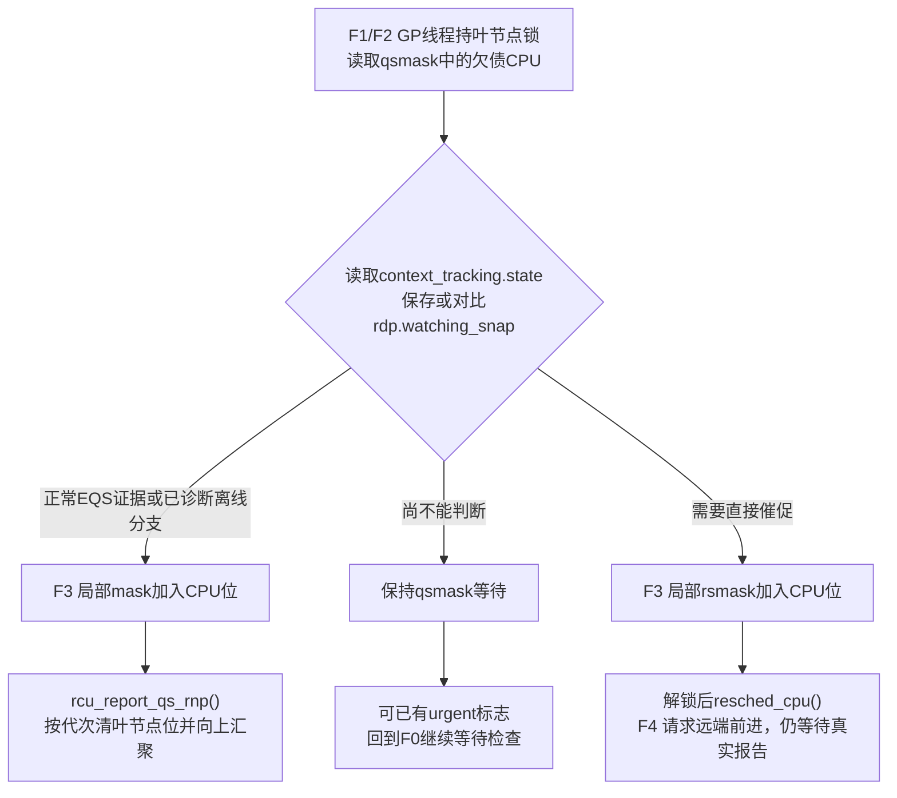
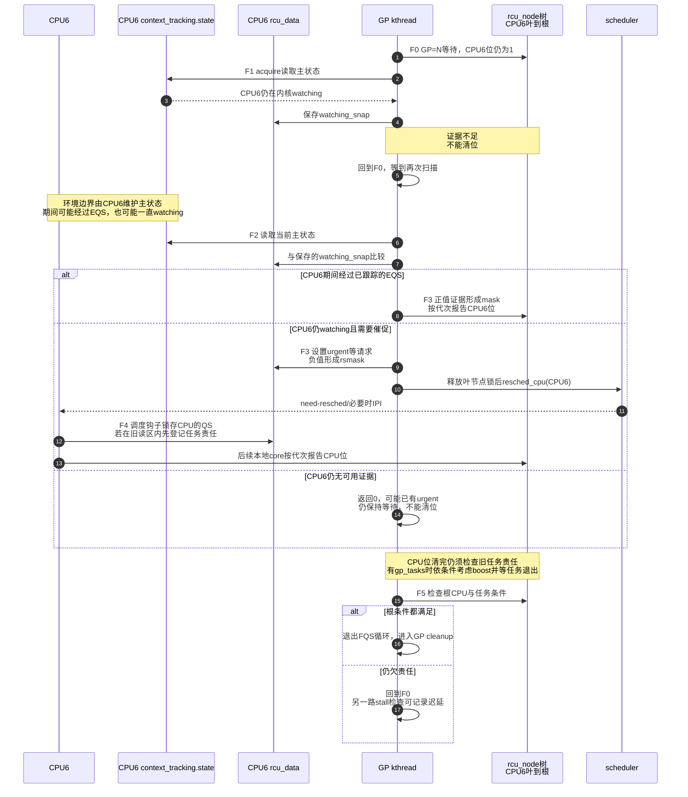

# 第14章\_Tree\_RCU\_force\_QS迟延与Stall


## 14.1\_安全证明成立以后为什么还需要活性慢路径

上一章的同步等待和 barrier 都依赖底层取得足够证据。P08～P10 建立的“真实 QS 或任务清债 → 节点逐层清位 → 根条件满足”保证了安全，却没有保证参与者及时运行和报告。force-QS（源码通常缩写 FQS）负责扫描证据并按条件催促；stall 是另一路对迟延的诊断。两者共享进展状态，但超时本身不能制造读者完成证据。本章沿一个迟延 CPU 的现场区分观察、催促和告警。

## 14.2\_场景\_qsmask剩一位究竟意味着什么

GP=N 已经等待一段时间，根最终只剩 CPU6 所在叶分支。可能存在三种完全不同的事实：

1. CPU6 早已进入 idle，只是没有主动运行 `rcu_core()` 报告；
2. CPU6 正在内核态运行，能够被重调度催促并很快产生 QS；
3. CPU6 长时间关中断或旧 reader 永不退出，当前确实没有安全证据。

如果 GP kthread 一律继续睡，前两种会造成无谓延迟；如果一律超时清位，第三种会释放仍在使用的对象。force-QS 的职责是 **区分已有证据、可以催促、仍必须等待**，不是强行宣布 reader 已结束。

## 14.3\_一个故意制造stall的错误代码

下面是仅供静态分析的错误片段，不是完整实验模块。`stop_bad_test` 与 `consume()` 代表业务条件和对象使用；这里没有提供可确保恢复的测试控制路径，读者不必运行它来理解问题：

```c
/* 错误示例：只用于理解告警原因，不能在生产或无保护测试机运行。 */
static void bad_path(struct demo_obj __rcu **slot)
{
	struct demo_obj *obj;
	unsigned long flags;

	local_irq_save(flags);
	rcu_read_lock();
	obj = rcu_dereference(*slot);

	while (!READ_ONCE(stop_bad_test))
		cpu_relax();

	consume(obj);
	rcu_read_unlock();
	local_irq_restore(flags);
}
```

循环期间本地普通中断不能被处理，scheduler tick 和依赖中断返回的调度机会也受阻。`cpu_relax()` 只是忙等提示，不会主动调度或报告 QS；NMI 仍可能运行，所以“关中断”也不是所有观察通道都消失。停止条件若只能靠本 CPU 的普通中断或被阻挡任务更新，循环甚至无法自行结束。

其他 CPU 可能报告这个迟延，日志包含目标 CPU、任务、GP 号及 tick/softirq 状态，但是否及时打印还取决于检查者能否运行。应缩短关中断/不可抢占区间，把长工作拆到可调度上下文；对象必须跨越区间时，先在保护下取得独立引用或转移所有权，再离开读侧，不能只把 `rcu_read_unlock()` 移到使用之前。

## 14.4\_普通GP的等待与扫描节奏

回到正常 GP。无须让每个 reader 都向全局线程发消息：正常本地路径报告 QS，GP 线程则周期性检查尚未收到的部分。`rcu_gp_fqs_loop()` 设置下一次检查时刻，通过 `rcu_state.gp_wq` 等待；条件已成立时可以不实际睡眠：

```text
gp_state=RCU_GP_WAIT_FQS
    → swait_event_idle_timeout_exclusive(...)
    → 根条件满足、显式FQS请求、过载条件或等待超时
    → gp_state=RCU_GP_DOING_FQS
```

若根尚未完成且到达扫描条件，调用 `rcu_gp_fqs(first_time)`。第一次与后续扫描故意不同：

```text
第一次：rcu_watching_snap_save
    → 保存仍watching CPU的基线
    → 当前已在EQS者可立即报告

后续：rcu_watching_snap_recheck
    → 判断CPU自基线以来是否进入/穿过EQS
    → 或判断是否需要resched催促
```

因此 force-QS 名字中的 force 更接近“强制进行一轮证据检查/催促”，不是“写一个位伪造 QS”。

这段是 P05 完整周期中等待读者证据的重复子循环。后文用 F0～F5 追踪一次迟延：F0 等待条件，F1 保存快照，F2 重新检查，F3 报告已有证据或登记催促，F4 目标响应并报告，F5 根条件满足后退出扫描；如果条件仍不满足，就回到 F0。stall 检查旁观这些进展，不是“扫描次数足够多”之后必然发生的释放阶段。

先把快照放回正确地址：`context_tracking.state` 是目标 CPU 自己维护的 watching/EQS 主状态；GP 扫描者将读取值存到目标对应 `rcu_data.watching_snap`，供以后比较；欠债位保存在叶 `rcu_node.qsmask`，在节点锁下修改。这三份状态不属于同一个结构体，也不由同一执行者写入。普通本地路径还用 `rcu_data.cpu_no_qs.b.norm` 锁存本 CPU 的 QS，后续 `rcu_core()` 才把它交给节点。

`rcu_state` 中与这段节奏相邻的字段应按用途分成三组，而不是统一叫“超时状态”：

| 状态组 | 字段 | 写入与读取关系 | 不能推出什么 |
| --- | --- | --- | --- |
| FQS 节奏 | `jiffies_force_qs`、`jiffies_kick_kthreads`、`n_force_qs` | GP/FQS 路径设置下次扫描/踢线程时刻并累计扫描次数；GP/stall 路径读取 | 到时不能无证据清除 `qsmask` |
| GP 生命周期观测 | `gp_start`、`gp_end`、`gp_activity`、`gp_req_activity`、`gp_max` | init/cleanup/请求/主循环写，stall 输出和诊断读取 | 活动时间变化不等于安全证明完成 |
| stall 与重调度门槛 | `jiffies_stall`、`nr_fqs_jiffies_stall`、`jiffies_resched`、`n_force_qs_gpstart` | stall 初始化、FQS 循环和检测路径协作；快照用于计算本轮扫描次数 | 打印告警或达到门槛不允许跳过旧 reader |

callback 过载还有一对正交字段：`cbovldnext` 在本轮叶节点扫描时汇总“下一轮是否过载”，下一次 `force_qs_rnp()` 开头才转交给 `cbovld`；`cbovld` 会缩短 FQS 等待并影响 boost 积极性。这个一拍延迟避免在尚未扫描完整棵叶层时，把局部观察立即冒充全局过载结论。

版本化阅读先进入 [force-QS 与 Stall 模块源码概念导读](../../../../../research/source_reading/rcu/navigation/P05_Linux_6.12_Tree_RCU_force_QS与Stall模块源码概念导读.md#5.1_为什么GP已经在等还要有force_QS)。FQS sleep/timer 主循环见 [`rcu_gp_fqs_loop()`](../../../../../research/source_reading/rcu/source_explanations/P05_Linux_6.12_Tree_RCU_GP全局生命周期源码实现.md#5.10_FQS循环与根完成通知)；watching snapshot、叶扫描、urgent/resched 与 stall 分类见 [force-QS 与 Stall 源码实现](../../../../../research/source_reading/rcu/source_explanations/P07_Linux_6.12_Tree_RCU_force_QS与Stall源码实现.md#7.2_源码符号覆盖账本)。

## 14.5\_force\_qs\_rnp如何按叶节点处理

`force_qs_rnp(check_fn)` 遍历叶节点，只检查当前 `qsmask` 仍为一的 CPU。对每个 CPU 调用 watching 快照函数，并把结果分成：

| `check_fn` 返回 | 解释 | 后续动作 |
| ---: | --- | --- |
| `> 0` | 正常路径确认当前处于 EQS 或从快照以来经过 EQS；另有下文的离线异常分支 | 加入本次局部 `mask`，节点锁下报告 |
| `0` | 尚无可报告的 QS，也不要求这次直接 `resched_cpu()`；仍可能已经设置 urgent/heavy 标志 | 保留等待位，让目标本地路径或下一轮继续处理 |
| `< 0` | 仍欠证据且需要调度催促 | 加入 `rsmask`，释放节点锁后 `resched_cpu(cpu)` |

如果叶 `qsmask==0` 但 PREEMPT_RCU 仍有 `gp_tasks`，扫描不再检查 CPU 位，而是调用 `rcu_initiate_boost()` 的可选路径处理任务活性。

这里的 `mask` 与 `rsmask` 只是扫描者栈上的临时集合，前者表示可报告位，后者表示离开节点锁后要催促的 CPU；两者不能互换。用户态只有在相应 CPU 的 context tracking 已激活时才能由这条快照路径作为 EQS 观察，不能把“用户进程正在运行”直接等同于计数器必然处于 EQS。

还要保留一个实现例外：本版本 recheck 若发现 RCU 已将 CPU 视为 offline，它本应早在下线、GP 初始化或任务清理路径交代完责任。这里仍欠位会先 `WARN_ON_ONCE` 并打印诊断，再返回正值使流程前进。这是对正常不变量失守的防御分支，不是普通离线报告方式，更不是“超时即可将在线 CPU 当成下线”。



## 14.6\_urgent\_resched\_IPI和boost各做什么

这些词经常被压成“RCU 发 IPI 通知 CPU”，实际有不同成本层级：

| 路径 | 状态/动作 | 谁处理 | 解决什么 |
| --- | --- | --- | --- |
| 本地正常报告 | `cpu_no_qs.b.norm=false` 后由 `rcu_core()` 检查 | 本 CPU | 从本地锁存向节点报告 |
| watching被动观察 | 远端读取 context-tracking 快照 | GP/FQS扫描者 | CPU已在 user/idle 时避免打扰 |
| urgent标志 | `rdp->rcu_urgent_qs` 等 | scheduler tick/本 CPU路径 | 请求尽快重调度或处理 QS |
| `resched_cpu()` | 写远端 need-resched，必要时由架构发送 reschedule IPI | scheduler/远端 CPU | 促使长内核执行尽快到安全边界 |
| 本轮 FQS 的 irq_work | 达到条件时设置 `rcu_iw_pending`、`rcu_iw_gp_seq` 并向目标排工作 | 目标 CPU 的 irq_work | 检查目标能否得到中断工作执行机会，辅助 stall 诊断；不是 QS 的同义词 |
| 本地 RCU core / softirq | 对本地待办安排后续处理 | 本 CPU 的相应执行路径 | 消费 GP 变化、QS 与成熟回调；与上行 irq_work 作用不同 |
| RCU boost | 节点 boost kthread、`boost_tasks` | 可选 `CONFIG_RCU_BOOST` | 让被低优先级任务拖住的旧 reader 得到运行机会 |

这些动作有具体消费链。扫描者按 GP 年龄或过载等条件设置 `rcu_urgent_qs`，较强请求还先写 `rcu_need_heavy_qs`，再以 release 发布 urgent。目标 tick 路径 acquire 读取 urgent，必要时置当前任务的 need-resched，并清 urgent；调度/QS 路径继续完成责任交接。没有 tick 的 `NO_HZ_FULL` CPU 可能一直执行内核循环，扫描者因此还会按条件返回负值，在解锁后直接请求重调度。设标志或发送 IPI 都不代表目标已经执行调度。

boost 处理另一种对象：CPU 已交代完，但一个被抢占的旧 reader 没有获得运行机会。启用 `CONFIG_RCU_BOOST` 且满足时机条件时，节点 boost 线程借助带优先级继承的 rt_mutex，让该任务临时取得更高运行优先级；旧 reader 仍须亲自运行到退出与清理路径，不能由 boost 线程代替它结束读区。未启用时对应入口不会凭空创建这个能力，硬件中断长期被屏蔽也不是提升任务优先级就能修好的。

被移除的“每个 reader 主动通知全局协调者”成本，由每 CPU 状态、周期扫描、任务登记及有条件的催促承担。普通 reader 不必每次广播 IPI，但不能据此宣称整个 RCU 无通知、无轮询或永不影响被保护 CPU。

## 14.7\_完整迟延CPU时序



## 14.8\_Stall是证明链停滞的诊断\_不是根因名称

常见原因按状态层分类：

| 层 | 可能根因 | 可观察后果 |
| --- | --- | --- |
| reader/任务 | 过长读侧、读侧内错误阻塞、低优先级被饿死 | `gp_tasks` 长期存在或 CPU长期欠QS |
| CPU执行 | 长时间关中断/禁抢占、死循环 | tick、softirq、调度QS都不能推进 |
| RCU执行者 | GP kthread、`rcu_core` 或 callback线程得不到CPU | 已有状态无人消费，GP/回调延迟 |
| 时间基础 | timer/jiffies/虚拟机暂停异常 | stall时刻和FQS节奏异常 |
| 系统过载 | callback大量积压、CPU饥饿 | GP与callback吞吐下降，可能触发过载路径 |
| 内核缺陷 | 状态位、hotplug、锁或报告代际错误 | 某节点长期无法收敛 |

这些原因不是一条日志可以直接裁决的。先分辨观察的是哪一段控制过程：

- **GP 已开始却未完成：** `check_cpu_stall()` 同时检查代次、开始时间、告警门槛和欠债情况；它前后读取两次 GP 序列，避免把相邻两代的时间字段拼成一次假超时。当前 CPU 仍欠位时可自报，其他观察者也可按条件报告。
- **GP 线程未获运行或等待定时器未唤醒：** 分别观察 `gp_activity` 等进展，以及 `gp_state`、`jiffies_force_qs`、线程运行队列状态。CPU 已有 QS，不等于负责消费和收尾的线程已经运行。
- **有需求却迟迟没有开始 GP：** 另一检查比较根 `gp_seq_needed` 与 `gp_seq`、请求与活动时间，在相应配置下诊断启动进展。它不能靠“正在进行的一轮超时”来发现，因为那轮尚未开始。

因此日志是 **检查器观察到迟延条件的线索**，不是某个根因已经确诊。虚拟机暂停、时间更新异常、配置抑制和检查者本身缺乏执行机会都影响诊断；本版本还会识别部分 guest paused 情况避免误报。一条告警不能单独证明读区过长或已经发生 UAF；没有告警也不证明系统持续前进。

## 14.9\_安全性与活性必须分开

```text
安全性：没有CPU/任务证据
    → GP不能完成
    → callback不能进入安全执行阶段
    → writer不能据此释放旧对象

活性：迟延参与者最终是否会运行、报告或退出
    → 由调度、FQS、IPI、boost、配置与系统健康共同决定
```

正常协议中，扫描和 boost 促进活性，stall 检测提供诊断；达到告警次数不能作为清除在线 CPU 位或旧任务责任的理由。前述“RCU 已视为离线却仍欠位”的 WARN 分支有自己的异常不变量条件，不能把它解释成超时释放许可。

## 14.10\_诊断步骤

1. 从日志记录 GP 序列、stall CPU/任务和持续时间。
2. 判断欠的是 CPU 位还是 PREEMPT_RCU blocked task。
3. 检查目标 CPU 是否在线、user/idle、长时间关中断或被虚拟机暂停。
4. 检查 GP kthread、`rcuc`/softirq、nocb/boost线程是否有调度机会。
5. 在配置与负载允许时用相应 ftrace 延迟追踪、调度事件或 perf 采样定位长区间和缺少调度的执行者；Lockdep 用来辅助查锁依赖和上下文违规，不是“最长读区计时器”。
6. 再检查 callback 过载与 hotplug 竞争，避免把“回调慢”误写成“GP不安全”。

先不注入卡死，做三个预测：首次扫描已看到 EQS，是否还须等第二次？不需要，已有证据可报告。recheck 返回 0，是否说明完全没催促？不是，它可能已设置 urgent，只是没有这次直接重调度请求。CPU 位清零、`gp_tasks` 非空，是否可以直接进入 cleanup？不能，还需要旧任务完成清理。这些都是状态推演，不要求运行前面的错误循环。

实际排查先记录内核版本与配置，区分“选项未启用”和“配置文件不可读”：

```bash
# Linux 目标机，只读检查；不修改启动参数或跟踪开关。
uname -r
config_file="/boot/config-$(uname -r)"
if test -r "$config_file"; then
    grep -E '^(CONFIG_(RCU_CPU_STALL_TIMEOUT|RCU_TRACE|RCU_BOOST|PREEMPT_RCU|NO_HZ_FULL|PROVE_RCU)=|# CONFIG_(RCU_TRACE|RCU_BOOST|PREEMPT_RCU|NO_HZ_FULL|PROVE_RCU) is not set)' "$config_file"
else
    printf '无法读取该路径的内核配置，不能据此判断配置关闭\n'
fi
```

输出中的 `=y` 和 `is not set` 含义不同；超时数值也只是构建默认，运行参数可能已调整。配置确认以后，再检查当前机器实际提供哪些事件：

```bash
# tracefs 若已挂载于 /sys/kernel/tracing，列出可见事件接口。
event_dir=/sys/kernel/tracing/events/rcu
if test -d "$event_dir"; then
    find "$event_dir" -maxdepth 2 -name format -print
else
    printf 'RCU事件目录不存在，请先核对挂载、配置与权限\n'
fi
```

这一步只列接口，不能当作已经捕获故障。采集时应把同一 GP 的序列、时间、CPU/task 欠债、线程调度及回调进度放在一起，避免将两个代次的日志拼成一条因果链。不要先调大告警门槛来宣称问题消失，那只改变观察条件。

## 14.11\_源码入口

- 版本边界与模块地图先见 [RCU 源码总阅读索引](../../../../../research/source_reading/rcu/navigation/P01_Linux_6.12_RCU源码总阅读索引.md)。本章实现分支以固定 NXP Linux 6.12.20 为准。
- [`kernel/rcu/tree.c::rcu_gp_fqs_loop()`](../../../../../research/source_reading/rcu/source_explanations/P05_Linux_6.12_Tree_RCU_GP全局生命周期源码实现.md#5.10_FQS循环与根完成通知)：等待、扫描节奏与根完成检查。
- [`rcu_watching_snap_save/recheck()`](../../../../../research/source_reading/rcu/source_explanations/P07_Linux_6.12_Tree_RCU_force_QS与Stall源码实现.md#7.4_watching快照怎样把EQS变成隐式QS证据)：首轮保存与后续 EQS/urgent 检查。
- [`force_qs_rnp()`](../../../../../research/source_reading/rcu/source_explanations/P07_Linux_6.12_Tree_RCU_force_QS与Stall源码实现.md#7.5_force_qs_rnp把远端观察任务债务和resched放进同一轮)：按叶节点分类证据、blocked task 与 `resched_cpu()`。
- [`rcu_gp_fqs()`](../../../../../research/source_reading/rcu/source_explanations/P07_Linux_6.12_Tree_RCU_force_QS与Stall源码实现.md#7.6_rcu_gp_fqs更新节奏并选择save或recheck)：更新扫描、activity 与 stall 时间字段。
- `kernel/rcu/tree.c::rcu_sched_clock_irq()`：urgent QS 的本地消费。
- `kernel/rcu/tree_plugin.h::rcu_initiate_boost()`：可选被抢占 reader boost。
- [`tree_stall.h` 三类控制故障与 `check_cpu_stall()`](../../../../../research/source_reading/rcu/source_explanations/P07_Linux_6.12_Tree_RCU_force_QS与Stall源码实现.md#7.7_三类stall为什么必须读取不同状态)：stall 阈值、检测、打印和抑制逻辑。

上一篇：[Tree RCU 同步等待与 rcu_barrier](P13_Tree_RCU_同步等待与rcu_barrier.md)。

下一篇：[Tree RCU Expedited GP](P15_Tree_RCU_Expedited_GP.md)。
