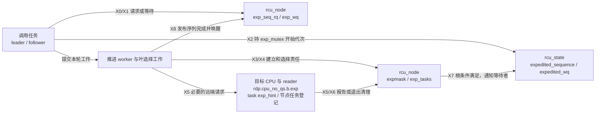
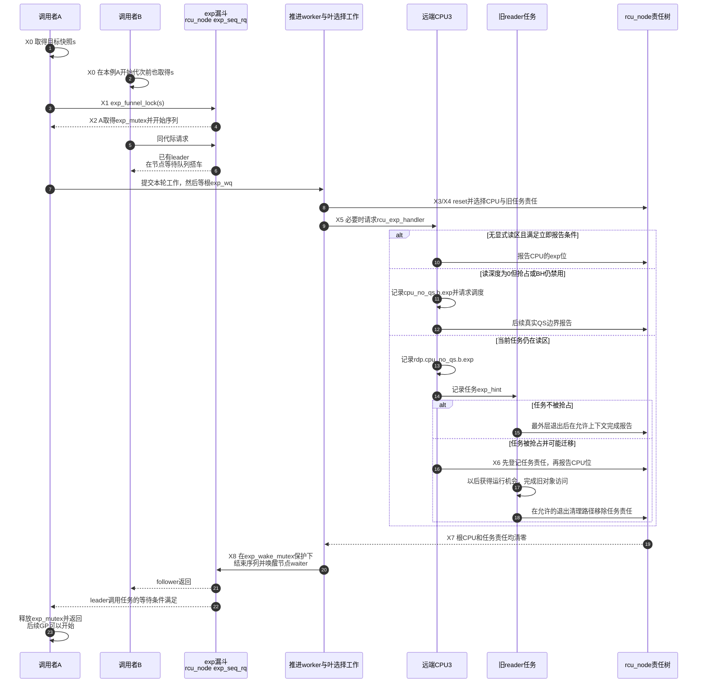

# 第15章\_Tree\_RCU\_Expedited\_GP

## 15.1\_场景\_控制路径愿意用系统扰动换更短等待

上一章说明普通 GP 怎样等待、扫描并逐步催促。若业务本来就愿意为一次低频控制操作付出更多跨 CPU 干预，是否可以更早主动取得同样的安全证据？这就是 expedited（加急）GP 要解决的问题；它不是取消旧读者等待。

例如驱动准备撤销一个 MMIO 映射的访问描述对象。控制路径已停止新的业务请求，还须切断软件查找入口，并等旧 reader 不再使用这个描述对象。普通 GP 可以等 CPU 自然到 QS，而这条低频路径希望缩短等待尾延迟。以下是协议片段：

```c
mutex_lock(&map_update_lock);
old = rcu_replace_pointer(active_map, NULL,
			  lockdep_is_held(&map_update_lock));
mutex_unlock(&map_update_lock);

/* 低频、明确需要尽快确认；不是数据面循环。 */
synchronize_rcu_expedited();
if (old) {
	/* 业务占位：另按设备协议停止硬件访问、完成必要握手并撤销窗口。 */
	disable_device_window(old);
	kfree(old);
}
```

`active_map`、`map_update_lock` 和 `disable_device_window()` 都属于这个驱动的业务协议，不是新增内核 API。假定 reader 只在普通 RCU 读区中使用描述对象，退出读区后不保留裸指针；控制操作之间也已串行化。**GP 只证明软件读者边界**，不会替驱动等待 DMA、刷新设备写入或完成硬件关闭握手；这些必须在设备自身协议中兑现。

`synchronize_rcu_expedited()` 与普通同步接口取得同类安全保证。实际走加急路径时，执行者主动选择 CPU、检查 EQS、请求远端处理并等待被抢占任务，用更高系统成本争取较短等待；后文还会说明公开 API 何时可能按策略退回普通路径。

## 15.2\_它不是普通GP的超时开关

普通 GP 用全局线程把许多回调需求合并后，按自然进展与周期扫描推进。如果直接把每个低延迟请求都改成对普通线程的一次全系统催促，就会混淆两种等待节奏，也难以让并发加急请求只付一次取证成本。实现因此保留独立的加急代次与等待位：请求先合并，由一个发起者组织本轮工作，完成后统一通知搭车等待者。两条通道依然观察同一类 reader，而不是创建一种“更弱的读侧保护”。

已经理解两条推进方式，再比较它们的状态载体：

| 维度 | 普通 GP | Expedited GP |
| --- | --- | --- |
| 全局序列 | `rcu_state.gp_seq` | `rcu_state.expedited_sequence` |
| 节点 CPU 债务 | `qsmask/qsmaskinit` | `expmask/expmaskinit` |
| 抢占任务边界 | `gp_tasks` | `exp_tasks` |
| 等待者合并 | callback代际与普通GP请求 | `exp_seq_rq`漏斗和exp序列 |
| 获得CPU证据 | 等自然QS并周期FQS | 主动快照、叶并行选择、IPI handler |
| 主要完成等待 | 普通 `gp_wq`/callback | `expedited_wq` 和节点 `exp_wq[]` |

实际走 expedited 路径不表示“让当前普通 GP 加快一点”；它走独立但共享 Tree RCU reader 定义的证明通道。公开 API 被策略改走普通路径的例外见后文。

Linux 6.12.20 的全局 expedited 字段还要再分三类：

| 字段 | 当前实现职责 | 关键边界 |
| --- | --- | --- |
| `exp_mutex` | 漏斗最终串行化物理 expedited GP leader；持有者开始序列并在调用完成后释放 | 它不保护普通 `gp_seq` |
| `exp_wake_mutex` | 串行化各轮的结束与节点唤醒阶段 | 下一轮开始可与上一轮剩余唤醒重叠；不是 CPU check-in 计数锁 |
| `expedited_sequence` | expedited GP 自己的代际/ticket 序列 | 与普通 `gp_seq` 独立 |
| `expedited_wq` | 本轮推进执行者等待根 `expmask/exp_tasks` 条件的全局 simple waitqueue | 正常运行期通常由 exp worker 等待；leader 调用任务与 follower 等节点 `exp_wq[]` |
| `ncpus_snap` | 上一次重置 expedited hotplug 树时观察到的 `ncpus` | 只用于发现新 online CPU，不是当前在线数快照 |
| `expedited_need_qs` | 在该固定提交中只有字段声明，没有活动写入者或读取者 | 不能凭字段注释虚构“所有 CPU 原子递减到零”的当前算法 |

当前完成证明落在节点 `expmask`、被抢占任务 `exp_tasks` 以及根完成检查上。结构体保留一个名字像计数器的字段，不等于该版本的活跃路径真的使用计数器。

## 15.3\_X0到X8\_一次expedited\_GP

普通 GP 的公共 S 周期没有被改成加急档。下面独立使用 X0～X8，仍遵循“请求 → 建立参与责任 → 收集 CPU 和任务证据 → 发布完成”的依赖。先固定调度器正常运行、加急 worker 已建立、没有 normal 策略覆盖的主线。

| 阶段 | 入口 | 状态变化 | 参与者 | 退出条件 |
| --- | --- | --- | --- | --- |
| X0 取票 | `rcu_exp_gp_seq_snap()` | 调用者保存所需 exp 序列 | 调用任务 | 判断能否共享已有工作 |
| X1 漏斗 | `exp_funnel_lock(s)` | `exp_seq_rq` 记录覆盖需求 | 并发调用任务 | 已完成则返回，已有请求则搭车，否则成为 leader |
| X2 开始 | 漏斗取得 mutex 后调用 `rcu_exp_gp_seq_start()` | `expedited_sequence` 开始代次 | leader 调用任务 | 向推进 worker 提交工作 |
| X3 重置 | `sync_exp_reset_tree()` | `expmask=expmaskinit` | 推进 worker | 建立本轮节点责任 |
| X4 选择 | `sync_rcu_exp_select_cpus()` 组织叶工作 | 排除可证明的 CPU，设置 `exp_tasks` | 叶选择执行者 | 得到仍需远端请求的集合 |
| X5 请求 | `smp_call_function_single(...rcu_exp_handler...)` | 立即报告或设置延期标志 | 选择者、远端 CPU | CPU 位在真实边界清除 |
| X6 等任务 | 调度登记及最外层 unlock 清理 | `exp_tasks` 表示旧任务责任 | 被抢占 reader / 清理路径 | 旧任务责任全部解除 |
| X7 根条件 | CPU 与任务责任汇聚 | `expedited_wq` 的条件成立 | 报告路径与推进 worker | 可以发布完成 |
| X8 交付 | `rcu_exp_wait_wake()` | 结束序列，唤醒节点等待者 | 推进 worker；调用任务最后释放 `exp_mutex` | leader 与 followers 返回 |

X5、X6 可以交错：任务被抢占后，原 CPU 的位可以解除，但任务责任继续留在节点中；不是先把所有 CPU 清完，才开始记录任务。字段、写入者与消费者关系如下：



## 15.4\_漏斗锁怎样合并并发调用者

若 100 个 CPU 同时调用 expedited，每项各自广播会重复打扰同一批 CPU。漏斗先尝试低争用快速路径：需求尚未被覆盖且能 trylock 全局 `exp_mutex` 时直接成为候选发起者；否则从调用 CPU 的叶节点逐层向根登记：

```text
本节点exp_seq_rq已经覆盖s
    → 说明有人正在做足够新的exp GP
    → 在本节点exp_wq[代际槽]等待并搭车

尚无人覆盖s
    → 写本节点exp_seq_rq=s
    → 继续向父节点

到根并取得rcu_state.exp_mutex
    → 成为本轮leader
```

这降低全局 mutex 争用，也让同一子树的 follower 就近等待。它们必须等自己的快照 `s` 被完成序列覆盖，不是“看到任意一轮正在运行就可以搭车”。已有工作在竞争期间完成则直接返回；真正成为 leader 的路径在漏斗函数内部开始代次，不是返回后再开始第二次。

## 15.5\_CPU选择和IPI不是无条件广播

`sync_rcu_exp_select_cpus()` 先重置 exp 树，再处理各叶节点。`expmaskinit` 保留曾经上线 CPU 的集合，下线时并不简单清掉，所以重置出来的 `expmask` 还需要本轮选择过程筛掉已离线的部分。`ncpus_snap` 用于识别是否出现新的上线 CPU，不是每轮在线 CPU 数量。

正常情况下可向不同的 kthread worker 提交叶工作，并在返回前等选择工作完成；最后一个叶直接处理，没有对应 worker 或处于早期启动时也直接调用。**选择工作完成不等于 GP 完成**：请求已经发出，远端仍可能欠 CPU 或任务责任。这里“当前 CPU”指当下执行选择工作的 CPU，不能固定理解成最初调用 API 的 CPU。

每个叶执行 `__sync_rcu_exp_select_node_cpus()`：

1. 锁叶节点，遍历 `expmask` 中的 CPU；
2. 当前 CPU、offline CPU 或已在 EQS 的 CPU 加入本地完成集合；
3. 对仍 watching 的远端 CPU 保存 `exp_watching_snap`；
4. 若存在被抢占 reader，把 `exp_tasks` 指向 blocked 链表边界；
5. 解锁后再检查远端是否自快照以来经过 EQS、选择者是否已迁到该 CPU；仍需请求时才异步调用 `smp_call_function_single(cpu, rcu_exp_handler, NULL, 0)`；
6. 若与 CPU hotplug 竞争，重新检查在线位并重试或报告 offline。

因此初始候选集合可以写成：

```text
本轮expmask
    - 已offline
    - 当前CPU可本地处理
    - 快照已证明在EQS
    = 远端exp handler候选CPU
```

真正发出请求以前还会再次筛选。看到 user 只有在该 CPU 的 context tracking 已激活并产生有效 EQS 证据时，才能走这条快照免打扰路径。跨 CPU 调用返回成功只说明请求已交给对应机制，不意味着 handler 已完成，更不意味着 GP 已结束。

## 15.6\_IPI\_handler在远端做什么

IPI 是请求远端执行一个短处理函数的手段，不是远端安全性的证据。PREEMPT_RCU 下，handler 同时检查显式读侧深度和抢占/BH 执行约束：

- 显式读深度为 0，且没有对应抢占/BH 禁用约束，或当前是从 idle 进入的情形，才能立即报告。
- 深度为 0 但抢占/BH 约束仍在时，置每 CPU `cpu_no_qs.b.exp` 并请求重调度，等待后续真实边界；“没有调用 `rcu_read_lock()`”不代表可以忽略这些隐式读侧约束。
- 深度大于 0 时，先在叶节点锁下确认本轮仍等待该 CPU，再置 `cpu_no_qs.b.exp` 与当前任务 `rcu_read_unlock_special.b.exp_hint`，让后续退出/调度路径处理。最外层 unlock 还可能因上下文限制延后清理，不能无条件画成当场完成全部报告。
- 若任务被抢占，调度钩子先把任务责任登记到节点，再允许 CPU 报告。此后任务即使迁移，原登记节点的 `exp_tasks` 仍使本轮等待它退出；CPU 位和任务责任不是同一项状态。

非抢占分支没有这套可抢占旧任务链，但仍检查本轮是否欠该位、是否已请求以及 idle/抢占/BH 条件；不能立即证明时，设置 exp 与 urgent 请求并催促调度。两种分支都不能把 IPI 到达本身当成 reader 结束。

## 15.7\_端到端时序



## 15.8\_为什么\_更快\_不等于固定deadline

expedited 会更积极，但仍可能受以下因素拖延：

- 旧 reader 本身很长；
- 被抢占 reader 长期得不到调度；
- CPU 长时间关中断，IPI 不能处理；
- CPU hotplug 与选择过程竞争；
- 系统工作队列、调度或虚拟化严重迟延；
- 多个调用者和其他 exp GP 正在合并/串行化。

源码具有 expedited stall 等待和诊断。它同样不会在证据不足时超时返回成功，因此 API 不提供硬实时上界。

## 15.9\_选择与替代

| 需求 | 建议 | 原因 |
| --- | --- | --- |
| 高频对象退休 | `call_rcu()`/`kfree_rcu()` 批量异步 | 更新者不逐项等待 GP，也不逐项请求一轮加急取证 |
| 批量更新后可统一等待 | 一次 `synchronize_rcu()` | 多对象共享普通GP |
| 低频控制路径确有短尾延迟要求 | 评估 `synchronize_rcu_expedited()` | 用扰动换积极取证 |
| 循环中每项都 expedited | 重构为批处理 | 源码注释明确要求避免 |
| 想等待此前 callback 全执行 | `rcu_barrier()` | expedited只等reader，不等全部callback |

还要核对策略覆盖：本版本 `synchronize_rcu_expedited()` 若发现 `rcu_gp_is_normal()` 为真，会调用普通同步路径；`rcu_normal_after_boot` 可在启动结束后设置这种策略，PREEMPT_RT 构建的默认值也与之相关。早期允许空 GP 的上下文另有退化路径。API 名字保证的是同步语义，不能用名字证明实际发送过 IPI。

用同一撤销场景做三个选择：一次撤销一千个对象，能否先全部断开入口再等待一次？能，这通常比一千次加急等待少得多的系统扰动。旧 reader 无限循环，加急能否保证到某个时限返回？不能，它不能替 reader 退出。此次加急完成，能否认为以前的释放回调也执行完？不能，仍须按上一章的 barrier 契约判断。这些预测把代价、活性与回调完成分开。

## 15.10\_源码和trace入口

版本化模块先从 [Expedited GP 模块源码概念导读](../../../../../research/source_reading/rcu/navigation/P06_Linux_6.12_Tree_RCU_Expedited_GP模块源码概念导读.md#6.1_Expedited不是普通GP的加速档)进入，再按问题直达唯一实现：

- 与之比较的普通 GP 控制线程、等待/FQS/cleanup 主线见 [普通 GP 端到端源码时序](../../../../../research/source_reading/rcu/source_explanations/P05_Linux_6.12_Tree_RCU_GP全局生命周期源码实现.md#5.14_端到端源码时序)，不要把 expedited worker 当成普通 GP kthread 的“加速模式”；
- [`expedited_sequence` 与 poll 交接](../../../../../research/source_reading/rcu/source_explanations/P08_Linux_6.12_Tree_RCU_Expedited_GP源码实现.md#8.4_expedited_sequence怎样独立计代并共同推进poll观察)；
- [`exp_funnel_lock()` 合并并发请求](../../../../../research/source_reading/rcu/source_explanations/P08_Linux_6.12_Tree_RCU_Expedited_GP源码实现.md#8.5_exp_funnel_lock怎样合并并发调用者)；
- [`sync_exp_reset_tree()` 建立 `expmask`](../../../../../research/source_reading/rcu/source_explanations/P08_Linux_6.12_Tree_RCU_Expedited_GP源码实现.md#8.6_sync_exp_reset_tree怎样建立本轮债务)；
- [叶并行 CPU selection、EQS 与 IPI](../../../../../research/source_reading/rcu/source_explanations/P08_Linux_6.12_Tree_RCU_Expedited_GP源码实现.md#8.7_sync_rcu_exp_select_cpus为什么不是无条件广播)；
- [`rcu_exp_handler()` 立即或延期报告](../../../../../research/source_reading/rcu/source_explanations/P08_Linux_6.12_Tree_RCU_Expedited_GP源码实现.md#8.8_rcu_exp_handler把IPI转换为立即或延期证明)；
- [`rcu_exp_wait_wake()` 与公开 API](../../../../../research/source_reading/rcu/source_explanations/P08_Linux_6.12_Tree_RCU_Expedited_GP源码实现.md#8.9_wait_wake与公开API怎样关闭一轮)。

版本与总体入口见 [RCU 源码总阅读索引](../../../../../research/source_reading/rcu/navigation/P01_Linux_6.12_RCU源码总阅读索引.md)。在 Linux 目标上可先检查运行内核的观测接口：

```bash
# tracefs 已挂载于 /sys/kernel/tracing 时只读检查，不改变已有跟踪配置。
for event in rcu_exp_grace_period rcu_exp_funnel_lock; do
    path="/sys/kernel/tracing/events/rcu/$event/format"
    if test -r "$path"; then
        printf '\n%s\n' "$event"
        cat "$path"
    else
        printf '事件不存在或不可读：%s\n' "$event"
    fi
done
```

这些格式用于辨认代次、选择与漏斗等待事件；不存在还可能是配置、挂载或权限原因。分析实际已有记录时，应先核对 normal 策略，再把同一代次的 start、select、报告和 end 对齐。`end` 表示安全序列已经结束，`endwake` 是后续唤醒遍历结束，两者不是同一时刻。本节没有运行硬件窗口撤销、加急压力测试或采集 trace；不通过紧循环制造 IPI 来代替对实际控制路径的评估。

上一篇：[Tree RCU force-QS、迟延与 Stall](P14_Tree_RCU_force_QS迟延与Stall.md)。

下一篇：[Tree RCU NOCB 回调卸载](P16_Tree_RCU_NOCB回调卸载.md)。
