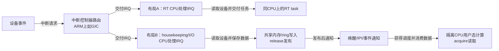
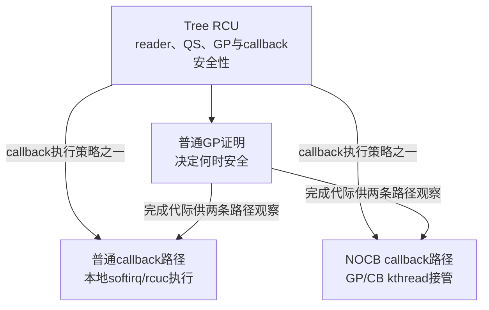
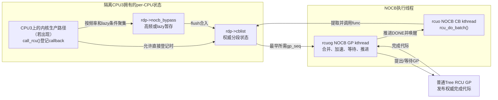
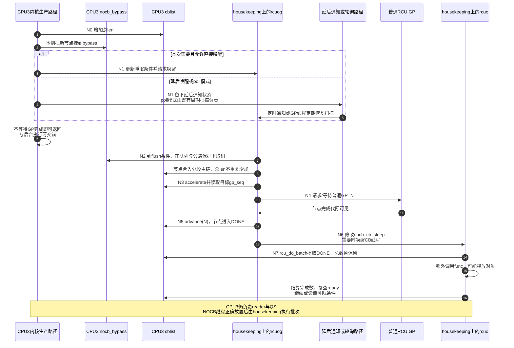

# 第16章\_Tree\_RCU\_NOCB回调卸载

## 16.1\_场景\_隔离CPU不希望执行回调批次

前两章讨论怎样更快取得安全证据，但另一个延迟来源仍在：已经成熟的回调会占用 CPU 执行时间。若某个 CPU 专门承担对抖动敏感的任务，仅缩短 GP 并不能移走这段工作。本章因此改问“回调由谁管理、在哪个 CPU 执行”。

NOCB 是 Tree RCU 把 callback 侧处理交给专用内核线程的 no-callbacks 卸载策略。先记住这个职责，下面再从具体隔离场景引出动态 tick 与线程放置，避免把几个配置当成一个总开关。

采用四 CPU 的教学布局：CPU3 长时间运行用户态计算，CPU0～CPU2 承担 I/O、普通内核线程和后台工作。这些承接公共工作的 CPU 称为 housekeeping CPU。目标是让 CPU3 获得连续、可预测的计算窗口；周期调度 tick 仍可能打断它，所以系统还可采用 `NO_HZ_FULL`（full dynticks）在条件允许时停掉指定 CPU 的周期 tick。若任务具有必须满足的截止时间，本章称其为实时任务（RT task）；这不自动意味着内核已启用 PREEMPT_RT。

即使 CPU3 的业务代码不直接使用 RCU，Linux 内核仍然有自己的 per-CPU RCU 状态。若 CPU3 上的某条内核路径产生 callback，例如内核态数据面更新对象：

```c
/* 片段：flow_slot 的所有写者都用同一把写侧锁串行化。 */
mutex_lock(&flow_update_lock);
old = rcu_replace_pointer(flow_slot, new,
			  lockdep_is_held(&flow_update_lock));
mutex_unlock(&flow_update_lock);
if (old)
	call_rcu(&old->rcu, flow_free_rcu);
```

普通非 offload 路径最终可能在 CPU3 的 `rcu_core()` 中调用 `rcu_do_batch()`。即使每个 callback 很短，一次大批量也会扰动 CPU3；一个耗时很长的 callback 或连续出现的多个小批次也能产生同类问题。callback 为什么成批执行、单批怎样限流，见 [Tree RCU 回调执行、批处理与限流](P12_Tree_RCU_回调执行_批处理与限流.md#12.1_场景_一次GP后突然成熟五万个callback)。

NOCB 把指定 CPU 的 **callback GP 管理与执行** 交给 kthread；它没有取消 CPU3 对普通 RCU reader/QS 的责任，也没有让 `call_rcu()` 变成零开销远端发送。

### 16.1.1\_先分开两种实时架构

“实时”只说明 deadline 重要，并没有规定 IRQ、I/O 和计算必须怎样放置。至少要区分两种常见架构：

| 架构 | 端到端路径 | 为什么这样放 | NOCB/NO_HZ_FULL的位置 |
| --- | --- | --- | --- |
| 外部事件快速响应 | 设备 → 中断控制器（ARM 上如 GIC）→ 目标 CPU 的 IRQ/线程化 IRQ → RT task → 执行器 | 避免一次核间交接，压缩最紧的 event-to-action 延迟 | 该 CPU 必须频繁进内核时，`NO_HZ_FULL` 未必有收益；NOCB 仍可单独用于减少 callback 噪声 |
| 隔离核持续计算 | 设备 → housekeeping/I/O CPU → 共享内存或 ring → 唤醒/通知隔离 CPU → 用户态计算 | 把 IRQ、协议栈和后台工作留在 housekeeping，换取长计算段的低 jitter | `NO_HZ_FULL` 减少周期 tick，NOCB 减少 callback 侧工作，二者在这里最自然地配套 |



布局 B 并不免费：它增加了缓存行所有权迁移、内存屏障、唤醒/IPI 和调度交接。对最紧的外部事件 deadline，布局 A 可能更短；对长时间计算和尾延迟控制，布局 B 往往更可控。是否“把可转嫁工作都转嫁”必须按完整最坏时延链决定，不能只追求某个 CPU 表面上没有 IRQ。

中断控制器维护中断请求状态并进行路由和交付，实际读取设备数据、处理业务的是 CPU 上的驱动代码。图中分离布局由 I/O CPU 接收和初步处理事件，再将数据交给计算 CPU；共享缓冲区的存活、发布和背压仍须由通信协议保证，NOCB 不会替它传送业务数据。

### 16.1.2\_隔离计算核为什么仍要处理RCU责任

“既然是纯计算，为什么还会用 RCU？”需要分开用户态业务与内核机制：

- 纯用户态算法不会直接调用内核 `rcu_read_lock()` 或 `call_rcu()`；
- 但系统调用、缺页、调度、设备路径以及偶发运行在该 CPU 上的内核代码都可能读写 RCU 保护状态；
- RCU 还必须知道该 CPU 当前在用户态、idle 还是内核态，才能形成 QS/EQS 证据；
- 若内核代码在 CPU3 上调用 `call_rcu()`，callback 仍会登记到 CPU3 对应的 per-CPU 队列，只是该队列可以被标为 offloaded。

所以 NOCB 不是为“计算函数里不守规矩地调用 RCU”兜底，而是提前建立一个 **持续成立的 callback 执行策略**：未来归入 CPU3 队列的 callback 仍然可以登记和等待普通 GP，但 callback 侧管理与实际调用由 NOCB 线程承担。

同样，`NO_HZ_FULL` 也不是运行时进入一个永不退出的“计算模式”。CPU3 每次满足条件时动态停 tick，条件破坏时按需恢复。当前 Linux 的启动配置会让 `nohz_full` CPU 同时进入 RCU callback offload 集合，因此不存在“每次进入 `NO_HZ_FULL` 前先把本地 RCU 账单清空”的串行步骤：

```text
启动时建立长期属性
    CPU3 ∈ nohz_full集合
    CPU3的callback队列 ∈ NOCB offload集合

运行时反复变化
    单一用户任务且无tick依赖 → 停周期tick
    IRQ/新任务/tick依赖出现   → 必要时恢复tick
    CPU3产生callback          → 进入offloaded队列，由NOCB侧推进和执行
```

`NO_HZ_FULL` 的动态 tick 状态与 NOCB 的 callback 队列属性是两组相关但不同的状态。前者会随运行条件反复切换，后者使未来 callback 不再要求本地 CPU 承担同一套执行路径。

### 16.1.3\_用三个运行时问题检查隔离边界

| 现场问题 | 应观察的状态 | 能够得出的结论 |
| --- | --- | --- |
| CPU3 刚恢复 tick，是否失去 callback 卸载？ | 有效 offload 状态与当前 tick 依赖分别检查 | tick 恢复本身不撤销长期 offload 协议 |
| 用户计算没有内核 RCU 调用，是否没有 RCU 责任？ | 系统调用、缺页等内核路径及 QS/EQS 状态 | 用户算法不直接用内核 API，但 CPU 仍参与内核的 reader 与 GP 协议 |
| 已迁走多数工作，是否证明满足 deadline？ | IRQ、调度、缓存通信与业务计算的完整时间线 | 迁移只能减少特定干扰，还须计算交接成本和剩余不可迁移活动 |

这三个问题把长期队列策略、瞬时执行环境和端到端时延分开。NOCB 在隔离方案中承担的是 callback 侧管理与执行位置这一部分。

### 16.1.4\_先纠正RCU\_IRQ\_callback这个说法

“大量 RCU IRQ callback 把 RT task 的时间消耗了”抓住了 **同一 CPU 上发生时间竞争** 这个核心，但有两个术语需要校正：

1. `call_rcu()` 登记的是 **RCU callback**，不是硬件 IRQ handler。普通 Tree RCU 路径通常由 `RCU_SOFTIRQ` 或 RCU 的 per-CPU kthread 进入 `rcu_core()`，再由 `rcu_do_batch()` 调用已经成熟的 callback；具体使用 softirq 还是线程上下文取决于内核版本、抢占模型与配置。
2. callback 没有增加 RT task 自己完成算法所需的计算量，而是在 RT task 所在 CPU 上占用了一段执行窗口。RT task 在这段墙上时间里没有获得 CPU 服务，所以它的 **响应时间/完成时间** 变长，最终可能越过 deadline。

因此更精确的表述是：

> 普通 Tree RCU 的 callback 批次若在 RT task 所在 CPU 上执行，会占用该 CPU 的服务时间并形成调度干扰；当 RT task 原有余量小于这段干扰时，它可能错过 deadline。NOCB 用可调度的 kthread 接管 callback 侧处理，配合 CPU 亲和性把实际执行移到 housekeeping CPU，从而减少这种 RCU callback 抖动。

### 16.1.5\_从CPU时间线看deadline为什么会错过

先只看一个简化的单 CPU 作业：RT task 在时刻 0 释放，deadline 是 200 μs，它真正需要获得 180 μs 的 CPU 执行时间。前 90 μs 执行 RT 代码后，CPU 转去执行一个 30 μs 的 RCU callback 批次，随后 RT task 才完成剩余 90 μs：

```text
墙上时间       0                    90       120                  200  210 μs
deadline       |--------------------------------------------------|
CPU执行内容    |---- RT 90 μs -----| RCU 30 |---- RT 90 μs ------|
RT累计服务     0                    90        90                  170  180 μs
                                                                    ↑
                                                              实际完成，迟到10 μs
```

RT task 的计算需求仍然是 180 μs，但响应时间从理想的 180 μs 增加到 210 μs。用一个只用于建立直觉、并非完整实时调度分析的预算式表示：

```text
R_RT ≈ C_RT + B + I_high + I_RCU + I_other

C_RT    RT task 自身需要的CPU执行时间
B       锁、资源和不可抢占区造成的阻塞
I_high  更高优先级任务造成的干扰
I_RCU   同一CPU上实际妨碍该作业前进的RCU callback时间
I_other IRQ、timer、workqueue、迁移任务等其他干扰
```

只有在 `R_RT <= deadline` 时，这个作业才按时完成。例子中 `180 + 30 = 210 μs > 200 μs`，因此发生 deadline miss。这里不要求“一定有大量 callback”：**一个重 callback、一个大批次或多个短批次的累计干扰** 都可能超过仅有的 20 μs 余量。

还要注意，callback 是否真的能抢在某个 RT task 前运行，取决于抢占模型、callback 执行上下文和双方优先级。例如线程化 softirq/RCU kthread 可能被更高优先级 RT task 抢占。NOCB 的价值不是声称“任何 callback 都必然抢占 RT task”，而是把这类工作从隔离 CPU 的本地执行责任中移出，使其位置和优先级能够被单独管理，并减少尾延迟中的一个不确定来源。

### 16.1.6\_为什么普通系统不一定需要卸载

批处理本来是在两个成本之间折中：一次处理多个 callback 可以摊薄调度、锁和唤醒开销，数量/时间限流又能防止单批无限占用 CPU。对没有专用隔离 CPU、更新量较低或延迟余量较大的通用系统，本地批处理通常比额外的跨 CPU 唤醒和线程切换更经济。

明确的 NO_HZ_FULL、HPC 数据面或实时隔离目标，加上足够的 housekeeping 处理能力，是典型适用条件；非对称多处理器还可能希望把回调放到更节能的 CPU，这也是 Kconfig 给出的用途。它是 **执行位置与成本选择策略**，不是普通路径的无条件升级。NO_HZ 的完整动态 tick 模型见 [Linux 时间基础与 timekeeping 框架速览](../../asynchrony/timers/P02_Linux_时间基础与_timekeeping_框架速览.md#2.5_NO_HZ_/_高精度定时器配置对驱动的影响)。

## 16.2\_卸载前后责任对比

上一节已经确定 NOCB 解决的是隔离 CPU 上的 callback 噪声。本节继续按 reader、QS、GP、队列和执行者逐项划界，避免把“callback 卸载”扩大成“整个 RCU 从此不再经过该 CPU”。

### 16.2.1\_NOCB不是另一套RCU实现

Tree RCU 的普通 GP 继续回答“旧 reader 是否都已越过边界，callback 是否已经安全”；NOCB 回答的是“指定 CPU 产生的 callback 由谁管理等待、由谁调用”。当前 Linux 6.12 的 `CONFIG_RCU_NOCB_CPU` 直接依赖 `TREE_RCU`，也从配置关系上证明它不是与 Tree RCU、Tiny RCU 并列的第三套实现。



NOCB 的名字表达的是 no-CBs CPU / no-callbacks-on-this-CPU 这一工程目标，不是 no-RCU-accounting-on-this-CPU，更不是“这个 CPU 从此不能调用 RCU”。NOCB CPU 仍然可以：

- 进入和退出 `rcu_read_lock()` 读侧临界区；
- 调用 `call_rcu()` 登记 callback；
- 通过调度、用户态、idle/EQS 等事件形成 QS 证据；
- 参与普通 Tree RCU 的分层 GP 判定。

### 16.2.2\_真正转移的责任

| 责任 | 普通CPU | NOCB CPU |
| --- | --- | --- |
| reader执行约束/任务跟踪 | 本CPU/当前任务 | 不变，仍在本CPU/任务 |
| QS/EQS形成 | scheduler/context tracking | 不变 |
| CPU位上报 | 本CPU RCU路径或远端EQS扫描 | 不变 |
| `call_rcu()`生产者动作 | 填写 `rcu_head` 并登记 | 仍要填写、记账和入队，成本不为零 |
| callback队列所有权 | 本CPU `rcu_data.cblist` | 仍属于该 CPU 的 `rcu_data`，但标为 offloaded，并可先入 `nocb_bypass` |
| callback等待目标GP | 本CPU `rcu_core()` 协助推进 | NOCB GP kthread 组织、加速并等待普通 GP |
| callback安全性依据 | 普通 Tree RCU 的 `gp_seq` | 完全相同，不另建 GP 算法 |
| READY callback执行 | 本CPU softirq/`rcuc` 路径 | NOCB CB kthread 调用 `rcu_do_batch()` |
| callback线程物理落点 | 随本地执行路径自然在该 CPU | 由 scheduler 决定；需 affinity/cpuset/cgroup 才能约束到 housekeeping CPU |

这说明 NOCB 不只是把最后的 `func(head)` 搬到线程：它还把 offloaded callback 的 bypass 合并、目标 GP 组织、等待、DONE 推进和 CB 线程唤醒等 **callback 侧 GP 管理** 交给 NOCB GP kthread。另一方面，它没有把 reader/QS 责任或普通 Tree RCU 的权威 GP 线程一并搬走。

## 16.3\_两个线程与一个生产者路径



图里的状态仍归 CPU3 对应的 `struct rcu_data` 所有，不是把 callback 数据复制到一份全局“远端 RCU 队列”。变化的是谁取得这些锁、读取这些队列并推进状态：

- **生产者** 仍在 `call_rcu()` 所在上下文写入 `rcu_head`、队列长度和唤醒状态；
- **NOCB GP kthread** 读取 `nocb_bypass`/`cblist`，把 callback 绑定到普通 GP，观察完成代际并推进到 DONE；
- **NOCB CB kthread** 读取 DONE 段，在锁外调用函数并结算；本版本执行后还可在适用锁条件下推进已经完成目标的其他段，不是绝不接触 GP 进度；
- **普通 Tree RCU GP** 继续汇聚 QS 并发布 `gp_seq`，它不被 `rcuog` 取代。

实际线程可按组共享：GP 线程通过组首 `rcu_data.nocb_head_rdp` 链表管理一组 offload CPU，每个成员的 `nocb_gp_rdp` 指向组首；每个 offloaded `rcu_data` 有对应 CB 线程。`nocb_lock` 保护该队列，`nocb_bypass_lock` 保护旁路，组首的 `nocb_gp_lock` 协调 GP 线程睡眠、延迟通知和组状态。因此“两个线程”描述两类职责，不表示系统固定只创建两个线程。

### 16.3.1\_卸载责任不等于自动完成CPU隔离

选择 CPU3 进入 `rcu_nocbs`，保证的是 CPU3 的 callback 队列走 NOCB 处理协议；它 **不自动保证 `rcuo`/`rcuog` 线程永远不会被 scheduler 放回 CPU3**。Linux 6.12 的 Kconfig 说明也明确指出，NOCB kthread 可以被调度到被卸载 CPU，只是线程可在 callback 之间被抢占，并能通过 affinity 或 cgroup 约束到期望的 CPU 集合。

因此“让 RT CPU 不执行该 callback 批次”需要两层配置共同成立：

1. **职责层**：用 `rcu_nocbs` 或 `nohz_full` 让目标 CPU 的 callback 队列进入 offloaded 模式；
2. **放置层**：用线程亲和性、cpuset/cgroup 和完整的 housekeeping 规划，把 `rcuo`/`rcuog` 及其他非实时工作约束到 housekeeping CPU。

如果只做第一层而没有管理线程落点，系统已经改用 NOCB 协议，但“物理上不在 CPU3 执行 callback”这一部署目标仍不能从配置本身推出。

## 16.4\_为什么需要bypass

`call_rcu()` 通常取得当前 CPU 的 `rcu_data`，本地 IRQ 关闭会串行化该 CPU 上的本地入队；真正需要避免的是 **高频本地生产者每次都与远端 NOCB GP/CB kthread 争用同一个 `nocb_lock`**。若每次 callback 都直接进入主 `cblist`，这个共享锁就会回到高频生产路径。

`nocb_bypass` 是一个由 `nocb_bypass_lock` 保护的普通 `rcu_cblist`，允许高频入队先聚集，再批量 flush 到权威 `rcu_segcblist`。它不是为了让任意 CPU 无规则地把 callback 推给 CPU3，而是为了缩短 CPU3 的 producer 与负责 CPU3 队列的 NOCB kthread 在主锁上的直接竞争。

`call_rcu_nocb()` 大致在以下条件间选择：

```text
早期启动，或运行期仍低于本jiffy直入限额且不是lazy回调
    → 必要时先flush旧bypass，再由调用者直接入cblist

bypass需要保持顺序，或者高频/lazy策略选择暂存
    → 进入nocb_bypass

bypass达到老化/长度条件，或其他路径要求推进
    → 在主队列与旁路保护下flush到cblist
```

这里的 lazy 是允许为批量化和节能暂缓推动回调的策略，不是弱化 GP 安全条件。它依赖 `CONFIG_RCU_LAZY` 等实际配置；双参数释放、`call_rcu()` 与 hurry 路径也不能仅凭名字猜测本次是否按 lazy 处理。非 lazy 回调进入全 lazy 的旁路时，需要重新考虑通知期限，但不意味着每次都由生产者立即 flush。

旁路减少高频生产者争用主锁的频率，增加自己的锁和链表并保留顺序。它不是免同步队列：主 `cblist.len` 在节点挂到 bypass 之前就增加，flush 时通常只转移链表归属而不重复加总数。这样 barrier 从总数仍能知道有工作存在。

## 16.5\_bypass不是第二个权威GP队列

callback 只有并入 `cblist` 后，才能由 `rcu_segcblist` 的 accelerate/advance 状态机绑定 GP 并进入 DONE。因此任何需要得出“当前所有 callback 到哪里了”的路径，必须先考虑 bypass：

- NOCB GP kthread 周期/条件 flush；
- `rcu_barrier_entrain()` 在尾随 callback 前 flush；
- CPU deoffload/hotplug 前 flush；
- bypass 老化或达到阈值时 flush；
- 新的非 lazy callback 到来时重新考虑通知/推进期限，不能让它一直沿用仅为 lazy 节点安排的长等待；这不等于每次立即 flush。

本版本 **`cblist.len` 已包含 bypass 的节点**，也包含提取后尚未结算的回调；不能再把旁路长度机械加到总数上。真正会漏看的是只遍历 `cblist.head` 或只看 `seglen[]`，然后误认为已经掌握全部节点资格。

例如 A、B 在 bypass，主链为空，总 `len=2`。flush 后 A、B 进入 NEXT，`len` 仍为 2；advance 后进入 DONE，提取到 CB 线程临时链表后 `len` 仍为 2，执行结算才减少。总数说明尚有责任，分段说明资格，旁路和临时链表说明实际存放位置，三者不能互相替代。

## 16.6\_N0到N7\_一次offload\_callback生命周期

NOCB 不是单一开关状态，而是 **per-CPU 队列、分组线程、普通 GP 代际** 协作。本章用 N0～N7 表示一次卸载回调周期：N0～N3 承接 P11 的登记与代际分配，N4 依赖普通 GP 证明，N5～N7 承接分段成熟与 P12 的执行周期；它不替代公共 S 周期。

| 阶段 | 触发与写入者 | 状态与存储位置 | 后续读取者/通信 | 退出条件 |
| --- | --- | --- | --- | --- |
| N0 登记 | offloaded CPU 的生产者 | 节点进入对应 bypass 或主链，总 `cblist.len` 增加 | 队列留下可观察工作 | 执行责任已交给 RCU |
| N1 通知判断 | 生产者或延后通知路径 | 组首 `nocb_gp_sleep`、`nocb_defer_wakeup`、`nocb_timer` | 直接唤醒、定时检查或 poll | 已安排后续检查；不保证固定调度时延 |
| N2 flush | GP 线程扫描，或其他受保护推进路径 | bypass 合入同一 `rcu_data.cblist`，总数不重复增加 | 分段算法接管节点 | 当前节点已在 NEXT |
| N3 分配 | NOCB GP 管理路径 | 主链段边界及目标 `gp_seq` | 向普通 Tree RCU 提出/维持需求 | 已知需要等待的目标 |
| N4 等 GP | 普通 GP 汇聚 reader/QS | 节点完成代际；组首记录最早等待目标 | GP 线程等待节点 `nocb_gp_wq[]` 或 poll | 目标完成值可以被观察 |
| N5 advance | 取得相应保护的 NOCB 路径 | 符合目标的段进入 DONE | GP/CB 线程检查 ready | 当前节点可执行 |
| N6 交付 CB | GP 线程发现 DONE 且 CB 原在睡眠 | `nocb_cb_sleep=false`，随后唤醒 `nocb_cb_wq` | CB 线程复查条件 | 线程取得执行机会 |
| N7 执行 | CB 线程的 `nocb_cb_wait()` | 提取 DONE、锁外执行、结算 `len`，必要时继续推进 | 执行函数，复查 ready 和睡眠状态 | 本批结束；线程可在回调之间重调度 |

NOCB 的批次不能机械套用普通 softirq 的数量/时间退出条件。P12 已说明 CB 线程在两项之间允许重调度，回调本身仍在所要求的 BH 禁用环境中运行，不得睡眠；一次超长回调依然会拖住执行者。

## 16.7\_端到端时序

同一个 callback 在普通路径和 NOCB 路径上的安全条件没有区别：都必须等普通 Tree RCU 的目标 GP 完成。区别只出现在 callback 侧状态由谁推进、最终在哪个执行上下文调用 `func`。下面假定管理员已经把 NOCB 线程约束到 housekeeping CPU；如果没有做线程放置，图中的 CPU 归属只是目标而不是保证。



对 RT task 而言，变化可以压缩为下面这条因果链：

```text
普通路径
CPU3上的内核路径产生callback
    → CPU3的本地RCU执行路径推进并调用成熟批次
    → callback区间与RT作业竞争CPU3服务时间
    → 响应时间增加，尾部样本可能越过deadline

NOCB + 正确线程放置
CPU3上的内核路径产生callback并完成必要入队/唤醒记账
    → housekeeping CPU上的rcuog推进等待状态
    → housekeeping CPU上的rcuo调用成熟批次
    → CPU3仍承担call_rcu、reader和QS成本，但不承担该callback批次的实际执行时间
```

因此 NOCB 减少的是 `I_RCU` 中 callback 管理和实际调用这一大段，不会把 `call_rcu()` 入队、缓存一致性、reader/QS、必要唤醒以及其他 IRQ/timer/workqueue 干扰全部归零。

## 16.8\_配置与观察

机制职责成立后，部署还要分别配置 callback 协议、动态 tick 和执行者落点，并用运行状态验证三层都真正生效。

### 16.8.1\_先分开三类配置

以下仅是本章 CPU0～CPU3 布局的参数示例，不直接修改启动配置。实际部署须先确认内核选项、有效 CPU 编号和剩余 housekeeping 容量：

```text
rcu_nocbs=3 nohz_full=3 isolcpus=managed_irq,3
```

三者不是同义参数，不能把一条启动命令误读成一个不可拆分的“实时开关”：

其中 `isolcpus=managed_irq,3` 只对 managed IRQ 做尽力隔离，不等于普通任务已被 cpuset 隔离，也不控制全部 IRQ。官方文档建议优先考虑 cpuset 管理调度域隔离；本例不把 `isolcpus` 当成通用实时部署配方。

| 层次 | 典型配置 | 解决的问题 | 没有保证什么 |
| --- | --- | --- | --- |
| RCU callback 职责 | `rcu_nocbs=3` | CPU3 对应 callback 队列进入 NOCB 协议 | 不自动绑定 NOCB kthread，也不迁走其他内核工作 |
| full dynticks | `nohz_full=3` | CPU3 只有一个用户态 runnable task 且没有 tick 依赖时，尽量停止周期调度 tick | 不等于永久停 tick，也不等于所有 timer、IRQ 和调度活动消失 |
| 任务/中断/线程放置 | affinity、cpuset/cgroup、housekeeping 规划，必要时结合 `isolcpus` | 指定哪些执行者能够落到哪些 CPU | 每类 IRQ、内核线程和工作队列仍需按自身接口核查 |

在编译了 `CONFIG_RCU_NOCB_CPU` 的本专题 Linux 6.12 实现中，`rcu_init_nohz()` 会将有效非空 `tick_nohz_full_mask` 并入 NOCB 集合，允许与显式 `rcu_nocbs` 合并。`CONFIG_RCU_NOCB_CPU_DEFAULT_ALL` 则只在尚无显式 NOCB 设置、也没有本次 nohz_full 集合选择时使用全部 possible CPU，不会无条件覆盖用户已经指定的集合。分配等初始化成功后，才为对应主链设置 offloaded 标志并组织线程分组；分组也不等于立即创建线程，真正的 GP/CB kthread 在后续启动阶段建立。

这段初始化建立的是 **CPU3 callback 队列的长期 offload 属性**，不是“在 CPU3 每次停 tick 前先搬走当前 callback”的运行时清账动作。运行期即使 CPU3 因 IRQ 或系统调用进入内核，或者因新的 tick 依赖而恢复周期 tick，它的 callback 队列也不会因此自动退回普通本地执行；反过来，NOCB 属性成立也不能保证 CPU3 此刻一定处于停 tick 状态。

还要保留能承担 timekeeping 等职责的 housekeeping CPU。内核会按体系结构和启动条件校正有效集合；例如本版 `tick_nohz_init()` 在相应系统睡眠配置分支会将启动 CPU 从集合移除，不支持所需 irq_work 中断能力时还会禁用 full dynticks。不要只看参数字符串，应核对启动日志和实际 nohz_full 集合，并为 RCU、timer、workqueue、IRQ 和调度工作留下执行资源。

### 16.8.2\_rcu\_nocb\_poll改变谁主动通知

默认模式下，队列从无待推进工作变成有工作时，需要确保 GP 线程不会无限睡眠。可安全直接通知时唤醒；原 IRQ 状态、离线情形或 lazy 策略要求延后时，设置组首的延后状态和定时器。只要旁路仍有未推进节点，就不能依赖“以后总会再来一次 `call_rcu()`”来救活它。

启用 `rcu_nocb_poll` 后，生产者的这条 GP 唤醒路径提前返回，由 GP 线程主动定期扫描所管理队列：

```text
默认唤醒模式
offloaded CPU入队
    → 必要时wake_up(NOCB GP kthread)
    → GP线程醒来检查队列

rcu_nocb_poll
offloaded CPU入队
    → 不执行这次GP线程唤醒
    → GP线程周期性主动检查队列
```

本版本有成员队列时，poll 分支使用 `schedule_timeout_idle(1)` 让出并等待一个 jiffy 后再检查；这不是硬实时唤醒期限。若组里已经没有成员，它仍可等待新的 offload 成员，而非永不睡眠。被移除的生产者通知成本变成周期活动和能耗；CB 线程的成熟条件通知仍存在，所以不能写成“整个 NOCB 无需唤醒”或“所有回调线程自动轮询”。

### 16.8.3\_运行时观察

先只读检查实际启动参数与有效 tick 集合，不改亲和性或启动项：

```bash
# Linux 目标机；CPU编号应与本机拓扑对应。
uname -r
cat /proc/cmdline
if test -r /sys/devices/system/cpu/nohz_full; then
    cat /sys/devices/system/cpu/nohz_full
else
    printf '没有可读的nohz_full接口，须核对内核配置与权限\n'
fi
```

`cmdline` 是请求的参数，sysfs 是当前可见的集合，两者职责不同。启动日志中的 `Offload RCU callbacks from CPUs:` 可以核对初始化结果；若以后执行过动态切换，还须结合切换记录与当前状态，不能拿启动日志充当任意时刻的 offload 快照。

随后确认构建能力；看不到配置文件时，不把缺失当作选项关闭：

```bash
# Linux 目标机，只读配置；未部署此文件时应从该内核构建产物取得。
config_file="/boot/config-$(uname -r)"
if test -r "$config_file"; then
    grep -E '^(CONFIG_(RCU_NOCB_CPU|RCU_NOCB_CPU_CB_BOOST|RCU_LAZY|NO_HZ_FULL)=|# CONFIG_(RCU_NOCB_CPU|RCU_NOCB_CPU_CB_BOOST|RCU_LAZY|NO_HZ_FULL) is not set)' "$config_file"
else
    printf '配置文件不可读，当前未完成配置核对\n'
fi
```

最后观察执行者，下面使用 procps 的 `ps` 和常见 `awk`。`psr` 是线程最近执行的 CPU，不是允许集合；`cls`、`rtprio` 分别给出调度类别与实时优先级。

```bash
# Linux 目标机，列出NOCB线程及其调度位置。
ps -eLo pid,lwp,psr,cls,rtprio,comm | awk 'NR == 1 || $6 ~ /^rcuo/'
```

用每个线程的 TID（上面 `lwp` 列）读取允许集合，才能判断它是否仍能落到 CPU3：

```bash
# 只读/proc；线程可能在两次观察之间退出，读失败不代表配置为零。
for tid in $(ps -eLo lwp=,comm= | awk '$2 ~ /^rcuo/ {print $1}'); do
    printf '\nTID=%s\n' "$tid"
    if test -r "/proc/$tid/status"; then
        grep -E '^(Name|Cpus_allowed_list):' "/proc/$tid/status"
    else
        printf '该线程状态已不可读\n'
    fi
done
```

如果看到线程最近在 CPU0、允许集合却含 CPU3，只能说明这次采样没有在 CPU3，不能证明隔离。线程存在也不证明对应 CPU 当前仍 offloaded：动态切换后线程可能已 park。还须结合 P12 的批次统计区分队列积压与执行机会；这里的命令不提供回调吞吐测量。它们是部署观察步骤，本次正文核对没有在目标机执行。

线程名和 affinity 随版本/配置变化，源码中的 `rcu_nocb_gp_kthread()`、`rcu_nocb_cb_kthread()` 才是职责锚点。

## 16.9\_动态offload/deoffload为何复杂

Linux 6.12.20 提供两个内核管理接口，但其边界比“任意 CPU 随时改模式”窄：需要实际改变状态时，`rcu_nocb_cpu_offload(cpu)` 与 `rcu_nocb_cpu_deoffload(cpu)` 要求目标 CPU 已离线，否则返回 `-EINVAL`；本版本重新 offload 还要求该 CPU 在启动时曾被组织进 NOCB，已有分组与线程关联。已处于所需状态时可以直接返回，不代表在线切换获准。

这些不是供用户程序直接调用的系统调用。切换至少要同步：

```text
cblist的offloaded标志
NOCB锁与本地core并发
bypass是否已flush
GP/CB kthread是否已创建、park或唤醒
已经DONE与仍pending callback由谁执行
barrier是否正在给队列entrain哨兵callback
```

外层以 CPU 热插拔读锁和 `nocb_mutex` 串行化管理，内层还需与 GP 线程握手，等待状态条件并 park/unpark CB 线程；deoffload 需要处理在途回调及 barrier 后再交还责任。它不是修改 cpumask 后立即完成的无状态操作。本章不把 CPU 下线作为普通观察步骤，稳定部署优先在启动配置中完成设计。

`rcu_state` 中只有两项 NOCB 全局配置协调字段，但它们不能代表 per-CPU callback 状态：

- `nocb_mutex` 串行化 offload/deoffload、启动组织以及需要避免锁状态失衡的管理路径；真正的 callback、bypass、等待队列和线程指针仍在各 `rcu_data`/NOCB 分组对象中。
- `nocb_is_setup` 表示 NOCB 启动组织是否已经建立。路径会结合 `rcu_scheduler_fully_active`、启动 cpumask 和对应 kthread 状态判断是否可继续；它不是“所有 callback 已经卸载”或“当前没有回调”的证明。

这两个字段只在 `CONFIG_RCU_NOCB_CPU` 下编译进 `rcu_state`。配置关闭时，整组全局管理状态消失，但普通 Tree RCU 的 reader、GP 与 callback 语义仍然存在。

## 16.10\_性能取舍

| 改变 | 对隔离/RT CPU的收益 | 转移到别处的成本 |
| --- | --- | --- |
| callback 批次由 CB kthread 调用 | 正确放置线程后，不再由本地 `rcu_core()` 消耗这段服务时间 | housekeeping CPU 承担 callback 本体和批处理开销 |
| GP/CB 职责分离 | 大块 callback 工作变得可调度、可单独设 affinity | 增加线程、等待队列、唤醒和 context switch |
| offloaded `call_rcu()` 入队 | 生产者不等待目标 GP 或回调完成；没有固定返回时延 | 仍有本地/共享记账、锁、缓存行通信和可能的 GP 线程唤醒 |
| bypass 聚合高频入队 | 降低生产者争用主 `nocb_lock` 的频率 | 增加暂存、flush 延迟、状态协议和内存峰值 |
| `rcu_nocb_poll` 主动轮询 | 进一步减少 no-CBs CPU 的 GP 线程唤醒工作 | 增加 polling 活动和能耗 |
| callback 集中到 housekeeping CPU | 减少计算 CPU 的 OS jitter | 可能集中缓存污染、内存回收和调度压力 |

若 housekeeping CPU 资源不足，offloaded callback 会积压，旧对象存活时间和内存峰值都会增加；被隔离 CPU 很干净，不等于系统整体回收吞吐足够。反过来，如果系统没有专用 CPU、callback 产生率很低且 deadline 余量充足，普通本地路径往往能以更少的跨 CPU 协调获得更好吞吐。

NOCB 也不承担 I/O CPU 与计算 CPU 之间的业务数据传递。共享内存/ring、内存序、唤醒和背压属于应用或数据面的核间通信协议；NOCB 只处理内核 RCU callback。把 IRQ、workqueue、timer 和 RCU callback 都规划到 housekeeping CPU 是一个系统级隔离方案，其中每一类工作都要使用自己的放置接口，而且仍会存在不可迁移的中断、必要 IPI、缺页和异常慢路径。

### 16.10.1\_实时优先级不是免费保障

本版本启用 `CONFIG_RCU_NOCB_CPU_CB_BOOST` 且 `kthread_prio` 非零时，会把 CB kthread 设为 `SCHED_FIFO`，以免被大量 `SCHED_OTHER` 后台负载饿死；该选项依赖 NOCB 与 RCU_BOOST，PREEMPT_RT 下默认启用。这里提升的是回调执行线程，与 P14 提升被抢占旧 reader 的协议不是同一对象。回调 flood 时，FIFO 线程也可能长期占用所在 CPU，因此避免积压的措施会反过来影响其他任务。

因此需要同时满足：

- callback 线程所在 housekeeping CPU 有明确容量预算；
- 延迟敏感任务要么使用更高的可证明优先级，要么根本不与 callback 线程共享 CPU；
- callback backlog、批次时间和 RT deadline miss 要一起观测，不能只验证隔离 CPU 的平均利用率；
- 不能把“启用 NOCB”写成“获得 deterministic latency”或“获得硬实时保证”。

NOCB 的正确收益描述是 **减少 callback 带来的一个可识别抖动源**。系统级实时性仍要由任务优先级、IRQ、timer、workqueue、内存分配、锁阻塞和硬件最坏时延共同证明。

### 16.10.2\_选择边界

优先考虑 NOCB 的条件是：有明确的 RT/HPC/NO_HZ_FULL/CPU isolation 目标；callback 批次确实进入尾延迟因果链；存在能够承接回调的 housekeeping CPU；并且愿意管理线程 affinity、优先级和 callback backlog。

优先保留普通 callback 路径的条件是：CPU 都承担通用工作；负载更关心总吞吐和局部性；callback 率较低或限流后的延迟已满足目标；系统没有足够的 housekeeping 容量。选择依据不是“NOCB 更先进”，而是 **是否值得用额外同步和调度成本换取指定 CPU 的时间隔离**。

对实时系统还应先回答更上层的问题：如果 deadline 是“外设事件到执行器动作”，先比较 IRQ 与 RT task 同核、分核两种端到端时延，再决定是否需要 full dynticks；如果目标是“一个长计算段尽量不被内核噪声打断”，`NO_HZ_FULL` + NOCB + housekeeping 规划才是更直接的候选。不要先看见“RT”就套用同一组启动参数。

## 16.11\_源码和trace入口

- 版本与模块地图先见 [RCU 源码总阅读索引](../../../../../research/source_reading/rcu/navigation/P01_Linux_6.12_RCU源码总阅读索引.md)。本章计数、切换和线程分支以固定 NXP Linux 6.12.20 为准；启动参数还对应同提交 `Documentation/admin-guide/kernel-parameters.txt`，有效 tick 集合由 `kernel/time/tick-sched.c` 等实现校正。
- [RCU 分类坐标与 Kconfig 映射](P04_RCU_分类坐标与内核配置.md#4.9.2_本章名称到API配置和启动参数的完整映射)：确认 NOCB 是 Tree RCU 的 callback 执行策略，而不是独立 RCU 实现。
- [普通回调批次为何会实际占用 CPU，以及怎样受数量/时间预算限制](P12_Tree_RCU_回调执行_批处理与限流.md#12.6_数量预算和时间预算)：先确认问题来自 callback 执行阶段，而不是把 GP 等待时间误算成 CPU 执行时间。
- [普通 GP 长期线程的端到端源码时序](../../../../../research/source_reading/rcu/source_explanations/P05_Linux_6.12_Tree_RCU_GP全局生命周期源码实现.md#5.14_端到端源码时序)：它创建并发布普通 Tree RCU 的权威完成代际；NOCB GP kthread只是等待、观察并推进 offloaded callback，不创建另一套普通 GP。
- [回调与 NOCB 模块源码概念导读](../../../../../research/source_reading/rcu/navigation/P07_Linux_6.12_Tree_RCU_回调与NOCB模块源码概念导读.md#7.6_NOCB为何拆成GP线程与CB线程)：先分清 producer、GP 观察者与 callback 执行者。
- [`call_rcu_nocb()`、bypass、flush 与防搁浅唤醒](../../../../../research/source_reading/rcu/source_explanations/P15_Linux_6.12_Tree_RCU_NOCB队列与执行交接源码实现.md#15.3_nocb_bypass怎样降低生产者锁竞争又避免搁浅)。
- [`nocb_gp_wait()` 的目标代际推进](../../../../../research/source_reading/rcu/source_explanations/P15_Linux_6.12_Tree_RCU_NOCB队列与执行交接源码实现.md#15.4_NOCB_GP线程怎样推进队列并等待最早目标代际)与 [`nocb_cb_wait()` 的成熟批次执行](../../../../../research/source_reading/rcu/source_explanations/P15_Linux_6.12_Tree_RCU_NOCB队列与执行交接源码实现.md#15.5_NOCB_CB线程只执行成熟批次)。
- [`rcu_nocb_cpu_offload()` / `deoffload()` 的动态切换](../../../../../research/source_reading/rcu/source_explanations/P15_Linux_6.12_Tree_RCU_NOCB队列与执行交接源码实现.md#15.6_动态offload为何只允许offline_CPU并等待状态交接)。
- [`rcu_init_nohz()` 在启动后半程建立 offload mask 与线程分组](../../../../../research/source_reading/rcu/source_explanations/P18_Linux_6.12_RCU早期请求与执行模式交接源码实现.md#18.5_函数返回后RCU还远未进入完整运行态)：它不改变 `rcu_init()` 的普通 Tree RCU 初始化职责，也不在此处创建 NOCB kthread。

上一篇：[Tree RCU Expedited GP](P15_Tree_RCU_Expedited_GP.md)。

下一篇：[Tree RCU CPU 热插拔与回调迁移](P17_Tree_RCU_CPU热插拔与回调迁移.md)。
