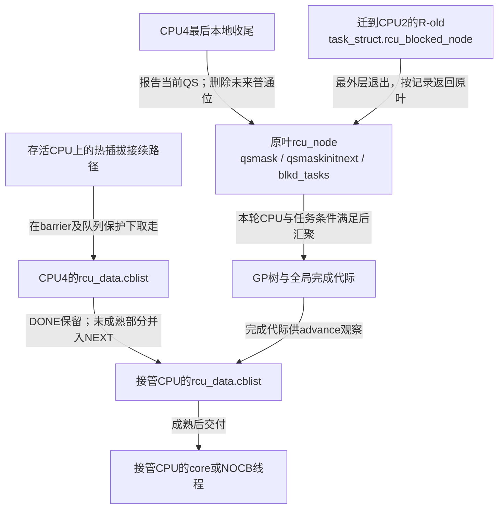
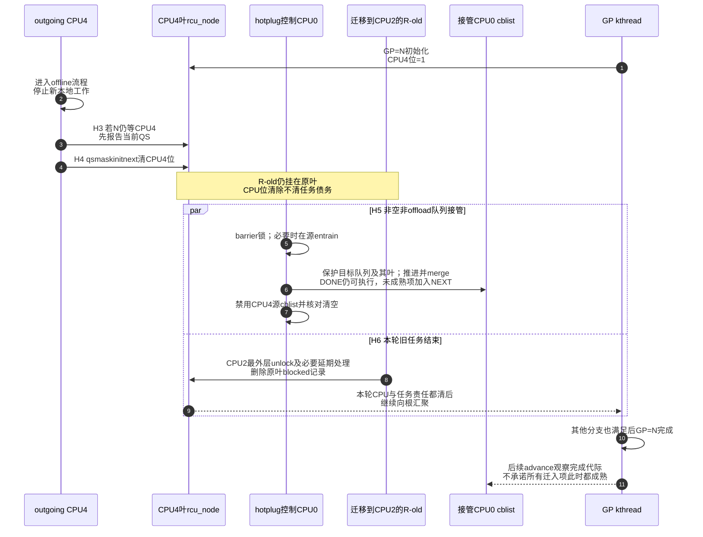

# 第17章\_Tree\_RCU\_CPU热插拔与回调迁移

## 17.1\_场景\_CPU4在GP中途下线

上一章改变了 callback 的执行者，但没有让 CPU 永远在线。管理员可能为了维护、功耗或隔离调整而下线一个 CPU；硬件线程停止参与调度以后，内存中的 RCU 队列和任务记录不会跟着消失。本章追踪 CPU4 的一次正常离线，回答这些责任怎样交接。这里的 CPU 热插拔是内核的上线/离线协议，不要求物理拔出处理器。

**讲解层次：实现层，固定 NXP Linux 6.12.20、Tree RCU。** GP=N 已经为 CPU4 建立本轮 `qsmask` 位；CPU4 的 `rcu_data.cblist` 还有等待 GP=N 和 N+1 的 callback。PREEMPT_RCU 下，还可能有一个曾在 CPU4 上被抢占的旧 reader R-old，任务已经迁移到 CPU2，但仍留在原叶节点的任务链上。先用这个纸面场景推演，实际下线命令放到后文，在确认测试环境后执行。

下线过程必须同时回答三组问题：

```text
参与集合：当前GP还等不等CPU4，下一轮还应不应纳入它？
任务债务：挂在CPU4叶节点的被抢占任务由谁继续等待？
回调所有权：CPU4以后不再运行，cblist由哪个在线CPU执行？
```

只处理 CPU 位而遗漏其他责任，会让 callback 无人执行，或者让仍持有旧指针的任务被过早忽略；只迁移 callback 而没有 CPU/QS 退出协议，GP 又可能继续等待已停止运行的 CPU。不是每个错误清位动作都会立即丢失链表，而是三个完成条件不能互相替代。



图中方框是软件执行者和内存状态，CPU4 离线后其 per-CPU 存储仍存在。R-old 的任务责任沿原叶解除，callback 的执行责任则可以转到另一个 CPU 的队列；两条路径可以交错，不能画成同一次“删除 CPU4”操作。

## 17.2\_当前GP与下一轮参与集合必须分开

叶节点有三组相关位：

| 字段 | 本场景含义 |
| --- | --- |
| `qsmask` | GP=N 当前仍欠 CPU4 的证明 |
| `qsmaskinit` | GP 初始化从缓冲集合吸收的参与位；随后用于建立本轮欠位 |
| `qsmaskinitnext` | 热插拔正在更新、供后续初始化吸收的普通参与集合；不是任意时刻通用 online mask 的副本 |

CPU4 下线时，如果当前 `qsmask` 仍有其位，离线路径先为当前 GP 报告 QS；之后再从 `qsmaskinitnext` 删除 CPU4。顺序不能反过来，否则当前 GP 报告路径可能失去解释它为何还在等待 CPU4 的代际上下文。

`rcutree_report_cpu_dead()` 在 `ofl_lock` 与叶节点锁保护下检查本轮位；需要报告时，`rcu_report_qs_rnp()` 会交出节点锁，因此返回后必须重新取得叶锁，再清 `qsmaskinitnext` 中的位。完整实现另做延期唤醒、延期 QS 和诊断快照的收尾，不能把两个位操作拼成可直接替换的函数。

从这一点直到 CPU 真正死亡必须保持 IRQ disabled，避免 CPU 已从未来参与集合删除后又由中断引入新的普通 RCU 读侧。这个边界是 CPU4 停止产生新普通读者的协议条件，其他 CPU 上的 R-old 仍然要独立等待。

全局 `rcu_state.ofl_lock` 专门把 CPU starting/dying 对 `qsmaskinitnext` 的修改，与普通 GP pre-init 把 `qsmaskinitnext` 收进稳定 `qsmaskinit` 的动作串行化。它解决的是“这一位属于当前轮还是下一轮”的边界竞态，不是保护整棵 `rcu_node` 树；具体节点位仍要在对应 `rnp->lock` 下修改。

版本化入口从 [RCU 源码总阅读索引](../../../../../research/source_reading/rcu/navigation/P01_Linux_6.12_RCU源码总阅读索引.md) 进入，再看 [GP 全局生命周期模块](../../../../../research/source_reading/rcu/navigation/P03_Linux_6.12_Tree_RCU_GP全局生命周期模块源码概念导读.md#3.7_一次唤醒怎样进入主循环和初始化)；普通 GP 一侧取得 `ofl_lock` 并吸收缓冲集合的落点，见 [`rcu_gp_init()` 开始代际并建立证明债务](../../../../../research/source_reading/rcu/source_explanations/P05_Linux_6.12_Tree_RCU_GP全局生命周期源码实现.md#5.9_rcu_gp_init开始代际并建立证明债务)。

## 17.3\_上线也不能中途加入当前GP

`rcutree_report_cpu_starting(cpu)` 在 incoming CPU 自己、尚未开中断的精确位置执行。它把本 CPU 位写入 `qsmaskinitnext`，同时加入 expedited 的 `expmaskinitnext`。后者是 **ever-online 并集**，CPU 离线时不清除；只有首次出现的位才令 `newcpu=1`，再以 release 存储增加 `rcu_state.ncpus`，供加急初始化判断是否需要向上传播。

普通集合的边界应按“初始化何时吸收该位”理解，不能仅看全局 GP 序号是否已经开始：`rcu_gp_init()` 先启动代次，随后才逐叶吸收 `qsmaskinitnext`。若上线写入先于该叶的吸收，它可以进入正在初始化的集合；若吸收已经完成，它等待后续初始化。正常 starting 路径不会直接给已经建立的 `qsmask` 追加一个欠位。本节说的“不在中途加入”，指已经建立的等待集合，不是把 GP 初始化的全部动作视为一个瞬间。

源码若发现当前 `qsmask` 错误地仍在等 incoming CPU，会警告并报告该位。最后以 release 语义发布 `rdp->beenonline=true`，再执行完整屏障，保证后续普通 RCU 读侧使用不越过初始化；“曾上线”也不等于此刻在线。

此路径先取得 `ofl_lock`，再取得 `barrier_lock` 和叶 `rnp->lock`；写入普通 next 位后便释放 `barrier_lock`，其后的 expedited 位由仍持有的叶锁等协议保护。因此不能把三个锁说成一直覆盖整个函数。`ofl_lock` 同时参与上线、离线和 GP 集合吸收，也不能只凭名字把它理解成只管 offline。

## 17.4\_被抢占任务为何不能随CPU位一起删除

R-old 曾在 CPU4 读侧内被抢占，已经挂到 CPU4 所属叶节点 `blkd_tasks`；它可能迁移到 CPU2 并继续持有旧对象。CPU4 offline 只证明 CPU4 不再运行旧 reader，不证明 R-old 已退出。

当前 GP 仍通过 `gp_tasks` 等待本轮旧任务。到了 GP 初始化吸收在线集合时，若发现某叶最后一个 CPU 已离线、但仍有 blocked task，`rcu_node.wait_blkd_tasks` 会让这条叶分支继续参与初始化。它不是每次 offline 当场无条件设置的标志。要把没有 CPU 的叶分支从上层初始化集合清理掉，必须同时满足：

```text
该叶没有在线CPU
    && 该叶已无被登记的blocked task
```

任务最终在 CPU2 unlock，仍通过 `task_struct.rcu_blocked_node` 回到原叶解除记录，必要时先延期到允许清理的上下文。当前轮任务债务归零后可继续向根报告；后续初始化再按实际任务与 CPU 集合决定是否清除 `wait_blkd_tasks` 和离线分支。若这期间有 CPU 重新上线，则保留分支并清除等待任务的过渡标记。清除当前 GP 欠债与清理未来初始化拓扑是两个阶段。

## 17.5\_非offload\_callback怎样迁移

CPU4 死亡后不再运行 `rcu_core()`，其 cblist 不能原地等待。`rcutree_migrate_callbacks(cpu4)` 在另一个在线 CPU 上执行：

1. 若源 CPU 是 NOCB offload，callback本来由远端管线管理，本函数直接返回；
2. 取得全局 `barrier_lock`，防止与 `rcu_barrier()` 对队列的哨兵登记竞争；
3. 若源 cblist 非空，先 `rcu_barrier_entrain(source_rdp)`，保持正在进行的 barrier 覆盖；
4. 取得目标 CPU NOCB/节点锁并 flush 目标 bypass；
5. 在目标叶锁下尝试推进队列，利用最近已完成 GP；源码以 `||` 合并 needwake，前项为真会短路，不能假定每次两次调用都执行；
6. `rcu_segcblist_merge(&target->cblist, &source->cblist)`；
7. disable 源 cblist，检查源已空；
8. 更新过载状态；目标 offload 时走 NOCB 唤醒协议，`needwake` 为真时唤醒普通 GP 线程。这里没有对普通目标无条件直接调用 `rcu_core()`。

迁移用 `rcu_segcblist_merge()`。源队列的 DONE 部分插入目标 DONE，尚未成熟的部分则加入目标 NEXT，源分段目标代际不被逐项原样保留；目标后续再安全地赋予等待目标。源码在 merge 后也有条件尝试推进，随后禁用源队列并检查源总数和链表均为空。它保留的是“已安全的可执行、未安全的继续等待”这一边界，可能多等，不能少等。

例如源队列有 A（DONE）、B（原目标 N+1），目标有 C（DONE）。合并后 A/C 仍可执行，B 进入 NEXT；不能仅因 B 原来写着 N+1，就宣称迁移后必定在 N+1 结束时调用。这里也不建立不同 CPU 队列之间的全局登记先后顺序。

## 17.6\_H0到H9\_CPU4离线周期

本章 H 阶段是热插拔子过程，与前文 GP 公共周期分开编号。H0～H5 描述 CPU 和队列交接；H6 的任务退出可与它们交错，H8 是后续 GP 吸收，H9 是另一次上线，不是所有行必须按墙上时间串行执行。

| 阶段 | 事件 | 状态变化 | 执行者 | 退出条件 |
| --- | --- | --- | --- | --- |
| H0 在线 | CPU4正常参与 | `qsmaskinitnext`含CPU4，cblist enabled | CPU4/RCU | 收到offline请求 |
| H1 早期offline | `rcutree_offline_cpu()` | 叶 `ffmask` 清位、调整节点线程 affinity、设置 tick 依赖 | 热插拔回调执行路径 | 后续 stop-machine 可及时推进 |
| H2 CPU dying | `rcutree_dying_cpu()` | trace 记录叶 `qsmask` 是否仍有本 CPU 位 | 热插拔路径 | 继续进入死亡边界，不由 trace 清位 |
| H3 最后本地收尾 | `rcutree_report_cpu_dead()` | 延期唤醒/QS收尾；必要时报告本轮位 | outgoing CPU4 | CPU4 本轮位已清，任务位独立 |
| H4 删除未来参与 | 同上 | 叶 `qsmaskinitnext` 清CPU4位，`rdp->cpu_started=false` | outgoing CPU4 | IRQ持续关闭，不再新建普通读侧 |
| H5 回调接管 | `rcutree_migrate_callbacks()` | 非offload且非空时：barrier协调、推进、合并、禁用源队列 | 存活接管CPU | 节点迁入目标，源链表与总数为空；空源/NOCB提前返回 |
| H6 任务退出 | R-old 最外层 unlock 及必要的延期处理 | 原叶 `blkd_tasks/gp_tasks` 解除本任务责任 | R-old在CPU2执行 | 当前轮其他责任也满足时向根汇聚 |
| H7 dead完成 | `rcutree_dead_cpu()` | `rcu_state.n_online_cpus` 减一，解除该 tick 依赖 | 其他CPU的进程上下文 | RCU本地清理完成；该私有计数在prepare增加，不是即时online mask |
| H8 后续GP吸收 | `rcu_gp_init()` | 叶 `qsmaskinit` 吸收next；按任务情况维护 `wait_blkd_tasks` 和父位 | GP kthread | 初始化得到一致的CPU/任务参与关系 |
| H9 再上线 | prepare/starting/online | prepare重建所需状态；starting发布next位；online完成后期处理 | 控制CPU与incoming CPU分别执行 | 后续普通读侧与中断按上线协议开放 |

## 17.7\_端到端时序



步骤 3、4 先结束 CPU4 的普通参与责任；步骤 5～7 与 8～9 表示两条可以交错的路径，并非接管必须等待 R-old，或 R-old 必须等接管完成。步骤 10 还要求其他分支也已满足；步骤 11 只发布安全进展，真正 callback 调用继续由前两章的队列和执行协议负责。

## 17.8\_为什么需要barrier\_lock参与迁移

`rcu_barrier()` 可能正在遍历每 CPU 队列并给 CPU4 entrain 哨兵 callback。若迁移同时把队列搬走而没有串行化，barrier 可能：

- 在已经移空的源队列放哨兵，接收 CPU 又不执行它；
- 观察源队列为空并跳过，但 callback 正在搬入目标且已错过目标扫描；
- 重复计数同一个队列。

迁移在 `rcu_state.barrier_lock` 下 entrain/merge，使“barrier截止边界”和“callback所有权转移”形成一个可序列化顺序。

## 17.9\_NOCB\_CPU为何不同

offload CPU 的 callback 即使 CPU 本身 offline，仍由 NOCB kthread 管理；线程要在存活且允许的 CPU 上获得调度，是否限定在 housekeeping 集合取决于实际亲和性，不能由 NOCB 名称自动推出。所以普通 `rcutree_migrate_callbacks()` 不迁移它，per-CPU 队列也不能因为 CPU offline 就被重置。NOCB offload/deoffload、线程 park 和 bypass flush 有自己的协议，见上一章。

这再次说明三条状态轴正交：

```text
CPU是否在线
CPU的reader/QS是否仍欠GP
CPU名下callback由本地core还是NOCB执行
```

不能由其中一项推导另外两项。

## 17.10\_实验和观察边界

先做不改变系统状态的观察，再决定是否在可恢复的测试机上做一次离线/上线。CPU4 只是本章示例编号；没有 CPU4 的机器不能照抄写入路径。支持 `CONFIG_HOTPLUG_CPU` 也不表示每个 CPU 都允许离线。

```bash
# 目标 Linux 测试机，只读查看实际配置；文件不存在时改查该内核构建产物。
grep -E '^(CONFIG_(HOTPLUG_CPU|TREE_RCU|RCU_NOCB_CPU)=|# CONFIG_(HOTPLUG_CPU|TREE_RCU|RCU_NOCB_CPU) is not set)' \
    /boot/config-"$(uname -r)"
```

这一步确认构建分支，不能证明平台热插拔已成功。还应记录正在运行的内核版本与来源，避免用本章固定实现解释另一个版本的内部字段。

```bash
# 目标 Linux 测试机，只读记录可在线、当前在线及CPU4的控制能力。
cat /sys/devices/system/cpu/possible
cat /sys/devices/system/cpu/online
cat /sys/devices/system/cpu/cpu4/online
```

前两个列表分别表示 possible 和 online 集合；最后一项要求 CPU4 存在且暴露热插拔属性。若文件不存在，先查平台能力；若读到 `0`，它本来已离线，本练习不擅自改变原状态。只有原值为 `1`，并确认 CPU4 不承担不可迁移中断、唯一 housekeeping 职责或测试会话时，才进入下一步。测试中避免其他管理程序同时改变这些 CPU 状态。

```bash
# 支持并允许离线CPU4的测试机：请求下线，然后读取实际结果。
echo 0 | sudo tee /sys/devices/system/cpu/cpu4/online
cat /sys/devices/system/cpu/cpu4/online
cat /sys/devices/system/cpu/online
```

`sudo tee` 让实际写文件的进程获得权限。保留写入报错与退出结果，随后以属性和 online 列表判断；看到 `tee` 回显 `0` 本身不是成功证据。正常离线后 CPU4 的属性为 `0`，online 列表不再包含它。这个结果能说明热插拔流程返回后的 CPU 状态，不能证明队列当时非空、发生过 merge，或确有 R-old 阻塞本轮 GP。

```bash
# 恢复本练习开始时在线的CPU4；即使前一步结果异常，也先核对并恢复原状态。
echo 1 | sudo tee /sys/devices/system/cpu/cpu4/online
cat /sys/devices/system/cpu/cpu4/online
cat /sys/devices/system/cpu/online
```

预期属性恢复为 `1`，online 列表重新包含 CPU4。若恢复失败，保存平台和内核日志，按测试机预先准备的控制台/重启恢复流程处理，不能假装操作已成功并继续负载实验。

```bash
# 只读取得最近的内核消息；系统限制dmesg访问时用获授权的日志读取方式。
dmesg | tail -n 100
```

`tail` 只选末尾消息，并不保证包含这次热插拔全过程。没有 RCU 告警也不证明所有迁移分支都已执行；虚拟机、固件或板卡拒绝下线，首先是平台能力问题。需要观察 RCU 事件时先查目标 tracefs 是否提供 `rcu_grace_period` 及其 `format`，再设计独立跟踪实验；本章不把只读日志冒充队列级实测。

### 17.10.1\_用三个交错检查完成条件

1. CPU4 的 `qsmask` 位已清，但 R-old 仍挂在原叶并持有旧对象。GP=N 能否仅凭 CPU4 离线完成？
2. 源队列的 A 已 DONE，B 仍等待；迁入 CPU0 后，能否对两者一起调用释放函数？
3. CPU4 是 NOCB CPU，离线后队列未迁入 CPU0。是否必定漏处理？

第一题不能。CPU 位和任务责任独立，仍须等待本轮 R-old 及其他分支；R-old 在 CPU2 退出时按 `rcu_blocked_node` 返回原叶清理。第二题不能。A 保留成熟资格，B 进入 NEXT 等待安全推进；合并不把未成熟项升级为 DONE。第三题也不能。NOCB 执行者独立于 CPU4 的本地 core，应检查线程是否可在存活 CPU 获得调度、通知与队列是否前进，不能要求所有离线队列都走普通迁移。

## 17.11\_源码入口

- [拓扑与 CPU 热插拔模块源码概念导读](../../../../../research/source_reading/rcu/navigation/P04_Linux_6.12_Tree_RCU_拓扑与CPU热插拔模块源码概念导读.md#4.4_它是三组相互交接的状态机)：先区分静态树、CPU参与集合和 callback 所有权。
- [`rcutree_prepare_cpu()` 与 boot 初始化](../../../../../research/source_reading/rcu/source_explanations/P06_Linux_6.12_Tree_RCU_拓扑与CPU热插拔源码实现.md#6.5_boot初始化与prepare为何仍未让CPU加入当前GP)。
- [`rcutree_report_cpu_starting()` / `report_cpu_dead()` 的 current/next 交接](../../../../../research/source_reading/rcu/source_explanations/P06_Linux_6.12_Tree_RCU_拓扑与CPU热插拔源码实现.md#6.6_report_cpu_starting与report_cpu_dead怎样隔离当前轮和下一轮)。
- [`rcutree_migrate_callbacks()` 的 barrier 哨兵、advance 与 merge](../../../../../research/source_reading/rcu/source_explanations/P06_Linux_6.12_Tree_RCU_拓扑与CPU热插拔源码实现.md#6.7_rcutree_migrate_callbacks保持成熟边界与barrier证明)。
- [`rcutree_offline/dying/dead_cpu()` 的 CPUHP 分工](../../../../../research/source_reading/rcu/source_explanations/P06_Linux_6.12_Tree_RCU_拓扑与CPU热插拔源码实现.md#6.8_CPUHP其余回调分别更新什么)。
- `kernel/rcu/tree.c` 的 `rcu_cleanup_dead_rnp()` 在 GP 集合整理时清理无 CPU、无登记任务的分支；`tree_plugin.h` 的任务清理路径负责当前任务欠债。两者不可合并为“CPU下线时删除整个叶”。
- `kernel/cpu.c` 的 `takedown_cpu()` 在 dying-idle 之后接续普通 callback 迁移，CPUHP 的 prepare/dead、online/offline、dying 回调承担不同阶段；不根据函数名推定全都在 outgoing CPU 执行。

现在可以分别跟踪一个 CPU 位、一个迁移中的旧任务和一条 callback 链，不再用“CPU已离线”替三者同时作结论。下一章换一个约束：读者如果需要睡眠，如何用私有保护域建立另一套可等待的读侧证据。

上一篇：[Tree RCU NOCB 回调卸载](P16_Tree_RCU_NOCB回调卸载.md)。

下一篇：[SRCU 私有域与双 index 状态机](P18_SRCU_私有域与双_index_状态机.md)。
