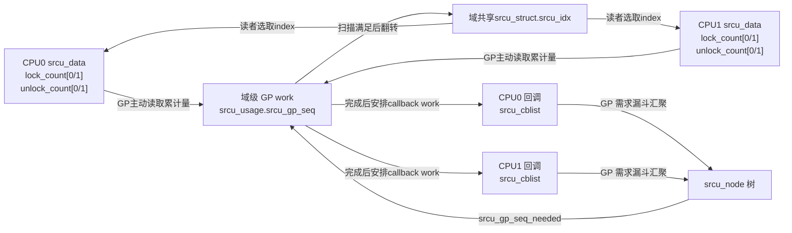
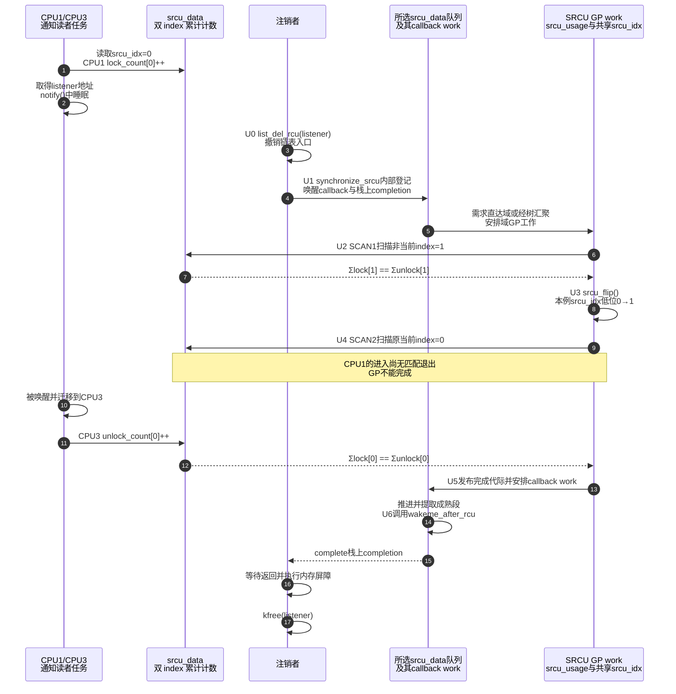

# 第18章\_SRCU\_私有域与双\_index\_状态机

前几章允许普通 RCU 读者被抢占和迁移，却没有允许它为了等待固件而主动睡眠。本章从一个可睡眠通知链开始：读者遍历监听器时要调用驱动函数，函数可能取得 mutex 或访问可睡眠总线。现在需要在睡眠前后继续借用监听器地址，又不想把整段等待塞进全局互斥锁。

**讲解层次：概念到实现的映射。** **可睡眠 RCU（Sleepable RCU，SRCU）** 用显式的私有保护域界定哪些读者要相互等待；这里以 Linux 6.12.20 的 Tree SRCU 后端说明该契约怎样兑现。它有自己的读侧计数和 GP，不是给普通 Tree RCU 加一个“允许睡眠”标志。读完可以判断注销为什么要等同一域、迁移后计数怎样归还，以及 GP 完成和回调执行为何仍是两件事。

## 18.1\_问题场景\_注销监听器时不能释放正在睡眠的回调对象

最直接的正确方案是持有通知链的 mutex，遍历并调用所有监听器；注销取得同一把锁后即可确信旧遍历已经退出。问题出现在多个设备并发通知、某个监听器又等待慢速 I/O 时：读者 A 持锁睡眠，读者 B 和注销者都堵在这一把锁上，即使 B 的监听器业务本可并行。

SRCU 让通知遍历登记一次读侧责任，然后释放 CPU 去睡眠；注销先从链表移除对象，再等待旧责任归还。这样通知遍历不再因链表锁而彼此串行，但 **监听器内部共享数据仍须自行同步**，SRCU 只保证借用期间对象不被过早释放。若通知很少、必须严格串行，原来的 mutex 方案仍可能更简单。

下面是供内核调用方嵌入的接口骨架，不是可直接加载的完整模块。假定监听器由 `kmalloc` 一类接口分配，发布前其 `notify` 和私有状态已经初始化；一个监听器只注册一次，由唯一拥有者注销一次，注销完成前不复用其链节点。总线本身由上层保活，调用均在允许睡眠的进程上下文进行。定义如下：

```c
struct event_listener {
	struct list_head node;
	void (*notify)(struct event_listener *listener, unsigned long event);
	/* 驱动私有状态，notify() 可能访问它。 */
};

struct event_bus {
	struct srcu_struct srcu;
	struct list_head listeners;
	struct mutex update_lock;
};
```

读者不是简单复制几个整数，而是取得 `event_listener` 的地址并调用它。这里的 `notify()` 是 **业务监听函数**，允许睡眠；它与稍后 `call_srcu()` 登记的回收 callback 不是同一类执行契约：

```c
static void event_bus_notify(struct event_bus *bus, unsigned long event)
{
	struct event_listener *listener;
	int idx;

	idx = srcu_read_lock(&bus->srcu);
	list_for_each_entry_rcu(listener, &bus->listeners, node,
				srcu_read_lock_held(&bus->srcu))
		listener->notify(listener, event); /* 允许主动阻塞。 */
	srcu_read_unlock(&bus->srcu, idx);
}
```

示例中的第四个条件告诉 RCU list 的 lockdep 检查：这里由指定的 SRCU 域而非普通 `rcu_read_lock()` 提供生命期保护。真正的保护仍来自进入/退出及注销等待协议，检查条件本身不会替程序取得保护。`notify()` 返回前不把裸指针交给超出本读侧寿命的异步任务；需要那样做时另取长引用。

注册和注销由 mutex 串行化；注销先切断可达性，再等待旧 SRCU 读者，最后释放：

```c
static void event_bus_register(struct event_bus *bus,
			       struct event_listener *listener)
{
	mutex_lock(&bus->update_lock);
	list_add_tail_rcu(&listener->node, &bus->listeners);
	mutex_unlock(&bus->update_lock);
}

static void event_bus_unregister(struct event_bus *bus,
				 struct event_listener *listener)
{
	mutex_lock(&bus->update_lock);
	list_del_rcu(&listener->node);
	mutex_unlock(&bus->update_lock);

	/* 必须在 update_lock 之外等待，旧 notify() 可能间接需要该锁。 */
	synchronize_srcu(&bus->srcu);
	kfree(listener);
}
```

初始化和销毁也属于生命周期协议：

```c
static int event_bus_init(struct event_bus *bus)
{
	INIT_LIST_HEAD(&bus->listeners);
	mutex_init(&bus->update_lock);
	return init_srcu_struct(&bus->srcu);
}

static void event_bus_destroy(struct event_bus *bus)
{
	/* 调用者先保证没有监听器、读者、更新者和待处理回调。 */
	cleanup_srcu_struct(&bus->srcu);
}
```

初始化返回 `0` 后才发布总线；失败时不允许调用其他 SRCU 操作，也不对未成功初始化的域调用 destroy。动态初始化与 `DEFINE_SRCU` 一类静态定义的生命周期约定不要混用。本示例的注销函数会释放 listener，不允许从该总线的 `notify()` 内直接调用它，否则会在 SRCU 读侧等待自己。

销毁前“没有使用者”须由上层关闭新入口并排空已进入调用来证明，单独清一个停止标志不够。本例逐个同步注销完监听器，还要等待总线上的空遍历、更新操作和外部引用结束；`cleanup_srcu_struct()` 是清理接口，不是强制终止并发读者的工具。若另加了 `call_srcu()` 回收路径，还要按 18.7 的步骤排空回调。

不能把 `synchronize_srcu()` 换成 `synchronize_rcu()`：后者等待普通 RCU 域，完全不知道这个 `srcu_struct` 中的进入/退出计数。总线 A 与总线 B 若有各自的 `srcu_struct`，等待 A 也不会替 B 完成回收。

## 18.2\_参与者和状态所有权

先考虑怎样登记一个可睡眠读者。把所有进入/退出都写到域的一个全局计数器上，能够表达“仍有人借用”，但多 CPU 会争写同一地址；读者又可能在睡眠后迁移，不能依赖“本 CPU 恢复调度”作为退出证据。Tree SRCU 因此把累计进入和退出写在各 CPU 的 `srcu_data`，扫描者再跨 CPU 求和。为什么需要两组计数留到 18.4 推导。

每个域的 `srcu_struct` 用 `sda` 指向每 CPU 存储，用 `srcu_sup` 指向该域的 `srcu_usage` 更新侧对象。后者保存 GP 序号、互斥锁和 delayed work；读者计数、GP 进度、callback 队列与工作调度是相互配合的几组状态，不是一个全局原子值。

还要分开 Tree SRCU 名称和实际是否已分配汇聚树：本版本的小形态可以没有 `srcu_node` 树，callback 先集中到启动 CPU 对应的 `srcu_data`；达到配置或争用策略条件后，才按受控阶段转为大形态。大形态分散 callback 队列并用树汇聚需求，避免许多请求者总争一处更新锁。代价是节点内存和切换期间的协调；读侧仍按所有 possible CPU 的计数扫描，不是将读者改成节点位图。

下面列出已建立角色的具体存储。回调树这一行只适用于节点已投入使用的形态，不能从每 CPU 都有 `srcu_data` 推断所有阶段都采用每 CPU 回调入队。

| 层次 | Linux 6.12.20 字段 | 谁写 | 谁读 | 含义 |
| --- | --- | --- | --- | --- |
| 域入口 | `srcu_struct.srcu_idx` | GP 工作 | 新读者 | 当前进入哪一组计数 |
| 每 CPU 读侧 | `srcu_data.srcu_lock_count[2]` | `__srcu_read_lock()` | GP 扫描 | 各 index 的累计进入次数 |
| 每 CPU 读侧 | `srcu_data.srcu_unlock_count[2]` | `__srcu_read_unlock()` | GP 扫描 | 各 index 的累计退出次数 |
| 更新侧队列 | `srcu_data.srcu_cblist`、`srcu_gp_seq_needed` | `call_srcu()` 路径，在该 `sdp->lock` 下修改 | SRCU work | 所选队列的回调及所需 GP；小形态选启动 CPU 队列 |
| 汇聚节点 | `srcu_node.srcu_have_cbs[]`、`srcu_data_have_cbs[]` | 漏斗提交与回调路径 | GP/work | 哪些子节点或 CPU 有特定 GP 的回调 |
| 域级更新侧 | `srcu_usage.srcu_gp_seq`、`srcu_gp_seq_needed` | GP/work | 请求者、轮询者 | 域的 GP 状态与目标 |
| 串行化 | `srcu_usage.srcu_gp_mutex` | GP/work | GP/work | 串行化双 index 扫描 |
| 完成交付 | `srcu_data.work`、`srcu_cblist_invoking`；同步等待者栈上的 completion | GP完成路径安排工作；回调工作执行唤醒函数 | 等待任务 | 安全代次完成后，等待自己的唤醒 callback 真正执行 |

特别注意：`srcu_node` 主要汇聚 **回调的 GP 需求和归属**，不是将读者计数逐层写进树。普通读者是否仍存在，最终由所有 `srcu_data` 中同一 index 的累计 lock 与 unlock 总和是否相等来判断。



图取树已投入使用的大形态，箭头“GP主动读取”表示远端扫描共享计数，不是每次 unlock 发一条通知。小形态的回调需求直接到域级更新状态，两种形态共用以下双 index 读者证明。固定版本的入口见 [RCU 源码总阅读索引](../../../../../research/source_reading/rcu/navigation/P01_Linux_6.12_RCU源码总阅读索引.md)。

## 18.3\_读者为什么能睡眠和迁移

以下是固定版本普通读侧的关键操作片段，完整函数及诊断包装见 [reader 累计账本](../../../../../research/source_reading/rcu/source_explanations/P11_Linux_6.12_Tree_SRCU源码实现.md#11.4_reader进入退出写的是累计账本)。它不把临界区全程固定在某个 CPU：

```c
idx = READ_ONCE(ssp->srcu_idx) & 0x1;
this_cpu_inc(ssp->sda->srcu_lock_count[idx].counter);
smp_mb();
return idx;
```

退出不是对原 CPU 的同一原子变量做减法，而是在 **当前 CPU** 增加累计退出次数：

```c
smp_mb();
this_cpu_inc(ssp->sda->srcu_unlock_count[idx].counter);
```

所以任务可以出现下面的执行：

```text
CPU1：lock_count[0] += 1
        ↓ 任务睡眠并迁移
CPU3：unlock_count[0] += 1
```

GP 扫描的是所有 **possible CPU** 的持久计数，包括当前离线 CPU 的记录。若只扫描 online CPU，可能漏掉离线前的进入，而退出已记在另一个 CPU。概念上需要检查同一 index：

```text
Σ lock_count[index] == Σ unlock_count[index]
```

实际比较并非任意时刻随便读两个和：扫描先累计 unlock，执行完整屏障，再累计 lock，配合两轮扫描和读侧屏障建立证据。一次配平说明扫描过程中的某个时刻没有该组已登记的未退出读者，不保证此后永远没有晚到的增量；完整安全性要由 18.4 的协议推出。SRCU 不要求退出发生在进入时的 CPU，但必须满足：

- lock/unlock 使用同一个 `srcu_struct`；
- unlock 使用 lock 返回的原 `idx`；
- 普通 `srcu_read_lock()` 与 unlock 在同一执行上下文配对，不能让 IRQ 或另一个任务代为 unlock。

睡眠和迁移仍是同一个任务上下文，不违反最后一条。跨上下文的 down/up 接口和 NMI-safe 接口另有契约，不属于这份普通通知链骨架；不能自行混用进入与退出版本。嵌套读侧也必须分别保存并归还各次返回的 index。

## 18.4\_为什么一组计数不够

若只有一组计数，旧读者和更新后不断到来的新读者会混在一起。在高频通知负载下，计数可能长期不归零；更新者无法只等待“删除之前已经进入”的读者。

两个 index 让新到读者逐步转入另一组，扫描者才有机会取得旧组配平证据；但“翻一下就等旧组”还不完整。一个任务可能已经读到 index，却在增加 lock 计数前被长时间延迟，因此同一时刻两组都可能有读者，不能把“非当前组”当成必然为空。Linux 6.12.20 的 `srcu_gp_seq` 低位状态因此分成：

```text
SRCU_STATE_IDLE → SRCU_STATE_SCAN1 → SRCU_STATE_SCAN2 → IDLE
```

本章完整周期记为 U0～U6，与普通 RCU 的 S 周期分开。沿同一个 listener 的撤销，表中同时标出谁推进、写到哪里，以及谁随后观察：

| 阶段 | 执行者与状态写入 | 后续观察及退出条件 |
| --- | --- | --- |
| U0 撤销入口 | 更新者在链表写锁下 `list_del_rcu()`，更新共享链指针 | 旧遍历仍可能持有 listener，不得立即释放 |
| U1 请求 | 调用者登记 callback/同步唤醒节点到所选 `srcu_data.srcu_cblist`，提交目标序号 | 必要时经节点树到 `srcu_usage.srcu_gp_seq_needed`；开始或搭上足以覆盖本请求的 GP |
| U2 SCAN1 | 域推进路径已令 `srcu_gp_seq` 进入 SCAN1；GP work 在 `srcu_gp_mutex` 下扫描非当前 index | 先读全 possible CPU 的 unlock、屏障、再读 lock；未配平则稍后重试，不翻转 |
| U3 翻转 | GP work 执行 `srcu_flip()`，增加共享 `srcu_struct.srcu_idx`，将序列状态改为 SCAN2 | 读者逐步观察新低位；不能假定所有旧 index 读取瞬间失效 |
| U4 SCAN2 | GP work 再扫描非当前 index，即翻转前的当前组 | 两组先后取得所需证据，结合屏障覆盖本轮旧读侧；仍不配平就重试 |
| U5 安全完成 | `srcu_gp_end()` 发布域级完成序列，安排相关队列工作 | callback work 后续推进成熟段，GP 完成不等于函数已经调用 |
| U6 交付 | `srcu_data.work` 执行成熟 callback；同步路径的 callback 完成栈上 completion | 等待任务观察完成、执行返回屏障，随后可以 `kfree(listener)` |

第一遍扫描不能省略。例如当前低位是 0，但一个延迟读者仍选用了此前的 1；它恢复并进入实际业务读侧后，可以在 1 组留下未配平进入。如果本轮只翻到 1 再等 0，就没有证明这个旧的 1 组读者已经退出。SCAN1 先处理该组，翻转后 SCAN2 再处理原当前组。

也不要把两轮解释成“两组从此绝对无人进入”：取 index 与记账不是不可分割的动作，晚到增量仍可能出现。读侧进入屏障、退出屏障、unlock→lock 的扫描顺序和 flip 前后屏障共同约束“仍能访问旧对象”与“扫描能看到其登记”的关系。表中的配平是整个协议的一部分，不能用一次无序统计或打印两个相等数字替代 SRCU GP。计数使用机器字累计值与相应回绕论证，也不是不断清零的当前人数。

## 18.5\_完整时序\_睡眠读者怎样阻止释放



步骤 1 的进入在 CPU1，步骤 11 的退出在 CPU3，配平依靠同一域的全 CPU 总和。步骤 9 发现未配平后不会让 updater 一直占 CPU 忙等；GP work 按普通/加急策略短暂重试或重新调度，读者退出只更新累计量，不逐个直接通知注销者。步骤 13 只是安全代次发布，步骤 14～16 才通过 callback 和 completion 把结论送到等待任务；这就是被“无需每次 unlock 唤醒”替代掉的扫描、工作调度与最终通知成本。

## 18.6\_同步等待和异步回调

`call_srcu()` 通过 `__call_srcu()` 填好回调函数，再由 `srcu_gp_start_if_needed()` 在所选队列锁下登记、赋予目标并提交需求。大形态的 `srcu_funnel_gp_start()` 沿节点树汇聚，小形态可直接到域级状态。调用返回不表示函数已经执行，也不保证它仍未执行，`rcu_head` 不能在尚未取得完成保证时重复入队。

**SRCU 的业务读侧可以睡眠，`call_srcu()` 的回收 callback 不能阻塞。** 本版本虽从进程上下文的工作项调用回收函数，调用期间仍关闭 BH，并要求函数快速返回；需要睡眠的后续清理应另行交给合适的工作机制，同时延长对象和模块寿命。不要因为两者都叫 callback，就把 `notify()` 的契约套到 `call_srcu()`。

`synchronize_srcu()` 最终也要把一个唤醒动作关联到 SRCU GP 并等待完成，但 Linux 6.12 还有 idle heuristic 和 expedited 分支，不能把源码机械压缩成永远固定的一条调用链：

```text
synchronize_srcu()
    ├─ srcu_might_be_idle() 或全局 expedited
    │      → synchronize_srcu_expedited()
    └─ 普通情况
           → __synchronize_srcu(ssp, true)
```

在正常调度运行阶段，两条路径最终在 `__synchronize_srcu()` 中创建栈上 completion，登记 `wakeme_after_rcu` 并睡眠等待；唤醒后还执行内存屏障。早期调度器尚未启动时有专门返回分支，不能拿它解释运行期等待。

共同语义不变：调用返回前，同一域中在调用前开始的 SRCU 读侧已经结束。加急主要改变重试和工作延迟策略，仍须等待旧读者；它不照搬普通 Tree RCU 的 IPI 取证，且 `synchronize_srcu_expedited()` 还受全局 normal 策略影响。idle 判断也只是启发式，不是“所有回收函数已经执行完”的证明。

## 18.7\_死锁与生命周期错误

SRCU 允许 reader 睡眠，不等于允许等待方在同一保护域内等待自己，也不等于 index 可以脱离取得它的域传播。下面三类错误分别破坏等待图、计数归还和域本身的生命期。

### 18.7.1\_在同一域读侧等待自己

```c
idx = srcu_read_lock(&bus->srcu);
synchronize_srcu(&bus->srcu); /* 错误：当前任务就是被等待的读者。 */
srcu_read_unlock(&bus->srcu, idx);
```

间接等待同样错误：读者等待 mutex，而 mutex 持有者正在执行 `synchronize_srcu()`。前面注销骨架把等待移到 `update_lock` 外，就是为了打断这条环；如果另有锁形成同样的闭环，单独释放这一把锁仍不够。跨两个 SRCU 域等待也须保证依赖无环，不能凭“不是同一域”免除死锁分析。

### 18.7.2\_用错域或用错index

```c
idx = srcu_read_lock(&bus_a.srcu);
/* ... */
srcu_read_unlock(&bus_b.srcu, idx); /* 错误：bus_a 的债务永不归还。 */
```

传错 index 会让一组出现多余 lock、另一组出现多余 unlock，GP 可能永久等待或破坏计数假设。

### 18.7.3\_只等GP却遗漏已排队回调

与普通 RCU 相同，`synchronize_srcu()` 等待旧读者，不等价于“此前所有 `call_srcu()` 回调已经执行”。销毁动态域之前，应先关闭并排空新的登记者、读者与更新调用，再用 `srcu_barrier()` 等待已经登记的 callback；callback 转交的工作还须另外排空，最后才调用 `cleanup_srcu_struct()`。

`cleanup_srcu_struct()` 虽会等待自己的工作项，却仍检查未归还读者、未执行 callback 与未完成 GP；发现违反前提时可警告并放弃释放相关内部状态。不能把这个错误兜底当成“它会替我排空任意业务”的契约，也不能因函数没有返回错误码就忽略告警。

## 18.8\_成本与选择边界

| 维度 | 普通 Tree RCU | Tree SRCU |
| --- | --- | --- |
| 读者高频状态写入 | 极少；主要是执行约束和必要慢路径 | 每次进入/退出都更新域的每 CPU 计数 |
| 主动阻塞 | 普通读侧禁止 | 允许 |
| 迁移 | 按普通 RCU 配置语义处理 | 允许；全 CPU 累计进入/退出可配平 |
| 等待范围 | 系统普通 RCU 域 | 指定 `srcu_struct` 私有域 |
| GP 判定 | CPU QS/EQS + 必要的任务债务 | 双 index 的两阶段全 CPU 计数扫描 |
| 扩展性状态 | `rcu_node.qsmask` 汇聚 QS | 大形态 `srcu_node` 汇聚回调需求；读计数仍在 `srcu_data` |

选择结论不是“SRCU 更高级”，而是：只有读者确实要睡眠，或必须隔离成私有域时，额外的进入/退出记账和 GP 扫描才值得。对只读几项字段就退出的高频路径，普通 RCU 通常更合适。

### 18.8.1\_在纸面上跟一次跨CPU归还

暂时固定其他读者不变化，只看 index 0 的累计量。CPU1 是 `lock=8、unlock=7`，CPU3 是 `lock=4、unlock=4`，其他 CPU 的进入/退出贡献恰好配平。先预测总差值，再让 CPU1 上进入的最后一个旧读者在 CPU3 退出。

初始全局差值是 `(8+4)-(7+4)=1`；退出后 CPU3 的 unlock 从 4 增到 5，全局差值成为 0。CPU1 自己仍差 1，CPU3 自己则多一次退出，所以逐 CPU 要求 lock=unlock 会得到错误的等待条件。这个固定账本练习只解释迁移与求和；实际并发扫描仍必须遵守屏障和双 index 协议。

继续预测三个变体：

1. 把 unlock 传入的 index 改为 1，会怎样？
2. 注销者只执行 `synchronize_rcu()`，能否由上面的计数推出 listener 可释放？
3. `srcu_gp_seq` 已达到目标，但唤醒 callback 的工作项还没有运行，同步注销者能否继续？

答案分别是：错误地归还另一组，0 组责任未消除且 1 组计数假设被破坏；不能，普通 RCU 的 GP 不检查这个域；仍不能，completion 尚未完成。第三题区分 U5 安全结论与 U6 对等待者的交付。

在目标内核只读核对后端时，可先查看配置：

```bash
# 目标Linux机器；文件缺失时使用对应内核构建产物中的.config。
grep -E '^(CONFIG_(SRCU|TREE_SRCU|TINY_SRCU|PROVE_RCU)=|# CONFIG_(SRCU|TREE_SRCU|TINY_SRCU|PROVE_RCU) is not set)' \
    /boot/config-"$(uname -r)"
```

该结果只确认构建选择和诊断配置，不显示某个业务域当前有多少读者，也不证明走过本章全部分支。不能把普通 RCU 的 trace 事件或一条无告警日志当成特定 SRCU 域完成的证据。本章骨架尚未构成可加载实验，实际并发通知和注销需要业务触发入口、线程退出与模块生命周期一同实现。

## 18.9\_Linux\_6.12.20源码证据

- [`include/linux/srcu.h`](../../../../../research/source_reading/linux/include/linux/srcu.h)：读侧接口、同域等待禁令和上下文配对契约。
- [`include/linux/srcutree.h`](../../../../../research/source_reading/linux/include/linux/srcutree.h)：`srcu_struct`、`srcu_data`、`srcu_node`、`srcu_usage` 和 `SRCU_STATE_*`。
- [`kernel/rcu/srcutree.c`](../../../../../research/source_reading/linux/kernel/rcu/srcutree.c)：`__srcu_read_lock()`、`__srcu_read_unlock()`、`srcu_flip()`、`srcu_advance_state()`、`srcu_gp_start()`、`srcu_gp_end()`、`call_srcu()` 与 `synchronize_srcu()`。
- 版本模块入口：[Linux 6.12 Tree SRCU 模块源码概念导读](../../../../../research/source_reading/rcu/navigation/P09_Linux_6.12_Tree_SRCU模块源码概念导读.md#9.1_先分清Tree_RCU与Tree_SRCU)。
- 唯一函数实现：[Linux 6.12 Tree SRCU 源码实现](../../../../../research/source_reading/rcu/source_explanations/P11_Linux_6.12_Tree_SRCU源码实现.md#11.2_源码符号覆盖账本)。其中 [reader 累计账本与扫描](../../../../../research/source_reading/rcu/source_explanations/P11_Linux_6.12_Tree_SRCU源码实现.md#11.4_reader进入退出写的是累计账本)、[双扫描 GP](../../../../../research/source_reading/rcu/source_explanations/P11_Linux_6.12_Tree_SRCU源码实现.md#11.6_双扫描GP状态机怎样推进)和 [同步/barrier 交付](../../../../../research/source_reading/rcu/source_explanations/P11_Linux_6.12_Tree_SRCU源码实现.md#11.9_synchronize_srcu怎样把异步callback变成同步等待)分别展开这里使用的实现结论。

现在可以解释一个显式 SRCU 读者怎样跨睡眠与迁移归还责任，但还没有解释“没有这些显式读锁、只关心任务是否离开某段执行轨迹”的等待。下一章由这个缺口进入 Tasks RCU。

上一篇：[Tree RCU CPU 热插拔与回调迁移](P17_Tree_RCU_CPU热插拔与回调迁移.md)。

下一篇：[Tasks RCU 任务轨迹宽限期](P19_Tasks_RCU_任务轨迹宽限期.md)。
