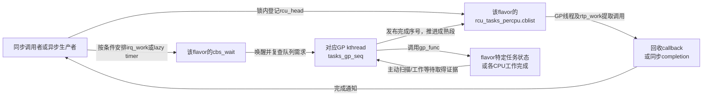
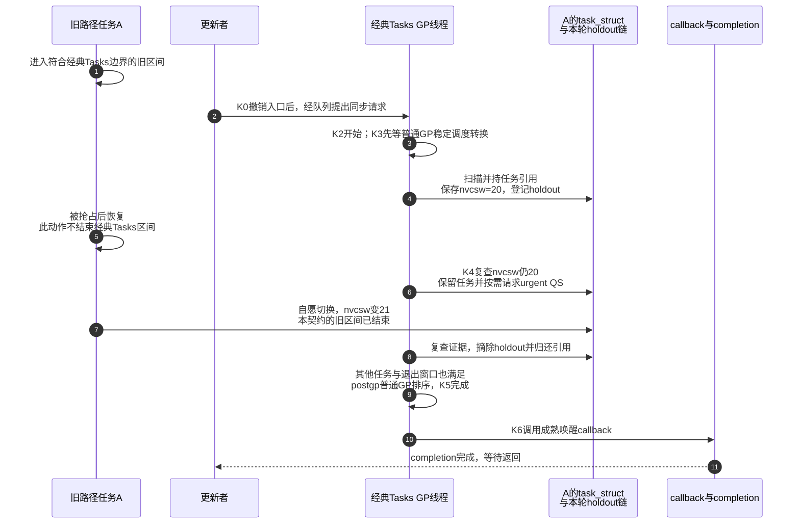
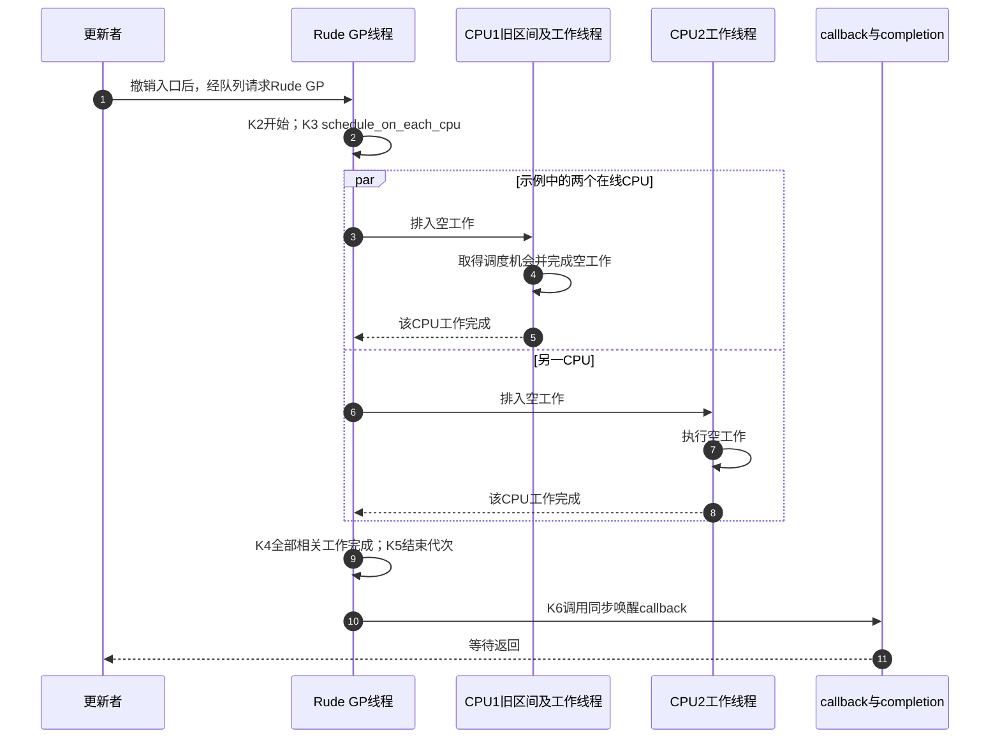
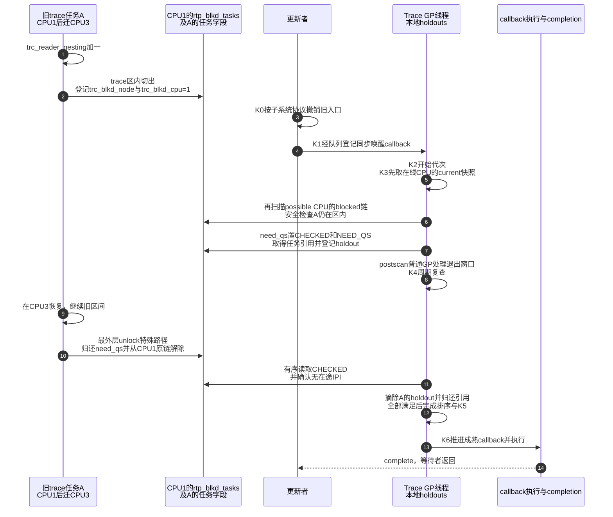

# 第19章\_Tasks\_RCU\_任务轨迹宽限期

上一章用显式读锁和私有域保护可睡眠的监听器。现在换一个入口：内核的函数跟踪设施要撤销一段执行跳板，而有的任务可能已进入旧路径。没有给这段路径配上普通 RCU 或 SRCU 读侧协议，仅等待它们的 GP，就不能自动证明旧路径已经安全结束。

**讲解层次：概念到实现的映射。** Tasks RCU 家族针对特定任务执行边界定义保护区间；本章依次从自然任务边界、主动调度边界和显式 trace 读侧推出三种 flavor，再映射到固定 Linux 6.12.20 的状态。flavor 在这里表示不同读侧集合与完成契约，不是三个可以按“更强、更快”排序的开关。

Tiny RCU 仍是普通 RCU 的单 CPU 实现，留到下一章；它不改变本章三种任务证明的语义。本章只讲等待证据，不把等待 GP 当成完成任意指令修改、指令缓存维护或解除模块引用的全套协议。

## 19.1\_为什么普通对象GP不能直接证明旧代码轨迹消失

**ftrace** 是 Linux 的函数跟踪设施；**BPF（Berkeley Packet Filter）** 是沿用历史名称的程序与内核执行设施，在本场景中用于跟踪挂接。**trampoline（执行跳板）** 是把执行流转接到被挂接函数的一段代码。设更新者通过相应子系统协议撤销旧跳板入口，任务 A 已经进入旧路径，但没有位于普通 `rcu_read_lock()` 包围的对象读侧：

```text
T0：任务A开始执行旧函数入口
T1：更新者发布新入口
T2：普通RCU GP完成
T3：任务A仍可能从旧入口返回路径继续执行
```

普通 RCU GP 只对其定义的普通 reader 集合负责。若旧代码路径没有落入该保护域，T2 不能自动证明任务 A 已离开旧指令范围。需要先定义 **什么任务状态足以结束当前受保护区间**，再围绕这一定义收集证据。

这项定义必须由真实调用路径成立。例如若区间在一次自愿调度以前就已结束，可以把自愿切换当作安全边界；若函数睡眠后仍会返回旧跳板，自愿切换就不够。即使强迫 CPU 换了一次任务，旧任务的返回地址也不会凭空消失。Tasks 家族只证明各自规定的边界，不负责把任意代码自动变成符合边界的读者。

## 19.2\_Tasks家族的共同角色与状态

先从共同的运输过程看起。更新者需要留下“请在某种任务边界都经过以后调用我”的请求，扫描者可能长时间等待，因此请求放入队列，由线程推进 GP，再把安全结论交付给 callback 或同步等待者。**holdout** 是“仍未取得安全证据的参与者”这一待观察集合，不表示任务一定有错误。

Linux 6.12.20 复用控制代码，但 `rcu_tasks`、`rcu_tasks_rude`、`rcu_tasks_trace` 是不同的全局控制对象，具有各自的 `tasks_gp_seq`、线程和队列。它们不共用一条 GP，也不像 SRCU 那样让调用者传入任意私有 `srcu_struct`。

版本化阅读从 [RCU 源码总阅读索引](../../../../../research/source_reading/rcu/navigation/P01_Linux_6.12_RCU源码总阅读索引.md) 进入；本章直接核对的原件为固定提交的 `kernel/rcu/tasks.h`、`include/linux/rcupdate.h` 和 `include/linux/rcupdate_trace.h`，详细模块入口在 19.8。

| 角色 / 状态地址 | 写入者与读取者 | 主要职责 |
| --- | --- | --- |
| 各 flavor 的 `struct rcu_tasks`：`tasks_gp_seq`、`tasks_gp_mutex`、`gp_func` | GP推进者写序号；请求和队列推进路径读 | 串行推进该 flavor 的 GP，选用其证明函数 |
| `rcu_tasks_percpu.cblist` 与其 `lock` | 调用者锁内登记；GP/回调工作锁内推进和提取 | 保存异步请求；有效队列可聚合，名字叫percpu不等于每个请求必进当前CPU队列 |
| `rtp_irq_work`、`lazy_timer`、控制对象 `cbs_wait` | 入队路径留下通知；IRQ work或定时器唤醒GP线程 | 合并通知和延迟批量化，同步唤醒callback走急迫路径 |
| GP函数本地 `holdouts` 链表及任务上的链节点 | GP扫描者登记、复查和移除，并持有任务引用 | 保存本轮尚未取得证据的任务；Rude的证明函数不使用这份任务扫描 |
| `task_struct` 的普通Tasks或Trace字段 | 调度/读侧路径写局部状态；扫描者按对应同步协议读取 | 存放实际完成证据，下面分别展开 |
| `rcu_tasks_percpu.rtp_work` 与同步等待者completion | GP线程/工作队列执行成熟callback；callback完成通知 | 将安全结论交付给等待者，与GP序号完成分开 |

队列聚合减少低负载时扫描许多空队列的代价，争用时又可扩大入队分布；这改变运输成本，不改变 flavor 的完成契约。共同骨架只说明“怎样启动证明和交付 callback”，三种 flavor 的核心差异仍在“什么叫证明完成”。



### 19.2.1\_K0到K6\_同一请求的公共交付周期

| 阶段 | 状态与执行者 | 完成条件及后续读取者 |
| --- | --- | --- |
| K0 撤销入口 | 子系统更新者按其代码/对象协议阻止新的旧路径访问 | 仍须等待已经进入的执行，GP不代替入口撤销 |
| K1 登记 | 调用者在所选队列锁下追加 `rcu_head` | IRQ work、lazy timer或已有活动线程使需求可被观察 |
| K2 开始 | GP线程复查队列并在 `tasks_gp_mutex` 下开始 `tasks_gp_seq` | `gp_func` 进入对应flavor的取证流程 |
| K3 建立观察 | Tasks/Trace登记并引用holdout任务；Rude安排各CPU工作 | 状态位置和遗漏任务的补充路径由flavor定义 |
| K4 等待 | Tasks/Trace周期复查、必要探测；Rude等待工作完成 | 不再有本轮未证明的参与者，并完成相应收尾排序 |
| K5 安全发布 | GP推进者结束 `tasks_gp_seq` | 队列推进者可把满足目标的callback移为成熟 |
| K6 交付 | GP线程及后续 `rtp_work` 提取并执行callback，结算总数 | 同步callback完成completion，等待者返回；异步业务按自己的完成协议继续 |

表取正常运行、GP线程已建立的路径；中期启动仍有调用者直接推进一轮的分支，不能把线程尚未出现解释成任何时候都可以同步等待。回调调用期间关闭 BH，必须快速且不能阻塞，线程可以在回调之间让出 CPU。等待一个 GP也不等于排空全部已登记callback，Tasks和Trace分别有对应barrier接口。

## 19.3\_经典Tasks\_RCU等待任务经过可证明边界

经典 Tasks RCU 没有要求调用者在每段受保护路径外显式写一对普通读锁。契约把 **自愿上下文切换**、`cond_resched_tasks_rcu_qs()` 显式静止点、进入用户态或 idle 等作为区间边界；单纯被抢占不算。调用方必须确保自己要保护的那段执行确实在这些边界结束，否则换一个 GP 名称没有意义。

证明思路是：

1. GP 边界之后才开始运行新路径的未来任务不属于旧集合；
2. GP 边界前已存在的任务先被保守列入观察范围；
3. 某任务经过 flavor 认可的边界后，其按此契约定义的旧区间已经结束；
4. 所有 holdout 都被排除后，本轮 Tasks GP 才完成。

实现需要保守建集合，不能从“当前没在 CPU 上运行”直接排除任务。A 可能已经执行旧入口，随后被抢占并留在运行队列；它的 `on_rq` 仍为真，旧区间并未因此结束。

K3 扫描前，`rcu_tasks_pregp_step()` 先调用普通 `synchronize_rcu()`，等待调度器那些在关中断区进行的 `on_rq/nvcsw` 转换稳定，再遍历任务。对需要观察的任务，扫描者用 `get_task_struct()` 保活，将 `t->nvcsw` 的自愿切换次数保存到 `t->rcu_tasks_nvcsw`，设置 `rcu_tasks_holdout`，并把 `rcu_tasks_holdout_list` 接入本轮本地链表。这些任务引用保护扫描者持有的任务对象，不是对被回收跳板的引用。

K4 复查主要比较三种证据：静止点路径已清 `rcu_tasks_holdout`、`nvcsw` 与快照不同、任务已经不再属于需要观察的可运行集合；NO_HZ_FULL 还利用 `rcu_tasks_idle_cpu` 等扩展静止状态。证据成立才摘掉本轮链节点并归还任务引用。没有证据时请求 urgent QS 并稍后复查，不能替旧任务提前结束区间。

只遍历全局任务链还会漏掉正在 `do_exit()` 中、已从任务链移除的对象。本版本用每 CPU 的 `rtp_exit_list` 和任务的 `rcu_tasks_exit_list` 补这段窗口，随后 K4 收尾再等一个普通 RCU GP，覆盖退出末尾的不可抢占区并提供所需排序。这里的普通 GP 是 Tasks 证明中的一个环节，不是说最初单独调用一次普通 GP 就能取代整套 Tasks 扫描。

例如 A 的 `nvcsw` 快照为 20。它被抢占后重新运行，快照和当前值仍为 20，不能删除；以后它自愿睡眠，当前值变成 21，复查才取得本 flavor 所需证据。即使没有每次事件直接唤醒 GP 线程，周期扫描仍要读取远端任务状态，成本没有消失。



步骤 5 的抢占和步骤 7 的自愿切换具有不同证明意义；步骤 8 也不是删除 `task_struct`，而是归还扫描者持有的那份任务引用。步骤 9 保留退出窗口和排序责任，不能把“holdout链空了”直接写成整个调用已经返回。

## 19.4\_Tasks\_Rude用系统扰动换取简单边界

如果调用方的受保护区间连 **任何上下文切换** 都不能跨越，就可以用更粗的 CPU 调度边界取证。Tasks Rude 的固定实现调用 `schedule_on_each_cpu(rcu_tasks_be_rude)`：让各在线 CPU 执行一个空工作并等待这些工作完成。空函数没有业务操作，它的意义是让工作线程实际取得执行机会，从而建立所需调度边界；Rude 不执行经典 Tasks 的逐任务 holdout 扫描。

假设 CPU1 正在执行不能被该调度边界打断的旧区间，安排的工作必须等它结束后才能运行。代价是把本来空闲或正做无关工作的 CPU 也拉入这次调度和跨 CPU 通信。若任意可抢占旧函数在切换后还能恢复并访问旧代码，单凭这次空工作不能使它安全；那条路径就不符合上述使用前提。

它与经典 Tasks 的比较应放在同一场景中：

| 比较项 | Tasks | Tasks Rude |
| --- | --- | --- |
| 观察对象 | 任务及其自然执行边界 | 在线 CPU 上的调度边界 |
| 推进方式 | 扫描任务状态并周期复查，必要时请求QS进展 | 主动让CPU执行调度工作并等待完成 |
| GP 延迟 | 可能被迟迟不经过边界的任务拉长 | 通常更主动，但系统扰动更大 |
| 适用范围 | 能以任务轨迹定义安全条件的路径 | 少数需要粗粒度强制边界的内部场景 |

Tasks Rude 不是“总是更快的 Tasks”。它改变了成本位置和观察粒度，仍必须由具体调用方契约证明适用。

公开同步入口是 `synchronize_rcu_tasks_rude()`；本版本的 `call_rcu_tasks_rude()` 是 `tasks.h` 内部的 static 辅助函数，不应在业务示例中当成导出的普通模块 API。三种 flavor 复用 callback 运输代码，不意味着它们导出完全相同的接口集合。



步骤 4、7 取得的是调度边界证据，不是逐个任务栈已清空；图只列两个在线 CPU，实际范围由接口在相应热插拔保护下确定。如果任务的合法读侧可以跨这个边界，便应进入下一节的显式 Trace 协议，不能用增加空工作次数补救契约不匹配。

图描述辅助工作存储分配成功的路径。固定版本的 `schedule_on_each_cpu()` 先分配 per-CPU 工作对象，失败可返回 `-ENOMEM`；而 `rcu_tasks_rude_wait_gp()` 没有检查这个返回值。这是核对该版本时需要单独保留的失败路径缺口，不能把正常图外推成“分配失败也完成了逐CPU工作”。本章不修改外部内核，也未通过故障注入验证该边界。

## 19.5\_Tasks\_Trace为什么需要显式trace读侧

Sleepable BPF 或 tracing 路径可能合法地跨越调度和阻塞。此时一次自愿切换不表示旧区间已经结束，前两节的边界都不合适。Tasks Trace 用显式 `rcu_read_lock_trace()` / `rcu_read_unlock_trace()` 建立另一个读侧集合，嵌套深度保存在当前任务的 `trc_reader_nesting`。

最简单的想法是 GP 线程直接读取所有任务的深度，但正在运行的任务会同时进入/退出；远端一次读到 0 不能代替整套排序协议。固定实现分开处理：能够借调度器锁定检查的非运行任务，可以检查稳定深度；运行任务若不能通过配置允许的重型读侧/EQS 证据证明已静止，先保留在 holdout，达到探测条件后向其运行 CPU 发 IPI，由该 CPU 检查当前任务。

更早的缺口在于如何找到已阻塞的旧读者。任务在 trace 区内切出时，调度路径把它的 `trc_blkd_node` 接入当时 CPU 对应的 `rcu_tasks_percpu.rtp_blkd_tasks`，并保存 `trc_blkd_cpu`。因此本版本 K3 先在热插拔读锁保护下取得各在线 CPU 的 current 快照，再检查所有 possible CPU 的 blocked-reader 链；它不再每轮遍历全部任务，公共框架中的 `pertask_func` 在这个 flavor 为 NULL。先 current、再 blocked 的顺序与调度登记协议共同封闭切换窗口。

读者被安全检查为仍在区内时，观察者将其 `trc_reader_special.b.need_qs` 从未检查状态改为 `CHECKED | NEED_QS`。读者最外层退出的特殊路径再把它变成仅 `CHECKED`，并按 `trc_blkd_cpu` 找回原 blocked 链删除节点；任务迁移不改变原登记链的位置。GP 复查者还要确认该任务没有在途 IPI，才能摘掉自己的 holdout 节点并归还任务引用。

| 状态地址 | 写入者 | 读取者与含义 |
| --- | --- | --- |
| `task_struct.trc_reader_nesting` | 本任务读侧进入/退出 | 安全检查路径观察深度；负值是退出过渡状态，须重试，不能当作已退出 |
| `trc_reader_special.b.need_qs` | 检查者以cmpxchg登记需要QS；读者特殊退出路径归还 | GP有序读取：0尚未检查，`CHECKED|NEED_QS`仍等待，只有`CHECKED`表示该项证据成立 |
| `trc_blkd_node`、`trc_blkd_cpu`、`blocked` 与 per-CPU `rtp_blkd_tasks` | 调度登记；读者特殊退出在对应队列锁下解除 | K3找到不在CPU上运行的旧显式读者 |
| `trc_holdout_list` 与GP本地holdouts | GP登记/删除，配对任务引用 | 本轮尚待证明集合，与blocked链是两个不同用途的链 |
| 任务 `trc_ipi_to_cpu` 和每CPU `trc_ipi_to_cpu` | GP发起探测，IPI结束时release清除 | 避免重复探测，并保证解除任务引用前IPI已交接 |

下图选取一个已阻塞、随后在另一 CPU 恢复的旧读者，展示局部深度怎样成为共享登记，又怎样被本轮扫描消除：



步骤 2 建立跨调度存活的共享登记，步骤 6、7 将它纳入本轮证明，步骤 10 在原链归还责任。这里 unlock 没有直接唤醒 GP 线程；步骤 11 的周期复查读取已发布状态，步骤 14 才把最终完成送到同步调用者。任务存在于 blocked 链与存在于本轮 holdout 链是两种关系，不能共用一个“已报告”布尔值代替。

对于仍在运行的任务，K4 的另一条分支是在延迟条件满足后发出异步 IPI。若 IPI 到达时 current 已不是预期任务，处理器只清探测在途标志，GP以后重查，不能把“IPI已执行”当作旧任务已退出；若读到负深度也重试；若深度为正则登记 `NEED_QS` 等待真正 unlock。`CONFIG_TASKS_TRACE_RCU_READ_MB` 可用读侧屏障换取特定远端静止证据，减少部分探测，但不是一概免除 IPI。退出任务还由 postscan 的普通 GP 与退出hook封闭遗漏窗口。

这与 PREEMPT_RCU 的 blocked-task 机制有相似外形，但前者服务普通对象读侧，Tasks Trace 服务显式 trace 读侧。字段相似不能推出 GP 可互换，也不能在自己的 trace 区内等待 `synchronize_rcu_tasks_trace()`，那会把自己列为无法结束的旧读者。

## 19.6\_三种flavor的模块差异

| 模块 | 共同职责 | Tasks | Tasks Rude | Tasks Trace |
| --- | --- | --- | --- | --- |
| 请求交付 | 接收同步/异步 GP 需求 | 共享 Tasks 控制骨架 | 共享 | 共享 |
| 旧集合建立 | 找出边界前可能仍相关的执行 | 全局任务扫描加退出链补充 | 面向在线CPU安排工作 | 在线current快照加possible CPU的blocked链 |
| 正常证据 | 移除 holdout | 自愿切换、user、idle 等 | CPU 经强制调度边界 | trace reader 退出或可证明不在旧区 |
| 主动推进 | 处理迟延参与者 | 周期复查和urgent QS请求 | `schedule_on_each_cpu()`等待空工作 | 安全检查、周期复查、必要探测/IPI |
| 主要代价 | 完成安全证明 | 扫描和潜在长 GP | 跨 CPU 扰动 | 每任务状态、扫描和探测 |

共用骨架不应被复制三遍；实现阅读应围绕“flavor 钩子怎样改变旧集合和完成条件”比较。

## 19.7\_与普通RCU或SRCU组合时怎样判断

同一对象可能同时面对多种访问入口：

- 数据结构通过普通 RCU 指针被查找；
- 对象内代码或 trampoline 正被 Tasks Trace reader 执行；
- 控制路径又通过 kref 持有长引用。

此时必须分别关闭每个保护域，不能选一个听起来最强的 GP 代替其余条件。安全释放条件可能是：

```text
普通RCU对象reader结束
    并且
Tasks Trace旧代码reader结束
    并且
所有长期引用归零
```

具体子系统若只需要其中一项，就不应机械叠加全部等待；选择依据是实际入口和对象所有权。

## 19.8\_源码证据与版本边界

Linux 6.12.20 的 Tasks 家族核心实现在 `kernel/rcu/tasks.h`，代表性 BPF/ftrace 调用方分布在对应子系统。进入源码前先读 [Tasks RCU 模块源码概念导读](../../../../../research/source_reading/rcu/navigation/P10_Linux_6.12_Tasks_RCU模块源码概念导读.md#10.1_模块问题与三个flavor)，按“共享控制骨架 → flavor 钩子 → 任务/CPU证据 → callback 完成”顺序核对。

本仓库当前没有为 `tasks.h` 每个函数体建立独立逐行实现文档，因此本章只使用已核对源码树的模块级结论，不虚构唯一函数讲解入口。新增实现讲解前，应继续遵守同一函数体只展开一次的证据规则。

本章依据固定 NXP 提交 `dfaf2136deb2af2e60b994421281ba42f1c087e0` 的实际函数体核对，不能把邻近旧注释中的“单队列”“直接唤醒”套回已经改变的实现。尤其是 Trace 的 `rcu_read_unlock_trace_special()` 在本版本更新任务状态和blocked链，完成判断由 `check_all_holdout_tasks_trace()` 复查；读侧接口位于 `include/linux/rcupdate_trace.h`。源树身份与核对记录见 [Linux 源码基线](../../../../../research/source_reading/linux/SOURCE_BASELINE.md)。

## 19.9\_选择与验收

面对调用点，先回答：

1. 保护的是对象地址，还是任务可能继续执行的旧代码轨迹；
2. 旧轨迹是否能用自然任务边界证明结束；
3. reader 是否有显式 trace 临界区并允许跨阻塞；
4. 调用方是否真的接受 Tasks Rude 的跨 CPU 调度扰动；
5. 是否还存在普通 RCU、SRCU 或引用计数提供的另一层生命期。

读完后不应再把 Tasks、Tasks Trace 和 Tiny RCU 放在同一“实现大小”列表中。前两者改变保护域和证明对象；Tiny 只改变普通 RCU 在单 CPU 上的底层组织。

### 19.9.1\_先判断证据再看线程是否存在

先用三次预测检验契约：

1. A 被抢占又恢复，`nvcsw` 没变。经典 Tasks 可以仅凭发生过切换就清除它吗？
2. Trace 探测 IPI 到达 CPU1 时 A 已迁到 CPU3，handler在CPU1执行完了。是否证明 A 的旧读侧已退出？
3. Rude 已让所有在线 CPU 完成空工作，一个允许跨睡眠的 Trace 读者仍未 unlock。能否跳过 Trace 等待？

答案均为不能。第一题只有非自愿抢占，没有本 flavor 的边界证据；第二题只完成一次失配探测，清除在途标志后必须重查；第三题的空工作与显式读侧寿命不在同一证明轴。另一个实用预测是：Trace 已发布完成序号，但同步callback尚未执行时，等待者仍不能返回，这属于K5到K6的交付延迟。

目标系统上先只读核对配置：

```bash
# 目标Linux机器；配置文件不存在时核对该内核的构建产物。
grep -E '^(CONFIG_(TASKS_RCU|TASKS_RUDE_RCU|TASKS_TRACE_RCU|TASKS_TRACE_RCU_READ_MB)=|# CONFIG_(TASKS_RCU|TASKS_RUDE_RCU|TASKS_TRACE_RCU|TASKS_TRACE_RCU_READ_MB) is not set)' \
    /boot/config-"$(uname -r)"
```

这一步确认哪些实现及重型读侧策略已编入。随后可以查看线程：

```bash
# 目标Linux上使用procps的ps，只读查找Tasks GP线程。
ps -e -o pid,psr,comm | grep rcu_tasks
```

`pid` 是进程标识，`psr` 是最近运行的CPU而不是允许CPU集合；线程名也可能被工具截断。线程存在只证明执行角色已创建，不证明有实际请求、某个旧读者被覆盖或相应 GP 已完成。真实子系统测试还要保留入口撤销、读侧边界、GP目标与完成交付的配对证据；本章不提供任意修改跟踪跳板的实验命令。

上一篇：[SRCU 私有域与双 index 状态机](P18_SRCU_私有域与双_index_状态机.md)。

下一篇：[Tiny RCU 单 CPU 实现](P20_Tiny_RCU_单CPU实现.md)。
