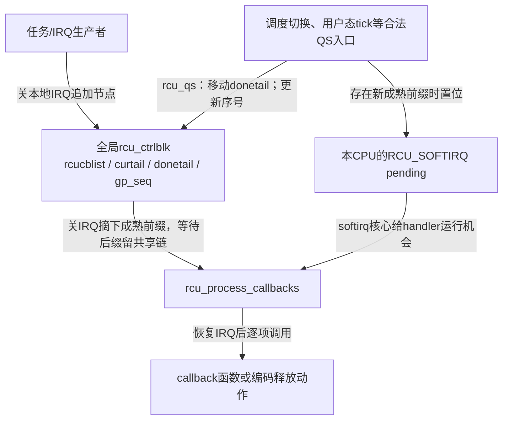
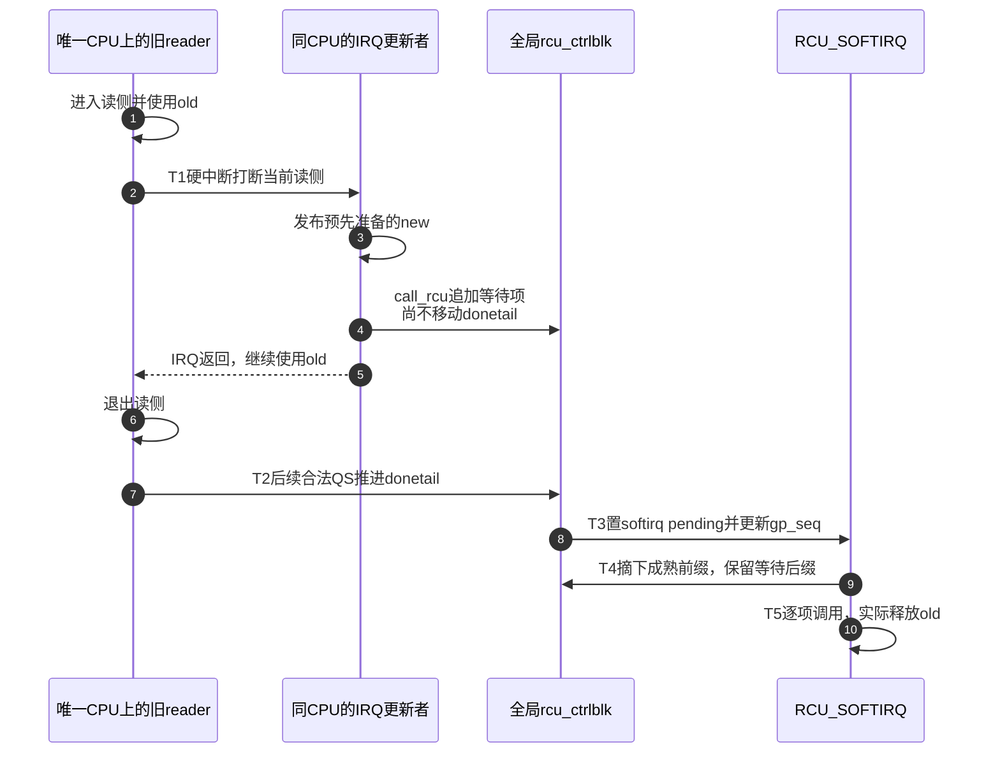

# 第20章\_Tiny\_RCU\_单CPU实现

上一章讨论 Tasks 家族怎样定义旧执行区间。本章回到 **普通 RCU 公共契约**，只改变部署条件：当内核是单 CPU、非 PREEMPT_RCU 构建时，Tiny RCU 可以删除 Tree RCU 的跨 CPU 汇聚树和长期 GP 协调复杂度。但一个旧读者仍可能被本 CPU 的中断打断，中断中的更新者又可能登记回收，这个时间交错还必须正确处理。

Tiny 不是应用在运行时选择的轻量 flavor。相同的普通 RCU 调用点由 Kconfig 选择底层实现，调用者仍需遵守 P03 的发布、取得和回收协议。

本章所说的 QS 仍是足以排除本轮旧普通读者的静止态事件，不是“CPU 暂时没有工作”。下面先推导单 CPU 可以省掉什么，再把保留下来的回调等待映射到固定 Linux 6.12.20 的一个控制块、两个边界指针和本地 softirq。

## 20.1\_单CPU删除了什么问题

Tree RCU 之所以需要 `rcu_node` 树，是因为多个 CPU 各自可能包含旧 reader，证据需要避免集中争用并逐层汇聚。单 CPU 构建中：

- 同一时刻只有一个 CPU 执行内核代码；
- 不存在来自其他 CPU 的并行旧 reader；
- 不需要为多个 CPU 建立 `qsmask` 位图或父子节点传播；
- 不需要用缓存一致性在 CPU 间搬运节点状态。

但单 CPU 并没有删除时间问题。旧 reader 与 callback 仍可能在时间上先后交错，所以实现仍需区分“还在等 QS”和“已经可执行”的回调集合。

非 PREEMPT_RCU 读者不能跨合法任务调度继续持有普通借用；但关抢占不等于关硬中断。因此可以出现“任务持有 old → IRQ 打断并发布 new、登记 old 的回收 → IRQ 返回 → 原任务继续使用 old”。若 `call_rcu()` 当场释放 old，就会在同一个 CPU 上造成释放后使用。无 SMP 只排除了远端并行，没排除这种嵌套执行。

## 20.2\_共同契约与Tiny状态的映射

**讲解层次：实现层，固定 Linux 6.12.20 的 Tiny RCU。** 原来的每 CPU 队列可以收为一个全局队列，跨 CPU 的树和位图不再需要。`struct rcu_ctrlblk` 是这里的控制块类型；同名静态实例保存队首、成熟边界、入队尾槽和供轮询观察的序号。先把这些职责与已经学过的 Tree 路径比较：

| 普通 RCU 问题 | Tree RCU 的代表实现 | Tiny RCU 的简化 |
| --- | --- | --- |
| 谁可能仍是旧 reader | 多 CPU + 可选被抢占任务 | 当前唯一 CPU 上的非抢占读侧 |
| 怎样得到 QS | 每 CPU 调度/EQS证据再汇聚 | 唯一 CPU 经过合法 QS |
| 怎样保存回调 | 每 CPU `rcu_segcblist` 与节点/GP代际 | 一个静态 `rcu_ctrlblk`，一条链和两个指针槽边界 |
| 怎样发布成熟资格 | 全局 GP 完成后推进分段 | QS 到达时移动待等待/可调用边界 |
| 怎样执行 callback | softirq、`rcuc`、NOCB线程 | `RCU_SOFTIRQ` 调用 `rcu_process_callbacks()` |

Tiny 的正确性没有来自“代码很少”，而来自单 CPU 和非抢占读侧这一组更强部署前提。

| 控制块字段 | 保存什么 | 修改者与同步 | 谁随后读取 |
| --- | --- | --- | --- |
| `rcucblist` | 共享callback链首节点地址 | 入队或softirq摘链，本地IRQ保护 | softirq取得成熟前缀 |
| `curtail` | 末尾可写指针槽地址，如 `&B.next` | `call_rcu()` 在关本地IRQ区追加，softirq在全摘空时复位 | 下一次入队、QS路径 |
| `donetail` | 成熟前缀后的指针槽地址；等于 `&rcucblist` 表示无成熟项 | QS令其追上curtail；softirq摘下成熟前缀后复位 | softirq判定和截断成熟链 |
| `gp_seq` | 供poll接口观察的机器字进展值 | `rcu_qs()` 或合法 `synchronize_rcu()` 增加2，使用对应本地执行约束 | get/poll接口，不是callback完成计数 |

两种 tail 都是 **指针槽的地址**，不是“最后一个节点本身”。例如 A 已成熟、B 仍等待时，链是 `A → B → NULL`，`donetail=&A.next`，`curtail=&B.next`。softirq从 A 开始取成熟前缀，把共享队首改成 B，再将 `A.next=NULL` 截断；不能把边界移成“B节点已成熟”。



本地 IRQ 保护用于避免同一 CPU 上的入队、边界更新和摘链互相打断；它不是跨 CPU 锁，也不意味着 callback 全程关中断执行。进入固定源码可从 [RCU 源码总阅读索引](../../../../../research/source_reading/rcu/navigation/P01_Linux_6.12_RCU源码总阅读索引.md) 继续查 [Tiny 控制块与指针槽](../../../../../research/source_reading/rcu/source_explanations/P13_Linux_6.12_Tiny_RCU源码实现.md#13.5_一个链表和两个二级指针怎样表达三种状态)。

## 20.3\_一次Tiny回调周期

回到任务正在使用旧对象、被硬中断打断的场景。这里假定 IRQ 更新者只做已准备好的指针发布与异步登记，不进行睡眠分配，也没有与其他更新者冲突；业务写侧序列化另行成立。它不是第二个并行 CPU。

| 阶段 | 执行者与状态变化 | 安全含义与退出条件 |
| --- | --- | --- |
| T0 reader进入 | 唯一CPU的任务取得old并进入普通读侧 | 旧对象必须保留，合法任务切换不能越过该读侧 |
| T1 发布并登记 | IRQ发布new，`call_rcu()`写 `head->func/next`，在关IRQ区追加到curtail | 源任务仍可能恢复使用old；只登记，不成熟 |
| T2 QS处理 | 任务退出后，后续合法QS调用 `rcu_qs()`，donetail追上当前curtail | QS之前的等待前缀获得成熟资格 |
| T3 通知与序号 | 同一次 `rcu_qs()` 必要时置softirq pending，并增加gp_seq | 通知执行者有成熟工作；尚未执行回调，T2/T3不表示两个独立GP |
| T4 摘链 | softirq在关IRQ区把donetail之前的前缀移到本地链，并修复共享边界 | QS之后新入队且未再经历QS的后缀仍留在共享链 |
| T5 调用 | softirq恢复原IRQ状态，遍历本地成熟链调用函数 | 回收函数实际释放old，之后才能依据其完成协议观察结果 |



步骤 5 是单 CPU 仍不能立即释放 old 的关键：IRQ 完成以后，原读者还会恢复。步骤 6 退出普通读侧本身也不是无条件直接执行回收；步骤 7、8 再由合法QS冻结批次并通知，步骤 9、10 才摘链和调用。QS证据、成熟资格与实际执行仍要区分。

本版本的调度切换钩子会调用 `rcu_qs()`，来自用户态的调度tick也可报告；若tick打断的是内核执行，`rcu_sched_clock_irq()` 对等待callback设置重调度需求，而不把这次内核tick本身冒充QS。生产者在idle任务中登记时也会催促调度。不要把“发生了任意中断”画成成熟条件。

考虑 A 在第一次 QS 前已入队，B 在 QS 后、softirq运行前才追加：`donetail=&A.next`，`curtail=&B.next`。T4摘下A并保留B，B要等后续QS。如果B到来后、softirq运行前又经历一次合法QS，边界当然可再前移；边界取决于真实事件，而不是固定按节点编号每次只处理一个。

## 20.4\_为什么同步等待可能看起来几乎为空

在合法的进程上下文调用 `synchronize_rcu()` 时，调用者已经位于普通读侧之外。另一个任务若仍处于不能被任务调度越过的旧读侧，就不可能同时把这个唯一 CPU 交给当前调用者；此前的中断/softirq读者也必须先返回，当前进程才能继续运行。因此合法调用现场本身已经排除了调用前的旧读者，不要求这个函数“先主动调度一次”。

固定版本的函数检查非法读侧嵌套，再在禁止抢占的局部区域把 `rcu_ctrlblk.gp_seq` 加2。它没有等待GP线程，也没有在函数体中执行注释里提到的 `might_sleep()`；应以实际代码为准。公共同步API的上下文约束仍然保留，不能据Tiny实现很短就在IRQ里调用，尤其不能在打断旧读者的IRQ里自行宣布它已经结束。

不能据此推出：

- `synchronize_rcu()` 在所有配置下都是空操作；
- callback 可以在入队后立即执行；
- 单 CPU 上允许 reader 把裸指针带出读侧；
- Tiny 的结论可以外推到 SMP 或 PREEMPT_RCU。

看似很轻的同步路径依赖的是强构建条件，而不是 API 放弃了旧 reader 语义。

还有一个容易遗漏的区别：这个同步函数更新poll序号，但不会像 `rcu_qs()` 那样移动 `donetail` 或直接运行callback。因此调用它以后，即使轮询观察到进展，也不能声称此前排队的回收函数已执行。`get_state_synchronize_rcu()` 只取cookie，`poll_state_synchronize_rcu()` 检查完成标记或序号变化；`start_poll_synchronize_rcu()` 另在idle调用时催促调度。

`rcu_barrier()` 则通过 `wait_rcu_gp(call_rcu_hurry)` 在单条队列尾部登记唤醒节点并等待其completion，取得此前callback已实际执行的证据；销毁者仍须先关闭新的生产者。Tiny的加急同步入口直接复用普通同步函数，没有另建IPI加急证明。具体落点见 [同步与poll](../../../../../research/source_reading/rcu/source_explanations/P13_Linux_6.12_Tiny_RCU源码实现.md#13.11_synchronize_rcu立即返回不等于没有宽限期语义) 和 [barrier交付](../../../../../research/source_reading/rcu/source_explanations/P13_Linux_6.12_Tiny_RCU源码实现.md#13.12_rcu_barrier等待的是旧callback实际执行)。

## 20.5\_Tiny与其他名称不能怎样互换

| 名称 | 所在分类轴 | 为什么不能替代Tiny |
| --- | --- | --- |
| SRCU | 私有保护域 / 可阻塞 reader | 即使单 CPU，主动阻塞 reader 仍需显式域记账 |
| Tasks RCU | 任务执行轨迹 flavor | 等待对象不是普通短读侧 |
| PREEMPT_RCU | Tree 普通 reader 执行模型 | Tiny 的构建前提排除了这套任务债务模型 |
| NOCB | callback 执行策略 | 解决回调负载位置，不删除跨 CPU 证明 |
| expedited | GP 策略 | 用更高扰动缩短等待，不是单 CPU 实现 |

这张表也是选择边界：应用作者通常选择普通 RCU、SRCU 或 Tasks 语义；Tree/Tiny 由目标内核构建决定。

## 20.6\_配置边界和源码证据

Linux 6.12.20 的典型构建关系是：[SMP 构建](../../../../foundations/computer_architecture/cache_coherence/P01_缓存一致性问题与缓存行.md#1.1.3_Linux中的CONFIG_SMP表示构建能力)默认选择 Tree RCU；`CONFIG_SMP=n` 且未启用 PREEMPT_RCU 的构建默认选择 Tiny RCU。这里描述的是 Kconfig 构建选择，不是根据运行时 online CPU 数量切换实现；实际结果必须以目标 `.config` 为准：

```bash
grep -E '^(CONFIG_(SMP|TREE_RCU|TINY_RCU|PREEMPT_RCU|PREEMPT_NONE)=|# CONFIG_(SMP|TREE_RCU|TINY_RCU|PREEMPT_RCU|PREEMPT_NONE) is not set)' .config
```

Tiny 核心实现位于 `kernel/rcu/tiny.c`，公共接口仍来自 `include/linux/rcupdate.h` 和 RCU 公共更新路径。先用 [Tiny RCU 模块源码概念导读](../../../../../research/source_reading/rcu/navigation/P11_Linux_6.12_Tiny_RCU模块源码概念导读.md#11.1_模块问题与当前配置前提)建立角色与阅读顺序，再进入 [Linux 6.12 Tiny RCU 源码实现](../../../../../research/source_reading/rcu/source_explanations/P13_Linux_6.12_Tiny_RCU源码实现.md#13.17_源码符号覆盖账本)核对控制块、`call_rcu()`、QS、softirq、同步、poll、barrier 与初始化函数。

在目标内核源码根目录运行这条只读命令，分别记录启用项和 `is not set` 项。没有匹配某项时先核查该版本的 Kconfig，不把空输出当作禁用证据；也不要拿宿主机发行版的配置替代待构建目标。运行时只剩一个 online CPU 的 SMP 内核仍然采用构建时选择的 Tree 实现。

仓库保留的 **2026-09-05 历史配置快照** 是 `CONFIG_TINY_RCU=y`、未启用 `CONFIG_SMP`、`CONFIG_PREEMPT_NONE=y`。该结果来自当时工作树中尚未提交的板级配置种子差量，不能倒推成固定标签或分支头的默认配置，也不能证明今天的目标构建仍然相同。本轮核对使用固定 Linux 6.12.20 提交的源码，未取得可复核的当前目标生成配置。函数体证据与历史配置快照各自只证明对应范围，详细身份见 [Linux 源码基线](../../../../../research/source_reading/linux/SOURCE_BASELINE.md)。

## 20.7\_验收与主线回收

先在纸上推演，不需要修改内核配置或操作硬件。

1. A 入队后经历 QS，随后 B 入队，尚未出现第二次 QS。softirq 应摘下谁，两个尾槽分别指向哪里？
2. 进程调用 `synchronize_rcu()` 返回后，能否销毁此前排队 callback 所在的模块？若不能，缺少哪类证据？
3. 一台 SMP 内核只保留 CPU0 在线，能否据此采用本章“没有远端旧读者”的实现推理？

**参考推演。** 第一题中，摘链前 `donetail=&A.next`、`curtail=&B.next`；softirq只取A，把共享队首改成B，`donetail`复位为共享队首槽，`curtail`仍为 `&B.next`。A执行完不表示B成熟。第二题缺少callback实际返回的证据；应先关闭新的登记来源，再使用匹配的 `rcu_barrier()` 等待旧callback，且仍须满足模块其他使用者的退出协议。普通同步函数的poll序号进展不能代替这些完成条件。第三题不能：online数量是运行时状态，Tree/Tiny是构建选择；离线、上线与其他Tree状态也不能靠一个瞬时CPU数量删除。

这些推演共同说明：Tiny删去跨CPU汇聚实现，却保留发布、旧读者安全和异步回收的公共语义。业务代码通常沿普通RCU契约编写，无须为了Tree/Tiny复制两份生命周期逻辑。本章未在目标Linux上执行配置切换或运行实验，纸面状态推演与源码核对不代表硬件验收。

至此，分类层中的普通 Tree/Tiny、SRCU 和 Tasks 家族已经分别闭合。下一章进入应用层，讨论 RCU 的临时读侧生命期怎样与 kref 的长引用生命期组合。

上一篇：[Tasks RCU 任务轨迹宽限期](P19_Tasks_RCU_任务轨迹宽限期.md)。

下一篇：[RCU、kref 与复合对象生命周期](P21_RCU_kref与复合对象生命周期.md)。
