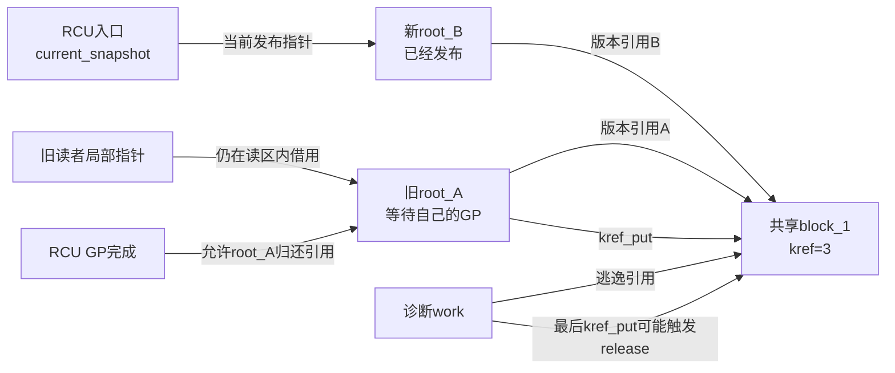
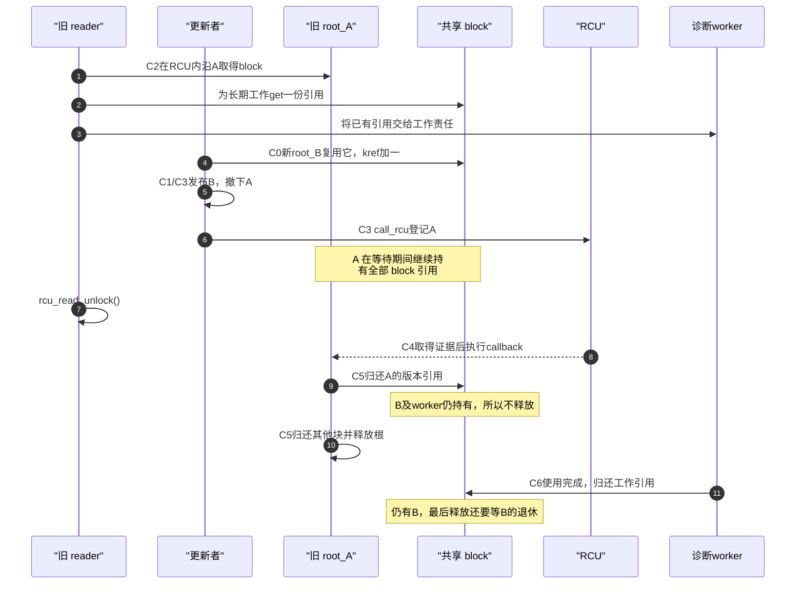

# 第21章\_RCU\_kref与复合对象生命周期

第三章的单块配置只在 RCU 读区内借用对象，因此 GP 后可以直接释放。但真实系统还会把查找结果交给工作队列，或者让一个版本根复用多个独立分配的数据块。此时 API 表不能自动组成正确程序：必须先画分配与所有权拓扑，再选择取消发布、宽限期、kref 归零和最终释放的顺序。

前几章已经建立普通 RCU 的完成协议，本章不再改变后端。这里使用一个具体场景贯穿三种模型：控制面偶尔发布一代新的路由快照，数据面高频读取；快照根包含多个独立数据块，新旧快照可能复用同一块，少量诊断任务还会把某个 block 带到工作队列长期使用。

若把全部数据放在一块不可变分配中，旧版本跨过GP后整体释放就足够。数据量很大而每次只改一小部分时，整块复制会重复分配和复制未变化数据；共享未变化块可以减少这部分工作，却使“根已退休”不再等于“它曾指向的所有块都无人使用”。另一条独立约束来自诊断工作：它需要睡眠或排队，不能把普通RCU读区一直带到工作结束。因此先用单对象解释临时借用怎样交给长期引用，再扩展到多根共享叶子。

**讲解层次：概念到实现的映射。** 下图是新根已经发布、旧根仍等GP的瞬间；current入口只指向新根，旧读者的局部指针和退休队列继续保存旧根地址。



这张图里的职责不能混写：

| 参与者 | 知道什么 | 不知道什么 |
| --- | --- | --- |
| 普通 RCU 后端 | 按构建实现取得相关旧读者已跨过边界的证据 | `root_A` 指向几个 block、每个 block 的 kref 值 |
| kref/refcount | 某个具体 block 还有多少份所有权引用 | block 属于哪一代 RCU、GP 是否完成 |
| 对象所属模块 | root 与 block 的所有权图、哪条回调归还哪份引用 | 不得把自己的约定冒充 RCU 或 kref 内建能力 |

所以不存在“kref 自动通知 RCU”或“RCU 自动等待 kref”的隐藏接口。二者是独立机制，但同一块内存仍然只有一个最终销毁协议；模块用 RCU callback、发布引用和 `kref_put(release)` 把两套状态机按所有权顺序接起来。

普通引用链的版本证据先从[kref 源码总索引](../../../../../research/source_reading/kref/navigation/P01_Linux_6.12_kref源码阅读索引.md#1.2_按问题进入已落地证据)进入。以下模板以仓库保存的 Linux 6.12.20 [`kref.h`](../../../../../research/source_reading/linux/include/linux/kref.h)、[`refcount.h`](../../../../../research/source_reading/linux/include/linux/refcount.h) 和 [`kref.rst`](../../../../../research/source_reading/linux/Documentation/core-api/kref.rst) 为接口边界：`struct kref` 本身只内嵌 `refcount_t`，release 由每次 `kref_put()` 的调用者传入；`kref_get_unless_zero()` 只解决“非零才增加”，其计数器所在内存仍必须先由 RCU 或其他协议保持有效。

## 21.1\_先按分配与所有权拓扑选模板

先纠正一个会直接影响回收设计的认识：`struct kref` **不保存 release 函数，也不存在内核提供的默认空 release**。Linux 6.12.20 的 `include/linux/kref.h::kref_put()` 接收本次调用者传入的函数指针，计数减到零时就在当前执行路径调用它：

固定[kref_put 的唯一实现](../../../../../research/source_reading/kref/source_explanations/include/linux/kref.h.md#1.4_最后归还调用清理)保留函数体和逐步解释；当前章只据其接口组织下面三种所有权拓扑。

因此，某个模块若传入空函数，空的是 **该模块选择的回调实现**，不是 kref 的默认行为。计数归零后 kref 会认为生命期已经终结；空回调既不会让 RCU 知道这件事，也不会为稍后的“手动查询并释放”保留一个可靠机会。并发代码也不能靠读取计数为零来获得独占销毁权，因为读到的数值与后续动作之间没有原子所有权转移。

正常用法是让同一种对象的所有 `kref_put()` 传入同一个最终 release。release 不一定当场 `kfree()`：它可以直接释放、调用 `kfree_rcu()`、排队 `call_rcu()`，或者只销毁上层资源并把下一阶段交给明确的所有者。**kref 决定何时调用 release，对象模块决定 release 做什么。**

| 模型 | RCU 入口 | kref 所在对象 | reader 是否逐次 get | 退休顺序 |
| --- | --- | --- | --- | --- |
| A：单对象逃逸 | 直接指向对象 | 同一个对象 | 只有逃出读区的 reader get | 取消发布 → 对象 kref 归零 → RCU GP → 释放对象 |
| B：发布引用跨 GP | 直接指向对象 | 同一个对象 | 逃出读区的 reader get | 取消发布 → RCU GP → 归还发布引用 → 对象 kref 归零后释放 |
| C：复合快照 | 指向版本根 | 每个分散 block | 短 reader 不 get；逃逸 block 才 get | 取消发布旧根 → RCU GP → 旧根逐块 put → 各 block 独立归零 |

模型 A 与 B 是同一分配块的两种合法串联顺序；模型 C 则包含一个根分配和多个叶子分配。选择之后，所有入口必须遵守同一协议，不能让同一块内存同时拥有直接 `kfree()` 和独立 RCU 回调两个出口。

只有短读者且每版独占整块数据时，继续采用P03的简单退休即可。需要把直接查到的对象带出读区时，A让最后put负责排出GP，B让撤销者先排GP并保留发布份额；两者都能正确，差异是回收责任放在哪里。确有跨版本共享收益时再采用C，代价是构造/回滚逐块记账、退休批量put和多代并存内存。不能只因“引用计数更灵活”就给全部短读者增加原子操作。

以下内核C片段是 **三个互斥的应用骨架**，不是一份可以直接加载的模块。它们依赖RCU、kref、slab、mutex等内核头文件；省略设备注册及模块入口。每个对象只发布一次，分配用kmalloc家族且支持相应kfree，发布后示例数据不变；构造者成功移交初始引用后不再擅自put。若模块可卸载，还需先关闭入口和生产者、等待在途操作及长期用户，最后排空对应异步清理；单次GP不是整个模块的退出协议。

## 21.2\_模型\_A\_单个\_RCU\_对象被长期持有

对象本身同时内嵌 kref 和 RCU 回调头：

```c
struct lookup_obj {
	struct kref ref;
	struct rcu_head rcu;
	int id;
};

static struct lookup_obj __rcu *current_obj;
static DEFINE_MUTEX(obj_update_lock);
```

共享入口持有 `kref_init()` 建立的初始引用。reader 在 RCU 临界区内尝试取得独立引用：

```c
static struct lookup_obj *lookup_obj_get(void)
{
	struct lookup_obj *obj;

	rcu_read_lock();
	obj = rcu_dereference(current_obj);
	if (obj && !kref_get_unless_zero(&obj->ref))
		obj = NULL;
	rcu_read_unlock();

	return obj;
}
```

最后一次 put 不直接释放，而是把同一块对象内存交给 RCU：

```c
static void lookup_obj_release(struct kref *ref)
{
	struct lookup_obj *obj;

	obj = container_of(ref, struct lookup_obj, ref);
	kfree_rcu(obj, rcu);
}

static void lookup_obj_put(struct lookup_obj *obj)
{
	kref_put(&obj->ref, lookup_obj_release);
}
```

替换路径先封闭新 lookup，再归还入口引用：

```c
static void replace_lookup_obj(struct lookup_obj *new)
{
	struct lookup_obj *old;

	mutex_lock(&obj_update_lock);
	old = rcu_replace_pointer(current_obj, new,
				  lockdep_is_held(&obj_update_lock));
	mutex_unlock(&obj_update_lock);

	if (old)
		lookup_obj_put(old);
}
```

传入的 `new` 必须已经完成全部字段初始化并执行 `kref_init()`；这份初始引用从发布成功开始属于共享入口。传NULL表示撤销，传当前同一对象或已退休对象不属于此骨架的合法用法。更新锁只序列化入口替换，发布后不再修改 `id`；kref保证存储保活，不保证对象仍是当前版本或业务仍允许操作。

若旧 reader 的 `kref_get_unless_zero()` 先成功，入口 put 不会使计数归零；若入口 put 先归零，reader 的 get 失败，而 `kfree_rcu()` 又保证计数器内存在 reader 退出 RCU 前仍有效。完整的单对象竞态与 `dying` 状态见[kref 与 RCU](../../../object_lifetime/kref/P10_kref_与_RCU.md)。

## 21.3\_模型\_B\_先过\_GP\_再归还单对象的发布引用

同一个对象也可以让初始引用一直代表“仍可能被旧 RCU reader 查找”，直到 GP 后才归还：

```text
替换共享入口
    -> call_rcu(&old->rcu, drop_publish_ref_rcu)
        -> GP 后执行 kref_put(&old->ref, object_release)
            -> 若无长期引用，release 直接释放
            -> 若仍有长期引用，最后一个用户 put 时释放
```

此模型中，发布引用保证 GP 结束前 `old->ref` 必然大于零，因此 reader 在正确 RCU 临界区内取得长期引用时不会碰到零值对象。`object_release()` 可以直接释放，是因为发布引用直到 GP 后才放掉，所有临时 RCU lookup 已经结束。**它与模型 A 的 `release() -> kfree_rcu()` 二选一**；不要让同一个对象有时在 GP 前归还发布引用，有时又假定发布引用跨越 GP。

对应的退休链如下。对象定义、`lookup_obj_get()` 和更新锁沿用模型 A；以下函数替换模型 A 的 release、put和替换函数。不要在B中继续调用A的 `lookup_obj_put()`：

```c
static void lookup_obj_release_after_gp(struct kref *ref)
{
	struct lookup_obj *obj;

	obj = container_of(ref, struct lookup_obj, ref);
	/* 发布引用只会在GP回调中归还，所以到这里时GP一定已经结束。 */
	kfree(obj);
}

static void drop_lookup_publish_ref_rcu(struct rcu_head *rcu)
{
	struct lookup_obj *obj;

	obj = container_of(rcu, struct lookup_obj, rcu);
	kref_put(&obj->ref, lookup_obj_release_after_gp);
}

static void lookup_obj_put_after_gp(struct lookup_obj *obj)
{
	/* 长期用户和发布引用必须使用同一个最终release。 */
	kref_put(&obj->ref, lookup_obj_release_after_gp);
}

static void replace_lookup_obj_after_gp(struct lookup_obj *new)
{
	struct lookup_obj *old;

	mutex_lock(&obj_update_lock);
	old = rcu_replace_pointer(current_obj, new,
				  lockdep_is_held(&obj_update_lock));
	mutex_unlock(&obj_update_lock);

	if (old)
		call_rcu(&old->rcu, drop_lookup_publish_ref_rcu);
}
```

这里也只有一个最终释放出口：所有长期用户和 GP 回调都调用 `kref_put(..., lookup_obj_release_after_gp)`，只有最后一次 put 能进入 release。RCU callback 并不询问 kref；它只是按照模块协议归还“共享入口原来持有的那一份引用”。

## 21.4\_模型\_C\_一个\_RCU\_版本根拥有多个\_kref\_数据块

前两个模型处理单个对象；复合快照还要区分 **版本根的入口生命期** 与 **各数据块的共享生命期**。RCU 负责让旧根退出正式查找路径并跨过旧 reader，`kref` 负责记录跨版本或读区外仍持有的数据块，二者必须按层退休。

这不是一个“GP完成便把所有字段置零”的单一状态机。入口指针、根的退休请求、每个块的引用数、工作队列的执行责任是相互约束的多组状态。用同一周期C0～C6贯穿后续代码：

| 阶段 | 状态落点与修改者 | 后续读取者及交付条件 |
| --- | --- | --- |
| C0 构造 | 更新者初始化私有根的块目录；为每个非NULL槽取得一份block.ref | 尚不可由普通读者取得，失败须回滚已取得份额 |
| C1 发布 | 更新者在snapshot_update_lock下写current_snapshot | reader用rcu_dereference取得根，看到已初始化目录 |
| C2 借用或带走 | 短reader只读目录；逃逸者在读区内增加选中块的ref | 引用交接必须在借用保护结束之前完成 |
| C3 退休旧根 | 下一次发布撤下旧根，将其rcu_head登记到RCU回调队列 | 旧根及全部块份额继续保留；不远程清除旧reader局部指针 |
| C4 取得完成证据 | RCU后端按普通GP规则观察旧reader退出 | callback取得可遍历并归还旧根份额的资格，不证明长期工作结束 |
| C5 拆根 | snapshot_retire_rcu逐槽put，再释放根和目录 | block若仍有新根/工作引用则保留；只在最后put时进入release |
| C6 长期归还 | worker使用结束后put自己的一份 | 最后归还者同步执行data_block_release，之后不得再访问块 |

C2的长期用户可能在C4前就归还，也可能在多个根退休后才归还；C6不必总在C5之后。等待所有业务完成的退出方必须取得工作队列/用户退出的证据，RCU不会为这些长期引用另发完成通知。

## 21.5\_对象定义与所有权不变量

复合快照用一个小根节点表达版本身份和块目录，每个 block 是独立分配：

```c
struct data_block {
	struct kref ref;
	unsigned long value;
};

struct data_snapshot {
	struct rcu_head rcu;
	unsigned int nr_blocks;
	struct data_block *blocks[];
};

static struct data_snapshot __rcu *current_snapshot;
static DEFINE_MUTEX(snapshot_update_lock);
```

必须长期成立的不变量是：

```text
一个 snapshot 的 blocks[i] 非 NULL
    -> 该 snapshot 为 blocks[i] 持有一份 kref；

snapshot 仍可能被 RCU reader 使用
    -> 不得归还它持有的任何 block 引用；

block 被任一 snapshot 发布
    -> 其供 reader 直接读取的字段保持不变，或另有独立同步协议；

构造新 snapshot 复用旧 block
    -> 发布新 root 之前，先为新 root 增加一份 block 引用。
```

block 的最后释放入口只属于 block 自己：

```c
static void data_block_release(struct kref *ref)
{
	struct data_block *block;

	block = container_of(ref, struct data_block, ref);
	kfree(block);
}
```

## 21.6\_构造新版本时取得块所有权

新建 block 的初始引用直接归新版本所有：

```c
static struct data_block *data_block_alloc(unsigned long value)
{
	struct data_block *block;

	block = kmalloc(sizeof(*block), GFP_KERNEL);
	if (!block)
		return NULL;

	kref_init(&block->ref);
	block->value = value;
	return block;
}
```

若新版本复用旧 block，则在新版本发布前增加一份版本所有权引用：

```c
static void snapshot_share_block(struct data_snapshot *new,
				 unsigned int index,
				 struct data_block *block)
{
	kref_get(&block->ref);
	new->blocks[index] = block;
}
```

这里允许普通 `kref_get()`，因为更新者在自己的更新锁下从当前版本取 block，而当前版本尚未取消发布并持续持有该 block 的非零引用。若 block 可以脱离 root 独立删除，这个前提不成立，必须增加独立状态机或子块级 RCU 协议。

`snapshot_share_block()` 还要求 `index < new->nr_blocks`、目的槽原来为空且block非NULL；覆盖非空槽会丢失它原有的责任。根可用 `kzalloc(struct_size(root, blocks, nr_blocks), GFP_KERNEL)` 分配，使未填槽为NULL；数量应受业务上限约束。分配和可能睡眠的准备工作不放在普通RCU读区内。

从当前根复用时，在 `snapshot_update_lock` 下用 `rcu_dereference_protected()` 取得旧根，并在保护有效期间完成所需get。若构造完成后先解锁、再调用后文自行加锁的发布函数，其他更新者可能已发布另一代：引用仍可保活，但可能覆盖对方业务更新。本骨架的复合构造采用单一控制面更新者；多写者的读—改—发布应把整个事务放在同一把锁下，或发布前校验根身份并失败重试。已持锁时不能再调用会重复加锁的 `publish_snapshot()`。

构造失败时逐个put已为新根取得的引用，再释放未发布根；由于它从未对reader可见，无需等待GP。下面的清理函数只接收私有且不再继续构造的根，不能用于已发布版本：

```c
static void snapshot_discard_private(struct data_snapshot *snapshot)
{
	unsigned int i;

	for (i = 0; i < snapshot->nr_blocks; i++) {
		if (snapshot->blocks[i])
			kref_put(&snapshot->blocks[i]->ref, data_block_release);
	}
	kfree(snapshot);
}
```

## 21.7\_短\_reader\_只借用版本已有的块引用

```c
static unsigned long read_block_value(unsigned int index)
{
	struct data_snapshot *snapshot;
	struct data_block *block;
	unsigned long value = 0;

	rcu_read_lock();
	snapshot = rcu_dereference(current_snapshot);
	if (snapshot && index < snapshot->nr_blocks) {
		block = snapshot->blocks[index];
		if (block)
			value = READ_ONCE(block->value);
	}
	rcu_read_unlock();

	return value;
}
```

这条高频路径没有逐块 get／put。reader 的安全性来自：旧 snapshot 只会在自己的 GP 后归还 block 引用，因此 reader 仍在临界区时，根节点替它托住了 block。

## 21.8\_旧版本在\_GP\_后逐块归还所有权

```c
static void snapshot_retire_rcu(struct rcu_head *rcu)
{
	struct data_snapshot *snapshot;
	unsigned int i;

	snapshot = container_of(rcu, struct data_snapshot, rcu);

	for (i = 0; i < snapshot->nr_blocks; i++) {
		if (snapshot->blocks[i])
			kref_put(&snapshot->blocks[i]->ref,
				 data_block_release);
	}

	kfree(snapshot);
}

static void publish_snapshot(struct data_snapshot *new)
{
	struct data_snapshot *old;

	mutex_lock(&snapshot_update_lock);
	old = rcu_replace_pointer(current_snapshot, new,
				  lockdep_is_held(&snapshot_update_lock));
	mutex_unlock(&snapshot_update_lock);

	if (old)
		call_rcu(&old->rcu, snapshot_retire_rcu);
}
```

`snapshot_retire_rcu()` 不查询“哪些 reader 看过哪个 block”。GP 已经证明旧 reader 不再沿该 root 访问任何 block，回调只负责归还 root 明确记录的所有权。每个 block 的最后一次 put 再独立决定是否执行 `data_block_release()`。



步骤2完成借用到长期持有的交接，步骤3只转交已有份额，不再次凭空get。步骤7退出旧读区允许后端推进；步骤8是取得GP证据后的callback调度，不是unlock直接调用回收。步骤9与11分别归还两个不同所有者的份额，当前B仍有一份，因而整个图结束时block仍存活。

## 21.9\_复合模型中把某个块带出\_RCU

若调用者要把一个 block 交给工作队列或跨越睡眠，必须在 root 仍受 RCU 保护时取得独立引用：

```c
static struct data_block *data_block_get_current(unsigned int index)
{
	struct data_snapshot *snapshot;
	struct data_block *block = NULL;

	rcu_read_lock();
	snapshot = rcu_dereference(current_snapshot);
	if (snapshot && index < snapshot->nr_blocks) {
		block = snapshot->blocks[index];
		if (block)
			kref_get(&block->ref);
	}
	rcu_read_unlock();

	return block;
}

static void data_block_put(struct data_block *block)
{
	kref_put(&block->ref, data_block_release);
}
```

这里的 `kref_get()` 不是无保护地从零复活：root 对 block 的版本引用保证，在当前 RCU 临界区结束以及 root 对应 GP 完成之前，block 计数不会降到零。reader get 成功后，root 的退休回调可以归还版本引用，但 reader 自己的引用仍继续托住 block。

向work转交时要明确由谁负责这份引用：若新建一次性工作并成功交付，worker最后put；若分配工作失败，调用者立即put。复用同一个 `work_struct` 时，`queue_work()` 返回false不表示新取得的引用自动被既有任务接管，必须按该工作项自己的合并协议归还或保存。取消一个尚未执行的工作也要有负责put的路径；仅等待RCU callback无法排空这些工作责任。

如果 block 同时还出现在一个可独立删除的 RCU 索引中，**就不能只依赖 root 的不变量**；应为那个入口单独设计 `kref_get_unless_zero()`、取消发布和回收链，避免一个分配块被两套入口各自直接释放。

## 21.10\_回调工作量与内存峰值

复合快照消除了短 reader 的逐块原子操作，却把工作转移到构造和退休路径：

| 成本 | 由谁承担 | 形成过程 |
| --- | --- | --- |
| 共享块 get | 新版本构造者 | 每复用一个 block，为新 root 增加一份所有权 |
| 批量 block put | 旧 root 退休者 | GP 后归还旧 root 持有的全部引用 |
| 版本并存内存 | 更新路径 | 旧 root 等 GP，新 root 已发布，长期引用还可能托住更老的 block |
| 热点块原子争用 | 逃逸 reader | 只有确实取得长期 block 引用的路径发生 |

RCU 回调必须保持短小且不能主动阻塞。若一个 root 包含数量很大的 block，或者 block 的最后 `release()` 可能睡眠，不应在 RCU 回调中执行无界清理。可以在允许睡眠的更新上下文中用 `synchronize_rcu()` 后批量归还，或让短小的 RCU 回调把退休工作转交给工作队列；无论采用哪种方式，都必须保证 root 和块目录在工作真正接管之前保持有效。

## 21.11\_RCU\_与\_seqcount/seqlock\_对比矩阵

回到同一组路由数据：如果内容只是几个可整体重读的标量，写者可以原地短更新，读者复制后检查序号，不必构造多代对象。若reader在检查序号之前已经沿指针访问被释放的块，之后发现冲突再重试也救不回那次非法访问。seqcount能检测快照冲突，却不能单独提供本章的块生命期保护。详细的读重试与写侧约束见 [序列计数器专题](../sequence_counters/大纲.md)；下表只比较常规读路径，不覆盖seqlock的带锁回退接口。

| 特征 | RCU | seqcount_t | seqlock_t |
| --- | --- | --- | --- |
| 读侧行为 | 轻量，短读可直接消费旧版本 | 无锁读取并在冲突时重试 | 无锁读取并在冲突时重试 |
| 写者串行化 | RCU 不提供，由使用者选择 | 必须由使用者提供 | 内置 spinlock |
| 复合数据 | 用不可变根一次发布，可引用多个分散块 | reader 重试以取得同一代字段 | reader 重试以取得同一代字段 |
| 指针生命期 | GP 与所有权图负责延迟回收 | 不能让 reader 在重试窗口解引用可释放指针 | 同左 |
| 更新成本 | 构造新根／新块、引用共享块、退休旧版本 | 原地写并更新序号 | 持锁原地写并更新序号 |
| 适合场景 | 读多写少、允许旧版本、内存可延迟回收 | 写入较短、reader 可重试 | 需要内置写锁的短更新 |

## 21.12\_所有权与回收核对表

| 检查项 | 目标 | 状态 |
| --- | --- | --- |
| RCU 入口直接发布的是单对象还是版本根 | 先确定回收层级 | □ |
| 每个分配块由哪些 root 或长期用户持有 | 建立所有权图 | □ |
| 新 root 复用 block 前是否先取得引用 | 防止发布悬空块 | □ |
| 旧 root 是否保持块引用直到自己的 GP 完成 | 保护临时 reader | □ |
| 短 reader 是否避免无意义的逐块 get／put | 保留读侧扩展性 | □ |
| 逃逸 block 是否在 RCU 内取得独立引用 | 完成保护交接 | □ |
| 同一分配块是否只有一个最终 release 路径 | 防止 UAF 与 double-free | □ |
| 退休回调的循环和 block release 是否有界且不阻塞 | 符合回调上下文 | □ |
| 连续更新和长期引用的内存峰值是否可接受 | 防止旧代积压 | □ |
| 多个写者是否由更新锁或其他协议串行化 | 防止所有权重复转移 | □ |

## 21.13\_小结

先推演一个可核对的账本。开始只有根A拥有块X，计数1；worker沿A取得长期份额变2；构造B复用X变3；撤下A并登记callback仍为3；A的GP完成后callback归还一份变2；worker结束变1；最后B也撤下并经过自己的GP，归还最后一份才变0并释放。**根A与根B需要分别满足自己的退休条件**，不能因为A那一轮完成就提前归还B的份额。

再改变两个条件：如果B构造到一半失败，私有清理归还它已经取得的一份，计数从3回到2，A与worker继续有效；如果worker在A的callback前结束，则先从3降到2，A的callback再降到1，最终仍由B托住。数值不是“有几条指针”的统计，而是协议已经取得且尚未归还的责任数。

动手观察A/B的两种先后顺序，可运行kref专题已经提供的完整 [rcu_take_window.c](../../../../../labs/kernel/object_lifetime/materials/rcu_take_window.c) 及其 [实验步骤](../../../object_lifetime/kref/P36_RCU查找与退休顺序实验.md)。该C程序使用显式观察者账本而非Linux并发实现；本章C模型的多根计数推演也不能验证真实内存顺序。内核片段仍需接入完整模块并在目标配置下验证，本轮没有完成目标Kbuild或并发压测。

- 单个 RCU 对象被带出读区时，kref 统计的是对这个对象本身的长期持有。
- 复合快照中，版本根持有每个分散 block 的 kref；短 reader 借用根已有的引用，不必逐块计数。
- 新版本复用 block 时先增加版本引用，旧版本只在 GP 后归还自己的引用。
- reader 把子块带出读区时才增加逃逸引用，旧 root 退休不会使该块提前释放。
- RCU 与 kref 仍然彼此无感；对象所属模块用根目录、RCU 回调和 block release 把所有权逐层收敛。
- 回收顺序由所有权拓扑决定，不存在对所有 RCU + kref 场景都成立的固定先后顺序。


上一篇：[Tiny RCU 单 CPU 实现](P20_Tiny_RCU_单CPU实现.md)。

下一篇：[RCU 驱动与子系统应用模式](P22_RCU_驱动与子系统应用模式.md)。


