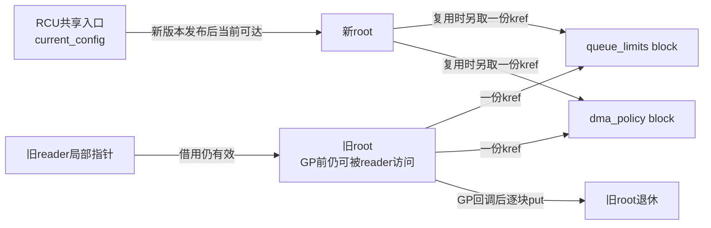
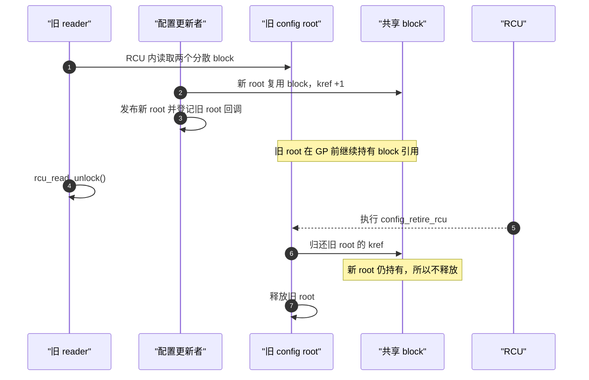
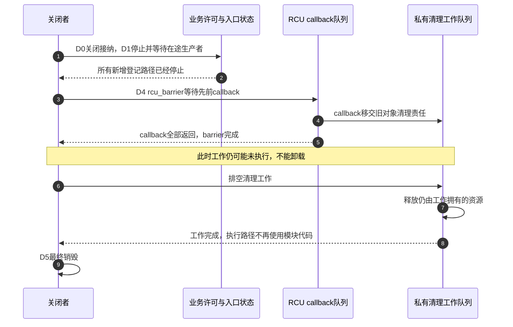

# 第22章\_RCU\_驱动与子系统应用模式

上一章解决了根、共享块和长期用户各自持有哪份引用。本章把这些规则放进设备驱动：一次热拔出既会撤销软件查找入口，又可能停止真实硬件，文件实例和工作队列还可能继续存在。即使RCU已经证明旧CPU读者退出，也不能据此断言DMA已经停止或旧文件已关闭。

先观察不涉及硬件访问的注册表和状态快照，再引入长期上下文和复合配置；最后把它们接回一次设备关闭。示例是教学驱动骨架，不冒充某个上游驱动的实测实现。

## 22.1\_RCU\_在驱动场景中的典型应用模式

本章不再展开 GP 内部字段，而是把 P03 和 P21 的生命周期协议放进驱动常见入口。每个场景都先定位正式查找入口、读者借用期、写者串行化方式和最后一个释放者，再选择 RCU、`kref` 或二者组合。

## 22.2\_本章固定的四类场景

本节从 **开发者视角** 出发，展示 RCU 在 Linux 驱动中四类典型场景的应用模式：

1. **设备链表与热插拔** —— 解决“读遍历与写插拔并发”；
2. **设备状态表（open/close/poll）** —— 解决“读频繁、写稀疏”的状态访问；
3. **单对象引用与延迟销毁** —— 解决“对象逃出 RCU 读区后仍需存活”的问题；
4. **复合配置快照** —— 解决“一代旧照由多个可共享分散块组成”的逐层退休问题。

**讲解层次：应用协议层。** 示例依赖前文已解释的Linux接口，未提供模块入口、设备注册或完整文件操作。普通RCU读区只做短且不阻塞的访问；kmalloc/kzalloc与mutex调用位于允许睡眠的过程上下文。以下四种场景相互独立，不共享同名对象的释放权。具体接口实现从 [RCU源码总索引](../../../../../research/source_reading/rcu/navigation/P01_Linux_6.12_RCU源码总阅读索引.md) 和上一章的kref索引追溯。

------

## 22.3\_场景一\_设备链表与热插拔

这一场景的核心是 **链表节点既是可遍历入口，又会被热插拔路径摘除**。读者需要无锁遍历，写者则必须把“停止新查找、摘链、等待旧遍历、释放节点”保持为不可颠倒的顺序。

### 22.3.1\_问题背景

驱动层往往维护一个设备节点链表：

```c
struct dev_entry {
	struct list_head list;
	struct rcu_head rcu;
	struct device *dev;
	int online;
};
```

在设备热插拔或动态加载时：

- **读者**：频繁遍历链表（如 sysfs、监控任务）；
- **写者**：插入或删除节点。

若读者也取得同一把 `spin_lock`，CPU A遍历期间B不能进入；B随后取得锁还可能需要取得该锁缓存行的写权限。不同CPU频繁交替取得时，这种序列化与缓存行所有权转移会成为代价。RCU让普通遍历不再修改该共享更新锁，删除者另以GP取得旧遍历退出证据；并不取消读侧标记和后端通信。列表很小、读取很少或必须串行执行设备操作时，原锁方案仍更直接。

下面固定一个 **设备对象由外层保活** 的范围：注册表拥有者在加入节点之前已有有效设备引用，并在停止本表所有读写入口、摘除节点及完成旧遍历排空之前保留它。`dev_entry`只借用 `dev`，不取得也不归还设备引用；设备名在示例观察期间不被并发重命名。无此范围的真实驱动必须给节点另建设备引用与合适的归还上下文，不能直接套用本例。

------

### 22.3.2\_RCU\_化实现

```c
LIST_HEAD(dev_list);
DEFINE_SPINLOCK(dev_lock);

/* 写侧：添加新设备 */
int dev_add(struct device *d)
{
	struct dev_entry *e = kmalloc(sizeof(*e), GFP_KERNEL);

	if (!e)
		return -ENOMEM;
	e->dev = d;
	e->online = 1;

	spin_lock(&dev_lock);
	list_add_rcu(&e->list, &dev_list);
	spin_unlock(&dev_lock);
	return 0;
}

/* 写侧：删除设备（延迟释放） */
void dev_del(struct device *d)
{
	struct dev_entry *e;
	spin_lock(&dev_lock);
	list_for_each_entry(e, &dev_list, list) {
		if (e->dev == d) {
			list_del_rcu(&e->list);
			spin_unlock(&dev_lock);
			kfree_rcu(e, rcu);  // 延迟释放
			return;
		}
	}
	spin_unlock(&dev_lock);
}

/* 读侧：遍历设备 */
void dev_show_all(void)
{
	struct dev_entry *e;
	rcu_read_lock();
	list_for_each_entry_rcu(e, &dev_list, list)
		pr_info("dev: %s\n", dev_name(e->dev));
	rcu_read_unlock();
}
```

这个最小示例只回收 `dev_entry` 节点，并假定节点中的 `struct device *` 在对应 GP 结束前仍然有效。实际驱动若不能从设备核心的注销顺序得到该保证，节点还必须为设备取得独立引用，并在允许执行设备 release 的后续上下文中归还；RCU 只保护链表节点，不会自动延长被节点指向的设备生命期。

示例要求同一设备只加入一次，所有增删者都遵循 `dev_lock`，也不在硬IRQ中调用这些过程上下文入口。若真正有IRQ写者，须重新设计分配及锁的IRQ保护；不能只把现有普通spin_lock原样搬过去。这里的只读遍历不修改节点；RCU本身并不普遍禁止读区内的合规写者操作，结构修改仍由写侧协议决定。

------

### 22.3.3\_机制分析

| 操作     | 安全点                 | 机制                     |
| -------- | ---------------------- | ------------------------ |
| 添加节点 | 加锁串行               | 结构一致                 |
| 删除节点 | RCU 删除 + 延迟释放    | 允许旧读者继续访问已摘除节点而不发生 UAF |
| 遍历     | `rcu_read_lock()` 保护 | 在生命周期保护区内遍历；不自动形成字段快照 |

`list_add_rcu()` / `list_del_rcu()` 与 `list_for_each_entry_rcu()` 分别承担发布、摘链及读取路径，释放时机仍由调用者安排。旧遍历可能经过刚摘除节点；一次遍历也不是全链的原子快照。例中的 `online` 发布后不变，不能把它读成“硬件此刻仍可访问”的授权检查。打印只用于演示，不能拿每节点打印的耗时衡量RCU查找性能。

------

## 22.4\_场景二\_设备状态表(open/close/poll)

状态表与设备链表不同：共享入口通常只指向一个整体快照，更新者通过构造新版本并原子替换避免 reader 看到半更新字段。这里要验证的是发布/取得和整代回收，而不是链表遍历规则。

### 22.4.1\_问题背景

设备驱动常维护运行状态，例如：

```c
struct drv_status {
	struct rcu_head rcu;
	bool online;
	bool ready;
	bool fault;
};
```

- **读者**：文件操作函数 (`read`, `poll`) 高频访问；
- **写者**：状态变化（如掉电、复位）低频更新。

若这三个标志是一组需要一致读取的诊断信息，原地分别赋值会让无锁读者混合两次更新；持同一把锁可以解决，但每次只读也要参与锁竞争。不可变快照把三个字段先在私有内存写完，再用一次入口发布选择版本。代价是每次更新要分配并延期回收，读者允许拿到旧的完整版本。高频统计计数通常不适合每次增加都复制快照，应另选原子、每CPU计数或锁；“读多写少”只是候选条件。

------

### 22.4.2\_RCU\_状态表实现

```c
struct drv_status __rcu *gstat;
static DEFINE_MUTEX(status_lock);

/* 写者：更新状态 */
int update_status(bool ready)
{
	struct drv_status *old, *new;

	new = kmalloc(sizeof(*new), GFP_KERNEL);
	if (!new)
		return -ENOMEM;

	mutex_lock(&status_lock);
	old = rcu_dereference_protected(gstat,
					lockdep_is_held(&status_lock));
	new->online = old ? old->online : false;
	new->fault = old ? old->fault : false;
	new->ready = ready;
	rcu_assign_pointer(gstat, new);
	mutex_unlock(&status_lock);
	if (old)
		kfree_rcu(old, rcu);  /* 宽限期后释放旧状态 */
	return 0;
}

struct status_view {
	bool online;
	bool ready;
	bool fault;
};

/* 只复制软件快照，不宣称已读取硬件或向用户交付数据。 */
bool read_status_view(struct status_view *view)
{
	struct drv_status *s;
	bool found = false;

	rcu_read_lock();
	s = rcu_dereference(gstat);
	if (s) {
		view->online = s->online;
		view->ready = s->ready;
		view->fault = s->fault;
		found = true;
	}
	rcu_read_unlock();
	return found;
}
```

`view`是调用者有效且独占的输出存储；返回false时不读取其中未写字段。读者在同一次读区内复制全部字段，退出后使用的是值，不是旧快照地址。该函数不能代替 `read()` 文件操作：真实read要在许可协议下取得数据、处理长度及错误，并在允许缺页/睡眠的上下文向用户复制；没有复制数据就返回len会虚报成功。

同样，`ready=true`只是观察结果。poll需要向设备自己的等待队列登记等待者，随后检查条件，条件改变的生产者按协议唤醒；RCU发布新指针不会自动发出poll唤醒。open取得长期上下文后还须验证设备业务许可，close则归还该文件实例的引用。硬件复位与读写操作的排斥由设备状态锁、在途计数或设备框架协议完成，不能以一次快照读取代替。

------

### 22.4.3\_性能与一致性比较

| 项         | RCU 方案           | 锁方案         |
| ---------- | ------------------ | -------------- |
| 读路径特征 | 不与写者争抢同一把锁 | 可能获取读锁或互斥锁 |
| 写代价 | 创建新版本并安排旧对象回收 | 通常可原地修改 |
| 实际延迟 | 必须通过基准测试 | 必须通过基准测试 |
| 读取模型 | 新旧版本可并存，读者不重试 | 读者取得锁保护的当前状态 |

若需要“检查ready和提交设备操作不可被关闭插入”的原子业务过程，仍须使用能覆盖这两个动作的许可协议；若只是显示最近一代软件状态，则本快照模型可以成立。

------

## 22.5\_场景三\_单个设备上下文被带出\_RCU\_读区

设备上下文可能先从全局入口查到，再交给工作队列或文件实例长期使用。此时共享入口直接指向同一个 `dev_ctx` 分配，kref 统计的也是对这个对象本身的长期持有。

```c
struct dev_ctx {
	struct kref ref;
	struct rcu_head rcu;
	unsigned int generation;  /* 示例只保存发布后不变的软件代号。 */
};

static struct dev_ctx __rcu *gctx;
static DEFINE_MUTEX(ctx_lock);

static void ctx_release(struct kref *ref)
{
	struct dev_ctx *ctx;

	ctx = container_of(ref, struct dev_ctx, ref);
	kfree_rcu(ctx, rcu);
}

static struct dev_ctx *ctx_get(void)
{
	struct dev_ctx *ctx;

	rcu_read_lock();
	ctx = rcu_dereference(gctx);
	if (ctx && !kref_get_unless_zero(&ctx->ref))
		ctx = NULL;
	rcu_read_unlock();

	return ctx;
}

static void ctx_put(struct dev_ctx *ctx)
{
	kref_put(&ctx->ref, ctx_release);
}

static void ctx_replace(struct dev_ctx *new)
{
	struct dev_ctx *old;

	mutex_lock(&ctx_lock);
	old = rcu_replace_pointer(gctx, new,
				  lockdep_is_held(&ctx_lock));
	mutex_unlock(&ctx_lock);

	if (old)
		ctx_put(old);       /* 归还共享入口持有的初始引用 */
}
```

新对象在发布前用 `kref_init()` 建立一份属于共享入口的初始引用。旧对象最后一个 put 调用 `ctx_release()`，但 release 不直接 `kfree()`，而是用 `kfree_rcu()` 等待仍可能拿着临时裸指针的 lookup reader。这里的唯一释放链是：

```text
最后一个 dev_ctx kref_put
    -> ctx_release
        -> kfree_rcu
            -> GP 后释放 dev_ctx
```

对象按kmalloc家族分配且只发布一次，`ctx_replace(NULL)`用于撤销；不得重新发布同一个在用或退休对象。查找成功只保证软件内存存活，不表示仍是当前代或允许硬件I/O。若真实上下文持有 `struct device *`、DMA映射、时钟或队列，这些资源还需逐项建独立获取/释放协议，不能在本例的kfree前随便补一次可能睡眠的设备release。

## 22.6\_场景四\_一代设备配置由多个分散块组成

设备配置可能不是一个连续结构，而是一个根节点组合队列限制、DMA 策略和过滤表等独立分配。不同代配置还可能共享未变化的 block：

```c
struct config_block {
	struct kref ref;
	unsigned long value;
};

struct dev_config {
	struct rcu_head rcu;
	struct config_block *queue_limits;
	struct config_block *dma_policy;
};

static struct dev_config __rcu *current_config;
static DEFINE_MUTEX(config_lock);
```

示例假设 block 发布后不再原地修改；若 `value` 仍会变化，需要另外使用锁、原子操作或替换整个 block。

每个 `dev_config` 为自己的两个 block 各持有一份 kref。新版本复用旧 block 时，在发布前为新根增加一份引用；旧根只在 GP 后归还自己的引用：

```c
static struct dev_config *config_clone(struct dev_config *old)
{
	struct dev_config *new;

	lockdep_assert_held(&config_lock);
	new = kzalloc(sizeof(*new), GFP_KERNEL);
	if (!new)
		return NULL;
	if (!old)
		return new;

	/* 新root在发布以前就取得自己对两个block的版本引用。 */
	if (old->queue_limits) {
		kref_get(&old->queue_limits->ref);
		new->queue_limits = old->queue_limits;
	}
	if (old->dma_policy) {
		kref_get(&old->dma_policy->ref);
		new->dma_policy = old->dma_policy;
	}
	return new;
}
```

调用者必须在 `config_lock` 下从当前入口取得old，不能传入无保护的历史裸指针。clone返回的新根尚不可见；若后续修改失败，须逐块put再释放根；替换某个非NULL槽前也须归还clone为该槽取得的原份额。若两个槽恰好指向同一块，它们分别代表两份引用，不能只get一次却在退休时put两次。完整构造/回滚约束沿上一章C0，而不把clone误当作完整更新事务。

```c
static void config_block_release(struct kref *ref)
{
	struct config_block *block;

	block = container_of(ref, struct config_block, ref);
	kfree(block);
}

static void config_retire_rcu(struct rcu_head *rcu)
{
	struct dev_config *config;

	config = container_of(rcu, struct dev_config, rcu);
	if (config->queue_limits)
		kref_put(&config->queue_limits->ref, config_block_release);
	if (config->dma_policy)
		kref_put(&config->dma_policy->ref, config_block_release);
	kfree(config);
}

static void config_publish_locked(struct dev_config *new)
{
	struct dev_config *old;

	/* 与取old、clone及私有修改处于同一更新事务。 */
	lockdep_assert_held(&config_lock);
	old = rcu_replace_pointer(current_config, new,
				  lockdep_is_held(&config_lock));

	if (old)
		call_rcu(&old->rcu, config_retire_rcu);
}
```

调用顺序是：取 `config_lock` → protected读取当前old → clone → 完成私有修改或失败回滚 → 成功时 `config_publish_locked(new)` → 解锁。这样两个控制面写者不会各自从同一旧版构造后覆盖对方；此mutex允许过程上下文构造中的睡眠。发布函数不再自行加锁，避免调用者已持锁时重复加锁。入口关闭与失败返回仍由外层驱动实现。

普通短 reader 只需借用根已经持有的 block 引用：

```c
static void read_current_config(void)
{
	struct dev_config *config;

	rcu_read_lock();
	config = rcu_dereference(current_config);
	if (config) {
		use_queue_limits(config->queue_limits);
		use_dma_policy(config->dma_policy);
	}
	rcu_read_unlock();
}
```

`use_queue_limits()` 和 `use_dma_policy()` 是业务占位函数：须接受NULL表示未配置，只做不阻塞且不保存裸指针的软件访问。名字含DMA不表示本模板已安全改写正在运行的设备。reader不需要每次读取都对两个block执行get/put；交给异步任务的块则在读区内取得长期引用，交付失败与取消也要归还。





这类复合快照的顺序是“GP 后逐块 put”，与上一场景的“最后 put 后 `kfree_rcu()`”不同。详细所有权不变量和逃逸 block 模板统一见 [RCU、kref 与复合对象生命周期](P21_RCU_kref与复合对象生命周期.md)。

图中步骤2先取得新根的块份额，步骤3才发布并登记旧根；步骤4结束借用，步骤5由后端在GP完成后交付callback，步骤6归还旧根的一份。没有任何一步把软件GP当作DMA完成信号。

## 22.7\_按问题特征选择组合

| 问题特征 | RCU负责 | 还需要的机制 |
| --- | --- | --- |
| 高频查找、低频插拔的节点表 | 查找期间节点生命期、删除后延迟回收 | 更新锁串行化结构修改 |
| 整体替换且发布后不变的状态 | 允许读者看到任一完整版本 | 更新锁；发布前完整初始化 |
| 对象要交给文件或工作队列长期使用 | 只保护 lookup 到安全 get 的窗口 | kref/refcount 保护逃逸生命期 |
| root 组合多个可共享 block | 保护旧 root 到 GP | root 对每块持 kref；GP 后逐块 put |
| 读侧必须等待 I/O 或 mutex | 普通 RCU 不适用该跨度 | SRCU，或先取得引用再退出普通 RCU |
| DMA 描述符/设备资源还受硬件访问 | 只能保护 CPU 软件入口的一部分 | DMA 停止、IRQ 同步、设备核心引用等硬件/框架协议 |

------

## 22.8\_交付前核对表

| 检查项                | 说明                                  | 状态 |
| --------------------- | ------------------------------------- | ---- |
| [CHECK] 写路径互斥    | 多写需自锁                            | □    |
| [CHECK] 延迟释放      | 是否使用 `call_rcu()` / `kfree_rcu()` | □    |
| [CHECK] 读路径最短    | 快照访问，不睡眠                      | □    |
| [CHECK] SRCU 场景识别 | 可睡读路径迁移至 SRCU                 | □    |
| [CHECK] 回调安全      | 可清理仍归自己所有的旧对象；释放后不再访问，且不阻塞 | □ |
| [CHECK] 复合快照所有权 | 旧 root 是否保持每个 block 到 GP 后 | □ |
| [CHECK] 逃逸子块引用 | 带出 RCU 前是否取得 block 独立引用 | □ |

------

## 22.9\_为什么一次GP不能完成设备关闭

用设备关闭检验前面的组合。以下D0～D5是责任顺序示例，不是对所有总线都成立的固定remove调用顺序；实际驱动还须遵循总线与设备框架的入口注销规则。

| 阶段 | 责任状态与写入者 | 等待者依据什么继续 |
| --- | --- | --- |
| D0 关闭接纳 | 关闭者在业务锁下改变许可，禁止新的open、更新及工作生产 | 后续入口检查同一许可，而非旧RCU快照 |
| D1 收回入口 | 注销框架入口、停止在途生产者，再撤下RCU节点/指针 | 不能再有本模块callback或工作新登记 |
| D2 停止设备活动 | 按硬件协议停止DMA和新IRQ来源，使用对应同步接口收敛在途handler | 设备/IRQ协议的完成证据，不是普通RCU GP |
| D3 等待旧软件使用 | 取得旧RCU遍历退出证据，并按协议处理旧文件、长期引用与工作 | 引用最终归还、工作完成或业务退出通知 |
| D4 排空异步清理 | 无新生产者后等待模块callback，再排空其转交的工作 | barrier与工作完成分别证明对应阶段已返回 |
| D5 最终销毁 | 所有资源的使用者退出后释放上下文、映射和模块私有资源 | 不留仍会执行模块代码的回调或工作 |

D2与D3的具体先后要由硬件操作对软件状态的依赖决定；不能在仍运行的handler会访问该资源时提前释放，也不能持有handler所需的锁去等待它退出。若callback会排work，先barrier后排work；若work又会排callback，必须先关闭反馈生产环，不能只各等一次就宣称全部完成。

下面固定“callback只向清理work单向转交，不再产生新callback”的结束分支；硬件停止与旧软件使用已经分别取得D2/D3证据。



步骤2必须先成立，步骤3才能覆盖一个不再增长的callback集合；步骤5只关闭第一段异步链。步骤6～8另行等待工作，解释了为什么“RCU回调已经跑完”仍可能不是驱动的最终退出条件。

三道推演用来检查职责边界：读到ready后设备立即关闭，RCU能阻止关闭吗？ctx引用仍为正时DMA可否继续访问已解除映射的内存？callback执行结束而它排出的work尚未运行，模块可否卸载？答案依次是 **不能**、**不能据引用数保证**、**不能**；分别缺少业务操作许可、硬件停止/映射生命期和后续工作的完成证据。


------

## 22.10\_本章边界

本章只保留驱动场景中的组合方式，不重复维护通用接口说明。接口契约统一查阅[RCU API 速查](P03_RCU_通用API与最小使用闭环.md)，可直接复用的最小调用链统一查阅[RCU 模板、选型与核对](P21_RCU_kref与复合对象生命周期.md)。

审查驱动代码时，应把注意力放在场景新增的责任上：写者由谁串行化、对象能否逃出读侧区间、版本根与分散 block 之间各由谁持有引用、GP 前后在哪一层归还引用、回调是否引用模块代码，以及卸载路径是否阻止了新回调产生。

本轮以宿主顺序替身编译并运行九段C骨架，检查分配失败、状态复制、长期引用及同一块占两个槽的计数交接；两种编译器的严格检查通过。该检查不实现Linux RCU或硬件，只覆盖片段类型及安排好的所有权顺序。没有执行目标Kbuild、真实热拔出、DMA停止或模块卸载实验，D0～D5仍需在具体驱动中落实为可验证的接口协议。

上一篇：[RCU、kref 与复合对象生命周期](P21_RCU_kref与复合对象生命周期.md)。

下一篇：[RCU 类型语义、Sparse 与 Lockdep](P23_RCU_类型语义_Sparse与Lockdep.md)。


