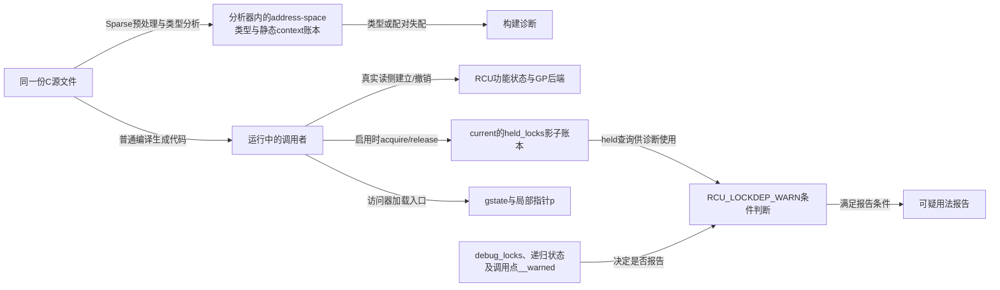
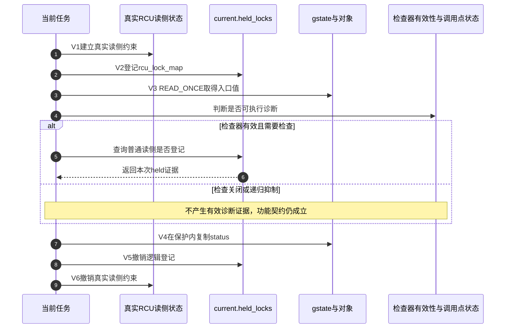

# 第23章\_RCU\_类型语义\_Sparse与Lockdep


## 23.1\_同一段错误代码需要三种不同证明

前面的例子都依赖一条人工约定：共享入口必须用 RCU 发布/取得，取得动作必须位于正确保护条件中。本章用一个会编译、却可能 UAF 的错误驱动说明三层检查怎样分工：Sparse 检查指针类型，lockdep 检查运行时保护条件，业务代码仍须证明对象生命周期。

上一章已经分开软件快照、业务许可和硬件完成；本章再问：哪些约定能交给工具检查，哪些仍必须由设计者证明？类型、运行时影子记录和对象真正的生命周期是三组不同状态，不能用一个“检查通过”互相替代。下面先构造失败交错，再分别接入工具，最后回到同一个查找周期检查它们能覆盖多少。

## 23.2\_具体问题\_普通赋值掩盖了哪两项错误

定义一个可替换的设备状态：

```c
struct dev_state {
	int status;
	struct rcu_head rcu;
};

static struct dev_state __rcu *gstate;
static DEFINE_MUTEX(state_lock);
```

下面的读取对普通 C 编译器看起来只是一次指针赋值：

```c
static int bad_read_status(void)
{
	struct dev_state *p = gstate; /* Sparse：不同 address space。 */

	return p->status;             /* 运行时：没有任何生命期保护。 */
}
```

同时发生更新时：

```c
/* 更新者片段：new已独立分配并初始化，更新锁真实持有。 */
mutex_lock(&state_lock);
old = rcu_replace_pointer(gstate, new,
			  lockdep_is_held(&state_lock));
mutex_unlock(&state_lock);
if (old)
	kfree_rcu(old, rcu);
```

错误因果链是：

```text
读者普通加载gstate
    → 编译器/源码没有表达RCU取得契约
    → 读者也没有进入普通RCU读侧
    → 更新者取消发布并完成GP
    → 旧对象被释放
    → 读者随后解引用旧地址，发生UAF
```

Sparse 能发现第一项类型错误，却无法证明最后是否真的发生 UAF；lockdep 能发现某些“在错误保护上下文中取得”的问题，却也不知道业务所有权是否完整。二者是互补证据，不是内存安全证明器。

这段坏代码也可能因gstate为NULL直接崩溃；讨论UAF交错时假定它最初非NULL。更关键的是，普通赋值没有调用RCU访问器的诊断hook，因此即便启用了Lockdep，它也不会自动检查任意一次C加载。把检查接口加入代码是获得动态证据的前提；这些反例只供静态阅读，不应加载到工作内核执行。

## 23.3\_rcu在Linux\_6.12中究竟是什么

**讲解层次：固定Linux 6.12.20的注解与接口实现。** `include/linux/compiler_types.h` 在Sparse定义 `__CHECKER__` 时，将 `__rcu` 展开为带 `noderef` 和 `address_space(__rcu)` 的属性；普通编译路径另有BTF标签选择。实现入口先从 [RCU源码总阅读索引](../../../../../research/source_reading/rcu/navigation/P01_Linux_6.12_RCU源码总阅读索引.md) 定位，正文只解释调用契约，宏体保留在唯一实现讲解中。

含义是：

- `address_space(__rcu)` 把 RCU 保护的指针与普通内核指针区分；
- `noderef` 要求不能把这种受标记指针当普通指针直接解引用；
- `__force` 只能由清楚语义的底层宏显式跨越 address-space 类型边界。

普通编译器分支并不靠这些属性实现 GP 或内存序；Linux 6.12 可能保留 BTF type tag，但真正的 Sparse address-space 检查只在 `__CHECKER__` 路径生效。因此不能说“`__rcu` 属性会在运行时插入屏障”或“GCC 会禁止直接访问”。



图中没有从Sparse账本通向运行中锁状态的箭头：二者是不同执行阶段的证据。运行时的局部指针是否还能使用，仍由发布、读区和回收协议决定；报告也不会替业务代码取得锁。

## 23.4\_正确的完整代码闭环

修复不能停在把普通赋值替换成一个访问器。下面给出成套调用骨架，依赖RCU、mutex及slab内核头文件，未包含可加载模块入口。它固定状态发布后不变，更新过程允许睡眠；退出时外层先停止并等待所有读写入口，再在state_lock下把gstate替换为NULL并按相同协议退休旧对象。没有这一步，单靠下面三个函数不能宣称模块生命周期完整。

### 23.4.1\_发布者

```c
static int update_status(int value)
{
	struct dev_state *new;
	struct dev_state *old;

	new = kmalloc(sizeof(*new), GFP_KERNEL);
	if (!new)
		return -ENOMEM;
	new->status = value; /* 先完成对象初始化。 */

	mutex_lock(&state_lock);
	old = rcu_replace_pointer(gstate, new,
				  lockdep_is_held(&state_lock));
	mutex_unlock(&state_lock);

	if (old)
		kfree_rcu(old, rcu);
	return 0;
}
```

`rcu_replace_pointer()` 内部用 `rcu_dereference_protected()` 取得旧值，并用 `rcu_assign_pointer()` 发布新值。`__rcu` 使 Sparse 检查入口类型；更新 mutex 串行化多个发布者；`kfree_rcu()` 负责 GP 后回收。三者职责不同。

### 23.4.2\_普通读者

```c
static int read_status(void)
{
	struct dev_state *p;
	int value = -ENOENT;

	rcu_read_lock();
	p = rcu_dereference(gstate);
	if (p)
		value = READ_ONCE(p->status);
	rcu_read_unlock();

	return value;
}
```

`p` 是普通局部指针，仍直接指向 `gstate` 所发布的同一对象分配，并不是复制出的 `dev_state`。它只能在读侧内借用；若返回 `p` 或交给 workqueue，还要在读侧内取得 kref/refcount，具体所有权见 [RCU、kref 与复合对象生命周期](P21_RCU_kref与复合对象生命周期.md)。

### 23.4.3\_持有更新锁的读取

```c
static int read_status_while_updating(void)
{
	struct dev_state *p;
	int value = -ENOENT;

	mutex_lock(&state_lock);
	p = rcu_dereference_protected(gstate,
				      lockdep_is_held(&state_lock));
	if (p)
		value = p->status;
	mutex_unlock(&state_lock);
	return value;
}
```

`rcu_dereference_protected()` 只适用于调用者已经用更新侧同步阻止并发变化的路径。Linux 6.12 的底层实现甚至省略 `READ_ONCE()`；若实际没有持锁，偶发失败可能比普通错误加载更隐蔽。

## 23.5\_Sparse具体检查什么

前面的正确代码已经把共享入口声明为 `struct dev_state __rcu *`，并要求发布、取得都经过 RCU 宏。接下来需要回答的不是“源码里有没有一个名叫检查的宏”，而是这套类型信息怎样真正到达检查工具：**Sparse 先进入构建并定义分析环境，`__rcu` 再建立 address-space 类型，RCU 辅助宏最后构造必须通过类型系统的表达式。**

如果还不熟悉 `#ifdef __CHECKER__`、GNU 属性、`typeof()`、语句表达式、`context()` 与 BTF 标签怎样分属不同消费者，先进入 [Linux 内核编译器与静态分析注解专题](../../../../foundations/c_language/kernel_static_annotations/大纲.md#1.3_阅读依赖图)。该专题维护通用语法和工具模型；本节只保留 RCU 怎样消费 `__rcu` 的场景特有结论。

### 23.5.1\_Sparse解析的是预处理后的C而不是搜索宏名

Sparse 是一个面向 C 语义的静态分析器。它会参与内核构建，对目标 `.c` 文件经过预处理后的翻译单元进行解析，理解类型、表达式、控制流和上下文注解；它不是用文本搜索去寻找 `rcu_check_sparse`、`rcu_dereference` 等字符串。

调用Sparse分析器时，它会自行定义 `__CHECKER__`。这不是Kconfig，也不表示运行中的内核开启了某个功能。`compiler_types.h` 据此选择分析器可理解的属性：`__acquire(x)`/`__release(x)`分别向静态context账本增加/减少一份；普通编译中这两项为空操作。精确语法和分支由前述注解专题维护，不把GNU编译器人为定义 `__CHECKER__` 当作运行Sparse。

因此，Sparse 看到的关键事实是：

```text
struct dev_state __rcu *gstate
    → gstate指向__rcu address space
    → 不能直接当普通内核指针赋值或解引用

rcu_read_lock()/rcu_read_unlock()
    → __acquire(RCU)/__release(RCU)
    → 为Sparse提供静态上下文配对信息
```

普通 GCC/Clang 构建中，`__acquire()` 和 `__release()` 退化为 `(void)0`；`__rcu` 也不依靠 Sparse 属性提供 GP、屏障或生命期保证。**普通编译成功和 Sparse 类型检查通过是两件不同的事。**

### 23.5.2\_rcu\_check\_sparse把宏参数交给类型系统

Linux 6.12的 `rcupdate.h` 只在 `__CHECKER__` 分支让 `rcu_check_sparse(p, space)` 构造类型比较表达式；普通编译分支为空。宏体及其逐项说明统一见 [静态类型桥接实现](../../../../../research/source_reading/rcu/source_explanations/P01_Linux_6.12_RCU_公共接口与检查机制源码详解.md#1.3.3_rcu_check_sparse静态类型桥接)。

`rcu_check_sparse` **不是 Sparse 关键字**。Sparse 不会因为看见这个名字就启动 RCU 专用规则；它只分析宏展开后留下的 C 类型表达式。若调用 `rcu_check_sparse(p, __rcu)`，这段表达式会：

1. 用 `typeof(*p) __rcu *` 构造“这里期待的 RCU 指针类型”；
2. 把这个期待类型与 `p` 的实际类型放进同一个比较表达式；
3. 迫使 Sparse 检查两侧 address space 是否兼容；
4. 用 `(void)` 丢弃比较结果，因为它只服务于静态检查，不产生业务值。

宏名即使改变，只要类型表达式保持不变，Sparse 仍会按相同规则检查；反过来，保留宏名却删掉类型约束，检查能力也会消失。真正的语义入口是 `__rcu` 展开的 `address_space` 与 `noderef`，`rcu_check_sparse()` 只是把 RCU API 参数送入这套类型系统。

`rcu_assign_pointer()`、`RCU_INIT_POINTER()`、普通check/protected访问器和 `unrcu_pointer()` 用这条通路检查共享入口；raw变体有意绕过部分检查，不能笼统称所有 `rcu_dereference*` 都等价。底层宏同时包含 `__force` 转换，允许工具识别显式address-space跨越；这不是运行时先验证成功再解锁权限的闸门，源码排列也不保证转换一定在检查表达式之后。调用者自行强转可以压掉诊断，却不会补出生命期保护。

例如，下面的入口缺少 `__rcu`：

```c
static struct dev_state *wrong_entry;

static void publish_to_wrong_entry(struct dev_state *new)
{
	rcu_assign_pointer(wrong_entry, new);
}
```

普通编译器可能接受这段代码；Sparse 展开 `rcu_assign_pointer()` 内的 `rcu_check_sparse(wrong_entry, __rcu)` 后，会看到普通指针与预期 RCU address space 不匹配。相同机制还能报告：

- 把 `__rcu` 指针直接赋给普通指针；
- 把普通指针错误写入 `__rcu` 入口；
- 对受标记指针直接解引用；
- 给期待 `__rcu` 指针的 RCU 宏传入不匹配类型。

这条静态证据只说明“指针入口与 API 类型契约匹配”，不能说明当前任务真的持有 RCU 读锁，也不能说明对象尚未释放。

### 23.5.3\_运行Sparse才能取得这类静态证据

在内核源码树中检查本模块：

```bash
# 检查正常构建会重新编译的文件。
make C=1 M=drivers/example

# 强制对目标目录的C文件运行检查，适合专门审计。
make C=2 M=drivers/example
```

这里的 `drivers/example` 是示意目录，必须换成实际存在且有Kbuild规则的目标；外置模块使用目标配置匹配的内核构建树和模块路径。两次命令是不同覆盖范围的选择，不要求机械连跑。记录Sparse版本、目标配置、实际分析文件及完整输出，才能判断“无告警”覆盖了什么。

典型输出包含：

```text
warning: incorrect type in initializer (different address spaces)
```

`C=1` 只检查本次正常构建会重新编译的文件，`C=2` 会对指定范围执行更主动的检查。二者都要求构建机已经安装 Sparse；普通 `make` 成功不等价于运行过 Sparse，局部 `C=1` 没有告警也不覆盖未重编译文件。`__CHECKER__` 两个分支、类型表达式和修改边界见 [`rcu_check_sparse()` 静态类型桥接](../../../../../research/source_reading/rcu/source_explanations/P01_Linux_6.12_RCU_公共接口与检查机制源码详解.md#1.3.3_rcu_check_sparse静态类型桥接)，它与读取功能的组合见 [`rcu_dereference()` 取得实现](../../../../../research/source_reading/rcu/source_explanations/P01_Linux_6.12_RCU_公共接口与检查机制源码详解.md#1.3.2_rcu_dereference取得实现)。

## 23.6\_Lockdep检查的是哪一个运行时条件

Sparse 到这里已经能检查共享入口的类型，但它不能观察某次真实执行是否位于正确保护条件中。RCU 因此还需要一条运行时检查链。Lockdep 是 Linux 通用的运行时锁正确性验证框架，RCU 没有另造一套独立检查器；它把自己的逻辑上下文登记给 Lockdep，再由访问器、断言和同步等待入口查询这些记录。

Lockdep 自身的锁实例、锁类、current 持锁账本、全局依赖图和 IRQ 规则由独立的 [Linux Lockdep 专题](../lockdep/大纲.md#1.1_专题定位)统一解释；本节只保留 RCU 怎样接入这套检查器。Linux 6.12.20 的 Lockdep 源码入口见 [Linux 6.12 Lockdep 源码导读](../../../../../research/source_reading/lockdep/navigation/P01_Linux_6.12_Lockdep源码导读.md#1.1_基线与阅读目标)，`lockdep_is_held()` 的查询实现可直接跳到 [`lock_is_held_type()` 当前持锁查询](../../../../../research/source_reading/lockdep/source_explanations/P04_Linux_6.12_Lockdep查询注解与配置源码实现.md#4.2_lock_is_held_type当前持锁查询)。

### 23.6.1\_同一rcu\_read\_lock中的功能与检查分层

重新观察公共入口中的四种动作。下表保留阅读所需的先后顺序和作用，具体函数体在 [RCU Lockdep适配层](../../../../../research/source_reading/rcu/source_explanations/P04_Linux_6.12_RCU_Lockdep适配层源码实现.md#4.2_源码符号覆盖账本) 唯一展开：

| 语句 | 执行阶段 | 状态或结果 | 关闭检查后的边界 |
| --- | --- | --- | --- |
| `__rcu_read_lock()` | 内核运行时 | 建立当前 RCU 实现所需的真实读侧功能状态 | 仍属于 RCU 功能路径 |
| `__acquire(RCU)` | Sparse 分析期 | 增加静态上下文计数，用于检查进入/退出配对 | 普通编译中为 `(void)0` |
| `rcu_lock_acquire(&rcu_lock_map)` | 启用 `CONFIG_DEBUG_LOCK_ALLOC` 的运行时 | 向当前任务的 Lockdep 影子账本登记普通 RCU 读侧身份 | 配置关闭时为空宏 |
| `RCU_LOCKDEP_WARN()` | 启用 `CONFIG_PROVE_RCU` 且 Lockdep 当前有效的运行时 | 消费当前状态并按调用点报告非法上下文 | 配置关闭时为空操作 |

因此，不能因为四行代码写在同一个 inline 函数中，就把它们都叫成“RCU 算法”，也不能把 `rcu_lock_map` 说成静态断言。**真正的静态上下文注解是 `__acquire(RCU)`；`rcu_lock_map` 属于可选的运行时影子状态。**

### 23.6.2\_配置决定rcu\_lock\_map是否进入运行时

Linux 6.12在 `CONFIG_DEBUG_LOCK_ALLOC=y` 时，通过 `rcu_lock_acquire(&rcu_lock_map)` 调用通用 `lock_acquire()`；配置关闭时acquire/release包装为空操作。启用配置也不保证每次都能登记：Lockdep还受运行时开关、递归抑制及自身容量等条件约束。

所以“源码里看见调用”不能推出“目标内核正在维护这份记录”。配置关系应分开判断：

| 条件 | 决定什么 |
| --- | --- |
| 运行 Sparse 并定义 `__CHECKER__` | `__rcu`、`rcu_check_sparse()`、`__acquire()` 等静态语义是否被分析 |
| `CONFIG_DEBUG_LOCK_ALLOC=y` | 四个 RCU map 是否定义，acquire/release 是否在运行时维护 Lockdep 影子记录 |
| `CONFIG_PROVE_RCU=y` | `RCU_LOCKDEP_WARN()` 和 RCU 专用断言是否编译为有效诊断；Linux 6.12 中它跟随 `CONFIG_PROVE_LOCKING` |

可以在目标构建树中核对：

```bash
grep -E '^(CONFIG_(LOCKDEP|DEBUG_LOCK_ALLOC|PROVE_LOCKING|PROVE_RCU|PROVE_RCU_LIST)=|# CONFIG_(LOCKDEP|DEBUG_LOCK_ALLOC|PROVE_LOCKING|PROVE_RCU|PROVE_RCU_LIST) is not set)' .config
```

检查运行内核时，可核对与其身份匹配的 `/boot/config-$(uname -r)` 或系统提供的 `/proc/config.gz`；文件不存在不表示选项关闭。本轮只核对固定Linux 6.12.20源码分支，未取得当前目标的生成配置和运行日志。仓库2026-09-05记录的是Tiny/非SMP历史配置，其他Tree/PREEMPT快照也各有日期，不能据其中任一记录宣称当前板上检查器启用。完整退化路径见 [配置关闭时对象和查询怎样退化](../../../../../research/source_reading/rcu/source_explanations/P04_Linux_6.12_RCU_Lockdep适配层源码实现.md#4.8_配置关闭时对象和查询怎样退化)。

若要先确认自己是否有资格运行这类动态验证、Lockdep 报告怎样产生以及 `debug_locks` 是否仍有效，可进入 [Lockdep 配置、亲手实验与报告解读](../lockdep/P08_配置_亲手实验与报告解读.md#8.1_先把使用资格变成环境检查)，再完成[锁顺序反转与报告解读实验](../../../../../labs/kernel/lockdep/P01_锁顺序反转与报告解读/README.md#1.1_本实验把哪条推理交给读者完成)。该实验验证的是通用 Lockdep 组件链，不会自动覆盖 RCU；回到 RCU 场景后仍须确认 `CONFIG_PROVE_RCU=y`，并实际执行目标访问器、读侧、callback 或同步等待路径。

### 23.6.3\_四个map怎样表示RCU逻辑上下文

RCU 把普通、BH 和 sched 读侧分别映射为 `rcu_lock_map`、`rcu_bh_lock_map`、`rcu_sched_lock_map`，再用 `rcu_callback_map` 标记 callback 正在执行的延迟动作范围：

| map | 登记的逻辑范围 | 典型登记与撤销位置 | 主要消费者 |
| --- | --- | --- | --- |
| `rcu_lock_map` | 明确经过 `rcu_read_lock()` 的普通读侧 | `rcu_read_lock()` / `rcu_read_unlock()` | 普通 held 查询、精确断言、自等待检查 |
| `rcu_bh_lock_map` | 明确经过 `rcu_read_lock_bh()` 的 BH 读侧 | `rcu_read_lock_bh()` / `rcu_read_unlock_bh()` | BH 精确断言、any-held、自等待检查 |
| `rcu_sched_lock_map` | 明确经过 `rcu_read_lock_sched()` 的 sched 读侧 | `rcu_read_lock_sched()` / `rcu_read_unlock_sched()` | sched held 查询、精确断言、自等待检查 |
| `rcu_callback_map` | RCU callback 或延迟释放动作正在执行 | callback/批量释放动作前后 | callback 内部的保护条件 |

这四个 map 都是检查身份，不是提供互斥或推进 GP 的功能锁。map 本身也不保存一个全局“已锁住”布尔值；acquire 把指向相应 map 的记录写入当前任务的 `held_locks[]`，release 再撤销匹配记录。两个任务同时进入普通 RCU 读侧时会各自持有一条影子记录，不会争抢 `rcu_lock_map`。

`rcu_callback_map` 与前三个 reader map 不能合并：它表达“GP 后的延迟动作正在执行”，不表达“当前正在借用受 RCU 保护对象”。它也不会自动保证 callback 内任意指针安全，具体对象仍须满足所属子系统的入口封闭、GP 和销毁协议。

公共 `rcu_read_lock()` 中，底层 `__rcu_read_lock()` 先建立功能约束，`rcu_lock_acquire()` 后登记影子状态；退出时先 release 影子记录，再由 `__rcu_read_unlock()` 撤销功能约束。检查事件因此被真实功能范围包住，但不能替代功能状态。四个 map 的声明、key、登记、查询和 callback 消费见[RCU Lockdep适配层源码实现](../../../../../research/source_reading/rcu/source_explanations/P04_Linux_6.12_RCU_Lockdep适配层源码实现.md#4.2_源码符号覆盖账本)。

### 23.6.4\_访问器怎样消费读侧或业务锁条件

`rcu_dereference(p)` 选择普通check访问器。固定版本中运行时加载与诊断的实际先后为：

```text
rcu_dereference_check(p, 0)
    → READ_ONCE(p)
    → RCU_LOCKDEP_WARN按配置和检查器状态选择是否查询held并报告
    → 返回局部普通指针
```

Sparse类型表达式在分析阶段被处理，不插入上述运行时队列。即使报告可疑访问，访问器也不会自动返回NULL、补锁或撤销已经取得的值。它是诊断，调用者不能用它代替先建立保护。

`rcu_dereference_check(p, c)` 则接受两条合法路径的析取：

```c
static struct dev_state *lookup_under_either_lock(void)
{
	return rcu_dereference_check(gstate,
				     lockdep_is_held(&state_lock));
}
```

它表达：调用者要么在普通 RCU 读侧，要么持有 `state_lock`。`lockdep_is_held(&state_lock)` 不是 RCU 同步动作，而是把业务代码的保护理由变成可动态核对的布尔条件。

这个helper本身不加锁，调用者必须在调用前进入两种保护之一，并把返回的p限制在同一个保护区内。不能把“函数返回一个普通指针”误解为已经取得长期引用。

`rcu_dereference_protected(p, c)` 更严格：它只接受调用者传入的 `c`，不会隐式追加 `rcu_read_lock_held()`。因此常见更新侧写法应传入 `lockdep_is_held(&state_lock)`；写成常量 `1` 仍要求调用者自己证明更新已被阻止，只是放弃了对这个理由的 Lockdep 核对。

### 23.6.5\_告警只报告已经观察到的误用

Linux 6.12 的底层 `__rcu_dereference_check()` 和 `__rcu_dereference_protected()` 都用 `RCU_LOCKDEP_WARN(!(c), ...)` 报告可疑调用。`CONFIG_PROVE_RCU=y` 时，它先确认 Lockdep 已处于可用状态，再检查条件，并用该宏展开点的静态 `__warned` 对这个调用点只报告一次，报告内容由 `lockdep_rcu_suspicious()` 输出；`CONFIG_PROVE_RCU=n` 时，同名宏为空操作。

有效性判定包含调度器已启动、全局 `debug_locks` 仍开以及当前任务未处于Lockdep递归；宏还在条件求值后复查有效性。`__warned`是调用点抑制状态，并非对象错误计数，也不是所有CPU之间严格原子的一次性协议。更隐蔽的是，检查被关闭或不可用时，普通 `rcu_read_lock_held()` 可能保守返回真以避免诊断误报；业务代码不得据此决定是否可以解引用对象。只有功能保护协议能提供这个资格。

关闭检查只移除了诊断路径，不会让调用约束消失，也不会改变后续 `READ_ONCE()`、指针返回、GP 或 callback 功能路径。反过来，告警宏本身也不提供锁、发布顺序、宽限期或对象生命期保证。它最准确的定位是：**RCU 对通用 Lockdep 框架的检查适配层**。

Lockdep 是动态检查，只能观察实际执行到的路径。一次测试没有告警，不能证明未覆盖分支、未来交错或临界区外裸指针一定安全。RCU 源码材料的家族分流和建议顺序见 [Linux 6.12 RCU 源码总阅读索引](../../../../../research/source_reading/rcu/navigation/P01_Linux_6.12_RCU源码总阅读索引.md#1.6_建议的源码阅读顺序)；四个 map 的声明、定义、key、wait type、事件配对、held 查询、callback 消费和关闭配置见[RCU Lockdep适配层源码实现](../../../../../research/source_reading/rcu/source_explanations/P04_Linux_6.12_RCU_Lockdep适配层源码实现.md#4.2_源码符号覆盖账本)，公共告警宏体见 [`RCU_LOCKDEP_WARN` 检查适配层](../../../../../research/source_reading/rcu/source_explanations/P01_Linux_6.12_RCU_公共接口与检查机制源码详解.md#1.6_RCU_LOCKDEP_WARN检查适配层)。

RCU 链表宏也使用同一思路。例如带额外条件的 `list_for_each_entry_rcu()` 能表达遍历由指定 SRCU 域或更新锁保护；条件为假且没有任何认可的 RCU 读锁时，`CONFIG_PROVE_RCU_LIST` 路径会报告。

### 23.6.6\_用一次读取周期对齐功能状态与检查状态

下表固定“合法普通读者、检查配置启用且检查器有效”的正常路径。V0～V6同时跟踪三类状态；它们相互约束，但不是一个统一的锁计数器。

| 阶段 | 执行者与状态变化 | 谁读取及下一步条件 |
| --- | --- | --- |
| V0 静态分析 | Sparse在自己的类型/context账本中解析共享入口与调用点 | 分析结果作为构建诊断，不传给运行内核 |
| V1 建立保护 | 当前任务执行__rcu_read_lock，修改构建后端规定的真实读侧状态 | RCU后端依该功能状态判断读区及后续进展 |
| V2 登记影子 | 当前任务经rcu_lock_acquire把map身份记入held_locks | 后续访问器的held查询读取本任务记录 |
| V3 取得并诊断 | 访问器加载gstate；诊断在有效性允许时检查held条件 | 合法调用继续使用p；告警不替代保护也不阻断返回 |
| V4 消费数据 | 任务在保护内读取status并复制为标量 | 不让裸指针离开保护区，不靠检查器保活 |
| V5 撤销影子 | unlock先检查适用条件，再释放map影子记录 | 此时功能保护仍未撤销，release诊断仍有上下文 |
| V6 退出功能 | __rcu_read_unlock撤销相应真实读侧状态 | 后端按其协议取得进展；不表示本次unlock直接完成GP |



步骤1先于2，步骤8先于9：影子范围被真实功能范围包住。步骤3又先于4～6，说明诊断不是读取许可闸门。静态V0不在这张运行时序图中；静态context的配对也不会向GP线程发送报告。

## 23.7\_三类检查不能互相替代

| 检查层 | 能发现 | 不能证明 |
| --- | --- | --- |
| Sparse / `__rcu` / `rcu_check_sparse()` | 错误 address-space 赋值、直接解引用、宏参数类型不匹配和部分静态上下文失配 | 当前线程真的持有读锁；对象是否已释放；未分析文件是否正确 |
| Lockdep / RCU maps / `*_check()` | 已执行路径是否满足声明的读侧、callback 或业务锁条件 | 指针是否来自正确对象；引用是否被带出临界区；未执行交错是否安全 |
| KASAN、业务压力测试 | 已实际触发的越界/UAF 等动态错误 | 未覆盖交错一定安全 |
| 所有权与 GP 证明 | 取消发布、旧读者、最终释放的完整先后关系 | 需要人工设计并由测试辅助验证 |

一个调用点可以 Sparse 与 lockdep 全部通过，却仍然错误：

```c
static struct dev_state *bad_escape(void)
{
	struct dev_state *p;

	rcu_read_lock();
	p = rcu_dereference(gstate); /* 类型和保护条件都正确。 */
	rcu_read_unlock();
	return p;                    /* 生命周期错误：裸指针逃逸。 */
}
```

可以做一次不执行坏内核代码的对照练习：先预测“普通指针接收gstate”“只换成rcu_dereference却不建立读区”“bad_escape”“完整read_status”四种写法的证据。第一种可能产生Sparse类型诊断，且没有访问器hook；第二种类型可对而动态保护条件错，须检查实际配置与执行覆盖才可能报告；第三种类型与动态检查都可通过，但返回指针失去保护；第四种只在其发布、回收与调用前提成立时完成安全值读取。工具没有一种单项结果可以跳过最后这些前提。

想实际观察address space与静态context，可以运行 [Sparse注解实验](../../../../../labs/foundations/c_language/P01_Sparse地址空间与上下文记账/README.md) 中的完整C样例。它只验证分析器规则，不启动Lockdep或RCU后端。本轮另用Sparse 0.6.4的宿主构建检查固定RCU类型桥接表达式；目标Kbuild与动态Lockdep路径未运行，不能把宿主类型诊断当作板上RCU验收。

## 23.8\_容易写错的绝对化结论

| 错误说法 | 准确边界 |
| --- | --- |
| `__rcu` 会插入屏障 | `__rcu` 主要表达类型；发布/取得宏实现内存序 |
| `__rcu` 会阻止错误代码编译 | Sparse 通常给出诊断；普通编译与构建策略可能不运行它 |
| Sparse 会按名字搜索 `rcu_check_sparse` | Sparse 解析预处理后的 C 类型；宏只是构造 address-space 类型约束，不是工具关键字 |
| `rcu_lock_map` 是静态断言 | `__acquire(RCU)` 属于 Sparse 静态注解；map 在 `CONFIG_DEBUG_LOCK_ALLOC=y` 时维护运行时 Lockdep 影子记录 |
| 源码出现 `rcu_lock_acquire()` 就表示目标内核正在执行 | 配置关闭时该宏为空；必须核对目标 `.config` 和检查器当前有效性 |
| 所有含 RCU 的结构字段都要标 `__rcu` | 标记共享 RCU **指针入口**；普通 payload 字段和嵌入的 `rcu_head` 不是同一概念 |
| 链表头必须写成 `struct list_head __rcu *` | 常见模式是普通 `struct list_head` 头配合 `list_*_rcu()` 宏；受保护的是链接更新和节点生命期协议 |
| lockdep 通过就不会 UAF | lockdep 不跟踪业务对象所有权和临界区外裸指针 |

## 23.9\_交付核对表

| 检查项 | 要回答的问题 |
| --- | --- |
| RCU 入口类型 | 共享指针是否标为 `__rcu`，而非给所有相关字段滥加标记？ |
| 发布 | 新对象是否先初始化，再经 `rcu_assign_pointer()` 或 `rcu_replace_pointer()` 发布？ |
| 取得 | 普通读者、更新锁持有者、SRCU 读者是否使用了与其域匹配的取得宏？ |
| 生命周期 | 局部普通指针是否只在保护区内借用；逃逸前是否安全取得长期引用？ |
| 回收 | 对象是否先取消发布，再由相同保护域的 GP/回调后释放？ |
| 静态检查入口 | 构建机是否安装 Sparse，是否针对修改目录实际运行 `C=1` 或 `C=2`，哪些文件进入了本轮分析？ |
| 动态检查配置 | 目标 `.config` 是否启用适用的 `CONFIG_DEBUG_LOCK_ALLOC`、`CONFIG_PROVE_RCU`、KASAN 和 debug objects？ |
| 动态路径覆盖 | 检查器是否仍有效，错误入口、callback、同步等待和拆除路径是否实际执行过？ |

源码证据集中在 [`compiler_types.h`](../../../../../research/source_reading/linux/include/linux/compiler_types.h) 与 [`rcupdate.h`](../../../../../research/source_reading/linux/include/linux/rcupdate.h)；`rcu_check_sparse()` 的版本化分支见[静态类型桥接实现](../../../../../research/source_reading/rcu/source_explanations/P01_Linux_6.12_RCU_公共接口与检查机制源码详解.md#1.3.3_rcu_check_sparse静态类型桥接)，访问器与告警宏从 [RCU 公共接口与检查机制源码详解](../../../../../research/source_reading/rcu/source_explanations/P01_Linux_6.12_RCU_公共接口与检查机制源码详解.md#1.2_接口与源码索引)进入，四个 map 的运行时适配见 [RCU Lockdep适配层源码实现](../../../../../research/source_reading/rcu/source_explanations/P04_Linux_6.12_RCU_Lockdep适配层源码实现.md#4.1_实现所有权与读者目标)。

上一篇：[RCU 驱动与子系统应用模式](P22_RCU_驱动与子系统应用模式.md)。

下一篇：[RCU 调试、验证与集成误用](P24_RCU_调试验证与集成误用.md)。
