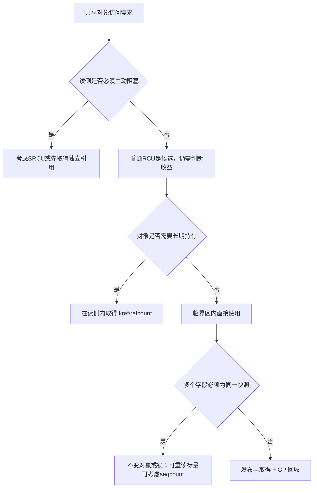
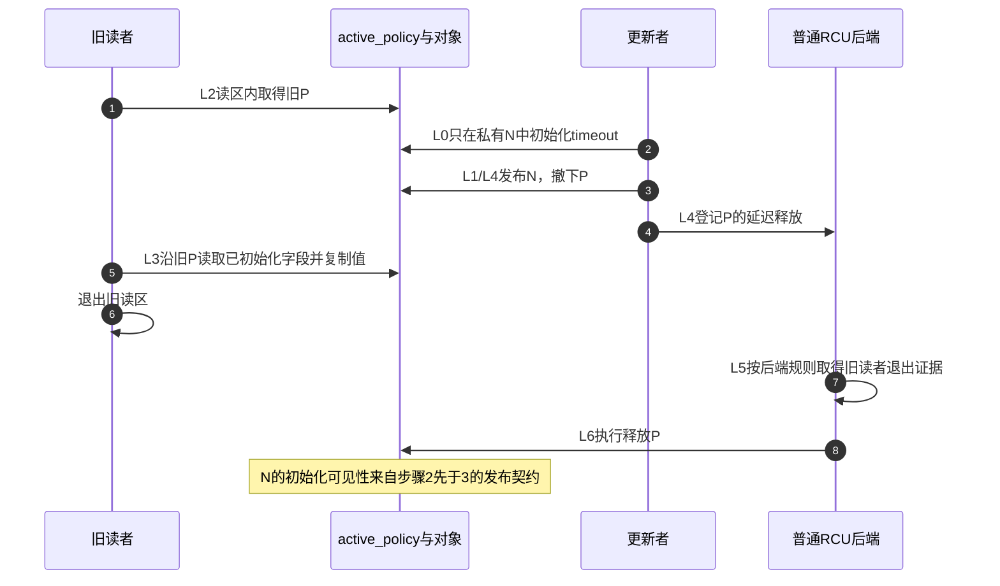

# 第25章\_RCU\_内存序\_误用与选择边界

最后一章不再引入一套新的入门模型，而是换几个容易出错的角度复盘整个专题：读侧域如何选择、发布—取得契约在哪里成立、宽限期不保证什么，以及 SRCU 与锁组合时的边界。

上一章按对象、GP、callback和卸载划分诊断证据。本章回到设计阶段，把这些证据用于选择：对象数据怎样到达读者，地址能保留到什么时候，哪段代价由读者或更新者承担。发布顺序与回收顺序必须分别建立，不能因为观察到一轮GP就跳过初始化可见性。

先审查一段同时犯了三个错误的代码：

```c
struct policy {
	u32 timeout_ms;
	struct rcu_head rcu;
};

static struct policy __rcu *active_policy;

static void broken_publish(struct policy *new)
{
	rcu_assign_pointer(active_policy, new);
	new->timeout_ms = 1000; /* 错误一：对象在发布后才初始化。 */
}

static struct policy *broken_lookup(void)
{
	return active_policy;   /* 错误二：普通取值且裸指针逃逸。 */
}

static void broken_remove(struct policy *old)
{
	synchronize_rcu();
	kfree(old);             /* 错误三：没有先把old从共享入口摘除。 */
}
```

仅仅“调用了 RCU API”不能修复其余步骤。后文分别检查读侧域、发布—取得、取消发布、GP 和长期所有权。



图是RCU相关方案的筛选入口，不排斥简单mutex方案。引用计数只托住存储，不自动同步可变字段；seqcount只提供可重试的一致性检查，也不能保护重试前已经解引用的可释放指针。先决定生命周期，再选择字段一致性协议。

## 25.1\_先确定读侧域

选择 RCU 接口时，不能只看“读多写少”，还必须确定读者的执行上下文、是否需要主动阻塞，以及更新者等待的是哪一类读者。

| 形式 | 读侧接口 | 等待或回调 | 主要用途 |
| --- | --- | --- | --- |
| 普通 RCU | `rcu_read_lock()` | `synchronize_rcu()` / `call_rcu()` | 高频、短小、不主动阻塞的读侧 |
| RCU-bh 接口 | `rcu_read_lock_bh()` | Linux 5.0 以后仍由普通 RCU GP 覆盖 | 需要同时禁用本地软中断的读侧 |
| RCU-sched 接口 | `rcu_read_lock_sched()` | Linux 5.0 以后仍由普通 RCU GP 覆盖 | 需要同时禁用抢占的特定路径 |
| SRCU | `srcu_read_lock(ssp)` | `synchronize_srcu(ssp)` / `call_srcu(ssp, ...)` | 读侧需要主动阻塞，或需要私有宽限期域 |
| 经典 Tasks RCU | 无显式经典读锁 | `synchronize_rcu_tasks()` / `call_rcu_tasks()` | 以经典Tasks认可的任务边界结束的执行轨迹 |
| Tasks Rude | 无普通显式读锁 | `synchronize_rcu_tasks_rude()` | 需要由每CPU调度边界覆盖的特定轨迹，不是任意旧栈帧 |
| Tasks Trace | `rcu_read_lock_trace()` | `synchronize_rcu_tasks_trace()` / `call_rcu_tasks_trace()` | tracing 与 sleepable BPF 的显式任务读侧 |

Linux 6.12.20 的 [`rcupdate.h`](../../../../../research/source_reading/linux/include/linux/rcupdate.h) 明确说明，从 Linux 5.0 开始，普通 `synchronize_rcu()` 和 `call_rcu()` 也会考虑禁止抢占、软中断或中断的区域。因此，不应再把 RCU-bh 描述成一个拥有独立宽限期的“SoftIRQ 域”。

这些名称并非等价性能档位：先证明目标代码的使用区间确实被所选域覆盖，才能采用它的完成结果。Tasks三种边界见 [Tasks家族](P19_Tasks_RCU_任务轨迹宽限期.md)，不能把任意函数指针删除都改成Tasks等待。Tree/Tiny是普通RCU的构建实现，NOCB是回调执行策略，不另列为应用保护域。

## 25.2\_读侧上下文不决定是否使用\_SRCU

“工作队列中必须用 SRCU”或“线程化中断中必须用 SRCU”都不准确。这些上下文允许睡眠，但不代表每一段代码都会睡眠。

判断时应问：

1. 受保护的读侧临界区本身是否需要调用可阻塞操作？
2. 能否在普通 RCU 临界区内只取得独立引用，然后退出 RCU 再执行慢操作？
3. 是否需要一个与普通RCU后端分离的私有宽限期域？

只有保护区必须跨越主动阻塞，或设计本身需要私有域时，SRCU 才是直接候选。

## 25.3\_发布\_取得契约

GP 解决“旧 reader 何时离场”，但 reader 能否看到完整初始化的新对象由发布/取得顺序单独保证。下面先看指针发布与取得各自约束哪一侧，再说明为什么普通赋值、随意搬运依赖或只等待 GP 都不能替代这对契约。

**讲解层次：公共内存顺序契约及固定6.12.20宏的映射。** 本节不以宿主机编译结果推测ARM/ARM64的具体指令，真实架构展开仍需对应构建证据。固定宏的阅读入口是 [RCU源码总索引](../../../../../research/source_reading/rcu/navigation/P01_Linux_6.12_RCU源码总阅读索引.md)，发布与取得分别见 [rcu_assign_pointer实现](../../../../../research/source_reading/rcu/source_explanations/P01_Linux_6.12_RCU_公共接口与检查机制源码详解.md#1.3.1_rcu_assign_pointer发布实现) 和 [rcu_dereference实现](../../../../../research/source_reading/rcu/source_explanations/P01_Linux_6.12_RCU_公共接口与检查机制源码详解.md#1.3.2_rcu_dereference取得实现)。

### 25.3.1\_rcu\_assign\_pointer()

Linux 6.12.20宏中，编译期可判定为NULL的值可走特殊路径；其余路径使用 `smp_store_release()` 发布经RCU类型转换的指针值。

它的意义是“对象初始化先于指针发布”。对于常量 `NULL` 则可以走 `WRITE_ONCE()` 特殊路径，所以不能把整个宏简单写成“它等于 `smp_wmb()`”。

### 25.3.2\_rcu\_dereference()

`rcu_dereference()` 组合了单次取值、编译器约束、架构所需的依赖顺序以及 RCU/Sparse/lockdep 检查。它依赖从取得的指针到后续对象访问的地址依赖。

以下操作可能破坏或隐藏依赖，不能在没有严格证明的情况下随意使用：

- 把指针转换为整数后做复杂运算再转回指针。
- 使用条件推导出某个无依赖的固定地址。
- 将读取出的值与另一来源的指针混合。

工程上应保持简单模式：用 `rcu_dereference()` 取得指针，然后直接通过该指针访问已初始化的对象。

设新对象地址是N，初始化 `N->timeout_ms=1000` 后再发布N。读者若经匹配的取得读到了N，再沿p访问timeout字段，就沿这条发布/依赖链读取已初始化内容。若先发布N再初始化，读者可能在两步之间拿到N并访问尚未准备好的字段；发布操作不会把未来的写入倒搬到过去。若payload发布后仍原地变化，首次发布也不会自动使后续多字段更新成为一致快照。

### 25.3.3\_更新侧取值

更新者在已持有更新锁时，应使用：

```c
old = rcu_dereference_protected(ptr, lockdep_is_held(&update_lock));
```

如果需要“取得旧指针 + 发布新指针”，可使用 `rcu_replace_pointer()`。只检查指针是否为 `NULL` 而不解引用时，才考虑 `rcu_access_pointer()`。

### 25.3.4\_把初始化可见与旧对象回收放回同一周期

下面修复开头的policy场景。沿用其结构体与入口，增加更新mutex；对象由kmalloc分配，发布后timeout不再原地写。这是可对照前文模板的应用骨架，省略模块入口；停止阶段先关闭并等待在途读写入口，再调用 `retire_policy()`。

```c
static DEFINE_MUTEX(policy_lock);

static int replace_policy(u32 timeout_ms)
{
	struct policy *new, *old;

	new = kmalloc(sizeof(*new), GFP_KERNEL);
	if (!new)
		return -ENOMEM;
	new->timeout_ms = timeout_ms;  /* L0：在发布之前初始化。 */
	mutex_lock(&policy_lock);
	old = rcu_replace_pointer(active_policy, new,
				  lockdep_is_held(&policy_lock));
	mutex_unlock(&policy_lock);
	if (old)
		kfree_rcu(old, rcu);  /* L4：已经撤下的旧对象才登记回收。 */
	return 0;
}

static bool read_policy_timeout(u32 *timeout_ms)
{
	struct policy *p;
	bool found = false;

	rcu_read_lock();
	p = rcu_dereference(active_policy);
	if (p) {
		*timeout_ms = p->timeout_ms;  /* 输出是值，指针不逃逸。 */
		found = true;
	}
	rcu_read_unlock();
	return found;
}

static void retire_policy(void)
{
	struct policy *old;

	mutex_lock(&policy_lock);
	old = rcu_replace_pointer(active_policy, NULL,
				  lockdep_is_held(&policy_lock));
	mutex_unlock(&policy_lock);
	if (old)
		kfree_rcu(old, rcu);
}
```

读取者提供有效且独占的输出地址，返回false时不消费未写的值。退休只撤入口并登记释放，不同步等待释放动作完成；模块若还有其他异步责任，继续按前章退出协议处理。

| 阶段 | 状态落点和写入者 | 接续读取及边界 |
| --- | --- | --- |
| L0 私有初始化 | 更新者写新分配的timeout字段 | 对象尚不可达，失败可直接清理 |
| L1 发布 | 更新者在policy_lock下release发布active_policy | 读者以匹配访问器取得该入口 |
| L2 取得 | 读者进入RCU并将入口值保存在局部p | 通过p形成后续对象访问依赖 |
| L3 消费 | 读者复制不可变字段到自己的输出 | 退出后只保留值，旧p不得继续使用 |
| L4 撤下与登记 | 更新者用新地址/NULL替换入口，将旧rcu_head交给后端 | 旧reader的局部p不会被远程清除 |
| L5 取得GP证据 | 后端完成对应旧读者的退出证明 | 回收请求获得可执行资格 |
| L6 释放 | 回收执行者真正释放旧分配 | 仍需区分GP完成与动作被调度执行 |

L2/L3与L4可交错，表不是全系统串行执行顺序。下图选择读者已取得旧P、更新者发布新N的分支；新对象可见性与旧对象生存期在同一时间线上各负其责。



步骤3不会让步骤1保存的P自动变为N；步骤5仍需旧对象存储。步骤7又不会补救“步骤2被错误挪到3之后”的新对象初始化问题。两条证明必须同时成立。

## 25.4\_宽限期不是一个发布屏障

| 接口 | 是否阻塞调用者 | 完成条件 | 主要用途 |
| --- | --- | --- | --- |
| `synchronize_rcu()` | 同步接口，可睡眠；Tiny合法现场可很快返回 | 调用前已经存在的相关读者结束 | 同步拆除、回收多个相关资源 |
| `call_rcu()` | 否 | 相关 GP 后调用回调 | 异步销毁或自定义回收 |
| 带内嵌head的 `kfree_rcu(ptr, head)` | 不等待GP完成 | 相关 GP 后释放对象 | 简单对象的延迟释放 |
| `rcu_barrier()` | 是 | 在其前排队的 RCU 回调执行完毕 | 模块卸载等必须等待回调代码退场的路径 |

`synchronize_rcu()` 和 `call_rcu()` 具有明确的宽限期与内存顺序保证，但它们不代替用于发布指针的 `rcu_assign_pointer()`，也不代替用于字段不变量的锁。

表不把同步API的上下文契约等同于每次实际睡眠，也不把所有同名释放形式混为一谈。固定版本的无head释放路径有mightsleep约束，应按 [回调批次与释放形式](P12_Tree_RCU_回调执行_批处理与限流.md) 核对真实调用形式。`rcu_barrier()`也不替尚未登记的新callback或长期用户完成退出。

## 25.5\_SRCU\_的域与死锁边界

SRCU 使用 `struct srcu_struct` 表示私有域。读侧必须保留 `srcu_read_lock()` 返回的 index，并在同一上下文中传给 `srcu_read_unlock()`：

```c
int idx;
struct config *cfg;

idx = srcu_read_lock(&config_srcu);
cfg = srcu_dereference(current_config, &config_srcu);
use_config_may_block(cfg);
srcu_read_unlock(&config_srcu, idx);
```

没有 `srcu_assign_pointer()` 这个通用发布 API。SRCU 保护的指针仍通常使用 `rcu_assign_pointer()` 发布，读侧用 `srcu_dereference()` 作带域检查的取得。

[`srcu.h`](../../../../../research/source_reading/linux/include/linux/srcu.h) 和 [`srcutree.c`](../../../../../research/source_reading/linux/kernel/rcu/srcutree.c) 还给出两条关键约束：

- lock/unlock 必须在同一上下文中成对。
- 不得在某个 SRCU 域的读侧临界区内等待同一域的宽限期，包括经由锁依赖间接等待，否则会形成死锁。

代码中的config_srcu须已正确初始化，发布者遵循该域的回收协议；占位函数必须处理cfg为NULL，不能保存缺少长期引用的裸指针。同一任务可以在持有SRCU读侧时睡眠并迁移CPU，所以“同一上下文”不等于“必须同一CPU”。

一个间接死锁不需要把synchronize_srcu写在reader函数体内：读者先进入config_srcu，再等待mutex M；更新者已持M，撤销旧配置后在持锁状态调用synchronize_srcu。更新者等待旧读者退出，读者却必须先取得M才能执行到unlock，形成闭环。


若更新事务允许，可在M内完成撤销，把需要等待的旧对象责任交给锁外路径，再解锁等待GP并清理；若不允许，就要调整读者取锁顺序或重新设计事务。不能只换成加急等待或增大超时。修复后仍须证明旧对象在锁外等待期间有唯一持有者，其他写者不会重复清理。

## 25.6\_读者很多时内存为什么不一定成为瓶颈

普通短 RCU reader 不对每个对象执行 kref get/put，也不为每次读取复制对象。它只是取得已发布对象的地址，并在读侧内借用。因此“读者次数很多”本身不会直接产生同数量的旧照副本或对象引用计数。

真正决定退休内存规模的粗略关系是：

```text
积压旧版本内存
≈ 更新产生旧版本的速率
  × GP与回调执行延迟
  × 每个退休版本独占的字节数
```

这不是内核保证的精确公式，而是定位容量问题的工程模型。读者多会在以下条件下间接放大内存：

1. 某些读侧很长，使 GP 延迟增加；
2. 更新者仍高频创建新版本，旧版本来不及成熟；
3. 回调执行受限、NOCB 线程得不到调度或批处理持续积压；
4. 每一代 root 都复制大量独占 block，而没有安全共享未变化部分。

RCU + kref 也不是让每个普通 reader 都记账。两种场景必须分开：

| reader行为 | 正确成本 |
| --- | --- |
| 只在 RCU 读侧内短暂使用 root 和 block | 不逐对象 get/put；root 持有 block 的版本引用 |
| 把某个对象或 block 带出读侧交给异步任务 | 在读侧内按所有权协议取得长期引用，用户最终put；支付原子计数及更长生命期的成本 |

这里不能一律替换成 `get_unless_zero()`：若入口份额可在GP前归零，就必须处理条件取得失败；若发布份额或root的块份额明确保留到对应GP之后，旧reader在读区内可据此证明计数正，普通get成立。两种协议见P21，条件get也不能挽救已经失效的计数器地址。

用一组数估计容量：每秒退休1000代、每代独占4KiB、平均从退休到实际释放20ms，稳定状态下约有20代、80KiB退休分配。若callback迟延升到200ms，约为200代、800KiB。这只是平均量级，未包含分配器开销、新版本和长期引用；共享块不能按每个root重复计算物理字节，突发更新和最长读者还会抬高峰值。实际容量应记录退休速率与释放延迟分布，不能用平均值承诺上限。

所以取舍不是“读者越多就越不适合 RCU”，而是看 **读侧时长、逃逸比例、更新速率和退休对象大小**：

- 读者很多但短小，更新稀疏，RCU 能避免所有读者争写一把共享锁；
- 读者很长且更新频繁，旧版本和回调会积压，应缩短读侧、降低更新频率或改用更适合的所有权模型；
- 几乎每个 reader 都要长期逃逸并执行 kref 原子操作时，需要用基准比较 RCU+kref、直接 refcount lookup、mutex/rwsem 等方案，不能只凭“RCU 读快”选择。

## 25.7\_选型核对表

| 问题 | 倾向选择 |
| --- | --- |
| 读侧短小且不主动阻塞？ | 普通 RCU |
| 读侧保护范围必须跨越睡眠或 I/O？ | SRCU，或改为 RCU 中取得引用后退出 |
| 只需要一致的小型数值快照，不涉及对象回收？ | seqcount/seqlock |
| 需要对对象字段做复合原地更新？ | 锁或 seqcount，RCU 不自动提供该不变量 |
| 需要离开 RCU 后继续使用对象？ | 在 RCU 临界区内安全取得 kref/refcount |
| 一代旧照由 root 和多个 kref block 组成，reader 只做短读取？ | root 为每个 block 持有版本引用，旧 root 的 GP 后再逐块 put；reader 不逐块 get |
| reader 要把复合旧照中的某个 block 带出读区？ | 在 root 仍受 RCU 保护时取得该 block 的独立引用 |
| 模块卸载时还可能有回调指向模块代码？ | 先关闭并等待生产者，再撤销入口并登记退休，等待匹配barrier及后续工作 |

最后做三项自检。把初始化放在发布后，再补一次synchronize_rcu能否修复新读者观察？不能，它已可能读到未初始化值。短reader每次读取root需要给所有block各get一次吗？不需要，只要root明确把份额保留到自己的GP后；逃逸才需要交接。SRCU reader能睡眠，是否意味着可以等待同域GP？不能，GP仍在等这个reader退出。能够按事件顺序解释这三题，才说明发布、完成、所有权和活性已经分开。

上一篇：[RCU 集成模式与常见误用](P24_RCU_调试验证与集成误用.md)。

下一步：[Linux 6.12 RCU 源码总阅读索引](../../../../../research/source_reading/rcu/navigation/P01_Linux_6.12_RCU源码总阅读索引.md#1.6_建议的源码阅读顺序)。


